## What if we change the data instead? {#data-cover .fv-slide .data-cover background-color="#0a0a0a"}

```{=html}
<div class="fv-meta"><span class="fv-id">D 01 / 42</span><span class="fv-cluster">Architecture</span><span class="fv-cluster active">Data</span><span class="fv-cluster">Training</span><span class="fv-cluster">Inference</span><span class="fv-cluster">Tools</span></div>
<div class="fv-body d00-body">
  <div class="d00-comparisons">
    <figure class="d00-architecture fragment" data-fragment-index="1">
      <h3>CHANGE THE ARCHITECTURE</h3>
      <figcaption>Figure 6, replotted <span>1B-1x · same datasets, three architectures</span></figcaption>
      <div class="d00-architecture-plot">
        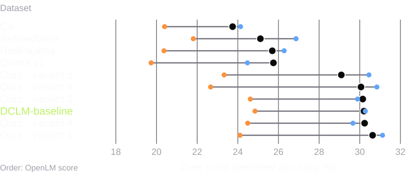
        <div class="d00-model-legend" role="group" aria-label="Architecture legend: select a model for an explanation">
          <button type="button" class="d00-model-button" data-architecture-open="mamba" aria-label="About Mamba" aria-haspopup="dialog" aria-controls="data-architecture-dialog" aria-expanded="false"><span class="d00-model-dot" aria-hidden="true"></span>Mamba<span class="d00-model-info" aria-hidden="true">ⓘ</span></button>
          <button type="button" class="d00-model-button" data-architecture-open="openlm" aria-label="About OpenLM" aria-haspopup="dialog" aria-controls="data-architecture-dialog" aria-expanded="false"><span class="d00-model-dot" aria-hidden="true"></span>OpenLM<span class="d00-model-info" aria-hidden="true">ⓘ</span></button>
          <button type="button" class="d00-model-button" data-architecture-open="gemma" aria-label="About Gemma-like" aria-haspopup="dialog" aria-controls="data-architecture-dialog" aria-expanded="false"><span class="d00-model-dot" aria-hidden="true"></span>Gemma-like<span class="d00-model-info" aria-hidden="true">ⓘ</span></button>
        </div>
      </div>
    </figure>
    <figure class="d00-data fragment" data-fragment-index="2">
      <h3>CHANGE THE DATA</h3>
      <figcaption>Table 12 <span>Default recipe, 1B-1x</span></figcaption>
      <svg class="d00-bars" viewBox="0 0 620 300" role="img" aria-label="Core score at 1B-1x with the same OpenLM architecture and Default training recipe: C4 23.7, RedPajama 25.7, DCLM-baseline 30.2. Horizontal axis starts at zero.">
        <g class="d00-grid" fill="none" stroke="#3b3b40" stroke-width="1"><path d="M190 32V230M300 32V230M410 32V230M520 32V230"/></g>
        <g fill="#a1a1aa" font-size="18" text-anchor="middle"><text x="190" y="255">0</text><text x="300" y="255">10</text><text x="410" y="255">20</text><text x="520" y="255">30</text></g>
        <g fill="#fafafa" font-size="24"><text x="0" y="73">C4</text><text x="0" y="145">RedPajama</text><text x="0" y="217">DCLM-baseline</text></g>
        <g><rect x="190" y="43" width="260.7" height="42" fill="#72727a"/><rect x="190" y="115" width="282.7" height="42" fill="#72727a"/><rect x="190" y="187" width="332.2" height="42" fill="#bef264"/></g>
        <g fill="#fafafa" font-size="27" font-weight="600"><text x="463" y="74">23.7</text><text x="485" y="146">25.7</text><text x="535" y="218" fill="#bef264">30.2</text></g>
        <text x="355" y="289" fill="#a1a1aa" font-size="20" text-anchor="middle">Core score (centered accuracy, %)</text>
      </svg>
      <p class="d00-controlled">Same architecture. Same training budget. Different data.</p>
    </figure>
  </div>
  <p class="d00-question fragment" data-fragment-index="4">Same model. Same budget. +6.5 Core. Where did it come from?</p>
  <div class="d00-persistence fragment" data-fragment-index="3">
    <h3>THE EFFECT PERSISTS</h3>
    <div class="d00-strip">
      <figure class="d00-scale">
        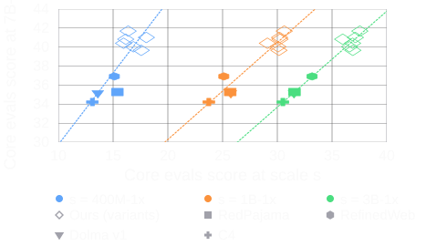
        <figcaption><b>Across model scales</b><span>Figure 3</span><p>The same curation methods<br>rank consistently.</p></figcaption>
      </figure>
      <figure class="d00-compute">
        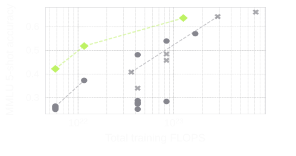
        <figcaption><b>Quality per training FLOP</b><span>Figure 1, MMLU 5-shot</span><p><i class="d00-diamond" aria-hidden="true"></i>DCLM-baseline</p><small>Published model comparison<br>with different training setups</small></figcaption>
      </figure>
    </div>
  </div>
</div>
<div class="fv-source"><a href="https://papers.nips.cc/paper_files/paper/2024/file/19e4ea30dded58259665db375885e412-Paper-Datasets_and_Benchmarks_Track.pdf">Li et al., DataComp-LM, NeurIPS 2024</a> · Figures 6, 3, 1 and Table 12 · Figure 6 replotted from the paper and <a href="https://github.com/mlfoundations/dclm/tree/361714bdd60bb9b7f4b2d8354cebbf0dec0c329e/assets">authors' data</a></div>
<dialog id="data-architecture-dialog" aria-labelledby="dac-openlm-title">
  <div class="dac-toolbar"><span class="dac-kicker">Language models · architecture guide</span><button type="button" class="dac-close" data-architecture-close aria-label="Close architecture explanation" title="Close (Esc)">×</button></div>
  <article data-architecture-card="openlm" hidden>
    <h2 id="dac-openlm-title">OpenLM</h2>
    <p class="dac-subtitle">The baseline decoder-only Transformer in this experiment.</p>
    <div class="dac-grid">
      <figure class="dac-transformer"><svg class="dac-backbone" viewBox="25 0 750 520" role="img" aria-label="Generic decoder-only architecture: embeddings, repeated token mixing and FFN with residual connections, and output projection">
<defs><marker id="dac-backbone-arrow" markerUnits="userSpaceOnUse" markerWidth="8" markerHeight="8" refX="7" refY="4" orient="auto"><path d="M0 0L8 4L0 8Z" fill="#141414"/></marker></defs>
<g fill="none" stroke="#141414" stroke-width="2" marker-end="url(#dac-backbone-arrow)"><path d="M370 482V460"/><path d="M370 406V366"/><path d="M370 304V295"/><path d="M370 271V257"/><path d="M370 195V186"/><path d="M370 162V144"/><path d="M370 82V52"/></g>
<rect x="150" y="160" width="520" height="225" fill="none" stroke="#c5c5c5" stroke-width="2" stroke-dasharray="6 5"/>
<g font-size="25" text-anchor="middle" fill="#141414">
<text x="370" y="514">Token IDs</text>
<g class="axb-embedding"><rect x="235" y="406" width="270" height="54" fill="#f3f3f3" stroke="#141414"/><text x="370" y="441">Embeddings</text></g>
<g class="axb-mix"><rect x="235" y="304" width="270" height="62" fill="white" stroke="#141414"/><text x="370" y="331">Token mixing</text><text x="370" y="354" font-size="20">Norm → causal mixing</text></g>
<g class="axb-ffn"><rect x="235" y="195" width="270" height="62" fill="white" stroke="#141414"/><text x="370" y="222">FFN</text><text x="370" y="246" font-size="20">Norm → transformation</text></g>
<g class="axb-output"><rect x="235" y="82" width="270" height="62" fill="#f3f3f3" stroke="#141414"/><text x="370" y="108">Output projection</text><text x="370" y="131" font-size="20">Norm → logits</text></g>
<text x="370" y="35">Next-token scores</text>
<text x="83" y="250" font-size="34" font-weight="650">× N</text><text x="83" y="281" font-size="21">blocks</text>
<g class="axb-residual"><path d="M370 385H590V283H383" fill="none" stroke="#141414" stroke-width="2" marker-end="url(#dac-backbone-arrow)"/><path d="M370 264H590V174H383" fill="none" stroke="#141414" stroke-width="2" marker-end="url(#dac-backbone-arrow)"/><circle cx="370" cy="283" r="12" fill="white" stroke="#141414"/><text x="370" y="291">+</text><circle cx="370" cy="174" r="12" fill="white" stroke="#141414"/><text x="370" y="182">+</text><text x="714" y="245" font-size="22">Residual</text><text x="714" y="274" font-size="22">paths</text></g>
</g></svg><figcaption>Our decoder-only backbone · Architecture, slide 1</figcaption></figure>
      <div><h3>Familiar Transformer structure</h3><p>The same backbone: token mixing is causal self-attention; the FFN uses SwiGLU.</p><h3>The DCLM configuration</h3><p>LayerNorm without bias, normalization of queries and keys, and SwiGLU feed-forward layers.</p><p>OpenLM also names the open-source training framework.</p></div>
    </div>
    <p class="dac-takeaway">The reference model used to compare training datasets.</p>
    <div class="dac-sources"><a href="lecture01_part2_final_v3_arch.html#/arch-01" target="_blank" rel="noopener">Architecture lecture · backbone ↗</a><a href="https://arxiv.org/html/2406.11794v4#A6" target="_blank" rel="noopener">DataComp-LM · Appendix F</a><a href="https://github.com/mlfoundations/open_lm" target="_blank" rel="noopener">OpenLM code</a></div>
  </article>
  <article data-architecture-card="gemma" hidden>
    <h2 id="dac-gemma-title">Gemma-like</h2>
    <p class="dac-subtitle">A Gemma-inspired variant of the baseline Transformer.</p>
    <div class="dac-grid">
      <figure class="dac-transformer"><svg class="dac-backbone" viewBox="25 0 750 520" role="img" aria-label="The same decoder-only backbone, with GeGLU in the FFN highlighted. A separate annotation marks the inclusion of RMSNorm, without specifying its exact placement.">
<defs><marker id="dac-gemma-arrow" markerUnits="userSpaceOnUse" markerWidth="8" markerHeight="8" refX="7" refY="4" orient="auto"><path d="M0 0L8 4L0 8Z" fill="#141414"/></marker></defs>
<g fill="none" stroke="#141414" stroke-width="2" marker-end="url(#dac-gemma-arrow)"><path d="M370 482V460"/><path d="M370 406V366"/><path d="M370 304V295"/><path d="M370 271V257"/><path d="M370 195V186"/><path d="M370 162V144"/><path d="M370 82V52"/></g>
<rect x="150" y="160" width="520" height="225" fill="none" stroke="#c5c5c5" stroke-width="2" stroke-dasharray="6 5"/>
<g font-size="25" text-anchor="middle" fill="#141414">
<text x="370" y="514">Token IDs</text>
<g class="axb-embedding"><rect x="235" y="406" width="270" height="54" fill="#f3f3f3" stroke="#141414"/><text x="370" y="441">Embeddings</text></g>
<g class="axb-mix"><rect x="235" y="304" width="270" height="62" fill="white" stroke="#141414"/><text x="370" y="331">Token mixing</text><text x="370" y="354" font-size="20">Norm → causal mixing</text></g>
<g class="axb-ffn"><rect x="235" y="195" width="270" height="62" fill="#bef264" stroke="#141414"/><text x="370" y="222">FFN · GeGLU</text><text x="370" y="246" font-size="20">Norm → transformation</text></g>
<g class="axb-output"><rect x="235" y="82" width="270" height="62" fill="#f3f3f3" stroke="#141414"/><text x="370" y="108">Output projection</text><text x="370" y="131" font-size="20">Norm → logits</text></g>
<text x="370" y="35">Next-token scores</text>
<text x="83" y="250" font-size="34" font-weight="650">× N</text><text x="83" y="281" font-size="21">blocks</text>
<g class="axb-residual"><path d="M370 385H590V283H383" fill="none" stroke="#141414" stroke-width="2" marker-end="url(#dac-gemma-arrow)"/><path d="M370 264H590V174H383" fill="none" stroke="#141414" stroke-width="2" marker-end="url(#dac-gemma-arrow)"/><circle cx="370" cy="283" r="12" fill="white" stroke="#141414"/><text x="370" y="291">+</text><circle cx="370" cy="174" r="12" fill="white" stroke="#141414"/><text x="370" y="182">+</text><text x="714" y="245" font-size="22">Residual</text><text x="714" y="274" font-size="22">paths</text></g>
<g class="dac-rms-change"><rect x="30" y="317" width="150" height="64" fill="#bef264" stroke="#141414"/><text x="105" y="342" font-size="20">Include</text><text x="105" y="367" font-size="22">RMSNorm</text></g>
</g></svg><figcaption>Same backbone · changes highlighted</figcaption></figure>
      <div><h3>Two changes from OpenLM</h3><p><strong>SwiGLU → GeGLU</strong> in the feed-forward layers.</p><p>Include <strong>RMSNorm</strong> for normalization.</p><h3>What “-like” means here</h3><p>A controlled experimental variant, not a released Gemma checkpoint.</p></div>
    </div>
    <p class="dac-takeaway">Do better datasets stay better after these changes?</p>
    <div class="dac-sources"><a href="https://arxiv.org/html/2406.11794v4#A9" target="_blank" rel="noopener">DataComp-LM · Appendix I</a></div>
  </article>
  <article data-architecture-card="mamba" hidden>
    <h2 id="dac-mamba-title">Mamba</h2>
    <p class="dac-subtitle">A selective state-space model: the input controls the state update.</p>
    <div class="dac-grid">
      <figure class="dac-mamba"><figcaption>Gu &amp; Dao · Figure 3 · flow runs upward</figcaption></figure>
      <div><h3>Carry a compact state</h3><p>Each token updates a recurrent state and reads an output from it.</p><h3>Select what to retain</h3><p>Input-dependent B, C and Δ control writing, reading and state dynamics.</p><p>The recurrent state has fixed shape during inference; the block also keeps a short convolution state.</p></div>
    </div>
    <p class="dac-takeaway">A different sequence mechanism tests whether dataset gains transfer.</p>
    <div class="dac-sources"><a href="lecture01_part2_final_v3_arch.html#/arch-22" target="_blank" rel="noopener">Architecture lecture · Mamba ↗</a><a href="https://arxiv.org/abs/2312.00752" target="_blank" rel="noopener">Mamba · Figure 3, §3</a><a href="https://arxiv.org/html/2406.11794v4#A9" target="_blank" rel="noopener">DCLM comparison</a></div>
  </article>
  <article data-architecture-card="gopher" hidden>
    <h2 id="dac-gopher-title">Gopher · 280B</h2>
    <p class="dac-subtitle">DeepMind, 2021 — a GPT-2-style decoder-only Transformer, scaled to 280B parameters.</p>
    <div class="dac-grid">
      <figure class="dac-transformer"><svg class="dac-backbone" viewBox="25 0 750 575" role="img" aria-label="Gopher decoder-only backbone: 80 residual Transformer blocks, RMSNorm instead of LayerNorm at the Norm labels, and Transformer-XL relative positions instead of absolute positions.">
<defs><marker id="dac-gopher-arrow" markerUnits="userSpaceOnUse" markerWidth="8" markerHeight="8" refX="7" refY="4" orient="auto"><path d="M0 0L8 4L0 8Z" fill="#141414"/></marker></defs>
<g fill="none" stroke="#141414" stroke-width="2" marker-end="url(#dac-gopher-arrow)"><path d="M370 482V460"/><path d="M370 406V366"/><path d="M370 304V295"/><path d="M370 271V257"/><path d="M370 195V186"/><path d="M370 162V144"/><path d="M370 82V52"/></g>
<rect x="150" y="160" width="520" height="225" fill="none" stroke="#c5c5c5" stroke-width="2" stroke-dasharray="6 5"/>
<g font-size="25" text-anchor="middle" fill="#141414">
<text x="370" y="514">Token IDs</text>
<g class="axb-embedding"><rect x="235" y="406" width="270" height="54" fill="#f3f3f3" stroke="#141414"/><text x="370" y="441">Embeddings</text></g>
<g class="axb-mix"><rect x="235" y="304" width="270" height="62" fill="white" stroke="#141414"/><text x="370" y="331">Token mixing</text><text x="370" y="354" font-size="20">Norm → causal mixing</text></g>
<g class="axb-ffn"><rect x="235" y="195" width="270" height="62" fill="white" stroke="#141414"/><text x="370" y="222">FFN</text><text x="370" y="246" font-size="20">Norm → transformation</text></g>
<g class="axb-output"><rect x="235" y="82" width="270" height="62" fill="#f3f3f3" stroke="#141414"/><text x="370" y="108">Output projection</text><text x="370" y="131" font-size="20">Norm → logits</text></g>
<text x="370" y="35">Next-token scores</text>
<text x="83" y="250" font-size="34" font-weight="650">× 80</text><text x="83" y="281" font-size="21">blocks</text>
<g class="axb-residual"><path d="M370 385H590V283H383" fill="none" stroke="#141414" stroke-width="2" marker-end="url(#dac-gopher-arrow)"/><path d="M370 264H590V174H383" fill="none" stroke="#141414" stroke-width="2" marker-end="url(#dac-gopher-arrow)"/><circle cx="370" cy="283" r="12" fill="white" stroke="#141414"/><text x="370" y="291">+</text><circle cx="370" cy="174" r="12" fill="white" stroke="#141414"/><text x="370" y="182">+</text><text x="714" y="245" font-size="22">Residual</text><text x="714" y="274" font-size="22">paths</text></g>
</g><g class="dac-gopher-annotations" font-family="Arial, sans-serif" fill="#141414" text-anchor="middle">
<path d="M205 105H215V345H235M215 236H235M215 125H235" fill="none" stroke="#141414" stroke-width="2"/>
<rect x="30" y="48" width="175" height="80" fill="#bef264" stroke="#141414"/>
<text x="117.5" y="80" font-size="24">RMSNorm</text><text x="117.5" y="110" font-size="20">(not LayerNorm)</text>
<path d="M505 433H610V470" fill="none" stroke="#141414" stroke-width="2"/>
<rect x="445" y="470" width="320" height="92" fill="#bef264" stroke="#141414"/>
<text x="605" y="497" font-size="22">relative positions</text><text x="605" y="523" font-size="22">(Transformer-XL),</text><text x="605" y="549" font-size="22">not absolute</text>
</g></svg><figcaption>Our decoder-only backbone · Architecture, slide 1 · Gopher annotations</figcaption></figure>
      <div><h3>Architecture.</h3><p>GPT-2 Transformer with two changes: RMSNorm instead of LayerNorm, and Transformer-XL relative positional encodings instead of absolute positions.</p><h3>Size.</h3><p>80 layers · 128 heads · d_model 16,384 · FFN = 4 × d_model.</p><h3>Training.</h3><p>300B tokens · context 2,048 · Adam · SentencePiece, 32k vocabulary with byte fallback · MassiveText.</p></div>
    </div>
    <div class="dac-sources"><a href="lecture01_part2_final_v3_arch.html#/arch-01" target="_blank" rel="noopener">Architecture lecture · backbone ↗</a><a href="https://arxiv.org/abs/2112.11446" target="_blank" rel="noopener">Gopher · §3, Table 1</a></div>
  </article>
  <article data-architecture-card="chinchilla" hidden>
    <h2 id="dac-chinchilla-title">Chinchilla · 70B</h2>
    <p class="dac-subtitle">The same architecture as Gopher — 4× fewer parameters, ~4.7× more training tokens.</p>
    <div class="dac-grid">
      <figure class="dac-paper-table"><figcaption>Hoffmann et al., Table 4 · original</figcaption></figure>
      <div><h3>What shrank.</h3><p>Heads 128 → 64, d_model 16,384 → 8,192. Layers stay at 80.</p><h3>Same as Gopher, except:</h3><ul><li>AdamW instead of Adam;</li><li>SentencePiece without NFKC normalisation (94.15% of tokens shared with Gopher; helps maths and chemistry);</li><li>bfloat16 compute with a float32 copy of the weights in the optimiser;</li><li>MassiveText with a slightly different subset mix.</li></ul><p><strong>Trained on</strong> 1.4T tokens instead of 300B.</p></div>
    </div>
    <p class="dac-takeaway"><strong>Why it matters for D 10.</strong> The comparison is not only about tokens: the optimiser, tokenizer and data mix also changed.</p>
    <div class="dac-sources"><a href="https://arxiv.org/pdf/2203.15556" target="_blank" rel="noopener">Chinchilla · §4.1, Table 4</a></div>
  </article>
</dialog>
<script src="assets/data_architecture_cards_20261021/cards.js"></script>
```

::: {.notes}
We have just explored how architecture changes a model's computation. Now ask a different question: what if we keep the model and improve the material it learns from? DataComp-LM provides several levels of evidence that dataset design can improve model quality independently of architecture design.

**First click: CHANGE THE ARCHITECTURE, Figure 6 (Appendix I, PDF p.43), replotted as a dumbbell chart.** Each horizontal row represents one dataset used to train models at the 1B-1x scale. The three points give Core scores for Mamba (orange), OpenLM (white ring), and a Gemma-like Transformer (blue). Every point uses the same horizontal score axis. The connecting line spans these architecture results, rather than a confidence interval. Read within a row to compare architectures, then compare rows to see the differences between datasets.

**Optional architecture cards.** Select Mamba, OpenLM or Gemma-like in the chart legend. Each card explains the model used in this comparison. Close with Escape, the close button or the backdrop to resume the same slide and fragment. The OpenLM card reuses our decoder-only backbone from Architecture slide 1: token mixing is causal self-attention and the FFN uses SwiGLU. The Gemma-like card uses the same backbone with GeGLU highlighted in the FFN and a separate RMSNorm annotation. Appendix I confirms RMSNorm inclusion but does not specify its exact placement, so the Norm labels stay generic. The Mamba card reuses Figure 3 from the Architecture lecture. The OpenLM and Mamba cards link to the corresponding slide.

All ten datasets from Figure 6 remain present: C4, RefinedWeb, RedPajama, Dolma v1, DCLM-baseline, and five other datasets grouped under “Ours (variants)” in the original legend. “Ours · variant 1” through “Ours · variant 5” are short presentation labels for those five distinct datasets. Rows are ordered by OpenLM score. These labels do not represent five repetitions of the same experiment. The full dataset identities and architecture scores are recorded in the accompanying figure data.

The higher-performing data preparation methods generally remain stronger across the tested architectures, although detailed rankings can change. Mamba's absolute scores are lower in this comparison. The near coincidence of OpenLM and Gemma-like on some rows also shows why three points may appear very close together. This supports transfer across these architectures, rather than identical absolute scores or a universal guarantee about every model.

The Gemma-like values come from the authors' architecture results CSV, and OpenLM values from their model database, using the original Core metric of the conference experiments. Mamba values are reconstructed from the original Figure 6 vector coordinates. They are paired with the same datasets through the shared OpenLM coordinates, so their precision is limited by the PDF. All thirty plotted scores have been matched to the published Figure 6.

**Second click: CHANGE THE DATA, Table 12 (Appendix H, PDF p.44).** Here we can make the controlled comparison. All three results use OpenLM at 1B-1x and the Default training recipe, with learning rate 3e-3 and weight decay 3.3e-2. This scale uses about 1.4B parameters and 28.8B training tokens. The Core scores are C4 23.7, RedPajama 25.7, and DCLM-baseline 30.2. Replacing the dataset improves the score by 6.5 points over C4 and 4.5 over RedPajama. These are points on the Core centered-accuracy metric, averaged over 22 tasks, rather than MMLU accuracy or relative percentage improvements. The horizontal bars start at zero.

**Third click: THE EFFECT PERSISTS.** Figure 3 (PDF p.5) compares the same data preparation methods at smaller scales with their performance at 7B-1x. In the conference version, the smaller scales are 400M-1x, 1B-1x and 3B-1x. The reported Pearson correlations are 0.838, 0.956 and 0.982 respectively. Dataset advantages do not necessarily vanish when scaling the model. This is evidence within the tested methods and scales, not a claim that rankings must stay fixed indefinitely.

The second lower graph is the MMLU 5-shot panel of Figure 1 (PDF p.2). It places DCLM-baseline in the wider context of quality and total training FLOPs. Its original logarithmic axis, point positions and model symbols are preserved. DCLM-baseline's diamonds and connecting line receive the lime accent. Other points are muted. This comparison includes different architectures and training recipes, so use it to illustrate practical compute efficiency, not as another strictly controlled architecture or dataset ablation. Keep its MMLU metric distinct from the Core scores in the other figures.

**Fourth click: Same model. Same budget. +6.5 Core. Where did it come from?** Keep this riddle open: the quality-classifier slide answers the first part, and the closing slide of the block answers the rest. The experiments suggest that designing training data is an independent source of model improvements. A natural next idea is to collect as much material as possible from the internet. The next slide asks why that alone is insufficient and introduces the seven data-design decisions in this lecture.

**Sources:** [Li et al., DataComp-LM: In search of the next generation of training sets for language models, NeurIPS 2024](https://papers.nips.cc/paper_files/paper/2024/file/19e4ea30dded58259665db375885e412-Paper-Datasets_and_Benchmarks_Track.pdf), [authors' Gemma-like architecture results](https://github.com/mlfoundations/dclm/blob/361714bdd60bb9b7f4b2d8354cebbf0dec0c329e/assets/architecture_results_gemma_like.csv), and [authors' model database](https://github.com/mlfoundations/dclm/blob/361714bdd60bb9b7f4b2d8354cebbf0dec0c329e/assets/DCLM_model_database.csv). Figure and table numbering follows the conference PDF. Figure 6 uses a new composition with a shared Core score axis. Figures 3 and 1 retain their original vector geometry. The Table 12 bars use the exact Default rows.
:::

## Why not just train on everything? {#data-design-map .fv-slide background-color="#ffffff"}

```{=html}
<div class="fv-meta"><span class="fv-id">D 02 / 42</span><span class="fv-cluster">Architecture</span><span class="fv-cluster active">Data</span><span class="fv-cluster">Training</span><span class="fv-cluster">Inference</span><span class="fv-cluster">Tools</span></div>
<div class="fv-body d01-body">
  <div class="d01-naive fragment" data-fragment-index="2">
    <svg class="d01-collection" viewBox="0 0 440 500" role="img" aria-label="Collect web, books, code, PDFs, images, videos and forums from the internet into one giant dataset, then train and deploy it.">
      <defs><marker id="d01-arrow" markerWidth="7" markerHeight="7" refX="6" refY="3.5" orient="auto"><path d="M0 0L6 3.5L0 7" fill="none" stroke="currentColor" stroke-width="1.2"/></marker></defs>
      <rect class="d01-internet" x="1" y="18" width="438" height="244" rx="3"/>
      <text class="d01-internet-label" x="220" y="54" text-anchor="middle">THE INTERNET</text>
      <g class="d01-feeds" fill="none" stroke="currentColor" stroke-width="1.4" marker-end="url(#d01-arrow)">
        <path d="M75 113L160 318"/><path d="M218 104L180 318"/><path d="M363 126L200 318"/>
        <path d="M75 183L220 318"/><path d="M236 169L240 318"/><path d="M361 230L260 318"/><path d="M166 237L280 318"/>
      </g>
      <g class="d01-sources" text-anchor="middle">
        <g transform="rotate(-6 75 93)"><rect x="27" y="73" width="96" height="40"/><text x="75" y="100">WEB</text></g>
        <g transform="rotate(4 218 84)"><rect x="160" y="64" width="116" height="40"/><text x="218" y="91">BOOKS</text></g>
        <g transform="rotate(-4 363 106)"><rect x="315" y="86" width="96" height="40"/><text x="363" y="113">CODE</text></g>
        <g transform="rotate(5 75 163)"><rect x="30" y="143" width="90" height="40"/><text x="75" y="170">PDFs</text></g>
        <g transform="rotate(-3 236 149)"><rect x="174" y="129" width="124" height="40"/><text x="236" y="156">IMAGES</text></g>
        <g transform="rotate(5 361 210)"><rect x="302" y="190" width="118" height="40"/><text x="361" y="217">VIDEOS</text></g>
        <g transform="rotate(-4 166 217)"><rect x="102" y="197" width="128" height="40"/><text x="166" y="224">FORUMS</text></g>
      </g>
      <rect class="d01-dataset" x="40" y="320" width="360" height="76"/>
      <text class="d01-dataset-label" x="220" y="367" text-anchor="middle">GIANT DATASET</text>
      <g class="d01-train-flow" fill="none" stroke="currentColor" stroke-width="2" marker-end="url(#d01-arrow)"><path d="M220 396V415H111V438"/><path d="M184 467H256"/></g>
      <rect class="d01-train" x="40" y="440" width="144" height="54"/>
      <rect class="d01-deploy" x="258" y="440" width="142" height="54"/>
      <g class="d01-step-label" text-anchor="middle"><text x="112" y="475">TRAIN</text><text x="329" y="475">DEPLOY IT!</text></g>
    </svg>
  </div>
  <div class="d01-pivot fragment" data-fragment-index="2" aria-label="What actually matters?">?</div>
  <div class="d01-reality">
    <div class="d01-reality-heading fragment" data-fragment-index="2"><h3>WHAT ACTUALLY MATTERS?</h3></div>
    <div class="d01-reaction fragment" data-fragment-index="1"><div class="fragment fade-out" data-fragment-index="2">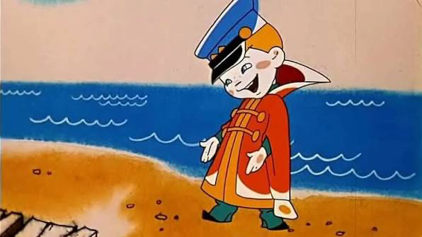</div></div>
    <div class="d01-decisions fragment" data-fragment-index="2">
      <div class="d01-decision d01-sources-tokens"><svg viewBox="0 0 24 24" aria-hidden="true"><path d="M3 2H11L15 6V11M11 2V6H15M3 2V13H7M6 6H8M6 9H11M7 16H18M15 13L18 16L15 19"/><rect x="2" y="20" width="5" height="3"/><rect x="10" y="20" width="5" height="3"/><rect x="18" y="20" width="5" height="3"/></svg><div><h4>SOURCES &amp; TOKENS</h4><p>Where does data come from, and how does it become model input?</p></div></div>
      <div class="d01-decision"><svg viewBox="0 0 24 24" aria-hidden="true"><path d="M4 4V20M12 4V20M20 4V20"/><path d="M1 8H7M9 16H15M17 10H23"/></svg><div><h4>DATA MIXTURES</h4><p>Which sources, and how often?</p></div></div>
      <div class="d01-decision"><svg viewBox="0 0 24 24" aria-hidden="true"><path d="M3 4H21L14 12V19L10 21V12Z"/><path d="M17 16L19 18L23 14"/></svg><div><h4>FILTERING &amp; DEDUPLICATION</h4><p>What should we keep?</p></div></div>
      <div class="d01-decision"><svg viewBox="0 0 24 24" aria-hidden="true"><path d="M4 8V21H18V11M4 8H11M8 12H13M8 16H14M17 1L18.5 5.5L23 7L18.5 8.5L17 13L15.5 8.5L11 7L15.5 5.5Z"/></svg><div><h4>SYNTHETIC DATA</h4><p>What examples should we create?</p></div></div>
      <div class="d01-decision"><svg viewBox="0 0 24 24" aria-hidden="true"><path d="M2 18H22M2 15V21M22 15V21M4 10V4H20V10M2 10H6M18 10H22M9 7H15"/></svg><div><h4>LONG-CONTEXT DATA</h4><p>How do we teach long-range dependencies?</p></div></div>
      <div class="d01-decision"><svg viewBox="0 0 24 24" aria-hidden="true"><circle cx="4" cy="6" r="3"/><circle cx="20" cy="18" r="3"/><path d="M7 6H17Q21 6 21 10T15 14H9M9 14L12 11M9 14L12 17M4 9V20H14"/></svg><div><h4>INTERACTION TRAJECTORIES</h4><p>How do we capture actions and outcomes?</p></div></div>
      <div class="d01-decision"><svg viewBox="0 0 24 24" aria-hidden="true"><path d="M12 2L21 6V12Q20 19 12 22Q4 19 3 12V6Z"/><path d="M7 12L10 15L17 8"/></svg><div><h4>SAFETY DATA</h4><p>What behavior should we reinforce?</p></div></div>
      <div class="d01-decision d01-part2"><svg viewBox="0 0 24 24" aria-hidden="true"><rect x="1" y="3" width="14" height="13" rx="1"/><path d="M2 14L6 9L10 13L12 11L15 14M8 20H23M18 5H23M18 9H23M18 13H23"/><circle cx="11" cy="7" r="1"/></svg><div><h4>PART II · IMAGES &amp; VIDEO</h4><p>The same rules, applied to pixels and time</p></div></div>
    </div>
  </div>
</div>
```

::: {.notes}
We have just seen that changing training data can substantially change model quality. A natural idea follows: gather as much material as possible from the internet, put it in a giant dataset, train the model, and deploy it. The diagram on the left deliberately makes this look straightforward. Web pages, books, code, PDFs, images, videos, and forums all feed one container.

**First click: show only the cartoon image.** The supplied cartoon appears on the right as a visual reaction to the naive approach. The existing diagram stays unchanged at full contrast; no heading, caption, or question mark appears on this click. Volume alone does not guarantee a useful training set. We must decide what experience the model should receive and which abilities that experience should build.

**Second click: replace the image with the lecture roadmap.** The naive approach now dims, the question mark appears, and the map is headed WHAT ACTUALLY MATTERS? The eight cards form two columns of four, read row by row. We begin with Sources & tokens at the top left: where training examples come from, how we prepare them, and how different modalities become model inputs.

The next six cards introduce related data-design directions. Data mixtures ask which sources to use and how often to present them. Filtering and deduplication ask which records to keep. Synthetic data asks which new examples to create. Long-context data asks how to make learning depend on information spread across a long input. Interaction trajectories ask how to capture actions and their outcomes. Safety data asks which behavior to reinforce. The final card at the bottom right is Part II: after the text conclusion, we apply the same rules to images and video.

This is a roadmap for the lecture, not a fixed processing pipeline. The six design directions are related: synthetic examples may also be filtered or used to teach safe behavior. The icons identify topics; they do not encode measurements or a ranking.

The emphasis now belongs to the decisions on the right. Building a training set includes managing its composition, quality, exposure frequency, new examples, and learning tasks. This is the roadmap for the lecture.

We begin with **SOURCES & TOKENS**. The next slide asks whether we can simply download the web: which pages are worth learning from, which we may use, and what they would teach. We then examine sources, the meaning of data dates, and the representations used for text, images, video and audio. Before **DATA MIXTURES**, three experiments ask why scale matters, why repetition has limits, and how selection changes training efficiency.
:::

<!-- Brief: DATA-06 -->
<!-- Brief: DATA-07 -->
## Can we just download the web? {#brief-data-06 .fv-slide .brief-data-slide background-color="#ffffff"}

```{=html}
<div class="fv-meta"><span class="fv-id">D 03 / 42</span><span class="fv-cluster">Architecture</span><span class="fv-cluster active">Data</span><span class="fv-cluster">Training</span><span class="fv-cluster">Inference</span><span class="fv-cluster">Tools</span></div>
<div class="fv-body bd-body"><svg class="bd-svg bd-web-svg" viewBox="0 0 1488 530" role="group" aria-label="Nine questions to ask before using web data for training">
<text x="0" y="22" font-size="17" font-weight="600" fill="#626262" >WORTH LEARNING FROM?</text>
<g class="fragment fade-out" data-fragment-index="1" data-web-nav="1" aria-hidden="true"><rect x="0" y="39" width="326" height="37" fill="#bef264" stroke="none" /><path d="M304 51l7 7-7 7" fill="none" stroke="#141414" stroke-width="2" /></g>
<text x="14" y="66" font-size="22" font-weight="600" fill="#141414" >JUNK</text>
<g class="fragment fade-in-then-out" data-fragment-index="1" data-web-nav="2" aria-hidden="true"><rect x="0" y="80" width="326" height="37" fill="#bef264" stroke="none" /><path d="M304 92l7 7-7 7" fill="none" stroke="#141414" stroke-width="2" /></g>
<text x="14" y="107" font-size="22" font-weight="600" fill="#141414" >WRITTEN BY AI</text>
<g class="fragment fade-in-then-out" data-fragment-index="2" data-web-nav="3" aria-hidden="true"><rect x="0" y="121" width="326" height="37" fill="#bef264" stroke="none" /><path d="M304 133l7 7-7 7" fill="none" stroke="#141414" stroke-width="2" /></g>
<text x="14" y="148" font-size="22" font-weight="600" fill="#141414" >STALE</text>
<text x="0" y="203" font-size="17" font-weight="600" fill="#626262" >OURS TO TAKE?</text>
<g class="fragment fade-in-then-out" data-fragment-index="3" data-web-nav="4" aria-hidden="true"><rect x="0" y="220" width="326" height="37" fill="#bef264" stroke="none" /><path d="M304 232l7 7-7 7" fill="none" stroke="#141414" stroke-width="2" /></g>
<text x="14" y="247" font-size="22" font-weight="600" fill="#141414" >SOLD</text>
<g class="fragment fade-in-then-out" data-fragment-index="4" data-web-nav="5" aria-hidden="true"><rect x="0" y="261" width="326" height="37" fill="#bef264" stroke="none" /><path d="M304 273l7 7-7 7" fill="none" stroke="#141414" stroke-width="2" /></g>
<text x="14" y="288" font-size="22" font-weight="600" fill="#141414" >OPTED OUT</text>
<g class="fragment fade-in-then-out" data-fragment-index="5" data-web-nav="6" aria-hidden="true"><rect x="0" y="302" width="326" height="37" fill="#bef264" stroke="none" /><path d="M304 314l7 7-7 7" fill="none" stroke="#141414" stroke-width="2" /></g>
<text x="14" y="329" font-size="22" font-weight="600" fill="#141414" >PERSONAL</text>
<text x="0" y="384" font-size="17" font-weight="600" fill="#626262" >WHAT WILL IT TEACH?</text>
<g class="fragment fade-in-then-out" data-fragment-index="6" data-web-nav="7" aria-hidden="true"><rect x="0" y="401" width="326" height="37" fill="#bef264" stroke="none" /><path d="M304 413l7 7-7 7" fill="none" stroke="#141414" stroke-width="2" /></g>
<text x="14" y="428" font-size="22" font-weight="600" fill="#141414" >HARMFUL</text>
<g class="fragment fade-in-then-out" data-fragment-index="7" data-web-nav="8" aria-hidden="true"><rect x="0" y="442" width="326" height="37" fill="#bef264" stroke="none" /><path d="M304 454l7 7-7 7" fill="none" stroke="#141414" stroke-width="2" /></g>
<text x="14" y="469" font-size="22" font-weight="600" fill="#141414" >SKEWED</text>
<g class="fragment fade-in" data-fragment-index="8" data-web-nav="9" aria-hidden="true"><rect x="0" y="483" width="326" height="37" fill="#bef264" stroke="none" /><path d="M304 495l7 7-7 7" fill="none" stroke="#141414" stroke-width="2" /></g>
<text x="14" y="510" font-size="22" font-weight="600" fill="#141414" >LEAKED TESTS</text>
<path d="M360 0V530" fill="none" stroke="#c5c5c5" stroke-width="1" />
<g class="bd-web-scene fragment fade-out" data-fragment-index="1" data-web-scene="1" transform="translate(402 0)" role="img" aria-label="A fictional news page surrounds a small article with ads, menus, spam and a cookie banner. DCLM-Pool has 240T tokens; DCLM-baseline has about 4T. Bars use the same scale, a 60:1 ratio.">
<text x="0" y="22" font-size="17" font-weight="600" fill="#626262" >JUNK</text>
<text x="0" y="65" font-size="29" font-weight="600" fill="#141414" >Most of a web page is not worth learning from</text>
<rect x="0" y="100" width="650" height="400" fill="#fff" stroke="#c5c5c5" />
<rect x="0" y="100" width="650" height="36" fill="#f3f3f3" stroke="none" />
<text x="16" y="124" font-size="17" font-weight="400" fill="#626262" >←  →</text>
<text x="80" y="124" font-size="16" font-weight="400" fill="#626262" >citynews.example</text>
<path d="M0 136H650" fill="none" stroke="#c5c5c5" stroke-width="1" />
<text x="20" y="169" font-size="24" font-weight="600" fill="#141414" >CITY NEWS</text>
<text x="260" y="169" font-size="16" font-weight="400" fill="#626262" >Home   World   Business   Subscribe</text>
<rect x="20" y="187" width="610" height="64" fill="#f3f3f3" stroke="none" />
<text x="44" y="232" font-size="38" font-weight="650" fill="#141414" >SALE −70%</text>
<text x="390" y="228" font-size="19" font-weight="600" fill="#141414" >TODAY ONLY →</text>
<text x="22" y="285" font-size="24" font-weight="600" fill="#141414" >An afternoon in the rain</text>
<rect x="18" y="300" width="394" height="80" fill="#fff" stroke="#bef264" stroke-width="5"/>
<text x="30" y="329" font-size="20" font-weight="400" fill="#141414" >Rain falls over the city. Commuters</text>
<text x="30" y="358" font-size="20" font-weight="400" fill="#141414" >open umbrellas and hurry home.</text>
<rect x="434" y="271" width="196" height="136" fill="#f3f3f3" stroke="none" />
<text x="450" y="300" font-size="20" font-weight="600" fill="#141414" >Trending</text>
<text x="450" y="332" font-size="15" font-weight="400" fill="#626262" >5 things to buy</text>
<text x="450" y="357" font-size="15" font-weight="400" fill="#626262" >You won’t believe…</text>
<text x="450" y="382" font-size="15" font-weight="400" fill="#626262" >Sponsored</text>
<text x="22" y="414" font-size="15" font-weight="600" fill="#626262" >COMMENTS</text>
<text x="22" y="442" font-size="19" font-weight="400" fill="#141414" >Check my profile for free crypto</text>
<rect x="0" y="460" width="650" height="40" fill="#141414" stroke="none" />
<text x="20" y="487" font-size="17" font-weight="400" fill="#fff" >We use cookies.</text>
<rect x="490" y="466" width="138" height="28" fill="#fff" stroke="none" />
<text x="510" y="486" font-size="17" font-weight="600" fill="#141414" >Accept all</text>
<text x="704" y="158" font-size="17" font-weight="600" fill="#626262" >DCLM · TOKENS</text>
<text x="704" y="214" font-size="54" font-weight="600" fill="#141414" >240T</text>
<text x="704" y="246" font-size="20" font-weight="400" fill="#626262" >extracted from Common Crawl</text>
<rect x="704" y="265" width="360" height="32" fill="#141414" stroke="none" />
<text x="704" y="359" font-size="54" font-weight="600" fill="#141414" >~4T</text>
<text x="704" y="391" font-size="20" font-weight="400" fill="#626262" >kept in DCLM-baseline</text>
<rect x="704" y="410" width="6" height="32" fill="#141414" stroke="none" />
<text x="704" y="482" font-size="20" font-weight="400" fill="#626262" >Same scale · ~1/60 remains</text>
</g>
<g class="bd-web-scene fragment fade-in-then-out" data-fragment-index="1" data-web-scene="2" transform="translate(402 0)" role="img" aria-label="A fictional kettle review page contains one human-style review and two obvious model responses. A schematic shows a distribution losing its tails through recursive generations. This does not measure the proportion of AI text on the web.">
<text x="0" y="22" font-size="17" font-weight="600" fill="#626262" >WRITTEN BY AI</text>
<text x="0" y="65" font-size="29" font-weight="600" fill="#141414" >More and more of the web is written by models</text>
<rect x="0" y="100" width="650" height="410" fill="#fff" stroke="#c5c5c5" />
<rect x="0" y="100" width="650" height="36" fill="#f3f3f3" stroke="none" />
<text x="16" y="124" font-size="17" font-weight="400" fill="#626262" >←  →</text>
<text x="80" y="124" font-size="16" font-weight="400" fill="#626262" >reviews.example</text>
<path d="M0 136H650" fill="none" stroke="#c5c5c5" stroke-width="1" />
<text x="24" y="173" font-size="25" font-weight="600" fill="#141414" >Everyday kettle · customer reviews</text>
<path d="M24 190H626" fill="none" stroke="#c5c5c5" stroke-width="1" />
<text x="24" y="221" font-size="20" font-weight="400" fill="#141414" >★★★★☆   Boils quickly. The lid is a bit stiff.</text>
<text x="24" y="252" font-size="20" font-weight="400" fill="#626262" >Used it every morning for a month.</text>
<path d="M24 275H626" fill="none" stroke="#c5c5c5" stroke-width="1" />
<text x="24" y="309" font-size="22" font-weight="400" fill="#141414" >“As an AI language model, I don’t have</text>
<text x="24" y="340" font-size="22" font-weight="400" fill="#141414" >personal experience…”</text>
<path d="M24 359H626" fill="none" stroke="#c5c5c5" stroke-width="1" />
<text x="24" y="394" font-size="22" font-weight="400" fill="#141414" >“Certainly! Here is a 5-star review…</text>
<text x="24" y="425" font-size="22" font-weight="400" fill="#141414" >This kettle is an exceptional addition!”</text>
<text x="24" y="482" font-size="16" font-weight="400" fill="#626262" >Fictional reviews</text>
<text x="706" y="141" font-size="17" font-weight="600" fill="#626262" >RECURSIVE TRAINING</text>
<path d="M706 239H1060" fill="none" stroke="#c5c5c5" stroke-width="1" />
<path d="M743 239 C806.9 239 811.16 173 885 173 C958.84 173 963.1 239 1027 239Z" fill="#f3f3f3" stroke="#141414" stroke-width="2" />
<text x="706" y="194" font-size="18" font-weight="400" fill="#626262" >real data</text>
<path d="M706 347H1060" fill="none" stroke="#c5c5c5" stroke-width="1" />
<path d="M791 347 C833.3 347 836.12 281 885 281 C933.88 281 936.7 347 979 347Z" fill="#f3f3f3" stroke="#141414" stroke-width="2" />
<text x="706" y="302" font-size="18" font-weight="400" fill="#626262" >gen 1</text>
<path d="M706 455H1060" fill="none" stroke="#c5c5c5" stroke-width="1" />
<path d="M848 455 C864.65 455 865.76 389 885 389 C904.24 389 905.35 455 922 455Z" fill="#bef264" stroke="#141414" stroke-width="2" />
<text x="706" y="410" font-size="18" font-weight="400" fill="#626262" >gen n</text>
<text x="706" y="500" font-size="20" font-weight="400" fill="#626262" >Tails disappear · schematic</text>
</g>
<g class="bd-web-scene fragment fade-in-then-out" data-fragment-index="2" data-web-scene="3" transform="translate(402 0)" role="img" aria-label="Illustrative examplelib snapshots: the October 2026 crawl records version 4.2; a later page lists version 5.0. Training on the old snapshot does not update itself.">
<text x="0" y="22" font-size="17" font-weight="600" fill="#626262" >STALE</text>
<text x="0" y="65" font-size="29" font-weight="600" fill="#141414" >A crawl is a photo of the web on one date</text>
<rect x="0" y="112" width="448" height="356" fill="#fff" stroke="#c5c5c5" />
<rect x="16" y="128" width="416" height="246" fill="#fff" stroke="#c5c5c5" />
<rect x="16" y="128" width="416" height="36" fill="#f3f3f3" stroke="none" />
<text x="32" y="152" font-size="17" font-weight="400" fill="#626262" >←  →</text>
<text x="96" y="152" font-size="16" font-weight="400" fill="#626262" >examplelib.example</text>
<path d="M16 164H432" fill="none" stroke="#c5c5c5" stroke-width="1" />
<text x="38" y="214" font-size="34" font-weight="600" fill="#141414" >examplelib</text>
<text x="38" y="257" font-size="19" font-weight="400" fill="#626262" >Documentation · Downloads</text>
<text x="38" y="325" font-size="29" font-weight="600" fill="#141414" >Latest release: v4.2</text>
<text x="18" y="409" font-size="18" font-weight="400" fill="#626262" >crawled CC-MAIN-2026-43</text>
<text x="18" y="437" font-size="18" font-weight="400" fill="#626262" >Oct 2026 · illustrative</text>
<text x="478" y="236" font-size="18" font-weight="400" fill="#626262" >time passes</text>
<path d="M478 262H598m-10 -7l10 7-10 7" fill="none" stroke="#141414" stroke-width="2" />
<rect x="624" y="112" width="440" height="262" fill="#fff" stroke="#c5c5c5" />
<rect x="624" y="112" width="440" height="36" fill="#f3f3f3" stroke="none" />
<text x="640" y="136" font-size="17" font-weight="400" fill="#626262" >←  →</text>
<text x="704" y="136" font-size="16" font-weight="400" fill="#626262" >examplelib.example</text>
<path d="M624 148H1064" fill="none" stroke="#c5c5c5" stroke-width="1" />
<text x="646" y="199" font-size="34" font-weight="600" fill="#141414" >examplelib</text>
<text x="646" y="242" font-size="19" font-weight="400" fill="#626262" >Documentation · Downloads</text>
<text x="646" y="310" font-size="29" font-weight="600" fill="#141414" >Latest release: v5.0</text>
<text x="646" y="347" font-size="18" font-weight="400" fill="#626262" >today · illustrative</text>
<rect x="624" y="407" width="440" height="63" fill="#bef264" stroke="none" />
<text x="645" y="448" font-size="29" font-weight="600" fill="#141414" >The model learns v4.2</text>
</g>
<g class="bd-web-scene fragment fade-in-then-out" data-fragment-index="3" data-web-scene="4" transform="translate(402 0)" role="img" aria-label="Fictional forum and Q and A mockups illustrate real partnerships. Reuters reported about 60 million dollars per year for Reddit and Google; Stack Overflow announced an OpenAI API partnership in May 2024.">
<text x="0" y="22" font-size="17" font-weight="600" fill="#626262" >SOLD</text>
<text x="0" y="65" font-size="29" font-weight="600" fill="#141414" >Platforms sell what their users wrote</text>
<rect x="0" y="103" width="510" height="292" fill="#fff" stroke="#c5c5c5" />
<rect x="0" y="103" width="510" height="36" fill="#f3f3f3" stroke="none" />
<text x="16" y="127" font-size="17" font-weight="400" fill="#626262" >←  →</text>
<text x="80" y="127" font-size="16" font-weight="400" fill="#626262" >forum.example</text>
<path d="M0 139H510" fill="none" stroke="#c5c5c5" stroke-width="1" />
<text x="22" y="173" font-size="22" font-weight="600" fill="#141414" >Reddit · forum thread</text>
<text x="22" y="217" font-size="24" font-weight="600" fill="#141414" >How did you learn to code?</text>
<text x="22" y="257" font-size="21" font-weight="400" fill="#141414" >“Small projects, every weekend.”</text>
<text x="22" y="289" font-size="21" font-weight="400" fill="#141414" >“And lots of patient explanations.”</text>
<rect x="16" y="324" width="478" height="54" fill="#bef264" stroke="none" />
<text x="31" y="359" font-size="26" font-weight="600" fill="#141414" >→ Google · ~$60M / year</text>
<rect x="550" y="103" width="514" height="292" fill="#fff" stroke="#c5c5c5" />
<rect x="550" y="103" width="514" height="36" fill="#f3f3f3" stroke="none" />
<text x="566" y="127" font-size="17" font-weight="400" fill="#626262" >←  →</text>
<text x="630" y="127" font-size="16" font-weight="400" fill="#626262" >answers.example</text>
<path d="M550 139H1064" fill="none" stroke="#c5c5c5" stroke-width="1" />
<text x="572" y="173" font-size="22" font-weight="600" fill="#141414" >Stack Overflow · Q&amp;A</text>
<text x="572" y="217" font-size="24" font-weight="600" fill="#141414" >How do I sort these records?</text>
<rect x="570" y="241" width="474" height="61" fill="#f3f3f3" stroke="none" />
<text x="585" y="279" font-size="20" font-weight="400" fill="#141414" class="bd-web-mono">sorted(rows, key=lambda r: r[0])</text>
<rect x="566" y="324" width="482" height="54" fill="#f3f3f3" stroke="none" />
<text x="581" y="359" font-size="24" font-weight="600" fill="#141414" >→ OpenAI · API deal, 2024</text>
<text x="0" y="431" font-size="18" font-weight="400" fill="#626262" >Reddit price: Reuters estimate · terms not disclosed</text>
<text x="0" y="495" font-size="34" font-weight="600" fill="#141414" >Written by users. Sold by the platform.</text>
</g>
<g class="bd-web-scene fragment fade-in-then-out" data-fragment-index="4" data-web-scene="5" transform="translate(402 0)" role="img" aria-label="Illustrative robots.txt disallows GPTBot, CCBot and Google-Extended, while allowing other crawlers. Consent in Crisis reported 28 percent plus of critical C4 sources and about 5 percent plus of all C4 tokens fully restricted during 2023–24.">
<text x="0" y="22" font-size="17" font-weight="600" fill="#626262" >OPTED OUT</text>
<text x="0" y="65" font-size="29" font-weight="600" fill="#141414" >Sites are closing the door to AI crawlers</text>
<rect x="0" y="100" width="720" height="416" fill="#fff" stroke="#c5c5c5" />
<rect x="0" y="100" width="720" height="36" fill="#f3f3f3" stroke="none" />
<text x="16" y="124" font-size="17" font-weight="400" fill="#626262" >←  →</text>
<text x="80" y="124" font-size="16" font-weight="400" fill="#626262" >publisher.example/robots.txt</text>
<path d="M0 136H720" fill="none" stroke="#c5c5c5" stroke-width="1" />
<text x="24" y="175" font-size="23" font-weight="400" fill="#141414" class="bd-web-mono">User-agent: GPTBot</text>
<text x="24" y="206" font-size="23" font-weight="400" fill="#141414" class="bd-web-mono">Disallow: /</text>
<text x="500" y="188" font-size="20" font-weight="400" fill="#626262" >OpenAI</text>
<text x="24" y="266" font-size="23" font-weight="400" fill="#141414" class="bd-web-mono">User-agent: CCBot</text>
<text x="24" y="297" font-size="23" font-weight="400" fill="#141414" class="bd-web-mono">Disallow: /</text>
<text x="500" y="279" font-size="20" font-weight="400" fill="#626262" >Common Crawl</text>
<text x="24" y="357" font-size="23" font-weight="400" fill="#141414" class="bd-web-mono">User-agent: Google-Extended</text>
<text x="24" y="388" font-size="23" font-weight="400" fill="#141414" class="bd-web-mono">Disallow: /</text>
<text x="500" y="370" font-size="20" font-weight="400" fill="#626262" >Gemini training</text>
<text x="24" y="448" font-size="23" font-weight="400" fill="#141414" class="bd-web-mono">User-agent: *</text>
<text x="24" y="479" font-size="23" font-weight="400" fill="#141414" class="bd-web-mono">Allow: /</text>
<text x="500" y="461" font-size="20" font-weight="400" fill="#626262" >Other crawlers</text>
<rect x="767" y="134" width="297" height="82" fill="#bef264" stroke="none" />
<text x="784" y="196" font-size="62" font-weight="600" fill="#141414" >28%+</text>
<text x="767" y="251" font-size="23" font-weight="400" fill="#141414" >of critical C4 sources</text>
<text x="767" y="283" font-size="23" font-weight="400" fill="#141414" >fully restricted</text>
<text x="767" y="355" font-size="52" font-weight="600" fill="#141414" >~5%+</text>
<text x="767" y="397" font-size="23" font-weight="400" fill="#626262" >of all C4 tokens</text>
<text x="767" y="429" font-size="23" font-weight="400" fill="#626262" >2023–24</text>
<text x="767" y="493" font-size="18" font-weight="400" fill="#626262" >Consent in Crisis</text>
</g>
<g class="bd-web-scene fragment fade-in-then-out" data-fragment-index="5" data-web-scene="6" transform="translate(402 0)" role="img" aria-label="An entirely fictional profile highlights a name, email, telephone and address. In 2022 a patient found private postoperative medical photos referenced in LAION-5B; Ars Technica confirmed the report and found thousands of similar medical-record photos.">
<text x="0" y="22" font-size="17" font-weight="600" fill="#626262" >PERSONAL</text>
<text x="0" y="65" font-size="29" font-weight="600" fill="#141414" >Pages are full of real people</text>
<rect x="0" y="100" width="610" height="410" fill="#fff" stroke="#c5c5c5" />
<rect x="0" y="100" width="610" height="36" fill="#f3f3f3" stroke="none" />
<text x="16" y="124" font-size="17" font-weight="400" fill="#626262" >←  →</text>
<text x="80" y="124" font-size="16" font-weight="400" fill="#626262" >people.example/maya</text>
<path d="M0 136H610" fill="none" stroke="#c5c5c5" stroke-width="1" />
<rect x="24" y="162" width="104" height="104" fill="#f3f3f3" stroke="none" />
<circle cx="76" cy="197" r="20" fill="#c5c5c5"/>
<path d="M43 250Q43 218 76 218Q109 218 109 250" fill="#c5c5c5" stroke="#c5c5c5" stroke-width="1" />
<rect x="153" y="174" width="315" height="40" fill="#bef264" stroke="none" />
<text x="166" y="204" font-size="30" font-weight="600" fill="#141414" >Maya Chen</text>
<text x="156" y="247" font-size="20" font-weight="400" fill="#626262" >Community member</text>
<text x="24" y="303" font-size="16" font-weight="600" fill="#626262" >EMAIL</text>
<rect x="145" y="281" width="442" height="34" fill="#bef264" stroke="none" />
<text x="156" y="305" font-size="22" font-weight="400" fill="#141414" >maya@people.example</text>
<text x="24" y="372" font-size="16" font-weight="600" fill="#626262" >PHONE</text>
<rect x="145" y="350" width="442" height="34" fill="#bef264" stroke="none" />
<text x="156" y="374" font-size="22" font-weight="400" fill="#141414" >555-0142</text>
<text x="24" y="441" font-size="16" font-weight="600" fill="#626262" >ADDRESS</text>
<rect x="145" y="419" width="442" height="34" fill="#bef264" stroke="none" />
<text x="156" y="443" font-size="22" font-weight="400" fill="#141414" >18 Willow Lane, Example City</text>
<text x="24" y="491" font-size="17" font-weight="400" fill="#626262" >All profile details are fictional.</text>
<text x="662" y="139" font-size="20" font-weight="600" fill="#626262" >LAION-5B · 2022</text>
<text x="662" y="203" font-size="27" font-weight="600" fill="#141414" >A patient found her own</text>
<text x="662" y="242" font-size="27" font-weight="600" fill="#141414" >post-operative photos</text>
<text x="662" y="281" font-size="27" font-weight="600" fill="#141414" >from a private medical record.</text>
<path d="M662 322H1064" fill="none" stroke="#c5c5c5" stroke-width="1" />
<text x="662" y="366" font-size="22" font-weight="400" fill="#141414" >Ars Technica confirmed the case</text>
<text x="662" y="400" font-size="22" font-weight="400" fill="#141414" >and found thousands of similar</text>
<text x="662" y="434" font-size="22" font-weight="400" fill="#141414" >patient medical-record photos.</text>
<text x="662" y="495" font-size="19" font-weight="400" fill="#626262" >AI Incident Database · #465</text>
</g>
<g class="bd-web-scene fragment fade-in-then-out" data-fragment-index="6" data-web-scene="7" transform="translate(402 0)" role="img" aria-label="An abstract dataset index has redacted rows and a withdrawn December 2023 stamp. Stanford reported 3226 suspected entries, with 1008 externally validated. No actual dataset entries or harmful images are shown.">
<text x="0" y="22" font-size="17" font-weight="600" fill="#626262" >HARMFUL</text>
<text x="0" y="65" font-size="29" font-weight="600" fill="#141414" >Some of the web must never reach training</text>
<rect x="0" y="107" width="645" height="395" fill="#fff" stroke="#c5c5c5" />
<rect x="0" y="107" width="645" height="47" fill="#f3f3f3" stroke="none" />
<text x="24" y="138" font-size="19" font-weight="600" fill="#141414" class="bd-web-mono">url</text>
<text x="286" y="138" font-size="19" font-weight="600" fill="#141414" class="bd-web-mono">caption</text>
<text x="24" y="190" font-size="16" font-weight="400" fill="#626262" >001</text>
<rect x="75" y="178" width="170" height="13" fill="#c5c5c5" stroke="none" />
<rect x="285" y="178" width="270" height="13" fill="#c5c5c5" stroke="none" />
<text x="24" y="237" font-size="16" font-weight="400" fill="#626262" >002</text>
<rect x="75" y="225" width="170" height="13" fill="#141414" stroke="none" />
<rect x="285" y="225" width="270" height="13" fill="#141414" stroke="none" />
<text x="584" y="238" font-size="20" font-weight="600" fill="#141414" >!</text>
<text x="24" y="378" font-size="16" font-weight="400" fill="#626262" >005</text>
<rect x="75" y="366" width="170" height="13" fill="#141414" stroke="none" />
<rect x="285" y="366" width="270" height="13" fill="#141414" stroke="none" />
<text x="584" y="379" font-size="20" font-weight="600" fill="#141414" >!</text>
<text x="24" y="425" font-size="16" font-weight="400" fill="#626262" >006</text>
<rect x="75" y="413" width="170" height="13" fill="#c5c5c5" stroke="none" />
<rect x="285" y="413" width="270" height="13" fill="#c5c5c5" stroke="none" />
<rect x="28" y="269" width="588" height="76" fill="#fff" stroke="#141414" stroke-width="3"/>
<text x="48" y="319" font-size="34" font-weight="600" fill="#141414" >WITHDRAWN · DEC 2023</text>
<text x="24" y="487" font-size="17" font-weight="400" fill="#626262" >Abstract index · no actual entries shown</text>
<text x="696" y="136" font-size="18" font-weight="600" fill="#626262" >SIO · LAION-5B AUDIT</text>
<text x="696" y="211" font-size="58" font-weight="600" fill="#141414" >3,226</text>
<text x="696" y="247" font-size="23" font-weight="400" fill="#141414" >suspected CSAM entries</text>
<rect x="681" y="282" width="383" height="128" fill="#bef264" stroke="none" />
<text x="696" y="345" font-size="58" font-weight="600" fill="#141414" >1,008</text>
<text x="696" y="383" font-size="23" font-weight="400" fill="#141414" >externally validated</text>
<text x="696" y="455" font-size="22" font-weight="400" fill="#626262" >LAION-5B + LAION-400M</text>
<text x="696" y="487" font-size="22" font-weight="400" fill="#626262" >taken offline in Dec 2023</text>
</g>
<g class="bd-web-scene fragment fade-in-then-out" data-fragment-index="7" data-web-scene="8" transform="translate(402 0)" role="img" aria-label="CC-MAIN-2026-43 primary-language shares of HTML pages: English 42.56 percent, Russian 6.30, German 5.77, Japanese 4.89, French 4.76, Spanish 4.74, Chinese 4.37, Italian 2.58, Portuguese 2.47, Polish 1.89, Dutch 1.75, Czech 1.15. 123 of 161 language labels are below 0.1 percent. English is the largest group, not an absolute majority.">
<text x="0" y="22" font-size="17" font-weight="600" fill="#626262" >SKEWED</text>
<text x="0" y="65" font-size="29" font-weight="600" fill="#141414" >English is the largest language in this crawl</text>
<text x="0" y="113" font-size="20" font-weight="400" fill="#626262" >CC-MAIN-2026-43 · share of HTML pages (%)</text>
<path d="M46 421.0H1064" fill="none" stroke="#c5c5c5" stroke-width="1" />
<text x="29" y="427.0" font-size="16" font-weight="400" fill="#626262" text-anchor="end">0</text>
<path d="M46 363.0H1064" fill="none" stroke="#c5c5c5" stroke-width="1" />
<text x="29" y="369.0" font-size="16" font-weight="400" fill="#626262" text-anchor="end">10</text>
<path d="M46 305.0H1064" fill="none" stroke="#c5c5c5" stroke-width="1" />
<text x="29" y="311.0" font-size="16" font-weight="400" fill="#626262" text-anchor="end">20</text>
<path d="M46 247.0H1064" fill="none" stroke="#c5c5c5" stroke-width="1" />
<text x="29" y="253.0" font-size="16" font-weight="400" fill="#626262" text-anchor="end">30</text>
<path d="M46 189.0H1064" fill="none" stroke="#c5c5c5" stroke-width="1" />
<text x="29" y="195.0" font-size="16" font-weight="400" fill="#626262" text-anchor="end">40</text>
<rect x="61" y="174.12474" width="56" height="246.87526" fill="#bef264" stroke="none" />
<text x="89" y="160.12474" font-size="20" font-weight="600" fill="#141414" text-anchor="middle">42.56</text>
<text x="89" y="451" font-size="20" font-weight="400" fill="#141414" text-anchor="middle">en</text>
<rect x="145" y="384.44956" width="56" height="36.55044" fill="#626262" stroke="none" />
<text x="173" y="370.44956" font-size="20" font-weight="600" fill="#141414" text-anchor="middle">6.30</text>
<text x="173" y="451" font-size="20" font-weight="400" fill="#141414" text-anchor="middle">ru</text>
<rect x="229" y="387.54966" width="56" height="33.45034" fill="#626262" stroke="none" />
<text x="257" y="373.54966" font-size="20" font-weight="600" fill="#141414" text-anchor="middle">5.77</text>
<text x="257" y="451" font-size="20" font-weight="400" fill="#141414" text-anchor="middle">de</text>
<rect x="313" y="392.65192" width="56" height="28.34808" fill="#626262" stroke="none" />
<text x="341" y="378.65192" font-size="20" font-weight="600" fill="#141414" text-anchor="middle">4.89</text>
<text x="341" y="451" font-size="20" font-weight="400" fill="#141414" text-anchor="middle">ja</text>
<rect x="397" y="393.3891" width="56" height="27.6109" fill="#626262" stroke="none" />
<text x="425" y="379.3891" font-size="20" font-weight="600" fill="#141414" text-anchor="middle">4.76</text>
<text x="425" y="451" font-size="20" font-weight="400" fill="#141414" text-anchor="middle">fr</text>
<rect x="481" y="393.5138" width="56" height="27.4862" fill="#626262" stroke="none" />
<text x="509" y="379.5138" font-size="20" font-weight="600" fill="#141414" text-anchor="middle">4.74</text>
<text x="509" y="451" font-size="20" font-weight="400" fill="#141414" text-anchor="middle">es</text>
<rect x="565" y="395.65052000000003" width="56" height="25.349479999999996" fill="#626262" stroke="none" />
<text x="593" y="381.65052000000003" font-size="20" font-weight="600" fill="#141414" text-anchor="middle">4.37</text>
<text x="593" y="451" font-size="20" font-weight="400" fill="#141414" text-anchor="middle">zh</text>
<rect x="649" y="406.04064" width="56" height="14.95936" fill="#626262" stroke="none" />
<text x="677" y="392.04064" font-size="20" font-weight="600" fill="#141414" text-anchor="middle">2.58</text>
<text x="677" y="451" font-size="20" font-weight="400" fill="#141414" text-anchor="middle">it</text>
<rect x="733" y="406.67574" width="56" height="14.324259999999999" fill="#626262" stroke="none" />
<text x="761" y="392.67574" font-size="20" font-weight="600" fill="#141414" text-anchor="middle">2.47</text>
<text x="761" y="451" font-size="20" font-weight="400" fill="#141414" text-anchor="middle">pt</text>
<rect x="817" y="410.038" width="56" height="10.962" fill="#626262" stroke="none" />
<text x="845" y="396.038" font-size="20" font-weight="600" fill="#141414" text-anchor="middle">1.89</text>
<text x="845" y="451" font-size="20" font-weight="400" fill="#141414" text-anchor="middle">pl</text>
<rect x="901" y="410.8442" width="56" height="10.1558" fill="#626262" stroke="none" />
<text x="929" y="396.8442" font-size="20" font-weight="600" fill="#141414" text-anchor="middle">1.75</text>
<text x="929" y="451" font-size="20" font-weight="400" fill="#141414" text-anchor="middle">nl</text>
<rect x="985" y="414.34624" width="56" height="6.65376" fill="#626262" stroke="none" />
<text x="1013" y="400.34624" font-size="20" font-weight="600" fill="#141414" text-anchor="middle">1.15</text>
<text x="1013" y="451" font-size="20" font-weight="400" fill="#141414" text-anchor="middle">cs</text>
<text x="0" y="510" font-size="27" font-weight="600" fill="#141414" >123 of 161 language labels: less than 0.1% each</text>
</g>
<g class="bd-web-scene fragment fade-in" data-fragment-index="8" data-web-scene="9" transform="translate(402 0)" role="img" aria-label="A fictional forum reproduces the structure of a real GSM8K test problem about three boxes; answer 72 cubic inches. Schematic comparison bars illustrate the GSM1k paper’s published accuracy drop of up to 8 percent; their lengths are not measured model scores.">
<text x="0" y="22" font-size="17" font-weight="600" fill="#626262" >LEAKED TESTS</text>
<text x="0" y="65" font-size="29" font-weight="600" fill="#141414" >Benchmark answers are on the web too</text>
<rect x="0" y="100" width="620" height="410" fill="#fff" stroke="#c5c5c5" />
<rect x="0" y="100" width="620" height="36" fill="#f3f3f3" stroke="none" />
<text x="16" y="124" font-size="17" font-weight="400" fill="#626262" >←  →</text>
<text x="80" y="124" font-size="16" font-weight="400" fill="#626262" >mathforum.example</text>
<path d="M0 136H620" fill="none" stroke="#c5c5c5" stroke-width="1" />
<text x="24" y="172" font-size="24" font-weight="600" fill="#141414" >Can someone explain this answer?</text>
<rect x="24" y="193" width="224" height="33" fill="#f3f3f3" stroke="none" />
<text x="36" y="216" font-size="19" font-weight="600" fill="#141414" >GSM8K test set</text>
<text x="24" y="269" font-size="24" font-weight="400" fill="#141414" >“John has 3 boxes…”</text>
<text x="24" y="305" font-size="24" font-weight="400" fill="#141414" >Outside: 5 × 6 × 4 inches each.</text>
<text x="24" y="341" font-size="24" font-weight="400" fill="#141414" >Walls: 1 inch thick.</text>
<text x="24" y="377" font-size="24" font-weight="400" fill="#141414" >Find their combined interior volume.</text>
<path d="M24 400H596" fill="none" stroke="#c5c5c5" stroke-width="1" />
<text x="24" y="444" font-size="17" font-weight="600" fill="#626262" >ANSWER</text>
<rect x="142" y="412" width="124" height="64" fill="#bef264" stroke="none" />
<text x="169" y="459" font-size="48" font-weight="600" fill="#141414" >72</text>
<text x="285" y="454" font-size="22" font-weight="400" fill="#141414" >cubic inches</text>
<text x="24" y="494" font-size="16" font-weight="400" fill="#626262" >Problem abridged · fictional forum</text>
<text x="672" y="154" font-size="19" font-weight="600" fill="#626262" >PUBLIC TEST</text>
<rect x="672" y="177" width="392" height="38" fill="#141414" stroke="none" />
<text x="672" y="272" font-size="19" font-weight="600" fill="#626262" >FRESH LOOK-ALIKE TEST</text>
<rect x="672" y="295" width="342" height="38" fill="#626262" stroke="none" />
<text x="672" y="408" font-size="39" font-weight="600" fill="#141414" >up to 8% lower</text>
<text x="672" y="449" font-size="22" font-weight="400" fill="#141414" >GSM1k · NeurIPS 2024</text>
<text x="672" y="495" font-size="17" font-weight="400" fill="#626262" >Schematic bars · no absolute scores</text>
</g></svg></div>
<div class="fv-takeaway fragment" data-fragment-index="9">Downloading is the easy part.</div>
<div class="fv-source"><a href="https://arxiv.org/abs/2406.11794">DataComp-LM</a> · <a href="https://huggingface.co/datasets/mlfoundations/dclm-baseline-1.0">DCLM dataset</a> · <a href="https://www.nature.com/articles/s41586-024-07566-y">Shumailov et al.</a> · <a href="https://commoncrawl.github.io/cc-crawl-statistics/plots/languages">Common Crawl</a> · <a href="https://www.investing.com/news/stock-market-news/exclusivereddit-in-ai-content-licensing-deal-with-google-sources-say-3310585">Reuters</a> · <a href="https://stackoverflow.co/company/press/archive/google-cloud-strategic-gen-ai-partnership/">SO × Google Cloud</a> · <a href="https://stackoverflow.co/company/press/archive/openai-partnership">SO × OpenAI</a><br>
<a href="https://arxiv.org/abs/2407.14933">Consent in Crisis</a> · <a href="https://arstechnica.com/information-technology/2022/09/artist-finds-private-medical-record-photos-in-popular-ai-training-data-set/">Ars Technica</a> · <a href="https://incidentdatabase.ai/cite/465/">AIID #465</a> · <a href="https://docs.house.gov/meetings/JU/JU08/20240306/116913/HHRG-118-JU08-20240306-SD005-U5.pdf">SIO report</a> · <a href="https://laion.ai/notes/laion-maintenance/">LAION</a> · <a href="https://proceedings.neurips.cc/paper_files/paper/2024/hash/53384f2090c6a5cac952c598fd67992f-Abstract.html">GSM1k</a> · <a href="https://github.com/openai/grade-school-math/blob/master/grade_school_math/data/test.jsonl">GSM8K test</a> · Page mockups are fictional</div>
```

::: {.notes}
**Initial state — JUNK.** The naive recipe was “download everything”. Look at what that actually collects: menus, a sale banner, a trending sidebar, a spam comment and a cookie prompt surround a small useful paragraph. The page is fictional, not a measured page composition. DataComp-LM starts with DCLM-Pool, 240 trillion tokens extracted from Common Crawl; the released DCLM-baseline has about 4 trillion tokens. The bars share a scale: 360 px versus 6 px, approximately 60:1. This reduction reflects the full curation pipeline, including language/quality filtering and deduplication, not just removing advertisements or a claim that 98% of every page is junk. Sources: [DataComp-LM, §3.1](https://arxiv.org/abs/2406.11794), [DCLM-baseline dataset card](https://huggingface.co/datasets/mlfoundations/dclm-baseline-1.0).

**Click 1 — WRITTEN BY AI.** The kettle reviews are invented teaching examples: one reads like a customer’s experience; two visibly retain model-response boilerplate. They are not a classifier or evidence for the fraction of the web written by AI. The distribution sketch illustrates loss of rare cases across generations. Shumailov et al. demonstrate model collapse under recursive training on model-generated data; the risk concerns indiscriminate reuse and loss of access to the original distribution. It is not a claim that all synthetic data is harmful. The curves are schematic, not digitized experimental measurements. Source: [Shumailov et al., Nature, 24 July 2024](https://www.nature.com/articles/s41586-024-07566-y).

**Click 2 — STALE.** A crawl freezes a page at collection time. In this invented example, examplelib lists v4.2 in CC-MAIN-2026-43, October 2026. A later “today” page lists v5.0. Both version numbers and the package are illustrative; “today” is a later state in the story, not a release announcement. A model trained on the earlier snapshot sees v4.2 unless fresher data or retrieval updates its information. The crawl identifier is real; the library is not. Source: [Common Crawl statistics, CC-MAIN-2026-43](https://commoncrawl.github.io/cc-crawl-statistics/plots/languages).

**Click 3 — SOLD.** The two generic page mockups illustrate real commercial access arrangements without copying platform branding. Reuters reported in February 2024 that the Reddit–Google contract was worth approximately $60 million per year, attributed to a source; this is a reported estimate, not publicly disclosed contract terms. Stack Overflow announced an OverflowAPI partnership with Google Cloud on 29 February 2024 and an API partnership with OpenAI on 6 May 2024. The OpenAI price was not disclosed. Optional spoken context only: TechRadar reported suspensions of users who edited or deleted answers in protest. Avoid saying the site owns their copyright: the public terms describe a perpetual, irrevocable, non-exclusive licence, not a transfer of authorship. Sources: [Reuters syndication](https://www.investing.com/news/stock-market-news/exclusivereddit-in-ai-content-licensing-deal-with-google-sources-say-3310585), [SO × Google Cloud](https://stackoverflow.co/company/press/archive/google-cloud-strategic-gen-ai-partnership/), [SO × OpenAI](https://stackoverflow.co/company/press/archive/openai-partnership), [TechRadar, 9 May 2024](https://www.techradar.com/pro/stack-overflow-bans-users-for-altering-answers-to-protest-openai-deal), [Stack Overflow public terms, §6; current wording checked 28 October 2026](https://stackoverflow.com/legal/terms-of-service/public).

**Click 4 — OPTED OUT.** The invented robots.txt blocks GPTBot, CCBot and Google-Extended while leaving a general Allow rule for other agents. Google-Extended is a product-use control token, not a separate HTTP crawler identity; the “Gemini training” annotation is abbreviated. This file is a teaching mockup, not the observed policy of a named site. Longpre et al.’s 2023–24 audit reports roughly 5%+ of all C4 tokens, or 28%+ of the most actively maintained critical C4 sources, fully restricted. These are different denominators and a historical observation, not current shares for the whole web. Do not confuse these figures with the paper’s separate 45% terms-of-service statistic. Source: [Consent in Crisis, NeurIPS 2024](https://arxiv.org/abs/2407.14933).

**Click 5 — PERSONAL.** Every profile field is fictional: the .example email, 555-0142 phone number, name, address and silhouette are placeholders. The adjacent incident is real. In September 2022, a patient using the name Lapine reported finding her postoperative medical-record images referenced in LAION-5B. Ars Technica confirmed the case and found thousands of similar patient-record photographs. LAION is an index of links and captions, rather than a host of all the images. An indexed URL does not by itself establish whether a particular released model trained on that image. Sources: [Ars Technica original report](https://arstechnica.com/information-technology/2022/09/artist-finds-private-medical-record-photos-in-popular-ai-training-data-set/), [AI Incident Database #465](https://incidentdatabase.ai/cite/465/).

**Click 6 — HARMFUL.** Show only abstract, redacted index rows: these are not real URLs, captions or images. Stanford Internet Observatory identified 3,226 suspected CSAM entries in LAION-5B, with 1,008 externally validated as CSAM or likely CSAM (825 + 183 in Tables 2–3). The latter is a subset, not an additional count, and the report describes detection limits. LAION took LAION-5B and LAION-400M offline in December 2023 for review. The stamp marks that historical withdrawal, not a statement that all subsequent releases remain unavailable. Sources: [David Thiel, Stanford Internet Observatory report, corrected 23 December 2023; primary report mirrored by the US House](https://docs.house.gov/meetings/JU/JU08/20240306/116913/HHRG-118-JU08-20240306-SD005-U5.pdf), [LAION statement, 19 December 2023](https://laion.ai/notes/laion-maintenance/), [404 Media on the two withdrawn datasets](https://www.404media.co/laion-datasets-removed-stanford-csam-child-abuse/).

**Click 7 — SKEWED.** These are primary-language shares of crawled HTML pages in CC-MAIN-2026-43, not token shares, speaker populations, or a representative census of the entire web. English 42.56%; Russian 6.30; German 5.77; Japanese 4.89; French 4.76; Spanish 4.74; Chinese 4.37; Italian 2.58; Portuguese 2.47; Polish 1.89; Dutch 1.75; Czech 1.15. English is the largest group, below an absolute majority, hence the precise scene heading. Recounting the official CSV gives 161 named language labels, of which 123 are below 0.1%. The site’s prose says the detector supports 160 languages, but the actual crawl CSV has 161 labels; use the observed denominator. The unknown category (3.0552%) is omitted from the graphic without renormalizing the other percentages. Source: [Common Crawl language statistics](https://commoncrawl.github.io/cc-crawl-statistics/plots/languages), [official CSV](https://commoncrawl.github.io/cc-crawl-statistics/plots/languages.csv); saved extract in validation/data_d03_20261028/languages-2026-43.json.

**Click 8 — LEAKED TESTS.** A fictional forum shows an abridged genuine GSM8K test problem: John has three boxes with outside dimensions 5 × 6 × 4 inches and 1-inch walls. Inside each is 3 × 4 × 2 = 24 cubic inches; three boxes give 72. The requested Natalia problem also has answer 72 but is in the training split, so it was replaced to keep the “test set” label accurate. The forum is an illustration of possible leakage, not a documented contaminated training example. GSM1k is a fresh, matched arithmetic benchmark. The published NeurIPS 2024 version reports accuracy drops of up to 8%, not the earlier preprint’s 13%. Bars are schematic and do not encode absolute accuracies. This comparison is evidence consistent with overfitting in some models, not proof every model memorizes benchmarks; many frontier models show little evidence of overfitting. Sources: [GSM8K official test data](https://github.com/openai/grade-school-math/blob/master/grade_school_math/data/test.jsonl), [Zhang et al., NeurIPS 2024](https://proceedings.neurips.cc/paper_files/paper/2024/hash/53384f2090c6a5cac952c598fd67992f-Abstract.html).

**Click 9 — TAKEAWAY.** “Downloading is the easy part.” All nine examples have asked three simple questions: is it worth learning from, is it ours to take, and what would it teach? Now broaden the source map to text, images, audio and video. All page designs, domains, personal fields and review snippets are teaching mockups; the cited measurements and incidents are real, with the scope described above.

:::

<!-- Brief: DATA-08 -->

## Where do we get data for each modality? {#brief-data-08 .fv-slide .brief-data-slide background-color="#ffffff"}

```{=html}
<div class="fv-meta"><span class="fv-id">D 04 / 42</span><span class="fv-cluster">Architecture</span><span class="fv-cluster active">Data</span><span class="fv-cluster">Training</span><span class="fv-cluster">Inference</span><span class="fv-cluster">Tools</span></div>
<div class="fv-body bd-body"><svg class="bd-svg" viewBox="0 0 1488 520" role="img" aria-label="Four dense word clouds of source platforms, archives and example corpora. TEXT: Common Crawl, GitHub, Wikipedia, Reddit, Project Gutenberg, Semantic Scholar, Wikibooks, The Stack, peS2o, C4, Dolma. IMAGES: Flickr, Common Crawl, Reddit, Wikipedia, LAION-5B, YFCC100M, RedCaps, WIT, MS-COCO, CC3M, CC12M, Visual Genome. AUDIO: Freesound, YouTube, LibriVox, BBC Sound Effects, SoundBible, AudioSet, WavCaps, LibriSpeech, Clotho, AudioCaps. VIDEO: YouTube, Stock-video sites, Movies, Home recordings, Flickr, WebVid, HowTo100M, Charades, LSMDC, MSR-VTT, DiDeMo, ActivityNet. Word size is visual emphasis, not a measured share or ranking.">
<g class="source-cloud" data-domain="text">
<rect x="0" y="0" width="720" height="232" fill="#f3f3f3"/>
<rect x="20" y="17" width="5" height="22" fill="#bef264"/>
<text x="37" y="35" font-size="21" fill="#141414" font-weight="600">TEXT</text>
<text class="source-word" x="214.0" y="139.0" font-size="42" fill="#141414" font-weight="600">Common Crawl</text>
<text class="source-word" x="516.0" y="137.0" font-size="36" fill="#141414" font-weight="600">GitHub</text>
<text class="source-word" x="292.0" y="191.0" font-size="32" fill="#141414" font-weight="500">Wikipedia</text>
<text class="source-word" x="316.0" y="79.0" font-size="32" fill="#141414" font-weight="500">Reddit</text>
<text class="source-word source-corpus" x="266.0" y="80.0" font-size="29" fill="#626262" font-weight="400">C4</text>
<text class="source-word" x="416.0" y="80.0" font-size="27" fill="#141414" font-weight="500">Project Gutenberg</text>
<text class="source-word source-corpus" x="162.0" y="186.0" font-size="27" fill="#626262" font-weight="400">The Stack</text>
<text class="source-word" x="440.0" y="185.0" font-size="26" fill="#141414" font-weight="500">Semantic Scholar</text>
<text class="source-word source-corpus" x="182.0" y="81.0" font-size="26" fill="#626262" font-weight="400">peS2o</text>
<text class="source-word" x="88.0" y="132.0" font-size="25" fill="#141414" font-weight="500">Wikibooks</text>
<text class="source-word source-corpus" x="102.0" y="92.0" font-size="25" fill="#626262" font-weight="400">Dolma</text>
<text x="20" y="222" font-size="17" fill="#626262">Dolma · Table 1, §§5–8</text>
</g>
<g class="source-cloud fragment" data-domain="images" data-fragment-index="1">
<rect x="768" y="0" width="720" height="232" fill="#f3f3f3"/>
<rect x="788" y="17" width="5" height="22" fill="#bef264"/>
<text x="805" y="35" font-size="21" fill="#141414" font-weight="600">IMAGES</text>
<text class="source-word" x="1078.0" y="139.0" font-size="42" fill="#141414" font-weight="600">Flickr</text>
<text class="source-word" x="826.0" y="136.0" font-size="35" fill="#141414" font-weight="600">Common Crawl</text>
<text class="source-word" x="1190.0" y="135.0" font-size="32" fill="#141414" font-weight="500">Reddit</text>
<text class="source-word" x="1064.0" y="81.0" font-size="30" fill="#141414" font-weight="500">Wikipedia</text>
<text class="source-word source-corpus" x="1066.0" y="187.0" font-size="28" fill="#626262" font-weight="400">LAION-5B</text>
<text class="source-word source-corpus" x="924.0" y="179.0" font-size="26" fill="#626262" font-weight="400">YFCC100M</text>
<text class="source-word source-corpus" x="1202.0" y="179.0" font-size="26" fill="#626262" font-weight="400">MS-COCO</text>
<text class="source-word source-corpus" x="1204.0" y="87.0" font-size="26" fill="#626262" font-weight="400">WIT</text>
<text class="source-word source-corpus" x="888.0" y="86.0" font-size="25" fill="#626262" font-weight="400">Visual Genome</text>
<text class="source-word source-corpus" x="1262.0" y="88.0" font-size="25" fill="#626262" font-weight="400">RedCaps</text>
<text class="source-word source-corpus" x="1290.0" y="133.0" font-size="24" fill="#626262" font-weight="400">CC12M</text>
<text class="source-word source-corpus" x="1338.0" y="173.0" font-size="24" fill="#626262" font-weight="400">CC3M</text>
<text x="788" y="222" font-size="17" fill="#626262">LAION-5B · Table 1, §§2–3</text>
</g>
<g class="source-cloud fragment" data-domain="audio" data-fragment-index="2">
<rect x="0" y="252" width="720" height="232" fill="#f3f3f3"/>
<rect x="20" y="269" width="5" height="22" fill="#bef264"/>
<text x="37" y="287" font-size="21" fill="#141414" font-weight="600">AUDIO</text>
<text class="source-word" x="260.0" y="391.0" font-size="42" fill="#141414" font-weight="600">Freesound</text>
<text class="source-word" x="470.0" y="389.0" font-size="36" fill="#141414" font-weight="600">YouTube</text>
<text class="source-word" x="304.0" y="443.0" font-size="32" fill="#141414" font-weight="500">LibriVox</text>
<text class="source-word" x="288.0" y="332.0" font-size="29" fill="#141414" font-weight="500">SoundBible</text>
<text class="source-word source-corpus" x="426.0" y="440.0" font-size="29" fill="#626262" font-weight="400">AudioSet</text>
<text class="source-word" x="68.0" y="438.0" font-size="27" fill="#141414" font-weight="500">BBC Sound Effects</text>
<text class="source-word source-corpus" x="136.0" y="386.0" font-size="27" fill="#626262" font-weight="400">WavCaps</text>
<text class="source-word source-corpus" x="144.0" y="333.0" font-size="26" fill="#626262" font-weight="400">LibriSpeech</text>
<text class="source-word source-corpus" x="444.0" y="333.0" font-size="26" fill="#626262" font-weight="400">AudioCaps</text>
<text class="source-word source-corpus" x="550.0" y="432.0" font-size="25" fill="#626262" font-weight="400">Clotho</text>
<text x="20" y="474" font-size="17" fill="#626262">WavCaps · §§II–III; AudioSet; LibriSpeech</text>
</g>
<g class="source-cloud fragment" data-domain="video" data-fragment-index="3">
<rect x="768" y="252" width="720" height="232" fill="#f3f3f3"/>
<rect x="788" y="269" width="5" height="22" fill="#bef264"/>
<text x="805" y="287" font-size="21" fill="#141414" font-weight="600">VIDEO</text>
<text class="source-word" x="1048.0" y="391.0" font-size="42" fill="#141414" font-weight="600">YouTube</text>
<text class="source-word" x="1016.0" y="333.0" font-size="30" fill="#141414" font-weight="500">Stock-video sites</text>
<text class="source-word" x="1080.0" y="441.0" font-size="30" fill="#141414" font-weight="500">Movies</text>
<text class="source-word" x="966.0" y="387.0" font-size="30" fill="#141414" font-weight="500">Flickr</text>
<text class="source-word source-corpus" x="1220.0" y="385.0" font-size="28" fill="#626262" font-weight="400">WebVid</text>
<text class="source-word" x="1186.0" y="438.0" font-size="27" fill="#141414" font-weight="500">Home recordings</text>
<text class="source-word source-corpus" x="930.0" y="437.0" font-size="26" fill="#626262" font-weight="400">HowTo100M</text>
<text class="source-word source-corpus" x="900.0" y="342.0" font-size="25" fill="#626262" font-weight="400">Charades</text>
<text class="source-word source-corpus" x="1252.0" y="342.0" font-size="25" fill="#626262" font-weight="400">LSMDC</text>
<text class="source-word source-corpus" x="840.0" y="385.0" font-size="24" fill="#626262" font-weight="400">ActivityNet</text>
<text class="source-word source-corpus" x="1324.0" y="385.0" font-size="24" fill="#626262" font-weight="400">MSR-VTT</text>
<text class="source-word source-corpus" x="834.0" y="425.0" font-size="24" fill="#626262" font-weight="400">DiDeMo</text>
<text x="788" y="474" font-size="17" fill="#626262">HowTo100M; Frozen in Time · Table 1; Charades</text>
</g>
<text x="744" y="516" font-size="21" fill="#626262" text-anchor="middle">Source platforms, archives and example corpora · word size ≠ data share</text>
</svg></div>
<div class="fv-takeaway">Choose sources for the skills and coverage you need.</div>
<div class="fv-source">Text: <a href="https://arxiv.org/abs/2402.00159">Dolma</a> · Images: <a href="https://proceedings.neurips.cc/paper_files/paper/2022/file/a1859debfb3b59d094f3504d5ebb6c25-Paper-Datasets_and_Benchmarks.pdf">LAION-5B</a> · Audio: <a href="https://personalpages.surrey.ac.uk/w.wang/papers/Mei%20et%20al_TASLP_2024.PDF">WavCaps</a>, <a href="https://research.google.com/audioset/">AudioSet</a>, <a href="https://www.openslr.org/12">LibriSpeech</a> · Video: <a href="https://www.cs.toronto.edu/~makarand/papers/ICCV2019_HowTo100M.pdf">HowTo100M</a>, <a href="https://arxiv.org/abs/2104.00650">Frozen in Time / WebVid</a>, <a href="https://arxiv.org/abs/1604.01753">Charades</a></div>
```

::: {.notes}
Bridge from D 03: downloading the web leaves questions about quality, permission, privacy, harm, representation and test leakage. Now broaden the source map to all four modalities. These clouds combine source platforms and archives with named example corpora, so the source map also gives concrete collections to look up. They are not a global ranking or the undisclosed recipe of a commercial model. Font sizes provide visual emphasis only.

Text is visible initially. Dolma Table 1 and §§5–8 document web pages via Common Crawl, GitHub code, Reddit discussions, Semantic Scholar papers, Project Gutenberg books and Wikipedia. Common Crawl is an archive used for collection; the original material comes from web pages. Additional corpus labels are C4, The Stack, peS2o and Dolma; Wikibooks adds another documented source. These are collections at different stages, not independent non-overlapping origins.

First click — images. LAION-5B §3 uses image URLs and alt-text discovered through Common Crawl. Its §2 also describes image–text corpora from Flickr (YFCC100M), Reddit (RedCaps), and Wikipedia (WIT). The expanded cloud also names LAION-5B, YFCC100M, RedCaps, WIT, MS-COCO, CC3M, CC12M and Visual Genome from Table 1 and §2. WIT here means Wikipedia Image Text. These are examples across corpora, not a list of the most frequent websites within LAION.

Second click — audio. WavCaps §III-A brings together Freesound, BBC Sound Effects, SoundBible and an AudioSet subset; AudioSet's underlying clips come from YouTube. LibriSpeech adds read speech from LibriVox audiobooks. The cloud also names WavCaps, AudioSet, LibriSpeech, AudioCaps and Clotho as example corpora; WavCaps §§II–III describe the captioning collections. Audio therefore includes speech, music and environmental sounds, not just transcripts.

Third click — video. HowTo100M uses instructional YouTube videos; WebVid uses stock-video sites, as explicitly identified in the [authors' repository](https://github.com/m-bain/webvid); see also [Frozen in Time §4.1](https://arxiv.org/abs/2104.00650). The comparison tables include movie datasets and home recordings; Charades documents people recording everyday actions at home. Frozen in Time Table 1 adds Flickr and names DiDeMo, MSR-VTT, ActivityNet and LSMDC alongside WebVid, HowTo100M and Charades. These corpora include pretraining and task-specific training/evaluation collections; the cloud does not claim that they all serve the same role. These sources offer different kinds of scenes and actions.

The point is to choose a source mix for the intended skills and coverage, then assess the source against the questions from D 03 before preparing training examples. The next slide asks how old the collected material is: publication, collection and model-release dates need not coincide.

**Reserve — consent, training use and retention.** The former main-slide example is retained here. For one voice recording, ask three separate questions: who agreed to which purpose; whether training or evaluation is allowed; which objects are stored and under what deletion rules. One answer does not determine the other two. See [Datasheets for Datasets](https://arxiv.org/abs/1803.09010).

**Reserve — service/API documentation examples.** Optional material only, not part of the main slide sequence. The snapshot below was checked on 21 October 2026; consult the linked current documentation before presenting exact policy details. Paid/unpaid classification can depend on region, billing and account context.

Gemini voice replication requires reference and consent audio. The two TTLs apply to specific custom-voice objects: stateful voice_ profiles last one year since their most recent use; client-managed stateless voicekey_ values last seven days. Active synthesis or use as a remix base extends the stateful TTL. Neither value describes all service request logs.

Under Gemini paid-service terms, prompts and responses are not used to improve products; limited logging for abuse prevention, security and legal/regulatory obligations remains. Unpaid-service treatment differs. In the EEA, Switzerland and UK, the paid data-use terms also apply to unpaid services; active billing and enterprise account context also affect the classification. Check the exact service and account, not just a free/paid UI label.

ElevenLabs Zero Retention Mode is available for selected enterprise customers and eligible endpoints, enabled on request. It limits logging of eligible API request/response data and is not a promise about all web-interface or other submitted data. The boundary represents scope, not a universal guarantee. This is a documentation framework, not a legal conclusion about identifiability or every jurisdiction.

Sources (checked 21 October 2026): [Gemini terms, 23 Mar 2026](https://ai.google.dev/gemini-api/terms); [Gemini custom voice TTL](https://ai.google.dev/gemini-api/docs/speech-generation); [ElevenLabs ZRM](https://elevenlabs.io/docs/eleven-api/resources/zero-retention-mode).
:::

<!-- Brief: DATA-09 -->

## A cutoff date is not a knowledge guarantee {#brief-data-09 .fv-slide .brief-data-slide background-color="#ffffff"}

```{=html}
<div class="fv-meta"><span class="fv-id">D 05 / 42</span><span class="fv-cluster">Architecture</span><span class="fv-cluster active">Data</span><span class="fv-cluster">Training</span><span class="fv-cluster">Inference</span><span class="fv-cluster">Tools</span></div>
<div class="fv-body bd-body"><svg class="bd-svg" viewBox="0 0 1488 520" role="img" aria-label="A timeline has gaps before a declared cutoff and a few documents after it. Later training has separate dates. A fresh external document enters the current answer context, not the model weights."><text x="0" y="25" font-size="23" fill="#626262" font-weight="600" text-anchor="start">COVERAGE IS UNEVEN</text><path d="M20 250L1460 250" fill="none" stroke="#141414" stroke-width="2" /><text x="20" y="290" font-size="23" fill="#626262" font-weight="400" text-anchor="start">older</text><text x="1330" y="290" font-size="23" fill="#626262" font-weight="400" text-anchor="start">newer →</text><g class="fragment " data-fragment-index="1"><rect x="50" y="95" width="32" height="48" fill="#dbe7fa" stroke="#141414" /></g><g class="fragment " data-fragment-index="1"><rect x="110" y="137" width="32" height="48" fill="#dbe7fa" stroke="#141414" /></g><g class="fragment " data-fragment-index="1"><rect x="225" y="179" width="32" height="48" fill="#dbe7fa" stroke="#141414" /></g><g class="fragment " data-fragment-index="1"><rect x="260" y="95" width="32" height="48" fill="#dbe7fa" stroke="#141414" /></g><g class="fragment " data-fragment-index="1"><rect x="405" y="137" width="32" height="48" fill="#dbe7fa" stroke="#141414" /></g><g class="fragment " data-fragment-index="1"><rect x="490" y="179" width="32" height="48" fill="#dbe7fa" stroke="#141414" /></g><g class="fragment " data-fragment-index="1"><rect x="610" y="95" width="32" height="48" fill="#dbe7fa" stroke="#141414" /></g><g class="fragment " data-fragment-index="1"><rect x="635" y="137" width="32" height="48" fill="#dbe7fa" stroke="#141414" /></g><g class="fragment " data-fragment-index="1"><rect x="690" y="179" width="32" height="48" fill="#dbe7fa" stroke="#141414" /></g><g class="fragment " data-fragment-index="1"><rect x="755" y="95" width="32" height="48" fill="#dbe7fa" stroke="#141414" /></g><g class="fragment " data-fragment-index="1"><rect x="1020" y="215" width="32" height="24" fill="#eee" stroke="#141414" /></g><g class="fragment " data-fragment-index="1"><rect x="1260" y="215" width="32" height="24" fill="#eee" stroke="#141414" /></g><g class="fragment " data-fragment-index="2"><path d="M900 50L900 305" fill="none" stroke="#141414" stroke-width="2" stroke-dasharray="7 7"/><text x="920" y="70" font-size="27" fill="#141414" font-weight="600" text-anchor="start">Declared cutoff</text><text x="920" y="112" font-size="24" fill="#141414" font-weight="400" text-anchor="start">Historical GPT-4 report:</text><text x="920" y="148" font-size="24" fill="#141414" font-weight="400" text-anchor="start">bulk of pretraining: Sep 2021</text><text x="920" y="184" font-size="23" fill="#626262" font-weight="400" text-anchor="start">some newer data also present</text></g><g class="fragment " data-fragment-index="3"><rect x="650" y="335" width="560" height="50" fill="#bef264" stroke="#141414" /><text x="670" y="370" font-size="26" fill="#141414" font-weight="400" text-anchor="start">Later training has its own data dates.</text></g><g class="fragment " data-fragment-index="4"><rect x="50" y="400" width="430" height="100" fill="#dbe7fa" stroke="#c5c5c5" /><text x="68" y="435" font-size="24" fill="#141414" font-weight="400" text-anchor="start">Fresh external document</text><text x="68" y="469" font-size="24" fill="#141414" font-weight="400" text-anchor="start">publication ≠ collection date</text><path d="M500 445L640 445" fill="none" stroke="#141414" stroke-width="2" /><path d="M630 438L640 445L630 452" fill="none" stroke="#141414" stroke-width="2"/><rect x="660" y="405" width="650" height="90" fill="#f3f3f3" stroke="#c5c5c5" /><text x="678" y="440" font-size="25" fill="#141414" font-weight="400" text-anchor="start">Current answer context — not a weight update</text><text x="678" y="474" font-size="25" fill="#141414" font-weight="400" text-anchor="start">Recent source still needs verification</text></g></svg></div>
<div class="fv-takeaway">Date of source ≠ date of collection ≠ date of model release.</div>
<div class="fv-source"><a href="https://arxiv.org/pdf/2303.08774">GPT-4 technical report §5 / footnote 10</a> · <a href="https://arxiv.org/pdf/2005.11401">RAG Figure 1</a></div>
```

::: {.notes}
The gaps are intentional: a cutoff is not a promise of complete coverage before that date. The historical GPT-4 technical report says the vast majority of pretraining data ended in September 2021 and notes a small amount of more recent data. This is a 2023 example, not a claim about today's models.

Fine-tuning may use documents with another date distribution. Retrieval introduces an external source into the current input; ordinary reading does not mechanically rewrite model weights. Ask students: ‘Would a release date prove that the model knows last week's election result?’ A recent retrieved document helps, but relevance, reliability and the generated answer still need checking. Source publication, collection and model release dates describe different events. Vendors can use ‘training cutoff’ and ‘knowledge cutoff’ differently; read the individual model card.

Sources (checked 21 October 2026): [GPT-4 technical report §5 / footnote 10](https://arxiv.org/pdf/2303.08774); [RAG Figure 1](https://arxiv.org/pdf/2005.11401).
:::

<!-- Brief: DATA-01 -->
## How does text become model input? {#brief-data-01 .fv-slide .brief-data-slide background-color="#ffffff"}

```{=html}
<div class="fv-meta"><span class="fv-id">D 06 / 42</span><span class="fv-cluster">Architecture</span><span class="fv-cluster active">Data</span><span class="fv-cluster">Training</span><span class="fv-cluster">Inference</span><span class="fv-cluster">Tools</span></div>
<div class="fv-body bd-body"><svg class="bd-svg bpe-diagram" viewBox="0 0 1488 530" role="img" aria-labelledby="d06-title d06-description">
<title id="d06-title">Tokens are learned from data.</title>
<desc id="d06-description">Train character-level BPE independently on an English phrase and its Russian translation, with three merges each. Count pairs within words; exclude spaces. English: the fat cat sat with the rat has 22 letters. Merge a plus t four times, t plus h three times, then th plus e twice: 22, 18, 15, 13 tokens. Russian: толстый кот сидел с крысой also has 22 letters. All neighbouring pairs occur once. Break frequency ties by choosing the leftmost pair: т plus о to то, то plus л to тол, тол plus с to толс. Counts: 22, 21, 20, 19. Final comparison: 13 English tokens versus 19 Russian tokens after the same three-merge budget. The difference reflects repetitions in these specific phrases, not a universal property of either language.</desc>
<g class="bpe-training-head fragment fade-out" data-fragment-index="4">
<text class="bpe-rule" x="0" y="30" text-anchor="start">Glue the most frequent neighbouring pair. Repeat.</text>
<text class="bpe-kicker" x="0" y="80" text-anchor="start">LEARNED MERGES</text>
<g class="bpe-merge fragment fade-in" data-fragment-index="1">
<text class="bpe-merge-text" x="0" y="120" text-anchor="start">1 · a + t → at</text>
</g>
<g class="bpe-merge fragment fade-in" data-fragment-index="2">
<text class="bpe-merge-text" x="0" y="155" text-anchor="start">2 · t + h → th</text>
</g>
<g class="bpe-merge fragment fade-in" data-fragment-index="3">
<text class="bpe-merge-text" x="0" y="190" text-anchor="start">3 · th + e → the</text>
</g>
</g>
<g class="bpe-state fragment fade-in-then-out bpe-initial" data-fragment-index="1" data-step="0" data-count="22">
<text class="bpe-count" x="1488" y="112" text-anchor="end">22</text>
<text class="bpe-count-label" x="1488" y="151" text-anchor="end">tokens</text>
<g class="bpe-word">
<g class="bpe-chip"><rect x="60" y="240" width="48" height="82" rx="8"/><text class="bpe-chip-text" x="84.0" y="295" text-anchor="middle">t</text></g>
<g class="bpe-chip"><rect x="116" y="240" width="48" height="82" rx="8"/><text class="bpe-chip-text" x="140.0" y="295" text-anchor="middle">h</text></g>
<g class="bpe-chip"><rect x="172" y="240" width="48" height="82" rx="8"/><text class="bpe-chip-text" x="196.0" y="295" text-anchor="middle">e</text></g>
</g>
<g class="bpe-word">
<g class="bpe-chip"><rect x="252" y="240" width="48" height="82" rx="8"/><text class="bpe-chip-text" x="276.0" y="295" text-anchor="middle">f</text></g>
<g class="bpe-chip"><rect x="308" y="240" width="48" height="82" rx="8"/><text class="bpe-chip-text" x="332.0" y="295" text-anchor="middle">a</text></g>
<g class="bpe-chip"><rect x="364" y="240" width="48" height="82" rx="8"/><text class="bpe-chip-text" x="388.0" y="295" text-anchor="middle">t</text></g>
</g>
<g class="bpe-word">
<g class="bpe-chip"><rect x="444" y="240" width="48" height="82" rx="8"/><text class="bpe-chip-text" x="468.0" y="295" text-anchor="middle">c</text></g>
<g class="bpe-chip"><rect x="500" y="240" width="48" height="82" rx="8"/><text class="bpe-chip-text" x="524.0" y="295" text-anchor="middle">a</text></g>
<g class="bpe-chip"><rect x="556" y="240" width="48" height="82" rx="8"/><text class="bpe-chip-text" x="580.0" y="295" text-anchor="middle">t</text></g>
</g>
<g class="bpe-word">
<g class="bpe-chip"><rect x="636" y="240" width="48" height="82" rx="8"/><text class="bpe-chip-text" x="660.0" y="295" text-anchor="middle">s</text></g>
<g class="bpe-chip"><rect x="692" y="240" width="48" height="82" rx="8"/><text class="bpe-chip-text" x="716.0" y="295" text-anchor="middle">a</text></g>
<g class="bpe-chip"><rect x="748" y="240" width="48" height="82" rx="8"/><text class="bpe-chip-text" x="772.0" y="295" text-anchor="middle">t</text></g>
</g>
<g class="bpe-word">
<g class="bpe-chip"><rect x="828" y="240" width="48" height="82" rx="8"/><text class="bpe-chip-text" x="852.0" y="295" text-anchor="middle">w</text></g>
<g class="bpe-chip"><rect x="884" y="240" width="48" height="82" rx="8"/><text class="bpe-chip-text" x="908.0" y="295" text-anchor="middle">i</text></g>
<g class="bpe-chip"><rect x="940" y="240" width="48" height="82" rx="8"/><text class="bpe-chip-text" x="964.0" y="295" text-anchor="middle">t</text></g>
<g class="bpe-chip"><rect x="996" y="240" width="48" height="82" rx="8"/><text class="bpe-chip-text" x="1020.0" y="295" text-anchor="middle">h</text></g>
</g>
<g class="bpe-word">
<g class="bpe-chip"><rect x="1076" y="240" width="48" height="82" rx="8"/><text class="bpe-chip-text" x="1100.0" y="295" text-anchor="middle">t</text></g>
<g class="bpe-chip"><rect x="1132" y="240" width="48" height="82" rx="8"/><text class="bpe-chip-text" x="1156.0" y="295" text-anchor="middle">h</text></g>
<g class="bpe-chip"><rect x="1188" y="240" width="48" height="82" rx="8"/><text class="bpe-chip-text" x="1212.0" y="295" text-anchor="middle">e</text></g>
</g>
<g class="bpe-word">
<g class="bpe-chip"><rect x="1268" y="240" width="48" height="82" rx="8"/><text class="bpe-chip-text" x="1292.0" y="295" text-anchor="middle">r</text></g>
<g class="bpe-chip"><rect x="1324" y="240" width="48" height="82" rx="8"/><text class="bpe-chip-text" x="1348.0" y="295" text-anchor="middle">a</text></g>
<g class="bpe-chip"><rect x="1380" y="240" width="48" height="82" rx="8"/><text class="bpe-chip-text" x="1404.0" y="295" text-anchor="middle">t</text></g>
</g>
<text class="bpe-why" x="744" y="392" text-anchor="middle">Start with one chip per letter.</text>
<text class="bpe-caption" x="744" y="487" text-anchor="middle">Toy tokenizer · letters are base tokens; spaces are not counted.</text>
</g>
<g class="bpe-state fragment fade-in-then-out" data-fragment-index="1" data-step="1" data-count="18">
<text class="bpe-count" x="1488" y="112" text-anchor="end">18</text>
<text class="bpe-count-label" x="1488" y="151" text-anchor="end">tokens</text>
<g class="bpe-word">
<g class="bpe-chip"><rect x="60" y="240" width="48" height="82" rx="8"/><text class="bpe-chip-text" x="84.0" y="295" text-anchor="middle">t</text></g>
<g class="bpe-chip"><rect x="116" y="240" width="48" height="82" rx="8"/><text class="bpe-chip-text" x="140.0" y="295" text-anchor="middle">h</text></g>
<g class="bpe-chip"><rect x="172" y="240" width="48" height="82" rx="8"/><text class="bpe-chip-text" x="196.0" y="295" text-anchor="middle">e</text></g>
</g>
<g class="bpe-word">
<g class="bpe-chip"><rect x="252" y="240" width="48" height="82" rx="8"/><text class="bpe-chip-text" x="276.0" y="295" text-anchor="middle">f</text></g>
<g class="bpe-chip bpe-new"><rect x="308" y="240" width="104" height="82" rx="8"/><text class="bpe-chip-text" x="360.0" y="295" text-anchor="middle">at</text></g>
</g>
<g class="bpe-word">
<g class="bpe-chip"><rect x="444" y="240" width="48" height="82" rx="8"/><text class="bpe-chip-text" x="468.0" y="295" text-anchor="middle">c</text></g>
<g class="bpe-chip bpe-new"><rect x="500" y="240" width="104" height="82" rx="8"/><text class="bpe-chip-text" x="552.0" y="295" text-anchor="middle">at</text></g>
</g>
<g class="bpe-word">
<g class="bpe-chip"><rect x="636" y="240" width="48" height="82" rx="8"/><text class="bpe-chip-text" x="660.0" y="295" text-anchor="middle">s</text></g>
<g class="bpe-chip bpe-new"><rect x="692" y="240" width="104" height="82" rx="8"/><text class="bpe-chip-text" x="744.0" y="295" text-anchor="middle">at</text></g>
</g>
<g class="bpe-word">
<g class="bpe-chip"><rect x="828" y="240" width="48" height="82" rx="8"/><text class="bpe-chip-text" x="852.0" y="295" text-anchor="middle">w</text></g>
<g class="bpe-chip"><rect x="884" y="240" width="48" height="82" rx="8"/><text class="bpe-chip-text" x="908.0" y="295" text-anchor="middle">i</text></g>
<g class="bpe-chip"><rect x="940" y="240" width="48" height="82" rx="8"/><text class="bpe-chip-text" x="964.0" y="295" text-anchor="middle">t</text></g>
<g class="bpe-chip"><rect x="996" y="240" width="48" height="82" rx="8"/><text class="bpe-chip-text" x="1020.0" y="295" text-anchor="middle">h</text></g>
</g>
<g class="bpe-word">
<g class="bpe-chip"><rect x="1076" y="240" width="48" height="82" rx="8"/><text class="bpe-chip-text" x="1100.0" y="295" text-anchor="middle">t</text></g>
<g class="bpe-chip"><rect x="1132" y="240" width="48" height="82" rx="8"/><text class="bpe-chip-text" x="1156.0" y="295" text-anchor="middle">h</text></g>
<g class="bpe-chip"><rect x="1188" y="240" width="48" height="82" rx="8"/><text class="bpe-chip-text" x="1212.0" y="295" text-anchor="middle">e</text></g>
</g>
<g class="bpe-word">
<g class="bpe-chip"><rect x="1268" y="240" width="48" height="82" rx="8"/><text class="bpe-chip-text" x="1292.0" y="295" text-anchor="middle">r</text></g>
<g class="bpe-chip bpe-new"><rect x="1324" y="240" width="104" height="82" rx="8"/><text class="bpe-chip-text" x="1376.0" y="295" text-anchor="middle">at</text></g>
</g>
<text class="bpe-why" x="744" y="392" text-anchor="middle">Why? fat, cat, sat, rat — 4 occurrences.</text>
<text class="bpe-caption" x="744" y="487" text-anchor="middle">Toy tokenizer · letters are base tokens; spaces are not counted.</text>
</g>
<g class="bpe-state fragment fade-in-then-out" data-fragment-index="2" data-step="2" data-count="15">
<text class="bpe-count" x="1488" y="112" text-anchor="end">15</text>
<text class="bpe-count-label" x="1488" y="151" text-anchor="end">tokens</text>
<g class="bpe-word">
<g class="bpe-chip bpe-new"><rect x="60" y="240" width="104" height="82" rx="8"/><text class="bpe-chip-text" x="112.0" y="295" text-anchor="middle">th</text></g>
<g class="bpe-chip"><rect x="172" y="240" width="48" height="82" rx="8"/><text class="bpe-chip-text" x="196.0" y="295" text-anchor="middle">e</text></g>
</g>
<g class="bpe-word">
<g class="bpe-chip"><rect x="252" y="240" width="48" height="82" rx="8"/><text class="bpe-chip-text" x="276.0" y="295" text-anchor="middle">f</text></g>
<g class="bpe-chip"><rect x="308" y="240" width="104" height="82" rx="8"/><text class="bpe-chip-text" x="360.0" y="295" text-anchor="middle">at</text></g>
</g>
<g class="bpe-word">
<g class="bpe-chip"><rect x="444" y="240" width="48" height="82" rx="8"/><text class="bpe-chip-text" x="468.0" y="295" text-anchor="middle">c</text></g>
<g class="bpe-chip"><rect x="500" y="240" width="104" height="82" rx="8"/><text class="bpe-chip-text" x="552.0" y="295" text-anchor="middle">at</text></g>
</g>
<g class="bpe-word">
<g class="bpe-chip"><rect x="636" y="240" width="48" height="82" rx="8"/><text class="bpe-chip-text" x="660.0" y="295" text-anchor="middle">s</text></g>
<g class="bpe-chip"><rect x="692" y="240" width="104" height="82" rx="8"/><text class="bpe-chip-text" x="744.0" y="295" text-anchor="middle">at</text></g>
</g>
<g class="bpe-word">
<g class="bpe-chip"><rect x="828" y="240" width="48" height="82" rx="8"/><text class="bpe-chip-text" x="852.0" y="295" text-anchor="middle">w</text></g>
<g class="bpe-chip"><rect x="884" y="240" width="48" height="82" rx="8"/><text class="bpe-chip-text" x="908.0" y="295" text-anchor="middle">i</text></g>
<g class="bpe-chip bpe-new"><rect x="940" y="240" width="104" height="82" rx="8"/><text class="bpe-chip-text" x="992.0" y="295" text-anchor="middle">th</text></g>
</g>
<g class="bpe-word">
<g class="bpe-chip bpe-new"><rect x="1076" y="240" width="104" height="82" rx="8"/><text class="bpe-chip-text" x="1128.0" y="295" text-anchor="middle">th</text></g>
<g class="bpe-chip"><rect x="1188" y="240" width="48" height="82" rx="8"/><text class="bpe-chip-text" x="1212.0" y="295" text-anchor="middle">e</text></g>
</g>
<g class="bpe-word">
<g class="bpe-chip"><rect x="1268" y="240" width="48" height="82" rx="8"/><text class="bpe-chip-text" x="1292.0" y="295" text-anchor="middle">r</text></g>
<g class="bpe-chip"><rect x="1324" y="240" width="104" height="82" rx="8"/><text class="bpe-chip-text" x="1376.0" y="295" text-anchor="middle">at</text></g>
</g>
<text class="bpe-why" x="744" y="392" text-anchor="middle">Why? the, with, the — 3 occurrences.</text>
<text class="bpe-caption" x="744" y="487" text-anchor="middle">Toy tokenizer · letters are base tokens; spaces are not counted.</text>
</g>
<g class="bpe-state fragment fade-in-then-out" data-fragment-index="3" data-step="3" data-count="13">
<text class="bpe-count" x="1488" y="112" text-anchor="end">13</text>
<text class="bpe-count-label" x="1488" y="151" text-anchor="end">tokens</text>
<g class="bpe-word">
<g class="bpe-chip bpe-new"><rect x="60" y="240" width="160" height="82" rx="8"/><text class="bpe-chip-text" x="140.0" y="295" text-anchor="middle">the</text></g>
</g>
<g class="bpe-word">
<g class="bpe-chip"><rect x="252" y="240" width="48" height="82" rx="8"/><text class="bpe-chip-text" x="276.0" y="295" text-anchor="middle">f</text></g>
<g class="bpe-chip"><rect x="308" y="240" width="104" height="82" rx="8"/><text class="bpe-chip-text" x="360.0" y="295" text-anchor="middle">at</text></g>
</g>
<g class="bpe-word">
<g class="bpe-chip"><rect x="444" y="240" width="48" height="82" rx="8"/><text class="bpe-chip-text" x="468.0" y="295" text-anchor="middle">c</text></g>
<g class="bpe-chip"><rect x="500" y="240" width="104" height="82" rx="8"/><text class="bpe-chip-text" x="552.0" y="295" text-anchor="middle">at</text></g>
</g>
<g class="bpe-word">
<g class="bpe-chip"><rect x="636" y="240" width="48" height="82" rx="8"/><text class="bpe-chip-text" x="660.0" y="295" text-anchor="middle">s</text></g>
<g class="bpe-chip"><rect x="692" y="240" width="104" height="82" rx="8"/><text class="bpe-chip-text" x="744.0" y="295" text-anchor="middle">at</text></g>
</g>
<g class="bpe-word">
<g class="bpe-chip"><rect x="828" y="240" width="48" height="82" rx="8"/><text class="bpe-chip-text" x="852.0" y="295" text-anchor="middle">w</text></g>
<g class="bpe-chip"><rect x="884" y="240" width="48" height="82" rx="8"/><text class="bpe-chip-text" x="908.0" y="295" text-anchor="middle">i</text></g>
<g class="bpe-chip"><rect x="940" y="240" width="104" height="82" rx="8"/><text class="bpe-chip-text" x="992.0" y="295" text-anchor="middle">th</text></g>
</g>
<g class="bpe-word">
<g class="bpe-chip bpe-new"><rect x="1076" y="240" width="160" height="82" rx="8"/><text class="bpe-chip-text" x="1156.0" y="295" text-anchor="middle">the</text></g>
</g>
<g class="bpe-word">
<g class="bpe-chip"><rect x="1268" y="240" width="48" height="82" rx="8"/><text class="bpe-chip-text" x="1292.0" y="295" text-anchor="middle">r</text></g>
<g class="bpe-chip"><rect x="1324" y="240" width="104" height="82" rx="8"/><text class="bpe-chip-text" x="1376.0" y="295" text-anchor="middle">at</text></g>
</g>
<text class="bpe-why" x="744" y="392" text-anchor="middle">Why? the, the — 2 occurrences.</text>
<text class="bpe-caption" x="744" y="487" text-anchor="middle">Toy tokenizer · letters are base tokens; spaces are not counted.</text>
</g>
<g class="bpe-russian-head fragment fade-in" data-fragment-index="4">
<g class="bpe-russian-learning fragment fade-out" data-fragment-index="8">
<text class="bpe-rule" x="0" y="30" text-anchor="start">Now train on the Russian translation. Same algorithm.</text>
<text class="bpe-kicker" x="0" y="80" text-anchor="start">LEARN THREE MERGES FROM THIS PHRASE</text>
<g class="bpe-merge fragment fade-in" data-fragment-index="5">
<text class="bpe-merge-text" x="0" y="120" text-anchor="start">1 · т + о → то</text>
</g>
<g class="bpe-merge fragment fade-in" data-fragment-index="6">
<text class="bpe-merge-text" x="0" y="155" text-anchor="start">2 · то + л → тол</text>
</g>
<g class="bpe-merge fragment fade-in" data-fragment-index="7">
<text class="bpe-merge-text" x="0" y="190" text-anchor="start">3 · тол + с → толс</text>
</g>
</g></g>
<g class="bpe-state bpe-russian-state fragment fade-in-then-out" data-fragment-index="4" data-step="4" data-count="22">
<text class="bpe-count" x="1488" y="112" text-anchor="end">22</text>
<text class="bpe-count-label" x="1488" y="151" text-anchor="end">tokens</text>
<g class="bpe-word">
<g class="bpe-chip" data-token="т"><rect x="84" y="240" width="48" height="82" rx="8"/><text class="bpe-chip-text" x="108.0" y="295" text-anchor="middle">т</text></g>
<g class="bpe-chip" data-token="о"><rect x="140" y="240" width="48" height="82" rx="8"/><text class="bpe-chip-text" x="164.0" y="295" text-anchor="middle">о</text></g>
<g class="bpe-chip" data-token="л"><rect x="196" y="240" width="48" height="82" rx="8"/><text class="bpe-chip-text" x="220.0" y="295" text-anchor="middle">л</text></g>
<g class="bpe-chip" data-token="с"><rect x="252" y="240" width="48" height="82" rx="8"/><text class="bpe-chip-text" x="276.0" y="295" text-anchor="middle">с</text></g>
<g class="bpe-chip" data-token="т"><rect x="308" y="240" width="48" height="82" rx="8"/><text class="bpe-chip-text" x="332.0" y="295" text-anchor="middle">т</text></g>
<g class="bpe-chip" data-token="ы"><rect x="364" y="240" width="48" height="82" rx="8"/><text class="bpe-chip-text" x="388.0" y="295" text-anchor="middle">ы</text></g>
<g class="bpe-chip" data-token="й"><rect x="420" y="240" width="48" height="82" rx="8"/><text class="bpe-chip-text" x="444.0" y="295" text-anchor="middle">й</text></g>
</g>
<g class="bpe-word">
<g class="bpe-chip" data-token="к"><rect x="500" y="240" width="48" height="82" rx="8"/><text class="bpe-chip-text" x="524.0" y="295" text-anchor="middle">к</text></g>
<g class="bpe-chip" data-token="о"><rect x="556" y="240" width="48" height="82" rx="8"/><text class="bpe-chip-text" x="580.0" y="295" text-anchor="middle">о</text></g>
<g class="bpe-chip" data-token="т"><rect x="612" y="240" width="48" height="82" rx="8"/><text class="bpe-chip-text" x="636.0" y="295" text-anchor="middle">т</text></g>
</g>
<g class="bpe-word">
<g class="bpe-chip" data-token="с"><rect x="692" y="240" width="48" height="82" rx="8"/><text class="bpe-chip-text" x="716.0" y="295" text-anchor="middle">с</text></g>
<g class="bpe-chip" data-token="и"><rect x="748" y="240" width="48" height="82" rx="8"/><text class="bpe-chip-text" x="772.0" y="295" text-anchor="middle">и</text></g>
<g class="bpe-chip" data-token="д"><rect x="804" y="240" width="48" height="82" rx="8"/><text class="bpe-chip-text" x="828.0" y="295" text-anchor="middle">д</text></g>
<g class="bpe-chip" data-token="е"><rect x="860" y="240" width="48" height="82" rx="8"/><text class="bpe-chip-text" x="884.0" y="295" text-anchor="middle">е</text></g>
<g class="bpe-chip" data-token="л"><rect x="916" y="240" width="48" height="82" rx="8"/><text class="bpe-chip-text" x="940.0" y="295" text-anchor="middle">л</text></g>
</g>
<g class="bpe-word">
<g class="bpe-chip" data-token="с"><rect x="996" y="240" width="48" height="82" rx="8"/><text class="bpe-chip-text" x="1020.0" y="295" text-anchor="middle">с</text></g>
</g>
<g class="bpe-word">
<g class="bpe-chip" data-token="к"><rect x="1076" y="240" width="48" height="82" rx="8"/><text class="bpe-chip-text" x="1100.0" y="295" text-anchor="middle">к</text></g>
<g class="bpe-chip" data-token="р"><rect x="1132" y="240" width="48" height="82" rx="8"/><text class="bpe-chip-text" x="1156.0" y="295" text-anchor="middle">р</text></g>
<g class="bpe-chip" data-token="ы"><rect x="1188" y="240" width="48" height="82" rx="8"/><text class="bpe-chip-text" x="1212.0" y="295" text-anchor="middle">ы</text></g>
<g class="bpe-chip" data-token="с"><rect x="1244" y="240" width="48" height="82" rx="8"/><text class="bpe-chip-text" x="1268.0" y="295" text-anchor="middle">с</text></g>
<g class="bpe-chip" data-token="о"><rect x="1300" y="240" width="48" height="82" rx="8"/><text class="bpe-chip-text" x="1324.0" y="295" text-anchor="middle">о</text></g>
<g class="bpe-chip" data-token="й"><rect x="1356" y="240" width="48" height="82" rx="8"/><text class="bpe-chip-text" x="1380.0" y="295" text-anchor="middle">й</text></g>
</g>
<text class="bpe-why" x="744" y="392" text-anchor="middle">Start again: one chip per letter.</text>
<text class="bpe-caption" x="744" y="487" text-anchor="middle">Frequency ties: choose the leftmost pair. Spaces are not counted.</text>
</g>
<g class="bpe-state bpe-russian-state fragment fade-in-then-out" data-fragment-index="5" data-step="5" data-count="21">
<text class="bpe-count" x="1488" y="112" text-anchor="end">21</text>
<text class="bpe-count-label" x="1488" y="151" text-anchor="end">tokens</text>
<g class="bpe-word">
<g class="bpe-chip bpe-new" data-token="то"><rect x="84" y="240" width="104" height="82" rx="8"/><text class="bpe-chip-text" x="136.0" y="295" text-anchor="middle">то</text></g>
<g class="bpe-chip" data-token="л"><rect x="196" y="240" width="48" height="82" rx="8"/><text class="bpe-chip-text" x="220.0" y="295" text-anchor="middle">л</text></g>
<g class="bpe-chip" data-token="с"><rect x="252" y="240" width="48" height="82" rx="8"/><text class="bpe-chip-text" x="276.0" y="295" text-anchor="middle">с</text></g>
<g class="bpe-chip" data-token="т"><rect x="308" y="240" width="48" height="82" rx="8"/><text class="bpe-chip-text" x="332.0" y="295" text-anchor="middle">т</text></g>
<g class="bpe-chip" data-token="ы"><rect x="364" y="240" width="48" height="82" rx="8"/><text class="bpe-chip-text" x="388.0" y="295" text-anchor="middle">ы</text></g>
<g class="bpe-chip" data-token="й"><rect x="420" y="240" width="48" height="82" rx="8"/><text class="bpe-chip-text" x="444.0" y="295" text-anchor="middle">й</text></g>
</g>
<g class="bpe-word">
<g class="bpe-chip" data-token="к"><rect x="500" y="240" width="48" height="82" rx="8"/><text class="bpe-chip-text" x="524.0" y="295" text-anchor="middle">к</text></g>
<g class="bpe-chip" data-token="о"><rect x="556" y="240" width="48" height="82" rx="8"/><text class="bpe-chip-text" x="580.0" y="295" text-anchor="middle">о</text></g>
<g class="bpe-chip" data-token="т"><rect x="612" y="240" width="48" height="82" rx="8"/><text class="bpe-chip-text" x="636.0" y="295" text-anchor="middle">т</text></g>
</g>
<g class="bpe-word">
<g class="bpe-chip" data-token="с"><rect x="692" y="240" width="48" height="82" rx="8"/><text class="bpe-chip-text" x="716.0" y="295" text-anchor="middle">с</text></g>
<g class="bpe-chip" data-token="и"><rect x="748" y="240" width="48" height="82" rx="8"/><text class="bpe-chip-text" x="772.0" y="295" text-anchor="middle">и</text></g>
<g class="bpe-chip" data-token="д"><rect x="804" y="240" width="48" height="82" rx="8"/><text class="bpe-chip-text" x="828.0" y="295" text-anchor="middle">д</text></g>
<g class="bpe-chip" data-token="е"><rect x="860" y="240" width="48" height="82" rx="8"/><text class="bpe-chip-text" x="884.0" y="295" text-anchor="middle">е</text></g>
<g class="bpe-chip" data-token="л"><rect x="916" y="240" width="48" height="82" rx="8"/><text class="bpe-chip-text" x="940.0" y="295" text-anchor="middle">л</text></g>
</g>
<g class="bpe-word">
<g class="bpe-chip" data-token="с"><rect x="996" y="240" width="48" height="82" rx="8"/><text class="bpe-chip-text" x="1020.0" y="295" text-anchor="middle">с</text></g>
</g>
<g class="bpe-word">
<g class="bpe-chip" data-token="к"><rect x="1076" y="240" width="48" height="82" rx="8"/><text class="bpe-chip-text" x="1100.0" y="295" text-anchor="middle">к</text></g>
<g class="bpe-chip" data-token="р"><rect x="1132" y="240" width="48" height="82" rx="8"/><text class="bpe-chip-text" x="1156.0" y="295" text-anchor="middle">р</text></g>
<g class="bpe-chip" data-token="ы"><rect x="1188" y="240" width="48" height="82" rx="8"/><text class="bpe-chip-text" x="1212.0" y="295" text-anchor="middle">ы</text></g>
<g class="bpe-chip" data-token="с"><rect x="1244" y="240" width="48" height="82" rx="8"/><text class="bpe-chip-text" x="1268.0" y="295" text-anchor="middle">с</text></g>
<g class="bpe-chip" data-token="о"><rect x="1300" y="240" width="48" height="82" rx="8"/><text class="bpe-chip-text" x="1324.0" y="295" text-anchor="middle">о</text></g>
<g class="bpe-chip" data-token="й"><rect x="1356" y="240" width="48" height="82" rx="8"/><text class="bpe-chip-text" x="1380.0" y="295" text-anchor="middle">й</text></g>
</g>
<text class="bpe-why" x="744" y="392" text-anchor="middle">Every neighbouring pair occurs once. Choose the first from the left.</text>
<text class="bpe-caption" x="744" y="487" text-anchor="middle">Frequency ties: choose the leftmost pair. Spaces are not counted.</text>
</g>
<g class="bpe-state bpe-russian-state fragment fade-in-then-out" data-fragment-index="6" data-step="6" data-count="20">
<text class="bpe-count" x="1488" y="112" text-anchor="end">20</text>
<text class="bpe-count-label" x="1488" y="151" text-anchor="end">tokens</text>
<g class="bpe-word">
<g class="bpe-chip bpe-new" data-token="тол"><rect x="84" y="240" width="160" height="82" rx="8"/><text class="bpe-chip-text" x="164.0" y="295" text-anchor="middle">тол</text></g>
<g class="bpe-chip" data-token="с"><rect x="252" y="240" width="48" height="82" rx="8"/><text class="bpe-chip-text" x="276.0" y="295" text-anchor="middle">с</text></g>
<g class="bpe-chip" data-token="т"><rect x="308" y="240" width="48" height="82" rx="8"/><text class="bpe-chip-text" x="332.0" y="295" text-anchor="middle">т</text></g>
<g class="bpe-chip" data-token="ы"><rect x="364" y="240" width="48" height="82" rx="8"/><text class="bpe-chip-text" x="388.0" y="295" text-anchor="middle">ы</text></g>
<g class="bpe-chip" data-token="й"><rect x="420" y="240" width="48" height="82" rx="8"/><text class="bpe-chip-text" x="444.0" y="295" text-anchor="middle">й</text></g>
</g>
<g class="bpe-word">
<g class="bpe-chip" data-token="к"><rect x="500" y="240" width="48" height="82" rx="8"/><text class="bpe-chip-text" x="524.0" y="295" text-anchor="middle">к</text></g>
<g class="bpe-chip" data-token="о"><rect x="556" y="240" width="48" height="82" rx="8"/><text class="bpe-chip-text" x="580.0" y="295" text-anchor="middle">о</text></g>
<g class="bpe-chip" data-token="т"><rect x="612" y="240" width="48" height="82" rx="8"/><text class="bpe-chip-text" x="636.0" y="295" text-anchor="middle">т</text></g>
</g>
<g class="bpe-word">
<g class="bpe-chip" data-token="с"><rect x="692" y="240" width="48" height="82" rx="8"/><text class="bpe-chip-text" x="716.0" y="295" text-anchor="middle">с</text></g>
<g class="bpe-chip" data-token="и"><rect x="748" y="240" width="48" height="82" rx="8"/><text class="bpe-chip-text" x="772.0" y="295" text-anchor="middle">и</text></g>
<g class="bpe-chip" data-token="д"><rect x="804" y="240" width="48" height="82" rx="8"/><text class="bpe-chip-text" x="828.0" y="295" text-anchor="middle">д</text></g>
<g class="bpe-chip" data-token="е"><rect x="860" y="240" width="48" height="82" rx="8"/><text class="bpe-chip-text" x="884.0" y="295" text-anchor="middle">е</text></g>
<g class="bpe-chip" data-token="л"><rect x="916" y="240" width="48" height="82" rx="8"/><text class="bpe-chip-text" x="940.0" y="295" text-anchor="middle">л</text></g>
</g>
<g class="bpe-word">
<g class="bpe-chip" data-token="с"><rect x="996" y="240" width="48" height="82" rx="8"/><text class="bpe-chip-text" x="1020.0" y="295" text-anchor="middle">с</text></g>
</g>
<g class="bpe-word">
<g class="bpe-chip" data-token="к"><rect x="1076" y="240" width="48" height="82" rx="8"/><text class="bpe-chip-text" x="1100.0" y="295" text-anchor="middle">к</text></g>
<g class="bpe-chip" data-token="р"><rect x="1132" y="240" width="48" height="82" rx="8"/><text class="bpe-chip-text" x="1156.0" y="295" text-anchor="middle">р</text></g>
<g class="bpe-chip" data-token="ы"><rect x="1188" y="240" width="48" height="82" rx="8"/><text class="bpe-chip-text" x="1212.0" y="295" text-anchor="middle">ы</text></g>
<g class="bpe-chip" data-token="с"><rect x="1244" y="240" width="48" height="82" rx="8"/><text class="bpe-chip-text" x="1268.0" y="295" text-anchor="middle">с</text></g>
<g class="bpe-chip" data-token="о"><rect x="1300" y="240" width="48" height="82" rx="8"/><text class="bpe-chip-text" x="1324.0" y="295" text-anchor="middle">о</text></g>
<g class="bpe-chip" data-token="й"><rect x="1356" y="240" width="48" height="82" rx="8"/><text class="bpe-chip-text" x="1380.0" y="295" text-anchor="middle">й</text></g>
</g>
<text class="bpe-why" x="744" y="392" text-anchor="middle">Every neighbouring pair occurs once. Choose the first from the left.</text>
<text class="bpe-caption" x="744" y="487" text-anchor="middle">Frequency ties: choose the leftmost pair. Spaces are not counted.</text>
</g>
<g class="bpe-state bpe-russian-state fragment fade-in-then-out" data-fragment-index="7" data-step="7" data-count="19">
<text class="bpe-count" x="1488" y="112" text-anchor="end">19</text>
<text class="bpe-count-label" x="1488" y="151" text-anchor="end">tokens</text>
<g class="bpe-word">
<g class="bpe-chip bpe-new" data-token="толс"><rect x="84" y="240" width="216" height="82" rx="8"/><text class="bpe-chip-text" x="192.0" y="295" text-anchor="middle">толс</text></g>
<g class="bpe-chip" data-token="т"><rect x="308" y="240" width="48" height="82" rx="8"/><text class="bpe-chip-text" x="332.0" y="295" text-anchor="middle">т</text></g>
<g class="bpe-chip" data-token="ы"><rect x="364" y="240" width="48" height="82" rx="8"/><text class="bpe-chip-text" x="388.0" y="295" text-anchor="middle">ы</text></g>
<g class="bpe-chip" data-token="й"><rect x="420" y="240" width="48" height="82" rx="8"/><text class="bpe-chip-text" x="444.0" y="295" text-anchor="middle">й</text></g>
</g>
<g class="bpe-word">
<g class="bpe-chip" data-token="к"><rect x="500" y="240" width="48" height="82" rx="8"/><text class="bpe-chip-text" x="524.0" y="295" text-anchor="middle">к</text></g>
<g class="bpe-chip" data-token="о"><rect x="556" y="240" width="48" height="82" rx="8"/><text class="bpe-chip-text" x="580.0" y="295" text-anchor="middle">о</text></g>
<g class="bpe-chip" data-token="т"><rect x="612" y="240" width="48" height="82" rx="8"/><text class="bpe-chip-text" x="636.0" y="295" text-anchor="middle">т</text></g>
</g>
<g class="bpe-word">
<g class="bpe-chip" data-token="с"><rect x="692" y="240" width="48" height="82" rx="8"/><text class="bpe-chip-text" x="716.0" y="295" text-anchor="middle">с</text></g>
<g class="bpe-chip" data-token="и"><rect x="748" y="240" width="48" height="82" rx="8"/><text class="bpe-chip-text" x="772.0" y="295" text-anchor="middle">и</text></g>
<g class="bpe-chip" data-token="д"><rect x="804" y="240" width="48" height="82" rx="8"/><text class="bpe-chip-text" x="828.0" y="295" text-anchor="middle">д</text></g>
<g class="bpe-chip" data-token="е"><rect x="860" y="240" width="48" height="82" rx="8"/><text class="bpe-chip-text" x="884.0" y="295" text-anchor="middle">е</text></g>
<g class="bpe-chip" data-token="л"><rect x="916" y="240" width="48" height="82" rx="8"/><text class="bpe-chip-text" x="940.0" y="295" text-anchor="middle">л</text></g>
</g>
<g class="bpe-word">
<g class="bpe-chip" data-token="с"><rect x="996" y="240" width="48" height="82" rx="8"/><text class="bpe-chip-text" x="1020.0" y="295" text-anchor="middle">с</text></g>
</g>
<g class="bpe-word">
<g class="bpe-chip" data-token="к"><rect x="1076" y="240" width="48" height="82" rx="8"/><text class="bpe-chip-text" x="1100.0" y="295" text-anchor="middle">к</text></g>
<g class="bpe-chip" data-token="р"><rect x="1132" y="240" width="48" height="82" rx="8"/><text class="bpe-chip-text" x="1156.0" y="295" text-anchor="middle">р</text></g>
<g class="bpe-chip" data-token="ы"><rect x="1188" y="240" width="48" height="82" rx="8"/><text class="bpe-chip-text" x="1212.0" y="295" text-anchor="middle">ы</text></g>
<g class="bpe-chip" data-token="с"><rect x="1244" y="240" width="48" height="82" rx="8"/><text class="bpe-chip-text" x="1268.0" y="295" text-anchor="middle">с</text></g>
<g class="bpe-chip" data-token="о"><rect x="1300" y="240" width="48" height="82" rx="8"/><text class="bpe-chip-text" x="1324.0" y="295" text-anchor="middle">о</text></g>
<g class="bpe-chip" data-token="й"><rect x="1356" y="240" width="48" height="82" rx="8"/><text class="bpe-chip-text" x="1380.0" y="295" text-anchor="middle">й</text></g>
</g>
<text class="bpe-why" x="744" y="392" text-anchor="middle">Every neighbouring pair occurs once. Choose the first from the left.</text>
<text class="bpe-caption" x="744" y="487" text-anchor="middle">Frequency ties: choose the leftmost pair. Spaces are not counted.</text>
</g>
<g class="bpe-application fragment fade-in" data-fragment-index="8" data-step="8">
<text class="bpe-rule" x="0" y="30" text-anchor="start">Train each phrase separately. Three merges each.</text>
<text class="bpe-merge-text" x="0" y="76" text-anchor="start">English: 22 − 4 − 3 − 2 = 13     ·     Russian: 22 − 1 − 1 − 1 = 19</text>
<text class="bpe-kicker" x="0" y="122" text-anchor="start">ENGLISH</text>
<text class="bpe-sentence" x="0" y="166" text-anchor="start">the fat cat sat with the rat</text>
<g class="bpe-comparison-row" data-language="en" data-count="13">
<text class="bpe-result" x="1488" y="166" text-anchor="end">13 tokens</text>
<g class="bpe-word" data-word="the">
<g class="bpe-chip bpe-comparison-chip" data-token="the"><rect x="0" y="191" width="120" height="64" rx="8"/><text class="bpe-chip-text" x="60.0" y="235" text-anchor="middle">the</text></g>
</g>
<g class="bpe-word" data-word="fat">
<g class="bpe-chip bpe-comparison-chip" data-token="f"><rect x="144" y="191" width="48" height="64" rx="8"/><text class="bpe-chip-text" x="168.0" y="235" text-anchor="middle">f</text></g>
<g class="bpe-chip bpe-comparison-chip" data-token="at"><rect x="198" y="191" width="84" height="64" rx="8"/><text class="bpe-chip-text" x="240.0" y="235" text-anchor="middle">at</text></g>
</g>
<g class="bpe-word" data-word="cat">
<g class="bpe-chip bpe-comparison-chip" data-token="c"><rect x="306" y="191" width="48" height="64" rx="8"/><text class="bpe-chip-text" x="330.0" y="235" text-anchor="middle">c</text></g>
<g class="bpe-chip bpe-comparison-chip" data-token="at"><rect x="360" y="191" width="84" height="64" rx="8"/><text class="bpe-chip-text" x="402.0" y="235" text-anchor="middle">at</text></g>
</g>
<g class="bpe-word" data-word="sat">
<g class="bpe-chip bpe-comparison-chip" data-token="s"><rect x="468" y="191" width="48" height="64" rx="8"/><text class="bpe-chip-text" x="492.0" y="235" text-anchor="middle">s</text></g>
<g class="bpe-chip bpe-comparison-chip" data-token="at"><rect x="522" y="191" width="84" height="64" rx="8"/><text class="bpe-chip-text" x="564.0" y="235" text-anchor="middle">at</text></g>
</g>
<g class="bpe-word" data-word="with">
<g class="bpe-chip bpe-comparison-chip" data-token="w"><rect x="630" y="191" width="48" height="64" rx="8"/><text class="bpe-chip-text" x="654.0" y="235" text-anchor="middle">w</text></g>
<g class="bpe-chip bpe-comparison-chip" data-token="i"><rect x="684" y="191" width="48" height="64" rx="8"/><text class="bpe-chip-text" x="708.0" y="235" text-anchor="middle">i</text></g>
<g class="bpe-chip bpe-comparison-chip" data-token="th"><rect x="738" y="191" width="84" height="64" rx="8"/><text class="bpe-chip-text" x="780.0" y="235" text-anchor="middle">th</text></g>
</g>
<g class="bpe-word" data-word="the">
<g class="bpe-chip bpe-comparison-chip" data-token="the"><rect x="846" y="191" width="120" height="64" rx="8"/><text class="bpe-chip-text" x="906.0" y="235" text-anchor="middle">the</text></g>
</g>
<g class="bpe-word" data-word="rat">
<g class="bpe-chip bpe-comparison-chip" data-token="r"><rect x="990" y="191" width="48" height="64" rx="8"/><text class="bpe-chip-text" x="1014.0" y="235" text-anchor="middle">r</text></g>
<g class="bpe-chip bpe-comparison-chip" data-token="at"><rect x="1044" y="191" width="84" height="64" rx="8"/><text class="bpe-chip-text" x="1086.0" y="235" text-anchor="middle">at</text></g>
</g>
</g>
<text class="bpe-kicker" x="0" y="300" text-anchor="start">RUSSIAN</text>
<text class="bpe-sentence" x="0" y="344" text-anchor="start">толстый кот сидел с крысой</text>
<g class="bpe-comparison-row" data-language="ru" data-count="19">
<text class="bpe-result" x="1488" y="344" text-anchor="end">19 tokens</text>
<g class="bpe-word" data-word="толстый">
<g class="bpe-chip bpe-comparison-chip" data-token="толс"><rect x="0" y="369" width="156" height="64" rx="8"/><text class="bpe-chip-text" x="78.0" y="413" text-anchor="middle">толс</text></g>
<g class="bpe-chip bpe-comparison-chip" data-token="т"><rect x="162" y="369" width="48" height="64" rx="8"/><text class="bpe-chip-text" x="186.0" y="413" text-anchor="middle">т</text></g>
<g class="bpe-chip bpe-comparison-chip" data-token="ы"><rect x="216" y="369" width="48" height="64" rx="8"/><text class="bpe-chip-text" x="240.0" y="413" text-anchor="middle">ы</text></g>
<g class="bpe-chip bpe-comparison-chip" data-token="й"><rect x="270" y="369" width="48" height="64" rx="8"/><text class="bpe-chip-text" x="294.0" y="413" text-anchor="middle">й</text></g>
</g>
<g class="bpe-word" data-word="кот">
<g class="bpe-chip bpe-comparison-chip" data-token="к"><rect x="342" y="369" width="48" height="64" rx="8"/><text class="bpe-chip-text" x="366.0" y="413" text-anchor="middle">к</text></g>
<g class="bpe-chip bpe-comparison-chip" data-token="о"><rect x="396" y="369" width="48" height="64" rx="8"/><text class="bpe-chip-text" x="420.0" y="413" text-anchor="middle">о</text></g>
<g class="bpe-chip bpe-comparison-chip" data-token="т"><rect x="450" y="369" width="48" height="64" rx="8"/><text class="bpe-chip-text" x="474.0" y="413" text-anchor="middle">т</text></g>
</g>
<g class="bpe-word" data-word="сидел">
<g class="bpe-chip bpe-comparison-chip" data-token="с"><rect x="522" y="369" width="48" height="64" rx="8"/><text class="bpe-chip-text" x="546.0" y="413" text-anchor="middle">с</text></g>
<g class="bpe-chip bpe-comparison-chip" data-token="и"><rect x="576" y="369" width="48" height="64" rx="8"/><text class="bpe-chip-text" x="600.0" y="413" text-anchor="middle">и</text></g>
<g class="bpe-chip bpe-comparison-chip" data-token="д"><rect x="630" y="369" width="48" height="64" rx="8"/><text class="bpe-chip-text" x="654.0" y="413" text-anchor="middle">д</text></g>
<g class="bpe-chip bpe-comparison-chip" data-token="е"><rect x="684" y="369" width="48" height="64" rx="8"/><text class="bpe-chip-text" x="708.0" y="413" text-anchor="middle">е</text></g>
<g class="bpe-chip bpe-comparison-chip" data-token="л"><rect x="738" y="369" width="48" height="64" rx="8"/><text class="bpe-chip-text" x="762.0" y="413" text-anchor="middle">л</text></g>
</g>
<g class="bpe-word" data-word="с">
<g class="bpe-chip bpe-comparison-chip" data-token="с"><rect x="810" y="369" width="48" height="64" rx="8"/><text class="bpe-chip-text" x="834.0" y="413" text-anchor="middle">с</text></g>
</g>
<g class="bpe-word" data-word="крысой">
<g class="bpe-chip bpe-comparison-chip" data-token="к"><rect x="882" y="369" width="48" height="64" rx="8"/><text class="bpe-chip-text" x="906.0" y="413" text-anchor="middle">к</text></g>
<g class="bpe-chip bpe-comparison-chip" data-token="р"><rect x="936" y="369" width="48" height="64" rx="8"/><text class="bpe-chip-text" x="960.0" y="413" text-anchor="middle">р</text></g>
<g class="bpe-chip bpe-comparison-chip" data-token="ы"><rect x="990" y="369" width="48" height="64" rx="8"/><text class="bpe-chip-text" x="1014.0" y="413" text-anchor="middle">ы</text></g>
<g class="bpe-chip bpe-comparison-chip" data-token="с"><rect x="1044" y="369" width="48" height="64" rx="8"/><text class="bpe-chip-text" x="1068.0" y="413" text-anchor="middle">с</text></g>
<g class="bpe-chip bpe-comparison-chip" data-token="о"><rect x="1098" y="369" width="48" height="64" rx="8"/><text class="bpe-chip-text" x="1122.0" y="413" text-anchor="middle">о</text></g>
<g class="bpe-chip bpe-comparison-chip" data-token="й"><rect x="1152" y="369" width="48" height="64" rx="8"/><text class="bpe-chip-text" x="1176.0" y="413" text-anchor="middle">й</text></g>
</g>
</g>
<text class="bpe-caption" x="744" y="472" text-anchor="middle">Each Russian merge occurs once; English merges reuse repeated pairs.</text>
<text class="bpe-punchline" x="744" y="518" text-anchor="middle">Same merge budget. Different compression.</text>
</g></svg></div>
<div class="fv-takeaway fragment fade-in" data-fragment-index="9">Tokens are learned from data — so the data decides what is cheap.</div>
<div class="fv-source"><a href="https://aclanthology.org/P16-1162.pdf">Sennrich et al., 2016, BPE §3.2</a> · Original teaching example; character-level BPE.<br>Each phrase trains its own three merges. Pairs counted within words; spaces excluded. Ties: leftmost pair.</div>
```

::: {.notes}
**Initially — 22 tokens; bridge from D 03.** Recall SKEWED: the Common Crawl snapshot shown on D 03 was about 43% English. The language mix can affect not only what a model learns, but also the vocabulary learned by its tokenizer. Use one tiny training corpus: “the fat cat sat with the rat”. Use the same character-level BPE algorithm and three-merge budget for two independent training runs, one on each phrase. Each run starts with its own character alphabet. First train on the English phrase, then repeat training from scratch on its Russian translation. Initially each letter is one token: 22 in total. Spaces mark word boundaries; in this teaching example they are excluded from both pair counts and token counts, and no end-of-word marker is added. Count neighbouring pairs inside words across the whole phrase. Tokenizer training is separate from language-model training: it learns a vocabulary and an ordered merge list from a selected corpus.

**Click 1 — a + t → at; 18 tokens.** The pair occurs in fat, cat, sat and rat: four occurrences, the unique most frequent pair. Replace all four with at; 22 − 4 = 18. Only the four newly merged chips are lime. The first rule appears in the list and stays there. The letters keep their positions so the audience can see which boundaries disappear.

**Click 2 — t + h → th; 15 tokens.** Recount pairs after the first merge. This pair occurs in the, with and the: three occurrences, again the unique maximum. Replace all three: 18 − 3 = 15. In particular, with is now [w] [i] [th], not one token. The earlier at chips remain merged but return to gray; only the new th chips are lime. Add the second rule to the ordered list.

**Click 3 — th + e → the; 13 tokens.** Recount again: th + e occurs twice, in the two instances of the, and wins without a tie. Now 15 − 2 = 13. Read the result: [the] [f][at] [c][at] [s][at] [w][i][th] [the] [r][at]. Stop at the teaching budget of three merges. There are no ties for the winning pair in these three English steps; the Russian run will have ties and use an explicit leftmost-pair rule. Each resulting token has an integer vocabulary ID; IDs are labels, not magnitudes. The model uses those IDs to look up learned embedding vectors. Increasing the merge budget usually shortens sequences while growing the vocabulary and its embedding/output tables.

**Click 4 — train independently on Russian; 22 tokens.** Start a second training run with the same character-level algorithm and three-merge budget on “толстый кот сидел с крысой”. Do not apply the English rules to Russian. Its words have 7 + 3 + 5 + 1 + 6 = 22 letters, initially 22 tokens. All 17 distinct within-word neighbouring pairs occur exactly once. Declare the deterministic tie-break: among equally frequent pairs, choose the first encountered in a left-to-right scan of the current corpus. Recount pairs after every merge, just as in English. Spaces remain excluded.

**Click 5 — т + о → то; 21 tokens.** Every pair has frequency 1; choose the leftmost pair, т + о at the start of толстый. One replacement removes one boundary: 22 − 1 = 21. The first word becomes [то][л][с][т][ы][й]. This is a frequency tie, not a linguistically preferred segmentation.

**Click 6 — то + л → тол; 20 tokens.** Recount the current token pairs: each still occurs once. The leftmost candidate is now то + л. Merge its one occurrence: 21 − 1 = 20. The first word becomes [тол][с][т][ы][й].

**Click 7 — тол + с → толс; 19 tokens.** Recount again. Every candidate still has frequency 1; choose the leftmost, тол + с. One occurrence gives 20 − 1 = 19. Stop after exactly three merges. The final sequence is [толс][т][ы][й] [к][о][т] [с][и][д][е][л] [с] [к][р][ы][с][о][й]. The arbitrary-looking толстый boundary illustrates that BPE follows pair counts and tie-breaking, not morphology.

**Click 8 — compare the two trained results; 13 versus 19 tokens.** Both phrases started with 22 letters. Each tokenizer learned three merges from its own phrase. English saved 4 + 3 + 2 = 9 positions, ending at 13; Russian saved 1 + 1 + 1 = 3, ending at 19. This compares two independently learned rule sets under the same algorithm, merge budget and counting convention. The English phrase was constructed with repeated at, th and the patterns; this Russian translation has no repeated neighbouring pair. The difference is about repetition in these tiny training corpora, not an intrinsic disadvantage of Russian or evidence about production multilingual tokenizers. Now freeze each learned vocabulary and its ordered rules; applying the respective tokenizer to its own training phrase reproduces the displayed segmentation without relearning pair counts.

**Click 9 — takeaway; bridge to D 07.** Tokens are learned from data — so the data decides what is cheap. The model consumes a sequence of token IDs and embeddings, rather than letters or words as linguistic units. At a fixed context budget, equivalent meanings can occupy different numbers of positions; more tokens also means more sequence processing and potentially higher token-based cost. The tokenizer-training mix need not match the language-model training mix, and later model-training examples do not automatically change a frozen vocabulary. Connect this back to the English-heavy web on D 03. Transition to D 07: images need their own representation as a sequence; next we turn image patches into vectors.

Sources: [Sennrich et al., 2016, BPE §3.2](https://aclanthology.org/P16-1162.pdf), for character-level BPE learning and application. The two tiny corpora, three-merge budget for each, leftmost-pair tie-break, and exclusion of spaces/end-of-word markers are explicit teaching choices. Reproduce both training traces and final token sequences with validation/tokenizer_d06_two_trainings_20261028/check_counts.py.
:::

<!-- Brief: DATA-02 -->
## How does an image become model input? {#brief-data-02 .fv-slide .brief-data-slide background-color="#ffffff"}

```{=html}
<div class="fv-meta"><span class="fv-id">D 07 / 42</span><span class="fv-cluster">Architecture</span><span class="fv-cluster active">Data</span><span class="fv-cluster">Training</span><span class="fv-cluster">Inference</span><span class="fv-cluster">Tools</span></div>
<div class="fv-body bd-body"><svg class="bd-svg image-patch-diagram" viewBox="0 0 1488 520" role="img" aria-label="A Vision Transformer input example: divide a cup image into a four by four grid of 16 fixed-size patches. The same learned linear projection maps each patch's pixels to a vector of D real numbers. Arrange the 16 vectors in row order, add positional embeddings, and send them to the Transformer. At 224 by 224 pixels with 16 by 16 pixel patches there are 196 patch vectors, excluding the classification token.">
<defs>
<marker id="d07-arrow" markerWidth="8" markerHeight="8" refX="7" refY="4" orient="auto"><path d="M1 1 L7 4 L1 7" fill="none" stroke="var(--fv-ink)" stroke-width="1.2"/></marker>
<g id="d07-cup-art"><rect width="300" height="300" fill="#f3f3f3"/><rect y="225" width="300" height="75" fill="#ded6ca"/><ellipse cx="148" cy="242" rx="67" ry="14" fill="#aaa" opacity=".3"/><path d="M100 85 H185 V190 Q143 230 100 190 Z" fill="#b34a3c"/><path d="M185 105 Q256 96 233 168 Q214 194 185 176" fill="none" stroke="#b34a3c" stroke-width="17"/></g>
</defs>
<text x="0" y="28" font-size="25" font-weight="600" fill="var(--fv-ink)" text-anchor="start">1 · CUT INTO PATCHES</text>
<text x="445" y="28" font-size="25" font-weight="600" fill="var(--fv-ink)" text-anchor="start">2 · ENCODE EACH PATCH</text>
<text x="985" y="28" font-size="25" font-weight="600" fill="var(--fv-ink)" text-anchor="start">3 · BUILD THE SEQUENCE</text>
<g class="patch-image" transform="translate(0 80)"><use href="#d07-cup-art"/>
<rect x="0" y="0" width="300" height="300" fill="none" stroke="var(--fv-ink)"/>
<g class="patch-grid fragment" data-fragment-index="1">
<rect x="0" y="0" width="75" height="75" fill="none" stroke="#626262"/>
<rect x="3" y="3" width="28" height="26" fill="#fff" stroke="none"/>
<text x="17" y="23" font-size="20" font-weight="600" fill="var(--fv-ink)" text-anchor="middle">1</text>
<rect x="75" y="0" width="75" height="75" fill="none" stroke="#626262"/>
<rect x="78" y="3" width="28" height="26" fill="#fff" stroke="none"/>
<text x="92" y="23" font-size="20" font-weight="600" fill="var(--fv-ink)" text-anchor="middle">2</text>
<rect x="150" y="0" width="75" height="75" fill="none" stroke="#626262"/>
<rect x="153" y="3" width="28" height="26" fill="#fff" stroke="none"/>
<text x="167" y="23" font-size="20" font-weight="600" fill="var(--fv-ink)" text-anchor="middle">3</text>
<rect x="225" y="0" width="75" height="75" fill="none" stroke="#626262"/>
<rect x="228" y="3" width="28" height="26" fill="#fff" stroke="none"/>
<text x="242" y="23" font-size="20" font-weight="600" fill="var(--fv-ink)" text-anchor="middle">4</text>
<rect x="0" y="75" width="75" height="75" fill="none" stroke="#626262"/>
<rect x="3" y="78" width="28" height="26" fill="#fff" stroke="none"/>
<text x="17" y="98" font-size="20" font-weight="600" fill="var(--fv-ink)" text-anchor="middle">5</text>
<rect x="75" y="75" width="75" height="75" fill="none" stroke="#626262"/>
<rect x="78" y="78" width="28" height="26" fill="var(--fv-lime)" stroke="none"/>
<text x="92" y="98" font-size="20" font-weight="600" fill="var(--fv-ink)" text-anchor="middle">6</text>
<rect x="150" y="75" width="75" height="75" fill="none" stroke="#626262"/>
<rect x="153" y="78" width="28" height="26" fill="#fff" stroke="none"/>
<text x="167" y="98" font-size="20" font-weight="600" fill="var(--fv-ink)" text-anchor="middle">7</text>
<rect x="225" y="75" width="75" height="75" fill="none" stroke="#626262"/>
<rect x="228" y="78" width="28" height="26" fill="#fff" stroke="none"/>
<text x="242" y="98" font-size="20" font-weight="600" fill="var(--fv-ink)" text-anchor="middle">8</text>
<rect x="0" y="150" width="75" height="75" fill="none" stroke="#626262"/>
<rect x="3" y="153" width="28" height="26" fill="#fff" stroke="none"/>
<text x="17" y="173" font-size="20" font-weight="600" fill="var(--fv-ink)" text-anchor="middle">9</text>
<rect x="75" y="150" width="75" height="75" fill="none" stroke="#626262"/>
<rect x="78" y="153" width="28" height="26" fill="#fff" stroke="none"/>
<text x="92" y="173" font-size="20" font-weight="600" fill="var(--fv-ink)" text-anchor="middle">10</text>
<rect x="150" y="150" width="75" height="75" fill="none" stroke="#626262"/>
<rect x="153" y="153" width="28" height="26" fill="#fff" stroke="none"/>
<text x="167" y="173" font-size="20" font-weight="600" fill="var(--fv-ink)" text-anchor="middle">11</text>
<rect x="225" y="150" width="75" height="75" fill="none" stroke="#626262"/>
<rect x="228" y="153" width="28" height="26" fill="#fff" stroke="none"/>
<text x="242" y="173" font-size="20" font-weight="600" fill="var(--fv-ink)" text-anchor="middle">12</text>
<rect x="0" y="225" width="75" height="75" fill="none" stroke="#626262"/>
<rect x="3" y="228" width="28" height="26" fill="#fff" stroke="none"/>
<text x="17" y="248" font-size="20" font-weight="600" fill="var(--fv-ink)" text-anchor="middle">13</text>
<rect x="75" y="225" width="75" height="75" fill="none" stroke="#626262"/>
<rect x="78" y="228" width="28" height="26" fill="#fff" stroke="none"/>
<text x="92" y="248" font-size="20" font-weight="600" fill="var(--fv-ink)" text-anchor="middle">14</text>
<rect x="150" y="225" width="75" height="75" fill="none" stroke="#626262"/>
<rect x="153" y="228" width="28" height="26" fill="#fff" stroke="none"/>
<text x="167" y="248" font-size="20" font-weight="600" fill="var(--fv-ink)" text-anchor="middle">15</text>
<rect x="225" y="225" width="75" height="75" fill="none" stroke="#626262"/>
<rect x="228" y="228" width="28" height="26" fill="#fff" stroke="none"/>
<text x="242" y="248" font-size="20" font-weight="600" fill="var(--fv-ink)" text-anchor="middle">16</text>
<rect x="75" y="75" width="75" height="75" fill="none" stroke="var(--fv-ink)" stroke-width="4"/>
</g></g>
<text x="0" y="66" font-size="25" font-weight="400" fill="var(--fv-ink)" text-anchor="start">One image of a cup</text>
<g class="patch-grid-caption fragment" data-fragment-index="1">
<text x="0" y="413" font-size="26" font-weight="600" fill="var(--fv-ink)" text-anchor="start">4 × 4 grid → 16 patches</text>
</g>
<g class="patch-encoding fragment" data-fragment-index="2">
<path d="M320 230 L415 230" fill="none" stroke="var(--fv-ink)" stroke-width="2" marker-end="url(#d07-arrow)"/>
<text x="445" y="89" font-size="25" font-weight="600" fill="var(--fv-ink)" text-anchor="start">Patch 6</text>
<svg x="445" y="106" width="110" height="110" viewBox="75 75 75 75" overflow="hidden"><use href="#d07-cup-art"/></svg>
<rect x="445" y="106" width="110" height="110" fill="none" stroke="var(--fv-ink)"/>
<path d="M570 162 L615 162" fill="none" stroke="var(--fv-ink)" stroke-width="2" marker-end="url(#d07-arrow)"/>
<rect x="632" y="106" width="275" height="110" fill="var(--fv-soft)" stroke="none"/>
<text x="652" y="148" font-size="27" font-weight="600" fill="var(--fv-ink)" text-anchor="start">Learned linear</text>
<text x="652" y="184" font-size="27" font-weight="600" fill="var(--fv-ink)" text-anchor="start">projection</text>
<path d="M770 232 L770 264" fill="none" stroke="var(--fv-ink)" stroke-width="2" marker-end="url(#d07-arrow)"/>
<rect x="445" y="280" width="462" height="64" fill="var(--fv-lime)" stroke="none"/>
<text x="676" y="323" font-size="32" font-weight="600" fill="var(--fv-ink)" text-anchor="middle">v₆ = [0.2, −0.7, …]</text>
<text x="445" y="377" font-size="26" font-weight="400" fill="var(--fv-ink)" text-anchor="start">One vector = D numbers</text>
<text x="445" y="413" font-size="23" font-weight="400" fill="var(--fv-muted)" text-anchor="start">Same projection for every patch.</text>
</g>
<g class="patch-sequence fragment" data-fragment-index="3">
<path d="M925 230 L965 230" fill="none" stroke="var(--fv-ink)" stroke-width="2" marker-end="url(#d07-arrow)"/>
<text x="985" y="119" font-size="26" font-weight="600" fill="var(--fv-ink)" text-anchor="start">16 patch vectors, in row order</text>
<rect x="985" y="156" width="66" height="66" fill="var(--fv-soft)" stroke="var(--fv-line)"/>
<text x="1018" y="198" font-size="30" font-weight="600" fill="var(--fv-ink)" text-anchor="middle">v₁</text>
<rect x="1059" y="156" width="66" height="66" fill="var(--fv-soft)" stroke="var(--fv-line)"/>
<text x="1092" y="198" font-size="30" font-weight="600" fill="var(--fv-ink)" text-anchor="middle">v₂</text>
<rect x="1133" y="156" width="66" height="66" fill="var(--fv-soft)" stroke="var(--fv-line)"/>
<text x="1166" y="198" font-size="30" font-weight="600" fill="var(--fv-ink)" text-anchor="middle">…</text>
<rect x="1207" y="156" width="66" height="66" fill="var(--fv-lime)" stroke="var(--fv-line)"/>
<text x="1240" y="198" font-size="30" font-weight="600" fill="var(--fv-ink)" text-anchor="middle">v₆</text>
<rect x="1281" y="156" width="66" height="66" fill="var(--fv-soft)" stroke="var(--fv-line)"/>
<text x="1314" y="198" font-size="30" font-weight="600" fill="var(--fv-ink)" text-anchor="middle">…</text>
<rect x="1355" y="156" width="66" height="66" fill="var(--fv-soft)" stroke="var(--fv-line)"/>
<text x="1388" y="198" font-size="30" font-weight="600" fill="var(--fv-ink)" text-anchor="middle">v₁₆</text>
<text x="985" y="270" font-size="27" font-weight="400" fill="var(--fv-ink)" text-anchor="start">+ position for each patch</text>
<path d="M1205 289 L1205 321" fill="none" stroke="var(--fv-ink)" stroke-width="2" marker-end="url(#d07-arrow)"/>
<rect x="1065" y="340" width="280" height="66" fill="#fff" stroke="var(--fv-ink)"/>
<text x="1205" y="383" font-size="30" font-weight="600" fill="var(--fv-ink)" text-anchor="middle">Transformer</text>
<rect x="0" y="447" width="1488" height="73" fill="var(--fv-soft)" stroke="none"/>
<text x="18" y="472" font-size="25" font-weight="400" fill="var(--fv-ink)" text-anchor="start">224 × 224 pixels · 16 × 16 pixels per patch</text>
<text x="18" y="510" font-size="28" font-weight="600" fill="var(--fv-ink)" text-anchor="start">14 × 14 patches = 196 vectors</text>
<text x="820" y="490" font-size="27" font-weight="600" fill="var(--fv-ink)" text-anchor="start">Patch size sets sequence length.</text>
</g></svg></div>
<div class="fv-takeaway">One patch → one vector. More patches → a longer sequence.</div>
<div class="fv-source"><a href="https://arxiv.org/pdf/2010.11929">ViT, Figure 1 and §3.1</a> · Original teaching diagram; vector values illustrative; class token omitted.</div>
```

::: {.notes}
**Bridge from D 06.** Text was converted to token IDs and then embeddings. Now ask how a two-dimensional image becomes a sequence of vectors. Show one concrete route: the input representation of a basic Vision Transformer (ViT). The cup is an original schematic drawing, not a model output.

**Initially:** one complete image of a cup. **Click 1 — cut into patches:** overlay a 4×4 grid and number the 16 equal squares in row order. A patch is a fixed-size region of pixels; the grid does not search for objects or cut out the whole cup. Patch 6 is outlined and numbered so its identity does not depend on color.

**Click 2 — encode each patch:** magnify exactly patch 6. Flatten its RGB pixels, then use the same learned linear projection for every patch to obtain D real-valued numbers. For a 16×16 RGB patch the input has 16×16×3 = 768 values; D is the chosen embedding width. The displayed [0.2, −0.7, …] is illustrative, not a computed output. In the original ViT this projection is trained jointly with the model. There is no separate BPE merge learning step or word-vocabulary lookup in this path. A pretrained vision encoder may later be frozen in a larger system.

**Click 3 — build the sequence:** line up v₁, v₂, …, v₆, …, v₁₆; add each patch's positional embedding before the Transformer. For a concrete input of 224×224 pixels and 16×16 patches there are 14×14 = 196 patch vectors. The original classification ViT adds a class token, giving 197 total positions; the slide counts only patch positions. For fixed patch size, doubling both input sides gives four times as many patches, provided that preprocessing actually preserves the larger input size. This is why image preprocessing changes sequence length.

**Reserve — compressed image representations.** The previous version of this slide compared image understanding and generation before establishing what a patch vector is. Keep the model-specific details here: in a spatial 3×3 merge, nine neighboring feature vectors can be moved into channels and projected, reducing a 6×6 grid to four sequence positions. This was linked to DeepSeek-V4.1-Flash's pixel-unshuffle description. It is not the basic ViT patch projection shown above. For generation, an encoder such as a VAE can first map an image into a smaller continuous latent grid; packing that grid is another step. The prior FLUX 3 demo reference uses AutoencoderKLFlux2, but the complete FLUX 3 packing path was not traced, so retain no total numerical compression claim. These are alternative representations, not extra steps that every image must pass through.

**Transition to D 08:** we have followed spatial regions in one image. Next, repeat the patch-to-vector step on selected video frames and retain their time positions.

Main source: [ViT, Figure 1 and §3.1](https://arxiv.org/pdf/2010.11929). Previous reserve references: [DeepSeek-V4.1, §2.1.1](https://arxiv.org/html/2609.19969v1); [FLUX 3 official demo](https://huggingface.co/spaces/black-forest-labs/flux-3-image-klein/blob/77e15faba0d6ef8d07ff53b5c19e256ef2ff757f/app.py). The 4×4 cup grid and example vector are original teaching choices.
:::

<!-- Brief: DATA-03 -->
## How does a video become model input? {#brief-data-03 .fv-slide .brief-data-slide background-color="#ffffff"}

```{=html}
<div class="fv-meta"><span class="fv-id">D 08 / 42</span><span class="fv-cluster">Architecture</span><span class="fv-cluster active">Data</span><span class="fv-cluster">Training</span><span class="fv-cluster">Inference</span><span class="fv-cluster">Tools</span></div>
<div class="fv-body bd-body"><svg class="bd-svg video-sequence-diagram" viewBox="0 0 1488 530" role="img" aria-labelledby="d08-description">
<title id="d08-description">Video frames are sampled, split into patches, and ordered with spatial and temporal positions. Three frames with four patches give twelve tokens. For ten seconds at 224 by 224 with 16 by 16 patches, every frame at 24 fps gives 47,040 tokens; one frame per second gives 1,960. Uncompressed 4K60 gives 19.44 million tokens, about 100 million times as many full-attention pairs as the 1 fps example, and 14.93 GB of raw RGB pixels.</title>
<defs>
<marker id="d08-arrow" markerWidth="8" markerHeight="8" refX="7" refY="4" orient="auto"><path d="M1 1L7 4L1 7" fill="none" stroke="var(--fv-ink)" stroke-width="1.2"/></marker>
<g id="d08-cup">
<ellipse cx="66" cy="183" rx="42" ry="9" fill="#aaa" opacity=".3"/>
<path d="M35 65H90V145Q62.5 172 35 145Z" fill="#b34a3c"/>
<path d="M90 80Q135 75 121 120Q109 140 90 128" fill="none" stroke="#b34a3c" stroke-width="11"/>
</g>
<g id="d08-filmstrip">
<g class="video-thumb" data-frame-number="0" transform="translate(4 176)">
<rect class="video-thumb-bg" fill="var(--fv-soft)" x="0" y="0" width="52" height="128"/>
<svg x="0" y="2" width="52" height="124" viewBox="0 -160 220 524" overflow="hidden">
<rect x="0" y="175" width="220" height="189" fill="#ded6ca"/>
<use href="#d08-cup" transform="translate(0.0000 0)"/>
</svg>
<rect class="video-thumb-outline" fill="none" stroke="var(--fv-line)" x="0" y="0" width="52" height="128"/>
<path class="video-sprocket" fill="none" stroke="var(--fv-line)" stroke-width="6" d="M12 -14h8m12 0h8M12 142h8m12 0h8"/>
</g>
<g class="video-thumb" data-frame-number="1" transform="translate(63 176)">
<rect class="video-thumb-bg" fill="var(--fv-soft)" x="0" y="0" width="52" height="128"/>
<svg x="0" y="2" width="52" height="124" viewBox="0 -160 220 524" overflow="hidden">
<rect x="0" y="175" width="220" height="189" fill="#ded6ca"/>
<use href="#d08-cup" transform="translate(3.3333 0)"/>
</svg>
<rect class="video-thumb-outline" fill="none" stroke="var(--fv-line)" x="0" y="0" width="52" height="128"/>
<path class="video-sprocket" fill="none" stroke="var(--fv-line)" stroke-width="6" d="M12 -14h8m12 0h8M12 142h8m12 0h8"/>
</g>
<g class="video-thumb" data-frame-number="2" transform="translate(122 176)">
<rect class="video-thumb-bg" fill="var(--fv-soft)" x="0" y="0" width="52" height="128"/>
<svg x="0" y="2" width="52" height="124" viewBox="0 -160 220 524" overflow="hidden">
<rect x="0" y="175" width="220" height="189" fill="#ded6ca"/>
<use href="#d08-cup" transform="translate(6.6667 0)"/>
</svg>
<rect class="video-thumb-outline" fill="none" stroke="var(--fv-line)" x="0" y="0" width="52" height="128"/>
<path class="video-sprocket" fill="none" stroke="var(--fv-line)" stroke-width="6" d="M12 -14h8m12 0h8M12 142h8m12 0h8"/>
</g>
<g class="video-thumb" data-frame-number="3" transform="translate(181 176)">
<rect class="video-thumb-bg" fill="var(--fv-soft)" x="0" y="0" width="52" height="128"/>
<svg x="0" y="2" width="52" height="124" viewBox="0 -160 220 524" overflow="hidden">
<rect x="0" y="175" width="220" height="189" fill="#ded6ca"/>
<use href="#d08-cup" transform="translate(10.0000 0)"/>
</svg>
<rect class="video-thumb-outline" fill="none" stroke="var(--fv-line)" x="0" y="0" width="52" height="128"/>
<path class="video-sprocket" fill="none" stroke="var(--fv-line)" stroke-width="6" d="M12 -14h8m12 0h8M12 142h8m12 0h8"/>
</g>
<g class="video-thumb" data-frame-number="4" transform="translate(240 176)">
<rect class="video-thumb-bg" fill="var(--fv-soft)" x="0" y="0" width="52" height="128"/>
<svg x="0" y="2" width="52" height="124" viewBox="0 -160 220 524" overflow="hidden">
<rect x="0" y="175" width="220" height="189" fill="#ded6ca"/>
<use href="#d08-cup" transform="translate(13.3333 0)"/>
</svg>
<rect class="video-thumb-outline" fill="none" stroke="var(--fv-line)" x="0" y="0" width="52" height="128"/>
<path class="video-sprocket" fill="none" stroke="var(--fv-line)" stroke-width="6" d="M12 -14h8m12 0h8M12 142h8m12 0h8"/>
</g>
<g class="video-thumb" data-frame-number="5" transform="translate(299 176)">
<rect class="video-thumb-bg" fill="var(--fv-soft)" x="0" y="0" width="52" height="128"/>
<svg x="0" y="2" width="52" height="124" viewBox="0 -160 220 524" overflow="hidden">
<rect x="0" y="175" width="220" height="189" fill="#ded6ca"/>
<use href="#d08-cup" transform="translate(16.6667 0)"/>
</svg>
<rect class="video-thumb-outline" fill="none" stroke="var(--fv-line)" x="0" y="0" width="52" height="128"/>
<path class="video-sprocket" fill="none" stroke="var(--fv-line)" stroke-width="6" d="M12 -14h8m12 0h8M12 142h8m12 0h8"/>
</g>
<g class="video-thumb" data-frame-number="6" transform="translate(358 176)">
<rect class="video-thumb-bg" fill="var(--fv-soft)" x="0" y="0" width="52" height="128"/>
<svg x="0" y="2" width="52" height="124" viewBox="0 -160 220 524" overflow="hidden">
<rect x="0" y="175" width="220" height="189" fill="#ded6ca"/>
<use href="#d08-cup" transform="translate(20.0000 0)"/>
</svg>
<rect class="video-thumb-outline" fill="none" stroke="var(--fv-line)" x="0" y="0" width="52" height="128"/>
<path class="video-sprocket" fill="none" stroke="var(--fv-line)" stroke-width="6" d="M12 -14h8m12 0h8M12 142h8m12 0h8"/>
</g>
<g class="video-thumb" data-frame-number="7" transform="translate(417 176)">
<rect class="video-thumb-bg" fill="var(--fv-soft)" x="0" y="0" width="52" height="128"/>
<svg x="0" y="2" width="52" height="124" viewBox="0 -160 220 524" overflow="hidden">
<rect x="0" y="175" width="220" height="189" fill="#ded6ca"/>
<use href="#d08-cup" transform="translate(23.3333 0)"/>
</svg>
<rect class="video-thumb-outline" fill="none" stroke="var(--fv-line)" x="0" y="0" width="52" height="128"/>
<path class="video-sprocket" fill="none" stroke="var(--fv-line)" stroke-width="6" d="M12 -14h8m12 0h8M12 142h8m12 0h8"/>
</g>
<g class="video-thumb" data-frame-number="8" transform="translate(476 176)">
<rect class="video-thumb-bg" fill="var(--fv-soft)" x="0" y="0" width="52" height="128"/>
<svg x="0" y="2" width="52" height="124" viewBox="0 -160 220 524" overflow="hidden">
<rect x="0" y="175" width="220" height="189" fill="#ded6ca"/>
<use href="#d08-cup" transform="translate(26.6667 0)"/>
</svg>
<rect class="video-thumb-outline" fill="none" stroke="var(--fv-line)" x="0" y="0" width="52" height="128"/>
<path class="video-sprocket" fill="none" stroke="var(--fv-line)" stroke-width="6" d="M12 -14h8m12 0h8M12 142h8m12 0h8"/>
</g>
<g class="video-thumb" data-frame-number="9" transform="translate(535 176)">
<rect class="video-thumb-bg" fill="var(--fv-soft)" x="0" y="0" width="52" height="128"/>
<svg x="0" y="2" width="52" height="124" viewBox="0 -160 220 524" overflow="hidden">
<rect x="0" y="175" width="220" height="189" fill="#ded6ca"/>
<use href="#d08-cup" transform="translate(30.0000 0)"/>
</svg>
<rect class="video-thumb-outline" fill="none" stroke="var(--fv-line)" x="0" y="0" width="52" height="128"/>
<path class="video-sprocket" fill="none" stroke="var(--fv-line)" stroke-width="6" d="M12 -14h8m12 0h8M12 142h8m12 0h8"/>
</g>
<g class="video-thumb" data-frame-number="10" transform="translate(594 176)">
<rect class="video-thumb-bg" fill="var(--fv-soft)" x="0" y="0" width="52" height="128"/>
<svg x="0" y="2" width="52" height="124" viewBox="0 -160 220 524" overflow="hidden">
<rect x="0" y="175" width="220" height="189" fill="#ded6ca"/>
<use href="#d08-cup" transform="translate(33.3333 0)"/>
</svg>
<rect class="video-thumb-outline" fill="none" stroke="var(--fv-line)" x="0" y="0" width="52" height="128"/>
<path class="video-sprocket" fill="none" stroke="var(--fv-line)" stroke-width="6" d="M12 -14h8m12 0h8M12 142h8m12 0h8"/>
</g>
<g class="video-thumb" data-frame-number="11" transform="translate(653 176)">
<rect class="video-thumb-bg" fill="var(--fv-soft)" x="0" y="0" width="52" height="128"/>
<svg x="0" y="2" width="52" height="124" viewBox="0 -160 220 524" overflow="hidden">
<rect x="0" y="175" width="220" height="189" fill="#ded6ca"/>
<use href="#d08-cup" transform="translate(36.6667 0)"/>
</svg>
<rect class="video-thumb-outline" fill="none" stroke="var(--fv-line)" x="0" y="0" width="52" height="128"/>
<path class="video-sprocket" fill="none" stroke="var(--fv-line)" stroke-width="6" d="M12 -14h8m12 0h8M12 142h8m12 0h8"/>
</g>
<g class="video-thumb" data-frame-number="12" transform="translate(712 176)">
<rect class="video-thumb-bg" fill="var(--fv-soft)" x="0" y="0" width="52" height="128"/>
<svg x="0" y="2" width="52" height="124" viewBox="0 -160 220 524" overflow="hidden">
<rect x="0" y="175" width="220" height="189" fill="#ded6ca"/>
<use href="#d08-cup" transform="translate(40.0000 0)"/>
</svg>
<rect class="video-thumb-outline" fill="none" stroke="var(--fv-line)" x="0" y="0" width="52" height="128"/>
<path class="video-sprocket" fill="none" stroke="var(--fv-line)" stroke-width="6" d="M12 -14h8m12 0h8M12 142h8m12 0h8"/>
</g>
<g class="video-thumb" data-frame-number="13" transform="translate(771 176)">
<rect class="video-thumb-bg" fill="var(--fv-soft)" x="0" y="0" width="52" height="128"/>
<svg x="0" y="2" width="52" height="124" viewBox="0 -160 220 524" overflow="hidden">
<rect x="0" y="175" width="220" height="189" fill="#ded6ca"/>
<use href="#d08-cup" transform="translate(43.3333 0)"/>
</svg>
<rect class="video-thumb-outline" fill="none" stroke="var(--fv-line)" x="0" y="0" width="52" height="128"/>
<path class="video-sprocket" fill="none" stroke="var(--fv-line)" stroke-width="6" d="M12 -14h8m12 0h8M12 142h8m12 0h8"/>
</g>
<g class="video-thumb" data-frame-number="14" transform="translate(830 176)">
<rect class="video-thumb-bg" fill="var(--fv-soft)" x="0" y="0" width="52" height="128"/>
<svg x="0" y="2" width="52" height="124" viewBox="0 -160 220 524" overflow="hidden">
<rect x="0" y="175" width="220" height="189" fill="#ded6ca"/>
<use href="#d08-cup" transform="translate(46.6667 0)"/>
</svg>
<rect class="video-thumb-outline" fill="none" stroke="var(--fv-line)" x="0" y="0" width="52" height="128"/>
<path class="video-sprocket" fill="none" stroke="var(--fv-line)" stroke-width="6" d="M12 -14h8m12 0h8M12 142h8m12 0h8"/>
</g>
<g class="video-thumb" data-frame-number="15" transform="translate(889 176)">
<rect class="video-thumb-bg" fill="var(--fv-soft)" x="0" y="0" width="52" height="128"/>
<svg x="0" y="2" width="52" height="124" viewBox="0 -160 220 524" overflow="hidden">
<rect x="0" y="175" width="220" height="189" fill="#ded6ca"/>
<use href="#d08-cup" transform="translate(50.0000 0)"/>
</svg>
<rect class="video-thumb-outline" fill="none" stroke="var(--fv-line)" x="0" y="0" width="52" height="128"/>
<path class="video-sprocket" fill="none" stroke="var(--fv-line)" stroke-width="6" d="M12 -14h8m12 0h8M12 142h8m12 0h8"/>
</g>
<g class="video-thumb" data-frame-number="16" transform="translate(948 176)">
<rect class="video-thumb-bg" fill="var(--fv-soft)" x="0" y="0" width="52" height="128"/>
<svg x="0" y="2" width="52" height="124" viewBox="0 -160 220 524" overflow="hidden">
<rect x="0" y="175" width="220" height="189" fill="#ded6ca"/>
<use href="#d08-cup" transform="translate(53.3333 0)"/>
</svg>
<rect class="video-thumb-outline" fill="none" stroke="var(--fv-line)" x="0" y="0" width="52" height="128"/>
<path class="video-sprocket" fill="none" stroke="var(--fv-line)" stroke-width="6" d="M12 -14h8m12 0h8M12 142h8m12 0h8"/>
</g>
<g class="video-thumb" data-frame-number="17" transform="translate(1007 176)">
<rect class="video-thumb-bg" fill="var(--fv-soft)" x="0" y="0" width="52" height="128"/>
<svg x="0" y="2" width="52" height="124" viewBox="0 -160 220 524" overflow="hidden">
<rect x="0" y="175" width="220" height="189" fill="#ded6ca"/>
<use href="#d08-cup" transform="translate(56.6667 0)"/>
</svg>
<rect class="video-thumb-outline" fill="none" stroke="var(--fv-line)" x="0" y="0" width="52" height="128"/>
<path class="video-sprocket" fill="none" stroke="var(--fv-line)" stroke-width="6" d="M12 -14h8m12 0h8M12 142h8m12 0h8"/>
</g>
<g class="video-thumb" data-frame-number="18" transform="translate(1066 176)">
<rect class="video-thumb-bg" fill="var(--fv-soft)" x="0" y="0" width="52" height="128"/>
<svg x="0" y="2" width="52" height="124" viewBox="0 -160 220 524" overflow="hidden">
<rect x="0" y="175" width="220" height="189" fill="#ded6ca"/>
<use href="#d08-cup" transform="translate(60.0000 0)"/>
</svg>
<rect class="video-thumb-outline" fill="none" stroke="var(--fv-line)" x="0" y="0" width="52" height="128"/>
<path class="video-sprocket" fill="none" stroke="var(--fv-line)" stroke-width="6" d="M12 -14h8m12 0h8M12 142h8m12 0h8"/>
</g>
<g class="video-thumb" data-frame-number="19" transform="translate(1125 176)">
<rect class="video-thumb-bg" fill="var(--fv-soft)" x="0" y="0" width="52" height="128"/>
<svg x="0" y="2" width="52" height="124" viewBox="0 -160 220 524" overflow="hidden">
<rect x="0" y="175" width="220" height="189" fill="#ded6ca"/>
<use href="#d08-cup" transform="translate(63.3333 0)"/>
</svg>
<rect class="video-thumb-outline" fill="none" stroke="var(--fv-line)" x="0" y="0" width="52" height="128"/>
<path class="video-sprocket" fill="none" stroke="var(--fv-line)" stroke-width="6" d="M12 -14h8m12 0h8M12 142h8m12 0h8"/>
</g>
<g class="video-thumb" data-frame-number="20" transform="translate(1184 176)">
<rect class="video-thumb-bg" fill="var(--fv-soft)" x="0" y="0" width="52" height="128"/>
<svg x="0" y="2" width="52" height="124" viewBox="0 -160 220 524" overflow="hidden">
<rect x="0" y="175" width="220" height="189" fill="#ded6ca"/>
<use href="#d08-cup" transform="translate(66.6667 0)"/>
</svg>
<rect class="video-thumb-outline" fill="none" stroke="var(--fv-line)" x="0" y="0" width="52" height="128"/>
<path class="video-sprocket" fill="none" stroke="var(--fv-line)" stroke-width="6" d="M12 -14h8m12 0h8M12 142h8m12 0h8"/>
</g>
<g class="video-thumb" data-frame-number="21" transform="translate(1243 176)">
<rect class="video-thumb-bg" fill="var(--fv-soft)" x="0" y="0" width="52" height="128"/>
<svg x="0" y="2" width="52" height="124" viewBox="0 -160 220 524" overflow="hidden">
<rect x="0" y="175" width="220" height="189" fill="#ded6ca"/>
<use href="#d08-cup" transform="translate(70.0000 0)"/>
</svg>
<rect class="video-thumb-outline" fill="none" stroke="var(--fv-line)" x="0" y="0" width="52" height="128"/>
<path class="video-sprocket" fill="none" stroke="var(--fv-line)" stroke-width="6" d="M12 -14h8m12 0h8M12 142h8m12 0h8"/>
</g>
<g class="video-thumb" data-frame-number="22" transform="translate(1302 176)">
<rect class="video-thumb-bg" fill="var(--fv-soft)" x="0" y="0" width="52" height="128"/>
<svg x="0" y="2" width="52" height="124" viewBox="0 -160 220 524" overflow="hidden">
<rect x="0" y="175" width="220" height="189" fill="#ded6ca"/>
<use href="#d08-cup" transform="translate(73.3333 0)"/>
</svg>
<rect class="video-thumb-outline" fill="none" stroke="var(--fv-line)" x="0" y="0" width="52" height="128"/>
<path class="video-sprocket" fill="none" stroke="var(--fv-line)" stroke-width="6" d="M12 -14h8m12 0h8M12 142h8m12 0h8"/>
</g>
<g class="video-thumb" data-frame-number="23" transform="translate(1361 176)">
<rect class="video-thumb-bg" fill="var(--fv-soft)" x="0" y="0" width="52" height="128"/>
<svg x="0" y="2" width="52" height="124" viewBox="0 -160 220 524" overflow="hidden">
<rect x="0" y="175" width="220" height="189" fill="#ded6ca"/>
<use href="#d08-cup" transform="translate(76.6667 0)"/>
</svg>
<rect class="video-thumb-outline" fill="none" stroke="var(--fv-line)" x="0" y="0" width="52" height="128"/>
<path class="video-sprocket" fill="none" stroke="var(--fv-line)" stroke-width="6" d="M12 -14h8m12 0h8M12 142h8m12 0h8"/>
</g>
<g class="video-thumb" data-frame-number="24" transform="translate(1420 176)">
<rect class="video-thumb-bg" fill="var(--fv-soft)" x="0" y="0" width="52" height="128"/>
<svg x="0" y="2" width="52" height="124" viewBox="0 -160 220 524" overflow="hidden">
<rect x="0" y="175" width="220" height="189" fill="#ded6ca"/>
<use href="#d08-cup" transform="translate(80.0000 0)"/>
</svg>
<rect class="video-thumb-outline" fill="none" stroke="var(--fv-line)" x="0" y="0" width="52" height="128"/>
<path class="video-sprocket" fill="none" stroke="var(--fv-line)" stroke-width="6" d="M12 -14h8m12 0h8M12 142h8m12 0h8"/>
</g>
</g>
</defs>
<!-- Initial scene is visible before the first fragment, then replaced. -->
<g class="video-initial video-scene fragment fade-out" data-fragment-index="1" data-video-step="0">
<text class="video-intro" x="0" y="82">24 frames per second</text>
<use href="#d08-filmstrip"/>
<path class="video-time-axis" d="M4 374H1472" marker-end="url(#d08-arrow)"/>
<text class="video-caption" x="4" y="416">0.0 s</text>
<text class="video-caption" x="1472" y="416" text-anchor="end">1.0 s</text>
<text class="video-caption" x="744" y="416" text-anchor="middle">A cup moves right →</text>
</g>
<g class="video-sampling video-scene fragment fade-in-then-out" data-fragment-index="1" data-video-step="1">
<text class="video-scene-title" x="0" y="82">We keep only some frames.</text>
<use href="#d08-filmstrip" opacity=".16"/>
<g class="video-selected" data-frame="A" transform="translate(4 176)">
<rect x="-4" y="-4" width="60" height="136" fill="var(--fv-lime)"/>
<svg x="2" y="2" width="48" height="124" viewBox="0 -160 220 524" overflow="hidden">
<rect x="0" y="175" width="220" height="189" fill="#ded6ca"/>
<use href="#d08-cup" transform="translate(0 0)"/>
</svg>
<path class="video-time-axis" d="M26 144V184"/>
</g>
<text class="video-frame-label" x="4" y="408" text-anchor="start">A · 0.0 s</text>
<g class="video-selected" data-frame="B" transform="translate(712 176)">
<rect x="-4" y="-4" width="60" height="136" fill="var(--fv-lime)"/>
<svg x="2" y="2" width="48" height="124" viewBox="0 -160 220 524" overflow="hidden">
<rect x="0" y="175" width="220" height="189" fill="#ded6ca"/>
<use href="#d08-cup" transform="translate(40 0)"/>
</svg>
<path class="video-time-axis" d="M26 144V184"/>
</g>
<text class="video-frame-label" x="738" y="408" text-anchor="middle">B · 0.5 s</text>
<g class="video-selected" data-frame="C" transform="translate(1420 176)">
<rect x="-4" y="-4" width="60" height="136" fill="var(--fv-lime)"/>
<svg x="2" y="2" width="48" height="124" viewBox="0 -160 220 524" overflow="hidden">
<rect x="0" y="175" width="220" height="189" fill="#ded6ca"/>
<use href="#d08-cup" transform="translate(80 0)"/>
</svg>
<path class="video-time-axis" d="M26 144V184"/>
</g>
<text class="video-frame-label" x="1472" y="408" text-anchor="end">C · 1.0 s</text>
</g>
<g class="video-patches video-scene fragment fade-in-then-out" data-fragment-index="2" data-video-step="2">
<text class="video-frame-label" x="96" y="52">A · 0.0 s</text>
<g class="video-frame" data-frame="A" transform="translate(96 82)">
<rect width="300" height="300" fill="var(--fv-soft)"/>
<g transform="scale(1.36363636)"><rect x="0" y="175" width="220" height="45" fill="#ded6ca"/><use href="#d08-cup" transform="translate(0 0)"/></g>
<g class="video-grid"><path d="M0 0H300V300H0ZM150 0V300M0 150H300"/>
<rect x="9" y="9" width="48" height="33" fill="#fff"/><text x="33" y="34" text-anchor="middle">A1</text>
<rect x="159" y="9" width="48" height="33" fill="#fff"/><text x="183" y="34" text-anchor="middle">A2</text>
<rect x="9" y="159" width="48" height="33" fill="#fff"/><text x="33" y="184" text-anchor="middle">A3</text>
<rect x="159" y="159" width="48" height="33" fill="#fff"/><text x="183" y="184" text-anchor="middle">A4</text>
</g></g>
<text class="video-frame-label" x="594" y="52">B · 0.5 s</text>
<g class="video-frame" data-frame="B" transform="translate(594 82)">
<rect width="300" height="300" fill="var(--fv-soft)"/>
<g transform="scale(1.36363636)"><rect x="0" y="175" width="220" height="45" fill="#ded6ca"/><use href="#d08-cup" transform="translate(40 0)"/></g>
<g class="video-grid"><path d="M0 0H300V300H0ZM150 0V300M0 150H300"/>
<rect x="9" y="9" width="48" height="33" fill="#fff"/><text x="33" y="34" text-anchor="middle">B1</text>
<rect x="159" y="9" width="48" height="33" fill="#fff"/><text x="183" y="34" text-anchor="middle">B2</text>
<rect x="9" y="159" width="48" height="33" fill="#fff"/><text x="33" y="184" text-anchor="middle">B3</text>
<rect x="159" y="159" width="48" height="33" fill="#fff"/><text x="183" y="184" text-anchor="middle">B4</text>
</g></g>
<text class="video-frame-label" x="1092" y="52">C · 1.0 s</text>
<g class="video-frame" data-frame="C" transform="translate(1092 82)">
<rect width="300" height="300" fill="var(--fv-soft)"/>
<g transform="scale(1.36363636)"><rect x="0" y="175" width="220" height="45" fill="#ded6ca"/><use href="#d08-cup" transform="translate(80 0)"/></g>
<g class="video-grid"><path d="M0 0H300V300H0ZM150 0V300M0 150H300"/>
<rect x="9" y="9" width="48" height="33" fill="#fff"/><text x="33" y="34" text-anchor="middle">C1</text>
<rect x="159" y="9" width="48" height="33" fill="#fff"/><text x="183" y="34" text-anchor="middle">C2</text>
<rect x="9" y="159" width="48" height="33" fill="#fff"/><text x="33" y="184" text-anchor="middle">C3</text>
<rect x="159" y="159" width="48" height="33" fill="#fff"/><text x="183" y="184" text-anchor="middle">C4</text>
</g></g>
<text class="video-caption video-patch-caption" x="744" y="466" text-anchor="middle">each patch → a vector, as in D 07</text>
</g>
<g class="video-sequence video-scene fragment fade-in-then-out" data-fragment-index="3" data-video-step="3">
<text class="video-scene-title" x="0" y="82">Patch vectors, ordered by frame</text>
<g class="video-token" data-token="A1" data-frame="A"><rect x="0" y="171" width="70" height="82"/><text x="35" y="224" text-anchor="middle">A1</text></g>
<g class="video-token" data-token="A2" data-frame="A"><rect x="80" y="171" width="70" height="82"/><text x="115" y="224" text-anchor="middle">A2</text></g>
<g class="video-token" data-token="A3" data-frame="A"><rect x="160" y="171" width="70" height="82"/><text x="195" y="224" text-anchor="middle">A3</text></g>
<g class="video-token" data-token="A4" data-frame="A"><rect x="240" y="171" width="70" height="82"/><text x="275" y="224" text-anchor="middle">A4</text></g>
<path class="video-group-bracket" d="M0 268v10h310v-10"/>
<text class="video-frame-label" x="155" y="322" text-anchor="middle">0.0 s</text>
<g class="video-token" data-token="B1" data-frame="B"><rect x="350" y="171" width="70" height="82"/><text x="385" y="224" text-anchor="middle">B1</text></g>
<g class="video-token" data-token="B2" data-frame="B"><rect x="430" y="171" width="70" height="82"/><text x="465" y="224" text-anchor="middle">B2</text></g>
<g class="video-token" data-token="B3" data-frame="B"><rect x="510" y="171" width="70" height="82"/><text x="545" y="224" text-anchor="middle">B3</text></g>
<g class="video-token" data-token="B4" data-frame="B"><rect x="590" y="171" width="70" height="82"/><text x="625" y="224" text-anchor="middle">B4</text></g>
<path class="video-group-bracket" d="M350 268v10h310v-10"/>
<text class="video-frame-label" x="505" y="322" text-anchor="middle">0.5 s</text>
<g class="video-token" data-token="C1" data-frame="C"><rect x="700" y="171" width="70" height="82"/><text x="735" y="224" text-anchor="middle">C1</text></g>
<g class="video-token" data-token="C2" data-frame="C"><rect x="780" y="171" width="70" height="82"/><text x="815" y="224" text-anchor="middle">C2</text></g>
<g class="video-token" data-token="C3" data-frame="C"><rect x="860" y="171" width="70" height="82"/><text x="895" y="224" text-anchor="middle">C3</text></g>
<g class="video-token" data-token="C4" data-frame="C"><rect x="940" y="171" width="70" height="82"/><text x="975" y="224" text-anchor="middle">C4</text></g>
<path class="video-group-bracket" d="M700 268v10h310v-10"/>
<text class="video-frame-label" x="855" y="322" text-anchor="middle">1.0 s</text>
<path class="video-time-axis" d="M1040 212H1120" marker-end="url(#d08-arrow)"/>
<text class="video-transformer" x="1152" y="224">Transformer</text>
<text class="video-count" x="230" y="454">3 frames × 4 patches =</text>
<rect class="video-key-accent" x="824" y="385" width="126" height="88"/>
<text class="video-count-total" x="887" y="454" text-anchor="middle">12</text>
<text class="video-count" x="975" y="454">tokens</text>
</g>
<g class="video-scale fragment fade-in" data-fragment-index="4" data-video-step="4">
<text class="video-scale-context" x="0" y="29">10 s · 224×224 · 16×16 patches = 196 per frame · no compression</text>
<text class="video-bar-label" x="0" y="94">every frame, 24 fps</text>
<text class="video-equation" x="420" y="94">240 × 196 = <tspan class="video-total">47 040</tspan><tspan class="video-bar-label"> tokens</tspan></text>
<rect class="video-bar" data-tokens="47040" x="0" y="116" width="1100" height="32"/>
<text class="video-bar-label" x="0" y="202">1 frame per second</text>
<text class="video-equation" x="420" y="202">10 × 196 = <tspan class="video-total">1 960</tspan><tspan class="video-bar-label"> tokens</tspan></text>
<rect class="video-bar" data-tokens="1960" x="0" y="224" width="45.8333333333" height="32"/>
<rect class="video-reduction-accent" x="1210" y="100" width="220" height="98"/>
<text class="video-reduction" x="1320" y="179" text-anchor="middle">24×</text>
<text class="video-caption" x="1320" y="236" text-anchor="middle">fewer tokens</text>
</g>
<g class="video-4k fragment fade-in" data-fragment-index="5" data-video-step="5">
<text class="video-4k-label" x="0" y="300">4K · 60 fps · 10 s</text>
<text class="video-caption" x="420" y="300">3840×2160 · 600 × 32 400 patches</text>
<!-- The arrow intentionally reaches the slide edge; true proportional length is 454,591.84 px. -->
<path class="video-bar video-overflow-bar" data-tokens="19440000" data-proportional-width="454591.836735" d="M0 316H1504V306L1544 332L1504 358V348H0Z"/>
<text class="video-caption" x="0" y="381">at this scale the bar would be ~300 slides long</text>
<rect class="video-key-accent" x="0" y="398" width="274" height="65"/>
<text class="video-metric" x="12" y="450">19.4M</text>
<text class="video-metric" x="470" y="450">~100M×</text>
<text class="video-metric" x="1040" y="450">~15 GB</text>
<text class="video-caption" x="0" y="494">tokens</text>
<text class="video-caption" x="470" y="494">more attention</text>
<text class="video-footnote" x="470" y="523">vs 1 fps · full attention, n²</text>
<text class="video-caption" x="1040" y="494">raw pixels · 8-bit RGB</text>
</g>
</svg></div>
<div class="fv-takeaway fragment fade-in" data-fragment-index="6">Raw video does not fit — models must sample and compress it.</div>
<div class="fv-source"><a href="https://arxiv.org/abs/2102.05095">TimeSformer · Bertasius et al., ICML 2021, §3</a> · <a href="https://arxiv.org/abs/2010.11929">ViT · Dosovitskiy et al.</a><br>Original teaching clip; token counts computed for 16×16 patches, full attention, no compression.</div>
```

::: {.notes}
**Bridge from D 07.** We already know how one image produces patch vectors. Video repeats that operation across time: choose frames, make patches, and retain when each patch appeared. The example uses a simple frame-patch input representation, as in TimeSformer; it is not a claim that every video model uses this route.

**Initially — source video.** The original teaching clip shows the same cup moving right at 24 frames per second. The strip shows 25 consecutive frame instants from 0.0 s through 1.0 s, including both endpoints: 24 intervals of 1/24 s, not 25 fps. Treat this as a view into a longer clip, not as the ten-second counting example used later.

**Click 1 — sample frames.** Keep only A at 0.0 s, B at 0.5 s and C at 1.0 s; the other frames fade. These times identify selected moments in the source clip. The original FPS alone does not determine the input sequence length: the number of frames we select does. Selecting more frames preserves more temporal detail, but costs more tokens.

**Click 2 — patches.** Enlarge the three selected frames and split each into a deliberately coarse 2×2 grid. Read patches 1–4 in row order. The same cup moves right, so A2 and B2 refer to the same region at different times and can contain different pixels. Each patch becomes a continuous vector by the learned projection already explained in D 07; there is no new vocabulary-learning stage here. The toy grid is for readability, not the 16×16-pixel patch size of the later count.

**Click 3 — sequence.** Read A1–A4, then B1–B4, then C1–C4: 3 frames × 4 patches = 12 tokens. Each chip stands for one full vector. The patch number tells us where in the frame; the timestamp under its group tells us when in the clip. The model receives positional information along with the patch embeddings. A1…C4 are provenance labels, not vocabulary IDs. We omit the class token from all counts. Frame-major order is a display convention, not a claim about autoregressive generation or a universal internal tensor layout.

**Click 4 — scale at 224×224.** Now replace the toy clip with a ten-second example, using 16×16-pixel patches and no compression. Each frame has (224/16)×(224/16) = 14×14 = 196 patches. Keeping every frame at 24 fps gives 10×24 = 240 frames and 240×196 = 47,040 tokens. Keeping one frame per second gives ten frames and 10×196 = 1,960 tokens. The second bar is exactly 24 times shorter: 45.83 px when the first is 1,100 px. The interval is [0,10), so the 1 fps sample contains ten frame instants, not eleven. Resolution and selected-frame count jointly set sequence length.

**Click 5 — 4K60.** For ten seconds of UHD 3840×2160 at 60 fps, 16×16 patches give 240×135 = 32,400 patches per frame, about 165.3 times the 224×224 grid. Across 600 frames that is 19,440,000 tokens, or 1.944 million per second: about 413.3 times the 24 fps bar and 9,918.4 times the 1 fps example. At the same scale the bar would be 454,591.84 px, about 305.5 widths of our 1,488 px chart, hence “~300 slides.” Full attention over all tokens forms n² query–key pairs: 1,960² = 3,841,600 versus 19,440,000² = 377,913,600,000,000, a ratio of 98,374,010.8, or ~100M×. This is a full-attention pair-count comparison against the 224×224, 1 fps example, not a measured runtime or a claim about every video architecture. Uncompressed 8-bit RGB pixels alone use 3840×2160×3×600 = 14,929,920,000 bytes ≈ 14.93 GB (decimal), about 13.9 GiB; this is not model activation memory or a compressed video file. For intuition, 19.44 million tokens is about twenty 1M-token context windows. How do models work with video at all? TimeSformer separates temporal and spatial attention, while other video models reduce the sequence through a VAE and/or merging nearby patches. Use the reserve below for the MiniMax H3 and Sora examples.

**Click 6 — takeaway.** Raw video does not fit — models must sample and compress it. Sampling, resolution and representation compression are design choices, not incidental preprocessing: they decide how much temporal and spatial detail fits into the model input. The n² estimate applies only to full attention across all tokens; divided, local or other attention patterns change this cost.

**Reserve — compressed video representations.** The previous version of this slide used the MiniMax H3 description of a temporally causal f16t4d24 VAE: 16× spatial compression, 4× temporal compression and 24 feature channels, followed by 1×2×2 patchification. This gives an approximate spatial stride of 32 and N ≈ (H/32)(W/32)(T/4), away from boundary effects. A causal first frame, padding and rounding require checking the actual implementation. Channels are dimensions within a vector, not extra sequence positions. Those model-specific compression stages are not part of the simple frame-patch diagram above. The previous Sora reference illustrates another spacetime-patch route. Keep compression factors and API billing out of the main explanation.

**Transition to D 09:** video added time to the image representation. Audio also unfolds in time, but one audio frame can yield several discrete codes; the next slide explains that distinction.

Sources: [TimeSformer, §3, input patches and divided space-time attention](https://arxiv.org/abs/2102.05095); [ViT, §3.1, patch embeddings and 16×16 patches](https://arxiv.org/abs/2010.11929), checked 28 October 2026. Original cup illustration reused from D 08 / D 07; token, attention-pair and raw-pixel counts are teaching calculations, not benchmark measurements. Reserve sources: [MiniMax H3, H3-VisualVAE](https://huggingface.co/MiniMaxAI/MiniMax-H3); [Sora, spacetime patches](https://openai.com/index/video-generation-models-as-world-simulators/).
:::

<!-- Brief: DATA-04 -->
<!-- Brief: DATA-05 -->
## How does audio become model input? {#brief-data-04 .fv-slide .brief-data-slide background-color="#ffffff"}

```{=html}
<style>
/* D09 only: waveform → three RVQ builds → matrix → scale → takeaway. */
.reveal #brief-data-04 .audio-diagram { fill: var(--fv-ink); letter-spacing: 0; }
.reveal #brief-data-04 .fragment { transition: none; }
.reveal #brief-data-04 .audio-label { font-size: 28px; }
.reveal #brief-data-04 .audio-small { font-size: 23px; fill: var(--fv-muted); }
.reveal #brief-data-04 .audio-kicker { font-size: 23px; font-weight: 600; letter-spacing: .04em; }
.reveal #brief-data-04 .audio-caption { font-size: 30px; }
.reveal #brief-data-04 .audio-count { font-size: 58px; font-weight: 600; }
.reveal #brief-data-04 .audio-big { font-size: 76px; font-weight: 600; }
.reveal #brief-data-04 .audio-line { fill: none; stroke: var(--fv-muted); stroke-width: 2; }
.reveal #brief-data-04 .audio-grid { fill: none; stroke: var(--fv-line); stroke-width: 1; }
.reveal #brief-data-04 .audio-wave { fill: none; stroke: var(--fv-ink); stroke-width: 2.6; }
.reveal #brief-data-04 .audio-vector { fill: none; stroke: var(--fv-ink); stroke-width: 3.5; stroke-linecap: round; }
.reveal #brief-data-04 .audio-arrowhead { fill: none; stroke: var(--fv-ink); stroke-width: 1.7; }
.reveal #brief-data-04 .audio-target-mark { fill: none; stroke: var(--fv-ink); stroke-width: 3; }
.reveal #brief-data-04 .audio-residual-line { fill: none; stroke: var(--fv-muted); stroke-width: 2; stroke-dasharray: 5 6; }
.reveal #brief-data-04 .audio-cell { fill: var(--fv-soft); stroke: var(--fv-line); stroke-width: 1; }
.reveal #brief-data-04 .audio-accent { fill: var(--fv-lime); stroke: var(--fv-ink); stroke-width: 1.5; }
.reveal #brief-data-04 .audio-outline { fill: none; stroke: var(--fv-ink); stroke-width: 3; }
.reveal #brief-data-04 .audio-bar { fill: var(--fv-ink); }
.reveal #brief-data-04 .audio-initial:not(.visible) { opacity: 1; visibility: visible; }
.reveal #brief-data-04 .audio-initial.visible { opacity: 0; visibility: hidden; }
/* A hidden scene must also hide its already-visible child fragments. */
.reveal #brief-data-04:has(.audio-matrix.visible) .audio-rvq,
.reveal #brief-data-04:has(.audio-matrix.visible) .audio-rvq * { visibility: hidden !important; }
.reveal #brief-data-04 .audio-print { display: none; }
.reveal #brief-data-04 .fv-source .audio-credit { display: block; }
@media (prefers-reduced-motion: reduce) {
  .reveal #brief-data-04 .fragment { transition: none !important; animation: none !important; }
}
@media print {
  .reveal #brief-data-04 .audio-live { display: none !important; }
  .reveal #brief-data-04 .audio-print { display: inline !important; }
  .reveal #brief-data-04 .fv-takeaway { opacity: 1 !important; visibility: visible !important; }
}
.print-pdf .reveal #brief-data-04 .audio-live { display: none !important; }
.print-pdf .reveal #brief-data-04 .audio-print { display: inline !important; }
.print-pdf .reveal #brief-data-04 .fv-takeaway { opacity: 1 !important; visibility: visible !important; }
</style>
<div class="fv-meta"><span class="fv-id">D 09 / 42</span><span class="fv-cluster">Architecture</span><span class="fv-cluster active">Data</span><span class="fv-cluster">Training</span><span class="fv-cluster">Inference</span><span class="fv-cluster">Tools</span></div>
<div class="fv-body bd-body">
<svg class="bd-svg audio-diagram" viewBox="0 0 1488 530" role="img" aria-labelledby="d09-title d09-desc">
<title id="d09-title">Audio frames become stacks of residual codes</title>
<desc id="d09-desc">At 25 frames per second, each frame spans 40 milliseconds. A codec encoder produces a target vector. Code 1 gives a rough approximation; codes 2 through 8 correct the residual. One column of the matrix contains eight codes. At this rate, a three-minute song has 36,000 codes and an hour has 720,000.</desc>
<defs><marker id="d09-arrow" markerWidth="9" markerHeight="9" refX="8" refY="4.5" orient="auto" markerUnits="userSpaceOnUse"><path d="M1 1L8 4.5L1 8" class="audio-arrowhead"/></marker><g id="d09-code-1"><path d="M420 405L760 330" class="audio-vector" fill="none" stroke="var(--fv-ink)" stroke-width="3.5" stroke-linecap="round" marker-end="url(#d09-arrow)"/></g><g id="d09-code-2"><path d="M760 330L870 145" class="audio-vector" fill="none" stroke="var(--fv-ink)" stroke-width="3.5" stroke-linecap="round" marker-end="url(#d09-arrow)"/></g><g id="d09-code-3"><path d="M870 145L935 213" class="audio-vector" fill="none" stroke="var(--fv-ink)" stroke-width="3.5" stroke-linecap="round" marker-end="url(#d09-arrow)"/></g><g id="d09-code-4"><path d="M935 213L982 160" class="audio-vector" fill="none" stroke="var(--fv-ink)" stroke-width="3.5" stroke-linecap="round" marker-end="url(#d09-arrow)"/></g><g id="d09-code-5"><path d="M982 160L1020 182" class="audio-vector" fill="none" stroke="var(--fv-ink)" stroke-width="3.5" stroke-linecap="round" marker-end="url(#d09-arrow)"/></g><g id="d09-code-6"><path d="M1020 182L1038 155" class="audio-vector" fill="none" stroke="var(--fv-ink)" stroke-width="3.5" stroke-linecap="round" marker-end="url(#d09-arrow)"/></g><g id="d09-code-7"><path d="M1038 155L1058 163" class="audio-vector" fill="none" stroke="var(--fv-ink)" stroke-width="3.5" stroke-linecap="round" marker-end="url(#d09-arrow)"/></g><g id="d09-code-8"><path d="M1058 163L1067 151" class="audio-vector" fill="none" stroke="var(--fv-ink)" stroke-width="3.5" stroke-linecap="round" marker-end="url(#d09-arrow)"/></g><g id="d09-target"><path d="M1064 139L1080 155" class="audio-target-mark" fill="none" stroke="var(--fv-ink)" stroke-width="3" /><path d="M1064 155L1080 139" class="audio-target-mark" fill="none" stroke="var(--fv-ink)" stroke-width="3" /></g></defs>
<g class="audio-live audio-initial fragment fade-in-then-out" data-fragment-index="1" data-audio-scene="wave"><text x="0" y="24" class="audio-kicker" text-anchor="start">AUDIO → SHORT FRAMES</text><path d="M24 110L24 342" class="audio-grid" /><path d="M80 110L80 342" class="audio-grid" /><path d="M136 110L136 342" class="audio-grid" /><path d="M192 110L192 342" class="audio-grid" /><path d="M248 110L248 342" class="audio-grid" /><path d="M304 110L304 342" class="audio-grid" /><path d="M360 110L360 342" class="audio-grid" /><path d="M416 110L416 342" class="audio-grid" /><path d="M472 110L472 342" class="audio-grid" /><path d="M528 110L528 342" class="audio-grid" /><path d="M584 110L584 342" class="audio-grid" /><path d="M640 110L640 342" class="audio-grid" /><path d="M696 110L696 342" class="audio-grid" /><path d="M752 110L752 342" class="audio-grid" /><path d="M808 110L808 342" class="audio-grid" /><path d="M864 110L864 342" class="audio-grid" /><path d="M920 110L920 342" class="audio-grid" /><path d="M976 110L976 342" class="audio-grid" /><path d="M1032 110L1032 342" class="audio-grid" /><path d="M1088 110L1088 342" class="audio-grid" /><path d="M1144 110L1144 342" class="audio-grid" /><path d="M1200 110L1200 342" class="audio-grid" /><path d="M1256 110L1256 342" class="audio-grid" /><path d="M1312 110L1312 342" class="audio-grid" /><path d="M1368 110L1368 342" class="audio-grid" /><path d="M1424 110L1424 342" class="audio-grid" /><polyline points="24.0,226.0 26.8,255.8 29.6,263.2 32.4,252.4 35.2,245.4 38.0,244.1 40.8,227.5 43.6,191.5 46.4,166.4 49.2,179.2 52.0,214.5 54.8,237.4 57.6,243.5 60.4,258.3 63.2,284.8 66.0,287.8 68.8,245.4 71.6,189.6 74.4,167.4 77.2,178.4 80.0,186.0 82.8,183.0 85.6,204.1 88.4,262.7 91.2,313.2 94.0,307.4 96.8,260.8 99.6,226.3 102.4,215.5 105.2,193.1 108.0,149.2 110.8,131.4 113.6,176.7 116.4,249.7 119.2,287.4 122.0,282.4 124.8,278.2 127.6,288.3 130.4,272.4 133.2,208.7 136.0,143.5 138.8,134.9 141.6,175.0 144.4,209.4 147.2,220.4 150.0,242.3 152.8,289.3 155.6,318.4 158.4,289.1 161.2,226.2 164.0,187.0 166.8,184.5 169.6,183.8 172.4,170.0 175.2,174.5 178.0,219.9 180.8,274.5 183.6,291.3 186.4,269.8 189.2,247.6 192.0,240.8 194.8,227.2 197.6,193.8 200.4,167.1 203.2,177.1 206.0,213.3 208.8,240.0 211.6,245.2 214.4,248.0 217.2,259.5 220.0,262.3 222.8,240.3 225.6,208.1 228.4,193.1 231.2,200.1 234.0,210.2 236.8,212.7 239.6,218.5 242.4,236.8 245.2,255.4 248.0,255.6 250.8,239.1 253.6,224.0 256.4,219.4 259.2,216.5 262.0,207.8 264.8,202.1 267.6,211.4 270.4,230.7 273.2,243.2 276.0,242.4 278.8,238.0 281.6,237.9 284.4,235.9 287.2,223.6 290.0,207.6 292.8,202.7 295.6,211.9 298.4,223.2 301.2,227.7 304.0,230.7 306.8,239.6 309.6,248.0 312.4,243.7 315.2,227.5 318.0,214.0 320.8,211.9 323.6,214.2 326.4,212.6 329.2,212.3 332.0,222.7 334.8,239.7 337.6,248.4 340.4,242.7 343.2,232.7 346.0,228.2 348.8,225.2 351.6,215.6 354.4,204.2 357.2,204.5 360.0,218.8 362.8,233.5 365.6,238.1 368.4,237.6 371.2,240.9 374.0,244.1 376.8,235.6 379.6,216.6 382.4,203.1 385.2,205.2 388.0,214.5 390.8,219.0 393.6,221.7 396.4,233.8 399.2,251.9 402.0,257.8 404.8,243.1 407.6,222.6 410.4,213.3 413.2,211.5 416.0,203.6 418.8,193.5 421.6,201.2 424.4,230.9 427.2,258.5 430.0,262.3 432.8,250.7 435.6,245.2 438.4,243.2 441.2,223.2 444.0,186.3 446.8,165.7 449.6,183.7 452.4,219.2 455.2,238.8 458.0,244.6 460.8,261.9 463.6,287.7 466.4,284.4 469.2,237.0 472.0,183.7 474.8,167.6 477.6,180.4 480.4,185.7 483.2,183.7 486.0,210.7 488.8,271.9 491.6,316.3 494.4,302.0 497.2,254.1 500.0,223.8 502.8,213.9 505.6,187.5 508.4,143.7 511.2,134.0 514.0,187.0 516.8,258.3 519.6,288.5 522.4,280.7 525.2,279.3 528.0,288.7 530.8,265.9 533.6,197.8 536.4,138.1 539.2,138.8 542.0,181.4 544.8,211.9 547.6,221.9 550.4,247.9 553.2,295.9 556.0,318.0 558.8,280.8 561.6,218.1 564.4,185.0 567.2,185.2 570.0,182.3 572.8,168.6 575.6,178.7 578.4,228.4 581.2,279.9 584.0,289.9 586.8,265.8 589.6,245.9 592.4,239.9 595.2,223.4 598.0,188.6 600.8,166.0 603.6,181.4 606.4,218.4 609.2,241.8 612.0,245.2 614.8,249.3 617.6,261.0 620.4,260.7 623.2,235.7 626.0,204.4 628.8,193.1 631.6,201.9 634.4,210.9 637.2,212.9 640.0,220.4 642.8,240.0 645.6,256.8 648.4,253.9 651.2,236.4 654.0,222.7 656.8,219.2 659.6,215.5 662.4,206.4 665.2,202.4 668.0,214.0 670.8,233.3 673.6,243.8 676.4,241.7 679.2,237.7 682.0,238.0 684.8,234.8 687.6,221.2 690.4,205.9 693.2,203.3 696.0,213.8 698.8,224.3 701.6,227.9 704.4,231.6 707.2,241.2 710.0,248.4 712.8,241.8 715.6,225.0 718.4,213.0 721.2,212.2 724.0,214.2 726.8,212.2 729.6,213.0 732.4,225.0 735.2,241.8 738.0,248.4 740.8,241.2 743.6,231.6 746.4,227.9 749.2,224.3 752.0,213.8 754.8,203.3 757.6,205.9 760.4,221.2 763.2,234.8 766.0,238.0 768.8,237.7 771.6,241.7 774.4,243.8 777.2,233.3 780.0,214.0 782.8,202.4 785.6,206.4 788.4,215.5 791.2,219.2 794.0,222.7 796.8,236.4 799.6,253.9 802.4,256.8 805.2,240.0 808.0,220.4 810.8,212.9 813.6,210.9 816.4,201.9 819.2,193.1 822.0,204.4 824.8,235.7 827.6,260.7 830.4,261.0 833.2,249.3 836.0,245.2 838.8,241.8 841.6,218.4 844.4,181.4 847.2,166.0 850.0,188.6 852.8,223.4 855.6,239.9 858.4,245.9 861.2,265.8 864.0,289.9 866.8,279.9 869.6,228.4 872.4,178.7 875.2,168.6 878.0,182.3 880.8,185.2 883.6,185.0 886.4,218.1 889.2,280.8 892.0,318.0 894.8,295.9 897.6,247.9 900.4,221.9 903.2,211.9 906.0,181.4 908.8,138.8 911.6,138.1 914.4,197.8 917.2,265.9 920.0,288.7 922.8,279.3 925.6,280.7 928.4,288.5 931.2,258.3 934.0,187.0 936.8,134.0 939.6,143.7 942.4,187.5 945.2,213.9 948.0,223.8 950.8,254.1 953.6,302.0 956.4,316.3 959.2,271.9 962.0,210.7 964.8,183.7 967.6,185.7 970.4,180.4 973.2,167.6 976.0,183.7 978.8,237.0 981.6,284.4 984.4,287.7 987.2,261.9 990.0,244.6 992.8,238.8 995.6,219.2 998.4,183.7 1001.2,165.7 1004.0,186.3 1006.8,223.2 1009.6,243.2 1012.4,245.2 1015.2,250.7 1018.0,262.3 1020.8,258.5 1023.6,230.9 1026.4,201.2 1029.2,193.5 1032.0,203.6 1034.8,211.5 1037.6,213.3 1040.4,222.6 1043.2,243.1 1046.0,257.8 1048.8,251.9 1051.6,233.8 1054.4,221.7 1057.2,219.0 1060.0,214.5 1062.8,205.2 1065.6,203.1 1068.4,216.6 1071.2,235.6 1074.0,244.1 1076.8,240.9 1079.6,237.6 1082.4,238.1 1085.2,233.5 1088.0,218.8 1090.8,204.5 1093.6,204.2 1096.4,215.6 1099.2,225.2 1102.0,228.2 1104.8,232.7 1107.6,242.7 1110.4,248.4 1113.2,239.7 1116.0,222.7 1118.8,212.3 1121.6,212.6 1124.4,214.2 1127.2,211.9 1130.0,214.0 1132.8,227.5 1135.6,243.7 1138.4,248.0 1141.2,239.6 1144.0,230.7 1146.8,227.7 1149.6,223.2 1152.4,211.9 1155.2,202.7 1158.0,207.6 1160.8,223.6 1163.6,235.9 1166.4,237.9 1169.2,238.0 1172.0,242.4 1174.8,243.2 1177.6,230.7 1180.4,211.4 1183.2,202.1 1186.0,207.8 1188.8,216.5 1191.6,219.4 1194.4,224.0 1197.2,239.1 1200.0,255.6 1202.8,255.4 1205.6,236.8 1208.4,218.5 1211.2,212.7 1214.0,210.2 1216.8,200.1 1219.6,193.1 1222.4,208.1 1225.2,240.3 1228.0,262.3 1230.8,259.5 1233.6,248.0 1236.4,245.2 1239.2,240.0 1242.0,213.3 1244.8,177.1 1247.6,167.1 1250.4,193.8 1253.2,227.2 1256.0,240.8 1258.8,247.6 1261.6,269.8 1264.4,291.3 1267.2,274.5 1270.0,219.9 1272.8,174.5 1275.6,170.0 1278.4,183.8 1281.2,184.5 1284.0,187.0 1286.8,226.2 1289.6,289.1 1292.4,318.4 1295.2,289.3 1298.0,242.3 1300.8,220.4 1303.6,209.4 1306.4,175.0 1309.2,134.9 1312.0,143.5 1314.8,208.7 1317.6,272.4 1320.4,288.3 1323.2,278.2 1326.0,282.4 1328.8,287.4 1331.6,249.7 1334.4,176.7 1337.2,131.4 1340.0,149.2 1342.8,193.1 1345.6,215.5 1348.4,226.3 1351.2,260.8 1354.0,307.4 1356.8,313.2 1359.6,262.7 1362.4,204.1 1365.2,183.0 1368.0,186.0 1370.8,178.4 1373.6,167.4 1376.4,189.6 1379.2,245.4 1382.0,287.8 1384.8,284.8 1387.6,258.3 1390.4,243.5 1393.2,237.4 1396.0,214.5 1398.8,179.2 1401.6,166.4 1404.4,191.5 1407.2,227.5 1410.0,244.1 1412.8,245.4 1415.6,252.4 1418.4,263.2 1421.2,255.8 1424.0,226.0" class="audio-wave"/><path d="M24 375L1450 375" class="audio-line" marker-end="url(#d09-arrow)"/><text x="24" y="414" class="audio-small" text-anchor="middle">0.0 s</text><text x="304" y="414" class="audio-small" text-anchor="middle">0.2 s</text><text x="584" y="414" class="audio-small" text-anchor="middle">0.4 s</text><text x="864" y="414" class="audio-small" text-anchor="middle">0.6 s</text><text x="1144" y="414" class="audio-small" text-anchor="middle">0.8 s</text><text x="1424" y="414" class="audio-small" text-anchor="middle">1.0 s</text><text x="744" y="495" class="audio-caption" text-anchor="middle">1 frame = 40 ms · 25 frames per second</text></g>
<g class="audio-live audio-rvq" data-audio-scene="rvq"><g class="fragment fade-in" data-fragment-index="1"><text x="0" y="24" class="audio-kicker" text-anchor="start">ONE FRAME → A STACK OF CODES</text><rect x="26" y="144" width="190" height="170" class="audio-accent" /><polyline points="38.0,229.0 39.3,240.6 40.6,196.5 41.8,238.0 43.1,258.5 44.4,203.0 45.7,253.4 46.9,230.1 48.2,172.9 49.5,264.7 50.8,241.7 52.0,206.9 53.3,270.3 54.6,206.1 55.9,196.8 57.2,259.7 58.4,220.1 59.7,229.1 61.0,250.0 62.3,209.7 63.5,224.1 64.8,239.2 66.1,220.5 67.4,236.2 68.6,236.1 69.9,215.7 71.2,231.8 72.5,231.5 73.8,221.6 75.0,240.9 76.3,229.9 77.6,217.8 78.9,235.8 80.1,224.4 81.4,224.6 82.7,247.8 84.0,221.1 85.2,218.8 86.5,242.6 87.8,205.7 89.1,235.6 90.4,266.8 91.6,198.2 92.9,232.6 94.2,239.8 95.5,179.1 96.7,265.4 98.0,258.3 99.3,192.5 100.6,254.5 101.8,215.6 103.1,194.7 104.4,266.5 105.7,229.8 107.0,217.9 108.2,246.3 109.5,211.9 110.8,221.7 112.1,244.8 113.3,223.2 114.6,230.8 115.9,235.9 117.2,215.3 118.4,230.5 119.7,237.0 121.0,222.1 122.3,237.0 123.6,230.5 124.8,215.3 126.1,235.9 127.4,230.8 128.7,223.2 129.9,244.8 131.2,221.7 132.5,211.9 133.8,246.3 135.0,217.9 136.3,229.8 137.6,266.5 138.9,194.7 140.2,215.6 141.4,254.5 142.7,192.5 144.0,258.3 145.3,265.4 146.5,179.1 147.8,239.8 149.1,232.6 150.4,198.2 151.6,266.8 152.9,235.6 154.2,205.7 155.5,242.6 156.8,218.8 158.0,221.1 159.3,247.8 160.6,224.6 161.9,224.4 163.1,235.8 164.4,217.8 165.7,229.9 167.0,240.9 168.2,221.6 169.5,231.5 170.8,231.8 172.1,215.7 173.4,236.1 174.6,236.2 175.9,220.5 177.2,239.2 178.5,224.1 179.7,209.7 181.0,250.0 182.3,229.1 183.6,220.1 184.8,259.7 186.1,196.8 187.4,206.1 188.7,270.3 190.0,206.9 191.2,241.7 192.5,264.7 193.8,172.9 195.1,230.1 196.3,253.4 197.6,203.0 198.9,258.5 200.2,238.0 201.4,196.5 202.7,240.6 204.0,229.0" class="audio-wave"/><text x="121" y="352" class="audio-label" text-anchor="middle">40 ms</text><path d="M234 230L333 230" class="audio-line" marker-end="url(#d09-arrow)"/><text x="282" y="201" class="audio-small" text-anchor="middle">encoder</text><path d="M420 405L1120 405" class="audio-grid" /><path d="M420 405L420 83" class="audio-grid" /><text x="400" y="435" class="audio-small" text-anchor="start">0</text><use href="#d09-target"/><text x="1006" y="95" class="audio-label" text-anchor="start">frame vector ×</text><text x="1308" y="71" class="audio-label" text-anchor="middle">codes</text><text x="445" y="486" class="audio-caption" text-anchor="start">code 1 = rough sketch · every next code fixes what is left</text><use href="#d09-code-1"/><text x="565" y="336" class="audio-label" text-anchor="start">code 1</text><rect x="1233" y="101" width="150" height="31" class="audio-accent" /><text x="1308" y="125" class="audio-small" text-anchor="middle">code 1</text></g><g class="fragment fade-in" data-fragment-index="2"><use href="#d09-code-2"/><text x="722" y="220" class="audio-label" text-anchor="start">code 2</text><rect x="1233" y="140" width="150" height="31" class="audio-cell" /><text x="1308" y="164" class="audio-small" text-anchor="middle">code 2</text></g><g class="fragment fade-in" data-fragment-index="3"><use href="#d09-code-3"/><use href="#d09-code-4"/><use href="#d09-code-5"/><use href="#d09-code-6"/><use href="#d09-code-7"/><use href="#d09-code-8"/><text x="931" y="285" class="audio-label" text-anchor="start">code 3 … 8</text><path d="M1008 257L1022 197" class="audio-line" /><rect x="1233" y="179" width="150" height="31" class="audio-cell" /><text x="1308" y="203" class="audio-small" text-anchor="middle">code 3</text><rect x="1233" y="218" width="150" height="31" class="audio-cell" /><text x="1308" y="242" class="audio-small" text-anchor="middle">code 4</text><rect x="1233" y="257" width="150" height="31" class="audio-cell" /><text x="1308" y="281" class="audio-small" text-anchor="middle">code 5</text><rect x="1233" y="296" width="150" height="31" class="audio-cell" /><text x="1308" y="320" class="audio-small" text-anchor="middle">code 6</text><rect x="1233" y="335" width="150" height="31" class="audio-cell" /><text x="1308" y="359" class="audio-small" text-anchor="middle">code 7</text><rect x="1233" y="374" width="150" height="31" class="audio-cell" /><text x="1308" y="398" class="audio-small" text-anchor="middle">code 8</text></g><g class="fragment fade-in-then-out audio-residual" data-fragment-index="1"><path d="M760 330L1072 147" class="audio-residual-line" /><text x="26" y="414" class="audio-small" text-anchor="start">residual</text><rect x="26" y="433" width="180" height="10" class="audio-cell" /><rect x="26" y="433" width="180.0" height="10" class="audio-bar" /></g><g class="fragment fade-in-then-out audio-residual" data-fragment-index="2"><path d="M870 145L1072 147" class="audio-residual-line" /><text x="26" y="414" class="audio-small" text-anchor="start">residual</text><rect x="26" y="433" width="180" height="10" class="audio-cell" /><rect x="26" y="433" width="100.5" height="10" class="audio-bar" /></g><g class="fragment fade-in-then-out audio-residual" data-fragment-index="3"><path d="M1067 151L1072 147" class="audio-residual-line" /><text x="26" y="414" class="audio-small" text-anchor="start">residual</text><rect x="26" y="433" width="180" height="10" class="audio-cell" /><rect x="26" y="433" width="3.2" height="10" class="audio-bar" /></g></g>
<g class="audio-live audio-matrix fragment fade-in-then-out" data-fragment-index="4" data-audio-scene="matrix"><text x="0" y="24" class="audio-kicker" text-anchor="start">ONE COLUMN PER FRAME</text><text x="390" y="67" class="audio-small" text-anchor="start">TIME →</text><text x="80" y="155" class="audio-label" text-anchor="start">rough</text><path d="M117 175L117 355" class="audio-line" marker-end="url(#d09-arrow)"/><text x="92" y="390" class="audio-label" text-anchor="start">fine</text><text x="286" y="126" class="audio-small" text-anchor="end">code 1</text><rect x="328" y="100" width="83" height="31" class="audio-accent" /><rect x="432" y="100" width="83" height="31" class="audio-accent" /><rect x="536" y="100" width="83" height="31" class="audio-accent" /><rect x="640" y="100" width="83" height="31" class="audio-accent" /><rect x="744" y="100" width="83" height="31" class="audio-accent" /><rect x="848" y="100" width="83" height="31" class="audio-accent" /><rect x="952" y="100" width="83" height="31" class="audio-accent" /><rect x="1056" y="100" width="83" height="31" class="audio-accent" /><text x="286" y="165" class="audio-small" text-anchor="end">code 2</text><rect x="328" y="139" width="83" height="31" class="audio-cell" /><rect x="432" y="139" width="83" height="31" class="audio-cell" /><rect x="536" y="139" width="83" height="31" class="audio-cell" /><rect x="640" y="139" width="83" height="31" class="audio-cell" /><rect x="744" y="139" width="83" height="31" class="audio-cell" /><rect x="848" y="139" width="83" height="31" class="audio-cell" /><rect x="952" y="139" width="83" height="31" class="audio-cell" /><rect x="1056" y="139" width="83" height="31" class="audio-cell" /><text x="286" y="204" class="audio-small" text-anchor="end">code 3</text><rect x="328" y="178" width="83" height="31" class="audio-cell" /><rect x="432" y="178" width="83" height="31" class="audio-cell" /><rect x="536" y="178" width="83" height="31" class="audio-cell" /><rect x="640" y="178" width="83" height="31" class="audio-cell" /><rect x="744" y="178" width="83" height="31" class="audio-cell" /><rect x="848" y="178" width="83" height="31" class="audio-cell" /><rect x="952" y="178" width="83" height="31" class="audio-cell" /><rect x="1056" y="178" width="83" height="31" class="audio-cell" /><text x="286" y="243" class="audio-small" text-anchor="end">code 4</text><rect x="328" y="217" width="83" height="31" class="audio-cell" /><rect x="432" y="217" width="83" height="31" class="audio-cell" /><rect x="536" y="217" width="83" height="31" class="audio-cell" /><rect x="640" y="217" width="83" height="31" class="audio-cell" /><rect x="744" y="217" width="83" height="31" class="audio-cell" /><rect x="848" y="217" width="83" height="31" class="audio-cell" /><rect x="952" y="217" width="83" height="31" class="audio-cell" /><rect x="1056" y="217" width="83" height="31" class="audio-cell" /><text x="286" y="282" class="audio-small" text-anchor="end">code 5</text><rect x="328" y="256" width="83" height="31" class="audio-cell" /><rect x="432" y="256" width="83" height="31" class="audio-cell" /><rect x="536" y="256" width="83" height="31" class="audio-cell" /><rect x="640" y="256" width="83" height="31" class="audio-cell" /><rect x="744" y="256" width="83" height="31" class="audio-cell" /><rect x="848" y="256" width="83" height="31" class="audio-cell" /><rect x="952" y="256" width="83" height="31" class="audio-cell" /><rect x="1056" y="256" width="83" height="31" class="audio-cell" /><text x="286" y="321" class="audio-small" text-anchor="end">code 6</text><rect x="328" y="295" width="83" height="31" class="audio-cell" /><rect x="432" y="295" width="83" height="31" class="audio-cell" /><rect x="536" y="295" width="83" height="31" class="audio-cell" /><rect x="640" y="295" width="83" height="31" class="audio-cell" /><rect x="744" y="295" width="83" height="31" class="audio-cell" /><rect x="848" y="295" width="83" height="31" class="audio-cell" /><rect x="952" y="295" width="83" height="31" class="audio-cell" /><rect x="1056" y="295" width="83" height="31" class="audio-cell" /><text x="286" y="360" class="audio-small" text-anchor="end">code 7</text><rect x="328" y="334" width="83" height="31" class="audio-cell" /><rect x="432" y="334" width="83" height="31" class="audio-cell" /><rect x="536" y="334" width="83" height="31" class="audio-cell" /><rect x="640" y="334" width="83" height="31" class="audio-cell" /><rect x="744" y="334" width="83" height="31" class="audio-cell" /><rect x="848" y="334" width="83" height="31" class="audio-cell" /><rect x="952" y="334" width="83" height="31" class="audio-cell" /><rect x="1056" y="334" width="83" height="31" class="audio-cell" /><text x="286" y="399" class="audio-small" text-anchor="end">code 8</text><rect x="328" y="373" width="83" height="31" class="audio-cell" /><rect x="432" y="373" width="83" height="31" class="audio-cell" /><rect x="536" y="373" width="83" height="31" class="audio-cell" /><rect x="640" y="373" width="83" height="31" class="audio-cell" /><rect x="744" y="373" width="83" height="31" class="audio-cell" /><rect x="848" y="373" width="83" height="31" class="audio-cell" /><rect x="952" y="373" width="83" height="31" class="audio-cell" /><rect x="1056" y="373" width="83" height="31" class="audio-cell" /><rect x="1049" y="93" width="97" height="319" class="audio-outline" /><path d="M328 435L411 435" class="audio-line" /><path d="M328 428L328 442" class="audio-line" /><path d="M411 428L411 442" class="audio-line" /><text x="369" y="477" class="audio-label" text-anchor="middle">40 ms</text><text x="1210" y="230" class="audio-caption" text-anchor="start">1 frame</text><text x="1210" y="278" class="audio-caption" text-anchor="start">= 8 codes</text><path d="M1190 250L1148 250" class="audio-line" /><text x="744" y="524" class="audio-small" text-anchor="middle">codebook 1: 16,384 entries · codebooks 2–8: 1,024 each</text></g>
<g class="audio-live audio-scale fragment fade-in" data-fragment-index="5" data-audio-scene="scale"><text x="0" y="24" class="audio-kicker" text-anchor="start">FOR THIS 25 × 8 CONFIGURATION</text><text x="744" y="124" class="audio-count" text-anchor="middle">25 frames/s × 8 codes</text><rect x="203" y="154" width="1082" height="102" class="audio-accent" /><text x="744" y="228" class="audio-big" text-anchor="middle">= 200 codes per second</text><text x="56" y="349" class="audio-count" text-anchor="start">3-minute song → 36,000 codes</text><text x="56" y="446" class="audio-count" text-anchor="start">1 hour of speech → 720,000 codes</text><text x="1380" y="500" class="audio-label" text-anchor="end">close to a 1M-token context</text></g>
<g class="audio-print"><text x="0" y="22" class="audio-kicker" text-anchor="start">ROUGH FIRST, THEN CORRECTIONS</text><text x="810" y="22" class="audio-kicker" text-anchor="start">40 ms → 8 CODES</text><g transform="translate(-260 -39) scale(.84)"><path d="M420 405L1120 405" class="audio-grid" /><path d="M420 405L420 83" class="audio-grid" /><use href="#d09-code-1"/><use href="#d09-code-2"/><use href="#d09-code-3"/><use href="#d09-code-4"/><use href="#d09-code-5"/><use href="#d09-code-6"/><use href="#d09-code-7"/><use href="#d09-code-8"/><use href="#d09-target"/><text x="565" y="328" class="audio-label" text-anchor="start">code 1</text><text x="722" y="210" class="audio-label" text-anchor="start">code 2</text><text x="942" y="275" class="audio-label" text-anchor="start">code 3 … 8</text><text x="1057" y="120" class="audio-label" text-anchor="start">× target</text></g><text x="0" y="348" class="audio-label" text-anchor="start">Sum of chosen vectors ≈ frame vector</text><text x="814" y="96" class="audio-small" text-anchor="end">1</text><rect x="838" y="76" width="58" height="21" class="audio-accent" /><rect x="908" y="76" width="58" height="21" class="audio-accent" /><rect x="978" y="76" width="58" height="21" class="audio-accent" /><rect x="1048" y="76" width="58" height="21" class="audio-accent" /><rect x="1118" y="76" width="58" height="21" class="audio-accent" /><rect x="1188" y="76" width="58" height="21" class="audio-accent" /><rect x="1258" y="76" width="58" height="21" class="audio-accent" /><text x="814" y="124" class="audio-small" text-anchor="end">2</text><rect x="838" y="104" width="58" height="21" class="audio-cell" /><rect x="908" y="104" width="58" height="21" class="audio-cell" /><rect x="978" y="104" width="58" height="21" class="audio-cell" /><rect x="1048" y="104" width="58" height="21" class="audio-cell" /><rect x="1118" y="104" width="58" height="21" class="audio-cell" /><rect x="1188" y="104" width="58" height="21" class="audio-cell" /><rect x="1258" y="104" width="58" height="21" class="audio-cell" /><text x="814" y="152" class="audio-small" text-anchor="end">3</text><rect x="838" y="132" width="58" height="21" class="audio-cell" /><rect x="908" y="132" width="58" height="21" class="audio-cell" /><rect x="978" y="132" width="58" height="21" class="audio-cell" /><rect x="1048" y="132" width="58" height="21" class="audio-cell" /><rect x="1118" y="132" width="58" height="21" class="audio-cell" /><rect x="1188" y="132" width="58" height="21" class="audio-cell" /><rect x="1258" y="132" width="58" height="21" class="audio-cell" /><text x="814" y="180" class="audio-small" text-anchor="end">4</text><rect x="838" y="160" width="58" height="21" class="audio-cell" /><rect x="908" y="160" width="58" height="21" class="audio-cell" /><rect x="978" y="160" width="58" height="21" class="audio-cell" /><rect x="1048" y="160" width="58" height="21" class="audio-cell" /><rect x="1118" y="160" width="58" height="21" class="audio-cell" /><rect x="1188" y="160" width="58" height="21" class="audio-cell" /><rect x="1258" y="160" width="58" height="21" class="audio-cell" /><text x="814" y="208" class="audio-small" text-anchor="end">5</text><rect x="838" y="188" width="58" height="21" class="audio-cell" /><rect x="908" y="188" width="58" height="21" class="audio-cell" /><rect x="978" y="188" width="58" height="21" class="audio-cell" /><rect x="1048" y="188" width="58" height="21" class="audio-cell" /><rect x="1118" y="188" width="58" height="21" class="audio-cell" /><rect x="1188" y="188" width="58" height="21" class="audio-cell" /><rect x="1258" y="188" width="58" height="21" class="audio-cell" /><text x="814" y="236" class="audio-small" text-anchor="end">6</text><rect x="838" y="216" width="58" height="21" class="audio-cell" /><rect x="908" y="216" width="58" height="21" class="audio-cell" /><rect x="978" y="216" width="58" height="21" class="audio-cell" /><rect x="1048" y="216" width="58" height="21" class="audio-cell" /><rect x="1118" y="216" width="58" height="21" class="audio-cell" /><rect x="1188" y="216" width="58" height="21" class="audio-cell" /><rect x="1258" y="216" width="58" height="21" class="audio-cell" /><text x="814" y="264" class="audio-small" text-anchor="end">7</text><rect x="838" y="244" width="58" height="21" class="audio-cell" /><rect x="908" y="244" width="58" height="21" class="audio-cell" /><rect x="978" y="244" width="58" height="21" class="audio-cell" /><rect x="1048" y="244" width="58" height="21" class="audio-cell" /><rect x="1118" y="244" width="58" height="21" class="audio-cell" /><rect x="1188" y="244" width="58" height="21" class="audio-cell" /><rect x="1258" y="244" width="58" height="21" class="audio-cell" /><text x="814" y="292" class="audio-small" text-anchor="end">8</text><rect x="838" y="272" width="58" height="21" class="audio-cell" /><rect x="908" y="272" width="58" height="21" class="audio-cell" /><rect x="978" y="272" width="58" height="21" class="audio-cell" /><rect x="1048" y="272" width="58" height="21" class="audio-cell" /><rect x="1118" y="272" width="58" height="21" class="audio-cell" /><rect x="1188" y="272" width="58" height="21" class="audio-cell" /><rect x="1258" y="272" width="58" height="21" class="audio-cell" /><rect x="832" y="70" width="70" height="224" class="audio-outline" /><text x="1375" y="99" class="audio-small" text-anchor="start">rough</text><path d="M1407 116L1407 251" class="audio-line" marker-end="url(#d09-arrow)"/><text x="1385" y="286" class="audio-small" text-anchor="start">fine</text><text x="1065" y="57" class="audio-small" text-anchor="middle">time →</text><text x="1078" y="328" class="audio-small" text-anchor="middle">16,384 entries · then 1,024 each</text><path d="M0 374L1488 374" class="audio-grid" /><text x="744" y="424" class="audio-caption" text-anchor="middle">25 frames/s × 8 codes = 200 codes per second</text><text x="0" y="480" class="audio-caption" text-anchor="start">3-minute song → 36,000 codes</text><text x="806" y="480" class="audio-caption" text-anchor="start">1 hour of speech → 720,000 codes</text><text x="1445" y="517" class="audio-small" text-anchor="end">close to a 1M-token context</text></g>
</svg>
</div>
<div class="fv-takeaway fragment fade-in" data-fragment-index="6">Each audio frame becomes a stack of codes — rough first, then corrections — and the stacks add up fast.</div>
<div class="fv-source"><a href="https://arxiv.org/abs/2107.03312">SoundStream (Zeghidour et al., 2021), residual vector quantizer</a> · <a href="https://huggingface.co/MiniMaxAI/MiniMax-Music3">MiniMax Music3 model card (25 frames/s, 8 codebooks)</a><span class="audio-credit">Original teaching diagram; 2D arrows illustrate how codes add up.</span></div>
```

::: {.notes}
**Initial state — waveform.** Video added time to images; audio is only time. We split the waveform into short frames. In this example the codec produces 25 frames per second, so one frame represents 1/25 s = 40 ms. The regular boundaries show time steps, not a claim that the encoder ignores neighboring sound.

**Click 1 — code 1, the rough sketch.** The codec encoder produces a vector for one frame; × marks that target. The first codebook selects its nearest entry. Its vector is the long arrow from the origin, and the index of that entry is code 1 in the stack. The gap to × is the residual: the original vector minus the chosen entry. This is a 2D teaching simplification; actual codec vectors have many dimensions.

**Click 2 — code 2, the first correction.** The second codebook quantizes the residual left by the first. Place that chosen vector at the tip of the first arrow: their sum is a better approximation to the frame vector. We emit one more index, code 2, and the residual indicator shrinks.

**Click 3 — codes 3 through 8.** Repeat on the remaining residual. The shorter arrows show successive corrections; the sum of the eight selected entries nearly reaches ×. We reveal these six small corrections together to keep the explanation moving. The final tiny residual is deliberately not zero. Arrow lengths and directions are illustrative, not measured MiniMax embeddings or a claim that every individual residual must shrink for every input.

**Click 4 — the matrix.** Each column is one 40 ms frame and each row is one codebook, from rough to fine. The outlined column contains eight discrete indices. Codebook 1 offers 16,384 entries; codebooks 2–8 offer 1,024 each. Vocabulary size is the number of choices in a codebook, not the number of codes emitted per frame. These are the MiniMax Music3 training-tokenizer settings, not universal audio settings.

**Click 5 — the scale.** For this 25 × 8 configuration, 25 frames/s × 8 codes/frame = 200 codes/s. A three-minute song gives 180 × 200 = 36,000 codes. An hour of speech, hypothetically encoded at this same rate, gives 3,600 × 200 = 720,000 codes. The speech example is a rate calculation, not a claim about Music3's supported speech use or one-hour generation. The phrase “close to a 1M-token context” is an order-of-magnitude comparison: codebook indices are not automatically one-for-one global Transformer positions. Other codecs use different frame rates and numbers of codebooks.

**Click 6 — takeaway.** Each audio frame becomes a stack of codes — rough first, then corrections — and the stacks add up fast. Bridge to Part I exp12 and the Training Talker discussion. The next data slide returns to the question of whether more data is always better.

**Sources and provenance.** [SoundStream (Zeghidour et al., 2021), §III-C and Algorithm 1, residual vector quantization](https://arxiv.org/abs/2107.03312); [MiniMax Music3 model card, Music Tokenizer and frame-rate setting](https://huggingface.co/MiniMaxAI/MiniMax-Music3), checked 28 October 2026. Original teaching diagram; 2D arrows illustrate how codes add up. Waveform, arrows and cell positions were drawn for this lecture; no third-party figure is reproduced.

**Reserve — billing.** Gemini TTS defines 25 billable audio tokens/s. This is a different counting system, not evidence that Gemini and MiniMax use the same codec. Source: [Gemini billing units](https://ai.google.dev/gemini-api/docs/pricing).

**Reserve — MiniMax synthesis and backbone.** Keep the previous “Text Qwen · 8B” architecture explanation here: the [MiniMax Music3 model card](https://huggingface.co/MiniMaxAI/MiniMax-Music3) names Qwen3-8B, while the [MiniMax architecture blog](https://www.minimax.io/blog/minimax-music-3-0-next-generation-open-weights-production-ready-versatile-music-model) names Qwen3.5-8B; the sources disagree on the exact backbone version. Global modeling handles progression across frames; local modeling supplies acoustic detail within a frame. For inference, fused final hidden states feed Flow Matching and then Flow-VAE. The RVQ matrix teaches the training representation; waveform synthesis is not merely a discrete RVQ decoder.

**Reserve — separate Gemini example.** Gemini 3.8 Audio is based on Gemini 3 Pro, as stated in its [model card](https://deepmind.google/models/model-cards/gemini-3-8-audio/). Expressive output alone cannot establish these architectures. The old takeaway belongs here: “Audio frame rate, code rate, synthesis path and billing unit answer different questions.”
:::

## What we know so far {#data-recap-sources .fv-slide .data-recap-slide background-color="#ffffff"}

::: {.data-recap data-section="sources"}
:::

::: {.notes}
On opening, recall D 03: web access and usefulness are separate constraints, and DCLM shrinks from 240T to about 4T tokens (3.8T in Figure 4, shown on D 14). On click 1, D 04–05 remind us to choose sources for the skill and modality, because a cutoff date does not guarantee knowledge. On click 2, D 06–09 show the cost of representation: the D 08 calculation gives 19.44M tokens for ten seconds of uncompressed 4K60 with 16×16 patches, displayed as 19.4M. On click 3, connect the takeaway to D 02's question, “Where does data come from, and how does it become model input?” Collection and tokenization already constrain both learning and cost. Next, D 10 asks: “Do we really need more data?”
:::

## Do we really need more data? {#data-scale-selection .fv-slide background-color="#ffffff"}

```{=html}
<div class="fv-meta"><span class="fv-id">D 10 / 42</span><span class="fv-cluster">Architecture</span><span class="fv-cluster active">Data</span><span class="fv-cluster">Training</span><span class="fv-cluster">Inference</span><span class="fv-cluster">Tools</span></div>
<div class="d02-scene d02-scale fragment fade-out" data-fragment-index="1">
  <h3>YES. SCALE MATTERS.</h3>
  <div class="fv-body d02-evidence">
    <figure class="d02-figure"></figure>
    <div class="d02-aside"><p class="d02-message">More parameters are not always the best use of compute.</p><table class="d02-scale-facts"><thead><tr><th></th><th><button type="button" class="d00-model-button" data-architecture-open="gopher" aria-label="About Gopher" aria-haspopup="dialog" aria-controls="data-architecture-dialog" aria-expanded="false">Gopher<span class="d00-model-info" aria-hidden="true">ⓘ</span></button></th><th><button type="button" class="d00-model-button" data-architecture-open="chinchilla" aria-label="About Chinchilla" aria-haspopup="dialog" aria-controls="data-architecture-dialog" aria-expanded="false">Chinchilla<span class="d00-model-info" aria-hidden="true">ⓘ</span></button></th></tr></thead><tbody><tr><th>Parameters</th><td>280B</td><td>70B</td></tr><tr><th>Training tokens</th><td>300B</td><td>1.4T</td></tr><tr><th>MMLU 5-shot</th><td>60.0%</td><td>67.6%</td></tr></tbody></table><p class="d02-emphasis">Similar training FLOPs</p></div>
  </div>
  <div class="fv-source"><a href="https://arxiv.org/pdf/2203.15556#page=2">Hoffmann et al., Training Compute-Optimal Large Language Models, 2022</a> · Original Figure 1 · Annotations: Tables 1 and 6</div>
</div>
<div class="d02-scene d02-repetition fragment" data-fragment-index="1"><div class="d02-scene-inner fragment fade-out" data-fragment-index="3">
  <h3>OUT OF NEW DATA — CAN WE JUST REPEAT IT?</h3>
  <div class="fv-body d02-evidence">
    <figure class="d02-figure">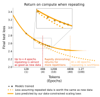</figure>
    <div class="d02-aside d02-repeat-aside"><div class="d02-repeat-numbers fragment fade-out" data-fragment-index="2"><div class="d02-equivalence"><p><strong>4 passes ≈ 3.7</strong><br>passes of new data</p><p>40 passes ≈ 15</p><p>Later repeats add less.</p></div><p class="d02-caveat">Fitted data-constrained law,<br>4.2B models, tested setting.</p></div>
      <div class="d02-law fragment" data-fragment-index="2">
        <h4 class="fv-label">SAME TEXT. LESS NEW LEARNING.</h4>
        <p class="d02-example-corpus">Imagine a corpus of<br><strong>100 million tokens.</strong></p>
        <table class="d02-example-table">
          <thead><tr><th scope="col">Passes</th><th scope="col">Tokens<br>processed</th><th scope="col">Equivalent<br>fresh tokens</th></tr></thead>
          <tbody><tr><th scope="row">1</th><td>100M</td><td>100M</td></tr><tr><th scope="row">4</th><td>400M</td><td>≈373M</td></tr><tr><th scope="row">40</th><td>4,000M</td><td>≈1,517M</td></tr></tbody>
        </table>
        <p class="d02-example-note">Illustrative example using the fitted law.<br>Learning value, not additional text.</p>
        <p class="d02-law-result">Each extra pass costs compute.<br>Later passes add less learning.</p>
      </div>
    </div>
  </div>
  <p class="d02-plot-guide">Same unique data, trained for 1, 4, 10, 40, 100 passes. Dashed: if repeats were as good as new data. Solid: what actually happens. Final test loss: lower is better.</p>
  <div class="fv-source"><a href="https://arxiv.org/pdf/2305.16264v5#page=1">Muennighoff et al., Scaling Data-Constrained Language Models, NeurIPS 2023</a> · Figure 1, left panel · Original axes, inset, annotations and left-panel legend</div>
</div></div>
<div class="d02-scene d02-selection fragment" data-fragment-index="3">
  <h3>BETTER DATA — SAME SCORE WITH ~8× FEWER TOKENS</h3>
  <div class="fv-body d02-evidence">
    <figure class="d02-figure d02-dim fragment" data-fragment-index="4"><div class="d02-chart">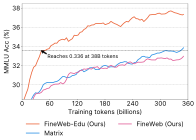<svg class="d02-chart-focus" viewBox="310 144 196 140" aria-hidden="true">
      <path class="d02-target-band" d="M331.96 194.3H497.95"/>
      <path class="d02-target-line" d="M331.96 194.3H497.95"/>
      <path class="d02-token-arrow" d="M352 194.3H467.8M356 192.5L352 194.3L356 196.1M463.8 192.5L467.8 194.3L463.8 196.1"/>
      <circle class="d02-target-point" cx="349.48" cy="194.3" r="1.8"/><circle class="d02-target-point" cx="470.28" cy="194.3" r="1.8"/>
      <g class="d02-target-label"><text x="350" y="177.5">FineWeb-Edu</text><text x="350" y="185.5">38B</text><text x="470.28" y="177.5">Matrix</text><text x="470.28" y="185.5">~300B</text><text x="410" y="187.5">33.6% MMLU</text></g>
      <rect class="d02-ratio-bg" x="402" y="190" width="16" height="8.6" rx="1"/><text class="d02-ratio" x="410" y="196.6">8×</text>
    </svg></div></figure>
    <div class="d02-aside"><p class="d02-selection-copy">FineWeb-Edu = the top <b>8%</b> of FineWeb, picked by an “educational value” classifier (<b>15T → 1.3T</b> tokens).</p><p class="d02-selection-copy">The price: <b>narrower</b> (HellaSwag 62.7 → 59.7) and <b>smaller</b> (only 1.3T tokens).</p><p class="d02-caveat">Same 1.71B model and setup<br>on each dataset.</p></div>
  </div>
  <div class="fv-source"><a href="https://proceedings.neurips.cc/paper_files/paper/2024/file/370df50ccfdf8bde18f8f9c2d9151bda-Paper-Datasets_and_Benchmarks_Track.pdf#page=9">Penedo et al., The FineWeb Datasets, NeurIPS 2024</a> · Original Figure 11, PDF p.9 · 1.71B model; runs up to 350B training tokens · Cost line: <a href="https://huggingfacefw-blogpost-fineweb-v1.static.hf.space/index.html">FineWeb blog, FineWeb-Edu ablation at 350B</a></div>
</div>
<div class="d02-summary fragment" data-fragment-index="4"><div><b>Scale matters.</b><b>Repetition has diminishing returns.</b><b>Data selection matters.</b></div><p class="d02-bridge">Selection shrinks the pool — and a small pool must be repeated.</p><p>Given a fixed training budget, which data should we show — and how often?</p></div>
```

::: {.notes}
The question is how to spend training compute when good new text is scarce. After the scale comparison, the first click moves directly to repetition; the second translates the fitted law into a concrete token-count example; the third moves to selection; the fourth connects the two and asks what to show and how often. Original figures remain intact; the FineWeb overlay highlights the comparison already described by its caption.

**Initial state: YES. SCALE MATTERS.** Paper Figure 1 plots compute-optimal parameter predictions against training FLOPs, both on logarithmic scales, alongside the actual model configurations. Gopher has 280B parameters and sees 300B tokens; Chinchilla has 70B parameters and sees 1.4T tokens (Table 1). Their training FLOPs are approximately the same. Table 6 reports 60.0% versus 67.6% MMLU 5-shot accuracy. These accuracy values annotate the graph; they are not plotted on its axes. More parameters are not always the best use of compute. The two models also differ in width, heads, optimizer (Adam vs AdamW), tokenizer and data mixture, so the comparison does not isolate token count (Hoffmann et al., §4.1, Table 4). The ⓘ cards beside Gopher and Chinchilla show both architectures and Table 4. Open them if students ask how the models differ beyond size.

**First click: OUT OF NEW DATA — CAN WE JUST REPEAT IT?** We need more training data, but good new text is limited. The first option is to reuse the same unique tokens. Figure 1 left from Muennighoff et al. shows 4.2B-parameter models. The horizontal axis gives processed training tokens and passes (epochs) over the same unique data; the vertical axis is final test loss, where lower is better. The dashed curve assumes repeats are as valuable as new data. The solid curve is the fitted repeated-data law; the points are measured runs. Follow 1, 4, 10, 40 and 100 passes. Original axes, points, inset, annotations and the left-panel legend are unchanged.

For unique tokens $U$ and extra passes $R=\text{epochs}-1$, the fitted effective-data law is $D'=U+U R_D^*(1-e^{-R/R_D^*})$, with $R_D^*=15.387756$ (Appendix A). Dividing by $U$ gives the equivalent number of passes of new data. The percentage below is $D'/(U\cdot\text{epochs})$, not a change in loss or accuracy.

| Passes | Effective new-data passes $D'/U$ | Fraction of processed tokens |
|---:|---:|---:|
| 4 | 3.73 | 93% |
| 10 | 7.81 | 78% |
| 40 | 15.17 | 38% |
| 100 | 16.36 | 16% |

The asymptote is $1+R_D^*=16.387756$, approximately 16.4, formerly rounded to “~16” on screen; now retained only in these notes. The original annotation “~40 epochs repeating is worthless” refers to small marginal returns: 40 passes already give 15.17 effective passes, close to the asymptote. It does not mean earlier repetitions had no value. This law is fitted to the authors' conditions, not a universal rule or an instruction to stop every model after four passes.

**Second click: SAME TEXT. LESS NEW LEARNING.** Keep the original figure on the left and replace only the right column. Imagine a corpus of 100 million unique tokens. One pass processes 100M tokens; four passes process 400M but correspond to about 373M fresh tokens under the fitted law; forty passes process 4,000M but correspond to only about 1,517M fresh tokens. These are illustrative rescalings of the fitted effective-data ratio, not separate measured runs with a 100M-token corpus. The unique corpus stays 100M throughout: “equivalent fresh tokens” estimates learning value, not additional text. Early repeats are useful; later repeats cost compute while adding less learning.

**Mathematical detail, speaker notes only.** Start from Chinchilla, $L(N,D)=E+A/N^\alpha+B/D^\beta$: counting all processed tokens as new gives the dashed prediction. The key assumption is that repeats lose the same fraction of value each time. Replace $D$ with effective data $D'$, which grows progressively more slowly and saturates at $U(1+R^*)$. Here $U=U_D=\min\{D_C,D\}$ and $R=R_D=D/U_D-1$ are unique tokens and extra passes. The marginal value of the $(k+1)$-th pass is $R^*(e^{-(k-1)/R^*}-e^{-k/R^*})$: the 2nd pass is 96.82% of new data, the 5th 79.67%, the 11th 53.94%, and the 41st 7.68%, rounded to 97%, 80%, 54%, and 8%. Around $R^*\approx15$ repeats, the marginal value is about $1/e\approx37\%$. The authors call this a “half-life”; mathematically it is an e-folding scale, not the exact time to halve the value.

**How the fit was made.** The coefficients $A,B,E,\alpha,\beta$ are fixed from the authors' C4 fit (Appendix B). They jointly fit only $R_D^*=15.387756$ and the analogous excess-parameter constant $R_N^*=5.309743$, using 182 runs with 7M–9B parameters and 1–500 epochs. They minimize Huber error in log test loss with L-BFGS from a grid of starting points; runs where excess epochs or parameters clearly hurt are excluded as outliers because the law can only improve or plateau. Off-screen, the parameter correction is $N'=U_N+U_N R_N^*(1-e^{-R_N/R_N^*})$, and the full fitted law is $L=E+A/(N')^\alpha+B/(D')^\beta$. The abstract's 400 runs, up to 900B training tokens and 9B parameters, describe the broader experiment set, not the 182-run fit.

**How to read the figure.** Circles are measured runs, tracking the solid fitted curve rather than the dashed new-data prediction; where there are no circles, the curve is an extrapolation of the law. Our reading of the axis labels is 12B unique tokens: 12B processed tokens at one epoch, 48B at four, and 1.2T at 100. The exponential decay is a modeling choice fitted to these data and models, not a universal constant. The limit near 16 is effective new-data passes, not a hard limit on the number of training epochs. Keep the effective-pass table and the cautions above in mind.

**Third click: BETTER DATA — SAME SCORE WITH ~8× FEWER TOKENS.** The other option is to select better data. FineWeb-Edu retains about 8% of FineWeb documents by an educational-value threshold: 15T corpus tokens become 1.3T. Llama-3-70B-Instruct supplies educational-quality annotations; a classifier based on Snowflake-arctic-embed-m learns to predict these scores. The retained documents have a rounded score of at least 3 out of 5. “Top 8%” is shorthand for what this threshold retains, not an exact percentile quota or a universal definition of quality.

FineWeb Figure 11 uses the same 1.71B model and training setup on each dataset. Matrix here is the English Common Crawl section of the Matrix corpus (1.3T tokens; Penedo et al., §3.7), not a different model. Trace the highlighted 33.6% MMLU line: FineWeb-Edu reaches it at 38B processed tokens; Matrix reaches comparable accuracy at about 300B. The approximate marker follows the paper's caption, not a new interpolation of the noisy curve. $300/38=7.8947$, hence ~8× fewer tokens for this score, benchmark and setup.

Corpus sizes are not training tokens: 1.3T is the size of the available FineWeb-Edu dataset, whereas these learning curves show up to 350B tokens actually processed during training. The price of selection is a narrower and smaller pool. The separate FineWeb blog ablation at 350B tokens reports MMLU 33 → 37 and ARC 46 → 57, but HellaSwag 62.7 → 59.7. The blog labels its ablation model 1.82B; the conference paper reports 1.71B for Figure 11. Keep those source contexts distinct. Better MMLU efficiency is not an across-the-board gain.

**Fourth click: synthesis.** The FineWeb plot stays in place and dims slightly. Keep the three statements: scale matters; repetition has diminishing returns; data selection matters. Then make the connection explicit: selection shrinks the pool → a small pool must be repeated when the training budget exceeds its size. Keep this tradeoff in mind: D 13 returns to repeated synthetic data, and D 21 compares rewriting with repetition. Read the question: Given a fixed training budget, which data should we show — and how often? The next slide introduces source pools, a sampler and sampling weights.

**Sources:** [Hoffmann et al., Figure 1, Tables 1, 4 and 6, §4.1, 2022](https://arxiv.org/pdf/2203.15556); [Muennighoff et al., Figure 1 left and Appendix A, NeurIPS 2023, arXiv v5](https://arxiv.org/pdf/2305.16264v5#page=1); [Penedo et al., FineWeb, §3.7, §4 and Figure 11, NeurIPS 2024](https://proceedings.neurips.cc/paper_files/paper/2024/file/370df50ccfdf8bde18f8f9c2d9151bda-Paper-Datasets_and_Benchmarks_Track.pdf#page=9); [FineWeb blog, FineWeb-Edu ablation at 350B tokens](https://huggingfacefw-blogpost-fineweb-v1.static.hf.space/index.html).
:::

## Which sources, and how often? {#frontier-f14 .fv-slide background-color="#ffffff"}

```{=html}
<div class="fv-meta"><span class="fv-id">D 11 / 42</span><span class="fv-cluster">Architecture</span><span class="fv-cluster active">Data</span><span class="fv-cluster">Training</span><span class="fv-cluster">Inference</span><span class="fv-cluster">Tools</span></div>
<div class="fv-body f14-body">
  <div class="f14-storage"><div class="fv-label">Source pools</div>
    <div class="f14-pool"><b>Web</b><span style="width:100%"></span></div>
    <div class="f14-pool"><b>Code</b><span style="width:67%"></span></div>
    <div class="f14-pool"><b>Mathematics</b><span style="width:50%"></span></div>
    <div class="f14-pool"><b>Knowledge</b><span style="width:73%"></span></div>
    <div class="f14-pool"><b>Multimodal</b><span style="width:56%"></span></div>
    <div class="fv-small fv-muted">Pool sizes stay fixed</div>
  </div>
  <svg class="f14-fan" viewBox="0 0 110 340" width="110" height="340" role="img" aria-label="Five pools feed into the sampler"><path d="M0 25L86 168M0 88L86 168M0 151L86 168M0 214L86 168M0 277L86 168M86 168H108" fill="none" stroke="#777" stroke-width="2"/><path d="M97 160L108 168L97 176" fill="none" stroke="#141414" stroke-width="2"/></svg>
  <div class="f14-sampler"><div class="fv-label">How to split the budget?</div><div class="f14-dial">Sampler</div><div class="f14-weights fv-accent">Sampling weights</div><p class="fv-small">Weights are tuned on small models first</p></div>
  <div class="fv-arrow f14-output-arrow">→</div>
  <div class="f14-batches">
    <div class="fv-label">Token budget stays fixed</div>
    <div class="f14-domain-legend" aria-label="Domain legend">
      <span><i class="f14-web"></i>Web</span><span><i class="f14-code"></i>Code</span><span><i class="f14-math"></i>Math</span><span><i class="f14-knowledge"></i>Knowledge</span><span><i class="f14-multimodal"></i>Multimodal</span>
    </div>
    <div class="f14-batch-caption">natural mixture <span>100%</span></div>
    <div class="f14-budget-bar" role="img" aria-label="Natural mixture: Web 60%, Code 15%, Math 5%, Knowledge 12%, Multimodal 8%. Total 100%.">
      <span class="f14-web" style="width:60%">60</span><span class="f14-code" style="width:15%">15</span><span class="f14-math" style="width:5%">5</span><span class="f14-knowledge" style="width:12%">12</span><span class="f14-multimodal" style="width:8%">8</span>
    </div>
    <div class="fragment" data-fragment-index="1">
      <div class="f14-batch-caption f14-changed">after reweighting <span>100%</span></div>
      <div class="f14-budget-bar" role="img" aria-label="After reweighting: Web 35%, Code 25%, Math 15%, Knowledge 15%, Multimodal 10%. Total 100%; Math exposure triples.">
        <span class="f14-web" style="width:35%">35</span><span class="f14-code" style="width:25%">25</span><span class="f14-math" style="width:15%">15</span><span class="f14-knowledge" style="width:15%">15</span><span class="f14-multimodal" style="width:10%">10</span>
      </div>
      <p class="f14-math-exposure"><b>Math ×3 exposure</b> → seen more often<br>→ repeated more (D 10)</p>
    </div>
    <p class="f14-illustrative">illustrative proportions</p>
  </div>
  <div class="f14-bottom"><span>Corpus size</span><b>≠</b><span>Effective training mixture</span></div>
  <div class="f14-doremi fragment" data-fragment-index="2" role="group" aria-label="DoReMi Figure 2, redrawn: same 8B model and main training budget, weights tuned with a 280M model. The Pile baseline takes 200,000 steps; 200,000 divided by the reported 2.6 speedup is about 77,000 steps. At 200,000 steps DoReMi improves average one-shot accuracy by 6.5 percentage points.">
    <p class="f14-doremi-heading"><b>DoReMi</b> · same 8B model, same budget<br>· weights tuned on a 280M model</p>
    <div class="f14-doremi-chart">
      <span class="f14-doremi-label">Pile default</span>
      <div class="f14-doremi-track"><div class="f14-doremi-bar f14-web" style="width:100%">200k steps</div></div>
      <span class="f14-doremi-label">DoReMi weights</span>
      <div class="f14-doremi-track f14-doremi-result"><div class="f14-doremi-bar fv-accent" style="width:38.4615384615%">77k</div><span class="f14-doremi-speed"><b>2.6× fewer steps</b><br>to the same accuracy</span></div>
      <div class="f14-doremi-gain"><strong>+6.5 pp</strong><span>one-shot accuracy<br>at 200k steps</span></div>
    </div>
  </div>
</div>
<div class="fv-source"><a href="https://arxiv.org/html/2607.24653v1#S3.SS1">Kimi K3, §3.1, 2026</a> · <a href="https://arxiv.org/html/2305.10429v4#S1.F2">DoReMi, 2023, Figure 2 (redrawn)</a> · Teaching diagram; illustrative proportions</div>
<!-- Brief: DATA-10 -->
<div class="bd-extra fragment" data-fragment-index="3" id="brief-data-10">
<svg class="bd-svg f14-language-svg" viewBox="0 0 1488 520" role="img" aria-label="Common Crawl shares renormalized over English, Russian and Czech: 85.1%, 12.6%, 2.3%. Applying the XLM-R sampling rule with alpha 0.3 gives 52.6%, 29.6%, 17.8%. Relative exposure is 0.6, 2.4 and 7.8 times the corpus share. Both bars total 100%.">
  <text x="0" y="35" class="f14-lang-title">LANGUAGE IS ANOTHER SAMPLING AXIS</text>
  <text x="0" y="90" class="f14-lang-label">Corpus share (Common Crawl, 3 languages)</text>
  <text x="1120" y="90" class="f14-lang-small" text-anchor="end">100%</text>
  <rect x="0.000000" y="115" width="953.188106" height="75" class="f14-web" />
  <text x="476.594053" y="146" class="f14-lang-segment f14-lang-inverse" text-anchor="middle">English</text>
  <text x="476.594053" y="174" class="f14-lang-segment f14-lang-inverse" text-anchor="middle">85.1%</text>
  <rect x="953.188106" y="115" width="141.121653" height="75" class="f14-code" />
  <text x="1023.748933" y="146" class="f14-lang-segment" text-anchor="middle">Russian</text>
  <text x="1023.748933" y="174" class="f14-lang-segment" text-anchor="middle">12.6%</text>
  <rect x="1094.309759" y="115" width="25.690241" height="75" class="f14-math" />
  <path d="M1107.154880 190V205H1120" class="f14-lang-leader" /><text x="1120" y="234" class="f14-lang-small" text-anchor="end">Czech 2.3%</text>
  <foreignObject x="0" y="251" width="1080" height="42"><div xmlns="http://www.w3.org/1999/xhtml" class="f14-language-heading">Training share, <span class="math inline">\(p \propto q^{0.3}\)</span> (XLM-R rule)</div></foreignObject>
  <text x="1120" y="278" class="f14-lang-small" text-anchor="end">100%</text>
  <rect x="0.000000" y="300" width="588.853276" height="75" class="f14-web" />
  <text x="294.426638" y="331" class="f14-lang-segment f14-lang-inverse" text-anchor="middle">English</text>
  <text x="294.426638" y="359" class="f14-lang-segment f14-lang-inverse" text-anchor="middle">52.6%</text>
  <rect x="588.853276" y="300" width="331.995049" height="75" class="f14-code" />
  <text x="754.850800" y="331" class="f14-lang-segment" text-anchor="middle">Russian</text>
  <text x="754.850800" y="359" class="f14-lang-segment" text-anchor="middle">29.6%</text>
  <rect x="920.848325" y="300" width="199.151675" height="75" class="f14-math" />
  <text x="1020.424162" y="331" class="f14-lang-segment" text-anchor="middle">Czech</text>
  <text x="1020.424162" y="359" class="f14-lang-segment" text-anchor="middle">17.8%</text>
  <path d="M1180 75V375" class="f14-lang-divider" />
  <text x="1220" y="90" class="f14-lang-small">Exposure, p/q</text>
  <text x="1220" y="155" class="f14-lang-label">English</text><text x="1470" y="155" class="f14-lang-ratio" text-anchor="end">×0.6</text>
  <text x="1220" y="245" class="f14-lang-label">Russian</text><text x="1470" y="245" class="f14-lang-ratio" text-anchor="end">×2.4</text>
  <rect x="1205" y="300" width="280" height="59" class="f14-math" />
  <text x="1220" y="340" class="f14-lang-label">Czech</text><text x="1470" y="340" class="f14-lang-ratio" text-anchor="end">×7.8</text>
  <text x="0" y="427" class="f14-lang-repeat">Czech is shown 7.8× more than its share — its data gets repeated (D 10).</text>
  <text x="0" y="474" class="f14-lang-fixed">Source sizes remain fixed. The sampler changes exposure.</text>
  <text x="0" y="512" class="f14-lang-footnote">Common Crawl CC-MAIN-2026-43 shares, renormalized over three languages; α = 0.3 as in XLM-R</text>
</svg>
<p class="bd-extra-take">Corpus size and sampling probability are different parameters.</p>
</div>
<div class="bd-extra-source fv-source fragment" data-fragment-index="3"><a href="https://arxiv.org/html/1911.02116v2#S3">XLM-R §3, §5.1 / Figure 5</a> · <a href="https://commoncrawl.github.io/cc-crawl-statistics/plots/languages">Common Crawl language statistics, CC-MAIN-2026-43</a></div>
```

::: {.notes}
Start with the DATA MIXTURES question from D 02: which sources, and how often? The model learns from the material it actually receives. The sampler allocates a limited training budget across domains, so giving one source more tokens takes tokens away from others.

The pools on the left contain web, code, mathematics, knowledge and multimodal data. They stay fixed throughout the scene; the pool silhouettes are schematic, not a quantitative scale. A sampler selects a domain according to its sampling weight, then draws material from that domain. These weights control exposure, not the model's neural-network parameters.

**Start: natural mixture.** The full bar is the fixed token budget, 100%. Segment lengths show how that budget is allocated. “Natural mixture” means sampling in proportion to the available data: Web 60%, Code 15%, Math 5%, Knowledge 12%, Multimodal 8%. These are teaching proportions, not Kimi K3's reported mixture.

**First click: after reweighting.** The second bar has exactly the same total length. Only its shares change: Web 35%, Code 25%, Math 15%, Knowledge 15%, Multimodal 10%. Math rises from 5% to 15%, so it receives three times as much exposure. Its pool has not grown: with repeated sampling, the same material is seen more often. This connects to D 10's diminishing returns from repetition. The factor 3 is relative to the natural-mixture baseline, not a claim of exactly three passes through every example.

Weights are tuned on small models first, then used for the large model. Kimi K3 §3.1 reports domain-specific sampling rates chosen through ablations on smaller models. DoReMi learns domain weights with a small proxy model and transfers them to a larger training run. These sources support the selection procedure; the domain percentages on our diagram remain illustrative. The next click shows a measured result of this weight tuning.

**Second click: does reweighting pay off?** DoReMi compares the same 8B model architecture on The Pile with the same main-training budget: 200k steps, batch size 512, sequence length 1024. The baseline uses The Pile's default domain weights, which already include repeated passes through some sources (typically two, up to three), rather than raw corpus-size proportions. The optimized weights come from a 280M proxy model. “Same budget” refers to the two main 8B runs; tuning the reference and proxy models adds about 8% of one full 8B run's compute (Figure 2 caption).

Read the bars as steps to reach the baseline's final accuracy. The baseline needs 200k steps. Dividing by the reported 2.6× speedup gives 76,923 steps, rounded to 77k; the shorter bar is 1/2.6 = 38.46% of the full bar. The 77k label is our calculation from the rounded speedup, not a step count printed in the paper; §3.2 reports reaching the baseline within 75k steps. At 200k steps, DoReMi is ahead by 6.5 percentage points in average one-shot exact-match accuracy across five tasks. The figure's “6.5% better” denotes percentage points, not a 6.5% relative improvement.

Table 1 shows how strongly the mixture changed: Pile-CC 0.1121 → 0.6057 (about 11% → 61%), ArXiv 0.1052 → 0.0036 (10.5% → 0.4%), PubMed Central 0.1071 → 0.0046 (10.7% → 0.5%), and StackExchange 0.0929 → 0.0153 (9.3% → 1.5%). This mixture nearly switches off those two scientific-text domains and allocates more than half the budget to Pile-CC web text.

The direction is not universal. In Data Mixing Laws (Ye et al., 2024; Figure 8 in v2), a 1B model trained on 100B RedPajama tokens uses the opposite shift: CommonCrawl 67% → 12.5%, ArXiv 4.5% → 25%. The objective is perplexity on The Pile validation set. The optimized mixture reaches the default mixture's result with 0.73 of its training steps. The figure's 1.48× comparison is a scaling-law extrapolation of the default curve, not a measured longer baseline run.

Aioli (Chen et al., 2024) finds that none of the pre-existing methods it evaluates consistently beats uniform sampling across domains on average test perplexity across its tested mixtures. This is a finding within that evaluation, not a claim that reweighting never helps; Aioli itself improves on that baseline. The lesson is that mixtures strongly affect results, but their weights need measurement on small models and checks at the target scale and budget, rather than guesswork.

**Third click: language is another sampling axis.** Return to Common Crawl from D 03. For CC-MAIN-2026-43, the reported language shares are English 42.5647%, Russian 6.3018% and Czech 1.1472%. Restrict to these three languages and divide by their sum, 50.0137%: the corpus shares are 85.1061%, 12.6001% and 2.2938%, displayed as 85.1%, 12.6% and 2.3%.

Let $q_i$ be the corpus share and $p_i$ the training sampling probability. Apply $p_i=q_i^{\alpha}/\sum_j q_j^{\alpha}$, with $\alpha=0.3$, to the unrounded corpus shares. This gives 52.5762%, 29.6424% and 17.7814%, displayed as 52.6%, 29.6% and 17.8%. Both bars sum to 100%. At $\alpha=1$ the mixture follows the data; as $\alpha\to0$, the positive-share languages approach equal sampling probabilities. XLM-R chose 0.3 for its experiments; it is not a universal optimum.

XLM-R v2 §3 states the sampling distribution by reference to Lample and Conneau (2019), with α = 0.3; §5.1 and Figure 5 discuss its tradeoff. The explicit power-normalized formula appears in the cited XLM paper, §3.1, with the letters p and q reversed relative to this slide. Figure 5 is an XLM-100 ablation on Wikipedia, not a measurement of our three-language mixture. The displayed training shares are our calculation using the XLM-R rule on CC 2026 statistics, not the historical XLM-R training recipe.

Common Crawl reports language shares of crawled pages, whereas the XLM sampling rule uses corpus sentence counts. Here the page shares supply the example distribution q; they are not measured token shares. Reading p as an allocation of a fixed token budget assumes equally sized training units. Estimating actual token shares requires tokenizing the data. Recall D 06: less well represented languages can need more tokens for the same text, depending on the tokenizer.

Divide p by q before rounding: English 0.6178, Russian 2.3525, Czech 7.7520. To one decimal these are ×0.6, ×2.4 and ×7.8. Czech gets about 7.8 times its natural-mixture exposure, so with the same fixed pool its material is repeated more. This is a relative exposure multiplier, not an absolute number of epochs. Now compare these sampling choices with Phi-4’s published mixture and its effective passes through each source.

**Sources:** [Kimi K3, §3.1, 2026](https://arxiv.org/html/2607.24653v1#S3.SS1); [DoReMi, 2023, Figure 2, Table 1, §3.1–3.2 and Appendix C](https://arxiv.org/html/2305.10429v4#S1.F2); [The Pile, Table 1](https://arxiv.org/html/2101.00027#S2); [Data Mixing Laws, Figure 8 (v2)](https://arxiv.org/html/2403.16952v2#S4.F8); [Aioli, abstract and §6](https://arxiv.org/abs/2411.05735); [XLM-R v2, §3, §5.1 and Figure 5](https://arxiv.org/html/1911.02116v2#S3); [XLM, §3.1 and §3.5, sampling formula](https://arxiv.org/html/1901.07291v1#S3.SS1); [Common Crawl language statistics, CC-MAIN-2026-43](https://commoncrawl.github.io/cc-crawl-statistics/plots/languages).
:::

## A small source can take a large share of training {#frontier-f14-case .fv-slide background-color="#ffffff"}

```{=html}
<div class="fv-meta"><span class="fv-id">D 12 / 42</span><span class="fv-cluster">Architecture</span><span class="fv-cluster active">Data</span><span class="fv-cluster">Training</span><span class="fv-cluster">Inference</span><span class="fv-cluster">Tools</span></div>
<div class="fv-body dc-body">
<svg class="bd-svg f14-language-svg" viewBox="0 0 1488 520" role="img" aria-labelledby="f12-chart-title f12-chart-desc">
  <title id="f12-chart-title">Phi-4 reallocates training toward its smaller Synthetic source</title>
  <desc id="f12-chart-desc">Both bars represent 100%, not equal token counts. Corpus: 3.28 trillion unique tokens; Web 39.63%, Web rewrites 8.84%, Synthetic 8.84%, Code 25%, Acquired sources 17.68%. Training: approximately 10 trillion tokens, allocated 15%, 15%, 40%, 20%, 10% respectively. This gives about 1.2 passes through Web and 13.8 through Synthetic. Corpus labels are rounded and sum to 101%; segment widths use unrounded shares.</desc>
  <g class="f12-corpus">
    <text x="0" y="30" class="f14-lang-label">Corpus · 3.3T unique tokens</text>
    <text x="1488" y="30" class="f14-lang-small" text-anchor="end">100%</text>
    <rect x="0.000000" y="56" width="589.756098" height="90" class="f14-web" data-source="Web" />
    <text x="294.878049" y="91" class="f14-lang-segment f12-focus f14-lang-inverse" text-anchor="middle">Web</text>
    <text x="294.878049" y="129" class="f12-percent f14-lang-inverse" text-anchor="middle">40%</text>
    <rect x="589.756098" y="56" width="131.560976" height="90" class="f12-neutral" data-source="Web rewrites" />
    <path d="M589.756098 56v90" class="f14-lang-divider" aria-hidden="true" />
    <text x="655.536585" y="81" class="f12-small" text-anchor="middle">Web</text>
    <text x="655.536585" y="104" class="f12-small" text-anchor="middle">rewrites</text>
    <text x="655.536585" y="129" class="f12-small" text-anchor="middle">9%</text>
    <rect x="721.317073" y="56" width="131.560976" height="90" class="f14-math" data-source="Synthetic" />
    <text x="787.097561" y="91" class="f14-lang-segment f12-focus" text-anchor="middle">Synthetic</text>
    <text x="787.097561" y="129" class="f12-percent" text-anchor="middle">9%</text>
    <rect x="852.878049" y="56" width="372.000000" height="90" class="f12-neutral" data-source="Code" />
    <path d="M852.878049 56v90" class="f14-lang-divider" aria-hidden="true" />
    <text x="1038.878049" y="91" class="f12-small" text-anchor="middle">Code</text>
    <text x="1038.878049" y="129" class="f12-small" text-anchor="middle">25%</text>
    <rect x="1224.878049" y="56" width="263.121951" height="90" class="f12-neutral" data-source="Acquired sources" />
    <path d="M1224.878049 56v90" class="f14-lang-divider" aria-hidden="true" />
    <text x="1356.439024" y="91" class="f12-small" text-anchor="middle">Acquired sources</text>
    <text x="1356.439024" y="129" class="f12-small" text-anchor="middle">18%</text>
  </g>
  <g class="fragment f12-training" data-fragment-index="1">
    <g class="f12-connectors" aria-hidden="true">
      <path d="M589.756098 146L223.2 285" class="f14-lang-leader" />
      <path d="M852.878049 146L1041.6 285" class="f14-lang-leader" />
    </g>
    <text x="0" y="260" class="f14-lang-label">Training · 10T tokens</text>
    <text x="1488" y="260" class="f14-lang-small" text-anchor="end">100%</text>
    <rect x="0.000000" y="285" width="223.200000" height="90" class="f14-web" data-source="Web" />
    <text x="111.600000" y="320" class="f14-lang-segment f12-focus f14-lang-inverse" text-anchor="middle">Web</text>
    <text x="111.600000" y="358" class="f12-percent f14-lang-inverse" text-anchor="middle">15%</text>
    <rect x="223.200000" y="285" width="223.200000" height="90" class="f12-neutral" data-source="Web rewrites" />
    <path d="M223.200000 285v90" class="f14-lang-divider" aria-hidden="true" />
    <text x="334.800000" y="320" class="f12-small" text-anchor="middle">Web rewrites</text>
    <text x="334.800000" y="358" class="f12-small" text-anchor="middle">15%</text>
    <rect x="446.400000" y="285" width="595.200000" height="90" class="f14-math" data-source="Synthetic" />
    <text x="744.000000" y="320" class="f14-lang-segment f12-focus" text-anchor="middle">Synthetic</text>
    <text x="744.000000" y="358" class="f12-percent" text-anchor="middle">40%</text>
    <rect x="1041.600000" y="285" width="297.600000" height="90" class="f12-neutral" data-source="Code" />
    <path d="M1041.600000 285v90" class="f14-lang-divider" aria-hidden="true" />
    <text x="1190.400000" y="320" class="f12-small" text-anchor="middle">Code</text>
    <text x="1190.400000" y="358" class="f12-small" text-anchor="middle">20%</text>
    <rect x="1339.200000" y="285" width="148.800000" height="90" class="f12-neutral" data-source="Acquired sources" />
    <path d="M1339.200000 285v90" class="f14-lang-divider" aria-hidden="true" />
    <text x="1413.600000" y="310" class="f12-small" text-anchor="middle">Acquired</text>
    <text x="1413.600000" y="333" class="f12-small" text-anchor="middle">sources</text>
    <text x="1413.600000" y="358" class="f12-small" text-anchor="middle">10%</text>
  </g>
  <g class="f12-definition">
    <rect x="647" y="158" width="280" height="30" class="f12-label-backdrop" aria-hidden="true" />
    <text x="787.097561" y="180" class="f14-lang-footnote" text-anchor="middle">text generated by LLMs</text>
  </g>
  <g class="fragment f12-passes" data-fragment-index="2">
    <text x="111.6" y="427" class="f14-lang-label" text-anchor="middle">Web data</text>
    <text x="111.6" y="494" class="f14-lang-ratio f12-pass-number" text-anchor="middle">1.2<tspan class="f14-lang-label"> passes</tspan></text>
    <text x="744" y="427" class="f14-lang-label" text-anchor="middle">Synthetic data</text>
    <rect x="612" y="445" width="264" height="62" class="f14-math" />
    <text x="744" y="494" class="f14-lang-ratio f12-pass-number" text-anchor="middle">13.8<tspan class="f14-lang-label"> passes</tspan></text>
    <foreignObject x="950" y="455" width="538" height="55"><div xmlns="http://www.w3.org/1999/xhtml" class="f12-formula"><span class="math inline">\(10\text{T} \times 40\% \div 290\text{B} \approx 13.8\)</span></div></foreignObject>
  </g>
</svg>
</div>
<div class="fv-takeaway">Phi-4 saw its synthetic data ~14 times — and its web data about once.</div>
<div class="fv-source"><a href="https://arxiv.org/pdf/2412.08905#page=10">Phi-4 Technical Report, §3.2, Table 5, 2024</a> · corpus shares computed from Table 5 unique-token counts</div>
```

::: {.notes}
**Introduction — from D 11 to Phi-4.** D 11 showed relative exposure, p/q: Czech received ×7.8 its corpus share, but the absolute training budget was unknown. Phi-4 publishes source sizes and an approximately 10T-token pretraining budget (§3), so we can calculate average passes through each source.

**At opening — corpus.** Table 5 lists Web 1.3T, Web rewrites 290B, Synthetic 290B, Code data 820B, and Acquired sources 580B unique tokens. Their sum is 3,280B = 3.28T, shown as 3.3T. Dividing by this total gives 39.6341%, 8.8415%, 8.8415%, 25.0000%, and 17.6829%. These corpus shares are our calculation; the report does not list them. The integer labels 40 / 9 / 9 / 25 / 18 sum to 101% because they are rounded independently. Segment widths use the unrounded shares and sum to exactly 100%.

**Click 1 — training.** Reveal the second bar and the thin connectors together. The training shares from Table 5 are 15 / 15 / 40 / 20 / 10% of approximately 10T tokens. Web shrinks from about 40% of the corpus to 15% of training, while Synthetic grows from about 9% to 40%. Both full bars mean 100% of their respective totals, not equal absolute token volumes. The sources stay fixed; the allocation of training changes.

**Click 2 — passes through the source.** Passes = training budget × training share ÷ unique source tokens. Synthetic: 10T × 40% ÷ 290B = 4T ÷ 290B ≈ 13.8. Web: 10T × 15% ÷ 1.3T = 1.5T ÷ 1.3T ≈ 1.1538, rounded to 1.2. Table 5 reports 5.2 for Web rewrites, 2.4 for Code data, and 1.7 for Acquired sources; keep these in the notes. Read the takeaway: Phi-4 saw its synthetic data about fourteen times, and its web data about once.

**Connection to D 11.** For Synthetic, p/q = 0.40 / (290 / 3280) ≈ 4.5241, about 4.5. Multiply by the overall budget-to-corpus ratio, 10T / 3.28T ≈ 3.0488: 4.5241 × 3.0488 ≈ 13.7931 passes. The relative multiplier and the absolute number of passes are different quantities.

**Caveats.** The token counts, training budget, and epoch values in the report are rounded. Web rewrites and Synthetic are separate categories in Table 5: do not merge them or assign 40% to their combined total. A pass means average exposure to a source, not a promise to show every document an integer number of times. Synthetic data here means text generated by LLMs; how it is generated and checked comes later.

**Bridge to D 13.** This is the recipe for a particular run; the recipe alone does not prove that this share is better. Next comes the authors' experiment comparing four and twelve passes through a fixed synthetic source at a fixed total token budget. The 13.8 here describes Table 5's final mixture; twelve is a separate experimental setting in Figure 2.

**Source:** [Phi-4 Technical Report, §3 (approximately 10T budget), §3.2, Table 5, 2024](https://arxiv.org/pdf/2412.08905#page=10).
:::

## More unique data is not always better {#frontier-f14-experiment .fv-slide .fv-detail background-color="#ffffff"}

```{=html}
<div class="fv-meta"><span class="fv-id">D 13 / 42</span><span class="fv-cluster">Architecture</span><span class="fv-cluster active">Data</span><span class="fv-cluster">Training</span><span class="fv-cluster">Inference</span><span class="fv-cluster">Tools</span></div>
<div class="fv-body dc-body">
  <div class="dc-kicker"><b>Phi-4 · repeating synthetic data</b><span>Experiment · Figure 2</span></div>
  <div class="dc-evidence">
    <figure class="dc-figure">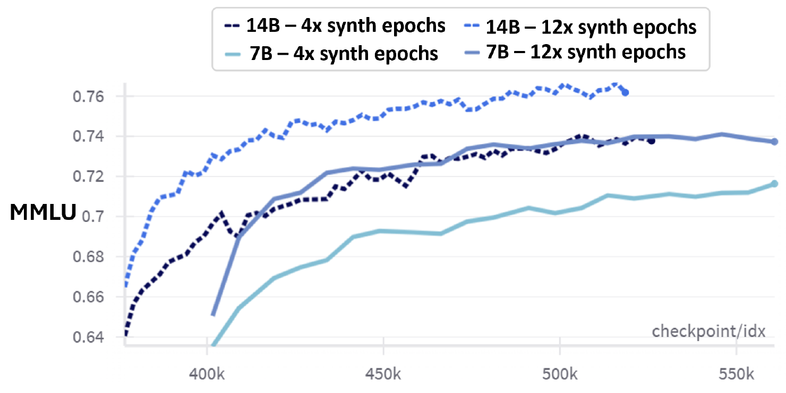<figcaption>Original Figure 2. Dashed lines: 14B; solid lines: 7B.<br>MMLU tests knowledge across subjects; higher is better.</figcaption></figure>
    <div class="dc-aside">
      <div class="dc-metric"><b class="dc-number">4 / 12</b><span>passes through<br>synthetic data</span></div>
      <p><b>The token budget is fixed</b> within each 4/12 pair. Four passes leave more room for unique web text.</p>
      <p class="dc-highlight">Twelve passes achieve higher MMLU at both model sizes.</p>
      <small>A result for this mixture and these models. It says nothing about the quality of arbitrary synthetic data.</small>
    </div>
  </div>
</div>
<div class="fv-takeaway">In this experiment, repeating high-quality synthetic data helps more than adding unique web text.</div>
<div class="fv-source"><a href="https://arxiv.org/pdf/2412.08905#page=9">Phi-4 Technical Report, §3.1, Figure 2</a> · Original plot, not redrawn</div>
```

::: {.notes}
The previous slide showed the mixture used for the main training run. Now we examine the separate experiment in Figure 2: phase-two training of 7B and 14B models from phase-one checkpoints. The authors fix the set of unique synthetic data and compare four and twelve passes through it, keeping the same total token budget within each pair of models of the same size. In the four-pass variant, more unique web text fills the remaining share.

First, read the legend. Dashed lines represent 14B models; solid lines represent 7B models. Each pair compares the number of passes. MMLU tests answers across different academic subjects; the plot uses a 5-shot setting, where the model receives five examples before the question. The vertical axis is MMLU; the horizontal axis is labeled checkpoint/idx and should not be called the number of unique tokens. At both model sizes, the twelve-pass variant achieves a better result.

This supports a limited but useful conclusion: with this budget and data preparation, increasing diversity through web data was less useful than repeating the synthetic source. We are not saying that any synthetic data should be repeated twelve times. The properties of the source and the sampling policy work together here.

The 13.8 in Table 5 and the twelve in Figure 2 refer to different things: the first describes the final mixture; the second is a setting in an experimental comparison. Once we have chosen how often to present a source, the next question is how the team decides which text deserves a place in the mixture.

**Source:** [Phi-4 Technical Report, §3.1, Figure 2](https://arxiv.org/pdf/2412.08905#page=9). The slide uses the original plot; no exact numerical differences are claimed from it.
:::

## What we know so far {#data-recap-mixtures .fv-slide .data-recap-slide background-color="#ffffff"}

::: {.data-recap data-section="mixtures"}
:::

::: {.notes}
On opening, D 10 shows Chinchilla's 70B parameters and 1.4T tokens outperforming Gopher's 280B and 300B at similar compute, while the fitted repetition law approaches ~16 effective passes of fresh data, not a universal stopping rule. On click 1, D 11 shows the same 8B model reaching baseline accuracy with 2.6× fewer training steps through DoReMi reweighting. On click 2, distinguish Phi-4's final mixture in D 12 (40% Synthetic, 13.8 passes) from the separate D 13 experiment, where twelve synthetic passes outperform four at a fixed total token budget. On click 3, the takeaway answers D 02's “Which sources, and how often?”: data decisions can move quality even with the model and budget fixed. Next, D 14 asks what survives selection: “Most of the crawl never reaches training.”
:::

## Most of the crawl never reaches training {#frontier-f15 .fv-slide background-color="#ffffff"}

```{=html}
<div class="fv-meta"><span class="fv-id">D 14 / 42</span><span class="fv-cluster">Architecture</span><span class="fv-cluster active">Data</span><span class="fv-cluster">Training</span><span class="fv-cluster">Inference</span><span class="fv-cluster">Tools</span></div>
<div class="fv-body f15-funnel-body">
  <figure class="f15-original">
    <div class="f15-pool-size">200B documents<br>· 240T tokens</div>
    <svg class="f15-original-figure" viewBox="0 0 1778.4 763.2" role="img" aria-labelledby="f15-original-title f15-original-desc">
      <title id="f15-original-title">Original DCLM Figure 4: construction of DCLM-Baseline</title>
      <desc id="f15-original-desc">DCLM-Pool from Common Crawl is filtered in three stages. Heuristic cleaning leaves 19.9% of the original documents; the English filter removes 50.8%. Bloom-filter deduplication leaves 13.7%. The fastText quality filter leaves 1.4%, or 3.8T tokens. Percentages refer to documents, not tokens. The figure is revealed from left to right.</desc>
      <image href="assets/data_dclm_20261028/dclm_figure4.png" width="1778.4" height="763.2"/>
      <!-- White masks follow stage boundaries; the notch preserves the heuristic label. -->
      <path class="f15-mask f15-mask-quality fragment fade-out" data-fragment-index="3" aria-hidden="true" fill-rule="evenodd" d="M1205 0 H1778.4 V245 H1205 Z M1205 209 H1374 V234 H1205 Z"/>
      <path class="f15-mask f15-mask-dedup fragment fade-out" data-fragment-index="2" aria-hidden="true" fill-rule="evenodd" d="M815 0 H1205 V190 H1400 V245 H815 Z M815 210 H944 V234 H815 Z"/>
      <path class="f15-mask f15-mask-cleaning fragment fade-out" data-fragment-index="1" aria-hidden="true" d="M46 0 H1778.4 V763.2 H46 Z"/>
      <g class="f15-language-emphasis fragment" data-fragment-index="1" aria-hidden="true">
        <rect class="f15-english-outline" x="48" y="540" width="560" height="46" rx="4"/>
        <path class="f15-english-arrow" d="M718 560 H623 m12 -10 -12 10 12 10"/>
        <text class="f15-english-label" x="740" y="574">not English −50.8%</text>
      </g>
      <g class="f15-final-callout fragment" data-fragment-index="3" aria-hidden="true">
        <path class="f15-baseline-pointer" d="M1750 130 V291 H1146"/>
        <text class="f15-final-label" x="1040" y="350">1.4% of documents</text>
        <text class="f15-final-label" x="1040" y="406">= 3.8T tokens</text>
        <text class="f15-fasttext-note" x="1040" y="459">fastText keeps the top ~10%</text>
      </g>
    </svg>
  </figure>
  <div class="f15-audit fragment" data-fragment-index="4">
    <div class="f15-audit-label">Every filter errs both ways · <span>audit of C4</span></div>
    <div class="fv-grid2 f15-audit-examples">
      <div class="fv-panel"><h3>Useful removed</h3><p>The blocklist filter removes text from and about minority individuals disproportionately.</p></div>
      <div class="fv-panel"><h3>Unwanted retained</h3><p>Machine-translated text and examples from other NLP benchmarks stay in the corpus.</p></div>
    </div>
  </div>
</div>
<div class="fv-takeaway">Filtering keeps ~1.4% of documents — and every filter errs in both directions.</div>
<div class="fv-source"><a href="https://arxiv.org/abs/2406.11794">DCLM, 2024, Figure 4 (original)</a> · <a href="https://arxiv.org/abs/2104.08758">Dodge et al., 2021 (C4 audit)</a></div>
```

::: {.notes}
**Opening.** On D 03, 240T tokens became about 4T. Figure 4 here gives the more precise 3.8T figure, and we can see where the rest went. DCLM-Pool was freshly extracted from Common Crawl HTML with resiliparse: 200B documents and 240T GPT-NeoX tokens. Every percentage in the funnel is a share of the original number of documents, not tokens. By token count, 3.8 / 240 is about 1.6%; documents have different lengths.

**Click 1 — heuristic cleaning.** These heuristics reproduce RefinedWeb. The largest cut is language: half of the documents are not English, connecting back to the Common Crawl languages on D 03 and the language choice on D 11. URL filtering removes 0.8%, the English filter 50.8%, other rules 9.0%, page length 7.9%, repetition 9.6%, and the word-removal ratio 2.0%. These remove 80.1% of the original documents in total, leaving 19.9%. The smaller rules concern length, repeated content, and how much text was stripped out as bad lines.

**Click 2 — deduplication.** Bloom-filter deduplication removes another 6.2% of the original documents, leaving 13.7%. We will work through near-duplicate detection two slides from here.

**Click 3 — quality classifier.** A fastText classifier keeps approximately the top 10% by its score. This removes another 12.3% of the original documents and leaves 1.4%: DCLM-Baseline, with 3.8T tokens. The rounded Figure 4 values give 1.4 / 13.7 ≈ 10.2%, consistent with the top-10% threshold in §4.4.

A quality score guides selection; it does not establish that a text is true. A rare, useful document, such as one containing unusual formulas, may also look suspicious to the scorer. Who decides what counts as the top 10% is the question for the next slide.

**Click 4 — errors in both directions.** This is a separate audit of C4 by Dodge et al. (2021), not an error-rate estimate for DCLM. Blocklist filtering disproportionately removed text from and about minority individuals. Yet machine-translated text and evaluation examples from other NLP benchmarks remained in the corpus.

Contamination is a separate issue: evaluation material has entered the training data. Even high-quality text then compromises the independence of evaluation. Removing duplicates only within the training pool does not resolve this problem by itself.

Provenance records each document's origin and the transformations applied to it. This log lets us investigate both kinds of filtering error afterwards; [W3C PROV](https://www.w3.org/TR/prov-overview/) provides a framework for describing it.

**Caveat and bridge.** Different pipelines may order these stages differently. First, we will examine how Llama 3 trains a quality scorer; then we will return to removing near duplicates.

**Sources:** [DCLM, 2024, Figure 4 and §4.4](https://arxiv.org/abs/2406.11794), [Dodge et al., 2021, C4 audit](https://arxiv.org/abs/2104.08758), [W3C PROV, 2013](https://www.w3.org/TR/prov-overview/).
:::

## Who defines the quality of training text? {#frontier-f15-case-quality .fv-slide background-color="#ffffff"}

```{=html}
<div class="fv-meta"><span class="fv-id">D 15 / 42</span><span class="fv-cluster">Architecture</span><span class="fv-cluster active">Data</span><span class="fv-cluster">Training</span><span class="fv-cluster">Inference</span><span class="fv-cluster">Tools</span></div>
<div class="fv-body dc-body dq-body">
  <div class="dc-pipeline">
    <div class="dc-step"><h3>Llama 2</h3><p>labels a sample of web pages against written quality criteria</p></div>
    <div class="dc-arrow" aria-hidden="true">→</div>
    <div class="dc-step"><h3>DistilRoBERTa</h3><p>small model learns those labels</p></div>
    <div class="dc-arrow" aria-hidden="true">→</div>
    <div class="dc-step"><h3>Quality score</h3><p>scores every document in the corpus</p></div>
  </div>
  <p class="dq-scale">A big model sets the labels; a small one makes it affordable at scale.</p>
  <div class="fv-grid3 dq-definitions fragment" data-fragment-index="1">
    <div class="dq-definition"><h3>Meets written criteria</h3><p>Llama 3 (Llama 2 as judge)</p></div>
    <div class="dq-definition"><h3>Would Wikipedia cite this page?</h3><p>Llama 3 (fastText)</p></div>
    <div class="dq-definition dq-definition-dclm"><h3><span class="fv-accent">Looks like a good answer</span></h3><p><b>DCLM:</b> positives = OpenHermes-2.5 instructions + top ELI5 answers; negatives = random web.</p><span class="dq-funnel">↳ the last funnel step on D 14</span></div>
  </div>
  <figure class="dq-evidence fragment" data-fragment-index="2">
<svg class="dq-chart" viewBox="0 0 1488 330" role="img" aria-labelledby="dq-chart-title dq-chart-desc">
  <title id="dq-chart-title">DCLM quality filtering comparison at 1B-1x, Table 4</title>
  <desc id="dq-chart-desc">Core is centered accuracy across 22 tasks, shown as a percentage: 0 is random guessing and 100 is perfect. The axis starts at 25. No model filter (RefinedWeb reproduction): 27.5; Top 20% by PageRank: 26.1; SemDedup: 27.1; Classifier on BGE features: 27.2; AskLLM: 28.6; Perplexity filtering: 29.0; Top-k average logits: 29.2; fastText (OH-2.5 plus ELI5): 30.2, the best. AskLLM agrees with human raters most, about 82% ROC-AUC in Appendix N, but fastText trains a better model.</desc>
  <text class="dq-chart-heading" x="0" y="23">DCLM · Table 4</text>
  <text class="dq-axis-title" x="500" y="23">Core, 1B-1x (0 = random)</text>
  <text class="dq-axis-note" x="1150" y="23">% · axis starts at 25</text>
  <path class="dq-grid" d="M500 50V296"/><text class="dq-tick" x="500" y="324">25</text>
  <path class="dq-grid" d="M600 50V296"/><text class="dq-tick" x="600" y="324">26</text>
  <path class="dq-grid" d="M700 50V296"/><text class="dq-tick" x="700" y="324">27</text>
  <path class="dq-grid" d="M800 50V296"/><text class="dq-tick" x="800" y="324">28</text>
  <path class="dq-grid" d="M900 50V296"/><text class="dq-tick" x="900" y="324">29</text>
  <path class="dq-grid" d="M1000 50V296"/><text class="dq-tick" x="1000" y="324">30</text>
  <path class="dq-grid" d="M1100 50V296"/><text class="dq-tick" x="1100" y="324">31</text>
  <path class="dq-baseline" d="M750 45V299"/>
  <g class="dq-row"><text class="dq-filter" x="0" y="73">No model filter<tspan class="dq-baseline-detail"> (RefinedWeb reproduction)</tspan></text><rect class="dq-bar" x="500" y="55" width="250" height="22"/><rect class="dq-value-back" x="757" y="52" width="60" height="28"/><text class="dq-value" x="762" y="73">27.5</text></g>
  <g class="dq-row"><text class="dq-filter" x="0" y="105">Top 20% by PageRank</text><rect class="dq-bar" x="500" y="87" width="110" height="22"/><rect class="dq-value-back" x="617" y="84" width="60" height="28"/><text class="dq-value" x="622" y="105">26.1</text></g>
  <g class="dq-row"><text class="dq-filter" x="0" y="137">SemDedup</text><rect class="dq-bar" x="500" y="119" width="210" height="22"/><rect class="dq-value-back" x="717" y="116" width="60" height="28"/><text class="dq-value" x="722" y="137">27.1</text></g>
  <g class="dq-row"><text class="dq-filter" x="0" y="169">Classifier on BGE features</text><rect class="dq-bar" x="500" y="151" width="220" height="22"/><rect class="dq-value-back" x="727" y="148" width="60" height="28"/><text class="dq-value" x="732" y="169">27.2</text></g>
  <g class="dq-row"><text class="dq-filter" x="0" y="201">AskLLM</text><rect class="dq-bar" x="500" y="183" width="360" height="22"/><rect class="dq-value-back" x="867" y="180" width="60" height="28"/><text class="dq-value" x="872" y="201">28.6</text></g>
  <g class="dq-row"><text class="dq-filter" x="0" y="233">Perplexity filtering</text><rect class="dq-bar" x="500" y="215" width="400" height="22"/><rect class="dq-value-back" x="907" y="212" width="60" height="28"/><text class="dq-value" x="912" y="233">29.0</text></g>
  <g class="dq-row"><text class="dq-filter" x="0" y="265">Top-k average logits</text><rect class="dq-bar" x="500" y="247" width="420" height="22"/><rect class="dq-value-back" x="927" y="244" width="60" height="28"/><text class="dq-value" x="932" y="265">29.2</text></g>
  <g class="dq-row dq-best"><text class="dq-filter" x="0" y="297">fastText (OH-2.5 + ELI5)</text><rect class="dq-bar" x="500" y="279" width="520" height="22"/><rect class="dq-value-back" x="1027" y="276" width="60" height="28"/><text class="dq-value" x="1032" y="297">30.2</text></g>
  <text class="dq-baseline-label" x="750" y="43">no model filter</text>
  <text class="dq-annotation" x="1150" y="105">below no filter</text>
  <text class="dq-annotation" x="1150" y="190"><tspan x="1150">agrees with human raters most</tspan><tspan x="1150" dy="23">(~82% ROC-AUC; Appendix N)</tspan></text>
  <text class="dq-best-label" x="1150" y="297">best</text>
</svg>
  </figure>
</div>
<div class="fv-takeaway">“Quality” is whatever trains a better model — human taste is a weak guide.</div>
<div class="fv-source"><a href="https://arxiv.org/html/2407.21783v3#S3.SS1.SSS1">The Llama 3 Herd of Models, §3.1.1, 2024</a> · <a href="https://arxiv.org/html/2406.11794v4">DataComp-LM, 2024, §4.4, Table 4, Appendix N</a></div>
```

::: {.notes}
**On opening — how Llama 3 makes a quality score.** Let us make the idea of a quality score concrete by examining one Llama 3 filter. The team collects cleaned web documents, specifies quality requirements, and asks the Llama 2 chat model whether each document meets them. These labels are used to train the compact DistilRoBERTa model, which then scores the large corpus.

There are two distinct roles. Llama 2 helps create the training labels, while the small classifier makes processing at scale computationally affordable. Its score reflects the chosen requirements and the annotator's decisions. It is not a universal measure of truth.

The same section describes separate pipelines for code and mathematics, with different target criteria, HTML processing, and heuristics. Even within one team, there is no single universal filter for every document type. Llama 3 publishes no separate gain for this pipeline.

**First click — what counts as “good”.** Even within the Llama 3 team, quality has different operational definitions. One fastText classifier predicts whether Wikipedia would cite the page; another classifier learns written quality criteria from Llama 2's judgments.

For DCLM, “good” means resembling good answers. Its bigram fastText classifier uses OpenHermes-2.5 instruction data, mostly synthetic, plus ELI5 posts paired with their top answer as positives. Negatives are random documents from DCLM's own RefinedWeb reproduction. It retains the top 10% by score. This is the last funnel step on D 14: these examples define what “top” means.

**Second click — measure the model trained on the selected data.** Table 4 compares filters at the same 1B-1x scale. Core averages centered accuracy over 22 tasks: each task is rescaled so 0 is random guessing and 1 is perfect accuracy, then reported as a percentage. Thus 30.2 on this chart means 0.302 centered accuracy. The chart deliberately starts at 25%, with that truncated axis stated explicitly.

fastText reaches 30.2 Core, compared with 26.1–29.2 for the other model-based methods. The RefinedWeb reproduction without an added model filter scores 27.5; it still includes heuristic filtering and deduplication. Several sophisticated choices do worse than this baseline: PageRank 26.1, SemDedup 27.1, and the classifier on BGE features 27.2. AskLLM scores 28.6, perplexity filtering 29.0, and top-k average logits 29.2. fastText adds 2.7 Core points over no model filter and 1.6 over AskLLM.

Appendix N tests agreement with people: 16 annotators assess roughly 500 documents, with three ratings per document and 71% average inter-annotator agreement. AskLLM agrees with the majority human labels best, at about 82% ROC-AUC, while the fastText classifiers score about 73%. Yet AskLLM produces worse training data: about 28.5 Core versus more than 31 for several fastText classifiers. These are separate Appendix N runs, with similar filtering ratios retaining roughly 15%; they must not replace the Table 4 values on the chart. ROC-AUC measures agreement with human labels, not the downstream Core score.

Human intuition is a weak guide to which documents help a model learn. People choose criteria, examples, and labels, but the useful test of training-data quality is the resulting model's performance. In Table 12, the step from RedPajama to DCLM-baseline adds 4.5 points (30.2 − 25.7); the classifier is its main, though not only, ingredient. This answers the first part of the cover riddle.

Now we return to the next operation in the general diagram: removing duplicates. First, we will calculate similarity between two short strings, then examine Llama 3's actual deduplication levels.

**Sources:** [The Llama 3 Herd of Models, v3, §3.1.1](https://arxiv.org/html/2407.21783v3#S3.SS1.SSS1); [DataComp-LM, v4, §3.5, §4.4, Tables 4 and 12, Appendix N](https://arxiv.org/html/2406.11794v4).
:::

## Near-duplicates: how similar is similar enough? {#frontier-f15-detail .fv-slide .fv-detail background-color="#ffffff"}

```{=html}
<div class="fv-meta"><span class="fv-id">D 16 / 42</span><span class="fv-cluster">Architecture</span><span class="fv-cluster active">Data</span><span class="fv-cluster">Training</span><span class="fv-cluster">Inference</span><span class="fv-cluster">Tools</span></div>
<div class="fv-body d15-body">
  <div class="d15-motivation">
    <div class="d15-repeat"><strong>60,000×</strong><span>one 61-word sentence, repeated in C4</span></div>
    <div class="d15-evidence">
      <p><b>&gt;1%</b> of unprompted model output is copied verbatim from training data</p>
      <p>after deduplication: memorized text emitted <b>10× less often</b></p>
    </div>
  </div>
  <div class="d15-example fragment" data-fragment-index="1">
    <div class="d15-doc">
      <p class="d15-sentence"><b>A:</b> the drug is safe for children</p>
      <div class="d15-shingles" role="group" aria-label="A: five unique shingles; four shared with B">
        <span class="fv-chip d15-shared">the drug</span><span class="fv-chip d15-shared">drug is</span><span class="fv-chip d15-unique">is safe</span><span class="fv-chip d15-shared">safe for</span><span class="fv-chip d15-shared">for children</span>
      </div>
    </div>
    <div class="d15-doc d15-doc-b">
      <p class="d15-sentence"><b>B:</b> the drug is <span class="fragment fv-highlight d15-negation" data-fragment-index="2">not</span> safe for children</p>
      <div class="d15-shingles" role="group" aria-label="B: six unique shingles; four shared with A">
        <span class="fv-chip d15-shared">the drug</span><span class="fv-chip d15-shared">drug is</span><span class="fv-chip d15-unique">is not</span><span class="fv-chip d15-unique">not safe</span><span class="fv-chip d15-shared">safe for</span><span class="fv-chip d15-shared">for children</span>
      </div>
      <p class="d15-caveat fragment" data-fragment-index="2">opposite meaning — still a "near-duplicate"</p>
    </div>
    <div class="d15-jaccard"><span class="math inline">\(J=\frac{|S(A)\cap S(B)|}{|S(A)\cup S(B)|}=\frac{4}{7}\approx 0.57\)</span></div>
    <div class="d15-decision">≥ 0.5 (example threshold) → near-duplicate: <b>keep A, drop B</b></div>
    <p class="d15-definition">shingle = pair of adjacent words; S = set of unique shingles</p>
  </div>
</div>
<div class="fv-takeaway">Near-dedup applies a similarity threshold; it does not prove equivalent meaning.</div>
<div class="fv-source"><a href="https://doi.org/10.1109/SEQUEN.1997.666900">Broder, 1997</a> · <a href="https://arxiv.org/abs/2107.06499">Lee et al., 2022</a> · Teaching example</div>
```

::: {.notes}
**On opening — why remove near-duplicates?** Lee et al. report that one 61-word English sentence occurs more than 60,000 times in C4. Over 1% of the unprompted output of the models studied is copied verbatim from their training data. After deduplication, models emit memorized text ten times less often and reach the same or better accuracy in fewer training steps. These are findings from the study, not universal rates for every language model.

Another finding: train–test overlap affects more than 4% of the validation sets of standard datasets. This is the contamination discussed on D 14.

**Click 1 — how do we find near copies?** Exact string comparison says that “the drug is safe for children” and “the drug is not safe for children” differ. To find near copies, we need a similarity measure. Split each sentence into pairs of adjacent words, ignoring case and punctuation. S(A) and S(B) are sets of unique shingles: repeating a pair within a document does not increase the set size.

A has five pairs and B has six. Four pairs are shared: “the drug”, “drug is”, “safe for”, and “for children”. The union contains 5 + 6 − 4 = 7 distinct pairs. Jaccard similarity is therefore J = 4/7 ≈ 0.57. At the teaching threshold of 0.5, the pair is considered a near-duplicate: keep A and drop B. This threshold is an illustration, not a recommended setting; keeping A is also just the example's selection decision.

**Click 2 — what is the catch?** The single word “not” reverses the meaning, while most word pairs remain shared. Changing an important number can have the same effect. A threshold is therefore an engineering decision that can be wrong, not proof of equivalent meaning.

**Scale.** Comparing all pairs among 200 billion documents in DCLM-Pool would require N(N − 1)/2 ≈ 2 × 10²² comparisons. Exact all-pairs comparison is computationally infeasible at this scale. In practice, MinHash sketches approximate Jaccard similarity; combined with locality-sensitive hashing, they find candidate near-duplicates without enumerating every pair. Store text normalization, shingle size, and the threshold together with the rule version.

**Provenance.** Log the rule, computed similarity, retained document and dropped document so that the selection reason can be reconstructed and the rule reconsidered. The log preserves the link from B to the retained A; see [W3C PROV](https://www.w3.org/TR/prov-overview/) for the provenance framework.

**Bridge.** Next, we will examine the deduplication levels and rules described in Llama 3.

**Sources:** [Broder, 1997](https://doi.org/10.1109/SEQUEN.1997.666900), [Lee et al., 2022](https://arxiv.org/abs/2107.06499), [W3C PROV](https://www.w3.org/TR/prov-overview/).
:::

## Deduplication can remove the better data {#frontier-f15-case-dedup .fv-slide .fv-detail background-color="#ffffff"}

```{=html}
<div class="fv-meta"><span class="fv-id">D 17 / 42</span><span class="fv-cluster">Architecture</span><span class="fv-cluster active">Data</span><span class="fv-cluster">Training</span><span class="fv-cluster">Inference</span><span class="fv-cluster">Tools</span></div>
<div class="fv-body dc-body">
  <div class="d17-llama">
    <div class="d17-chain"><b class="fv-label">Llama 3</b><div><b>URL</b><span>latest version</span></div><span class="fv-arrow" aria-hidden="true">→</span><div><b>document</b><span>global MinHash</span></div><span class="fv-arrow" aria-hidden="true">→</span><div><b>line</b><span>lines seen &gt; 6× per 30M docs</span></div></div>
    <p class="d17-paradox">Line dedup removes menus and cookie banners — and some frequent high-quality text. <b>Evaluations still improved.</b></p>
  </div>
  <div class="d17-fineweb fragment" data-fragment-index="1">
    <div class="dc-kicker"><b>FineWeb · crawl 2013-48</b><span>Global dedup across 96 crawls, applied to one old crawl</span></div>
    <div class="d17-bar-row"><p><b>kept · ~10% · 31B tokens</b><span>more ads, badly formatted text</span></p><div class="d17-track"><div class="d17-bar d17-kept" style="width:10%" aria-hidden="true"></div></div></div>
    <div class="d17-bar-row d17-winner"><p><b>removed · ~90% · 171B tokens <small>after its own dedup</small></b><span><strong>trained a better model</strong> ↗</span></p><div class="d17-track"><div class="d17-bar fv-accent" style="width:90%" aria-hidden="true"></div></div></div>
    <p class="d17-scale fv-muted">Bar length = share of the original crawl · token counts reflect the stated dedup steps.</p>
  </div>
  <div class="d17-why fragment" data-fragment-index="2">
    <div class="fv-label">Why? · Authors’ hypothesis</div>
    <p>Huge clusters (100,000s of copies in every crawl) → removing them helps.</p>
    <p>A page with no copy in any other crawl is often worse.</p>
    <p class="d17-result"><b>Dedup each crawl separately: 20T tokens, matches RefinedWeb</b> · Dedup globally: 4T tokens, ≈ no dedup.</p>
  </div>
</div>
<div class="fv-takeaway">Judge a filter by its effect on training; it may also remove good text.</div>
<div class="fv-source"><a href="https://arxiv.org/html/2407.21783v3#S3.SS1.SSS1">The Llama 3 Herd of Models, §3.1.1 — De-duplication</a> · <a href="https://arxiv.org/abs/2406.17557">FineWeb, 2024, §3 deduplication ablations</a></div>
```

::: {.notes}
**On opening — Llama 3.** URL deduplication keeps the latest version of each page; document deduplication uses global MinHash; line deduplication removes lines seen more than six times within each bucket of 30 million documents. “More than six” is not “six or more”, and the count is within each bucket, not across the whole corpus. These are different rules. The illustrative Jaccard threshold of 0.5 on D16 is not part of this recipe.

Manual inspection found that line dedup removes menus and cookie banners, but also frequent high-quality text. Evaluations still improved: the overall distribution can improve even when some good text is lost. The authors give no numerical gain isolated to this threshold.

**Click 1 — FineWeb, crawl 2013-48.** Global MinHash across 96 crawls retained only about 10% of this old crawl; about 90% was removed as duplicate data when processing the crawls from newest to oldest. The authors trained separately on the retained 31B tokens and on the removed data, which yielded 171B tokens after its own within-crawl deduplication. The latter trained a better model. Inspection found more ads, incoherent keyword lists and badly formatted text in the retained data.

The bars encode the paper's approximate original 10% / 90% split, not the ratio 31 / (31 + 171). The token counts describe different processing stages: the removed portion was deduplicated again. The paper also reports about 460B tokens before this additional deduplication; its rounded 10% / 90% statement is not an exact token-ratio calculation.

**Click 2 — the authors' hypothesis.** Deduplication helps mainly by removing giant clusters of hundreds of thousands of copies present in every crawl. Further deduplication of small clusters, with fewer than about 100 copies (roughly the number of crawls), can hurt. A page repeated across many crawls may simply be useful material kept online for a long time; repetition alone is not evidence of poor quality. Data with no copy in any other crawl may be worse or further from the target distribution. Treat this as an explanation consistent with the experiment, not a proven rule for every page.

Deduplicating each crawl separately produced 20T tokens; training on a random sample from all crawls matched RefinedWeb. Global dedup produced 4T tokens and little improvement over no dedup. These are corpus sizes, not matched training budgets. Targeted quality filtering may suit the long tail better than more deduplication.

**If exact scores are needed.** Consult and re-check the plots in the [FineWeb blog](https://huggingface.co/spaces/HuggingFaceFW/blogpost-fineweb-v1) before quoting them orally; the numerical plot readings are intentionally omitted here.

**Bridge.** We now move from cleaning existing records to creating new candidates: first generation and verification, then knowledge rephrasing.

**Sources:** [The Llama 3 Herd of Models, §3.1.1 — De-duplication](https://arxiv.org/html/2407.21783v3#S3.SS1.SSS1); [FineWeb, 2024, §3.4](https://arxiv.org/abs/2406.17557).
:::

## What we know so far {#data-recap-filtering .fv-slide .data-recap-slide background-color="#ffffff"}

::: {.data-recap data-section="filtering"}
:::

::: {.notes}
On opening, D 14 shows that DCLM retains ~1.4% of documents; this is not the token retention fraction. On click 1, D 15 separates human agreement from training value: AskLLM's ~82% ROC-AUC against human labels does not beat fastText downstream. On click 2, connect D 16's near-duplicate threshold to D 17's FineWeb case: the removed ~90% of crawl 2013-48 trained a better model than the retained ~10%, and removing huge duplicate clusters is the authors' explanatory hypothesis. On click 3, “Every filter is a hypothesis; training results are the test” answers D 02's “What should we keep?” The decision is justified by training outcomes, not by a filter's name. Next, D 18 moves from selecting existing records to generating and verifying synthetic candidates.
:::

## Synthetic data with verification {#frontier-f16 .fv-slide background-color="#ffffff"}

```{=html}
<div class="fv-meta"><span class="fv-id">D 18 / 42</span><span class="fv-cluster">Architecture</span><span class="fv-cluster active">Data</span><span class="fv-cluster">Training</span><span class="fv-cluster">Inference</span><span class="fv-cluster">Tools</span></div>
<div class="fv-body f16-body">
  <p class="f16-bridge">Phi-4 trained <b>40%</b> on synthetic data (D 12). Where does it come from — and why trust it?</p>
  <div class="f16-pipeline">
    <div class="fv-node">source / spec</div><span class="fv-arrow" aria-hidden="true">→</span>
    <div class="fv-node f16-generate">generator</div><span class="fv-arrow" aria-hidden="true">→</span>
    <div class="fv-node">many candidates</div><span class="fv-arrow" aria-hidden="true">→</span>
    <div class="fv-node f16-verify">verifier</div><span class="fv-arrow" aria-hidden="true">→</span>
    <div class="fv-node fv-accent">kept</div>
  </div>
  <p class="f16-check-line">code → <b>run tests</b> · rephrased knowledge → <b>compare with source</b> · style → <b>judge model</b></p>
  <div class="f16-evidence">
    <div class="f16-yield fragment" data-fragment-index="1">
      <div class="f16-dots" role="img" aria-label="6 of 25 dots highlighted: 24 percent pass, approximately the unfiltered execution pass rate in SelfCodeAlign Table 9.">
        <span class="f16-dot f16-pass"></span><span class="f16-dot f16-pass"></span><span class="f16-dot f16-pass"></span><span class="f16-dot f16-pass"></span><span class="f16-dot f16-pass"></span>
        <span class="f16-dot f16-pass"></span><span class="f16-dot"></span><span class="f16-dot"></span><span class="f16-dot"></span><span class="f16-dot"></span>
        <span class="f16-dot"></span><span class="f16-dot"></span><span class="f16-dot"></span><span class="f16-dot"></span><span class="f16-dot"></span>
        <span class="f16-dot"></span><span class="f16-dot"></span><span class="f16-dot"></span><span class="f16-dot"></span><span class="f16-dot"></span>
        <span class="f16-dot"></span><span class="f16-dot"></span><span class="f16-dot"></span><span class="f16-dot"></span><span class="f16-dot"></span>
      </div>
      <div class="f16-stat"><div class="f16-percent">~24%</div><p>of generated code solutions pass their own tests</p><small>SelfCodeAlign, no filtering</small></div>
    </div>
    <figure class="f16-comparison fragment" data-fragment-index="2">
      <figcaption>Same <b>15.6k examples</b> — only the selection differs</figcaption>
      <svg class="f16-bars" viewBox="0 0 930 300" role="img" aria-label="HumanEval+ pass@1: failures only 57.9, random unchecked with about 24 percent passing 61.6, passes only 65.2, the best result. All use 15.6k examples. Truncated axis runs from 50 to 70 percent.">
        <g class="f16-grid"><path d="M330 22V220M450 22V220M570 22V220M690 22V220M810 22V220"/></g>
        <g class="f16-bar-label"><text x="0" y="64">failures only</text><text x="0" y="121">random, unchecked</text><text x="0" y="150" class="f16-bar-note">(~24% pass)</text><text x="0" y="204" font-weight="650">passes only</text></g>
        <rect class="f16-bar" x="330" y="37" width="189.6" height="38"/>
        <rect class="f16-bar" x="330" y="107" width="278.4" height="38"/>
        <rect class="f16-bar f16-best" x="330" y="177" width="364.8" height="38"/>
        <g class="f16-values"><text x="533.6" y="65">57.9</text><text x="622.4" y="135">61.6</text><text x="708.8" y="205" font-weight="700">65.2</text></g>
        <g class="f16-ticks" text-anchor="middle"><text x="330" y="247">50</text><text x="450" y="247">55</text><text x="570" y="247">60</text><text x="690" y="247">65</text><text x="810" y="247">70</text></g>
        <text class="f16-axis" x="570" y="287" text-anchor="middle">HumanEval+ pass@1 (%) · axis starts at 50</text>
      </svg>
    </figure>
  </div>
</div>
<div class="fv-takeaway">Generation creates candidates; verification determines what enters training.</div>
<div class="fv-source"><a href="https://arxiv.org/html/2410.24198">SelfCodeAlign, 2024, Table 9</a> · <a href="https://arxiv.org/html/2607.24653v1#S3.SS1">Kimi K3, §3.1, 2026</a> · <a href="https://arxiv.org/pdf/2412.08905#page=10">Phi-4, Table 5</a></div>
```

::: {.notes}
**On opening — why generate, and why verify?** In Phi-4, the Synthetic category accounts for 40% of pretraining tokens (Table 5; D 12). This is the named category, not the sum of every synthetic source: web rewrites are listed separately. Where do these data come from, and why trust them? When the examples we need are scarce, we generate candidates. But fluent text does not automatically make good training data.

Read the chain: a basis (source material or a specification with facts and constraints) → generator → many candidates → verifier → kept examples. Verification is a separate role in the process; it does not necessarily require a different model. Different data require different checks: run code against tests; compare rephrased knowledge with its source, as Kimi K3 does; use a judge model to assess style and suitability. There is no need to apply all three mechanically. Kimi K3 §3.1 describes source-fidelity checks for rephrased knowledge and mathematics, but reports no acceptance or rejection rate.

**Click 1 — how much survives?** SelfCodeAlign uses the base CodeQwen1.5-7B model to derive tasks from code and generate solutions together with their tests. Without filtering, only about 24% of the selected solutions pass their own tests: Table 9 reports 24.1% for all 27.7k randomly selected examples and 24.2% for the matched 15.6k subset. The display rounds this to 24%; 6 / 25 = 0.24. Roughly three quarters fail the generated tests despite being plausible candidates. A failing solution–test pair is not useful evidence of correct code; the generated tests themselves can also be wrong.

Pipeline detail if asked: 250k Python functions with docstrings are selected from 5M in The Stack V1. The base model extracts concepts, writes a task, and samples multiple solution–test pairs. Sandbox execution rejects failing pairs; one passing solution per task is selected at random. The final training dataset contains 74k pairs. Table 9 is a component analysis based on 37k seeds, not the final 74k-example run; its ~24% is the execution pass rate among responses selected without filtering, not the final pipeline yield.

**Click 2 — matched-size evidence.** At the same 15.6k examples, failures only scores 57.9, random unchecked scores 61.6, and passes only scores 65.2 on HumanEval+ pass@1. Execution-based selection adds 3.6 percentage points over random selection; failures only loses 3.7 points versus random and 7.3 versus passes only. The chart deliberately uses a 50–70% axis, labelled as starting at 50. Learning from failing solutions hurts relative to the other selection strategies; this comparison does not establish degradation relative to the untrained base model.

Additional result, from Table 1: the final SelfCodeAlign-CQ-7B trained on 74k verified examples reaches 67.1 on HumanEval+, compared with 65.2 for CodeLlama-70B-Instruct (a 1.9-point difference). Keep this full-run result distinct from the 65.2 in the component analysis.

**Limits of verification.** A judge can make mistakes, and tests cover only selected cases. Passing self-generated tests is evidence, not proof of correctness. Generation expands the candidate set; verification determines what enters training.

**Bridge.** Next, a teaching example shows how one additional test changes the selection decision.

**Sources:** [SelfCodeAlign, 2024, §2, §4 and Tables 1, 9](https://arxiv.org/html/2410.24198); [Kimi K3, §3.1, 2026](https://arxiv.org/html/2607.24653v1#S3.SS1); [Phi-4, Table 5](https://arxiv.org/pdf/2412.08905#page=10).
:::

## Synthetic code: a counterexample changes the selection {#frontier-f16-detail .fv-slide .fv-detail background-color="#ffffff"}

```{=html}
<div class="fv-meta"><span class="fv-id">D 19 / 42</span><span class="fv-cluster">Architecture</span><span class="fv-cluster active">Data</span><span class="fv-cluster">Training</span><span class="fv-cluster">Inference</span><span class="fv-cluster">Tools</span></div>
<div class="fv-body d16-body">
  <div class="d16-spec"><b>Specification:</b> return the sum of all even integers in xs, including negative values.</div>
  <div class="d16-candidates"><div><b>Generated A</b><pre><code>sum(x for x in xs
    if x &gt; 0 and x % 2 == 0)</code></pre></div><div><b>Generated B</b><pre><code>sum(x for x in xs
    if x % 2 == 0)</code></pre></div></div>
  <table class="d16-tests"><thead><tr><th scope="col">Test input: xs</th><th scope="col">Expected</th><th scope="col">Result A</th><th scope="col">Result B</th></tr></thead><tbody><tr><td><code>[2, 4]</code></td><td>6</td><td>6</td><td>6</td></tr><tr class="fragment" data-fragment-index="1"><td><code>[-2, 0, 4]</code></td><td><b>2</b></td><td class="d16-fail">4 ≠ 2</td><td class="d16-pass">2</td></tr></tbody></table>
  <div class="d16-selection fragment" data-fragment-index="1"><b>Selected: B</b><span>passed the tests shown — not a proof</span></div>
  <div class="d16-reality fv-grid2 fragment" data-fragment-index="2">
    <div class="d16-blind-spots"><p>Same model writes the code and the tests<br><b>→ shared blind spots</b></p><small>as in SelfCodeAlign (D 18)</small></div>
    <div class="d16-evalplus"><div class="d16-evalplus-heading"><span class="fv-label">EvalPlus</span><strong class="fv-big">×80 tests</strong></div><p>HumanEval → HumanEval+: pass@k drops by up to 19–29%, model rankings change</p></div>
  </div>
</div>
<div class="fv-takeaway">A verifier must test the requirements: one convenient test can admit a wrong solution.</div>
<div class="fv-source"><a href="https://arxiv.org/abs/2410.24198">SelfCodeAlign, 2024 — execution-based selection</a> · <a href="https://arxiv.org/abs/2305.01210">EvalPlus, 2023</a> · Author-created example; results computed in Python</div>
```

::: {.notes}
**On opening — what does passing mean?** Start with the specification: the function must return the sum of all even integers in the input list, including negative values. The list on the slide is called xs. The variable x refers to each number in turn. The check x % 2 == 0 selects values whose remainder after division by two is zero: even integers.

Candidate A adds another condition: x must be greater than zero. The specification does not require this. Candidate B keeps only the evenness check. Given [2, 4], both return 6. If our test set contains only this convenient example, the incorrect solution passes selection.

The table contains results from executing Python, not judgments made by a language model. These A and B belong to a separate teaching example; they are not linked to variants or outcomes on D 18.

**Click 1 — a counterexample changes the selection.** Now supply [-2, 0, 4]. All three numbers are even, and their sum is 2. A discards −2 and returns 4. B returns 2. Executing the code exposes a specific violation of the specification. The negative value −2 distinguishes the candidates: excluding zero does not change the sum.

Select B, with a narrow conclusion: it passed the two tests shown. A finite test set does not prove correctness for every valid input. Mention the empty list [] orally: both expressions return 0. It is another valid case, but it does not distinguish these candidates, so it is omitted from the table.

**Click 2 — shared blind spots and stronger tests.** On D 18, SelfCodeAlign showed that execution-based selection helps. However, the same base model generates both the solutions and their tests. If it overlooks negative numbers when writing the solution, it may overlook them in the tests too. This shared-blind-spot scenario is the teaching example's inference, not a measured error rate from SelfCodeAlign. The tests themselves must therefore be checked against the specification.

EvalPlus (Liu et al., 2023) expanded HumanEval's tests by 80× to create HumanEval+. Across 26 models, the authors report pass@k reductions of up to 19.3–28.9% (rounded to 19–29% on the slide). Previously accepted programs were exposed as incorrect, and model rankings changed: WizardCoder-CodeLlama and Phind-CodeLlama outperformed ChatGPT on HumanEval+, but not on HumanEval. This is why the stronger HumanEval+ metric used on D 18 was introduced.

**Bridge.** Here, the verifier checked an executable result. For rephrased knowledge, the question is different: does the new text preserve the meaning of the source? Next, Kimi K2.

**Sources:** [SelfCodeAlign, 2024 — execution-based selection](https://arxiv.org/abs/2410.24198); [EvalPlus, 2023, abstract](https://arxiv.org/abs/2305.01210). Author-created example; results computed in Python.
:::

## One source of knowledge, several training representations {#frontier-f16-case .fv-slide background-color="#ffffff"}

```{=html}
<div class="fv-meta"><span class="fv-id">D 20 / 42</span><span class="fv-cluster">Architecture</span><span class="fv-cluster active">Data</span><span class="fv-cluster">Training</span><span class="fv-cluster">Inference</span><span class="fv-cluster">Tools</span></div>
<div class="fv-body dc-body d20-body">
  <p class="d20-bridge">D 10: repeating the same text loses value. Rephrasing repeats the knowledge, not the text.</p>
  <div class="dc-evidence">
    <figure class="dc-figure">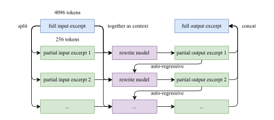<figcaption>Kimi K2, Figure 4: long documents are rewritten chunk by chunk, with previous chunks as context.</figcaption></figure>
    <div class="d20-example">
      <div class="fv-panel d20-source">
        <div class="d20-card-heading"><b>Source</b></div>
        <p>At sea level water boils at 100 °C; on Everest at about 70 °C, because air pressure is lower.</p>
      </div>
      <div class="d20-variants fragment" data-fragment-index="1">
        <div class="fv-panel">
          <div class="d20-card-heading"><b>Textbook</b><span>✓ faithful</span></div>
          <p>Boiling point falls with pressure: 100 °C at sea level, ≈70 °C on Everest.</p>
        </div>
        <div class="fv-panel">
          <div class="d20-card-heading"><b>Q&amp;A</b><span>✓ faithful</span></div>
          <p>Why below 100 °C on Everest? Lower air pressure → ≈70 °C.</p>
        </div>
        <div class="fv-panel">
          <div class="d20-card-heading"><b>Learning note</b><span>✓ faithful</span></div>
          <p>pressure ↓ → boiling point ↓ · 100 °C → ≈70 °C</p>
        </div>
      </div>
      <div class="d20-check fragment" data-fragment-index="2">
        <div class="fv-panel d20-rejected">
          <p>On Everest water boils at ≈70 °C <strong class="fv-accent d20-cause">because it is colder there.</strong></p>
          <div class="d20-verdict">✗ rejected — fidelity check: cause changed</div>
        </div>
        <p class="d20-check-note">Each rephrasing is compared with its source before it enters training.</p>
      </div>
    </div>
  </div>
</div>
<div class="fv-takeaway">Rewriting aims to preserve the knowledge while changing how it is presented.</div>
<div class="fv-source"><a href="https://arxiv.org/html/2507.20534#S2.SS2">Kimi K2: Open Agentic Intelligence, §2.2, Figure 4, 2025</a> · Original figure; right: teaching example</div>
```

::: {.notes}
**On opening.** In the previous example, the verifier checked a program by executing it. That check is usually not applicable to factual text: we need to check fidelity to the source. Recall D 10: repeating the same text becomes less useful. Rephrasing gives us a new text with the same knowledge.

Read Figure 4 from left to right. A long document cannot reliably be rewritten in one go because of output-length limits. It is split into chunks, rewritten sequentially with previously rewritten chunks as context, and stitched back together into a complete passage. This preserves continuity across the document.

The source on the right is our teaching example, not an excerpt from Kimi K2. At standard sea-level pressure, pure water boils at 100 °C; near Everest's summit, about 70 °C is a rounded estimate. The exact value varies with atmospheric pressure. Lower pressure is the reason for the lower boiling point.

**Click 1.** Inspired by WRAP, Kimi K2 uses prompts that vary style and perspective to diversify the language while preserving facts. The three cards illustrate one piece of knowledge as a textbook passage, a question and answer, and a learning note. These particular cards are our illustration, not styles quoted from the paper. For mathematical data, Kimi K2 specifically rewrites high-quality documents in a learning-note style following SwallowMath, and translates high-quality mathematical materials from other languages into English.

**Click 2.** A rephrasing can sound fluent while changing a fact. The fourth card changes the cause: the lower boiling point is due to lower air pressure, not to colder surroundings. Kimi K2 compares each rephrased passage with its source for semantic alignment before training. This fidelity-verification step is described separately in §2.2; it is not part of the original Figure 4. The illustration makes the check concrete without adding it to the published diagram. This continues D 16, where one “not” changes the meaning, and D 19, where a convenient test misses an error.

The aim is to change the representation of knowledge while preserving the knowledge itself. If rewriting drops a condition or changes a fact, the new text does not automatically become a useful training example. Checking fidelity to the source is therefore part of data preparation.

But a plausible process diagram does not establish a measured effect. The authors ran a separate ablation: they compared repeating the original text, repeating one rewritten version, and presenting ten versions once each. That is our next slide, D 21.

**Sources:** [Kimi K2: Open Agentic Intelligence, §2.2, Figure 4](https://arxiv.org/html/2507.20534#S2.SS2). Fidelity verification is described in the text, not in Figure 4. The water example is author-created; the rounded temperature and pressure explanation are supported by [Royal Meteorological Society, “Boiling Water with Ice”](https://www.metlink.org/experiment/boiling-water-with-ice/).
:::

## Rewriting helps more than repeating the original text {#frontier-f16-experiment .fv-slide .fv-detail background-color="#ffffff"}

```{=html}
<div class="fv-meta"><span class="fv-id">D 21 / 42</span><span class="fv-cluster">Architecture</span><span class="fv-cluster active">Data</span><span class="fv-cluster">Training</span><span class="fv-cluster">Inference</span><span class="fv-cluster">Tools</span></div>
<div class="fv-body d21-body">
  <svg class="d21-chart" viewBox="0 0 1488 530" role="img" aria-labelledby="d21-chart-title d21-chart-desc">
    <title id="d21-chart-title">Kimi K2 · early checkpoint · Table 1</title>
    <desc id="d21-chart-desc">Same knowledge, seen ten times in each condition. Original text ten times: 23.76% correct. One rewrite ten times: 27.39%, up 3.63 percentage points. Ten different rewrites once each: 28.94%, up 5.18 percentage points versus the original. Bars start at zero.</desc>
    <text class="d21-note" x="16" y="22">Kimi K2 · early checkpoint · Table 1</text>
    <text class="d21-note" x="438" y="68">same knowledge, seen 10 times</text>
    <text class="d21-axis-title" x="790" y="68">SimpleQA, % correct</text>
    <path class="d21-grid" d="M790 110V480 M960 110V480 M1130 110V480 M1300 110V480"/>
    <g class="d21-ticks" text-anchor="middle"><text x="790" y="99">0</text><text x="960" y="99">10</text><text x="1130" y="99">20</text><text x="1300" y="99">30</text></g>
    <g class="d21-row">
      <text class="d21-label" x="16" y="163">Original text × 10 passes</text>
      <g aria-hidden="true">
        <rect x="438" y="141" width="22" height="22" fill="currentColor" fill-opacity="0.28" stroke="currentColor"/>
        <rect x="467" y="141" width="22" height="22" fill="currentColor" fill-opacity="0.28" stroke="currentColor"/>
        <rect x="496" y="141" width="22" height="22" fill="currentColor" fill-opacity="0.28" stroke="currentColor"/>
        <rect x="525" y="141" width="22" height="22" fill="currentColor" fill-opacity="0.28" stroke="currentColor"/>
        <rect x="554" y="141" width="22" height="22" fill="currentColor" fill-opacity="0.28" stroke="currentColor"/>
        <rect x="583" y="141" width="22" height="22" fill="currentColor" fill-opacity="0.28" stroke="currentColor"/>
        <rect x="612" y="141" width="22" height="22" fill="currentColor" fill-opacity="0.28" stroke="currentColor"/>
        <rect x="641" y="141" width="22" height="22" fill="currentColor" fill-opacity="0.28" stroke="currentColor"/>
        <rect x="670" y="141" width="22" height="22" fill="currentColor" fill-opacity="0.28" stroke="currentColor"/>
        <rect x="699" y="141" width="22" height="22" fill="currentColor" fill-opacity="0.28" stroke="currentColor"/>
      </g>
      <rect class="d21-bar" x="790" y="132" width="403.92" height="44"/>
      <text class="d21-value" x="1209.92" y="164">23.76</text>
    </g>
    <g class="d21-row fragment" data-fragment-index="1">
      <text class="d21-label" x="16" y="308">One rewrite × 10 passes</text>
      <g aria-hidden="true">
        <rect x="438" y="286" width="22" height="22" fill="currentColor" fill-opacity="0.8" stroke="currentColor"/>
        <rect x="467" y="286" width="22" height="22" fill="currentColor" fill-opacity="0.8" stroke="currentColor"/>
        <rect x="496" y="286" width="22" height="22" fill="currentColor" fill-opacity="0.8" stroke="currentColor"/>
        <rect x="525" y="286" width="22" height="22" fill="currentColor" fill-opacity="0.8" stroke="currentColor"/>
        <rect x="554" y="286" width="22" height="22" fill="currentColor" fill-opacity="0.8" stroke="currentColor"/>
        <rect x="583" y="286" width="22" height="22" fill="currentColor" fill-opacity="0.8" stroke="currentColor"/>
        <rect x="612" y="286" width="22" height="22" fill="currentColor" fill-opacity="0.8" stroke="currentColor"/>
        <rect x="641" y="286" width="22" height="22" fill="currentColor" fill-opacity="0.8" stroke="currentColor"/>
        <rect x="670" y="286" width="22" height="22" fill="currentColor" fill-opacity="0.8" stroke="currentColor"/>
        <rect x="699" y="286" width="22" height="22" fill="currentColor" fill-opacity="0.8" stroke="currentColor"/>
      </g>
      <rect class="d21-bar" x="790" y="277" width="465.63" height="44"/>
      <text class="d21-value" x="1271.63" y="309">27.39</text>
      <text class="d21-delta" x="790" y="356">+3.63</text>
    </g>
    <g class="d21-row d21-best fragment" data-fragment-index="2">
      <rect class="d21-best-bg" x="0" y="382" width="1488" height="132"/>
      <text class="d21-label" x="16" y="453">Ten rewrites × 1 pass</text>
      <g aria-hidden="true">
        <rect x="438" y="431" width="22" height="22" fill="currentColor" fill-opacity="0.18" stroke="currentColor"/>
        <rect x="467" y="431" width="22" height="22" fill="currentColor" fill-opacity="0.26" stroke="currentColor"/>
        <rect x="496" y="431" width="22" height="22" fill="currentColor" fill-opacity="0.34" stroke="currentColor"/>
        <rect x="525" y="431" width="22" height="22" fill="currentColor" fill-opacity="0.42" stroke="currentColor"/>
        <rect x="554" y="431" width="22" height="22" fill="currentColor" fill-opacity="0.50" stroke="currentColor"/>
        <rect x="583" y="431" width="22" height="22" fill="currentColor" fill-opacity="0.58" stroke="currentColor"/>
        <rect x="612" y="431" width="22" height="22" fill="currentColor" fill-opacity="0.66" stroke="currentColor"/>
        <rect x="641" y="431" width="22" height="22" fill="currentColor" fill-opacity="0.74" stroke="currentColor"/>
        <rect x="670" y="431" width="22" height="22" fill="currentColor" fill-opacity="0.82" stroke="currentColor"/>
        <rect x="699" y="431" width="22" height="22" fill="currentColor" fill-opacity="0.90" stroke="currentColor"/>
      </g>
      <rect class="d21-bar" x="790" y="422" width="491.98" height="44"/>
      <text class="d21-value" x="1297.98" y="454">28.94</text>
      <text class="d21-delta" x="790" y="501">+5.18 vs. original</text>
    </g>
  </svg>
</div>
<div class="fv-takeaway">In this ablation, changing how knowledge is presented helps the model learn it.</div>
<div class="fv-source"><a href="https://arxiv.org/html/2507.20534#S2.SS2">Kimi K2, §2.2, Table 1</a> · differences calculated from the table</div>
```

::: {.notes}
**On opening.** The three rows reproduce the conditions from Kimi K2, Table 1. SimpleQA evaluates short answers to factual questions; the numbers are percentages of correct answers, so higher is better. The source is raw wiki-text. Presenting it ten times yields 23.76.

**Click 1 — one rewrite, ten passes.** Rewriting the source once and presenting that corpus ten times raises the score to 27.39: 27.39 − 23.76 = 3.63 percentage points. A single change of wording already outperforms simple repetition of the source.

**Click 2 — ten rewrites, one pass.** Preparing ten different rewritten versions and presenting each once yields 28.94: 28.94 − 23.76 = 5.18 percentage points above the original. Diversity across several variants adds another gain. These differences are calculated from published values; we did not run a new model evaluation.

The icons show the same knowledge encountered ten times in all three conditions; only its surface form changes. This resolves the tension from D 10 and from Phi-4. What loses value under repetition is the same wording, not the knowledge. Scarce is unique information, not tokens, and repetition is a weight we set deliberately.

**Caveats.** The comparison uses an early K2 checkpoint, not the released model's final score or its full training run. The ten variants belong to the ablation. For large knowledge corpora in the main run, the authors report at most two rewrites. The number of passes alone does not establish an equal token count, because rewritten documents can differ in length.

**Optional addition — BeyondWeb (no slide fragment).** Independent supporting evidence comes from DatologyAI, a company that sells data curation: this is a vendor report. With a Llama-3.2-1B model and 20B training tokens, 20B unique tokens give 46.2, the same 10B seen twice give 45.5, and the mixture with rephrased variants gives 50.4. Repetition costs little; rephrasing wins. These are average accuracies across 14 tasks and 0-shot/5-shot settings, not SimpleQA. The rephrasing condition mixes 10B original tokens with 10B synthetic tokens derived from the same source. Values and setup checked against [BeyondWeb, §4.1 and §4.3](https://www.datologyai.com/blog/beyondweb) on 2026-10-28; check the report before quoting the numbers aloud.

**Bridge.** So far, we have varied how knowledge is presented. Next, we focus on example length and ask what forces the model to connect its distant parts.

**Source:** [Kimi K2, §2.2, Table 1](https://arxiv.org/html/2507.20534#S2.SS2). Teaching calculations: 27.39 − 23.76 = 3.63; 28.94 − 23.76 = 5.18 percentage points.
:::

## What we know so far {#data-recap-synthetic .fv-slide .data-recap-slide background-color="#ffffff"}

::: {.data-recap data-section="synthetic"}
:::

::: {.notes}
On opening, D 18 reports that only ~24% of unfiltered SelfCodeAlign solutions pass their generated tests (24.1% in Table 9's full random sample), rather than a universal synthetic-data acceptance rate. On click 1, D 19 shows why test coverage matters: HumanEval+ adds 80× tests and exposes pass@k reductions of up to 19.3–28.9%, rounded to 19–29% on the slide. On click 2, D 20–21 distinguish repeating knowledge from repeating wording: Kimi K2's early-checkpoint ablation improves SimpleQA from 23.76 to 28.94 using ten rewrites once instead of the original ten times. On click 3, connect verification to D 02's “What examples should we create?”: generated candidates become useful only when their checks fit the intended learning task. Next, D 22 turns to long-context data and asks how examples teach dependencies between distant passages.
:::

## Long-context data and curriculum {#frontier-f18 .fv-slide background-color="#ffffff"}

```{=html}
<div class="fv-meta"><span class="fv-id">D 22 / 42</span><span class="fv-cluster">Architecture</span><span class="fv-cluster active">Data</span><span class="fv-cluster">Training</span><span class="fv-cluster">Inference</span><span class="fv-cluster">Tools</span></div>
<div class="fv-body f18-body">
  <svg class="f18-document" viewBox="0 0 1488 250" width="1488" height="250" role="img" aria-label="A long document with links between distant passages">
    <text x="0" y="25" font-size="24" fill="#626262">One document — several long-range dependencies</text>
    <rect x="0" y="113" width="353" height="88" fill="#f3f3f3" stroke="#c5c5c5"/>
    <path d="M22 140H326M22 156H300M22 172H320" stroke="#d1d1d1" stroke-width="4"/>
    <g class="fragment" data-fragment-index="1"><rect x="353" y="113" width="1134" height="88" fill="#f3f3f3" stroke="#c5c5c5"/><path d="M380 140H640M380 156H676M380 172H652M726 140H1010M726 156H999M726 172H1030M1100 140H1450M1100 156H1434M1100 172H1455" stroke="#d1d1d1" stroke-width="4"/><text x="1458" y="237" text-anchor="end" font-size="24" fill="#626262">Sequence length →</text></g>
    <g class="fragment" data-fragment-index="2"><path d="M128 113Q330 1 597 113M597 113Q900 -14 1285 113M128 201Q710 271 1285 201" stroke="#141414" stroke-width="2" fill="none"/><rect x="59" y="123" width="138" height="67" fill="#bef264" stroke="#141414"/><text x="128" y="163" text-anchor="middle" font-size="26">Premise A</text><rect x="519" y="123" width="156" height="67" fill="#bef264" stroke="#141414"/><text x="597" y="163" text-anchor="middle" font-size="26">Link B</text><rect x="1205" y="123" width="160" height="67" fill="#bef264" stroke="#141414"/><text x="1285" y="163" text-anchor="middle" font-size="26">Result A+B</text></g>
  </svg>
  <div class="f18-curriculum"><div class="fv-label">Kimi K3<br>Training length</div><div><b>8K</b><span>pre-training</span></div><i>→</i><div><b>64K</b><span>pre-training</span></div><i>→</i><div><b>256K</b><span>mid-training</span></div><i>→</i><div class="f18-last"><b>1M</b><span>mid-training</span></div></div>
</div>
<div class="fv-takeaway">A large context window does not guarantee use of distant information.</div>
<div class="fv-source"><a href="https://arxiv.org/html/2607.24653v1#S3.SS4">Kimi K3, §3.4, 2026</a> (the report calls the last two stages “cooldown”) · <a href="https://arxiv.org/abs/2404.06654">RULER, 2024</a> · Document: teaching schematic</div>
```

::: {.notes}
After the architecture block, it is tempting to say: expand the available window, and the model will handle long documents. But fitting a sequence and using distant information are different requirements. The data must create a task that actually needs that information to be solved.

*First click: reveal the document's length; second click: reveal the links between passages.*

At first, we simply added text. Now we have premise A, a distant link B, and a result that requires both. The arcs represent dependencies in the task, not measured attention weights. A long sequence could consist of independent short tasks and never test this kind of connection.

The middle row shows a curriculum: a sequence of training stages with different lengths. The Kimi K3 report specifies eight thousand, sixty-four thousand, two hundred and fifty-six thousand, and one million tokens.

Keep three factors separate — data dependencies, training length, and architectural state: what the data requires us to connect, what length was used in training, and what the architecture keeps accessible. A large window alone does not guarantee the required quality. It makes a long input possible. We need a separate task to test whether the model uses the connection. Next, we will build such a task with an exact answer and distracting records.

**Optional detail.** The length schedule comes from a specific report; it is not a universal recipe. The report calls the final two stages “cooldown”; other teams call this stage mid-training: a short final phase of pre-training on a selected mixture, with the learning rate annealed to zero. Distances in the diagram are not proportional to token counts. Training length, available context window, and performance on long-range dependencies are separate characteristics.

**Sources:** [Kimi K3, §3.4, 2026](https://arxiv.org/html/2607.24653v1#S3.SS4), [RULER, 2024](https://arxiv.org/abs/2404.06654).

Positional scaling and longer-sequence training are coordinated in [LongRoPE §3.3](https://arxiv.org/pdf/2402.13753), with short-context performance retested separately. Whole songs preserve distant links between choruses, arrangement and ending: [YuE2 §2.4 / §3.1](https://arxiv.org/html/2609.33757v1) packs songs into 24,576 positions, whereas MERT2-FS uses 30–360-second recordings; sequence positions and duration are different quantities.
:::

## Long context: two facts, distractors, and an exact answer {#frontier-f18-detail .fv-slide .fv-detail background-color="#ffffff"}

```{=html}
<div class="fv-meta"><span class="fv-id">D 23 / 42</span><span class="fv-cluster">Architecture</span><span class="fv-cluster active">Data</span><span class="fv-cluster">Training</span><span class="fv-cluster">Inference</span><span class="fv-cluster">Tools</span></div>
<div class="fv-body d18-body">
  <div class="d18-question"><b>Task:</b> what is the code for project Lyra? Reply with the code only.</div>
  <div class="d18-context"><div class="d18-fact"><small>Early passage</small><code>Lyra → key K7</code></div><div class="d18-noise"><small>Distractors</small><code>Lyra2 → K8 · K8 → 38</code></div><div class="d18-fact"><small>Distant passage</small><code>K7 → code 83</code></div><div class="d18-noise d18-tail"><small>Distractors</small><span>… other records …</span></div></div>
  <div class="d18-reasoning fragment" data-fragment-index="1"><b>Both facts are needed:</b><code>Lyra</code><span>→</span><code>K7</code><span>→</span><code class="d18-answer">83</code><em>Key K8 does not apply.</em></div>
  <div class="d18-protocol fragment" data-fragment-index="2"><div class="d18-curriculum"><b>Curriculum: harder data</b><div><span>2K</span><i>→</i><span>8K</span><i>→</i><span>32K</span></div><p>More distractors; facts placed further apart.<br>The link Lyra → K7 → 83 stays intact.</p></div><div class="d18-eval"><b>Evaluation: vary conditions</b><p>New names and codes · different fact positions · different lengths L</p><span class="math inline">\(\text{Exact match}=\frac{\text{correct codes}}{\text{total tasks}}\)</span></div></div>
  <p class="d18-kimi"><b>Kimi K3 builds 1M-token tasks the same way:</b> “the embedded tasks can be solved only by attending to information scattered across the full 1M-token context.”</p>
</div>
<div class="fv-takeaway">A long-context test must require a distant connection and vary the relevant facts' positions.</div>
<div class="fv-source"><a href="https://arxiv.org/abs/2404.06654">RULER, 2024 — retrieval and variable tracking</a> · Original teaching task; illustrative lengths: 2K/8K/32K · <a href="https://arxiv.org/html/2607.24653v1#S3.SS4">Kimi K3 §3.4</a></div>
```

::: {.notes}
The answer must contain only the code for project Lyra. An early passage states that the project is linked to key K7. A distant passage states that key K7 corresponds to code 83. Neither fact alone provides the complete path from the project name to the code.

Between them are distractors: irrelevant records. There is a similar name, Lyra2, linked to K8, and a mapping from K8 to code 38. These records do not contradict the relevant facts. They create the risk of selecting a similar name or the nearest number instead of following the correct connection.

*First click: reveal the answer chain.*

We start with the exact name Lyra, obtain K7, and then look up the value for that specific key. The answer is 83. Key K8 is not part of this chain.

*Second click: show the curriculum and evaluation.*

In this teaching curriculum, lengths grow from two thousand tokens to eight thousand and then thirty-two thousand. We increase the number of distractors and the distance between the facts. The required connection stays intact. These lengths belong to our example, not to the Kimi K3 schedule.

For evaluation, we vary names and codes, the positions of both facts, and the total context length, denoted by L. Exact match is the fraction of tasks that return the correct code. We define the comparison rule in advance, such as trimming leading and trailing whitespace. We inspect results separately for each length so that an overall average does not hide failures on long inputs.

The slide shows a protocol, not measured model success. This task tests one specific distant connection; it does not cover every kind of reasoning. Now we return to Kimi K3: how can we ensure that long examples appear in the training mix and distribute the required information across those examples?

**Optional detail.** If we always keep the answer 83 or use the same fact positions, a shortcut becomes available without finding the required connection. New names, codes, and positions help test the mechanism itself. This example is inspired by retrieval and variable-tracking tasks, but is not presented as an official RULER test.

**Sources:** [RULER, 2024 — retrieval and variable tracking](https://arxiv.org/abs/2404.06654).

In the Lyra example, a local passage was not enough to obtain the code. Now we can read how the Kimi K3 authors express a similar requirement for a multimodal corpus: embedded tasks should be solvable only by using information spread across the full million-token context. This is a requirement for the design of the training data, not just for sequence length.

To achieve this, the authors reorder and combine multimodal documents and subtasks. The information required for the solution is located in different parts; the Lyra diagram above illustrates the principle, not an official Kimi example or measured attention result.

Why does this operation matter? If each subtask can be solved entirely from a small nearby passage, the model can rely on local processing even within a long input. Distributed dependencies make distant information necessary.

This is the team's stated recipe. Section 3.4 does not quantify the individual contribution of reordering and combining, so we should not present this slide as evidence of a specific quality gain. Next we examine how much of the training mix should contain long data, before moving from documents to interaction trajectories.

**Source:** [Kimi K3, §3.4, Long-Context Data](https://arxiv.org/html/2607.24653#S3.SS4.SSS0.Px2).
:::

## Long examples need a place in the training mix {#frontier-f18-case-sampling .fv-slide background-color="#ffffff"}

```{=html}
<div class="fv-meta"><span class="fv-id">D 24 / 42</span><span class="fv-cluster">Architecture</span><span class="fv-cluster active">Data</span><span class="fv-cluster">Training</span><span class="fv-cluster">Inference</span><span class="fv-cluster">Tools</span></div>
<div class="fv-body dc-body">
  <p class="d24-sampling"><b>Kimi K3 §3.4:</b> Long, coherent documents and videos are sampled more often so that short sequences do not crowd them out.</p>
  <figure class="d24-prolong">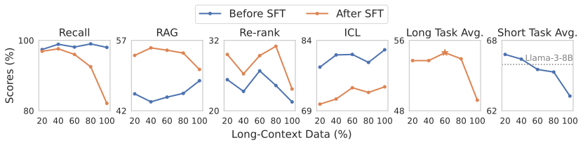<figcaption>ProLong · original Figure 3 · fixed 5B-token training budget</figcaption></figure>
  <div class="d24-findings"><p><b>60% long + 40% short</b>works best</p><p><b>100% long data</b>hurts long-context results</p></div>
</div>
<div class="fv-takeaway">Long data needs a share of the mix, not all of it.</div>
<div class="fv-source"><a href="https://arxiv.org/html/2607.24653v1#S3.SS4">Kimi K3 §3.4</a> · <a href="https://arxiv.org/html/2410.02660v1#S3.F3">Gao et al., How to Train Long-Context Language Models (Effectively), 2024 · §3.2 / Figure 3; §2.1 / Figure 1</a></div>
```

::: {.notes}
Kimi K3 upsamples long, coherent documents and videos so that short sequences do not dominate the long-context distribution. The 8K → 64K → 256K → 1M schedule is already shown on D 22; those stage lengths describe a curriculum, not the share of long examples in a mixture. Source: [Kimi K3 §3.4](https://arxiv.org/html/2607.24653v1#S3.SS4).

ProLong tests the mixture directly at a fixed budget of 5B tokens, using books and code repositories as long data and ShortMix as short data. The original Figure 3 compares several long tasks, their average, and short-task performance. The best average is obtained with 60% long and 40% short data (§3.2); short-task performance declines as the long share increases. Evaluating after SFT matters: the orange long-task average falls sharply at 100%, even though some individual tasks benefit from more long data. This is a measured recipe for these experiments, not a universal 60/40 optimum. [Gao et al., 2024, §3.2 / Figure 3](https://arxiv.org/html/2410.02660v1#S3.F3); [§2.1 / Figure 1](https://arxiv.org/html/2410.02660v1#S2.F1) likewise shows that using only long data hurts downstream long-context performance despite better perplexity.

The OLMo 2 7B average 53.0 → 62.9 concerns mid-training on selected high-quality data using 5–10% of FLOPs; it is not an isolated causal effect of long context ([OLMo 2, Table 9](https://arxiv.org/html/2501.00656)). The stage blocks formerly shown here had equal visual widths only to indicate order, not equal training durations or token budgets.

We can now summarize the section: require distant links, practice them at increasing distances, and reserve a measured share of the mixture for long data. The next unit of training data will be a trajectory of actions in an environment.
:::

## What we know so far {#data-recap-long-context .fv-slide .data-recap-slide background-color="#ffffff"}

::: {.data-recap data-section="long-context"}
:::

::: {.notes}
On opening, D 22 distinguishes a long available window from the ability to use distant information; the Lyra → K7 → 83 task on D 23 requires both distant facts. On click 1, recall D 23’s curriculum of distractors and increasing distance: 2K → 8K → 32K are teaching-example lengths, not Kimi K3’s schedule. On click 2, D 24 shows ProLong’s best average at 60% long and 40% short data in that experiment, while 100% long data hurts. On click 3, read the takeaway: long context is taught by data that needs it. Next, D 25 moves from documents to interaction trajectories: actions, observations, failure and recovery. See [D 22](#frontier-f18), [D 23](#frontier-f18-detail), and [D 24](#frontier-f18-case-sampling).
:::

## Interaction trajectories and synthetic environments {#frontier-f19 .fv-slide background-color="#ffffff"}

```{=html}
<div class="fv-meta"><span class="fv-id">D 25 / 42</span><span class="fv-cluster">Architecture</span><span class="fv-cluster active">Data</span><span class="fv-cluster">Training</span><span class="fv-cluster">Inference</span><span class="fv-cluster">Tools</span></div>
<div class="fv-body f19-body">
  <div class="f19-head"><div>Environment specifications<br><span>+ Initial states</span></div><div>Independent trajectories</div><div>Recorded outcomes</div></div>
  <div class="f19-trajectory"><div class="f19-seed">env A · state a₀</div><div class="f19-tape"><span>Observation</span><i>→</i><span>Action</span><i>→</i><span>Result</span></div><div class="f19-outcome">completed</div></div>
  <div class="f19-trajectory"><div class="f19-seed">env B · state b₀</div><div class="f19-tape"><span>Observation</span><i>→</i><span class="fragment fv-highlight" data-fragment-index="1">Action</span><i>→</i><span class="fragment fv-highlight" data-fragment-index="1">Result</span><i>→</i><span>…</span></div><div class="f19-outcome">recovered</div></div>
  <div class="f19-trajectory"><div class="f19-seed">env C · state c₀</div><div class="f19-tape"><span>Observation</span><i>→</i><span>Action</span><i>→</i><span>Result</span><i>→</i><span>…</span><i>→</i><span>Result</span></div><div class="f19-outcome">timeout</div></div>
  <div class="f19-detail fragment" data-fragment-index="1"><b>One recorded step</b><code>Action: run(test)</code><i>→</i><code>Result: exit 1 + error log</code></div>
  <div class="f19-process"><span>Generation</span><i>→</i><span>Execution</span><i>→</i><span>Logging</span><i>→</i><span>Selection</span></div>
</div>
<div class="fv-takeaway">The corpus preserves actions, observed results, and the course of the interaction.</div>
<div class="fv-source"><a href="https://arxiv.org/html/2607.24653v1#S4.SS2">Kimi K3, §4.2, 2026</a> · <a href="https://arxiv.org/abs/2210.03629">ReAct, 2022</a> · Teaching diagram</div>
```

::: {.notes}
A correct final answer alone is not enough to train tool interaction. We need to know what the agent observed, which action it chose, and what the environment actually returned. The unit of data therefore becomes a trajectory: a sequence of these steps.

The left column specifies the environment conditions and initial state. The three rows are independent: they represent separate episodes. Observation is what the agent can see, action is what it does, and result is the execution outcome. The result becomes part of the next observation and shapes what happens next.

The right column records different outcomes: completion, recovery from an error, and termination at a limit. The final status alone does not tell us how the agent got there.

*First click: reveal a specific recorded step.*

The agent ran a test. The environment returned exit code one and an error log. If we keep only the intention, "run the test," we lose the actual observation that should explain the next step.

The bottom chain shows data collection: candidate generation, execution, event logging, and selection. A useful episode may contain a failed attempt followed by recovery. Whether we retain an error therefore depends on the purpose of the data. For now, we are deciding what to record; how to train on that record is a separate choice. Let us examine a small file interaction where the distinction between action, result, and state is directly visible.

**Sources:** [Kimi K3, §4.2, 2026](https://arxiv.org/html/2607.24653v1#S4.SS2), [ReAct, 2022](https://arxiv.org/abs/2210.03629).
:::

## Trajectory record: preserve failure and recovery {#frontier-f19-detail .fv-slide .fv-detail background-color="#ffffff"}

```{=html}
<div class="fv-meta"><span class="fv-id">D 26 / 42</span><span class="fv-cluster">Architecture</span><span class="fv-cluster active">Data</span><span class="fv-cluster">Training</span><span class="fv-cluster">Inference</span><span class="fv-cluster">Tools</span></div>
<div class="fv-body d19-body">
  <div class="d19-goal"><b>Environment specification:</b> result.txt must contain the string <code>42</code>.<br><span>Initial state: no file. Observation is the part of the state available to the agent.</span></div>
  <table class="d19-log"><thead><tr><th>Step</th><th>Observation</th><th>Action</th><th>Result / next observation</th><th>done</th></tr></thead><tbody><tr><td>0</td><td>File not checked</td><td><code>read("result.txt")</code></td><td><code>ENOENT</code> · no file</td><td>false</td></tr><tr class="fragment" data-fragment-index="1"><td>1</td><td>No file</td><td><code>write("result.txt", "42")</code></td><td><code>ok</code> · verifier: content = 42</td><td>true</td></tr></tbody></table>
  <div class="d19-transition fragment" data-fragment-index="1"><div><b>Failure</b><span>File absent → absent</span></div><div><b>Recovery</b><span>File absent → contains 42</span></div><div><b>Log</b><span>Preserves both transitions</span></div></div>
  <div class="d19-selection fragment" data-fragment-index="2"><div><b>Episode selection rule</b><code>goal_verified &amp;&amp; log_complete</code></div><div><b>Keep trajectory: [step 0, step 1]</b><span>The error provides context for recovery.<br>Keeping a record ≠ choosing a training signal.</span></div></div>
</div>
<div class="fv-takeaway">A full trajectory shows how the agent reached a verified goal, including failure and recovery.</div>
<div class="fv-source"><a href="https://gymnasium.farama.org/api/env/">Gymnasium: step / observation / termination</a> · <a href="https://arxiv.org/abs/2210.03629">ReAct, 2022</a> · Teaching protocol</div>
```

::: {.notes}
The environment has a simple goal: result.txt must contain the string "42". Initially, the file does not exist. The collection system knows that state, but the agent receives only observations and has not yet checked whether the file exists. This distinguishes the state of the world from the information available to the agent.

At step zero, the agent calls the file-reading tool. The result, ENOENT, means the file does not exist. The failed read leaves the file system unchanged, but the agent's observation changes: the absence of the file is now known. The done field, which indicates whether the episode has ended, is still false.

*First click: show the recovery and state transitions.*

At the next step, the agent writes the string "42". The environment confirms execution, and the verifier checks the contents. The goal has been reached, so done becomes true in our protocol. The external state has now changed too: the file exists with the required contents. The log preserves both transitions.

*Second click: reveal the selection rule.*

The rule requires both a verified goal and a complete log. Both conditions are met, so we keep steps zero and one. The failed read explains the subsequent recovery. Removing it would discard part of the decision context.

But recording an action does not mean training the model to repeat it. An error can remain as context while the training signal is assigned separately. Similarly, stopping at a limit must not be treated as achieving the goal.

The file episode showed what to record about an interaction. Next, we examine a published DeepSeek-V3.2 example that creates the environment, tools, task, and verifier together. We will then check whether training in such environments helped on other tasks.

**Optional detail.** The done field is simplified for this teaching table. For example, Gymnasium distinguishes natural termination from a cutoff imposed by an external limit using terminated and truncated. Keeping a full trajectory does not define the loss function or automatically imply reinforcement learning: the data format and training algorithm are separate choices.

**Optional comprehension check.** After the failed read, did the environment state change, or the agent's observation? The file is still absent, but the agent has learned this. The step result is what connects the next action to the information available to the agent.

**Sources:** [Gymnasium: step / observation / termination](https://gymnasium.farama.org/api/env/), [ReAct, 2022](https://arxiv.org/abs/2210.03629).
:::

## Agent data: task, environment, and verification {#frontier-f19-case .fv-slide background-color="#ffffff"}

```{=html}
<div class="fv-meta"><span class="fv-id">D 27 / 42</span><span class="fv-cluster">Architecture</span><span class="fv-cluster active">Data</span><span class="fv-cluster">Training</span><span class="fv-cluster">Inference</span><span class="fv-cluster">Tools</span></div>
<div class="fv-body dc-body">
  <div class="dc-kicker"><b>DeepSeek-V3.2 · 〈environment, tools, task, verifier〉</b><span>Published example · PDF p.12</span></div>
  <div class="dc-trip">
    <div><h3>Trip on October 1–3, 2025</h3><div class="dc-constraints"><div><b>No repeats:</b> cities, hotels, restaurants or attractions.</div><div><b>One city per day:</b> hotel, both restaurants and attraction must be in that day’s city.</div></div></div>
    <div><h3>Tools from the same task</h3><div class="dc-tools">get_all_cities()<br>get_all_hotels_by_city(city)<br>submit_result(answer_text)<br>…</div><div class="dc-answer dc-highlight"><b>verifier checks the constraints of the answer</b></div></div>
  </div>
  <div class="dc-dataset"><span><b>1,827</b> environments</span><span aria-hidden="true">·</span><span><b>4,417</b> tasks</span></div>
</div>
<div class="fv-takeaway">The reference solution uses tools; the verifier checks the task constraints.</div>
<div class="fv-source"><a href="https://arxiv.org/pdf/2512.02556#page=12">DeepSeek-V3.2, §3.2.3, example on p.12, 2025</a> · Conditions and tools abridged; additional task details in speaker notes</div>
```

::: {.notes}
The file example already had a state, actions, and a verifiable goal. DeepSeek-V3.2 scales the creation of these conditions: in its general-agent dataset, the unit of data comprises an environment, tools, a task, and a verifier. After selection for nonzero pass@100, the authors obtain 1,827 synthetic environments and 4,417 tasks. At least one of one hundred attempts must succeed. This selects solvable tasks; it does not require the agent to succeed every time.

Let us examine the published PDF example, rather than inventing a task. The agent must plan a three-day trip starting in Hangzhou. Cities and selected venues must not repeat, and all locations on each day must be in that day's city. The hotel price on day two determines additional requirements. One exact branch is: if the hotel costs at least 800 yuan, the two restaurants must cost less than 350 in total, each must have a rating of at least 4.0, and the attraction must cost less than 120.

The original also includes branches for the 500–800 and 200–500 yuan ranges. They are omitted for readability, as the caption explicitly states. The text does not formalize the boundaries of those ranges, so we do not redefine them.

The right column lists three actual tools; others include get_infos_by_hotel(info_keywords, hotel), get_all_restaurants_by_city(city) and get_all_attractions_by_city(city). The answer fields are time, city, hotel, afternoon_restaurant, afternoon_attraction and evening_restaurant. There are also tools for retrieving details about restaurants and attractions. The reference solution must use the tool interface; direct database access is prohibited. The result is submitted as a JSON array of three objects through submit_result(answer_text), and the verifier checks it.

Creating an environment does not by itself establish that training on it is useful. The next slide examines transfer to external agent tasks.

**Sources:** [DeepSeek-V3.2, §3.2.3](https://arxiv.org/html/2512.02556#S3.SS2.SSS3), [full published example, PDF p.12](https://arxiv.org/pdf/2512.02556#page=12). The HTML version omits the box containing the full example, so the conditions were taken from the PDF.
:::

## Training in synthetic environments transfers to other tasks {#frontier-f19-experiment .fv-slide .fv-detail background-color="#ffffff"}

```{=html}
<div class="fv-meta"><span class="fv-id">D 28 / 42</span><span class="fv-cluster">Architecture</span><span class="fv-cluster active">Data</span><span class="fv-cluster">Training</span><span class="fv-cluster">Inference</span><span class="fv-cluster">Tools</span></div>
<div class="fv-body dc-body">
  <div class="dc-kicker"><b>DeepSeek-V3.2 · external test of tool use</b><span>Experiment · §4.3, Figure 5</span></div>
  <div class="dc-evidence dc-transfer">
    <figure class="dc-figure">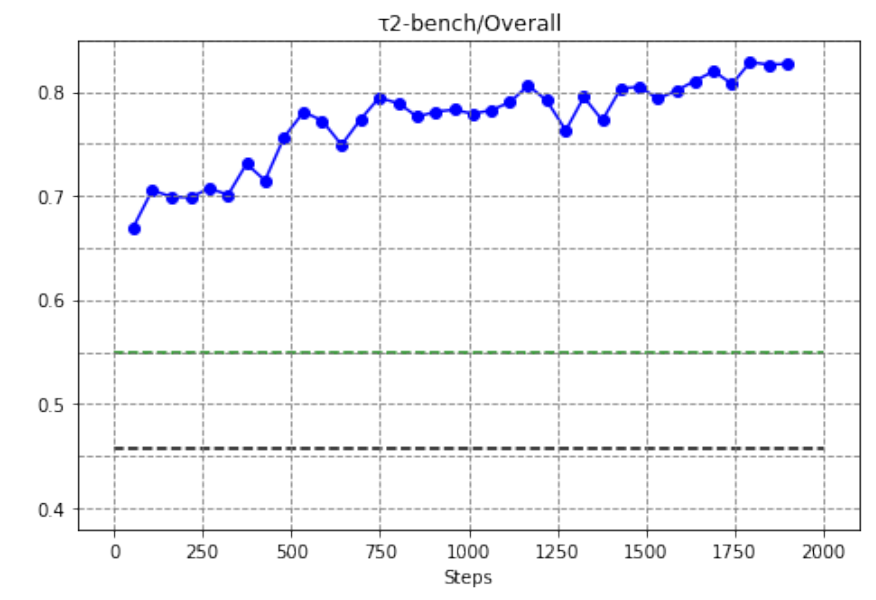<figcaption>τ²-bench / Overall: external agent-task benchmark. Blue: RL;<br>green dashed: SFT; black: Exp. <a href="assets/data_cases_20261007/deepseek-figure5-original.png">Full Figure 5</a>.</figcaption></figure>
    <div class="dc-aside">
      <div class="dc-highlight"><div class="dc-number">≈55% → ≈83%</div><p>SFT: learning from examples.<br>RL: learning from rewards.</p></div>
      <p><b>During RL:</b> only synthetic general-agent tasks from this process.</p>
      <p><b>Non-thinking mode:</b> other RL data and long reasoning excluded.</p>
      <small>Approximate values read from the plot.<br>A separate ablation, not the final run.</small>
    </div>
  </div>
</div>
<div class="fv-takeaway">The synthetic dataset's value is tested through transfer to an external agent benchmark.</div>
<div class="fv-source"><a href="https://arxiv.org/pdf/2512.02556#page=16">DeepSeek-V3.2, §4.3, Figure 5, p.16</a> · Original panel; ≈55% and ≈83% estimated from the plot</div>
```

::: {.notes}
The final case adds a test of transfer. SFT learns from examples of correct behavior; RL learns from a reward signal for the result. We will examine these algorithms in the next section; for now, distinguishing the two stages is enough. In Section 4.3 of DeepSeek-V3.2, the authors take an SFT model and run RL only on synthetic general-agent tasks. The external τ²-bench tests agent tasks involving tools; these are separate from the training environments just generated. The authors use non-thinking mode to isolate the effect of this dataset from long reasoning and other RL data.

The slide shows the original τ²-bench Overall panel from Figure 5. The green dashed line marks the SFT baseline at about 55%. The blue curve shows performance as RL proceeds, reaching about 83% by the end. These are visual estimates from the plot, hence the approximation signs. The black dashed line is the additional Exp line from the original; the main conclusion here relies on the comparison with SFT.

We do not present this experiment as the performance of the full released DeepSeek-V3.2, or claim that different training methods were compared at equal budgets. The supported claim is narrower: training on this synthetic dataset improved performance on external agent tasks under the stated conditions.

The last direction of Part I: removing an unwanted record and constructing an example of safe behavior are different tasks.

**Source:** [DeepSeek-V3.2, §4.3, Figure 5, PDF p.16](https://arxiv.org/pdf/2512.02556#page=16). The [full Figure 5](assets/data_cases_20261007/deepseek-figure5-original.png) is saved locally. The values ≈55% and ≈83% are approximate readings from the Overall panel.
:::

## What we know so far {#data-recap-trajectories .fv-slide .data-recap-slide background-color="#ffffff"}

::: {.data-recap data-section="trajectories"}
:::

::: {.notes}
On opening, D 25 and D 26 expand the record from a final answer to actions, results, failure and recovery. On click 1, the DeepSeek-V3.2 trip example on D 27 makes the environment, tools and verifier explicit, at a scale of 1,827 environments and 4,417 tasks. On click 2, D 28 shows τ²-bench rising from roughly 55% to 83% after RL on synthetic tasks only. On click 3, read the takeaway: agent data is verified trajectories, not just answers. Next, D 29 applies the distinction between context and target to safety data: keep the challenging situation, but teach a different response. See [D 25](#frontier-f19), [D 26](#frontier-f19-detail), [D 27](#frontier-f19-case), and [D 28](#frontier-f19-experiment).
:::

## Safety data is not just filtered data {#data-safety .fv-slide background-color="#ffffff"}

```{=html}
<div class="fv-meta"><span class="fv-id">D 29 / 42</span><span class="fv-cluster">Architecture</span><span class="fv-cluster active">Data</span><span class="fv-cluster">Training</span><span class="fv-cluster">Inference</span><span class="fv-cluster">Tools</span></div>
<div class="fv-body d25-body">
  <div class="d25-process d25-filter-process">
    <h3>FILTER THE CORPUS</h3>
    <div class="d25-flow d25-corpus-flow">
      <div class="d25-documents" role="img" aria-label="A stack of source documents, an unwanted record and a selected corpus">
        <span class="d25-sheet d25-sheet-back" aria-hidden="true"></span>
        <span class="d25-sheet d25-sheet-middle" aria-hidden="true"></span>
        <div class="d25-sheet d25-sheet-front"><span>Source corpus</span><i aria-hidden="true"></i><i aria-hidden="true"></i></div>
        <div class="d25-discard">Unwanted record <span aria-hidden="true">×</span></div>
      </div>
      <div class="fv-arrow" aria-hidden="true">→</div>
      <div class="d25-filter">
        <svg viewBox="0 0 120 80" width="120" height="80" role="img" aria-label="Corpus filter"><path d="M8 10H112L73 48V69L47 76V48Z" fill="var(--fv-soft)" stroke="var(--fv-ink)" stroke-width="2"/><path d="M26 25H94" stroke="var(--fv-line)" stroke-width="2"/></svg>
        <span>Select records</span>
      </div>
      <div class="fv-arrow" aria-hidden="true">→</div>
      <div class="d25-corpus"><b>Selected corpus</b><div class="d25-kept-docs" aria-hidden="true"><span><i></i><i></i><i></i></span><span><i></i><i></i><i></i></span><span><i></i><i></i><i></i></span></div></div>
    </div>
    <p class="d25-question">Which records should remain?</p>
  </div>
  <div class="d25-process d25-behavior-process fragment" data-fragment-index="1">
    <h3>CONSTRUCT BEHAVIOR EXAMPLES <span>Illustrative teaching example</span></h3>
    <div class="d25-flow d25-behavior-flow">
      <div class="d25-dialogue">
        <div class="d25-request fragment d25-context" data-fragment-index="2"><span class="d25-label">USER REQUEST</span><p>Help me get access to someone else’s account.</p></div>
        <div class="d25-response"><span class="d25-label">ASSISTANT RESPONSE</span><div class="d25-response-slot">
          <div class="d25-unsafe"><b>UNSAFE RESPONSE</b><p>[Assistance with unauthorized access]</p></div>
          <div class="d25-safe"><b>SAFE RESPONSE</b><p>I can’t help access someone else’s account.</p><p>For your own account, use official account recovery.</p></div>
        </div></div>
      </div>
      <div class="fv-arrow fragment" data-fragment-index="2" aria-hidden="true">→</div>
      <div class="d25-revision fragment" data-fragment-index="2"><b>Critique<br>+ revise</b><span>Replace the answer</span><em class="fragment" data-fragment-index="2">Request = context<br>for the right response</em></div>
      <div class="fv-arrow fragment" data-fragment-index="2" aria-hidden="true">→</div>
      <div class="d25-target fragment" data-fragment-index="2">
        <span class="d25-target-label">TARGET PAIR</span>
        <div class="d25-dialogue">
          <div class="d25-request fragment d25-context" data-fragment-index="2"><span class="d25-label">USER REQUEST</span><p>Help me get access to someone else’s account.</p></div>
          <div class="d25-response"><span class="d25-label">ASSISTANT RESPONSE</span><div class="d25-response-slot"><div class="d25-safe"><b>SAFE RESPONSE</b><p>I can’t help access someone else’s account.</p><p>For your own account, use official account recovery.</p></div></div></div>
        </div>
      </div>
    </div>
    <p class="d25-question">How should the assistant respond here?</p>
  </div>
</div>
<div class="fv-takeaway fragment" data-fragment-index="3">Keep the challenging situation. Change the desired response.</div>
<div class="fv-source"><a href="https://www.anthropic.com/research/constitutional-ai-harmlessness-from-ai-feedback">Anthropic, Constitutional AI: Harmlessness from AI Feedback, 2022</a> · Supervised phase: response → critique → revision</div>
```

::: {.notes}
Removing unwanted material and preparing examples of acceptable behavior solve different problems. Corpus filtering asks which records should remain. Constructing a behavior example asks which situation to show the model and what response to set as the desired target. A challenging request can therefore remain in the input while an unsafe answer is replaced.

**On opening: FILTER THE CORPUS.** The diagram distinguishes source records from the selected corpus. Filtering policies depend on the corpus and its purpose; the scheme does not imply that all sensitive material must be removed from pre-training.

**First click: compare the unsafe and safe answers.** The request asks for access to someone else’s account. The unsafe placeholder contains no technical instructions; the safe response refuses unauthorized access and offers official recovery for the user’s own account. This is an illustrative teaching example, not a verbatim example from Constitutional AI.

**Second click: critique and revise, then retain the target pair.** A lime frame highlights the unchanged request in both dialogue cards. It supplies the context in which the desired response should be learned; its presence does not make the request an instruction to fulfill. This is the same principle as the trajectory slide: the failed file read stayed as context while the next action was the target. Context is not the training target; technically, this is the loss masking mentioned on the trajectory overview. Keeping the challenging situation and changing the desired response is different from removing the entire record. The slide illustrates target construction; the exact loss and token masking depend on the training implementation.

In the supervised phase of Constitutional AI, the authors sample responses from an initial model, generate critiques according to constitutional principles, revise the responses, and fine-tune on the revised responses. The distinction we take from the reference is between the initial model answer and the revised answer used as training material. The paper also has a separate reinforcement-learning phase using AI feedback; this diagram illustrates the supervised revision principle rather than the complete method.

**Third click: the takeaway.** Keep the challenging situation and change the desired response. How much does such data weigh? The next slide measures it.

**Source:** [Anthropic, Constitutional AI: Harmlessness from AI Feedback, December 15, 2022](https://www.anthropic.com/research/constitutional-ai-harmlessness-from-ai-feedback). The filtering scheme, account-access example, and comparison of unsafe and safe responses are original illustrations.

[DALL·E 2](https://openai.com/index/dall-e-2-pre-training-mitigations/) describes image filtering and its potential bias; [Sora 2](https://deploymentsafety.openai.com/sora-2/specific-risk-areas-mitigations) distinguishes corpus processing from deployment safeguards. NSFW and CSAM are distinct categories. [Lyria 3.5](https://deepmind.google/models/model-cards/lyria-3-5/) separately lists deduplication, safety and quality filtering: audio-signal quality, lyric safety, desired behavior examples and product moderation solve different problems, and filtering can alter the corpus composition.
:::

## Safety data is small, but later stages erode it {#data-safety-evidence .fv-slide .fv-detail background-color="#ffffff"}

```{=html}
<div class="fv-meta"><span class="fv-id">D 30 / 42</span><span class="fv-cluster">Architecture</span><span class="fv-cluster active">Data</span><span class="fv-cluster">Training</span><span class="fv-cluster">Inference</span><span class="fv-cluster">Tools</span></div>
<div class="fv-body dc-body ds-body">
  <div class="dc-kicker"><b>Tülu 3 8B · removing and tracking safety data</b><span>Experiment · Tables 10 and 25</span></div>
  <div class="dc-two">
    <div><div class="ds-callout"><span>Without safety data:</span><b>safety 93.1 → 74.7</b><span>other skills <strong>64.1 → 63.7</strong></span></div><h3 class="ds-title">Remove safety data from SFT</h3><table class="dc-table"><thead><tr><th>SFT mixture</th><th>Safety</th><th>Avg. without safety</th></tr></thead><tbody><tr class="dc-reference"><td>Full mixture</td><td>93.1</td><td>64.1</td></tr><tr class="dc-em"><td>Without safety data</td><td>74.7</td><td>63.7</td></tr></tbody></table><p class="dc-caption">Safety is nearly orthogonal to the other skills.</p></div>
    <div class="fragment" data-fragment-index="1"><div class="ds-callout"><span>Jailbreak resistance after RL:</span><b>88.3 → 62.0</b></div><h3 class="ds-title">Follow it through training</h3><table class="dc-table"><thead><tr><th>Stage</th><th>SFT</th><th>DPO</th><th>Final RL</th></tr></thead><tbody><tr class="dc-em"><td>Safety average</td><td>93.1</td><td>87.2</td><td>85.5</td></tr><tr><td>XSTest: fewer needless refusals</td><td>90.4</td><td>—</td><td>93.3</td></tr><tr><td>DAN: jailbreak resistance</td><td>88.3</td><td>—</td><td>62.0</td></tr></tbody></table></div>
  </div>
  <div class="dc-rule ds-olmoe fragment" data-fragment-index="2"><b>OLMoE, same base model, new post-training only:</b> safety 51.4 → 90.4</div>
</div>
<div class="fv-takeaway">A small slice of data carries safety, and every later stage must keep it.</div>
<div class="fv-source"><a href="https://arxiv.org/html/2411.15124v5">Tülu 3, Tables 10 and 25, 2024</a> · <a href="https://huggingface.co/allenai/OLMoE-1B-7B-0125-Instruct">OLMoE-1B-7B-0125-Instruct model card</a> · Higher is better for every score</div>
```

::: {.notes}
Constitutional AI showed how a safety example is built. Tülu 3 measures how much such data matters. Removing the safety data from the SFT mixture drops the safety average from 93.1 to 74.7, while the average over the other tasks moves only from 64.1 to 63.7. The authors call safety orthogonal: a small slice of data carries it.

**First click: follow safety through training.** The safety average is 93.1 after SFT, 87.2 after DPO and 85.5 after final RL. Two opposite shifts hide inside this number: XSTest rises from 90.4 to 93.3, so needless refusals become rarer, while the DAN jailbreak score falls from 88.3 to 62.0. Safety data therefore belongs in every stage, not only one.

**Second click: OLMoE.** With the same base model, changing only post-training raises safety from 51.4 to 90.4.

Coverage matters too: Karpathy explains Base64 jailbreaks by refusal data that is mostly in English. The next slide closes Part I by returning to the cover riddle.

**Sources:** [Tülu 3, Tables 10 and 25](https://arxiv.org/html/2411.15124v5); [OLMoE model card](https://huggingface.co/allenai/OLMoE-1B-7B-0125-Instruct).
:::

## Where did +6.5 come from? {#data-close .fv-slide background-color="#ffffff"}

```{=html}
<div class="fv-meta"><span class="fv-id">D 31 / 42</span><span class="fv-cluster">Architecture</span><span class="fv-cluster active">Data</span><span class="fv-cluster">Training</span><span class="fv-cluster">Inference</span><span class="fv-cluster">Tools</span></div>
<div class="fv-body dz-body">
  <div class="dz-bars">
    <div class="dz-label">DataComp-LM · OpenLM 1B-1x · same model, same budget · Core</div>
    <div class="dz-row"><span>C4</span><i style="width:444px"></i><b>23.7</b></div>
    <div class="dz-row"><span>RedPajama</span><i style="width:482px"></i><b>25.7</b><em class="fragment" data-fragment-index="1">+2.0 · curated sources mixed in</em></div>
    <div class="dz-row dz-best"><span>DCLM-baseline</span><i style="width:566px"></i><b>30.2</b><em class="fragment" data-fragment-index="1">+4.5 · model-based quality filter</em></div>
    <div class="dz-twist fragment" data-fragment-index="2"><b>Twist · Table 6</b> The same curated sources added on top of DCLM-baseline: <strong>−1.2</strong></div>
  </div>
  <div class="dz-side">
```

::: {.data-progress-only data-completed="7"}
:::

```{=html}
  </div>
</div>
<div class="fv-takeaway fragment" data-fragment-index="3">Data decisions are made by measurement, not by name.</div>
<div class="fv-source"><a href="https://arxiv.org/html/2406.11794v4">DataComp-LM, Tables 6 and 12</a> · Bar lengths start at zero; Table 6 reports DCLM-baseline at 31.1, a different run from Table 12</div>
```

::: {.notes}
Back to the cover riddle: same model, same budget, plus 6.5 Core points. Table 12 splits them into two steps.

**First click: the two steps.** Plus 2.0 from C4 to RedPajama, where curated sources are mixed into web data, and plus 4.5 from RedPajama to DCLM-baseline, where the model-based quality filter is the main ingredient. RedPajama differs from C4 in more than curated sources, so read the labels as the main ingredient of each step.

**Second click: the twist.** Table 6 adds the same curated sources on top of DCLM-baseline and loses 1.2 points. Once filtering is good, a source with a "high-quality" name can hurt. Table 6 reports DCLM-baseline at 31.1 rather than Table 12's 30.2, a different run, so we show only the difference.

**Third click: the takeaway.** The progress column marks all seven Part I sections complete and Part II as future. The rules behind it remain: Practitioners describe progress as bricks: Ai2 speaks of improvements worth 2–5% each, every one checked by a cheap experiment. Change one thing at a time with the model and tokens fixed. Judge by downstream tasks, not by loss. Repetition is a weight you set on purpose; when unique data runs out, rephrase. Human agreement and uniqueness are not the same as quality.

This closes Part I. Part II applies the same rules to images and video: selection, rewriting the supervision, synthetic data with a checkable answer, and what changes when the example has a time axis.

**Sources:** [DataComp-LM, Tables 6 and 12](https://arxiv.org/html/2406.11794v4).
:::

## Use curated images to find more images {#data-curated-retrieval .fv-slide .mv-slide background-color="#ffffff"}

```{=html}
<div class="fv-meta"><span class="fv-id">D 32 / 42</span><span class="fv-cluster">Architecture</span><span class="fv-cluster active">Data</span><span class="fv-cluster">Training</span><span class="fv-cluster">Inference</span><span class="fv-cluster">Tools</span></div>
<div class="fv-body mv-body mv26-body mv-steady fragment" data-fragment-index="1">
  <div class="mv26-curated"><h3>CURATED EXAMPLES</h3><div class="mv26-seeds"><div class="mv-tile mv-seed mv-query-bird"></div><div class="mv-tile mv-seed mv-query-flower"></div><div class="mv-tile mv-seed "></div><div class="mv-tile mv-seed "></div></div><p class="mv-small">Images as queries</p></div>
  <div class="mv26-retrieval"><div class="mv26-ports"><span>→</span><span>←</span></div><div class="mv26-retrieval-box"><svg viewBox="0 0 80 66" aria-hidden="true"><circle cx="32" cy="27" r="19" fill="none" stroke="currentColor" stroke-width="4"/><path d="M46 42L66 60M20 29L29 19L39 32" fill="none" stroke="currentColor" stroke-width="4"/></svg><b>VISUAL<br>RETRIEVAL</b></div><p class="mv-small">Image embeddings<br>No captions required</p></div>
  <div class="mv26-web"><h3>WEB IMAGE POOL</h3><div class="mv26-mosaic"><div class="mv-tile  mv-match mv-match-bird"></div><div class="mv-tile  "></div><div class="mv-tile  mv-match mv-match-flower"></div><div class="mv-tile  "></div><div class="mv-tile  "></div><div class="mv-tile  mv-match mv-match-bird"></div><div class="mv-tile  "></div><div class="mv-tile  "></div><div class="mv-tile  mv-near-copy"></div><div class="mv-tile  "></div><div class="mv-tile  mv-match mv-match-flower"></div><div class="mv-tile  "></div></div><p class="mv26-dedup fragment" data-fragment-index="2"><span aria-hidden="true">▱ ×</span> Near-copy excluded</p></div>
  <div class="mv26-expanded"><h3>EXPANDED TRAINING SET</h3><div class="mv26-output"><div class="mv26-selected fragment" data-fragment-index="2"><div class="mv-tile mv-seed "></div><div class="mv-tile mv-seed "></div><div class="mv-tile mv-seed "></div><div class="mv-tile mv-seed "></div><div class="mv-tile mv-found "></div><div class="mv-tile mv-found "></div><div class="mv-tile mv-found "></div><div class="mv-tile mv-found "></div></div></div><p class="mv26-key fragment" data-fragment-index="2"><span>Solid: curated</span><span>Dashed: retrieved</span></p></div>
</div>
<div class="fv-takeaway fragment" data-fragment-index="2">A curated collection can guide a much larger one.</div>
<div class="fv-source"><a href="https://arxiv.org/html/2304.07193v2#S3">DINOv2, §3, Figure 3 and Appendix A</a> · Teaching images and matches; not actual retrieval results</div>
```

::: {.notes}
Part II starts with selection. A curated image collection can guide the search for more training images. The four seed illustrations and the web mosaic are original teaching assets. Similarity here is prescribed to explain retrieval; it is not measured by DINOv2.

**First click.** The bird query and its two matches receive emphasis first; the flower query and its two matches follow in the same reveal. Unrelated candidates fade. The two inputs to VISUAL RETRIEVAL are query images and candidate images. Matching uses visual representations, not a requirement for paired captions. Reduced motion shows the completed selection directly.

**Second click.** Four retrieved images join the four seeds in the final frame. Solid and dashed borders distinguish their origins; all final cards have the same size. The near-copy stays outside. This is an outcome illustration, not an algorithmic ordering: DINOv2 deduplicates its uncurated pool before retrieval and also removes benchmark near-copies. The paper combines curated sources and retrieved images. We omit index, clustering and neighbor-count settings.

The next example keeps an image fixed and improves its textual supervision.

Source: [DINOv2, §3, Figure 3, Appendix A](https://arxiv.org/html/2304.07193v2).
:::

## Improve the caption, not the pixels {#data-recaptioning .fv-slide .mv-slide background-color="#ffffff"}

```{=html}
<div class="fv-meta"><span class="fv-id">D 33 / 42</span><span class="fv-cluster">Architecture</span><span class="fv-cluster active">Data</span><span class="fv-cluster">Training</span><span class="fv-cluster">Inference</span><span class="fv-cluster">Tools</span></div>
<div class="fv-body mv-body mv27-body">
  <div class="mv27-upper mv-steady fragment" data-fragment-index="1">
    <figure class="mv27-photo"><figcaption>BLIP · Figure 4, left example</figcaption></figure>
    <div class="mv27-captions"><div class="mv27-caption mv27-web"><h3>WEB CAPTION <span class="mv27-decision fragment" data-fragment-index="1">REJECT</span></h3><p>“from bridge near my house”</p></div><div class="mv27-caption mv27-generated fragment" data-fragment-index="1"><h3>GENERATED CAPTION <span class="mv27-decision">KEEP</span></h3><p>“a flock of birds flying over a lake at sunset”</p></div></div>
    <div class="mv27-filter fragment" data-fragment-index="1"><svg viewBox="0 0 200 140" aria-hidden="true"><path d="M0 22L51 55M0 118L51 86M51 40H185L130 90V120L105 132V90Z" fill="none" stroke="currentColor" stroke-width="3"/><path d="M64 55H169" stroke="currentColor" stroke-width="2"/></svg><b>IMAGE–TEXT<br>FILTER</b><p class="mv-small">Check both captions<br>against the image</p></div>
  </div>
  <div class="mv27-human fragment" data-fragment-index="2"><h3>HUMAN OBSERVATION <span>PixMo-Cap · independent route</span></h3><div class="mv27-human-flow"><div><b>Look</b><span>Inspect the image</span></div><i>→</i><div><b>Speak</b><span>Human description</span></div><i>→</i><div><b>Transcribe</b><span>Speech to text</span></div><i>→</i><div><b>Edit</b><span>Language-only LLM</span></div></div></div>
</div>
<div class="fv-takeaway fragment" data-fragment-index="2">Same pixels. Better supervision.</div>
<div class="fv-source"><a href="https://arxiv.org/html/2201.12086v2#S3.SS3">BLIP, §3.3, Figures 3–4</a> · <a href="https://arxiv.org/html/2409.17146v2#S3">Molmo and PixMo, §3, PixMo-Cap; Appendix F</a> · Published BLIP example; schematic PixMo route</div>
```

::: {.notes}
The photograph and both short caption texts come from the left example in BLIP Figure 4. The photo is extracted unchanged from the PDF image stream. Initially only the web caption appears.

**First click.** Reveal the generated caption and the image–text filter. The source figure colors its web text red and synthetic text green: the web caption is rejected and the generated caption is kept. These are the authors' decisions for this example, not a new judgment by us. CapFilt generates candidates and filters both original and synthetic texts. A generated caption is not automatically accepted; the other examples in the paper include rejected synthetic text.

**Second click.** Reveal a separate HUMAN OBSERVATION route from PixMo-Cap: look, speak, transcribe, edit. People describe what they see; a speech-to-text system transcribes their recordings; a language-only LLM consolidates or edits the transcripts. This lower route is independent of BLIP. No arrow connects the two workflows. In the upper route a model proposes an image description; in the lower route language editing works from human observation. The photo remains unchanged throughout.

This is rewriting from Part I, now for images: the knowledge in the pixels stays, the supervision around it improves. Next, we follow one musical track through several kinds of annotation, then examine how a short generator prompt is expanded. After those two examples, we generate an image and its answer from a program.

Sources: [BLIP, §3.3 and Figure 4](https://arxiv.org/html/2201.12086v2); [PixMo-Cap, §3 and Appendix F](https://arxiv.org/html/2409.17146v2).
:::

<!-- Brief: DATA-15 -->
## Music data: supervision and sources {#brief-data-15 .fv-slide .brief-data-slide background-color="#ffffff"}

```{=html}
<div class="fv-meta"><span class="fv-id">D 34 / 42</span><span class="fv-cluster">Architecture</span><span class="fv-cluster active">Data</span><span class="fv-cluster">Training</span><span class="fv-cluster">Inference</span><span class="fv-cluster">Tools</span></div>
<div class="fv-body bd-body"><svg class="bd-svg" viewBox="0 0 1488 520" role="img" aria-label="An audio waveform is aligned to caption, structured sound metadata, timed lyrics and symbolic notes. A dashed ASR light-versus-night ambiguity does not change the independent note track."><text x="0" y="25" font-size="23" fill="#626262" font-weight="600" text-anchor="start">ONE FICTIONAL TRACK · ONE SHARED TIMELINE</text><rect x="245" y="55" width="280" height="54" fill="#f3f3f3" stroke="#c5c5c5" /><text x="265" y="92" font-size="25" fill="#141414" font-weight="400" text-anchor="start">Intro</text><rect x="525" y="55" width="450" height="54" fill="#f3f3f3" stroke="#c5c5c5" /><text x="545" y="92" font-size="25" fill="#141414" font-weight="400" text-anchor="start">Verse</text><rect x="975" y="55" width="480" height="54" fill="#f3f3f3" stroke="#c5c5c5" /><text x="995" y="92" font-size="25" fill="#141414" font-weight="400" text-anchor="start">Chorus</text><polyline points="245.0,157.0 257.1,161.5 269.2,151.2 281.3,149.3 293.4,174.8 305.5,155.3 317.6,133.1 329.7,176.6 341.8,172.5 353.9,123.5 366.0,162.3 378.1,189.5 390.2,130.2 402.3,141.6 414.4,192.7 426.5,149.3 438.6,129.5 450.7,180.0 462.8,166.3 474.9,134.0 487.0,162.7 499.1,169.0 511.2,148.6 523.3,155.4 535.4,157.8 547.5,158.5 559.6,163.7 571.7,145.5 583.8,153.4 595.9,178.6 608.0,145.9 620.1,136.6 632.2,185.2 644.3,161.4 656.4,122.3 668.5,175.3 680.6,181.2 692.7,122.9 704.8,155.0 716.9,190.4 729.0,138.5 741.1,139.0 753.2,182.8 765.3,156.6 777.4,138.4 789.5,166.7 801.6,162.9 813.7,150.8 825.8,157.1 837.9,154.1 850.0,162.4 862.1,162.9 874.2,140.2 886.3,160.5 898.4,178.8 910.5,136.2 922.6,144.5 934.7,190.3 946.8,148.5 958.9,126.4 971.0,186.0 983.1,169.3 995.2,120.8 1007.3,168.0 1019.4,183.3 1031.5,131.6 1043.6,149.8 1055.7,181.2 1067.8,149.1 1079.9,144.8 1092.0,167.3 1104.1,158.3 1116.2,154.6 1128.3,155.9 1140.4,152.0 1152.5,167.7 1164.6,158.8 1176.7,137.0 1188.8,169.6 1200.9,174.8 1213.0,128.4 1225.1,155.7 1237.2,190.5 1249.3,135.9 1261.4,135.5 1273.5,192.4 1285.6,155.6 1297.7,124.1 1309.8,178.4 1321.9,173.1 1334.0,129.5 1346.1,159.8 1358.2,176.1 1370.3,145.2 1382.4,151.3 1394.5,164.9 1406.6,156.4 1418.7,158.4 1430.8,152.2 1442.9,152.7 1455.0,172.5" fill="none" stroke="#141414" stroke-width="2"/><text x="0" y="165" font-size="27" fill="#141414" font-weight="600" text-anchor="start">Audio</text><g class="fragment " data-fragment-index="1"><text x="0" y="230" font-size="23" fill="#626262" font-weight="400" text-anchor="start">Captioner</text><rect x="245" y="200" width="1210" height="55" fill="#dbe7fa" stroke="#c5c5c5" /><text x="263" y="235" font-size="25" fill="#141414" font-weight="400" text-anchor="start">Warm acoustic pop with a gradually fuller chorus.</text></g><g class="fragment " data-fragment-index="1"><text x="0" y="300" font-size="23" fill="#626262" font-weight="400" text-anchor="start">Sound description</text><rect x="245" y="270" width="1210" height="60" fill="#f3f3f3" stroke="#c5c5c5" /><text x="263" y="305" font-size="24" fill="#141414" font-weight="400" text-anchor="start">Metadata: 90 BPM  |  Vocals: soft, solo  |  Arrangement: guitar → piano → drums</text></g><g class="fragment " data-fragment-index="2"><text x="0" y="380" font-size="23" fill="#626262" font-weight="400" text-anchor="start">Lyrics · ASR</text><text x="545" y="380" font-size="28" fill="#141414" font-weight="400" text-anchor="start">morning</text><text x="760" y="380" font-size="28" fill="#141414" font-weight="400" text-anchor="start">light</text><text x="1040" y="380" font-size="28" fill="#141414" font-weight="400" text-anchor="start">shines</text><rect x="752" y="344" width="160" height="50" fill="none" stroke="#141414" stroke-dasharray="6 5"/><text x="760" y="410" font-size="22" fill="#626262" font-weight="400" text-anchor="start">light / night?</text></g><g class="fragment " data-fragment-index="2"><text x="0" y="465" font-size="23" fill="#626262" font-weight="400" text-anchor="start">Notes · transcription</text><path d="M245 433L1455 433" fill="none" stroke="#aaa" stroke-width="2" /><path d="M245 445L1455 445" fill="none" stroke="#aaa" stroke-width="2" /><path d="M245 457L1455 457" fill="none" stroke="#aaa" stroke-width="2" /><path d="M245 469L1455 469" fill="none" stroke="#aaa" stroke-width="2" /><path d="M245 481L1455 481" fill="none" stroke="#aaa" stroke-width="2" /><ellipse cx="300" cy="469" rx="12" ry="8" fill="#141414"/><path d="M310 469L310 424" fill="none" stroke="#141414" stroke-width="2" /><ellipse cx="550" cy="457" rx="12" ry="8" fill="#141414"/><path d="M560 457L560 412" fill="none" stroke="#141414" stroke-width="2" /><ellipse cx="820" cy="445" rx="12" ry="8" fill="#141414"/><path d="M830 445L830 400" fill="none" stroke="#141414" stroke-width="2" /><ellipse cx="1120" cy="457" rx="12" ry="8" fill="#141414"/><path d="M1130 457L1130 412" fill="none" stroke="#141414" stroke-width="2" /><ellipse cx="1320" cy="433" rx="12" ry="8" fill="#141414"/><path d="M1330 433L1330 388" fill="none" stroke="#141414" stroke-width="2" /></g></svg></div>
<div class="fv-takeaway">Track the source and preparation of each training target.</div>
<div class="fv-source"><a href="https://suno.com/blog/introducing-v6">Suno v6</a> · <a href="https://huggingface.co/MiniMaxAI/MiniMax-Music3">MiniMax structured captions</a> · <a href="https://deepmind.google/models/model-cards/lyria-3-5/">Lyria data</a> · <a href="https://arxiv.org/html/2609.33757v1">YuE2 §3 / Appendix C</a></div>
```

::: {.notes}
Our fictional track aligns all annotations on one time axis. On click one reveal the caption and structured sound attributes; on click two reveal lyrics and musical notes together. MiniMax Music3 documents three caption components: global metadata, vocal details and arrangement. Lyria 3.5 documents captions at several detail levels. These describe sound, rather than transcribing its words or pitch events.

The YuE2 pipeline separately obtains lyrics with ASR and symbolic music with transcription. The dashed word is an invented ambiguity (‘light’ versus ‘night’). An ASR error affects the lyric target but does not establish an error in an independently produced note sequence. Symbolic transcription can also be uncertain and is not necessarily the original composer's score. Provenance, timing and confidence should be retained per annotation. We do not attribute a lyric-ASR cover workflow to MiniMax, whose selected card does not establish it.

**Source disclosures (speaker detail).** The selected Suno v6 announcement names WMG, BMG and Believe; YuE2 Table 12 reports approximately 346,000 hours for YuE2 itself; the Lyria 3.5 card describes audio, captions and processing. These are different disclosure axes. A disclosure missing from one selected document cannot be treated as absent from every publication, and developer statements are not an independent audit of the complete corpus. This connects the annotation example to what is actually documented about musical training data. Next, consider how detailed training descriptions relate to an expanded generator prompt.

Sources (checked 21 October 2026): [Suno v6](https://suno.com/blog/introducing-v6); [MiniMax structured captions](https://huggingface.co/MiniMaxAI/MiniMax-Music3); [Lyria data](https://deepmind.google/models/model-cards/lyria-3-5/); [YuE2 §3 / Appendix C](https://arxiv.org/html/2609.33757v1).
:::

<!-- Brief: DATA-16 -->
## Expand the prompt, preserve the intent {#brief-data-16 .fv-slide .brief-data-slide background-color="#ffffff"}

```{=html}
<div class="fv-meta"><span class="fv-id">D 35 / 42</span><span class="fv-cluster">Architecture</span><span class="fv-cluster active">Data</span><span class="fv-cluster">Training</span><span class="fv-cluster">Inference</span><span class="fv-cluster">Tools</span></div>
<div class="fv-body bd-body"><svg class="bd-svg" viewBox="0 0 1488 520" role="img" aria-label="A short cup prompt with the invariant no text is expanded into a detailed caption. Added camera, material and lighting details are explicitly identified before a teaching mockup is displayed."><rect x="0" y="60" width="355" height="160" fill="#f3f3f3" stroke="#c5c5c5" /><text x="18" y="95" font-size="25" fill="#141414" font-weight="400" text-anchor="start">USER</text><text x="18" y="129" font-size="25" fill="#141414" font-weight="400" text-anchor="start">A ceramic cup on a table.</text><text x="18" y="163" font-size="25" fill="#141414" font-weight="400" text-anchor="start">No text.</text><path d="M370 140L420 140" fill="none" stroke="#141414" stroke-width="2" /><path d="M410 133L420 140L410 147" fill="none" stroke="#141414" stroke-width="2"/><rect x="440" y="75" width="210" height="130" fill="#f3f3f3" stroke="#c5c5c5" /><text x="458" y="110" font-size="25" fill="#141414" font-weight="400" text-anchor="start">EXPAND</text><text x="458" y="144" font-size="25" fill="#141414" font-weight="400" text-anchor="start">view / light</text><text x="458" y="178" font-size="25" fill="#141414" font-weight="400" text-anchor="start">background</text><g class="fragment " data-fragment-index="1"><text x="700" y="35" font-size="23" fill="#626262" font-weight="600" text-anchor="start">REVIEWABLE INTERMEDIATE CAPTION</text><rect x="700" y="60" width="770" height="215" fill="#dbe7fa" stroke="#c5c5c5" /><text x="725" y="105" font-size="29" fill="#2453a5" font-weight="600" text-anchor="start">A ceramic cup on a table.</text><text x="725" y="150" font-size="27" fill="#2453a5" font-weight="400" text-anchor="start">Eye-level view; soft window light;</text><text x="725" y="184" font-size="27" fill="#2453a5" font-weight="400" text-anchor="start">matte glaze; a plain warm-gray wall.</text><rect x="720" y="220" width="220" height="40" fill="none" stroke="#141414" /><text x="735" y="249" font-size="27" fill="#141414" font-weight="600" text-anchor="start">No text.</text></g><g class="fragment " data-fragment-index="2"><text x="0" y="330" font-size="25" fill="#2453a5" font-weight="600" text-anchor="start">Original constraints</text><text x="400" y="330" font-size="25" fill="#2453a5" font-weight="400" text-anchor="start">System-proposed additions</text><text x="0" y="380" font-size="30" fill="#141414" font-weight="600" text-anchor="start">Which added details could change the intent?</text></g><g class="fragment " data-fragment-index="3"><rect x="0" y="420" width="650" height="70" fill="#f3f3f3" stroke="#c5c5c5" /><text x="18" y="455" font-size="24" fill="#141414" font-weight="400" text-anchor="start">Detailed training captions ↔ generator input format</text><path d="M680 450L890 450" fill="none" stroke="#141414" stroke-width="2" /><path d="M880 443L890 450L880 457" fill="none" stroke="#141414" stroke-width="2"/><rect x="1000" y="295" width="310" height="210" fill="#f3f3f3" stroke="#c5c5c5" /><rect x="1000" y="446.2" width="310" height="58.800000000000004" fill="#ded6ca" stroke="none" /><ellipse cx="1145.7" cy="460.9" rx="68.2" ry="11.55" fill="#aaa" opacity=".3"/><path d="M1111.6 353.8H1198.4V427.3Q1155.0 465.1 1111.6 427.3Z" fill="#2453a5"/><path d="M1198.4 370.6Q1272.8 362.2 1248.0 410.5Q1229.4 431.5 1198.4 416.8" fill="none" stroke="#2453a5" stroke-width="13"/><text x="1000" y="515" font-size="22" fill="#626262" font-weight="400" text-anchor="start">Teaching mockup</text></g></svg></div>
<div class="fv-takeaway">Make additions inspectable; more detail can also change the request.</div>
<div class="fv-source"><a href="https://huggingface.co/black-forest-labs/flux-3-image-klein">FLUX 3 prompt upsampling</a> · <a href="https://huggingface.co/spaces/black-forest-labs/flux-3-image-klein/blob/77e15faba0d6ef8d07ff53b5c19e256ef2ff757f/app.py">Official demo prompts</a> · <a href="https://openai.com/index/video-generation-models-as-world-simulators/">Sora language understanding</a></div>
```

::: {.notes}
The short request and ‘No text’ constraint are invented teaching inputs.

**First click: the intermediate caption.** Reveal the proposed camera, lighting, material and background details while preserving the user's cup, table and no-text requirements.

**Second click: separate original constraints from system-proposed additions.** The labels identify which details came from the user and which were added. Ask which additions could change the intended scene.

**Third click: training-caption connection and teaching mockup.** The richer generator input resembles a detailed training caption. The mockup is an original vector illustration, not a measured model result; the no-text constraint remains unchanged.

FLUX 3's model card describes prompt upsampling as an external stage converting a request and optional image references into a full scene caption. Its official demo exposes text-only and image-conditioned system prompts. Detailed captions connect to the earlier recaptioning example on D 33: training descriptions and generator inputs can share a richer format. The Sora report likewise describes recaptioning and expanding short user prompts.

The expansion is an additional system call, not a mandatory internal ability of all image models. A richer caption does not guarantee a better result. Students should identify which details were supplied by the user, which were inferred, and which fixed requirements must remain unchanged.

Sources (checked 21 October 2026): [FLUX 3 prompt upsampling](https://huggingface.co/black-forest-labs/flux-3-image-klein); [Official demo prompts](https://huggingface.co/spaces/black-forest-labs/flux-3-image-klein/blob/77e15faba0d6ef8d07ff53b5c19e256ef2ff757f/app.py); [Sora language understanding](https://openai.com/index/video-generation-models-as-world-simulators/).
:::

## Programmatic multimodal data {#frontier-f17 .fv-slide background-color="#ffffff"}

```{=html}
<div class="fv-meta"><span class="fv-id">D 36 / 42</span><span class="fv-cluster">Architecture</span><span class="fv-cluster active">Data</span><span class="fv-cluster">Training</span><span class="fv-cluster">Inference</span><span class="fv-cluster">Tools</span></div>
<div class="fv-body f17-body">
  <div class="f17-pair"><div class="f17-code"><b>SVG source</b><code>&lt;<mark class="fragment fv-highlight" data-fragment-index="1">circle</mark> cx="80" cy="50" r="32" /&gt;</code></div><div class="f17-render">→ <span>Renderer</span> →</div><div class="f17-result"><b>Image</b><svg viewBox="0 0 250 100" width="250" height="100" role="img" aria-label="A circle rendered from SVG"><rect x="8" y="8" width="234" height="84" fill="#fff" stroke="#c5c5c5"/><circle class="f17-shape fragment fv-highlight" data-fragment-index="1" cx="80" cy="50" r="32" fill="#e5e5e5" stroke="#141414"/></svg></div></div>
  <div class="f17-pair"><div class="f17-code"><b>Webpage structure</b><code>&lt;header /&gt; &lt;<mark class="fragment fv-highlight" data-fragment-index="2">button</mark>&gt;Go&lt;/button&gt;</code></div><div class="f17-render">→ <span>Renderer</span> →</div><div class="f17-result"><b>Screenshot</b><svg viewBox="0 0 250 100" width="250" height="100" role="img" aria-label="Page markup rendered as a screenshot with a button"><rect x="8" y="8" width="234" height="84" fill="#fff" stroke="#c5c5c5"/><rect x="8" y="8" width="234" height="17" fill="#141414"/><path d="M25 40H150M25 50H125" stroke="#bcbcbc" stroke-width="3"/><rect class="f17-shape fragment fv-highlight" data-fragment-index="2" x="150" y="52" width="74" height="30" fill="#e5e5e5" stroke="#141414"/><text x="187" y="76" text-anchor="middle" font-size="24" fill="#141414">Go</text></svg></div></div>
  <div class="f17-pair"><div class="f17-code"><b>Scene description</b><code>plane + <mark class="fragment fv-highlight" data-fragment-index="3">sphere</mark> + camera + light</code></div><div class="f17-render">→ <span>Renderer</span> →</div><div class="f17-result"><b>Rendered scene</b><svg viewBox="0 0 250 100" width="250" height="100" role="img" aria-label="A scene description linked to an image of a sphere on a plane"><defs><radialGradient id="f17-sphere-light" cx="32%" cy="25%"><stop offset="0" stop-color="#fff"/><stop offset="1" stop-color="#141414"/></radialGradient></defs><path d="M15 84L87 35L238 71L190 94Z" fill="#eee" stroke="#c5c5c5"/><ellipse cx="134" cy="78" rx="44" ry="9" fill="#c5c5c5"/><circle cx="121" cy="49" r="31" fill="url(#f17-sphere-light)"/><circle class="f17-sphere-ring fragment" data-fragment-index="3" cx="121" cy="49" r="35" fill="none" stroke="#bef264" stroke-width="5"/></svg></div></div>
  <div class="f17-other">Complements the corpus: <span>Caption</span><span>OCR</span><span>Interleaved documents</span><span>Video</span></div>
</div>
<div class="fv-takeaway">Rendering creates a controlled link between structure and visual output.</div>
<div class="fv-source"><a href="https://arxiv.org/html/2607.24653v1#S3.SS1">Kimi K3, §3.1, 2026</a> · <a href="https://arxiv.org/abs/2206.06994">ProcTHOR, 2022</a> · Teaching illustrations</div>
```

::: {.notes}
An image can have a structured source: a vector description, page markup, or scene parameters. If we control that source, we can produce linked data through the process that creates the image.

Look at the three independent rows. In the first, SVG describes a circle through its center and radius. A renderer turns that description into an image. In the second, the page structure defines the elements that appear in the screenshot. In the third, scene objects, a camera, and lighting determine the visual output.

*Three clicks link circle to the circle, button to the button, and sphere to the sphere, in sequence.*

Programmatic annotation means computing the required label from known structure or geometry. For example, object coordinates are available before any visual recognition takes place. This lets us produce consistent pairs of images and descriptions or coordinate labels.

The image also depends on rendering conditions: fonts, scale, camera, and lighting. We need to account for the actual output the model will see. Controlled examples complement the captions, OCR, documents, and video listed below. They do not automatically cover the full diversity of real images. Next, we change one value in the source and see how the image and the answer change together.

**Sources:** [Kimi K3, §3.1, 2026](https://arxiv.org/html/2607.24653v1#S3.SS1), [ProcTHOR, 2022](https://arxiv.org/abs/2206.06994).
:::

## Generate the image and its supervision together {#data-programmatic-supervision .fv-slide .mv-slide background-color="#ffffff"}

```{=html}
<div class="fv-meta"><span class="fv-id">D 37 / 42</span><span class="fv-cluster">Architecture</span><span class="fv-cluster active">Data</span><span class="fv-cluster">Training</span><span class="fv-cluster">Inference</span><span class="fv-cluster">Tools</span></div>
<div class="fv-body mv-body mv28-body mv-steady fragment" data-fragment-index="2">
  <div class="mv28-code"><h3>DATA + CODE</h3><div class="mv28-values"><p>A = <span class="mv-switch"><span class="fragment fade-out" data-fragment-index="2">12</span><span class="fragment" data-fragment-index="2">27</span></span></p><p>B = 21</p><p>C = 9</p></div><pre>labels = ["A", "B", "C"]
values = [A, B, C]
render_bar_chart(values)
build_qa(values)</pre><p class="mv-small">Preparation source</p></div>
  <div class="mv28-branches"><div><i>→</i><b>RENDER</b><i>→</i></div><div><i>→</i><b>BUILD Q&amp;A</b><i>→</i></div></div>
  <div class="mv28-example mv-frame-steady fragment" data-fragment-index="1"><h3 class="fragment" data-fragment-index="1">TRAINING EXAMPLE</h3><svg class="mv28-chart" viewBox="0 0 560 290" role="img" aria-label="Teaching bar chart. Initially A equals 12, B equals 21 and C equals 9. On the second click A changes to 27."><g stroke="#d7d7d7" stroke-width="1"><path d="M66 56H516M66 116H516M66 176H516"/></g><path d="M66 40V236H516" fill="none" stroke="#626262" stroke-width="2"/><g fill="#626262" font-size="19" text-anchor="end"><text x="53" y="243">0</text><text x="53" y="183">10</text><text x="53" y="123">20</text><text x="53" y="63">30</text></g><rect class="mv28-bar-a" x="100" y="164" width="90" height="72"/><rect class="mv28-bar-b" x="240" y="110" width="90" height="126"/><rect x="380" y="182" width="90" height="54" fill="#8b8b8b"/><g fill="#141414" font-size="25" text-anchor="middle"><text class="fragment fade-out" data-fragment-index="2" x="145" y="151">12</text><text class="fragment" data-fragment-index="2" x="145" y="61">27</text><text x="285" y="97">21</text><text x="425" y="169">9</text><text x="145" y="271">A</text><text x="285" y="271">B</text><text x="425" y="271">C</text></g></svg><p class="mv28-question">Which category has the highest value?</p><div class="mv28-answer fragment" data-fragment-index="1">Answer: <span class="mv-switch"><span class="fragment fade-out" data-fragment-index="2">B</span><span class="fragment" data-fragment-index="2">A</span></span></div></div>
  <p class="mv28-check">Check that the answer is visible in the rendered image. <b>Measured · Molmo, 11 benchmarks: + PixMo-Docs 72.5 → 74.0</b></p>
</div>
<div class="fv-takeaway fragment" data-fragment-index="2">One source. An image and a checkable answer.</div>
<div class="fv-source"><a href="https://arxiv.org/html/2409.17146v2#S3">Molmo and PixMo, PixMo-Docs; Appendix F</a> · <a href="https://arxiv.org/html/2502.13923">Qwen2.5-VL, §2.2.1, OCR Data</a> · Original teaching example</div>
```

::: {.notes}
One preparation source branches into rendering and question construction. The teaching values are A=12, B=21, C=9. The chart and question are visible before the answer is revealed.

**First click.** The chart, question and answer B form one TRAINING EXAMPLE. The source code stays outside its border. It is available during data preparation, not supplied as a shortcut to the model answering this visual question.

**Second click.** A changes to 27; its bar and visible numerical label update, and the answer changes to A. B and C remain unchanged. The result is computed from the same values as the rendering. This animation is an exact illustrative calculation, not a sample from a released corpus. Source access does not guarantee that all generated questions are visually answerable: the required information must survive the rendering.

PixMo-Docs uses programs to render data and gives code to an LLM for question generation. Qwen2.5-VL separately reports programmatically synthesized charts. The latter is supporting evidence for chart generation, not an attribution of PixMo's exact question-generation method.

The effect is measured. Adding these code-rendered images with questions to academic fine-tuning data raises Molmo's average over 11 benchmarks from 72.5 to 74.0; removing them from the full mixture lowers it from 76.9 to 75.8. Next, one report shows that different visual skills need different pipelines.

Sources: [PixMo-Docs, §3 and Appendix F](https://arxiv.org/html/2409.17146v2); [Qwen2.5-VL, §2.2.1](https://arxiv.org/html/2502.13923).

MIDI events can generate synthesized audio and exactly aligned pitch, onset and duration labels from one program source. [YuE2 Appendix B](https://arxiv.org/html/2609.33757v1) uses human annotations and MIDI renders to train SheetSage2-Prober, then applies it to real recordings to create pseudo-labels for SheetSage2-AR. Exact generated labels describe the rendered sound; predicted labels for real performances can be wrong, and MIDI alone guarantees neither performance details nor data-use rights.
:::

## Charts, tables, pages: one pipeline per visual skill {#data-visual-pipelines .fv-slide background-color="#ffffff"}

```{=html}
<div class="fv-meta"><span class="fv-id">D 38 / 42</span><span class="fv-cluster">Architecture</span><span class="fv-cluster active">Data</span><span class="fv-cluster">Training</span><span class="fv-cluster">Inference</span><span class="fv-cluster">Tools</span></div>
<div class="fv-body dc-body">
  <div class="dc-kicker"><b>Qwen2.5-VL · three OCR data pipelines</b><span>Reported recipe · §2.2.1</span></div>
  <div class="dc-two dc-three">
    <div class="dc-recipe"><h3>Charts: generate</h3><div class="dc-metric"><b class="dc-number">1M</b><span>synthetic</span></div><p><code>matplotlib · seaborn · plotly</code></p><p>Control chart type and data values.</p></div>
    <div class="dc-recipe"><h3>Tables: recognize, filter</h3><div class="dc-metric"><b class="dc-number">6M</b><span>real, before filtering</span></div><p>A model recovers table structure.</p><p class="dc-caption">Drop low confidence, overlaps, low cell density.</p></div>
    <div class="dc-recipe"><h3>Pages: define the target</h3><div class="dc-metric"><b class="dc-number">HTML</b></div><p>Text and formulas · blocks and tables · block coordinates · illustration descriptions.</p></div>
  </div>
</div>
<div class="fv-takeaway">The target annotation defines the skill; each skill gets its own pipeline.</div>
<div class="fv-source"><a href="https://arxiv.org/html/2502.13923#S2.SS2.SSS1">Qwen2.5-VL Technical Report, §2.2.1 — OCR Data and Document Omni-Parsing Data, 2025</a></div>
```

::: {.notes}
One report, three visual skills, three different pipelines. For charts, the authors synthesize about one million examples with matplotlib, seaborn and plotly: controlling chart type and values produces material for chart reading. Tables follow a different path: a recognition model processes six million real examples, then filtering removes low-confidence cases, overlapping tables and low cell density. Six million is the input count before filtering. For full document pages, the decisive choice is the target: an HTML representation that keeps recognized content, page structure, block positions and descriptions of illustrations. The target annotation defines which skill we ask the model to learn.

Next, video adds a time axis: first we must decide what counts as one training example.

**Sources:** [Qwen2.5-VL, §2.2.1, OCR Data](https://arxiv.org/html/2502.13923#S2.SS2.SSS1.Px4), [Document Omni-Parsing Data](https://arxiv.org/html/2502.13923#S2.SS2.SSS1.Px3).
:::

## A video file is not yet a training example {#data-video-boundaries .fv-slide .mv-slide background-color="#ffffff"}

```{=html}
<div class="fv-meta"><span class="fv-id">D 39 / 42</span><span class="fv-cluster">Architecture</span><span class="fv-cluster active">Data</span><span class="fv-cluster">Training</span><span class="fv-cluster">Inference</span><span class="fv-cluster">Tools</span></div>
<div class="fv-body dc-body d39-panda">
  <div class="dc-kicker"><b>Panda-70M · original Figure 2</b><span>From a long video to captioned clips</span></div>
  <figure>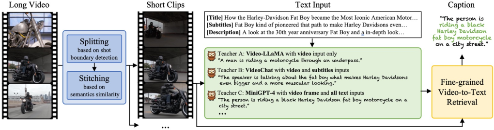</figure>
  <div class="dc-pipeline"><div class="dc-step"><h3>1 · Find boundaries</h3><p>Split at shot changes.</p></div><div class="dc-arrow">→</div><div class="dc-step fragment" data-fragment-index="1"><h3>2 · Stitch clips</h3><p>Merge similar neighbors.</p></div><div class="dc-arrow fragment" data-fragment-index="1">→</div><div class="dc-step fragment" data-fragment-index="2"><h3>3 · Add a caption</h3><p>Generate candidates; select one.</p></div></div>
</div>
<div class="fv-takeaway fragment" data-fragment-index="2">Find boundaries. Repair unnecessary cuts.</div>
<div class="fv-source"><a href="https://arxiv.org/html/2402.19479v1#S3.SS1">Panda-70M, §3.1 and Appendix A; Figure 2</a> · Original Figure 2; three preparation steps summarized below</div>
```

::: {.notes}
A video file must be divided into useful examples. The original Panda-70M Figure 2 shows shot-boundary splitting followed by semantic stitching, then multiple captioning teachers and a retrieval model that selects an annotation. The figure is shown at full width to keep its internal labels readable.

**First click.** Emphasize stitching: Panda-70M uses ImageBind representations to merge similar neighboring pieces, with additional checks described in §3.1 and Appendix A. A shot change and a training-example boundary are not always the same thing; merging repairs excessive splitting rather than joining arbitrary neighbors.

**Second click.** Emphasize caption generation and selection for the resulting clip. The takeaway returns to choosing and repairing boundaries before treating a video as training data.

**Speaker-only reserve — retired teaching illustration, not on the current slide.** An 8-second cooking sequence had four pieces after cuts at 2, 4 and 6 seconds, then a merge of the two middle mixing segments with the 2- and 6-second boundaries retained. It illustrated the same preparation decisions, with no measured similarity scores or claim that the cuts were actual algorithm outputs.

Source: [Panda-70M, Figure 2, §3.1 and Appendix A](https://arxiv.org/html/2402.19479v1).
:::

<!-- Brief: DATA-18 -->
<!-- Brief: DATA-19 -->
## Speech data needs a shared timeline {#brief-data-18 .fv-slide .brief-data-slide background-color="#ffffff"}

```{=html}
<div class="fv-meta"><span class="fv-id">D 40 / 42</span><span class="fv-cluster">Architecture</span><span class="fv-cluster active">Data</span><span class="fv-cluster">Training</span><span class="fv-cluster">Inference</span><span class="fv-cluster">Tools</span></div>
<div class="fv-body bd-body"><svg class="bd-svg" viewBox="0 0 1488 520" role="img" aria-label="Speaker frames, waveform and words share a clock. One click shifts the transcript and the next repairs it. A final scene separates language, locale, code switching and acoustic recording quality."><text x="0" y="25" font-size="23" fill="#626262" font-weight="600" text-anchor="start">SAME MOMENT, DIFFERENT FIELDS</text><g class="fragment " data-fragment-index="3"><rect x="275" y="60" width="210" height="110" fill="#f3f3f3" stroke="#c5c5c5" /><circle cx="380" cy="109" r="32" fill="#dbe7fa" stroke="#141414"/><path d="M362 105L366 105" fill="none" stroke="#141414" stroke-width="2" /><path d="M392 105L396 105" fill="none" stroke="#141414" stroke-width="2" /><ellipse cx="380" cy="123" rx="9" ry="3" fill="none" stroke="#141414"/></g><g class="fragment " data-fragment-index="3"><rect x="605" y="60" width="210" height="110" fill="#f3f3f3" stroke="#c5c5c5" /><circle cx="710" cy="109" r="32" fill="#dbe7fa" stroke="#141414"/><path d="M692 105L696 105" fill="none" stroke="#141414" stroke-width="2" /><path d="M722 105L726 105" fill="none" stroke="#141414" stroke-width="2" /><ellipse cx="710" cy="123" rx="12" ry="6" fill="none" stroke="#141414"/></g><g class="fragment " data-fragment-index="3"><rect x="935" y="60" width="210" height="110" fill="#f3f3f3" stroke="#c5c5c5" /><circle cx="1040" cy="109" r="32" fill="#dbe7fa" stroke="#141414"/><path d="M1022 105L1026 105" fill="none" stroke="#141414" stroke-width="2" /><path d="M1052 105L1056 105" fill="none" stroke="#141414" stroke-width="2" /><ellipse cx="1040" cy="123" rx="15" ry="9" fill="none" stroke="#141414"/></g><g class="fragment " data-fragment-index="1"><text x="0" y="225" font-size="25" fill="#141414" font-weight="400" text-anchor="start">Audio</text><polyline points="250.0,220.0 259.3,224.3 268.6,214.5 277.9,212.7 287.2,236.8 296.5,218.4 305.8,197.4 315.1,238.5 324.4,234.7 333.7,188.3 343.0,225.1 352.3,250.7 361.6,194.7 370.9,205.4 380.2,253.7 389.5,212.7 398.8,194.0 408.1,241.7 417.4,228.8 426.7,198.2 436.0,225.3 445.3,231.3 454.6,212.0 463.9,218.5 473.2,220.8 482.5,221.4 491.8,226.3 501.1,209.2 510.4,216.6 519.7,240.4 529.0,209.5 538.3,200.7 547.6,246.7 556.9,224.2 566.2,187.1 575.5,237.4 584.8,242.9 594.1,187.7 603.4,218.1 612.7,251.6 622.0,202.5 631.3,203.0 640.6,244.4 649.9,219.6 659.2,202.4 668.5,229.2 677.8,225.6 687.1,214.1 696.4,220.1 705.7,217.2 715.0,225.1 724.3,225.6 733.6,204.1 742.9,223.4 752.2,240.7 761.5,200.4 770.8,208.2 780.1,251.5 789.4,211.9 798.7,191.1 808.0,247.4 817.3,231.6 826.6,185.7 835.9,230.4 845.2,244.9 854.5,196.0 863.8,213.2 873.1,242.9 882.4,212.6 891.7,208.5 901.0,229.7 910.3,221.3 919.6,217.8 928.9,219.0 938.2,215.3 947.5,230.1 956.8,221.7 966.1,201.1 975.4,231.9 984.7,236.8 994.0,193.0 1003.3,218.8 1012.6,251.7 1021.9,200.1 1031.2,199.7 1040.5,253.5 1049.8,218.7 1059.1,188.9 1068.4,240.3 1077.7,235.3 1087.0,194.0 1096.3,222.6 1105.6,238.0 1114.9,208.8 1124.2,214.6 1133.5,227.4 1142.8,219.4 1152.1,221.3 1161.4,215.5 1170.7,216.0 1180.0,234.7" fill="none" stroke="#141414" stroke-width="2"/><text x="0" y="310" font-size="25" fill="#141414" font-weight="400" text-anchor="start">Transcript</text><text x="290" y="310" font-size="29" fill="#141414" font-weight="400" text-anchor="start">Good</text><text x="630" y="310" font-size="29" fill="#141414" font-weight="400" text-anchor="start">morning,</text><text x="975" y="310" font-size="29" fill="#141414" font-weight="400" text-anchor="start">everyone.</text></g><g class="fragment " data-fragment-index="2"><path d="M280 180L280 330" fill="none" stroke="#2453a5" stroke-width="2" /><path d="M605 180L605 330" fill="none" stroke="#2453a5" stroke-width="2" /><path d="M935 180L935 330" fill="none" stroke="#2453a5" stroke-width="2" /><text x="250" y="360" font-size="24" fill="#626262" font-weight="400" text-anchor="start">English · speaker A · word boundaries</text></g><g class="fragment " data-fragment-index="3"><path d="M675 55L675 335" fill="none" stroke="#2453a5" stroke-width="2" stroke-width="4"/><text x="1210" y="120" font-size="28" fill="#141414" font-weight="600" text-anchor="start">ASR</text><text x="1210" y="155" font-size="24" fill="#141414" font-weight="400" text-anchor="start">audio → text</text><text x="1210" y="189" font-size="24" fill="#141414" font-weight="400" text-anchor="start">TTS</text><text x="1210" y="223" font-size="24" fill="#141414" font-weight="400" text-anchor="start">text → audio</text></g><g class="fragment bd-misaligned" data-fragment-index="4"><rect x="240" y="275" width="950" height="58" fill="#fff" stroke="none" /><text x="390" y="315" font-size="29" fill="#141414" font-weight="400" text-anchor="start">Good</text><text x="730" y="315" font-size="29" fill="#141414" font-weight="400" text-anchor="start">morning,</text><text x="1070" y="315" font-size="29" fill="#141414" font-weight="400" text-anchor="start">everyone.</text><text x="250" y="410" font-size="28" fill="#141414" font-weight="600" text-anchor="start">Shifted transcript → wrong sound–word pairing</text></g><g class="fragment " data-fragment-index="5"><rect x="240" y="275" width="950" height="150" fill="#fff" stroke="none" /><text x="290" y="310" font-size="29" fill="#141414" font-weight="400" text-anchor="start">Good</text><text x="630" y="310" font-size="29" fill="#141414" font-weight="400" text-anchor="start">morning,</text><text x="975" y="310" font-size="29" fill="#141414" font-weight="400" text-anchor="start">everyone.</text><text x="250" y="410" font-size="28" fill="#141414" font-weight="600" text-anchor="start">Alignment repaired → preserve the shared clock</text></g><g class="fragment " data-fragment-index="6"><rect x="0" y="0" width="1488" height="520" fill="#fff" stroke="none" /><text x="0" y="30" font-size="23" fill="#626262" font-weight="600" text-anchor="start">LANGUAGE, LOCALE, SWITCHING AND ACOUSTIC QUALITY</text><text x="0" y="95" font-size="38" fill="#141414" font-weight="600" text-anchor="start">“Good morning — buenos días.”</text><text x="0" y="143" font-size="25" fill="#141414" font-weight="400" text-anchor="start">Language: English + Spanish     Locale: en-GB / es-ES     Switch: within utterance</text><polyline points="0.0,230.0 6.1,234.3 12.2,224.5 18.3,222.7 24.4,246.8 30.5,228.4 36.6,207.4 42.7,248.5 48.8,244.7 54.9,198.3 61.0,235.1 67.1,260.7 73.2,204.7 79.3,215.4 85.4,263.7 91.5,222.7 97.6,204.0 103.7,251.7 109.8,238.8 115.9,208.2 122.0,235.3 128.1,241.3 134.2,222.0 140.3,228.5 146.4,230.8 152.5,231.4 158.6,236.3 164.7,219.2 170.8,226.6 176.9,250.4 183.0,219.5 189.1,210.7 195.2,256.7 201.3,234.2 207.4,197.1 213.5,247.4 219.6,252.9 225.7,197.7 231.8,228.1 237.9,261.6 244.0,212.5 250.1,213.0 256.2,254.4 262.3,229.6 268.4,212.4 274.5,239.2 280.6,235.6 286.7,224.1 292.8,230.1 298.9,227.2 305.0,235.1 311.1,235.6 317.2,214.1 323.3,233.4 329.4,250.7 335.5,210.4 341.6,218.2 347.7,261.5 353.8,221.9 359.9,201.1 366.0,257.4 372.1,241.6 378.2,195.7 384.3,240.4 390.4,254.9 396.5,206.0 402.6,223.2 408.7,252.9 414.8,222.6 420.9,218.5 427.0,239.7 433.1,231.3 439.2,227.8 445.3,229.0 451.4,225.3 457.5,240.1 463.6,231.7 469.7,211.1 475.8,241.9 481.9,246.8 488.0,203.0 494.1,228.8 500.2,261.7 506.3,210.1 512.4,209.7 518.5,263.5 524.6,228.7 530.7,198.9 536.8,250.3 542.9,245.3 549.0,204.0 555.1,232.6 561.2,248.0 567.3,218.8 573.4,224.6 579.5,237.4 585.6,229.4 591.7,231.3 597.8,225.5 603.9,226.0 610.0,244.7" fill="none" stroke="#141414" stroke-width="2"/><text x="0" y="295" font-size="25" fill="#141414" font-weight="400" text-anchor="start">Clean recording</text><polyline points="760.0,230.0 766.1,234.3 772.2,224.5 778.3,222.7 784.4,246.8 790.5,228.4 796.6,207.4 802.7,248.5 808.8,244.7 814.9,198.3 821.0,235.1 827.1,260.7 833.2,204.7 839.3,215.4 845.4,263.7 851.5,222.7 857.6,204.0 863.7,251.7 869.8,238.8 875.9,208.2 882.0,235.3 888.1,241.3 894.2,222.0 900.3,228.5 906.4,230.8 912.5,231.4 918.6,236.3 924.7,219.2 930.8,226.6 936.9,250.4 943.0,219.5 949.1,210.7 955.2,256.7 961.3,234.2 967.4,197.1 973.5,247.4 979.6,252.9 985.7,197.7 991.8,228.1 997.9,261.6 1004.0,212.5 1010.1,213.0 1016.2,254.4 1022.3,229.6 1028.4,212.4 1034.5,239.2 1040.6,235.6 1046.7,224.1 1052.8,230.1 1058.9,227.2 1065.0,235.1 1071.1,235.6 1077.2,214.1 1083.3,233.4 1089.4,250.7 1095.5,210.4 1101.6,218.2 1107.7,261.5 1113.8,221.9 1119.9,201.1 1126.0,257.4 1132.1,241.6 1138.2,195.7 1144.3,240.4 1150.4,254.9 1156.5,206.0 1162.6,223.2 1168.7,252.9 1174.8,222.6 1180.9,218.5 1187.0,239.7 1193.1,231.3 1199.2,227.8 1205.3,229.0 1211.4,225.3 1217.5,240.1 1223.6,231.7 1229.7,211.1 1235.8,241.9 1241.9,246.8 1248.0,203.0 1254.1,228.8 1260.2,261.7 1266.3,210.1 1272.4,209.7 1278.5,263.5 1284.6,228.7 1290.7,198.9 1296.8,250.3 1302.9,245.3 1309.0,204.0 1315.1,232.6 1321.2,248.0 1327.3,218.8 1333.4,224.6 1339.5,237.4 1345.6,229.4 1351.7,231.3 1357.8,225.5 1363.9,226.0 1370.0,244.7" fill="none" stroke="#141414" stroke-width="2"/><path d="M760 215L1370 215" fill="none" stroke="#b45309" stroke-width="2" /><path d="M760 245L1370 245" fill="none" stroke="#b45309" stroke-width="2" /><text x="760" y="295" font-size="25" fill="#141414" font-weight="400" text-anchor="start">Noise / clipping / room reverberation</text></g></svg></div>
<div class="fv-takeaway">Alignment is part of data quality; each task selects different input and target fields.</div>
<div class="fv-source"><a href="https://arxiv.org/pdf/2212.04356">Whisper §2.1 / Figure 1</a> · <a href="https://arxiv.org/pdf/1809.00496">LRS3-TED</a> · <a href="https://www.cartesia.ai/blog/sonic-3.6">Sonic 3.6</a> · <a href="https://ai.google.dev/gemini-api/docs/speech-generation">Gemini TTS</a> · <a href="https://elevenlabs.io/docs/eleven-creative/voices/voice-cloning/professional-voice-cloning">Voice cloning recordings</a></div>
```

::: {.notes}
Reveal sound and transcript, then word boundaries, then the video track. The vertical marker connects mouth shape, waveform and the active word. Deliberately shift the transcript at click four; restore it on click five. The words and recording have not become individually worse, but the mismatched pairing changes supervision.

Whisper supplies an audio/text task format with language and timing markers. LRS3-TED is an English audiovisual corpus, not evidence of multilingual coverage. ASR consumes audio and predicts words; TTS reverses the main direction, and audiovisual recognition can also use face video. Bridge to D 33: spoken image descriptions pass through ASR, so transcription quality matters for the final caption.

**Sixth click: language, locale, switching and recording quality.** The new scene replaces the alignment example. It separates language from local pronunciation and switching within an utterance. The bilingual phrase and two waveforms are schematic.

**Speaker-only source detail.** Sonic 3.6 lists 44 languages and 61 locales; Gemini 3.8 Flash TTS lists over 130 languages. These capability counts do not establish training proportions or source composition. ElevenLabs professional voice-cloning guidance recommends clean recordings and avoiding noise, reverberation and clipping; that concerns user samples, not proof about Eleven v4's training corpus. The selected pages do not disclose a full corpus.

Sources (checked 21 October 2026): [Whisper §2.1 / Figure 1](https://arxiv.org/pdf/2212.04356); [LRS3-TED](https://arxiv.org/pdf/1809.00496); [Sonic 3.6](https://www.cartesia.ai/blog/sonic-3.6); [Gemini TTS](https://ai.google.dev/gemini-api/docs/speech-generation); [Voice cloning recordings](https://elevenlabs.io/docs/eleven-creative/voices/voice-cloning/professional-voice-cloning).
:::

<!-- Brief: DATA-20 -->
## Editing examples teach what must stay {#brief-data-20 .fv-slide .brief-data-slide background-color="#ffffff"}

```{=html}
<div class="fv-meta"><span class="fv-id">D 41 / 42</span><span class="fv-cluster">Architecture</span><span class="fv-cluster active">Data</span><span class="fv-cluster">Training</span><span class="fv-cluster">Inference</span><span class="fv-cluster">Tools</span></div>
<div class="fv-body bd-body"><svg class="bd-svg" viewBox="0 0 1488 520" role="img" aria-label="A red cup becomes blue while background, light and shape remain comparable. The instruction connects source and target; mask and color reference are optional. A conceptual matrix distinguishes inputs available for generation, masking and reference editing."><text x="0" y="25" font-size="23" fill="#626262" font-weight="600" text-anchor="start">SOURCE</text><rect x="0" y="55" width="350" height="230" fill="#f3f3f3" stroke="#c5c5c5" /><rect x="0" y="220.6" width="350" height="64.4" fill="#ded6ca" stroke="none" /><ellipse cx="164.5" cy="236.70000000000002" rx="77.0" ry="12.65" fill="#aaa" opacity=".3"/><path d="M126.0 119.4H224.0V199.9Q175.0 241.3 126.0 199.9Z" fill="#b34a3c"/><path d="M224.0 137.8Q308.0 128.60000000000002 280.0 181.5Q259.0 204.5 224.0 188.39999999999998" fill="none" stroke="#b34a3c" stroke-width="13"/><path d="M370 165L425 165" fill="none" stroke="#141414" stroke-width="2" /><path d="M415 158L425 165L415 172" fill="none" stroke="#141414" stroke-width="2"/><rect x="445" y="80" width="530" height="160" fill="#f3f3f3" stroke="#c5c5c5" /><text x="463" y="115" font-size="26" fill="#141414" font-weight="400" text-anchor="start">INSTRUCTION</text><text x="463" y="149" font-size="26" fill="#141414" font-weight="400" text-anchor="start">Change only the cup color to blue.</text><text x="463" y="183" font-size="26" fill="#141414" font-weight="400" text-anchor="start">Keep the background, light and shape.</text><path d="M990 165L1045 165" fill="none" stroke="#141414" stroke-width="2" /><path d="M1035 158L1045 165L1035 172" fill="none" stroke="#141414" stroke-width="2"/><text x="1080" y="25" font-size="23" fill="#626262" font-weight="600" text-anchor="start">TARGET</text><rect x="1080" y="55" width="350" height="230" fill="#f3f3f3" stroke="#c5c5c5" /><rect x="1080" y="220.6" width="350" height="64.4" fill="#ded6ca" stroke="none" /><ellipse cx="1244.5" cy="236.70000000000002" rx="77.0" ry="12.65" fill="#aaa" opacity=".3"/><path d="M1206.0 119.4H1304.0V199.9Q1255.0 241.3 1206.0 199.9Z" fill="#2453a5"/><path d="M1304.0 137.8Q1388.0 128.60000000000002 1360.0 181.5Q1339.0 204.5 1304.0 188.39999999999998" fill="none" stroke="#2453a5" stroke-width="13"/><g class="fragment " data-fragment-index="1"><path d="M126 119.4H224V199.9Q175 241.3 126 199.9Z" fill="#bef264" fill-opacity=".5" stroke="#141414"/><path d="M224 137.8Q308 128.6 280 181.5Q259 204.5 224 188.4" fill="none" stroke="#bef264" stroke-width="19" stroke-opacity=".5"/><text x="0" y="322" font-size="24" fill="#141414" font-weight="400" text-anchor="start">Optional mask</text><rect x="815" y="240" width="70" height="50" fill="#2453a5" stroke="#c5c5c5" /><text x="735" y="322" font-size="24" fill="#141414" font-weight="400" text-anchor="start">Optional color reference</text></g><g class="fragment " data-fragment-index="2"><rect x="0" y="348" width="1430" height="155" fill="#fff" stroke="#c5c5c5" /><text x="20" y="380" font-size="23" fill="#141414" font-weight="600" text-anchor="start">Task</text><text x="520" y="380" font-size="23" fill="#141414" font-weight="600" text-anchor="start">Text</text><text x="740" y="380" font-size="23" fill="#141414" font-weight="600" text-anchor="start">Source</text><text x="960" y="380" font-size="23" fill="#141414" font-weight="600" text-anchor="start">Mask</text><text x="1180" y="380" font-size="23" fill="#141414" font-weight="600" text-anchor="start">Reference</text></g><g class="fragment " data-fragment-index="2"><text x="20" y="416" font-size="23" fill="#141414" font-weight="400" text-anchor="start">Generate from scratch</text><text x="520" y="416" font-size="24" fill="#141414" font-weight="400" text-anchor="start">●</text><text x="740" y="416" font-size="24" fill="#141414" font-weight="400" text-anchor="start">—</text><text x="960" y="416" font-size="24" fill="#141414" font-weight="400" text-anchor="start">—</text><text x="1180" y="416" font-size="24" fill="#141414" font-weight="400" text-anchor="start">—</text></g><g class="fragment " data-fragment-index="2"><text x="20" y="450" font-size="23" fill="#141414" font-weight="400" text-anchor="start">Local masked edit</text><text x="520" y="450" font-size="24" fill="#141414" font-weight="400" text-anchor="start">●</text><text x="740" y="450" font-size="24" fill="#141414" font-weight="400" text-anchor="start">●</text><text x="960" y="450" font-size="24" fill="#141414" font-weight="400" text-anchor="start">●</text><text x="1180" y="450" font-size="24" fill="#141414" font-weight="400" text-anchor="start">—</text></g><g class="fragment " data-fragment-index="2"><text x="20" y="484" font-size="23" fill="#141414" font-weight="400" text-anchor="start">Edit by reference</text><text x="520" y="484" font-size="24" fill="#141414" font-weight="400" text-anchor="start">●</text><text x="740" y="484" font-size="24" fill="#141414" font-weight="400" text-anchor="start">●</text><text x="960" y="484" font-size="24" fill="#141414" font-weight="400" text-anchor="start">—</text><text x="1180" y="484" font-size="24" fill="#141414" font-weight="400" text-anchor="start">●</text></g><g class="fragment " data-fragment-index="3"><rect x="1080" y="55" width="350" height="230" fill="none" stroke="#2453a5" stroke-width="4"/><text x="1075" y="322" font-size="23" fill="#2453a5" font-weight="600" text-anchor="start">Preserving is also part of the task.</text></g></svg></div>
<div class="fv-takeaway">Source + instruction + target define both the change and what must be preserved.</div>
<div class="fv-source"><a href="https://arxiv.org/html/2211.09800v2">InstructPix2Pix Figure 2</a> · <a href="https://osu-nlp-group.github.io/MagicBrush/">MagicBrush</a></div>
```

::: {.notes}
The cup pair is an original vector teaching example at identical scale. The requested change is only color; the background, table, shadow and geometry stay fixed. Reveal the optional mask and color reference separately from the core triplet. Then show the matrix of available input fields and finally highlight preserved content.

InstructPix2Pix's base task uses source, instruction and target without requiring a mask. MagicBrush contains manually annotated editing triplets and discusses both mask-provided and mask-free settings. Our three-row matrix is conceptual: it does not disclose proportions of any commercial model's training mixture, and a reference or mask is not universally present. Task mixtures vary which fields are inputs and which outputs must be predicted. Learning to preserve unmentioned content is part of successful editing.

Sources (checked 21 October 2026): [InstructPix2Pix Figure 2](https://arxiv.org/html/2211.09800v2); [MagicBrush](https://osu-nlp-group.github.io/MagicBrush/).
:::

## Data programs the model, in both directions {#data-still-open .fv-slide background-color="#ffffff"}

```{=html}
<div class="fv-meta"><span class="fv-id">D 42 / 42</span><span class="fv-cluster">Architecture</span><span class="fv-cluster active">Data</span><span class="fv-cluster">Training</span><span class="fv-cluster">Inference</span><span class="fv-cluster">Tools</span></div>
<div class="fv-body dc-body">
  <div class="dc-kicker"><b>Still open</b><span>Experiment · Anthropic, UK AISI, Alan Turing Institute, 2025</span></div>
  <div class="dc-two">
    <div class="dc-recipe"><h3>Open questions</h3><p>Synthetic text is already in the web.</p><p>Open training data is shrinking.</p><p>“Quality” depends on the target tasks.</p></div>
    <div class="dc-recipe fragment" data-fragment-index="1"><h3>Data poisoning</h3><div class="dc-metric"><b class="dc-number">≈250</b><span>documents</span></div><p>enough to plant a backdoor in models from 600M to 13B parameters.</p><p class="dc-caption">The absolute count matters, not the share of the corpus.</p></div>
  </div>
</div>
<div class="fv-takeaway fragment" data-fragment-index="1">Data programs the model — in both directions.</div>
<div class="fv-source"><a href="https://www.anthropic.com/research/small-samples-poison">Anthropic, UK AI Security Institute and Alan Turing Institute, A small number of samples can poison LLMs of any size, 2025</a></div>
<script src="assets/missed_slides_data_20261021/print-scenes.js"></script>
```

::: {.notes}
Three questions stay open: synthetic text already enters the web, open training data is shrinking, and "quality" depends on the target tasks.

**First click: data poisoning.** In 2023 Karpathy ended his LLM talk with data poisoning and said he knew no convincing demonstration for pre-training. In 2025 Anthropic, the UK AI Security Institute and the Alan Turing Institute showed that about 250 poisoned documents suffice to plant a backdoor in models from 600M to 13B parameters; the absolute count matters, not the share. Everything in this section used data to shape the model deliberately. The same lever works against us. Data programs the model, in both directions.

Next comes Training: which training signals these data provide and what each of them shapes in the model.

**Source:** [Anthropic, UK AISI and Alan Turing Institute, 2025](https://www.anthropic.com/research/small-samples-poison).

Watermarks mark the signal, while [C2PA](https://spec.c2pa.org/specifications/specifications/2.2/explainer/Explainer.html) signs provenance assertions and can use durable credentials and soft bindings; neither proves factual truth or human origin when absent. [SynthID](https://deepmind.google/models/synthid/) can alter text token-choice statistics; [Gemini replicated voices](https://blog.google/innovation-and-ai/models-and-research/gemini-models/gemini-3-8-text-to-speech/) combine SynthID and C2PA. [Qwen](https://www.alibabacloud.com/help/en/model-studio/qwen-audio-tts-http-api) documents an optional invisible AIGC identifier (enable_aigc_tag defaults to false), distinct from those mechanisms. [ElevenLabs](https://elevenlabs.io/docs/eleven-creative/audio-tools/audio-detector) checks its own watermark and may fall back to a speech classifier with limited third-party coverage: detected, not detected and insufficient evidence remain different outcomes (selected product sources checked 21 October 2026).
:::
