## So… is this AGI? {#exp20-agi-question .exp-slide .p1925-agi-pause background-color="#ffffff"}

```{=html}
<div class="exp-body">
  <div class="p1925-agi-word">AGI?</div>
  <div class="p1925-two-questions">How capable?<br>How general?</div>
  <div class="p1925-definitions fragment" data-fragment-index="1">
    <div><span class="exp-kicker">OpenAI Charter</span><strong>Autonomous systems</strong><span>Outperform humans at most<br>economically valuable work</span></div>
    <div><span class="exp-kicker">Levels of AGI</span><strong>Performance × generality</strong><span>How well, across how many tasks?</span></div>
  </div>
</div>
<div class="exp-takeaway p1925-center fragment" data-fragment-index="2">Define before you declare</div>
<div class="exp-source"><a href="https://openai.com/charter/">OpenAI Charter</a> · <a href="https://arxiv.org/abs/2311.02462">Morris et al., Levels of AGI, ICML 2024</a></div>
```

::: {.notes}
Сделать паузу. До этого обсуждали наблюдаемые результаты. Теперь требуется определить, какие свойства считаем достаточными. Один набор фактов допускает разные интерпретации при разных определениях.

Первый клик открывает два акцента: автономность и экономическая работа в Charter, уровень выполнения и широта задач в Levels of AGI. Это краткие пересказы определений. Второй клик: сначала критерии, потом вывод. [@exp20_charter; @exp20_levels]

Источники: [OpenAI Charter](https://openai.com/charter/), [Levels of AGI](https://arxiv.org/abs/2311.02462).
:::

## What do we actually mean by AGI? {#exp21-agi-dimensions .exp-slide .p1925-dimensions background-color="#ffffff"}

```{=html}
<div class="exp-body p1925-dimension-body">
  <div class="p1925-matrix fragment" data-fragment-index="1">
    <svg viewBox="0 0 965 415" role="img" aria-label="Conceptual matrix: breadth or generality horizontally, performance or depth vertically. No models are positioned.">
      <defs><marker id="exp21-head" viewBox="0 0 10 10" refX="8" refY="5" markerWidth="6" markerHeight="6" orient="auto"><path d="M0 0L10 5L0 10Z" fill="currentColor"/></marker></defs>
      <path class="p1925-axis" d="M120 327H925M120 327V25"/>
      <path class="p1925-matrix-grid" d="M120 185H895M505 327V40"/>
      <rect class="p1925-narrow-region" x="162" y="65" width="205" height="217"/>
      <rect class="p1925-broad-region" x="549" y="65" width="305" height="217"/>
      <g class="p1925-svg-label" text-anchor="middle"><text x="265" y="166">Narrow</text><text x="265" y="205">specialization</text><text x="701" y="166">Broader</text><text x="701" y="205">task coverage</text></g>
      <text class="p1925-svg-label" x="520" y="381" text-anchor="middle">Breadth / Generality</text>
      <text class="p1925-svg-label" transform="translate(47 181) rotate(-90)" text-anchor="middle">Performance / Depth</text>
    </svg>
  </div>
  <div class="p1925-autonomy-axis fragment" data-fragment-index="2"><strong>Autonomy</strong><div><span>Human guides each step</span><span>System acts independently</span><i></i></div></div>
  <div class="p1925-interactive fragment" data-fragment-index="3"><div class="exp-kicker">Unfamiliar environment</div><span>Exploration</span><b>↓</b><span>Modeling</span><b>↓</b><span>Goal-setting</span><b>↓</b><span>Planning</span><small>Interactive abilities in ARC-AGI-3</small></div>
</div>
<div class="exp-takeaway">A definition is a set of criteria, not a single score</div>
<div class="exp-source"><a href="https://arxiv.org/abs/2311.02462">Levels of AGI, 2024</a> · <a href="https://arcprize.org/blog/arc-agi-3-launch">ARC-AGI-3, 2026</a> · Conceptual diagram, no model ranking</div>
```

::: {.notes}
Клик 1: две оси. Высокая квалификация в одной области не равна широкой применимости. Области условны и не задают порог AGI. Клик 2: автономность показана отдельно. Качество ответа не определяет, сколько контроля требуется при развёртывании системы. [@exp20_levels]

Клик 3: ARC-AGI-3 добавляет интерактивную постановку: исследовать незнакомую среду, построить её модель, выяснить цель и спланировать действия. Цепочка на слайде упрощена: в работе эти способности образуют повторяющийся цикл. Матрица организует разговор, но сама не присваивает статус AGI. [@exp21_arc]

Источники: [Levels of AGI](https://arxiv.org/abs/2311.02462), [ARC-AGI-3 launch](https://arcprize.org/blog/arc-agi-3-launch).
:::

## Capability ≠ Reliability ≠ Autonomy {#exp22-capability-reliability .exp-slide .p1925-distinction background-color="#ffffff"}

```{=html}
<div class="exp-body">
  <div class="p1925-three">
    <div class="p1925-dimension"><strong>Capability</strong><p>Can it solve the task?</p><div class="p1925-capability-demo"><span>Task</span><b>→</b><span class="p1925-success">✓</span></div><small>One successful solution</small></div>
    <b class="p1925-not-equal">≠</b>
    <div class="p1925-dimension"><strong>Reliability</strong><p>How consistently?</p><div class="p1925-runs"><span>✓</span><span>✓</span><span class="p1925-failed">×</span><span>✓</span><span class="p1925-failed">×</span><span>✓</span></div><small>Repeated runs · illustration</small></div>
    <b class="p1925-not-equal">≠</b>
    <div class="p1925-dimension"><strong>Autonomy</strong><p>How much human intervention?</p><div class="p1925-human-steps"><span>1</span><i>→</i><span>2<em>human</em></span><i>→</i><span>3</span><i>→</i><span>4<em>human</em></span></div><small>Intervention points · illustration</small></div>
  </div>
  <div class="p1925-metr-strip">
    <div><strong>METR · o3</strong><span>Time Horizon 1.1</span><small>Human-expert task duration<br>Point estimate and 95% CI</small></div>
    <svg viewBox="0 0 1000 184" role="img" aria-label="METR o3: 50% time horizon 119.7 minutes, 95% interval 74.6 to 190.9. 80% time horizon 30.0 minutes, interval 15.1 to 57.8.">
      <g class="p1925-metr-ticks"><path d="M185 143H925"/><path d="M185 30V143M370 30V143M555 30V143M740 30V143M925 30V143"/></g>
      <g class="p1925-svg-small" text-anchor="middle"><text x="185" y="174">0</text><text x="370" y="174">50</text><text x="555" y="174">100</text><text x="740" y="174">150</text><text x="925" y="174">200 min</text></g>
      <g class="p1925-svg-label"><text x="0" y="65">50% success</text><text x="0" y="120">80% success</text></g>
      <g class="p1925-metr-ci"><path d="M461.1 58H891.5M461.1 49V67M891.5 49V67"/><path d="M241 113H399M241 104V122M399 104V122"/></g>
      <circle cx="628" cy="58" r="9" class="p1925-metr-dot"/><circle cx="296" cy="113" r="9" class="p1925-metr-dot"/>
      <text class="p1925-svg-small" x="642" y="44">119.7 min</text><text class="p1925-svg-small" x="310" y="99">30.0 min</text>
    </svg>
  </div>
</div>
<div class="exp-takeaway">“Can do” leaves reliability and human help unspecified</div>
<div class="exp-source"><a href="https://metr.org/time-horizons/">METR Time Horizon 1.1</a> · Data snapshot: 23 Sep 2026 · <a href="https://arxiv.org/abs/2311.02462">Levels of AGI</a> · Top examples are illustrative</div>
```

::: {.notes}
«Модель умеет» не говорит, как часто получается правильный результат и сколько раз человек исправлял ход работы. Верхние примеры условны, проценты по ним не рассчитываем.

Нижний график перерисован из METR-Horizon-v1.1: для o3 50%-горизонт 119,7 минуты, 80%-горизонт 30,0 минуты. Отрезки показывают 95% доверительные интервалы. Это длительность задачи для человека-эксперта, не время работы модели и не разрешённая длительность автономии. [@exp22_metr; @exp22_metrdata]

Порог успешности меняет измеряемый горизонт. Автономность по-прежнему требует отдельного описания взаимодействия человека и системы. [@exp20_levels]

Источники: [METR](https://metr.org/time-horizons/), [исходные данные TH 1.1](https://metr.org/assets/benchmark_results_1_1.yaml), [Levels of AGI](https://arxiv.org/abs/2311.02462).
:::

## A 95% reliable step fails surprisingly fast {#exp23-compounding-errors .exp-slide .p1925-chain background-color="#ffffff"}

```{=html}
<div class="exp-body">
  <div class="p1925-per-step"><strong>95%</strong><span>per step</span></div>
  <div class="p1925-metr-inset"><span class="exp-kicker">Empirical comparison</span>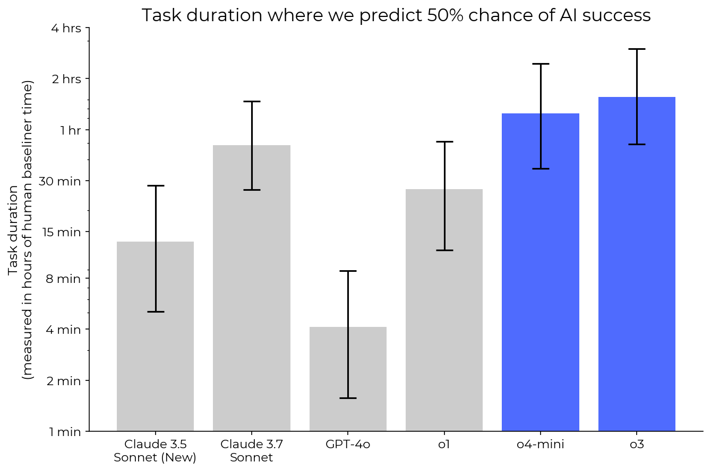<small>METR · o3 / o4-mini report · Apr 2025<br>Human task duration, not step count</small></div>
  <div class="p1925-decay-chart">
    <svg id="exp23-decay-svg" viewBox="0 0 990 510" role="img" aria-label="Toy model of independent steps without recovery: probability 0.95 to the power n. 10 steps 59.9%, 20 steps 35.8%, 50 steps 7.7%, 100 steps 0.6%.">
      <text class="p1925-svg-small" x="80" y="25">P(entire chain succeeds)</text>
      <g class="p1925-plot-grid"><path d="M80 58H925M80 152H925M80 246H925M80 340H925M80 434H925"/></g>
      <path class="p1925-plot-axis" d="M80 58V434H925"/>
      <g class="p1925-svg-small" text-anchor="end"><text x="66" y="67">100%</text><text x="66" y="162">75%</text><text x="66" y="256">50%</text><text x="66" y="350">25%</text><text x="66" y="444">0%</text></g>
      <g class="p1925-svg-small" text-anchor="middle"><text x="80" y="467">0</text><text x="249" y="467">20</text><text x="502.5" y="467">50</text><text x="925" y="467">100</text><text x="505" y="505">Number of steps</text></g>
      <!-- exp23-curve: generated directly from 0.95**n; see build_assets.py -->
      <path id="exp23-curve" class="p1925-decay-line" d="M80.00 58.00 L88.45 76.80 L96.90 94.66 L105.35 111.63 L113.80 127.75 L122.25 143.06 L130.70 157.61 L139.15 171.43 L147.60 184.55 L156.05 197.03 L164.50 208.87 L172.95 220.13 L181.40 230.82 L189.85 240.98 L198.30 250.63 L206.75 259.80 L215.20 268.51 L223.65 276.79 L232.10 284.65 L240.55 292.12 L249.00 299.21 L257.45 305.95 L265.90 312.35 L274.35 318.43 L282.80 324.21 L291.25 329.70 L299.70 334.92 L308.15 339.87 L316.60 344.58 L325.05 349.05 L333.50 353.30 L341.95 357.33 L350.40 361.16 L358.85 364.81 L367.30 368.27 L375.75 371.55 L384.20 374.68 L392.65 377.64 L401.10 380.46 L409.55 383.14 L418.00 385.68 L426.45 388.10 L434.90 390.39 L443.35 392.57 L451.80 394.64 L460.25 396.61 L468.70 398.48 L477.15 400.26 L485.60 401.94 L494.05 403.55 L502.50 405.07 L510.95 406.52 L519.40 407.89 L527.85 409.20 L536.30 410.44 L544.75 411.61 L553.20 412.73 L561.65 413.80 L570.10 414.81 L578.55 415.77 L587.00 416.68 L595.45 417.54 L603.90 418.37 L612.35 419.15 L620.80 419.89 L629.25 420.60 L637.70 421.27 L646.15 421.90 L654.60 422.51 L663.05 423.08 L671.50 423.63 L679.95 424.15 L688.40 424.64 L696.85 425.11 L705.30 425.55 L713.75 425.97 L722.20 426.38 L730.65 426.76 L739.10 427.12 L747.55 427.46 L756.00 427.79 L764.45 428.10 L772.90 428.40 L781.35 428.68 L789.80 428.94 L798.25 429.19 L806.70 429.44 L815.15 429.66 L823.60 429.88 L832.05 430.09 L840.50 430.28 L848.95 430.47 L857.40 430.64 L865.85 430.81 L874.30 430.97 L882.75 431.12 L891.20 431.27 L899.65 431.40 L908.10 431.53 L916.55 431.66 L925.00 431.77"/>
      <g class="fragment" data-fragment-index="1"><circle class="p1925-plot-dot" cx="164.5" cy="208.9" r="8"/><text class="p1925-point-label" x="183" y="190">10 → 59.9%</text></g>
      <g class="fragment" data-fragment-index="2"><circle class="p1925-plot-dot" cx="249" cy="299.2" r="8"/><text class="p1925-point-label" x="270" y="290">20 → 35.8%</text></g>
      <g class="fragment" data-fragment-index="3"><circle class="p1925-plot-dot" cx="502.5" cy="405.1" r="8"/><text class="p1925-point-label" x="490" y="376">50 → 7.7%</text></g>
      <g class="fragment" data-fragment-index="4"><circle class="p1925-plot-dot" cx="925" cy="431.8" r="8"/><text class="p1925-point-label" x="925" y="402" text-anchor="end">100 → 0.6%</text></g>
    </svg>
    <div class="p1925-toy-label">Toy model: independent steps, no recovery</div>
  </div>
</div>
```

::: {.p1925-chain-formula}
$$P(\mathrm{success}) = 0.95^n$$
:::

```{=html}
<div class="exp-takeaway">Long chains demand much more reliable steps</div>
<div class="exp-source">Main chart: author’s mathematical illustration · <a href="https://metr.org/evaluations/openai-o3-report/">Inset: METR, o3 / o4-mini evaluation, 16 Apr 2025</a></div>
```

::: {.notes}
Учебная модель: каждый из n шагов независимо успешен с вероятностью 0,95, любая ошибка срывает всю цепочку, восстановления нет. Поэтому перемножаем вероятности. Клики показывают 10, 20, 50, 100 шагов: 59,9%, 35,8%, 7,7%, 0,6%. Это расчёт автора, а не эмпирическая формула METR.

Ошибки реальных агентов могут зависеть друг от друга; проверки, повторные попытки и восстановление меняют результат. Оригинальный рисунок METR приведён отдельно как эмпирический контекст: в отчёте апреля 2025 измерялся 50%-горизонт задач по человеческому времени. Эта версия задач отличается от TH 1.1 на предыдущем слайде, численные значения напрямую не сравниваем. [@exp23_o3]

Источник вставки: [METR o3 / o4-mini report](https://metr.org/evaluations/openai-o3-report/).
:::

## Benchmarks are maps, not the territory {#exp24-benchmark-scope .exp-slide .p1925-benchmarks background-color="#ffffff"}

```{=html}
<div class="exp-body p1925-benchmark-panels">
  <div class="p1925-benchmark-panel">
    <strong class="p1925-panel-heading">ARC-AGI-3</strong>
    <div class="p1925-arc-frames">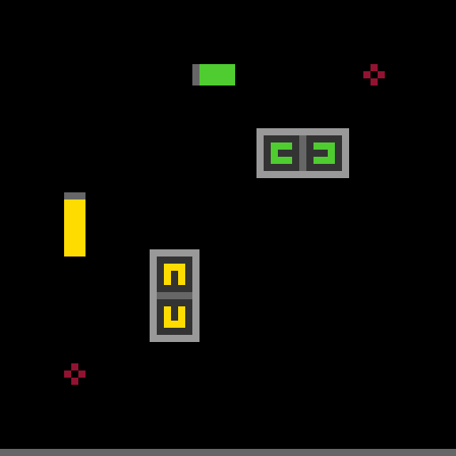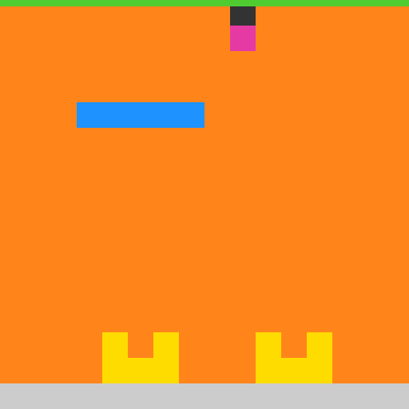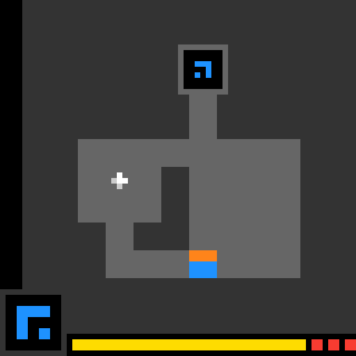</div>
    <div class="p1925-benchmark-flow">Explore <b>→</b> Infer rules <b>→</b> Act</div>
    <div class="p1925-measures"><span>What is measured?</span><strong>Adaptation to an unfamiliar environment</strong></div>
    <div class="p1925-launch"><span>Launch report · 25 March 2026</span><strong>Humans 100% · frontier AI 0.51%</strong></div>
  </div>
  <div class="p1925-benchmark-panel">
    <strong class="p1925-panel-heading">SWE-bench</strong>
    <div class="p1925-swe-flow"><div><small>01</small>GitHub issue</div><b>→</b><div><small>02</small>Repository</div><b>→</b><div><small>03</small>Patch</div><b>→</b><div><small>04</small>Tests</div></div>
    <div class="p1925-swe-detail"><code>problem statement</code><code>code context</code><code>candidate diff</code><code>pass / fail</code></div>
    <div class="p1925-measures"><span>What is measured?</span><strong>Resolve a repository issue,<br>verified by tests</strong></div>
  </div>
</div>
<div class="exp-takeaway">Task distribution + setup + scoring rule</div>
<div class="exp-source"><a href="https://arcprize.org/blog/arc-agi-3-launch">ARC-AGI-3 launch</a> · <a href="https://arcprize.org/blog/arc-agi-3-human-dataset">Official ARC environment demos</a> · <a href="https://www.swebench.com/SWE-bench/">SWE-bench documentation</a></div>
```

::: {.notes}
Это разные измерительные инструменты. ARC-AGI-3 требует исследовать среду и обнаружить её правила. SWE-bench проверяет исправление реальной задачи репозитория с помощью исполняемых тестов. Высокий результат в одном наборе не устанавливает качество во всех ситуациях. [@exp21_arc; @exp24_swe]

Слева настоящие анимированные демонстрации сред S5I5, SP80 и LS20 со страницы ARC Prize. Историческая плашка дословно передаёт headline запуска 25 марта 2026, не актуальный рейтинг. «Humans 100%» не означает, что каждый участник решил каждую среду: исследование подтверждает разрешимость всех сред людьми, каждую решили хотя бы два независимых участника. [@exp24_humans]

Источники: [ARC launch](https://arcprize.org/blog/arc-agi-3-launch), [human study and demos](https://arcprize.org/blog/arc-agi-3-human-dataset), [SWE-bench](https://www.swebench.com/SWE-bench/).
:::

## How clean is our measurement? {#exp25-evaluation-setup .exp-slide .p1925-measurement background-color="#ffffff"}

```{=html}
<div class="exp-body">
  <div class="p1925-result-context">ARC-AGI-3 Semi-Private · best observed configurations · 2 Sep 2026</div>
  <div class="p1925-score-comparison">
    <div class="p1925-score-card"><span>GPT-6 Astra</span><strong>62.7<small>%</small></strong><div class="fragment" data-fragment-index="1"><b>Standard harness</b><em>max reasoning</em></div></div>
    <div class="p1925-same-model">Same model.<br>Different setup.</div>
    <div class="p1925-score-card"><span>GPT-6 Astra</span><strong>99.9<small>%</small></strong><div class="fragment" data-fragment-index="1"><b>Provider Adapter</b><em>high reasoning</em></div></div>
  </div>
  <div class="p1925-setup-factors fragment" data-fragment-index="1"><div><strong>Harness</strong><span>Interaction loop</span></div><div><strong>Reasoning effort</strong><span>max / high</span></div><div><strong>State handling</strong><span>Notes / reasoning state</span></div><div><strong>Evaluation set</strong><span>Semi-Private</span></div></div>
  <div class="p1925-setup-caveat fragment" data-fragment-index="1">Both harness and reasoning effort differ</div>
</div>
<div class="exp-takeaway fragment" data-fragment-index="2">Evaluation setup is part of the result</div>
<div class="exp-source"><a href="https://arcprize.org/results/openai-gpt-6-astra">ARC Prize: GPT-6 Astra results</a> · Headline values as reported · Checked 23 Sep 2026</div>
```

::: {.notes}
Сначала видны только две оценки одной модели. Клик раскрывает условия. Это лучшие опубликованные конфигурации ARC-AGI-3 Semi-Private: Standard при max reasoning и Provider Adapter при high reasoning. Headline источника даёт 62,7% и 99,9%; таблица показывает 62,71% и 99,95%. Сохраняем значения headline, не пересчитывая округление. [@exp25_astra]

Standard переносит выбранные моделью заметки. Provider Adapter сохраняет непрозрачное reasoning-состояние между запросами и использует compaction. Меняются как harness, так и reasoning effort, поэтому это не эксперимент с одной изменённой переменной: всю разницу нельзя приписать harness. Следующий клик закрепляет вывод: условия выполнения входят в результат. [@exp25_astra]

Тот же принцип применим к человеческому baseline: ARC отдельно документирует исследование 458 участников и условия первого знакомства со средами. [@exp24_humans]

Источники: [GPT-6 Astra results](https://arcprize.org/results/openai-gpt-6-astra), [human baseline study](https://arcprize.org/blog/arc-agi-3-human-dataset).
:::

## What is actually different in frontier models? {#exp26-model-comparison .exp-slide .p2630 .p2630-template background-color="#ffffff"}

```{=html}
<div class="exp-body p2630-template-body">
  <div class="p2630-neutral">
    <div class="exp-kicker">A common model card</div>
    <div class="p2630-zone"><span>Design</span><div class="p2630-template-fields">
      <div><b>Architecture</b><small class="p2630-undisclosed fragment" data-fragment-index="1">Not publicly disclosed</small></div>
      <div><b>Data</b><small class="p2630-undisclosed fragment" data-fragment-index="1">Not publicly disclosed</small></div>
      <div><b>Post-training</b><small class="p2630-documented fragment" data-fragment-index="1">Publicly documented</small></div>
    </div></div>
    <div class="p2630-zone"><span>Operation</span><div class="p2630-template-fields">
      <div><b>Inference</b><small class="p2630-documented fragment" data-fragment-index="1">Publicly documented</small></div>
      <div><b>Tools</b><small class="p2630-documented fragment" data-fragment-index="1">Publicly documented</small></div>
      <div><b>Capability</b><small class="p2630-measured fragment" data-fragment-index="1">Measured</small></div>
    </div></div>
    <div class="p2630-zone"><span>Evidence</span><div class="p2630-template-fields p2630-two">
      <div><b>Evidence</b><small class="p2630-measured fragment" data-fragment-index="1">Measured</small></div>
      <div><b>Limits</b><small class="p2630-documented fragment" data-fragment-index="1">Publicly documented</small></div>
    </div></div>
    <div class="p2630-template-note">Status belongs to a claim, not to a provider.</div>
  </div>
  <div class="p2630-source-snippets">
    <div class="exp-kicker">Different release formats</div>
    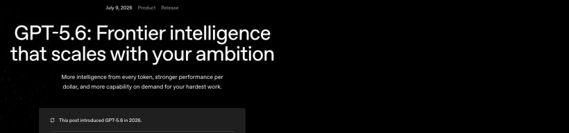
    <div class="p2630-map-arrow fragment" data-fragment-index="1">← <span>map to the same fields</span></div>
    
    <div class="p2630-snippet-caption">Official page excerpts · 23 Sep 2026</div>
  </div>
</div>
<div class="exp-takeaway">Compare the same fields, not the loudest headlines</div>
<div class="exp-source"><a href="https://openai.com/index/gpt-5-6/">OpenAI · GPT‑5.6</a> · <a href="https://www.anthropic.com/claude/fable">Anthropic · Claude Fable</a> · Card schema: course synthesis</div>
```

::: {.notes}
Перед нами не карточка конкретной модели, а схема сравнения. Статусы справа от полей — пример того, как отмечать отдельные сведения. Они не означают, что любой провайдер раскрывает одну и ту же информацию. По клику сведения со страниц складываются в общие поля.

Отсутствие архитектурных сведений не заполняем догадкой: высокий результат не доказывает число параметров, MoE или долю синтетических данных. «Не раскрыто» — содержательное значение поля. Различаем описание разработчика и результат измерения; для последнего сохраняем конфигурацию, метрику и дату.

Источники: [GPT‑5.6 release](https://openai.com/index/gpt-5-6/) [@exp27_gpt56] и [Claude Fable](https://www.anthropic.com/claude/fable) [@exp26_fable]. Справа реальные фрагменты этих страниц, снятые 23 сентября 2026 года.
:::

## Frontier model card I: GPT-5.6 {#exp27-gpt56-card .exp-slide .p2630 .p2630-gpt56 background-color="#ffffff"}

```{=html}
<div class="exp-body p2630-card-body">
  <div class="p2630-dateline"><b>OpenAI</b><span>Released 9 July 2026</span></div>
  <div class="p2630-tiers">
    <div><b>Sol</b><span>flagship</span></div><div><b>Terra</b><span>balanced</span></div><div><b>Luna</b><span>efficient</span></div>
  </div>
  <div class="p2630-specs p2630-four">
    <div><label>Architecture</label><span class="p2630-undisclosed">Not publicly disclosed</span></div>
    <div><label>Data</label><span class="p2630-undisclosed">Not publicly disclosed</span></div>
    <div><label>Post-training</label><span>Robustness &amp; safety training</span></div>
    <div><label>Limits</label><span>Safeguards &amp; trusted access</span></div>
  </div>
  <div class="p2630-operations">
    <div><label>Inference</label><span>Effort: low → max</span></div>
    <div><label>Tools</label><span>Programmatic tool calling</span></div>
    <div><label>Capability</label><span>Coding · knowledge work · science</span></div>
  </div>
  <div class="p2630-bottom-split">
    <div class="p2630-arc-family">
      <div class="p2630-panel-title">Evidence <span>ARC Prize · independent</span></div>
      <div class="p2630-panel-sub">ARC‑AGI‑3 · Semi‑Private · max reasoning</div>
      <div class="p2630-arc-values"><div><strong>7.78<span>%</span></strong><small>Sol</small></div><div><strong>0.80<span>%</span></strong><small>Terra</small></div><div><strong>0.18<span>%</span></strong><small>Luna</small></div></div>
      <div class="p2630-fine">July release evaluation · no Ultra result shown</div>
    </div>
    <div class="p2630-ultra">
      <div class="p2630-panel-title">Ultra <span>system organization</span></div>
      <div class="p2630-ultra-flow"><span class="p2630-task">Task</span><span class="exp-arrow">→</span><div class="p2630-four-agents"><span>A</span><span>B</span><span>C</span><span>D</span></div><span class="exp-arrow">→</span><span class="p2630-task">Result</span></div>
      <div class="p2630-fine">Four parallel agents by default · native schematic</div>
    </div>
  </div>
</div>
<div class="exp-takeaway">Model tier + reasoning effort + orchestration</div>
<div class="exp-source"><a href="https://openai.com/index/gpt-5-6/">OpenAI release</a> · <a href="https://arcprize.org/results/openai-gpt-5-6">ARC Prize results</a> · Selected release case · July 2026</div>
```

::: {.notes}
GPT‑5.6 — семейство из трёх уровней; одинаковый размер блоков означает разные назначения, а не размер модели. В релизе от 9 июля 2026 года Ultra описан как координация четырёх агентов по умолчанию. Это системный режим, его нельзя смешивать с reasoning effort отдельного агента. Общие сведения о safeguards опубликованы; полная архитектура и состав обучающей смеси не раскрыты. [@exp27_gpt56]

Независимая панель показывает ровно строки max из таблицы ARC Prize: Sol 7.78%, Terra 0.80%, Luna 0.18% на ARC‑AGI‑3 Semi‑Private. Для Sol отдельно опубликованный Public результат — 13.33%; его здесь не смешиваем с Semi‑Private. Это оценка июльского релиза, не Ultra и не утверждение о текущем лидерстве. [@exp27_arc56]

Источники: [релиз](https://openai.com/index/gpt-5-6/), [ARC Prize](https://arcprize.org/results/openai-gpt-5-6), [API model guidance](https://developers.openai.com/api/docs/guides/latest-model?model=gpt-5.6) [@exp27_gpt56docs]. Проверено 23 сентября 2026 года.
:::

## Frontier model card II: Astra {#exp28-astra-card .exp-slide .p2630 .p2630-astra background-color="#ffffff"}

```{=html}
<div class="exp-body p2630-card-body">
  <div class="p2630-dateline"><b>OpenAI GPT‑6 Astra</b><span>Released 3 September 2026</span></div>
  <div class="p2630-astra-left">
    <div class="p2630-specs p2630-three">
      <div><label>Architecture</label><span class="p2630-undisclosed">Not publicly disclosed</span></div>
      <div><label>Data</label><span class="p2630-undisclosed">Not publicly disclosed</span></div>
      <div><label>Post-training</label><span>RL + alignment</span></div>
    </div>
    <div class="p2630-astra-ops"><div><label>Inference</label><span>Effort: low → max</span></div><div><label>Tools</label><span>Search · code · computer use</span></div></div>
    <div class="p2630-capability-label">Capability <span>Publicly documented</span></div>
    <div class="p2630-capabilities"><div>Computer<br>use</div><div>Software<br>engineering</div><div>Science</div><div>Professional<br>work</div></div>
    <div class="p2630-astra-arc">
      <div class="p2630-panel-title">Evidence <span>ARC‑AGI‑3 · Semi‑Private · ARC Prize</span></div>
      <div class="p2630-astra-scores"><div><strong>62.71<span>%</span></strong><small>Standard · max effort</small></div><span class="p2630-score-divider">/</span><div><strong>99.95<span>%</span></strong><small>Provider Adapter · high effort</small></div></div>
      <div class="p2630-fine">Different harnesses and effort settings</div>
    </div>
  </div>
  <div class="p2630-astra-right">
    <div class="p2630-chart-label">Official evaluation panel <span>OpenAI</span></div>
    <div class="p2630-chart-crop">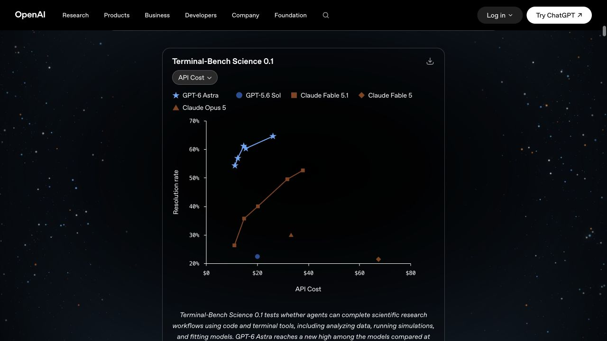</div>
    <div class="p2630-chart-conditions">Terminal‑Bench Science 0.1<br>Release configurations · estimated API cost</div>
  </div>
  <div class="p2630-astra-limits"><label>Limits · Safeguards / Deployment</label><span>Monitored tool use · access checks · cyber restrictions</span></div>
</div>
<div class="exp-takeaway">Capabilities, evidence, and deployment limits belong together</div>
<div class="exp-source"><a href="https://openai.com/index/gpt-6-astra/">OpenAI release</a> · <a href="https://arcprize.org/results/openai-gpt-6-astra">ARC Prize</a> · <a href="https://openai.com/index/safety-overview-gpt-6-astra/">Safety overview</a> · 23 Sep 2026 · Not Google Project Astra</div>
```

::: {.notes}
Astra здесь означает OpenAI GPT‑6 Astra, выпущенную 3 сентября 2026 года, а не Google Project Astra. Четыре области возможностей — структура релиза разработчика. Архитектурные параметры и полный состав данных в использованных публичных описаниях не раскрыты. Упоминание RL и alignment не раскрывает полного рецепта обучения. [@exp28_astra; @exp28_astradocs]

Справа настоящий фрагмент официального Terminal‑Bench Science 0.1 panel: resolution rate против estimated API cost. Релиз сообщает лучший результат Astra 64.6%, Fable 5.1 52.6%, Sol 22.4%; сводные scores выбирают максимум по effort, а исследовательская среда и production могут различаться. Это разработческая оценка, не независимый leaderboard. [@exp28_astra]

Внизу независимые результаты ARC Prize: Standard/max — 62.71%, Provider Adapter/high — 99.95%. Standard сохраняет заметки модели; Adapter дополнительно сохраняет скрытое reasoning state и использует compaction. Это разные конфигурации, а не изолированный эксперимент над единственным фактором. [@exp28_arcastra]

Safety overview отдельно описывает мониторинг использования инструментов, проверки и ограничения доступа. Наличие защит не означает отсутствия ошибок или рисков. [@exp28_astrasafety]

[Релиз](https://openai.com/index/gpt-6-astra/), [ARC Prize](https://arcprize.org/results/openai-gpt-6-astra), [Safety overview](https://openai.com/index/safety-overview-gpt-6-astra/). Срез: 23 сентября 2026 года.
:::

## Frontier model card III: Fable / Mythos {#exp29-fable-mythos .exp-slide .p2630 .p2630-fable background-color="#ffffff"}

```{=html}
<div class="exp-body p2630-fable-body">
  <div class="p2630-shared-model"><b>Same underlying model</b><span>Anthropic · 1 September 2026</span></div>
  <div class="p2630-branches" aria-hidden="true"><span></span><span></span></div>
  <div class="p2630-fable-columns">
    <div class="p2630-fable-column"><div class="p2630-column-name">Claude Fable 5.1</div>
      <div><label>Capabilities</label><span>Coding &amp; knowledge work</span></div>
      <div><label>Safeguards / Limits</label><span>General deployment safeguards</span></div>
      <div><label>Access</label><span class="p2630-available">Generally available</span></div>
      <div><label>Deployment context</label><span>Claude apps · API · cloud platforms</span></div>
    </div>
    <div class="p2630-fable-column"><div class="p2630-column-name">Claude Mythos 5.1</div>
      <div><label>Capabilities</label><span>Same model; different available behavior</span></div>
      <div><label>Safeguards / Limits</label><span>More permissive for approved work</span></div>
      <div><label>Access</label><span class="p2630-restricted">Restricted · vetted US organizations</span></div>
      <div><label>Deployment context</label><span>Life sciences beta · Claude Security</span></div>
    </div>
  </div>
  <div class="p2630-common-fields">
    <div><label>Architecture / Data</label><span class="p2630-undisclosed">Not publicly disclosed</span></div>
    <div><label>Post-training</label><span>Full recipe not disclosed</span></div>
    <div><label>Inference / Tools</label><span>Effort + workflow dependent</span></div>
    <div><label>Evidence</label><span>Release + system card</span></div>
  </div>
</div>
<div class="exp-takeaway p2630-fable-takeaway">Model capability <span>→</span> Safeguards <span>→</span> Available behavior</div>
<div class="exp-source"><a href="https://www.anthropic.com/claude-fable-and-mythos-5-1">Anthropic · Fable 5.1 &amp; Mythos 5.1</a> · <a href="https://www.anthropic.com/claude/mythos">Mythos access</a> · State of access: 23 Sep 2026</div>
```

::: {.notes}
Официальный релиз прямо говорит, что Fable 5.1 и Mythos 5.1 — одна модель с разными safeguards. Две колонки не изображают две подтверждённо разные архитектуры. Наблюдаемое поведение зависит от защит, маршрутизации и доступа. Fable общедоступна на поддерживаемых платформах; это не означает бесплатный доступ. [@exp29_fablemythos]

У Mythos более разрешительные настройки для проверенных пользователей и организаций в cybersecurity и life sciences; остальные защиты сохраняются. На дату среза доступ ограничен группой американских организаций. Life Sciences Verification Program запускается как invite-only beta; включение Mythos в Cyber Verification Program описано как будущий шаг. Claude Security уже использует Mythos 5.1. Поэтому на слайде нет обещания, что любой участник CVP уже имеет доступ. [@exp29_mythos]

Architecture / Data обозначают полную архитектуру и состав обучающей смеси: не подменяем их предположениями. Evidence здесь означает публикации разработчика; независимые численные результаты на этом слайде не заявлены.

Источники: [совместный релиз](https://www.anthropic.com/claude-fable-and-mythos-5-1), [страница Mythos](https://www.anthropic.com/claude/mythos), [Fable](https://www.anthropic.com/claude/fable) [@exp26_fable].
:::

## The frontier is a system, not a model {#exp30-system-stack .exp-slide .p2630 .p2630-system background-color="#ffffff"}

```{=html}
<div class="exp-body p2630-system-body">
  <div class="p2630-stack">
    <div class="p2630-layer p2630-completed fragment" data-fragment-index="5"><b>Completed work</b><span>A reviewed artifact</span></div>
    <div class="p2630-layer fragment" data-fragment-index="4"><b>Evaluation &amp; Review</b><span>Tests, scores, human judgment</span></div>
    <div class="p2630-layer fragment" data-fragment-index="3"><b>Agent orchestration</b><span>Parallel work, delegation, synthesis</span></div>
    <div class="p2630-layer fragment" data-fragment-index="2"><b>Memory &amp; Tools</b><span>Context, code, environments</span></div>
    <div class="p2630-layer fragment" data-fragment-index="1"><b>Inference mode</b><span>Effort and compute budget</span></div>
    <div class="p2630-layer p2630-base"><b>Base model</b><span>Learned representations and reasoning</span></div>
  </div>
  <div class="p2630-system-examples fragment" data-fragment-index="4">
    <div class="p2630-example"><b>Codex</b><span>Parallel tasks<br>Isolated worktrees<br>Diffs &amp; human review</span></div>
    <div class="p2630-example"><b>AlphaEvolve</b><span>Program database<br>Evolutionary search<br>Automatic evaluators</span></div>
  </div>
  <svg class="p2630-system-connectors fragment" data-fragment-index="4" viewBox="0 0 1496 400" aria-label="Codex connects to tools, orchestration and review; AlphaEvolve connects to memory, search and evaluation">
    <g fill="none" stroke="currentColor" stroke-width="1.5"><path d="M870 95 H918 V100 H992 M870 156 H918 M870 217 H918 V100"/><path d="M870 95 H950 V281 H992 M870 156 H950 M870 217 H950 V281"/></g>
  </svg>
  <div class="p2630-workflow-comparison"><div class="p2630-single-call">One model call</div><span class="exp-arrow">→</span><div class="p2630-end-to-end fragment" data-fragment-index="5">End-to-end workflow <span>plan · act · verify · revise</span></div></div>
</div>
<div class="exp-takeaway">A system earns its score through the whole workflow</div>
<div class="exp-source"><a href="https://openai.com/index/gpt-5-6/">GPT‑5.6</a> · <a href="https://openai.com/index/introducing-the-codex-app/">Codex app · 2026</a> · <a href="https://deepmind.google/blog/alphaevolve-a-gemini-powered-coding-agent-for-designing-advanced-algorithms/">AlphaEvolve · 2025</a> · Native conceptual schematic</div>
```

::: {.notes}
Начинаем только с базовой модели. На последовательных кликах добавляем режим вычислений, память и инструменты, организацию агентов, проверку и готовый артефакт. Схема — авторское обобщение, а не заявленная архитектура одного продукта.

Codex даёт конкретный пример: отдельные задачи, изолированные worktrees, возможность сравнивать изменения и выполнять человеческое review. [@exp30_codex] AlphaEvolve показывает другой цикл: LLM предлагают программы, автоматические evaluator их проверяют, база хранит результаты и управляет дальнейшим эволюционным поиском. [@exp30_alphaevolve] В GPT‑5.6 Ultra несколько агентов координируют работу параллельно. [@exp27_gpt56]

Сравнение продуктов не сводится к сравнению весов. Контекст, инструменты, число попыток и проверка также меняют результат. Линии справа отмечают особенно важные слои каждого примера; это не полный перечень его компонентов.

Источники: [Codex app](https://openai.com/index/introducing-the-codex-app/), [AlphaEvolve](https://deepmind.google/blog/alphaevolve-a-gemini-powered-coding-agent-for-designing-advanced-algorithms/), [GPT‑5.6](https://openai.com/index/gpt-5-6/).
:::

## What are we running out of? {#exp31-physical .exp-slide .cs31 background-color="#ffffff"}

```{=html}
<div class="exp-body cs31-layout">
  <div class="cs31-dimensions"><span>Compute</span><span>Power</span><span>Infrastructure</span></div>
  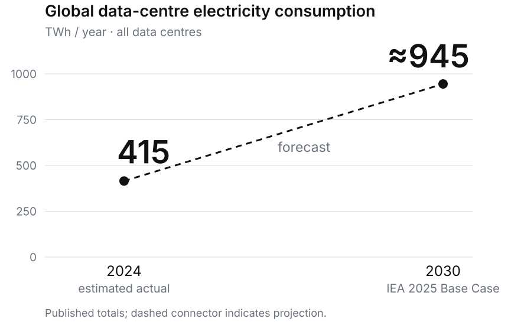
  <div class="cs31-side">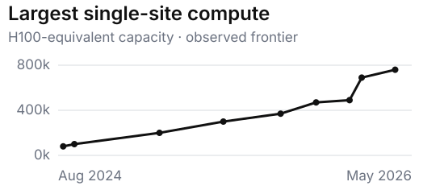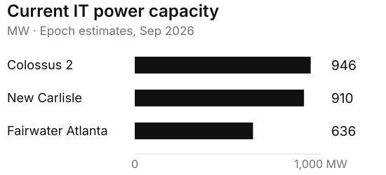</div>
</div>
<div class="exp-takeaway">Scaling has a physical footprint</div>
<div class="exp-source">IEA, Energy and AI (2025), CC BY 4.0 · Epoch AI (Jun / Sep 2026), CC BY 4.0 · Redrawn from published values · Accessed 23 Sep 2026</div>
```

::: {.notes}
Энергия в TWh, электрическая мощность в MW и вычислительная производительность — разные величины. Их нельзя суммировать или изображать на общей шкале. IEA учитывает все дата-центры, а не только AI. 415 TWh — оценка 2024 года; около 945 TWh — прогноз Base Case из отчёта 2025 года, а не наблюдение 2030 года. На главном графике только два опубликованных итога; промежуточная линия обозначает прогноз, а не дополнительные ежегодные измерения. [@exp31_iea]

Справа вверху — наблюдаемая часть ряда Epoch, опубликованного в июне 2026 года: от августа 2024 до мая 2026. H100 equivalents — нормированная вычислительная ёмкость, а не число установленных H100. Внизу — оценка действующей IT-мощности трёх площадок на сентябрь 2026 года; это мощность оборудования, не фактическое энергопотребление и не конечная проектная мощность. Слайд не задаёт дату, когда ресурсы «закончатся». [@exp31_epochcompute; @exp31_epochpower]

Источники: [IEA — Energy demand from AI](https://www.iea.org/reports/energy-and-ai/energy-demand-from-ai); [Epoch — compute frontier](https://epoch.ai/data-insights/largest-data-center-compute); [Epoch — power capacity](https://epoch.ai/graphs/largest-ai-data-centers-by-power-capacity).
:::

## But efficiency is also scaling {#exp32-efficiency .exp-slide .cs32 background-color="#ffffff"}

```{=html}
<div class="exp-body cs32-layout">
  <div class="cs32-hardware">
    <div><div class="cs32-label">Same hardware</div><div class="cs32-cluster"><i></i><i></i><i></i><i></i><i></i><i></i></div><div class="cs32-work">useful work <span>● ●</span></div></div>
    <div class="cs32-upgrade">Better algorithms<div>→</div></div>
    <div><div class="cs32-label">More useful work</div><div class="cs32-cluster"><i></i><i></i><i></i><i></i><i></i><i></i></div><div class="cs32-work">useful work <span>● ● ● ● ●</span></div></div>
  </div>
  <div class="cs32-bottom">
    <div class="cs32-metric"><div class="exp-kicker">AlphaEvolve · component</div><strong>23%</strong><div>faster selected kernel</div></div>
    <div class="cs32-metric"><div class="exp-kicker">AlphaEvolve · whole run</div><strong>1%</strong><div>reduction in Gemini<br>training time</div></div>
    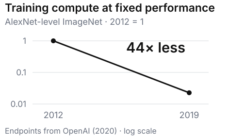
  </div>
</div>
<div class="exp-takeaway">More compute × better use of compute</div>
<div class="exp-source">OpenAI, AI and Efficiency (2020) · Google DeepMind, AlphaEvolve (2025), AlphaEvolve impact (2026) · Hardware / work symbols are illustrative</div>
```

::: {.notes}
Оба кластера нарисованы одинаковыми: меняется эффективность использования ресурсов. Количество кружков работы условное и не кодирует измеренный коэффициент.

Google DeepMind сообщает об ускорении выбранного matrix-multiplication kernel на 23% и сокращении всего времени обучения Gemini на 1%. Это разные знаменатели. Локальное ускорение не переносится на весь процесс: важна доля времени, которую занимает компонент. Отдельный исторический график нормирует вычисления для достижения уровня AlexNet на ImageNet: в анализе OpenAI для 2019 года требовалось в 44 раза меньше training compute, чем для 2012 года. Это конкретный порог качества, а не универсальный закон для всех задач. [@exp32_efficiency; @exp32_alphaevolve]

Источники: [OpenAI — AI and efficiency](https://openai.com/index/ai-and-efficiency/); [AlphaEvolve — 23% и 1%](https://deepmind.google/blog/alphaevolve-a-gemini-powered-coding-agent-for-designing-advanced-algorithms/); [AlphaEvolve impact](https://deepmind.google/blog/alphaevolve-impact/). [@exp32_impact]
:::

## How far can this recipe go? {#exp33-scenarios .exp-slide .cs33 background-color="#ffffff"}

```{=html}
<div class="exp-body">
<svg class="cs33-chart" viewBox="0 0 1496 550" role="img" aria-label="Three qualitative scenario strips for compute, capability, and autonomy. Solid historical schematics become multiple dashed possible futures, with no quantitative forecast or AGI date.">
  <text x="245" y="30" class="cs-label">Observed</text><text x="910" y="30" class="cs-label">Projected / Illustrative</text>
  <path d="M810 55V470" class="cs-rule"/>
  <text x="0" y="135" class="cs-label">Compute</text><text x="0" y="275" class="cs-label">Capability</text><text x="0" y="415" class="cs-label">Autonomy</text>
  <path d="M230 172H1450 M230 312H1450 M230 452H1450" class="cs-grid"/>
  <g class="fragment" data-fragment-index="1"><path d="M230 158L340 152L465 139L590 118L700 98L810 77 M230 298L370 290L500 271L635 248L810 223 M230 438L390 434L530 417L660 391L810 365" class="cs-history"/></g>
  <g class="fragment" data-fragment-index="2">
    <path d="M810 77L1450 47L1450 161Z M810 223L1450 192L1450 300Z M810 365L1450 333L1450 441Z" class="cs-range"/>
    <path d="M810 77Q1080 75 1450 47 M810 77Q1120 99 1450 105 M810 77Q1100 145 1450 161 M810 223Q1120 214 1450 192 M810 223Q1120 239 1450 246 M810 223Q1040 300 1450 300 M810 365Q1050 362 1450 333 M810 365Q1100 385 1450 398 M810 365Q1080 438 1450 441" class="cs-future"/>
    <text x="1175" y="128" class="cs-small">Scenario range</text><text x="1175" y="270" class="cs-small">Scenario range</text><text x="1175" y="413" class="cs-small">Scenario range</text>
  </g>
  <rect x="230" y="488" width="1220" height="53" class="cs-band"/><text x="250" y="523" class="cs-small">Physical constraints</text><text x="635" y="523" class="cs-small">chips · power · grids · construction</text>
</svg>
</div>
<div class="exp-takeaway">Trends motivate scenarios. They do not establish the future.</div>
<div class="exp-source">Conceptual schematics informed by METR, Epoch AI, and IEA · No common y-scale · Scenario ranges are not statistical confidence intervals</div>
```

::: {.notes}
Первый клик раскрывает историю, второй — расходящиеся продолжения. Все три полосы — качественные авторские схемы, а не измеренные временные ряды. Слова Observed и Projected различают статус утверждений; единая граница — логическая, без календарной даты. Диапазоны сценариев не являются доверительными интервалами.

Наблюдения METR, оценки вычислительных площадок Epoch и сценарии IEA помогают сформулировать условия продолжения роста. Они не дают единого закона для compute, capability и autonomy. Ограничения инфраструктуры могут менять траекторию; любое продолжение линии зависит от допущений. На слайде намеренно нет даты AGI. [@exp35_metr; @exp31_epochcompute; @exp31_iea]

Источники: [METR](https://metr.org/time-horizons/); [Epoch](https://epoch.ai/data-insights/largest-data-center-compute); [IEA](https://www.iea.org/reports/energy-and-ai/energy-demand-from-ai).
:::

## The open problems are changing {#exp34-open-problems .exp-slide .cs34 background-color="#ffffff"}

```{=html}
<div class="exp-body cs34-layout">
  <div class="cs34-old"><div class="exp-kicker">Earlier focus</div><p>Recognition</p><p>Classification</p><p>Matching</p><div class="cs34-shift">→</div></div>
  <div class="cs34-new">
    <div class="cs34-grid">
      <div class="fragment" data-fragment-index="1"><span>01</span><strong>Exploration</strong><p>What should I investigate?</p></div>
      <div class="fragment" data-fragment-index="2"><span>02</span><strong>World modeling</strong><p>How does this environment work?</p></div>
      <div class="fragment" data-fragment-index="3"><span>03</span><strong>Goal-setting</strong><p>What would count as success?</p></div>
      <div class="fragment" data-fragment-index="4"><span>04</span><strong>Planning &amp; Execution</strong><p>What should I do next?</p></div>
    </div>
    <div class="cs34-transition fragment" data-fragment-index="5"><div><div class="cs34-world"><i></i><b></b></div><span>State</span></div><b class="exp-arrow">→</b><div><div class="cs34-action">move →</div><span>Action</span></div><b class="exp-arrow">→</b><div><div class="cs34-world cs34-next"><i></i><b></b></div><span>Predicted next state</span></div></div>
  </div>
</div>
<div class="exp-takeaway fragment" data-fragment-index="5">From recognizing the world to operating in it</div>
<div class="exp-source">ARC-AGI-3 (2026) · Visual General Intelligence white paper (2026) · Genie (2024) · State transition: author schematic</div>
```

::: {.notes}
Клики по очереди показывают четыре вопроса. Старые задачи слева не объявлены решёнными: это прежний центр внимания. Интерактивная среда добавляет активный поиск информации, модель последствий, обнаружение цели и коррекцию действий. Именно эти четыре группы выделяет ARC-AGI-3. [@exp34_arc]

Genie связывает действия с генерируемыми следующими состояниями. Нижний ряд — учебная схема такого перехода, не кадр Genie и не пример среды ARC. White paper о visual general intelligence задаёт более широкую исследовательскую рамку. [@exp34_genie; @exp34_vgi]

Источники: [ARC-AGI-3](https://arcprize.org/competitions/2026/arc-agi-3); [Visual General Intelligence](https://deepmind.google/research/publications/270149/); [Genie](https://deepmind.google/research/publications/60474/).
:::

## Long-horizon autonomy is the stress test {#exp35-long-horizon .exp-slide .cs35 background-color="#ffffff"}

```{=html}
<div class="exp-body cs35-layout">
  <div class="cs35-main"><div class="cs35-version">METR · Time Horizon 1.1</div>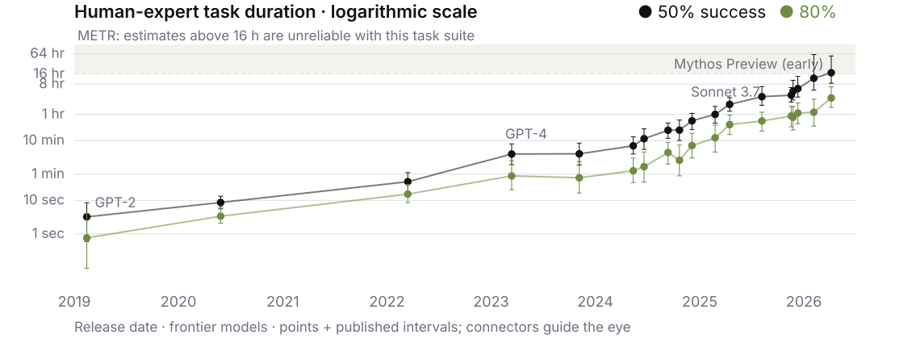<div class="cs35-chain"><span>Understand</span><b>→</b><span>Plan</span><b>→</b><span>Act</span><b>→</b><span>Check</span><b>→</b><span>Recover</span><b>→</b><span>Finish</span></div><div class="cs35-dependency">← intermediate results constrain what comes next →</div></div>
  <div class="cs35-supervision"><div>Human<br>supervision</div><ol><li>review scope</li><li>review plan</li><li>review evidence</li></ol><p>Workflow checkpoints<br><span>separate from time horizon</span></p></div>
</div>
<div class="exp-takeaway">Reliability belongs to the completed task.</div>
<div class="exp-source">METR · TH 1.1 · Page updated 8 May 2026 · Accessed 23 Sep 2026 · Native redraw of released YAML · Supervision strip: conceptual</div>
```

::: {.notes}
METR time horizon измеряется временем человека-эксперта на соответствующей задаче, а не длительностью непрерывной работы агента. Две серии соответствуют 50% и 80% вероятности завершения. Перерисованы опубликованные центральные оценки и интервалы TH 1.1 для моделей с меткой frontier; соединители лишь помогают чтению. Выше 16 часов сама METR отмечает ненадёжность оценок на текущем наборе. [@exp35_metr]

Длинная задача содержит зависимые этапы. Ошибку нужно обнаружить и исправить, сохранив цель и результаты предыдущих шагов. Полоса справа отдельно показывает возможные человеческие проверки: это наша схема процесса, не переменная графика METR. Набор задач преимущественно связан с software, ML и cybersecurity; абсолютные горизонты нельзя автоматически переносить на любую профессию.

[METR — Task-Completion Time Horizons](https://metr.org/time-horizons/), обновление 8 мая 2026 года, обращение 23 сентября 2026 года. [Исходный YAML TH 1.1](https://metr.org/assets/benchmark_results_1_1.yaml).
:::

## Science is an unusually hard benchmark {#exp36-science .exp-slide .cs36 background-color="#ffffff"}

```{=html}
<div class="exp-body cs36-layout">
  <div class="cs36-research"><span>Question</span><b>→</b><span class="fragment" data-fragment-index="1">Hypothesis</span><b class="fragment" data-fragment-index="1">→</b><span class="fragment" data-fragment-index="2">Experiment</span><b class="fragment" data-fragment-index="2">→</b><span class="fragment" data-fragment-index="2">Result</span><b class="fragment" data-fragment-index="2">→</b><span class="fragment" data-fragment-index="2">Verification</span></div>
  <div class="cs36-lanes">
    <div class="cs36-lane"><div class="cs36-name">Algorithms<br><span>AlphaEvolve</span></div><div class="cs36-program"><code>candidate.py</code><div>program</div></div><b class="exp-arrow">→</b><div class="cs36-check fragment" data-fragment-index="2"><strong>Automated evaluator</strong><span>execute · score · verify</span><div class="cs36-return">↶ feed results back to search</div></div></div>
    <div class="cs36-lane"><div class="cs36-name">Molecular structures<br><span>AlphaFold 3</span></div><div class="cs36-molecule"><div class="cs36-crop" role="img" aria-label="AlphaFold 3 published structure comparison, Figure 1a: protein, DNA and cGMP complex, PDB 7PZB." style="background-image:url(assets/final/part_31_37/alphafold3-fig1.png)"></div><span>predicted structure · Fig. 1a</span></div><b class="exp-arrow">→</b><div class="cs36-experiment fragment" data-fragment-index="2"><svg viewBox="0 0 54 62" aria-hidden="true"><path d="M20 3h14M23 3v21L8 49q-4 8 5 8h28q9 0 5-8L31 24V3M15 39h24" fill="none" stroke="currentColor" stroke-width="3"/></svg><strong>Experimental check</strong><span>physical measurements</span></div></div>
  </div>
  <div class="cs36-evidence fragment" data-fragment-index="2"><span>↘</span><strong>Evidence</strong><span>↗</span><p>Different claims.<br>Different tests.</p></div>
</div>
<div class="exp-takeaway fragment" data-fragment-index="2">A plausible answer is not a scientific result</div>
<div class="exp-source">Google DeepMind, AlphaEvolve (2025) · Abramson et al., Nature (2024), Fig. 1a, CC BY 4.0 · Structure figure shown as a cropped panel</div>
```

::: {.notes}
Первый клик раскрывает гипотезу, следующий — проверку. На верхней дорожке AlphaEvolve генерирует программы, а исполнение и функции оценки направляют следующий поиск. Корректность оценивается относительно поставленной задачи и evaluator. [@exp32_alphaevolve]

Нижняя дорожка показывает другой класс результата. Реальная панель 1a из статьи AlphaFold 3 содержит сравнение предсказанной и экспериментальной структуры комплекса белка с DNA и cGMP, PDB 7PZB. Отдельный блок физической проверки — общая научная рамка: он не означает, что AlphaFold 3 сам выполняет лабораторный эксперимент для каждого предсказания. Программный тест и экспериментальное свидетельство не взаимозаменяемы. [@exp36_alphafold]

Источники: [AlphaEvolve](https://deepmind.google/blog/alphaevolve-a-gemini-powered-coding-agent-for-designing-advanced-algorithms/); [AlphaFold 3 — Nature](https://www.nature.com/articles/s41586-024-07487-w).
:::

## Can AI improve AI? {#exp37-ai-improves-ai .exp-slide .cs37 background-color="#ffffff"}

```{=html}
<div class="exp-body cs37-layout">
<svg class="cs37-loop" viewBox="0 0 1020 540" role="img" aria-label="AI system to better algorithms to better infrastructure to more effective AI work, with a partial feedback loop and external human research direction.">
<defs><marker id="cs37-arrow" markerWidth="9" markerHeight="9" refX="8" refY="4" orient="auto"><path d="M0 0L8 4L0 8" fill="none" stroke="currentColor" stroke-width="1.5"/></marker></defs>
<g class="cs37-nodes"><rect x="112" y="35" width="320" height="90"/><text x="272" y="91">AI system</text><rect x="648" y="35" width="330" height="90"/><text x="813" y="91">Better algorithms</text><rect x="648" y="288" width="330" height="100"/><text x="813" y="331">Better</text><text x="813" y="367">infrastructure</text><rect x="112" y="288" width="320" height="100"/><text x="272" y="331">More effective</text><text x="272" y="367">AI work</text></g>
<g class="cs37-path"><path d="M432 80H631"/><path d="M813 125V270"/><path d="M648 338H450"/></g>
<g class="fragment" data-fragment-index="1"><path d="M272 288V142" class="cs37-feedback"/><text x="330" y="195" class="cs37-note">Partial</text><text x="330" y="222" class="cs37-note">feedback loop</text></g>
<path d="M570 467H70V80H94" class="cs37-humanpath"/><path d="M650 467H1000V338H991" class="cs37-humanpath"/>
<rect x="340" y="438" width="420" height="62" class="cs37-human"/><text x="550" y="479" class="cs37-humantext">Human research direction</text>
<text x="150" y="421" class="cs37-small">set tasks</text><text x="902" y="421" class="cs37-small">accept results</text>
</svg>
<div class="cs37-evidence"><div><div class="exp-kicker">Deployed example</div><strong>AlphaEvolve</strong><p>systems optimization</p><span>kernels · chips · scheduling</span></div><div><div class="exp-kicker">Reported research use</div><strong>AI research agents</strong><p>code &amp; experiments</p><span>under human direction</span></div></div>
</div>
<div class="exp-takeaway">Partial feedback is already visible.</div>
<div class="exp-source">Google DeepMind, AlphaEvolve (2025), impact update (7 May 2026) · OpenAI, Research acceleration (6 Sep 2026) · Accessed 23 Sep 2026</div>
```

::: {.notes}
Сначала виден прямой путь к улучшению инфраструктуры. Клик добавляет обратную связь. Это частичный цикл: AI помогает улучшать компоненты, которые используются в дальнейшей AI-работе. Внешний блок показывает, что люди задают направление и принимают результаты.

DeepMind описывает использование AlphaEvolve в оптимизации систем и проектировании TPU. OpenAI сообщает, что coding agents увеличивают объём кода и экспериментов исследователей; это наблюдение самой организации, а не независимая оценка скорости научного прогресса. Больше экспериментов не означает пропорционально больше научных открытий. В том же описании люди продолжают выбирать приоритеты и решать, какие результаты развивать. [@exp32_impact; @exp37_research]

Источники: [AlphaEvolve impact](https://deepmind.google/blog/alphaevolve-impact/); [Research acceleration: The view inside OpenAI](https://openai.com/index/research-acceleration-view-inside-openai/).
:::

## The loop is not closed yet {#exp38-loop-open .exp-slide .ev38 background-color="#ffffff"}

```{=html}
<div class="exp-body ev38-layout">
<svg class="ev38-loop" viewBox="0 0 1020 540" role="img" aria-label="Same partial AI improvement loop, now with external objective, evaluator and deployment checkpoints.">
<defs><marker id="ev38-arrow" markerWidth="9" markerHeight="9" refX="8" refY="4" orient="auto"><path d="M0 0L8 4L0 8" fill="none" stroke="currentColor" stroke-width="1.5"/></marker></defs>
<g class="ev38-nodes"><rect x="112" y="35" width="320" height="90"/><text x="272" y="91">AI system</text><rect x="648" y="35" width="330" height="90"/><text x="813" y="91">Better algorithms</text><rect x="648" y="288" width="330" height="100"/><text x="813" y="331">Better</text><text x="813" y="367">infrastructure</text><rect x="112" y="288" width="320" height="100"/><text x="272" y="331">More effective</text><text x="272" y="367">AI work</text></g>
<g class="ev38-path"><path d="M432 80H631"/><path d="M813 125V270"/><path d="M648 338H450"/></g>
<path d="M272 288V142" class="ev38-feedback"/><text x="330" y="195" class="ev38-note">Partial</text><text x="330" y="222" class="ev38-note">feedback loop</text>
<g class="fragment" data-fragment-index="1">
<path d="M550 438V417H70V195H175 M550 438V245H813 M760 467H1000V416H813V388" class="ev38-humanpath"/>
<g class="ev38-gates"><rect x="175" y="177" width="194" height="50"/><text x="272" y="209">Objective</text><rect x="715" y="178" width="196" height="50"/><text x="813" y="210">Evaluator</text><rect x="702" y="396" width="278" height="40"/><text x="841" y="423">Deployment decision</text></g>
<rect x="340" y="438" width="420" height="62" class="ev38-human"/><text x="550" y="478" class="ev38-humantext">Human / External validation</text>
</g><g class="fragment ev38-evidence-flow" data-fragment-index="2"><text x="550" y="535">AI prediction → Experiment → Accepted evidence</text></g></svg>
<div class="ev38-validation fragment" data-fragment-index="1"><div class="exp-kicker">External checkpoints</div><div class="ev38-step">Set the objective</div><div class="ev38-step">Choose the evaluator</div><div class="ev38-step">Accept deployment</div></div>
</div>
<div class="exp-takeaway fragment" data-fragment-index="3">Acceleration is not the same as a fully autonomous research loop.</div>
<div class="exp-source">Sources: AlphaEvolve (2025) · AlphaFold 3 (2024) · OpenAI, Research acceleration (6 Sep 2026)</div>
```

::: {.notes}
Повторяется геометрия предыдущего слайда. Первый клик раскрывает внешние контрольные точки: задачу, критерий оценки и решение об использовании результата. Второй клик отделяет предсказание от эксперимента и принятого свидетельства. Последний клик фиксирует вывод.

В AlphaEvolve исследователи задают исходную программу и evaluator. Автоматизированный поиск опирается на эту внешнюю постановку. В рассмотренных кейсах люди выбирают научные приоритеты и принимают результаты; ускорение отдельных компонентов не доказывает полностью автономного исследовательского цикла. Это утверждение о показанных примерах, а не отрицание полезного самоулучшения. [@exp38_alphaevolve; @exp38_research]

AlphaFold 3 предсказывает структуру биомолекулярных комплексов. Предсказание, экспериментальная проверка и принятое научное свидетельство — разные стадии; схема под циклом обобщает их, а не изображает внутреннюю архитектуру AlphaFold. [@exp38_alphafold]

Источники: [AlphaEvolve](https://deepmind.google/blog/alphaevolve-a-gemini-powered-coding-agent-for-designing-advanced-algorithms/); [Research acceleration](https://openai.com/index/research-acceleration-view-inside-openai/); [AlphaFold 3](https://www.nature.com/articles/s41586-024-07487-w).
:::

## Evidence #1: mathematics / science {#exp39-science-evidence .exp-slide .ev39 background-color="#ffffff"}

```{=html}
<div class="exp-body ev39-layout">
<div class="ev39-artifacts fragment" data-fragment-index="1"><div class="ev39-label">Proof write-up <span class="exp-muted">· Theorem 1.1</span></div>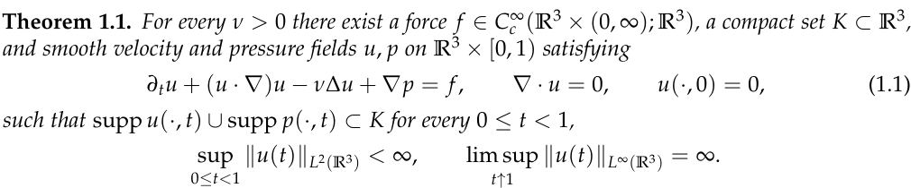<div class="ev39-label">Formalization <span class="exp-muted">· Lean source excerpt</span></div><pre class="ev39-lean">theorem periodic_corollary :
  breakdownStatement := by
  intro ν hν
  obtain ⟨u, p, f, K, hc, _, hrest⟩ :=
    NavierStokesR3.
      theorem_1_1_with_initial_rest ν hν
  …</pre></div>
<div class="ev39-card"><div class="ev39-headline">Published AI-generated<br>proposed solution</div><div class="ev39-row"><b>Problem</b><span>Navier–Stokes<br>smooth forcing · C / D</span></div><div class="ev39-row"><b>AI contribution</b><span>Proposed proof + formalization</span></div><div class="ev39-row"><b>Human contribution</b><span>Direction, resource allocation, publication</span></div><div class="ev39-row fragment" data-fragment-index="1"><b>Verification artifact</b><span>Paper + Lean repository</span></div><div class="ev39-row ev39-status fragment" data-fragment-index="2"><b>Status</b><span>Published 8 Sep 2026<br>No prize claimed</span></div></div>
</div>
<div class="exp-takeaway fragment" data-fragment-index="2">Claim → artifact → verification → external recognition</div>
<div class="exp-source">OpenAI, On the Navier–Stokes Millennium Prize Problem (8 Sep 2026) · Paper p. 1 · openai/NavierStokesAndEuler</div>
```

::: {.notes}
На слайде пересказывается опубликованное заявление OpenAI и показаны доступные артефакты. Это не собственное математическое заключение преподавателя. Результат относится к исследовательской системе из публикации. Авторы заявляют конечновременную сингулярность при гладкой внешней силе и ограниченной энергии — варианты C и D официальной постановки, а не решение невынужденного случая. [@exp39_report; @exp39_paper]

Слева — настоящий фрагмент страницы 1 статьи и точная выдержка из `NavierStokes/PeriodicPaperTheorem.lean`, строки 155–158, с переносом длинного имени и многоточием вместо продолжения. Lean-репозиторий является опубликованным проверочным артефактом; собственная сборка доказательства здесь не выполнялась. [@exp39_lean]

Вклад человека включает выбор направлений, перераспределение ресурсов, передачу промежуточных результатов и решение о публикации. OpenAI прямо заявила, что не намерена претендовать на Millennium Prize. Публикация и формализация не подменяют процедуру внешнего признания. [@exp39_report]

Источники: [Публикация OpenAI](https://openai.com/index/navier-stokes-solution/); [статья, страница 1](https://cdn.openai.com/pdf/32d9f210-8b73-45e0-91bc-82a30aef8a9a/navier-stokes.pdf#page=1); [Lean-артефакт](https://github.com/openai/NavierStokesAndEuler/blob/main/NavierStokes/PeriodicPaperTheorem.lean).
:::

## Evidence #2: software engineering {#exp40-software-evidence .exp-slide .ev40 background-color="#ffffff"}

```{=html}
<div class="exp-body">
<div class="ev40-strip"><div class="ev40-frame"><h3>Issue</h3><p>Nested models lose separability</p><small>SWE-bench Lite<br>astropy__astropy-12907</small></div><div class="exp-arrow">→</div><div class="ev40-frame"><h3>Repository</h3><pre>astropy/
  modeling/
    separable.py
    tests/</pre><small>Inspect <code>_cstack</code></small></div><div class="exp-arrow fragment" data-fragment-index="1">→</div><div class="ev40-frame fragment" data-fragment-index="1"><h3>Patch</h3><pre>cright[ … ] =
<span class="ev40-diff-minus">− 1</span>
<span class="ev40-diff-plus">+ right</span></pre><small>Benchmark reference patch<br>slice abbreviated</small></div><div class="exp-arrow fragment" data-fragment-index="2">→</div><div class="ev40-frame ev40-tests fragment" data-fragment-index="2"><h3>Tests</h3><small>Isolated reproducer</small><strong>FAIL → PASS</strong><small>Preserve the nested<br>dependency matrix</small></div></div>
<div class="ev40-review fragment" data-fragment-index="3"><div><h3>Workflow,<br>not just code completion</h3><p>Parallel tasks → review changes</p></div>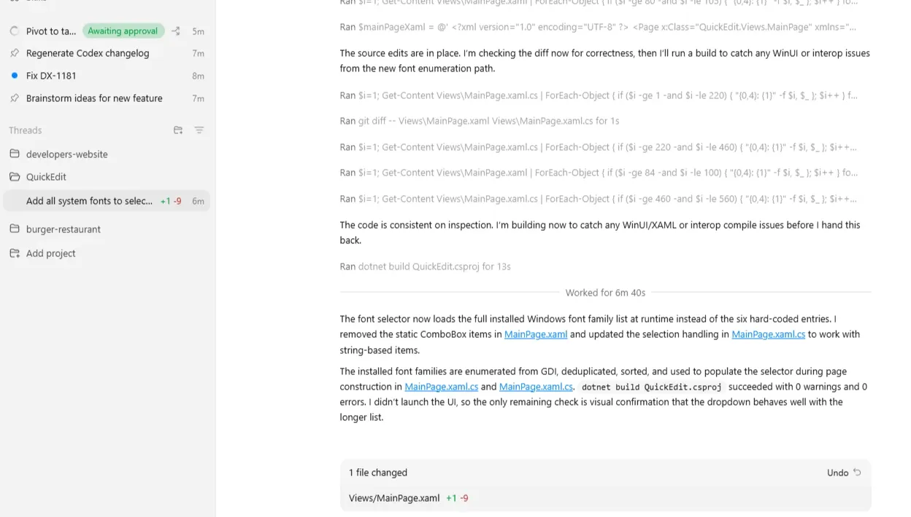</div>
</div>
<div class="exp-takeaway">A repository change becomes evidence when we execute a check.</div>
<div class="exp-source">SWE-bench Lite: astropy__astropy-12907 · Isolated reproduction: 23 Sep 2026 · Codex official UI: 4 Mar 2026</div>
```

::: {.notes}
Сначала видны задача и репозиторий. Клики раскрывают patch, проверку и интерфейс принятия работы. SWE-bench оценивает исправления настоящих issues в контексте репозитория с исполняемыми проверками. [@exp40_swebench]

Конкретный пример взят из SWE-bench Lite: `astropy__astropy-12907`. В `_cstack` вложенная матрица зависимостей ошибочно заменялась единицами. Эталонный patch сохраняет `right`. Здесь показан reference patch датасета, а не результат прогона конкретного AI. В подписи diff многоточие сокращает индекс среза, но сохраняет смысл единственного изменения. [@exp40_dataset]

FAIL → PASS получено при выполнении оригинальной функции `_cstack` на изолированном массивном примере до и после эталонного исправления. Это не запуск полного Astropy или SWE-bench harness и не оценка модели. Команда, исходник и вывод сохранены рядом с изображениями в `assets/final/part_38_43/`. Такая проверка даёт предметное свидетельство об этой ветви функции, но не доказывает отсутствие всех ошибок.

Внизу — подлинный фрагмент официального скриншота Codex for Windows, опубликованного в changelog 4 марта 2026. Несколько задач, отчёт о сборке и сводка изменённого файла показывают организацию работы. Это отдельный продуктовый пример, не интерфейс выполнения приведённого Astropy issue. [@exp40_codex; @exp40_changelog]

Источники: [SWE-bench](https://www.swebench.com/SWE-bench/); [датасет SWE-bench Lite](https://huggingface.co/datasets/princeton-nlp/SWE-bench_Lite); [Codex app](https://openai.com/index/introducing-the-codex-app/); [официальный changelog](https://learn.chatgpt.com/docs/changelog).
:::

## Evidence #3: multimodal world understanding {#exp41-world-evidence .exp-slide .ev41 background-color="#ffffff"}

```{=html}
<div class="exp-body ev41-layout"><div class="ev41-old"><div class="exp-kicker">Fixed-label perception</div><div class="ev41-output">cat</div><small>Illustrative classifier output</small></div><div class="exp-arrow">⟶</div><div><div class="ev41-sequence-title">Project Astra <span class="exp-muted">· official 2025 demo excerpt</span></div><div class="ev41-sequence"><div class="ev41-stage fragment" data-fragment-index="1"><h3>Scene</h3><p>See the current setting<br>2025 demo · frame 1</p></div><div class="ev41-stage fragment" data-fragment-index="2"><h3>Dialogue</h3><p>Respond in context<br>2025 demo · frame 2</p></div><div class="ev41-stage fragment" data-fragment-index="3"><h3>Memory</h3><p>Retrieve relevant context<br>2025 demo · frame 3</p></div></div><div class="ev41-context fragment" data-fragment-index="3"><div class="ev41-gpt">GPT-4o</div><div><p>Audio + vision + text in real-time interaction</p><small>OpenAI demonstration · 13 May 2024</small></div></div></div></div>
<div class="exp-takeaway">From a label to an ongoing interaction.</div>
<div class="exp-source">Google DeepMind, Project Astra demo (2025), Universal AI assistant (20 May 2025) · OpenAI, Hello GPT-4o (13 May 2024)</div>
```

::: {.notes}
Слева — учебный пример интерфейса классификации: фотография кошки и подпись `cat`. Это иллюстрация, не измеренный ответ AlexNet. Фото Chelsea взято из открытых sample data scikit-image.

Справа три последовательных кадра официального ролика Project Astra на сайте Google DeepMind: 1, 3 и 8 секунд короткого teaser, связанного с демонстрацией 2025 года. Видны рабочее место, ответ на телефоне и переход к руководству велосипеда. Подписи Scene / Dialogue / Memory описывают более широкий класс возможностей по сопровождающему первоисточнику. Статичные кадры сами по себе не доказывают наличие долговременной памяти; в источнике отдельно описаны retrieval и multimodal memory. [@exp41_astra; @exp41_universal]

Демонстрации 2024 и 2025 годов показывают переход от единичного распознавания к взаимодействию с видео, речью и контекстом. GPT-4o — второй пример мультимодального взаимодействия, а не та же система. Здесь речь о Google Project Astra, не о модели OpenAI GPT-6 Astra. Демонстрация — конкретный сценарий, не гарантия надёжности во всех реальных условиях. [@exp41_gpt4o; @exp41_astra2024]

Источники: [Project Astra и официальный ролик](https://deepmind.google/models/project-astra/); [Universal AI assistant, 2025](https://blog.google/innovation-and-ai/models-and-research/google-deepmind/gemini-universal-ai-assistant/); [Astra, 2024](https://blog.google/innovation-and-ai/products/google-gemini-update-flash-ai-assistant-io-2024/); [Hello GPT-4o](https://openai.com/index/hello-gpt-4o/).
:::

## From models to agents {#exp42-agents .exp-slide .ev42 background-color="#ffffff"}

```{=html}
<div class="exp-body"><div class="ev42-linear">Prompt → Model → Response</div><svg class="ev42-loop" viewBox="0 0 1490 550" role="img" aria-label="Agent observes, plans, acts and observes again, guided by a goal, memory, tools and human constraints."><defs><marker id="ev42-arrow" markerWidth="9" markerHeight="9" refX="8" refY="4" orient="auto"><path d="M0 0L8 4L0 8" fill="none" stroke="currentColor" stroke-width="1.5"/></marker></defs><rect x="485" y="82" width="305" height="85" class="ev42-node"/><text x="638" y="135">Reason / Plan</text><rect x="418" y="237" width="250" height="94" class="ev42-goal"/><text x="543" y="295">Goal</text><rect x="104" y="233" width="250" height="94" class="ev42-node"/><text x="229" y="291">Observe</text><path d="M228 233V125H465" class="ev42-arrow"/><g class="fragment ev42-action" data-fragment-index="1"><rect x="772" y="233" width="250" height="94" class="ev42-node"/><text x="897" y="291">Act</text><path d="M790 125H896V213" class="ev42-arrow"/><path d="M1022 279H1100" class="ev42-arrow"/><rect x="1118" y="170" width="267" height="226" class="ev42-side"/><text x="1251" y="224">Search</text><text x="1251" y="291">Code</text><text x="1251" y="358">Browser</text></g><g class="fragment" data-fragment-index="2"><path d="M897 327V422H229V347" class="ev42-arrow"/><text x="551" y="460" class="ev42-side-text">Result / new observation</text></g><g class="fragment" data-fragment-index="3"><path d="M228 233V125H465" class="ev42-arrow"/><rect x="42" y="474" width="290" height="65" class="ev42-side"/><text x="187" y="515" class="ev42-side-text">Memory / State</text><path d="M189 474V350 M104 280H23V125H485" class="ev42-link"/><rect x="1055" y="470" width="360" height="65" class="ev42-side"/><text x="1235" y="497" class="ev42-side-text">Human approval</text><text x="1235" y="525" class="ev42-side-text">/ Constraints</text><path d="M1055 502H972V327" class="ev42-link"/></g></svg></div>
<div class="exp-takeaway fragment" data-fragment-index="3">An agent adapts its next step to what happened.</div>
<div class="exp-source">Yao et al., ReAct (2022/2023) · Google, Gemini 2.0 (11 Dec 2024) · OpenAI, Computer-Using Agent (23 Jan 2025)</div>
```

::: {.notes}
Маленькая схема показывает одиночный ответ модели. Первый клик добавляет действие и инструменты; линейная схема уменьшается. Второй клик возвращает последствия действия в наблюдение. Третий раскрывает состояние, ограничения и возможность продолжить планирование.

Агент определяется организацией поведения: система получает последствия действия и использует их при выборе следующего шага. Длинный ответ и сам факт наличия API ещё не задают такого цикла. ReAct чередует reasoning, action и observation; Computer-Using Agent описывает взаимодействие с интерфейсом через восприятие, действие и новое наблюдение. [@exp42_react; @exp42_cua]

Goal, Memory / State и внешние ограничения — обобщающая авторская схема, а не раскрытая архитектура конкретной закрытой модели. Инструменты Search, Code и Browser расширяют доступные действия. В практической системе часть действий ограничивается правилами или требует человеческого подтверждения. [@exp42_gemini]

Источники: [ReAct](https://arxiv.org/abs/2210.03629); [Computer-Using Agent](https://openai.com/index/computer-using-agent/); [Gemini 2.0](https://blog.google/innovation-and-ai/models-and-research/google-deepmind/google-gemini-ai-update-december-2024/).
:::

## And you can use this now {#exp43-use-agents .exp-slide .ev43 background-color="#ffffff"}

```{=html}
<div class="exp-body"><div class="ev43-evolution"><span>Models</span><span class="fragment" data-fragment-index="1">→ Agents</span><span class="fragment ev43-teams" data-fragment-index="2">→ Teams of Agents</span></div><div class="ev43-actionline fragment" data-fragment-index="2">Delegate → Run in parallel → Review</div><div class="ev43-products fragment" data-fragment-index="2"><div><div class="ev43-caption">Codex · official UI excerpt · 4 Mar 2026</div></div><div>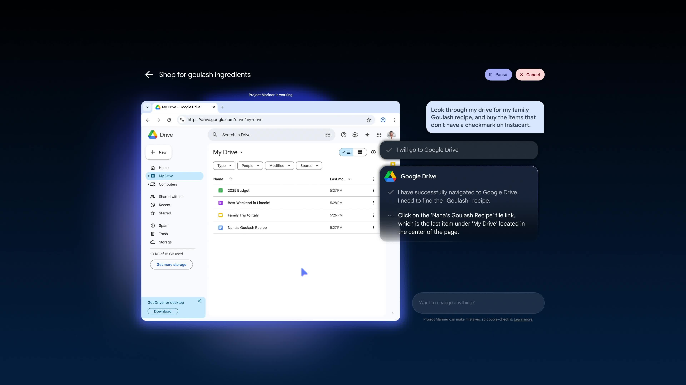<div class="ev43-caption">Project Mariner · demo · 20 May 2025</div></div></div></div>
<div class="exp-source">OpenAI, Introducing the Codex app (2 Feb 2026), official changelog · Google DeepMind, Universal AI assistant (20 May 2025)</div>
```

::: {.notes}
Это переход к практике. Теперь вопрос — как сформулировать работу, задать критерий готовности, ограничить полномочия и проверить результат. Принятие выполненной работы остаётся отдельным этапом.

Codex app представлен как интерфейс для нескольких агентов, раздельных задач, параллельной работы и просмотра изменений. Здесь использован подлинный скриншот официального changelog для Windows от 4 марта 2026 года; кадр обрезан до рабочей области. [@exp40_codex; @exp40_changelog]

Project Mariner показан как отдельный браузерный пример. В публикации 20 мая 2025 Google описывала систему агентов, способную выполнять до десяти задач одновременно. Кадр взят на 8-й секунде официального UI-demo из той публикации. Продукты не представлены как единая интеграция; изображение одного задания Mariner само по себе не показывает все десять. [@exp41_universal]

Источники: [Codex app](https://openai.com/index/introducing-the-codex-app/); [официальный Codex changelog](https://learn.chatgpt.com/docs/changelog); [Universal AI assistant / Project Mariner](https://blog.google/innovation-and-ai/models-and-research/google-deepmind/gemini-universal-ai-assistant/).
:::
