<!-- Generated by scripts/build-showcase.py from the model database. -->

```{=html}
<div class="showcase-catalog"><header class="showcase-hero"><div><p class="showcase-domain">M1</p><h1>Model Showcase</h1><p class="showcase-intro">Explore the models. Inspect the evidence.</p><p>Model families, their versions and published results across language, images, video, speech and music.</p></div><div class="showcase-hero-actions"><a class="course-button" href="/raw/lectures/01_intro/lecture01_part2_final_v3_showcase.html">Open the lecture</a><a href="#comparisons">Compare models</a></div></header><p class="showcase-snapshot">41 models · 28 families · 5 domains · Sources and audit dates are documented on each card.</p><div class="showcase-controls"><label class="showcase-search-label" for="showcase-search">Find a model<input id="showcase-search" type="search" placeholder="Model, family or capability" autocomplete="off"></label><label class="showcase-family-label" for="showcase-family">Model family<select id="showcase-family"><option value="all">All families</option><option value="gpt">GPT family (4)</option><option value="opus">Opus family (1)</option><option value="sonnet">Sonnet family (1)</option><option value="gemini">Gemini family (3)</option><option value="fable">Fable family (1)</option><option value="muse">Muse family (1)</option><option value="grok">Grok family (1)</option><option value="qwen">Qwen family (3)</option><option value="kimi">Kimi family (1)</option><option value="deepseek">DeepSeek family (1)</option><option value="glm">GLM family (2)</option><option value="flux">FLUX family (5)</option><option value="krea">Krea family (1)</option><option value="wan">Wan family (2)</option><option value="utopai">Utopai family (1)</option><option value="minimax-h3">MiniMax H3 family (1)</option><option value="kling">Kling family (1)</option><option value="veo">Veo family (1)</option><option value="seedance">Seedance family (1)</option><option value="aleph">Aleph family (1)</option><option value="eleven">Eleven family (1)</option><option value="sonic">Sonic family (1)</option><option value="heygen-voice">HeyGen Voice family (1)</option><option value="suno">Suno family (1)</option><option value="mureka">Mureka family (1)</option><option value="lyria">Lyria family (1)</option><option value="minimax-music">MiniMax Music family (1)</option><option value="yue">YuE family (1)</option></select></label><label class="showcase-weights-label"><input id="showcase-open-weights" type="checkbox"> Open weights</label><div class="showcase-filters" role="group" aria-label="Model domain"><button type="button" data-filter="all" aria-pressed="true">All models <span>41</span></button><button type="button" data-filter="llm" aria-pressed="false">Language models <span>13</span></button><button type="button" data-filter="t2i" aria-pressed="false">Image generation <span>10</span></button><button type="button" data-filter="t2v" aria-pressed="false">Video generation <span>8</span></button><button type="button" data-filter="tts" aria-pressed="false">Speech <span>5</span></button><button type="button" data-filter="music" aria-pressed="false">Music <span>5</span></button></div></div><div class="showcase-catalog-meta"><p id="showcase-count" role="status" aria-live="polite">41 models</p><p class="showcase-legend"><span data-status="k">Known</span><span data-status="p">Partial</span><span data-status="n">Undisclosed</span><span>Public disclosure</span></p></div><div id="showcase-empty" hidden><h2>No matching models</h2><p>Try another name or clear the filters.</p><button type="button" id="showcase-reset">Clear filters</button></div><div class="showcase-families"><section class="showcase-family" id="family-gpt" data-family="gpt" aria-labelledby="family-gpt-title"><header class="showcase-family-heading"><h2 id="family-gpt-title">GPT family</h2><span class="showcase-family-count">4 models</span></header><div class="showcase-grid"><article class="showcase-model" data-family="gpt" data-category="llm" data-open="false" data-search="GPT-6 Astra OpenAI GPT family Language models The disclosed methods support a training outline, without revealing the model’s topology."><a class="showcase-preview" href="/raw/showcase/llm-gpt6-astra.html" aria-label="GPT-6 Astra model card">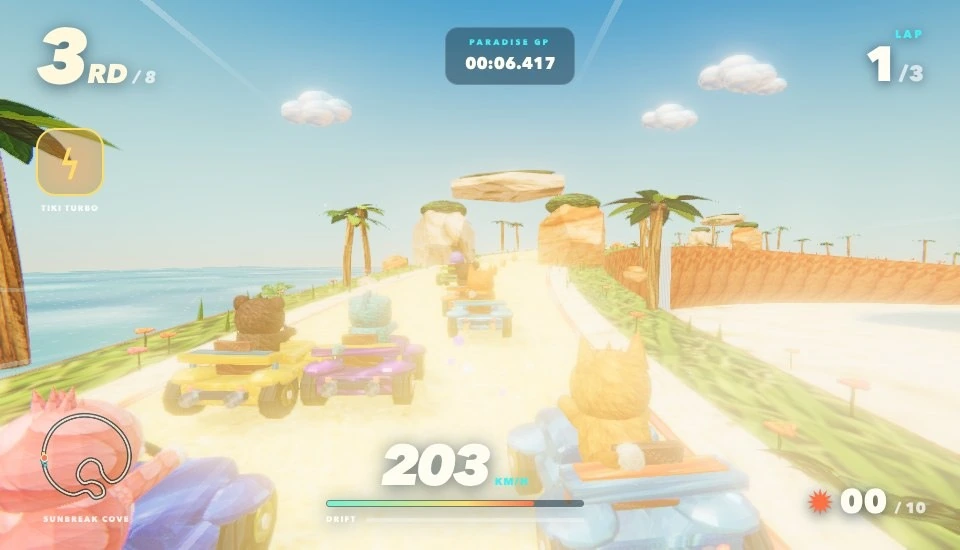</a><div class="showcase-card-body"><div class="showcase-card-meta"><span>Language models</span><span class="showcase-weight">Hosted / API</span></div><h3 class="model-name"><a href="/raw/showcase/llm-gpt6-astra.html">GPT-6 Astra</a></h3><p class="showcase-description">The disclosed methods support a training outline, without revealing the model’s topology.</p><div class="showcase-disclosure" aria-label="Public disclosure"><span data-status="n" title="Architecture: Undisclosed"><i aria-hidden="true"></i><span>Architecture</span><span class="showcase-status-text">Undisclosed</span></span><span data-status="k" title="Data: Known"><i aria-hidden="true"></i><span>Data</span><span class="showcase-status-text">Known</span></span><span data-status="k" title="Training: Known"><i aria-hidden="true"></i><span>Training</span><span class="showcase-status-text">Known</span></span><span data-status="k" title="Inference: Known"><i aria-hidden="true"></i><span>Inference</span><span class="showcase-status-text">Known</span></span><span data-status="k" title="Tools: Known"><i aria-hidden="true"></i><span>Tools</span><span class="showcase-status-text">Known</span></span></div></div><nav class="showcase-card-actions" aria-label="GPT-6 Astra materials"><a href="/raw/showcase/llm-gpt6-astra.html">Model card</a><a href="/raw/showcase/llm-gpt6-astra.html#results">Results & examples</a></nav></article>
<article class="showcase-model" data-family="gpt" data-category="llm" data-open="false" data-search="GPT-6.1 Sol OpenAI GPT family Language models A direct addendum supports shared data and training descriptions, while topology remains unknown."><a class="showcase-preview" href="/raw/showcase/llm-gpt61-sol.html" aria-label="GPT-6.1 Sol model card"><div class="showcase-brand"><div aria-label="OpenAI" class="sc-company" role="img"></div></div></a><div class="showcase-card-body"><div class="showcase-card-meta"><span>Language models</span><span class="showcase-weight">Hosted / API</span></div><h3 class="model-name"><a href="/raw/showcase/llm-gpt61-sol.html">GPT-6.1 Sol</a></h3><p class="showcase-description">A direct addendum supports shared data and training descriptions, while topology remains unknown.</p><div class="showcase-disclosure" aria-label="Public disclosure"><span data-status="n" title="Architecture: Undisclosed"><i aria-hidden="true"></i><span>Architecture</span><span class="showcase-status-text">Undisclosed</span></span><span data-status="k" title="Data: Known"><i aria-hidden="true"></i><span>Data</span><span class="showcase-status-text">Known</span></span><span data-status="k" title="Training: Known"><i aria-hidden="true"></i><span>Training</span><span class="showcase-status-text">Known</span></span><span data-status="k" title="Inference: Known"><i aria-hidden="true"></i><span>Inference</span><span class="showcase-status-text">Known</span></span><span data-status="k" title="Tools: Known"><i aria-hidden="true"></i><span>Tools</span><span class="showcase-status-text">Known</span></span></div></div><nav class="showcase-card-actions" aria-label="GPT-6.1 Sol materials"><a href="/raw/showcase/llm-gpt61-sol.html">Model card</a><a href="/raw/showcase/llm-gpt61-sol.html#results">Results & examples</a></nav></article>
<article class="showcase-model" data-family="gpt" data-category="t2i" data-open="false" data-search="GPT Image 2.5 OpenAI GPT family Image generation The API is detailed; the generator and its training recipe remain undisclosed."><a class="showcase-preview" href="/raw/showcase/t2i-gpt-image-25.html" aria-label="GPT Image 2.5 model card"></a><div class="showcase-card-body"><div class="showcase-card-meta"><span>Image generation</span><span class="showcase-weight">Hosted / API</span></div><h3 class="model-name"><a href="/raw/showcase/t2i-gpt-image-25.html">GPT Image 2.5</a></h3><p class="showcase-description">The API is detailed; the generator and its training recipe remain undisclosed.</p><div class="showcase-disclosure" aria-label="Public disclosure"><span data-status="n" title="Architecture: Undisclosed"><i aria-hidden="true"></i><span>Architecture</span><span class="showcase-status-text">Undisclosed</span></span><span data-status="p" title="Data: Partial"><i aria-hidden="true"></i><span>Data</span><span class="showcase-status-text">Partial</span></span><span data-status="n" title="Training: Undisclosed"><i aria-hidden="true"></i><span>Training</span><span class="showcase-status-text">Undisclosed</span></span><span data-status="p" title="Inference: Partial"><i aria-hidden="true"></i><span>Inference</span><span class="showcase-status-text">Partial</span></span><span data-status="p" title="Tools: Partial"><i aria-hidden="true"></i><span>Tools</span><span class="showcase-status-text">Partial</span></span></div></div><nav class="showcase-card-actions" aria-label="GPT Image 2.5 materials"><a href="/raw/showcase/t2i-gpt-image-25.html">Model card</a><a href="/raw/showcase/t2i-gpt-image-25.html#results">Results & examples</a></nav></article>
<article class="showcase-model" data-family="gpt" data-category="t2i" data-open="false" data-search="GPT Image 2 OpenAI GPT family Image generation Product-level “thinking” does not disclose how the image generator works."><a class="showcase-preview" href="/raw/showcase/t2i-gpt-image-2.html" aria-label="GPT Image 2 model card"></a><div class="showcase-card-body"><div class="showcase-card-meta"><span>Image generation</span><span class="showcase-weight">Hosted / API</span></div><h3 class="model-name"><a href="/raw/showcase/t2i-gpt-image-2.html">GPT Image 2</a></h3><p class="showcase-description">Product-level “thinking” does not disclose how the image generator works.</p><div class="showcase-disclosure" aria-label="Public disclosure"><span data-status="n" title="Architecture: Undisclosed"><i aria-hidden="true"></i><span>Architecture</span><span class="showcase-status-text">Undisclosed</span></span><span data-status="n" title="Data: Undisclosed"><i aria-hidden="true"></i><span>Data</span><span class="showcase-status-text">Undisclosed</span></span><span data-status="n" title="Training: Undisclosed"><i aria-hidden="true"></i><span>Training</span><span class="showcase-status-text">Undisclosed</span></span><span data-status="p" title="Inference: Partial"><i aria-hidden="true"></i><span>Inference</span><span class="showcase-status-text">Partial</span></span><span data-status="p" title="Tools: Partial"><i aria-hidden="true"></i><span>Tools</span><span class="showcase-status-text">Partial</span></span></div></div><nav class="showcase-card-actions" aria-label="GPT Image 2 materials"><a href="/raw/showcase/t2i-gpt-image-2.html">Model card</a><a href="/raw/showcase/t2i-gpt-image-2.html#results">Results & examples</a></nav></article></div></section>
<section class="showcase-family" id="family-opus" data-family="opus" aria-labelledby="family-opus-title"><header class="showcase-family-heading"><h2 id="family-opus-title">Opus family</h2><span class="showcase-family-count">1 model</span></header><div class="showcase-grid"><article class="showcase-model" data-family="opus" data-category="llm" data-open="false" data-search="Claude Opus 5.5 Anthropic Opus family Language models The API is described in detail, while the system card leaves model topology unspecified."><a class="showcase-preview" href="/raw/showcase/llm-opus-55.html" aria-label="Claude Opus 5.5 model card">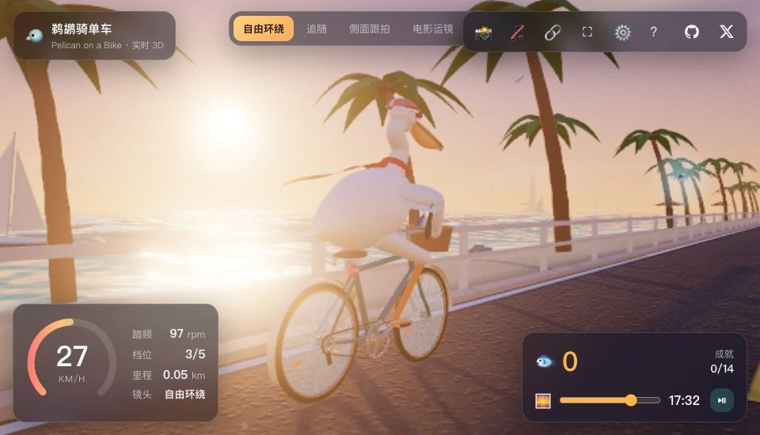</a><div class="showcase-card-body"><div class="showcase-card-meta"><span>Language models</span><span class="showcase-weight">Hosted / API</span></div><h3 class="model-name"><a href="/raw/showcase/llm-opus-55.html">Claude Opus 5.5</a></h3><p class="showcase-description">The API is described in detail, while the system card leaves model topology unspecified.</p><div class="showcase-disclosure" aria-label="Public disclosure"><span data-status="n" title="Architecture: Undisclosed"><i aria-hidden="true"></i><span>Architecture</span><span class="showcase-status-text">Undisclosed</span></span><span data-status="k" title="Data: Known"><i aria-hidden="true"></i><span>Data</span><span class="showcase-status-text">Known</span></span><span data-status="p" title="Training: Partial"><i aria-hidden="true"></i><span>Training</span><span class="showcase-status-text">Partial</span></span><span data-status="k" title="Inference: Known"><i aria-hidden="true"></i><span>Inference</span><span class="showcase-status-text">Known</span></span><span data-status="k" title="Tools: Known"><i aria-hidden="true"></i><span>Tools</span><span class="showcase-status-text">Known</span></span></div></div><nav class="showcase-card-actions" aria-label="Claude Opus 5.5 materials"><a href="/raw/showcase/llm-opus-55.html">Model card</a><a href="/raw/showcase/llm-opus-55.html#results">Results & examples</a></nav></article></div></section>
<section class="showcase-family" id="family-sonnet" data-family="sonnet" aria-labelledby="family-sonnet-title"><header class="showcase-family-heading"><h2 id="family-sonnet-title">Sonnet family</h2><span class="showcase-family-count">1 model</span></header><div class="showcase-grid"><article class="showcase-model" data-family="sonnet" data-category="llm" data-open="false" data-search="Claude Sonnet 5.5 Anthropic Sonnet family Language models Limits and tool rules are public, while the training recipe remains partial."><a class="showcase-preview" href="/raw/showcase/llm-sonnet-55.html" aria-label="Claude Sonnet 5.5 model card">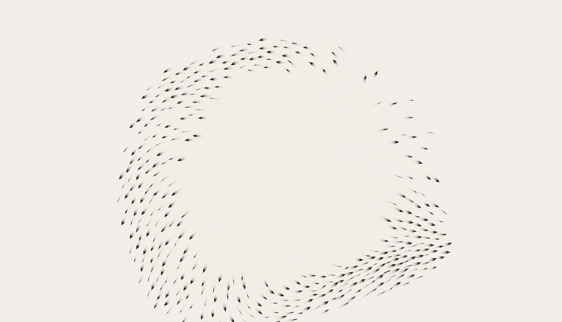</a><div class="showcase-card-body"><div class="showcase-card-meta"><span>Language models</span><span class="showcase-weight">Hosted / API</span></div><h3 class="model-name"><a href="/raw/showcase/llm-sonnet-55.html">Claude Sonnet 5.5</a></h3><p class="showcase-description">Limits and tool rules are public, while the training recipe remains partial.</p><div class="showcase-disclosure" aria-label="Public disclosure"><span data-status="n" title="Architecture: Undisclosed"><i aria-hidden="true"></i><span>Architecture</span><span class="showcase-status-text">Undisclosed</span></span><span data-status="k" title="Data: Known"><i aria-hidden="true"></i><span>Data</span><span class="showcase-status-text">Known</span></span><span data-status="p" title="Training: Partial"><i aria-hidden="true"></i><span>Training</span><span class="showcase-status-text">Partial</span></span><span data-status="k" title="Inference: Known"><i aria-hidden="true"></i><span>Inference</span><span class="showcase-status-text">Known</span></span><span data-status="k" title="Tools: Known"><i aria-hidden="true"></i><span>Tools</span><span class="showcase-status-text">Known</span></span></div></div><nav class="showcase-card-actions" aria-label="Claude Sonnet 5.5 materials"><a href="/raw/showcase/llm-sonnet-55.html">Model card</a><a href="/raw/showcase/llm-sonnet-55.html#results">Results & examples</a></nav></article></div></section>
<section class="showcase-family" id="family-gemini" data-family="gemini" aria-labelledby="family-gemini-title"><header class="showcase-family-heading"><h2 id="family-gemini-title">Gemini family</h2><span class="showcase-family-count">3 models</span></header><div class="showcase-grid"><article class="showcase-model" data-family="gemini" data-category="llm" data-open="false" data-search="Gemini 4 Argon Google DeepMind Gemini family Language models A 1M shared window supports long decode through continuation, not a single unlimited response."><a class="showcase-preview" href="/raw/showcase/llm-gemini4-argon.html" aria-label="Gemini 4 Argon model card"></a><div class="showcase-card-body"><div class="showcase-card-meta"><span>Language models</span><span class="showcase-weight">Hosted / API</span></div><h3 class="model-name"><a href="/raw/showcase/llm-gemini4-argon.html">Gemini 4 Argon</a></h3><p class="showcase-description">A 1M shared window supports long decode through continuation, not a single unlimited response.</p><div class="showcase-disclosure" aria-label="Public disclosure"><span data-status="k" title="Architecture: Known"><i aria-hidden="true"></i><span>Architecture</span><span class="showcase-status-text">Known</span></span><span data-status="k" title="Data: Known"><i aria-hidden="true"></i><span>Data</span><span class="showcase-status-text">Known</span></span><span data-status="k" title="Training: Known"><i aria-hidden="true"></i><span>Training</span><span class="showcase-status-text">Known</span></span><span data-status="k" title="Inference: Known"><i aria-hidden="true"></i><span>Inference</span><span class="showcase-status-text">Known</span></span><span data-status="k" title="Tools: Known"><i aria-hidden="true"></i><span>Tools</span><span class="showcase-status-text">Known</span></span></div></div><nav class="showcase-card-actions" aria-label="Gemini 4 Argon materials"><a href="/raw/showcase/llm-gemini4-argon.html">Model card</a><a href="/raw/showcase/llm-gemini4-argon.html#results">Results & examples</a></nav></article>
<article class="showcase-model" data-family="gemini" data-category="t2i" data-open="false" data-search="Nano Banana 2.1 Google DeepMind Gemini family Image generation A linked family card provides context, not the exact image model’s recipe."><a class="showcase-preview" href="/raw/showcase/t2i-nano-banana-21.html" aria-label="Nano Banana 2.1 model card">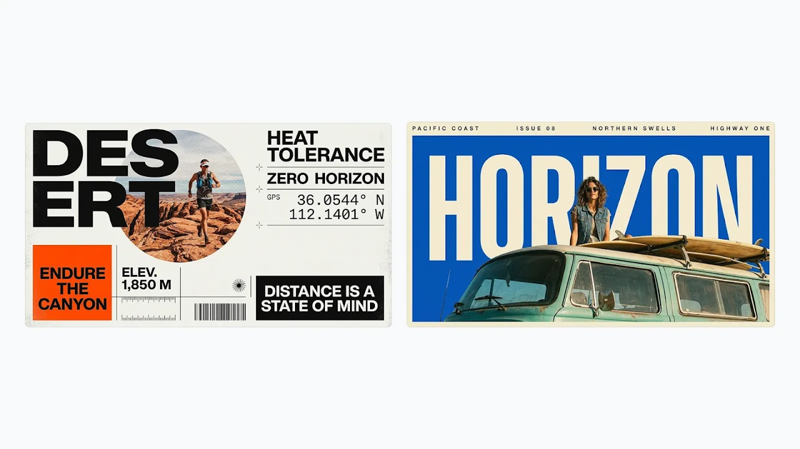</a><div class="showcase-card-body"><div class="showcase-card-meta"><span>Image generation</span><span class="showcase-weight">Hosted / API</span></div><h3 class="model-name"><a href="/raw/showcase/t2i-nano-banana-21.html">Nano Banana 2.1</a></h3><p class="showcase-description">A linked family card provides context, not the exact image model’s recipe.</p><div class="showcase-disclosure" aria-label="Public disclosure"><span data-status="p" title="Architecture: Partial"><i aria-hidden="true"></i><span>Architecture</span><span class="showcase-status-text">Partial</span></span><span data-status="n" title="Data: Undisclosed"><i aria-hidden="true"></i><span>Data</span><span class="showcase-status-text">Undisclosed</span></span><span data-status="n" title="Training: Undisclosed"><i aria-hidden="true"></i><span>Training</span><span class="showcase-status-text">Undisclosed</span></span><span data-status="p" title="Inference: Partial"><i aria-hidden="true"></i><span>Inference</span><span class="showcase-status-text">Partial</span></span><span data-status="p" title="Tools: Partial"><i aria-hidden="true"></i><span>Tools</span><span class="showcase-status-text">Partial</span></span></div></div><nav class="showcase-card-actions" aria-label="Nano Banana 2.1 materials"><a href="/raw/showcase/t2i-nano-banana-21.html">Model card</a><a href="/raw/showcase/t2i-nano-banana-21.html#results">Results & examples</a></nav></article>
<article class="showcase-model" data-family="gemini" data-category="tts" data-open="false" data-search="Gemini 3.8 Flash TTS Google Gemini family Speech Voice creation and direction are documented; TTS internals are mostly deferred to a family card."><a class="showcase-preview" href="/raw/showcase/tts-gemini-38-flash.html" aria-label="Gemini 3.8 Flash TTS model card">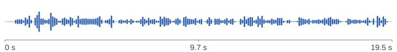</a><div class="showcase-card-body"><div class="showcase-card-meta"><span>Speech</span><span class="showcase-weight">Hosted / API</span></div><h3 class="model-name"><a href="/raw/showcase/tts-gemini-38-flash.html">Gemini 3.8 Flash TTS</a></h3><p class="showcase-description">Voice creation and direction are documented; TTS internals are mostly deferred to a family card.</p><div class="showcase-disclosure" aria-label="Public disclosure"><span data-status="p" title="Architecture: Partial"><i aria-hidden="true"></i><span>Architecture</span><span class="showcase-status-text">Partial</span></span><span data-status="n" title="Data: Undisclosed"><i aria-hidden="true"></i><span>Data</span><span class="showcase-status-text">Undisclosed</span></span><span data-status="p" title="Training: Partial"><i aria-hidden="true"></i><span>Training</span><span class="showcase-status-text">Partial</span></span><span data-status="p" title="Inference: Partial"><i aria-hidden="true"></i><span>Inference</span><span class="showcase-status-text">Partial</span></span><span data-status="k" title="Voice control: Known"><i aria-hidden="true"></i><span>Voice control</span><span class="showcase-status-text">Known</span></span></div></div><nav class="showcase-card-actions" aria-label="Gemini 3.8 Flash TTS materials"><a href="/raw/showcase/tts-gemini-38-flash.html">Model card</a><a href="/raw/showcase/tts-gemini-38-flash.html#results">Results & examples</a></nav></article></div></section>
<section class="showcase-family" id="family-fable" data-family="fable" aria-labelledby="family-fable-title"><header class="showcase-family-heading"><h2 id="family-fable-title">Fable family</h2><span class="showcase-family-count">1 model</span></header><div class="showcase-grid"><article class="showcase-model" data-family="fable" data-category="llm" data-open="false" data-search="Claude Fable 5.1 Anthropic Fable family Language models Fable and Mythos are access and safeguard configurations of the same underlying weights."><a class="showcase-preview" href="/raw/showcase/llm-fable-51.html" aria-label="Claude Fable 5.1 model card">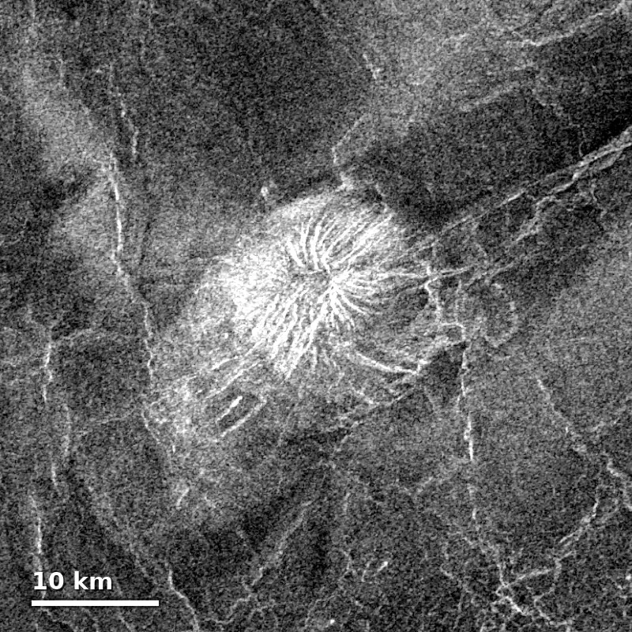</a><div class="showcase-card-body"><div class="showcase-card-meta"><span>Language models</span><span class="showcase-weight">Hosted / API</span></div><h3 class="model-name"><a href="/raw/showcase/llm-fable-51.html">Claude Fable 5.1</a></h3><p class="showcase-description">Fable and Mythos are access and safeguard configurations of the same underlying weights.</p><div class="showcase-disclosure" aria-label="Public disclosure"><span data-status="n" title="Architecture: Undisclosed"><i aria-hidden="true"></i><span>Architecture</span><span class="showcase-status-text">Undisclosed</span></span><span data-status="k" title="Data: Known"><i aria-hidden="true"></i><span>Data</span><span class="showcase-status-text">Known</span></span><span data-status="p" title="Training: Partial"><i aria-hidden="true"></i><span>Training</span><span class="showcase-status-text">Partial</span></span><span data-status="k" title="Inference: Known"><i aria-hidden="true"></i><span>Inference</span><span class="showcase-status-text">Known</span></span><span data-status="k" title="Tools: Known"><i aria-hidden="true"></i><span>Tools</span><span class="showcase-status-text">Known</span></span></div></div><nav class="showcase-card-actions" aria-label="Claude Fable 5.1 materials"><a href="/raw/showcase/llm-fable-51.html">Model card</a><a href="/raw/showcase/llm-fable-51.html#results">Results & examples</a></nav></article></div></section>
<section class="showcase-family" id="family-muse" data-family="muse" aria-labelledby="family-muse-title"><header class="showcase-family-heading"><h2 id="family-muse-title">Muse family</h2><span class="showcase-family-count">1 model</span></header><div class="showcase-grid"><article class="showcase-model" data-family="muse" data-category="llm" data-open="false" data-search="Muse Wonder Meta Muse family Language models Wonder’s API and agent workflow are described more fully than its model or training recipe."><a class="showcase-preview" href="/raw/showcase/llm-muse-wonder.html" aria-label="Muse Wonder model card">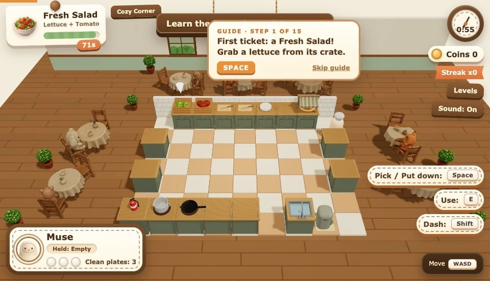</a><div class="showcase-card-body"><div class="showcase-card-meta"><span>Language models</span><span class="showcase-weight">Hosted / API</span></div><h3 class="model-name"><a href="/raw/showcase/llm-muse-wonder.html">Muse Wonder</a></h3><p class="showcase-description">Wonder’s API and agent workflow are described more fully than its model or training recipe.</p><div class="showcase-disclosure" aria-label="Public disclosure"><span data-status="n" title="Architecture: Undisclosed"><i aria-hidden="true"></i><span>Architecture</span><span class="showcase-status-text">Undisclosed</span></span><span data-status="p" title="Data: Partial"><i aria-hidden="true"></i><span>Data</span><span class="showcase-status-text">Partial</span></span><span data-status="p" title="Training: Partial"><i aria-hidden="true"></i><span>Training</span><span class="showcase-status-text">Partial</span></span><span data-status="k" title="Inference: Known"><i aria-hidden="true"></i><span>Inference</span><span class="showcase-status-text">Known</span></span><span data-status="k" title="Tools: Known"><i aria-hidden="true"></i><span>Tools</span><span class="showcase-status-text">Known</span></span></div></div><nav class="showcase-card-actions" aria-label="Muse Wonder materials"><a href="/raw/showcase/llm-muse-wonder.html">Model card</a><a href="/raw/showcase/llm-muse-wonder.html#results">Results & examples</a></nav></article></div></section>
<section class="showcase-family" id="family-grok" data-family="grok" aria-labelledby="family-grok-title"><header class="showcase-family-heading"><h2 id="family-grok-title">Grok family</h2><span class="showcase-family-count">1 model</span></header><div class="showcase-grid"><article class="showcase-model" data-family="grok" data-category="llm" data-open="false" data-search="Grok 4.7 xAI Grok family Language models The model’s API contract is explicit, while corpus and topology remain unspecified."><a class="showcase-preview" href="/raw/showcase/llm-grok-47.html" aria-label="Grok 4.7 model card">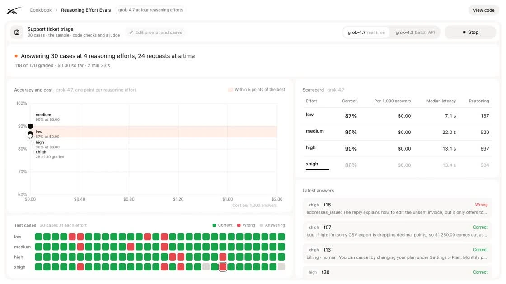</a><div class="showcase-card-body"><div class="showcase-card-meta"><span>Language models</span><span class="showcase-weight">Hosted / API</span></div><h3 class="model-name"><a href="/raw/showcase/llm-grok-47.html">Grok 4.7</a></h3><p class="showcase-description">The model’s API contract is explicit, while corpus and topology remain unspecified.</p><div class="showcase-disclosure" aria-label="Public disclosure"><span data-status="p" title="Architecture: Partial"><i aria-hidden="true"></i><span>Architecture</span><span class="showcase-status-text">Partial</span></span><span data-status="n" title="Data: Undisclosed"><i aria-hidden="true"></i><span>Data</span><span class="showcase-status-text">Undisclosed</span></span><span data-status="p" title="Training: Partial"><i aria-hidden="true"></i><span>Training</span><span class="showcase-status-text">Partial</span></span><span data-status="k" title="Inference: Known"><i aria-hidden="true"></i><span>Inference</span><span class="showcase-status-text">Known</span></span><span data-status="k" title="Tools: Known"><i aria-hidden="true"></i><span>Tools</span><span class="showcase-status-text">Known</span></span></div></div><nav class="showcase-card-actions" aria-label="Grok 4.7 materials"><a href="/raw/showcase/llm-grok-47.html">Model card</a><a href="/raw/showcase/llm-grok-47.html#results">Results & examples</a></nav></article></div></section>
<section class="showcase-family" id="family-qwen" data-family="qwen" aria-labelledby="family-qwen-title"><header class="showcase-family-heading"><h2 id="family-qwen-title">Qwen family</h2><span class="showcase-family-count">3 models</span></header><div class="showcase-grid"><article class="showcase-model" data-family="qwen" data-category="llm" data-open="true" data-search="Qwen3.8-2.4T-A95B Alibaba / Qwen Qwen family Language models Architecture is detailed, but Max’s vision, optional thinking and built-in tools are a hosted variant."><a class="showcase-preview" href="/raw/showcase/llm-qwen38.html" aria-label="Qwen3.8-2.4T-A95B model card">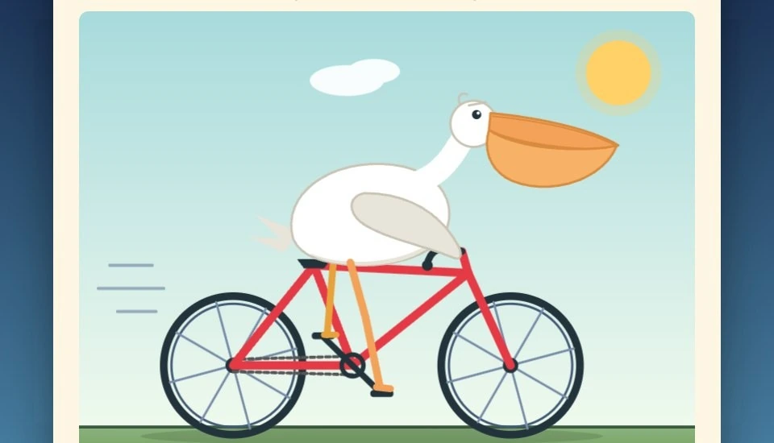</a><div class="showcase-card-body"><div class="showcase-card-meta"><span>Language models</span><span class="showcase-weight">Open weights</span></div><h3 class="model-name"><a href="/raw/showcase/llm-qwen38.html">Qwen3.8-2.4T-A95B</a></h3><p class="showcase-description">Architecture is detailed, but Max’s vision, optional thinking and built-in tools are a hosted variant.</p><div class="showcase-disclosure" aria-label="Public disclosure"><span data-status="k" title="Architecture: Known"><i aria-hidden="true"></i><span>Architecture</span><span class="showcase-status-text">Known</span></span><span data-status="n" title="Data: Undisclosed"><i aria-hidden="true"></i><span>Data</span><span class="showcase-status-text">Undisclosed</span></span><span data-status="p" title="Training: Partial"><i aria-hidden="true"></i><span>Training</span><span class="showcase-status-text">Partial</span></span><span data-status="k" title="Inference: Known"><i aria-hidden="true"></i><span>Inference</span><span class="showcase-status-text">Known</span></span><span data-status="k" title="Tools: Known"><i aria-hidden="true"></i><span>Tools</span><span class="showcase-status-text">Known</span></span></div></div><nav class="showcase-card-actions" aria-label="Qwen3.8-2.4T-A95B materials"><a href="/raw/showcase/llm-qwen38.html">Model card</a><a href="/raw/showcase/llm-qwen38.html#results">Results & examples</a></nav></article>
<article class="showcase-model" data-family="qwen" data-category="t2i" data-open="false" data-search="Qwen-Image 3.0 Alibaba / Qwen Qwen family Image generation An earlier Qwen-Image architecture or licence cannot be assigned to version 3.0."><a class="showcase-preview" href="/raw/showcase/t2i-qwenimage-3.html" aria-label="Qwen-Image 3.0 model card">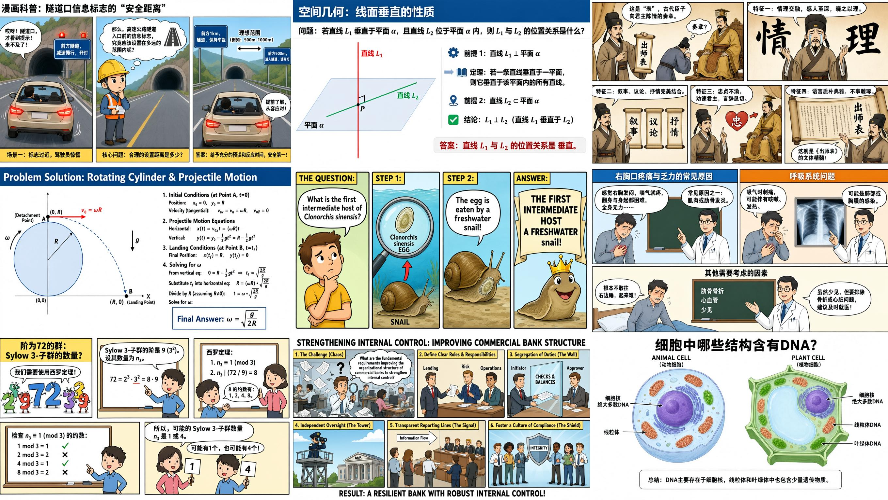</a><div class="showcase-card-body"><div class="showcase-card-meta"><span>Image generation</span><span class="showcase-weight">Hosted / API</span></div><h3 class="model-name"><a href="/raw/showcase/t2i-qwenimage-3.html">Qwen-Image 3.0</a></h3><p class="showcase-description">An earlier Qwen-Image architecture or licence cannot be assigned to version 3.0.</p><div class="showcase-disclosure" aria-label="Public disclosure"><span data-status="n" title="Architecture: Undisclosed"><i aria-hidden="true"></i><span>Architecture</span><span class="showcase-status-text">Undisclosed</span></span><span data-status="n" title="Data: Undisclosed"><i aria-hidden="true"></i><span>Data</span><span class="showcase-status-text">Undisclosed</span></span><span data-status="n" title="Training: Undisclosed"><i aria-hidden="true"></i><span>Training</span><span class="showcase-status-text">Undisclosed</span></span><span data-status="p" title="Inference: Partial"><i aria-hidden="true"></i><span>Inference</span><span class="showcase-status-text">Partial</span></span><span data-status="p" title="Tools: Partial"><i aria-hidden="true"></i><span>Tools</span><span class="showcase-status-text">Partial</span></span></div></div><nav class="showcase-card-actions" aria-label="Qwen-Image 3.0 materials"><a href="/raw/showcase/t2i-qwenimage-3.html">Model card</a><a href="/raw/showcase/t2i-qwenimage-3.html#results">Results & examples</a></nav></article>
<article class="showcase-model" data-family="qwen" data-category="tts" data-open="false" data-search="Qwen Audio 3.1 Alibaba / Qwen Qwen family Speech Flash and Next serve different audio tasks; shared branding does not establish shared internals."><a class="showcase-preview" href="/raw/showcase/tts-qwen-audio-31.html" aria-label="Qwen Audio 3.1 model card">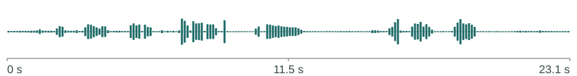</a><div class="showcase-card-body"><div class="showcase-card-meta"><span>Speech</span><span class="showcase-weight">Hosted / API</span></div><h3 class="model-name"><a href="/raw/showcase/tts-qwen-audio-31.html">Qwen Audio 3.1</a></h3><p class="showcase-description">Flash and Next serve different audio tasks; shared branding does not establish shared internals.</p><div class="showcase-disclosure" aria-label="Public disclosure"><span data-status="p" title="Architecture: Partial"><i aria-hidden="true"></i><span>Architecture</span><span class="showcase-status-text">Partial</span></span><span data-status="n" title="Data: Undisclosed"><i aria-hidden="true"></i><span>Data</span><span class="showcase-status-text">Undisclosed</span></span><span data-status="p" title="Training: Partial"><i aria-hidden="true"></i><span>Training</span><span class="showcase-status-text">Partial</span></span><span data-status="p" title="Inference: Partial"><i aria-hidden="true"></i><span>Inference</span><span class="showcase-status-text">Partial</span></span><span data-status="k" title="Voice control: Known"><i aria-hidden="true"></i><span>Voice control</span><span class="showcase-status-text">Known</span></span></div></div><nav class="showcase-card-actions" aria-label="Qwen Audio 3.1 materials"><a href="/raw/showcase/tts-qwen-audio-31.html">Model card</a><a href="/raw/showcase/tts-qwen-audio-31.html#results">Results & examples</a></nav></article></div></section>
<section class="showcase-family" id="family-kimi" data-family="kimi" aria-labelledby="family-kimi-title"><header class="showcase-family-heading"><h2 id="family-kimi-title">Kimi family</h2><span class="showcase-family-count">1 model</span></header><div class="showcase-grid"><article class="showcase-model" data-family="kimi" data-category="llm" data-open="true" data-search="Kimi K3 Moonshot AI Kimi family Language models The public checkpoint is detailed, and multi-turn quality depends on retaining the full thinking history."><a class="showcase-preview" href="/raw/showcase/llm-kimi-k3.html" aria-label="Kimi K3 model card"><div class="showcase-brand"><div aria-label="Moonshot AI" class="sc-company" role="img"></div></div></a><div class="showcase-card-body"><div class="showcase-card-meta"><span>Language models</span><span class="showcase-weight">Open weights</span></div><h3 class="model-name"><a href="/raw/showcase/llm-kimi-k3.html">Kimi K3</a></h3><p class="showcase-description">The public checkpoint is detailed, and multi-turn quality depends on retaining the full thinking history.</p><div class="showcase-disclosure" aria-label="Public disclosure"><span data-status="k" title="Architecture: Known"><i aria-hidden="true"></i><span>Architecture</span><span class="showcase-status-text">Known</span></span><span data-status="p" title="Data: Partial"><i aria-hidden="true"></i><span>Data</span><span class="showcase-status-text">Partial</span></span><span data-status="k" title="Training: Known"><i aria-hidden="true"></i><span>Training</span><span class="showcase-status-text">Known</span></span><span data-status="k" title="Inference: Known"><i aria-hidden="true"></i><span>Inference</span><span class="showcase-status-text">Known</span></span><span data-status="k" title="Tools: Known"><i aria-hidden="true"></i><span>Tools</span><span class="showcase-status-text">Known</span></span></div></div><nav class="showcase-card-actions" aria-label="Kimi K3 materials"><a href="/raw/showcase/llm-kimi-k3.html">Model card</a><a href="/raw/showcase/llm-kimi-k3.html#results">Results & examples</a></nav></article></div></section>
<section class="showcase-family" id="family-deepseek" data-family="deepseek" aria-labelledby="family-deepseek-title"><header class="showcase-family-heading"><h2 id="family-deepseek-title">DeepSeek family</h2><span class="showcase-family-count">1 model</span></header><div class="showcase-grid"><article class="showcase-model" data-family="deepseek" data-category="llm" data-open="true" data-search="DeepSeek V4.1-Flash DeepSeek DeepSeek family Language models The checkpoint, training outline and harness are public, while corpus provenance remains undisclosed."><a class="showcase-preview" href="/raw/showcase/llm-deepseek-v41.html" aria-label="DeepSeek V4.1-Flash model card">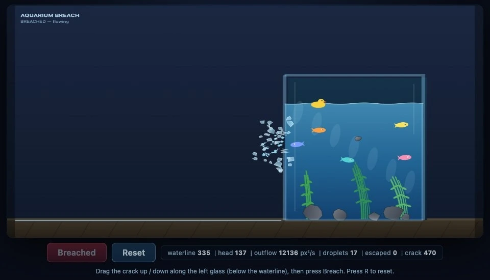</a><div class="showcase-card-body"><div class="showcase-card-meta"><span>Language models</span><span class="showcase-weight">Open weights</span></div><h3 class="model-name"><a href="/raw/showcase/llm-deepseek-v41.html">DeepSeek V4.1-Flash</a></h3><p class="showcase-description">The checkpoint, training outline and harness are public, while corpus provenance remains undisclosed.</p><div class="showcase-disclosure" aria-label="Public disclosure"><span data-status="k" title="Architecture: Known"><i aria-hidden="true"></i><span>Architecture</span><span class="showcase-status-text">Known</span></span><span data-status="k" title="Data: Known"><i aria-hidden="true"></i><span>Data</span><span class="showcase-status-text">Known</span></span><span data-status="k" title="Training: Known"><i aria-hidden="true"></i><span>Training</span><span class="showcase-status-text">Known</span></span><span data-status="k" title="Inference: Known"><i aria-hidden="true"></i><span>Inference</span><span class="showcase-status-text">Known</span></span><span data-status="k" title="Tools: Known"><i aria-hidden="true"></i><span>Tools</span><span class="showcase-status-text">Known</span></span></div></div><nav class="showcase-card-actions" aria-label="DeepSeek V4.1-Flash materials"><a href="/raw/showcase/llm-deepseek-v41.html">Model card</a><a href="/raw/showcase/llm-deepseek-v41.html#results">Results & examples</a></nav></article></div></section>
<section class="showcase-family" id="family-glm" data-family="glm" aria-labelledby="family-glm-title"><header class="showcase-family-heading"><h2 id="family-glm-title">GLM family</h2><span class="showcase-family-count">2 models</span></header><div class="showcase-grid"><article class="showcase-model" data-family="glm" data-category="llm" data-open="true" data-search="GLM-5.3 Z.ai / Zhipu GLM family Language models GLM-5.3 adds post-training to the GLM-5.2 base; Flash is a different model with different dimensions."><a class="showcase-preview" href="/raw/showcase/llm-glm-53.html" aria-label="GLM-5.3 model card">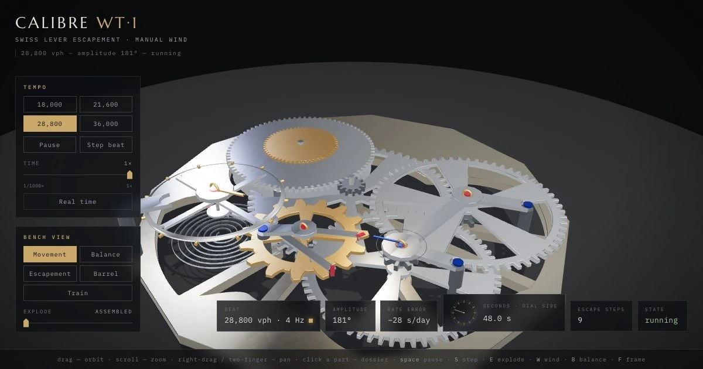</a><div class="showcase-card-body"><div class="showcase-card-meta"><span>Language models</span><span class="showcase-weight">Open weights</span></div><h3 class="model-name"><a href="/raw/showcase/llm-glm-53.html">GLM-5.3</a></h3><p class="showcase-description">GLM-5.3 adds post-training to the GLM-5.2 base; Flash is a different model with different dimensions.</p><div class="showcase-disclosure" aria-label="Public disclosure"><span data-status="k" title="Architecture: Known"><i aria-hidden="true"></i><span>Architecture</span><span class="showcase-status-text">Known</span></span><span data-status="p" title="Data: Partial"><i aria-hidden="true"></i><span>Data</span><span class="showcase-status-text">Partial</span></span><span data-status="k" title="Training: Known"><i aria-hidden="true"></i><span>Training</span><span class="showcase-status-text">Known</span></span><span data-status="k" title="Inference: Known"><i aria-hidden="true"></i><span>Inference</span><span class="showcase-status-text">Known</span></span><span data-status="p" title="Tools: Partial"><i aria-hidden="true"></i><span>Tools</span><span class="showcase-status-text">Partial</span></span></div></div><nav class="showcase-card-actions" aria-label="GLM-5.3 materials"><a href="/raw/showcase/llm-glm-53.html">Model card</a><a href="/raw/showcase/llm-glm-53.html#results">Results & examples</a></nav></article>
<article class="showcase-model" data-family="glm" data-category="llm" data-open="false" data-search="GLM-5.4 Z.ai / Zhipu GLM family Language models Reusing the middle block gives each token 106 layer applications across 78 numbered layers."><a class="showcase-preview" href="/raw/showcase/llm-glm-54.html" aria-label="GLM-5.4 model card">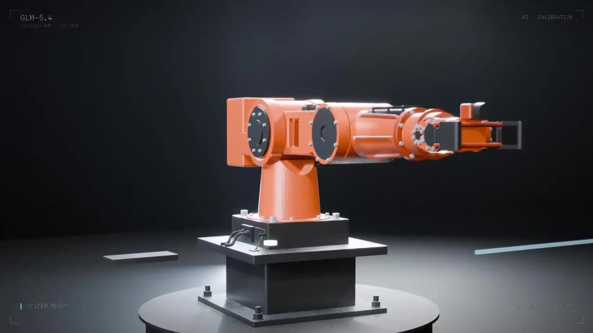</a><div class="showcase-card-body"><div class="showcase-card-meta"><span>Language models</span><span class="showcase-weight">Hosted / API</span></div><h3 class="model-name"><a href="/raw/showcase/llm-glm-54.html">GLM-5.4</a></h3><p class="showcase-description">Reusing the middle block gives each token 106 layer applications across 78 numbered layers.</p><div class="showcase-disclosure" aria-label="Public disclosure"><span data-status="k" title="Architecture: Known"><i aria-hidden="true"></i><span>Architecture</span><span class="showcase-status-text">Known</span></span><span data-status="n" title="Data: Undisclosed"><i aria-hidden="true"></i><span>Data</span><span class="showcase-status-text">Undisclosed</span></span><span data-status="p" title="Training: Partial"><i aria-hidden="true"></i><span>Training</span><span class="showcase-status-text">Partial</span></span><span data-status="k" title="Inference: Known"><i aria-hidden="true"></i><span>Inference</span><span class="showcase-status-text">Known</span></span><span data-status="k" title="Tools: Known"><i aria-hidden="true"></i><span>Tools</span><span class="showcase-status-text">Known</span></span></div></div><nav class="showcase-card-actions" aria-label="GLM-5.4 materials"><a href="/raw/showcase/llm-glm-54.html">Model card</a><a href="/raw/showcase/llm-glm-54.html#results">Results & examples</a></nav></article></div></section>
<section class="showcase-family" id="family-flux" data-family="flux" aria-labelledby="family-flux-title"><header class="showcase-family-heading"><h2 id="family-flux-title">FLUX family</h2><span class="showcase-family-count">5 models</span></header><div class="showcase-grid"><article class="showcase-model" data-family="flux" data-category="t2i" data-open="true" data-search="FLUX.2 Black Forest Labs FLUX family Image generation Specifications for the open [dev] checkpoint do not transfer to hosted models."><a class="showcase-preview" href="/raw/showcase/t2i-flux-2.html" aria-label="FLUX.2 model card">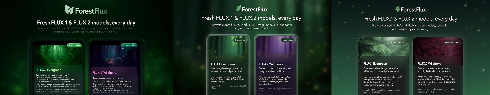</a><div class="showcase-card-body"><div class="showcase-card-meta"><span>Image generation</span><span class="showcase-weight">Open weights</span></div><h3 class="model-name"><a href="/raw/showcase/t2i-flux-2.html">FLUX.2</a></h3><p class="showcase-description">Specifications for the open [dev] checkpoint do not transfer to hosted models.</p><div class="showcase-disclosure" aria-label="Public disclosure"><span data-status="p" title="Architecture: Partial"><i aria-hidden="true"></i><span>Architecture</span><span class="showcase-status-text">Partial</span></span><span data-status="p" title="Data: Partial"><i aria-hidden="true"></i><span>Data</span><span class="showcase-status-text">Partial</span></span><span data-status="p" title="Training: Partial"><i aria-hidden="true"></i><span>Training</span><span class="showcase-status-text">Partial</span></span><span data-status="k" title="Inference: Known"><i aria-hidden="true"></i><span>Inference</span><span class="showcase-status-text">Known</span></span><span data-status="k" title="Tools: Known"><i aria-hidden="true"></i><span>Tools</span><span class="showcase-status-text">Known</span></span></div></div><nav class="showcase-card-actions" aria-label="FLUX.2 materials"><a href="/raw/showcase/t2i-flux-2.html">Model card</a><a href="/raw/showcase/t2i-flux-2.html#results">Results & examples</a></nav></article>
<article class="showcase-model" data-family="flux" data-category="t2i" data-open="true" data-search="FLUX.2 [klein] Black Forest Labs FLUX family Image generation Choose size, checkpoint and licence separately; Base is for local adaptation."><a class="showcase-preview" href="/raw/showcase/t2i-flux-2-klein.html" aria-label="FLUX.2 [klein] model card"></a><div class="showcase-card-body"><div class="showcase-card-meta"><span>Image generation</span><span class="showcase-weight">Open weights</span></div><h3 class="model-name"><a href="/raw/showcase/t2i-flux-2-klein.html">FLUX.2 [klein]</a></h3><p class="showcase-description">Choose size, checkpoint and licence separately; Base is for local adaptation.</p><div class="showcase-disclosure" aria-label="Public disclosure"><span data-status="k" title="Architecture: Known"><i aria-hidden="true"></i><span>Architecture</span><span class="showcase-status-text">Known</span></span><span data-status="n" title="Data: Undisclosed"><i aria-hidden="true"></i><span>Data</span><span class="showcase-status-text">Undisclosed</span></span><span data-status="p" title="Training: Partial"><i aria-hidden="true"></i><span>Training</span><span class="showcase-status-text">Partial</span></span><span data-status="p" title="Inference: Partial"><i aria-hidden="true"></i><span>Inference</span><span class="showcase-status-text">Partial</span></span><span data-status="k" title="Tools: Known"><i aria-hidden="true"></i><span>Tools</span><span class="showcase-status-text">Known</span></span></div></div><nav class="showcase-card-actions" aria-label="FLUX.2 [klein] materials"><a href="/raw/showcase/t2i-flux-2-klein.html">Model card</a><a href="/raw/showcase/t2i-flux-2-klein.html#results">Results & examples</a></nav></article>
<article class="showcase-model" data-family="flux" data-category="t2i" data-open="false" data-search="FLUX 3 Image Black Forest Labs FLUX family Image generation Rich editing controls coexist with undisclosed model size and production recipe."><a class="showcase-preview" href="/raw/showcase/t2i-flux-3-image.html" aria-label="FLUX 3 Image model card"></a><div class="showcase-card-body"><div class="showcase-card-meta"><span>Image generation</span><span class="showcase-weight">Hosted / API</span></div><h3 class="model-name"><a href="/raw/showcase/t2i-flux-3-image.html">FLUX 3 Image</a></h3><p class="showcase-description">Rich editing controls coexist with undisclosed model size and production recipe.</p><div class="showcase-disclosure" aria-label="Public disclosure"><span data-status="p" title="Architecture: Partial"><i aria-hidden="true"></i><span>Architecture</span><span class="showcase-status-text">Partial</span></span><span data-status="p" title="Data: Partial"><i aria-hidden="true"></i><span>Data</span><span class="showcase-status-text">Partial</span></span><span data-status="p" title="Training: Partial"><i aria-hidden="true"></i><span>Training</span><span class="showcase-status-text">Partial</span></span><span data-status="p" title="Inference: Partial"><i aria-hidden="true"></i><span>Inference</span><span class="showcase-status-text">Partial</span></span><span data-status="p" title="Tools: Partial"><i aria-hidden="true"></i><span>Tools</span><span class="showcase-status-text">Partial</span></span></div></div><nav class="showcase-card-actions" aria-label="FLUX 3 Image materials"><a href="/raw/showcase/t2i-flux-3-image.html">Model card</a><a href="/raw/showcase/t2i-flux-3-image.html#results">Results & examples</a></nav></article>
<article class="showcase-model" data-family="flux" data-category="t2i" data-open="true" data-search="FLUX 3 Image Klein Black Forest Labs FLUX family Image generation Core model and sampling specs are documented; data and training remain partial."><a class="showcase-preview" href="/raw/showcase/t2i-flux3-klein.html" aria-label="FLUX 3 Image Klein model card"></a><div class="showcase-card-body"><div class="showcase-card-meta"><span>Image generation</span><span class="showcase-weight">Open weights</span></div><h3 class="model-name"><a href="/raw/showcase/t2i-flux3-klein.html">FLUX 3 Image Klein</a></h3><p class="showcase-description">Core model and sampling specs are documented; data and training remain partial.</p><div class="showcase-disclosure" aria-label="Public disclosure"><span data-status="k" title="Architecture: Known"><i aria-hidden="true"></i><span>Architecture</span><span class="showcase-status-text">Known</span></span><span data-status="p" title="Data: Partial"><i aria-hidden="true"></i><span>Data</span><span class="showcase-status-text">Partial</span></span><span data-status="p" title="Training: Partial"><i aria-hidden="true"></i><span>Training</span><span class="showcase-status-text">Partial</span></span><span data-status="k" title="Inference: Known"><i aria-hidden="true"></i><span>Inference</span><span class="showcase-status-text">Known</span></span><span data-status="p" title="Tools: Partial"><i aria-hidden="true"></i><span>Tools</span><span class="showcase-status-text">Partial</span></span></div></div><nav class="showcase-card-actions" aria-label="FLUX 3 Image Klein materials"><a href="/raw/showcase/t2i-flux3-klein.html">Model card</a><a href="/raw/showcase/t2i-flux3-klein.html#results">Results & examples</a></nav></article>
<article class="showcase-model" data-family="flux" data-category="t2v" data-open="false" data-search="FLUX 3 Video Black Forest Labs FLUX family Video generation Video generation, continuation and editing have distinct controls and availability."><a class="showcase-preview" href="/raw/showcase/t2v-flux-3-video.html" aria-label="FLUX 3 Video model card"></a><div class="showcase-card-body"><div class="showcase-card-meta"><span>Video generation</span><span class="showcase-weight">Hosted / API</span></div><h3 class="model-name"><a href="/raw/showcase/t2v-flux-3-video.html">FLUX 3 Video</a></h3><p class="showcase-description">Video generation, continuation and editing have distinct controls and availability.</p><div class="showcase-disclosure" aria-label="Public disclosure"><span data-status="p" title="Architecture: Partial"><i aria-hidden="true"></i><span>Architecture</span><span class="showcase-status-text">Partial</span></span><span data-status="p" title="Data: Partial"><i aria-hidden="true"></i><span>Data</span><span class="showcase-status-text">Partial</span></span><span data-status="p" title="Training: Partial"><i aria-hidden="true"></i><span>Training</span><span class="showcase-status-text">Partial</span></span><span data-status="k" title="Inference: Known"><i aria-hidden="true"></i><span>Inference</span><span class="showcase-status-text">Known</span></span><span data-status="k" title="Tools: Known"><i aria-hidden="true"></i><span>Tools</span><span class="showcase-status-text">Known</span></span></div></div><nav class="showcase-card-actions" aria-label="FLUX 3 Video materials"><a href="/raw/showcase/t2v-flux-3-video.html">Model card</a><a href="/raw/showcase/t2v-flux-3-video.html#results">Results & examples</a></nav></article></div></section>
<section class="showcase-family" id="family-krea" data-family="krea" aria-labelledby="family-krea-title"><header class="showcase-family-heading"><h2 id="family-krea-title">Krea family</h2><span class="showcase-family-count">1 model</span></header><div class="showcase-grid"><article class="showcase-model" data-family="krea" data-category="t2i" data-open="false" data-search="Krea 3 Krea AI Krea family Image generation A clean copy of each reference lets the transformer preserve detail while it denoises the target."><a class="showcase-preview" href="/raw/showcase/t2i-krea-3.html" aria-label="Krea 3 model card">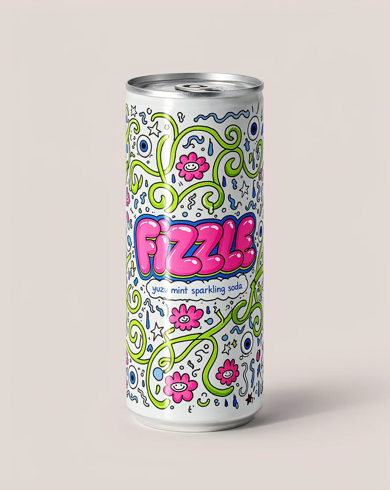</a><div class="showcase-card-body"><div class="showcase-card-meta"><span>Image generation</span><span class="showcase-weight">Hosted / API</span></div><h3 class="model-name"><a href="/raw/showcase/t2i-krea-3.html">Krea 3</a></h3><p class="showcase-description">A clean copy of each reference lets the transformer preserve detail while it denoises the target.</p><div class="showcase-disclosure" aria-label="Public disclosure"><span data-status="p" title="Architecture: Partial"><i aria-hidden="true"></i><span>Architecture</span><span class="showcase-status-text">Partial</span></span><span data-status="p" title="Data: Partial"><i aria-hidden="true"></i><span>Data</span><span class="showcase-status-text">Partial</span></span><span data-status="p" title="Training: Partial"><i aria-hidden="true"></i><span>Training</span><span class="showcase-status-text">Partial</span></span><span data-status="p" title="Inference: Partial"><i aria-hidden="true"></i><span>Inference</span><span class="showcase-status-text">Partial</span></span><span data-status="p" title="Tools: Partial"><i aria-hidden="true"></i><span>Tools</span><span class="showcase-status-text">Partial</span></span></div></div><nav class="showcase-card-actions" aria-label="Krea 3 materials"><a href="/raw/showcase/t2i-krea-3.html">Model card</a><a href="/raw/showcase/t2i-krea-3.html#results">Results & examples</a></nav></article></div></section>
<section class="showcase-family" id="family-wan" data-family="wan" aria-labelledby="family-wan-title"><header class="showcase-family-heading"><h2 id="family-wan-title">Wan family</h2><span class="showcase-family-count">2 models</span></header><div class="showcase-grid"><article class="showcase-model" data-family="wan" data-category="t2i" data-open="false" data-search="Wan2.7 Image Alibaba / Wan Wan family Image generation A documented adaptation workflow does not reveal the base model or its weights."><a class="showcase-preview" href="/raw/showcase/t2i-wan-27-image.html" aria-label="Wan2.7 Image model card">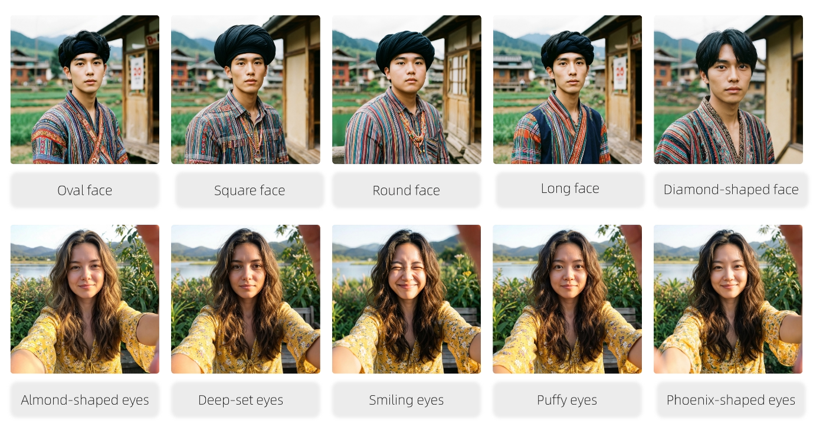</a><div class="showcase-card-body"><div class="showcase-card-meta"><span>Image generation</span><span class="showcase-weight">Hosted / API</span></div><h3 class="model-name"><a href="/raw/showcase/t2i-wan-27-image.html">Wan2.7 Image</a></h3><p class="showcase-description">A documented adaptation workflow does not reveal the base model or its weights.</p><div class="showcase-disclosure" aria-label="Public disclosure"><span data-status="n" title="Architecture: Undisclosed"><i aria-hidden="true"></i><span>Architecture</span><span class="showcase-status-text">Undisclosed</span></span><span data-status="p" title="Data: Partial"><i aria-hidden="true"></i><span>Data</span><span class="showcase-status-text">Partial</span></span><span data-status="p" title="Training: Partial"><i aria-hidden="true"></i><span>Training</span><span class="showcase-status-text">Partial</span></span><span data-status="p" title="Inference: Partial"><i aria-hidden="true"></i><span>Inference</span><span class="showcase-status-text">Partial</span></span><span data-status="p" title="Tools: Partial"><i aria-hidden="true"></i><span>Tools</span><span class="showcase-status-text">Partial</span></span></div></div><nav class="showcase-card-actions" aria-label="Wan2.7 Image materials"><a href="/raw/showcase/t2i-wan-27-image.html">Model card</a><a href="/raw/showcase/t2i-wan-27-image.html#results">Results & examples</a></nav></article>
<article class="showcase-model" data-family="wan" data-category="t2v" data-open="false" data-search="Wan3 Alibaba / Wan Wan family Video generation Model Studio documents an all-in-one workflow; model internals remain undisclosed."><a class="showcase-preview" href="/raw/showcase/t2v-wan3.html" aria-label="Wan3 model card"></a><div class="showcase-card-body"><div class="showcase-card-meta"><span>Video generation</span><span class="showcase-weight">Hosted / API</span></div><h3 class="model-name"><a href="/raw/showcase/t2v-wan3.html">Wan3</a></h3><p class="showcase-description">Model Studio documents an all-in-one workflow; model internals remain undisclosed.</p><div class="showcase-disclosure" aria-label="Public disclosure"><span data-status="n" title="Architecture: Undisclosed"><i aria-hidden="true"></i><span>Architecture</span><span class="showcase-status-text">Undisclosed</span></span><span data-status="n" title="Data: Undisclosed"><i aria-hidden="true"></i><span>Data</span><span class="showcase-status-text">Undisclosed</span></span><span data-status="n" title="Training: Undisclosed"><i aria-hidden="true"></i><span>Training</span><span class="showcase-status-text">Undisclosed</span></span><span data-status="k" title="Inference: Known"><i aria-hidden="true"></i><span>Inference</span><span class="showcase-status-text">Known</span></span><span data-status="k" title="Tools: Known"><i aria-hidden="true"></i><span>Tools</span><span class="showcase-status-text">Known</span></span></div></div><nav class="showcase-card-actions" aria-label="Wan3 materials"><a href="/raw/showcase/t2v-wan3.html">Model card</a><a href="/raw/showcase/t2v-wan3.html#results">Results & examples</a></nav></article></div></section>
<section class="showcase-family" id="family-utopai" data-family="utopai" aria-labelledby="family-utopai-title"><header class="showcase-family-heading"><h2 id="family-utopai-title">Utopai family</h2><span class="showcase-family-count">1 model</span></header><div class="showcase-grid"><article class="showcase-model" data-family="utopai" data-category="t2v" data-open="false" data-search="Utopai X Utopai Utopai family Video generation An identified base model does not establish the derivative’s architecture or limits."><a class="showcase-preview" href="/raw/showcase/t2v-utopai-x.html" aria-label="Utopai X model card"></a><div class="showcase-card-body"><div class="showcase-card-meta"><span>Video generation</span><span class="showcase-weight">Hosted / API</span></div><h3 class="model-name"><a href="/raw/showcase/t2v-utopai-x.html">Utopai X</a></h3><p class="showcase-description">An identified base model does not establish the derivative’s architecture or limits.</p><div class="showcase-disclosure" aria-label="Public disclosure"><span data-status="p" title="Architecture: Partial"><i aria-hidden="true"></i><span>Architecture</span><span class="showcase-status-text">Partial</span></span><span data-status="n" title="Data: Undisclosed"><i aria-hidden="true"></i><span>Data</span><span class="showcase-status-text">Undisclosed</span></span><span data-status="p" title="Training: Partial"><i aria-hidden="true"></i><span>Training</span><span class="showcase-status-text">Partial</span></span><span data-status="p" title="Inference: Partial"><i aria-hidden="true"></i><span>Inference</span><span class="showcase-status-text">Partial</span></span><span data-status="p" title="Tools: Partial"><i aria-hidden="true"></i><span>Tools</span><span class="showcase-status-text">Partial</span></span></div></div><nav class="showcase-card-actions" aria-label="Utopai X materials"><a href="/raw/showcase/t2v-utopai-x.html">Model card</a><a href="/raw/showcase/t2v-utopai-x.html#results">Results & examples</a></nav></article></div></section>
<section class="showcase-family" id="family-minimax-h3" data-family="minimax-h3" aria-labelledby="family-minimax-h3-title"><header class="showcase-family-heading"><h2 id="family-minimax-h3-title">MiniMax H3 family</h2><span class="showcase-family-count">1 model</span></header><div class="showcase-grid"><article class="showcase-model" data-family="minimax-h3" data-category="t2v" data-open="true" data-search="MiniMax H3 MiniMax MiniMax H3 family Video generation The architecture and checkpoints are concrete; corpus and compute details remain missing."><a class="showcase-preview" href="/raw/showcase/t2v-minimax-h3.html" aria-label="MiniMax H3 model card">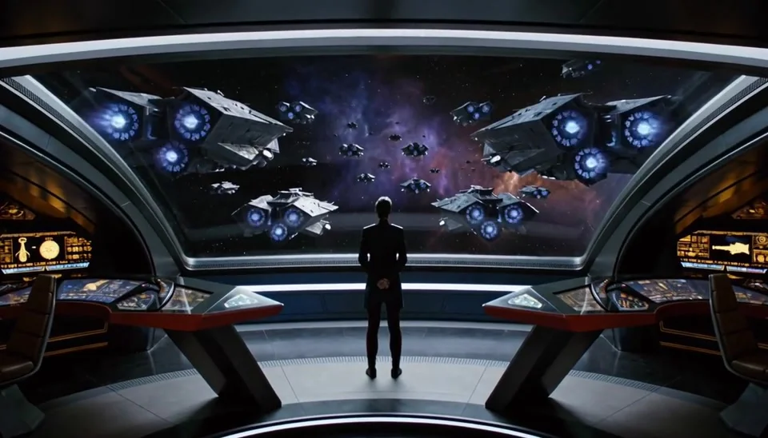</a><div class="showcase-card-body"><div class="showcase-card-meta"><span>Video generation</span><span class="showcase-weight">Open weights</span></div><h3 class="model-name"><a href="/raw/showcase/t2v-minimax-h3.html">MiniMax H3</a></h3><p class="showcase-description">The architecture and checkpoints are concrete; corpus and compute details remain missing.</p><div class="showcase-disclosure" aria-label="Public disclosure"><span data-status="k" title="Architecture: Known"><i aria-hidden="true"></i><span>Architecture</span><span class="showcase-status-text">Known</span></span><span data-status="p" title="Data: Partial"><i aria-hidden="true"></i><span>Data</span><span class="showcase-status-text">Partial</span></span><span data-status="p" title="Training: Partial"><i aria-hidden="true"></i><span>Training</span><span class="showcase-status-text">Partial</span></span><span data-status="k" title="Inference: Known"><i aria-hidden="true"></i><span>Inference</span><span class="showcase-status-text">Known</span></span><span data-status="k" title="Tools: Known"><i aria-hidden="true"></i><span>Tools</span><span class="showcase-status-text">Known</span></span></div></div><nav class="showcase-card-actions" aria-label="MiniMax H3 materials"><a href="/raw/showcase/t2v-minimax-h3.html">Model card</a><a href="/raw/showcase/t2v-minimax-h3.html#results">Results & examples</a></nav></article></div></section>
<section class="showcase-family" id="family-kling" data-family="kling" aria-labelledby="family-kling-title"><header class="showcase-family-heading"><h2 id="family-kling-title">Kling family</h2><span class="showcase-family-count">1 model</span></header><div class="showcase-grid"><article class="showcase-model" data-family="kling" data-category="t2v" data-open="false" data-search="Kling 3.0 Omni Kling AI / Kuaishou Kling family Video generation The documented controls are specific; the unified-training claim is only a high-level description."><a class="showcase-preview" href="/raw/showcase/t2v-kling-3-omni.html" aria-label="Kling 3.0 Omni model card"></a><div class="showcase-card-body"><div class="showcase-card-meta"><span>Video generation</span><span class="showcase-weight">Hosted / API</span></div><h3 class="model-name"><a href="/raw/showcase/t2v-kling-3-omni.html">Kling 3.0 Omni</a></h3><p class="showcase-description">The documented controls are specific; the unified-training claim is only a high-level description.</p><div class="showcase-disclosure" aria-label="Public disclosure"><span data-status="p" title="Architecture: Partial"><i aria-hidden="true"></i><span>Architecture</span><span class="showcase-status-text">Partial</span></span><span data-status="n" title="Data: Undisclosed"><i aria-hidden="true"></i><span>Data</span><span class="showcase-status-text">Undisclosed</span></span><span data-status="p" title="Training: Partial"><i aria-hidden="true"></i><span>Training</span><span class="showcase-status-text">Partial</span></span><span data-status="k" title="Inference: Known"><i aria-hidden="true"></i><span>Inference</span><span class="showcase-status-text">Known</span></span><span data-status="k" title="Tools: Known"><i aria-hidden="true"></i><span>Tools</span><span class="showcase-status-text">Known</span></span></div></div><nav class="showcase-card-actions" aria-label="Kling 3.0 Omni materials"><a href="/raw/showcase/t2v-kling-3-omni.html">Model card</a><a href="/raw/showcase/t2v-kling-3-omni.html#results">Results & examples</a></nav></article></div></section>
<section class="showcase-family" id="family-veo" data-family="veo" aria-labelledby="family-veo-title"><header class="showcase-family-heading"><h2 id="family-veo-title">Veo family</h2><span class="showcase-family-count">1 model</span></header><div class="showcase-grid"><article class="showcase-model" data-family="veo" data-category="t2v" data-open="false" data-search="Veo 3.1 Google DeepMind Veo family Video generation Family-level model-card details and variant-specific API features need separate labels."><a class="showcase-preview" href="/raw/showcase/t2v-veo-3-1.html" aria-label="Veo 3.1 model card">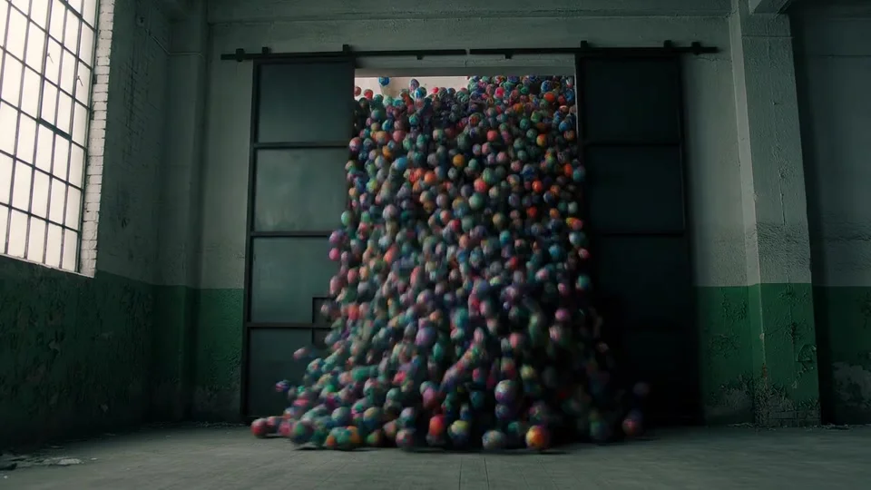</a><div class="showcase-card-body"><div class="showcase-card-meta"><span>Video generation</span><span class="showcase-weight">Hosted / API</span></div><h3 class="model-name"><a href="/raw/showcase/t2v-veo-3-1.html">Veo 3.1</a></h3><p class="showcase-description">Family-level model-card details and variant-specific API features need separate labels.</p><div class="showcase-disclosure" aria-label="Public disclosure"><span data-status="p" title="Architecture: Partial"><i aria-hidden="true"></i><span>Architecture</span><span class="showcase-status-text">Partial</span></span><span data-status="p" title="Data: Partial"><i aria-hidden="true"></i><span>Data</span><span class="showcase-status-text">Partial</span></span><span data-status="p" title="Training: Partial"><i aria-hidden="true"></i><span>Training</span><span class="showcase-status-text">Partial</span></span><span data-status="k" title="Inference: Known"><i aria-hidden="true"></i><span>Inference</span><span class="showcase-status-text">Known</span></span><span data-status="k" title="Tools: Known"><i aria-hidden="true"></i><span>Tools</span><span class="showcase-status-text">Known</span></span></div></div><nav class="showcase-card-actions" aria-label="Veo 3.1 materials"><a href="/raw/showcase/t2v-veo-3-1.html">Model card</a><a href="/raw/showcase/t2v-veo-3-1.html#results">Results & examples</a></nav></article></div></section>
<section class="showcase-family" id="family-seedance" data-family="seedance" aria-labelledby="family-seedance-title"><header class="showcase-family-heading"><h2 id="family-seedance-title">Seedance family</h2><span class="showcase-family-count">1 model</span></header><div class="showcase-grid"><article class="showcase-model" data-family="seedance" data-category="t2v" data-open="false" data-search="Seedance2.5 ByteDance Seed Seedance family Video generation A 30-second generation and a platform’s long-video workflow are different capabilities."><a class="showcase-preview" href="/raw/showcase/t2v-seedance-2-5.html" aria-label="Seedance2.5 model card"></a><div class="showcase-card-body"><div class="showcase-card-meta"><span>Video generation</span><span class="showcase-weight">Hosted / API</span></div><h3 class="model-name"><a href="/raw/showcase/t2v-seedance-2-5.html">Seedance2.5</a></h3><p class="showcase-description">A 30-second generation and a platform’s long-video workflow are different capabilities.</p><div class="showcase-disclosure" aria-label="Public disclosure"><span data-status="p" title="Architecture: Partial"><i aria-hidden="true"></i><span>Architecture</span><span class="showcase-status-text">Partial</span></span><span data-status="n" title="Data: Undisclosed"><i aria-hidden="true"></i><span>Data</span><span class="showcase-status-text">Undisclosed</span></span><span data-status="n" title="Training: Undisclosed"><i aria-hidden="true"></i><span>Training</span><span class="showcase-status-text">Undisclosed</span></span><span data-status="p" title="Inference: Partial"><i aria-hidden="true"></i><span>Inference</span><span class="showcase-status-text">Partial</span></span><span data-status="k" title="Tools: Known"><i aria-hidden="true"></i><span>Tools</span><span class="showcase-status-text">Known</span></span></div></div><nav class="showcase-card-actions" aria-label="Seedance2.5 materials"><a href="/raw/showcase/t2v-seedance-2-5.html">Model card</a><a href="/raw/showcase/t2v-seedance-2-5.html#results">Results & examples</a></nav></article></div></section>
<section class="showcase-family" id="family-aleph" data-family="aleph" aria-labelledby="family-aleph-title"><header class="showcase-family-heading"><h2 id="family-aleph-title">Aleph family</h2><span class="showcase-family-count">1 model</span></header><div class="showcase-grid"><article class="showcase-model" data-family="aleph" data-category="t2v" data-open="false" data-search="Aleph 2.0 Runway Aleph family Video generation An image guides edits to a supplied clip; it is not evidence of image-to-video generation."><a class="showcase-preview" href="/raw/showcase/t2v-aleph-2.html" aria-label="Aleph 2.0 model card"></a><div class="showcase-card-body"><div class="showcase-card-meta"><span>Video generation</span><span class="showcase-weight">Hosted / API</span></div><h3 class="model-name"><a href="/raw/showcase/t2v-aleph-2.html">Aleph 2.0</a></h3><p class="showcase-description">An image guides edits to a supplied clip; it is not evidence of image-to-video generation.</p><div class="showcase-disclosure" aria-label="Public disclosure"><span data-status="n" title="Architecture: Undisclosed"><i aria-hidden="true"></i><span>Architecture</span><span class="showcase-status-text">Undisclosed</span></span><span data-status="n" title="Data: Undisclosed"><i aria-hidden="true"></i><span>Data</span><span class="showcase-status-text">Undisclosed</span></span><span data-status="n" title="Training: Undisclosed"><i aria-hidden="true"></i><span>Training</span><span class="showcase-status-text">Undisclosed</span></span><span data-status="p" title="Inference: Partial"><i aria-hidden="true"></i><span>Inference</span><span class="showcase-status-text">Partial</span></span><span data-status="k" title="Tools: Known"><i aria-hidden="true"></i><span>Tools</span><span class="showcase-status-text">Known</span></span></div></div><nav class="showcase-card-actions" aria-label="Aleph 2.0 materials"><a href="/raw/showcase/t2v-aleph-2.html">Model card</a><a href="/raw/showcase/t2v-aleph-2.html#results">Results & examples</a></nav></article></div></section>
<section class="showcase-family" id="family-eleven" data-family="eleven" aria-labelledby="family-eleven-title"><header class="showcase-family-heading"><h2 id="family-eleven-title">Eleven family</h2><span class="showcase-family-count">1 model</span></header><div class="showcase-grid"><article class="showcase-model" data-family="eleven" data-category="tts" data-open="false" data-search="Eleven v4 ElevenLabs Eleven family Speech Rich voice direction is documented; the base model and training corpus remain closed."><a class="showcase-preview" href="/raw/showcase/tts-eleven-v4.html" aria-label="Eleven v4 model card">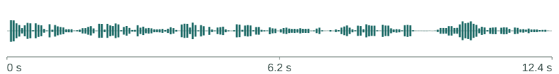</a><div class="showcase-card-body"><div class="showcase-card-meta"><span>Speech</span><span class="showcase-weight">Hosted / API</span></div><h3 class="model-name"><a href="/raw/showcase/tts-eleven-v4.html">Eleven v4</a></h3><p class="showcase-description">Rich voice direction is documented; the base model and training corpus remain closed.</p><div class="showcase-disclosure" aria-label="Public disclosure"><span data-status="n" title="Architecture: Undisclosed"><i aria-hidden="true"></i><span>Architecture</span><span class="showcase-status-text">Undisclosed</span></span><span data-status="n" title="Data: Undisclosed"><i aria-hidden="true"></i><span>Data</span><span class="showcase-status-text">Undisclosed</span></span><span data-status="p" title="Training: Partial"><i aria-hidden="true"></i><span>Training</span><span class="showcase-status-text">Partial</span></span><span data-status="k" title="Inference: Known"><i aria-hidden="true"></i><span>Inference</span><span class="showcase-status-text">Known</span></span><span data-status="k" title="Voice control: Known"><i aria-hidden="true"></i><span>Voice control</span><span class="showcase-status-text">Known</span></span></div></div><nav class="showcase-card-actions" aria-label="Eleven v4 materials"><a href="/raw/showcase/tts-eleven-v4.html">Model card</a><a href="/raw/showcase/tts-eleven-v4.html#results">Results & examples</a></nav></article></div></section>
<section class="showcase-family" id="family-sonic" data-family="sonic" aria-labelledby="family-sonic-title"><header class="showcase-family-heading"><h2 id="family-sonic-title">Sonic family</h2><span class="showcase-family-count">1 model</span></header><div class="showcase-grid"><article class="showcase-model" data-family="sonic" data-category="tts" data-open="false" data-search="Sonic 3.6 Cartesia Sonic family Speech Sonic documents deployment and speech controls more fully than its model architecture."><a class="showcase-preview" href="/raw/showcase/tts-sonic-36.html" aria-label="Sonic 3.6 model card">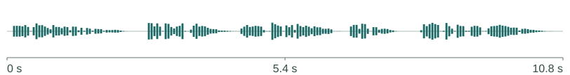</a><div class="showcase-card-body"><div class="showcase-card-meta"><span>Speech</span><span class="showcase-weight">Hosted / API</span></div><h3 class="model-name"><a href="/raw/showcase/tts-sonic-36.html">Sonic 3.6</a></h3><p class="showcase-description">Sonic documents deployment and speech controls more fully than its model architecture.</p><div class="showcase-disclosure" aria-label="Public disclosure"><span data-status="p" title="Architecture: Partial"><i aria-hidden="true"></i><span>Architecture</span><span class="showcase-status-text">Partial</span></span><span data-status="n" title="Data: Undisclosed"><i aria-hidden="true"></i><span>Data</span><span class="showcase-status-text">Undisclosed</span></span><span data-status="p" title="Training: Partial"><i aria-hidden="true"></i><span>Training</span><span class="showcase-status-text">Partial</span></span><span data-status="k" title="Inference: Known"><i aria-hidden="true"></i><span>Inference</span><span class="showcase-status-text">Known</span></span><span data-status="k" title="Voice control: Known"><i aria-hidden="true"></i><span>Voice control</span><span class="showcase-status-text">Known</span></span></div></div><nav class="showcase-card-actions" aria-label="Sonic 3.6 materials"><a href="/raw/showcase/tts-sonic-36.html">Model card</a><a href="/raw/showcase/tts-sonic-36.html#results">Results & examples</a></nav></article></div></section>
<section class="showcase-family" id="family-heygen-voice" data-family="heygen-voice" aria-labelledby="family-heygen-voice-title"><header class="showcase-family-heading"><h2 id="family-heygen-voice-title">HeyGen Voice family</h2><span class="showcase-family-count">1 model</span></header><div class="showcase-grid"><article class="showcase-model" data-family="heygen-voice" data-category="tts" data-open="false" data-search="HeyGen Voice HeyGen HeyGen Voice family Speech The voice reference identifies the speaker. The image and captions guide how that voice sounds in the scene."><a class="showcase-preview" href="/raw/showcase/tts-heygen-voice.html" aria-label="HeyGen Voice model card">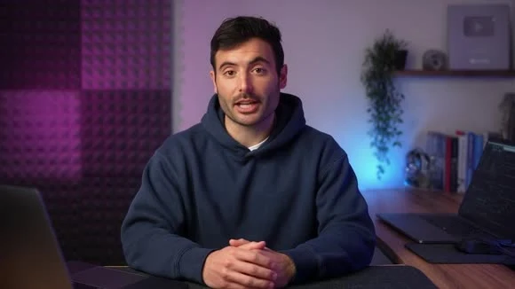</a><div class="showcase-card-body"><div class="showcase-card-meta"><span>Speech</span><span class="showcase-weight">Hosted / API</span></div><h3 class="model-name"><a href="/raw/showcase/tts-heygen-voice.html">HeyGen Voice</a></h3><p class="showcase-description">The voice reference identifies the speaker. The image and captions guide how that voice sounds in the scene.</p><div class="showcase-disclosure" aria-label="Public disclosure"><span data-status="k" title="Architecture: Known"><i aria-hidden="true"></i><span>Architecture</span><span class="showcase-status-text">Known</span></span><span data-status="p" title="Data: Partial"><i aria-hidden="true"></i><span>Data</span><span class="showcase-status-text">Partial</span></span><span data-status="k" title="Training: Known"><i aria-hidden="true"></i><span>Training</span><span class="showcase-status-text">Known</span></span><span data-status="k" title="Inference: Known"><i aria-hidden="true"></i><span>Inference</span><span class="showcase-status-text">Known</span></span><span data-status="k" title="Voice control: Known"><i aria-hidden="true"></i><span>Voice control</span><span class="showcase-status-text">Known</span></span></div></div><nav class="showcase-card-actions" aria-label="HeyGen Voice materials"><a href="/raw/showcase/tts-heygen-voice.html">Model card</a><a href="/raw/showcase/tts-heygen-voice.html#results">Results & examples</a></nav></article></div></section>
<section class="showcase-family" id="family-suno" data-family="suno" aria-labelledby="family-suno-title"><header class="showcase-family-heading"><h2 id="family-suno-title">Suno family</h2><span class="showcase-family-count">1 model</span></header><div class="showcase-grid"><article class="showcase-model" data-family="suno" data-category="music" data-open="false" data-search="Suno v6 Suno Suno family Music Suno v6 won more expert votes even though YuE2 best-of-8 scored higher on automated SongBench."><a class="showcase-preview" href="/raw/showcase/music-suno-v6.html" aria-label="Suno v6 model card"><div class="showcase-brand"><div aria-label="Suno" class="sc-company" role="img"></div></div></a><div class="showcase-card-body"><div class="showcase-card-meta"><span>Music</span><span class="showcase-weight">Hosted / API</span></div><h3 class="model-name"><a href="/raw/showcase/music-suno-v6.html">Suno v6</a></h3><p class="showcase-description">Suno v6 won more expert votes even though YuE2 best-of-8 scored higher on automated SongBench.</p><div class="showcase-disclosure" aria-label="Public disclosure"><span data-status="n" title="Architecture: Undisclosed"><i aria-hidden="true"></i><span>Architecture</span><span class="showcase-status-text">Undisclosed</span></span><span data-status="p" title="Data: Partial"><i aria-hidden="true"></i><span>Data</span><span class="showcase-status-text">Partial</span></span><span data-status="n" title="Training: Undisclosed"><i aria-hidden="true"></i><span>Training</span><span class="showcase-status-text">Undisclosed</span></span><span data-status="p" title="Inference: Partial"><i aria-hidden="true"></i><span>Inference</span><span class="showcase-status-text">Partial</span></span><span data-status="p" title="Tools: Partial"><i aria-hidden="true"></i><span>Tools</span><span class="showcase-status-text">Partial</span></span></div></div><nav class="showcase-card-actions" aria-label="Suno v6 materials"><a href="/raw/showcase/music-suno-v6.html">Model card</a><a href="/raw/showcase/music-suno-v6.html#results">Results & examples</a></nav></article></div></section>
<section class="showcase-family" id="family-mureka" data-family="mureka" aria-labelledby="family-mureka-title"><header class="showcase-family-heading"><h2 id="family-mureka-title">Mureka family</h2><span class="showcase-family-count">1 model</span></header><div class="showcase-grid"><article class="showcase-model" data-family="mureka" data-category="music" data-open="false" data-search="Mureka V9.5 Mureka / Kunlun Tech Mureka family Music Mureka’s own test found a 69-point gap between following the prompt and producing a usable song."><a class="showcase-preview" href="/raw/showcase/music-mureka-v95.html" aria-label="Mureka V9.5 model card"><div class="showcase-brand"><div aria-label="Mureka / Kunlun Tech" class="sc-company" role="img"><span class="sc-company-name">Mureka</span><span class="sc-company-caption">Kunlun Tech</span></div></div></a><div class="showcase-card-body"><div class="showcase-card-meta"><span>Music</span><span class="showcase-weight">Hosted / API</span></div><h3 class="model-name"><a href="/raw/showcase/music-mureka-v95.html">Mureka V9.5</a></h3><p class="showcase-description">Mureka’s own test found a 69-point gap between following the prompt and producing a usable song.</p><div class="showcase-disclosure" aria-label="Public disclosure"><span data-status="p" title="Architecture: Partial"><i aria-hidden="true"></i><span>Architecture</span><span class="showcase-status-text">Partial</span></span><span data-status="n" title="Data: Undisclosed"><i aria-hidden="true"></i><span>Data</span><span class="showcase-status-text">Undisclosed</span></span><span data-status="n" title="Training: Undisclosed"><i aria-hidden="true"></i><span>Training</span><span class="showcase-status-text">Undisclosed</span></span><span data-status="p" title="Inference: Partial"><i aria-hidden="true"></i><span>Inference</span><span class="showcase-status-text">Partial</span></span><span data-status="k" title="Tools: Known"><i aria-hidden="true"></i><span>Tools</span><span class="showcase-status-text">Known</span></span></div></div><nav class="showcase-card-actions" aria-label="Mureka V9.5 materials"><a href="/raw/showcase/music-mureka-v95.html">Model card</a><a href="/raw/showcase/music-mureka-v95.html#results">Results & examples</a></nav></article></div></section>
<section class="showcase-family" id="family-lyria" data-family="lyria" aria-labelledby="family-lyria-title"><header class="showcase-family-heading"><h2 id="family-lyria-title">Lyria family</h2><span class="showcase-family-count">1 model</span></header><div class="showcase-grid"><article class="showcase-model" data-family="lyria" data-category="music" data-open="false" data-search="Lyria 3.5 Google DeepMind Lyria family Music One prompt sets the song structure before Lyria synthesizes the audio."><a class="showcase-preview" href="/raw/showcase/music-lyria-35.html" aria-label="Lyria 3.5 model card"><div class="showcase-brand"><div aria-label="Google DeepMind" class="sc-company" role="img"></div></div></a><div class="showcase-card-body"><div class="showcase-card-meta"><span>Music</span><span class="showcase-weight">Hosted / API</span></div><h3 class="model-name"><a href="/raw/showcase/music-lyria-35.html">Lyria 3.5</a></h3><p class="showcase-description">One prompt sets the song structure before Lyria synthesizes the audio.</p><div class="showcase-disclosure" aria-label="Public disclosure"><span data-status="p" title="Architecture: Partial"><i aria-hidden="true"></i><span>Architecture</span><span class="showcase-status-text">Partial</span></span><span data-status="p" title="Data: Partial"><i aria-hidden="true"></i><span>Data</span><span class="showcase-status-text">Partial</span></span><span data-status="p" title="Training: Partial"><i aria-hidden="true"></i><span>Training</span><span class="showcase-status-text">Partial</span></span><span data-status="k" title="Inference: Known"><i aria-hidden="true"></i><span>Inference</span><span class="showcase-status-text">Known</span></span><span data-status="p" title="Tools: Partial"><i aria-hidden="true"></i><span>Tools</span><span class="showcase-status-text">Partial</span></span></div></div><nav class="showcase-card-actions" aria-label="Lyria 3.5 materials"><a href="/raw/showcase/music-lyria-35.html">Model card</a><a href="/raw/showcase/music-lyria-35.html#results">Results & examples</a></nav></article></div></section>
<section class="showcase-family" id="family-minimax-music" data-family="minimax-music" aria-labelledby="family-minimax-music-title"><header class="showcase-family-heading"><h2 id="family-minimax-music-title">MiniMax Music family</h2><span class="showcase-family-count">1 model</span></header><div class="showcase-grid"><article class="showcase-model" data-family="minimax-music" data-category="music" data-open="true" data-search="MiniMax Music 3.0 MiniMax MiniMax Music family Music The renderer uses hidden states from both language models to recover detail in the final waveform."><a class="showcase-preview" href="/raw/showcase/music-minimax-music-30.html" aria-label="MiniMax Music 3.0 model card"><div class="showcase-brand"><div aria-label="MiniMax" class="sc-company" role="img"></div></div></a><div class="showcase-card-body"><div class="showcase-card-meta"><span>Music</span><span class="showcase-weight">Open weights</span></div><h3 class="model-name"><a href="/raw/showcase/music-minimax-music-30.html">MiniMax Music 3.0</a></h3><p class="showcase-description">The renderer uses hidden states from both language models to recover detail in the final waveform.</p><div class="showcase-disclosure" aria-label="Public disclosure"><span data-status="k" title="Architecture: Known"><i aria-hidden="true"></i><span>Architecture</span><span class="showcase-status-text">Known</span></span><span data-status="n" title="Data: Undisclosed"><i aria-hidden="true"></i><span>Data</span><span class="showcase-status-text">Undisclosed</span></span><span data-status="p" title="Training: Partial"><i aria-hidden="true"></i><span>Training</span><span class="showcase-status-text">Partial</span></span><span data-status="k" title="Inference: Known"><i aria-hidden="true"></i><span>Inference</span><span class="showcase-status-text">Known</span></span><span data-status="k" title="Tools: Known"><i aria-hidden="true"></i><span>Tools</span><span class="showcase-status-text">Known</span></span></div></div><nav class="showcase-card-actions" aria-label="MiniMax Music 3.0 materials"><a href="/raw/showcase/music-minimax-music-30.html">Model card</a><a href="/raw/showcase/music-minimax-music-30.html#results">Results & examples</a></nav></article></div></section>
<section class="showcase-family" id="family-yue" data-family="yue" aria-labelledby="family-yue-title"><header class="showcase-family-heading"><h2 id="family-yue-title">YuE family</h2><span class="showcase-family-count">1 model</span></header><div class="showcase-grid"><article class="showcase-model" data-family="yue" data-category="music" data-open="true" data-search="YuE 2 · YuE2-3B HKUST / M-A-P YuE family Music Holding the checkpoint and candidate budget fixed, the expert panel preferred songs generated with a score."><a class="showcase-preview" href="/raw/showcase/music-yue-2.html" aria-label="YuE 2 · YuE2-3B model card"><div class="showcase-brand"><div aria-label="HKUST / M-A-P" class="sc-company" role="img"><span class="sc-company-name">HKUST<small>M-A-P</small></span></div></div></a><div class="showcase-card-body"><div class="showcase-card-meta"><span>Music</span><span class="showcase-weight">Open weights</span></div><h3 class="model-name"><a href="/raw/showcase/music-yue-2.html">YuE 2 · YuE2-3B</a></h3><p class="showcase-description">Holding the checkpoint and candidate budget fixed, the expert panel preferred songs generated with a score.</p><div class="showcase-disclosure" aria-label="Public disclosure"><span data-status="k" title="Architecture: Known"><i aria-hidden="true"></i><span>Architecture</span><span class="showcase-status-text">Known</span></span><span data-status="p" title="Data: Partial"><i aria-hidden="true"></i><span>Data</span><span class="showcase-status-text">Partial</span></span><span data-status="p" title="Training: Partial"><i aria-hidden="true"></i><span>Training</span><span class="showcase-status-text">Partial</span></span><span data-status="k" title="Inference: Known"><i aria-hidden="true"></i><span>Inference</span><span class="showcase-status-text">Known</span></span><span data-status="k" title="Tools: Known"><i aria-hidden="true"></i><span>Tools</span><span class="showcase-status-text">Known</span></span></div></div><nav class="showcase-card-actions" aria-label="YuE 2 · YuE2-3B materials"><a href="/raw/showcase/music-yue-2.html">Model card</a><a href="/raw/showcase/music-yue-2.html#results">Results & examples</a></nav></article></div></section></div><section class="showcase-comparisons" id="comparisons"><h2>Compare models</h2><p>Read the conditions alongside each comparison: prices, scores and limits describe different snapshots and evaluation setups.</p><div class="showcase-comparison-grid"><section><h3>Language models</h3><ul><li><a href="/raw/showcase/compare-llm-cost.html">Token cost</a></li><li><a href="/raw/showcase/compare-llm-deploy.html">Deployment</a></li><li><a href="/raw/showcase/compare-llm-scores.html">Coding scores</a></li></ul></section><section><h3>Image generation</h3><ul><li><a href="/raw/showcase/compare-image-api.html">API constraints</a></li><li><a href="/raw/showcase/compare-image-control.html">Image controls</a></li></ul></section><section><h3>Video generation</h3><ul><li><a href="/raw/showcase/compare-video-generation.html">Output limits</a></li><li><a href="/raw/showcase/compare-video-workflow.html">Video editing</a></li></ul></section><section><h3>Speech</h3><ul><li><a href="/raw/showcase/compare-speech-controls.html">Voice controls</a></li><li><a href="/raw/showcase/tts-eleven-sonic.html">Speech agents</a></li></ul></section><section><h3>Music</h3><ul><li><a href="/raw/showcase/compare-music-workflow.html">Song creation</a></li><li><a href="/raw/showcase/music-yue-suno.html">Local vs. hosted</a></li><li><a href="/raw/showcase/compare-music-scores.html">Selection budget</a></li></ul></section></div></section><section class="showcase-presentations" id="presentations"><h2>Source presentations</h2><ul><li><a href="/raw/lectures/01_intro/lecture01_part2_final_v3_showcase.html">Model Showcase: Model Cards &amp; Results</a><span>M1</span></li></ul></section><p class="showcase-provenance">Examples and reported measurements are reproduced from the lecture’s cited sources. Each model page retains the original provenance, limitations and evaluation notes.</p></div><script src="/assets/showcase.js" defer></script>
```
