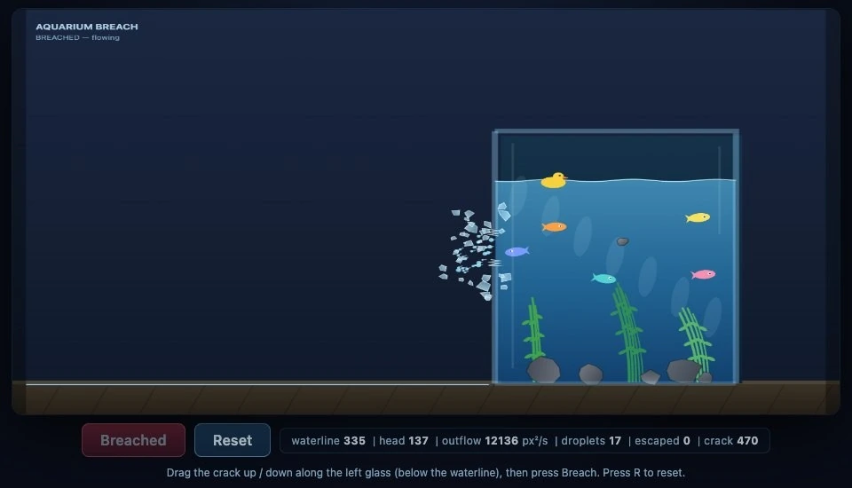

<!-- Generated by scripts/build-showcase.py from the model database. -->

```{=html}
<div class="showcase-detail"><nav class="showcase-breadcrumb" aria-label="Breadcrumb"><a href="/raw/showcase.html">Model Showcase</a><span aria-hidden="true">/</span><a href="/raw/showcase.html#family-deepseek">DeepSeek family</a></nav><header class="showcase-detail-header"><p class="showcase-domain">Language models</p><h1>DeepSeek V4.1-Flash</h1><p>DeepSeek V4.1-Flash: detailed public recipe</p><nav class="showcase-detail-actions" aria-label="On this page"><a href="#model-card">Model card</a><a href="#results">Results & examples</a><a href="#source-slides">Source slides</a><a href="#methods">Methods & sources</a></nav></header><section class="showcase-source-map" id="source-slides" aria-labelledby="source-slides-title"><h2 id="source-slides-title">Source slides</h2><ul><li><span>Model card</span><a href="/raw/lectures/01_intro/lecture01_part2_final_v3_showcase.html#/sc-llm-deepseek-v41" title="Slide ID: sc-llm-deepseek-v41">Model Showcase: Model Cards &amp; Results · slide 22</a><code>sc-llm-deepseek-v41</code></li><li><span>Results</span><a href="/raw/lectures/01_intro/lecture01_part2_final_v3_showcase.html#/sc-llm-deepseek-v41-results" title="Slide ID: sc-llm-deepseek-v41-results">Model Showcase: Model Cards &amp; Results · slide 23</a><code>sc-llm-deepseek-v41-results</code></li></ul></section>
```

```{=html}
<section class="showcase-section" id="model-card"><div class="showcase-section-heading"><h2>Model card</h2></div>
```

```{=html}
<article class="showcase-slide-source" data-presentation="intro-showcase" data-slide="sc-llm-deepseek-v41"><p class="showcase-slide-reference"><a href="/raw/lectures/01_intro/lecture01_part2_final_v3_showcase.html#/sc-llm-deepseek-v41" title="Slide ID: sc-llm-deepseek-v41">Model Showcase: Model Cards &amp; Results · slide 22</a></p><div class="showcase-source">
<div class="sc-body ds-body" data-company="deepseek"><div class="ds-card"><div class="ds-head"><div class="sc-company" aria-label="DeepSeek" role="img"></div><p class="ds-kicker">released 10.09.2026</p><p class="ds-kicker ds-r">Open weights</p><h3 class="ds-name">DeepSeek V4.1-Flash</h3><p class="ds-lic">MIT licence</p></div>
<div class="ds-row"><div class="ds-feat"><h4>Architecture</h4><p class="ds-st"><i class="sc-pip k"></i>Known</p></div>
<div class="ds-spec ds-lead"><span class="ds-k">MoE backbone</span><div class="ds-line"><b class="ds-v">552B</b><span class="ds-n">8B / 16B active</span></div>
</div>
<div class="ds-spec "><span class="ds-k">40-layer layout</span><b class="ds-v">Encoder–decoder</b></div>
<div class="ds-spec "><span class="ds-k">Global KV, FP4</span><b class="ds-v">890 B/token</b></div>
</div>
<div class="ds-row"><div class="ds-feat"><h4>Data</h4><p class="ds-st"><i class="sc-pip k"></i>Known</p></div>
<div class="ds-spec ds-lead"><span class="ds-k">Multimodal corpus</span><div class="ds-line"><b class="ds-v">45T tokens</b></div>
</div>
<div class="ds-spec "><span class="ds-k">Post-training</span><b class="ds-v">Synthetic agent tasks</b></div>
<div class="ds-spec ds-gap"><span class="ds-k">Not disclosed</span><b class="ds-v">Sources, shares, licences</b></div>
</div>
<div class="ds-row"><div class="ds-feat"><h4>Training</h4><p class="ds-st"><i class="sc-pip k"></i>Known</p></div>
<div class="ds-spec ds-lead"><span class="ds-k">Initialization</span><div class="ds-line"><b class="ds-v">From scratch</b></div>
</div>
<div class="ds-spec "><span class="ds-k">Context extension</span><b class="ds-v">1M at 34T tokens</b></div>
<div class="ds-spec "><span class="ds-k">Recipe</span><b class="ds-v">SFT → RL → OPD</b></div>
</div>
<div class="ds-row"><div class="ds-feat"><h4>Inference</h4><p class="ds-st"><i class="sc-pip k"></i>Known</p></div>
<div class="ds-spec ds-lead"><span class="ds-k">Context / max output</span><div class="ds-line"><b class="ds-v">1M / 384K</b></div>
</div>
<div class="ds-spec "><span class="ds-k">Reasoning effort</span><b class="ds-v">Integer 1–100</b></div>
<div class="ds-spec "><span class="ds-k">Modes</span><b class="ds-v">Thinking / off</b></div>
</div>
<div class="ds-row"><div class="ds-feat"><h4>Tools</h4><p class="ds-st"><i class="sc-pip k"></i>Known</p></div>
<div class="ds-spec ds-lead"><span class="ds-k">DeepSeek Harness</span><div class="ds-line"><b class="ds-v">40+ tools</b></div>
</div>
<div class="ds-spec "><span class="ds-k">Compatible APIs</span><b class="ds-v">OpenAI + Anthropic</b></div>
<div class="ds-spec ds-part"><span class="ds-k">JSON output</span><b class="ds-v">Soft JSON only</b></div>
</div></div>
</div>
<figure class="sc-evidence sc-evidence-strip"><div class="showcase-diagram-scroll" tabindex="0" role="region" aria-label="Diagram; scroll horizontally to inspect details"></div><a class="showcase-figure-link" href="/raw/lectures/01_intro/assets/showcase_llm_evidence/deepseek-v41.svg" target="_blank" rel="noopener">Open full-size figure</a></figure>
<div class="sc-study">
<table class="sc-study-table" data-numeric="2 3">
<caption>One checkpoint, four agent harnesses</caption>
<thead><tr><th scope="col">Agent harness</th><th scope="col">DeepSWE v1.1</th><th scope="col">Terminal-Bench 2.1</th></tr></thead>
<tbody>
<tr><th scope="row">Claude Code</th><td>69.8%</td><td>88.0%</td></tr>
<tr><th scope="row">Codex</th><td>65.6%</td><td>84.1%</td></tr>
<tr><th scope="row">mini-SWE</th><td>74.2%</td><td>90.3%</td></tr>
<tr><th scope="row">DSH Minimal</th><td>72.6%</td><td>90.6%</td></tr>
</tbody>
</table>
<p class="sc-study-source"><a href="https://huggingface.co/deepseek-ai/DeepSeek-V4.1-Flash/resolve/main/DeepSeek_V41_Tech_Report.pdf#page=35">DeepSeek Technical Report · §5.3.4, Table 4</a> · Effort 100, 1M context</p>
</div>
<div class="fv-takeaway">The checkpoint, training outline and harness are public, while corpus provenance remains undisclosed.</div>
<div class="fv-source">LLM_v1.0.xlsx · DeepSeek V4.1 · audit 18.10.2026 · <a href="https://huggingface.co/deepseek-ai/DeepSeek-V4.1-Flash">Model card</a> · <a href="https://huggingface.co/deepseek-ai/DeepSeek-V4.1-Flash/blob/main/DeepSeek_V41_Tech_Report.pdf">Technical report</a> · <a href="https://github.com/deepseek-ai/deepseek-harness">Harness</a> · <a href="https://huggingface.co/deepseek-ai/DeepSeek-V4.1-Flash">Figure source</a></div></div></article>
```

```{=html}
</section>
```

```{=html}
<section class="showcase-section" id="results"><div class="showcase-section-heading"><h2>Results & examples</h2></div>
```

```{=html}
<article class="showcase-slide-source" data-presentation="intro-showcase" data-slide="sc-llm-deepseek-v41-results"><p class="showcase-source-subtitle">Can DeepSeek code a draining aquarium?</p><p class="showcase-slide-reference"><a href="/raw/lectures/01_intro/lecture01_part2_final_v3_showcase.html#/sc-llm-deepseek-v41-results" title="Slide ID: sc-llm-deepseek-v41-results">Model Showcase: Model Cards &amp; Results · slide 23</a></p><div class="showcase-source">
<div class="sc-body sr-body" data-company="deepseek">
<div class="sr-sidebar" role="group" aria-label="Model and reported metrics"><div class="sr-brand"><div aria-label="DeepSeek" class="sc-company" role="img"></div></div><div class="sr-model"><p>RESULTS · LLM</p><h3>DeepSeek V4.1</h3></div><div class="sr-metrics"><div class="sr-metric"><p class="sr-metric-label">Terminal-Bench 2.1</p><p class="sr-metric-value">90.6%</p><p class="sr-metric-note">Instruct; max effort 100 <a class="" href="https://huggingface.co/deepseek-ai/DeepSeek-V4.1-Flash" target="_blank" rel="noopener">↗</a></p></div><div class="sr-metric"><p class="sr-metric-label">DeepSWE v1.1</p><p class="sr-metric-value">74.2%</p><p class="sr-metric-note">Instruct; mini-swe-agent; max 100 <a class="" href="https://huggingface.co/deepseek-ai/DeepSeek-V4.1-Flash" target="_blank" rel="noopener">↗</a></p></div><div class="sr-metric"><p class="sr-metric-label">Terminal-Bench 4.0</p><p class="sr-metric-value">31.2%</p><p class="sr-metric-note">Instruct; max effort 100 <a class="" href="https://huggingface.co/deepseek-ai/DeepSeek-V4.1-Flash" target="_blank" rel="noopener">↗</a></p></div></div></div>
<div class="sr-example"><div class="sr-stage"><video controls playsinline preload="none" src="/raw/lectures/01_intro/assets/showcase_llm_evidence/deepseek-breach.mp4" poster="/raw/lectures/01_intro/assets/showcase_llm_evidence/deepseek-breach.webp" aria-label="The output of the OneShotLM DeepSeek-V4.1-Flash run: a broken aquarium drains into a spreading puddle."></video></div><p class="sr-caption">A break in the glass releases a curved jet. As the waterline falls toward the opening, the flow weakens and the puddle spreads.<span class="sr-caveat">Browser recording of the OneShotLM artifact · DeepSeek-V4.1-Flash via pi-agent.</span></p></div></div>
<div class="fv-takeaway">The running simulation makes the requested causal relationship visible. As the water above the opening drops, the jet weakens.</div>
<div class="fv-source"><a href="https://oneshotlm.com/r/aquarium-breach-deepseek-deepseek-v4-1-flash/">OneShotLM · prompt, trajectory and output</a> · Benchmark sources beside each score</div></div></article>
```

```{=html}
</section>
```

```{=html}
<section class="showcase-section" id="methods"><div class="showcase-section-heading"><h2>Methods & sources</h2><p>Source notes, evaluation conditions and limitations from the presentation slides.</p></div>
```

<details class="showcase-notes">
<summary>Model card: Model Showcase: Model Cards &amp; Results · slide 22</summary>

**Table.** Four of eight configurations from Table 4, p. 35, are transposed onto rows. DeepSWE reports the percentage resolved over eight samples per task. Terminal-Bench reports pass@1 over three samples per task. The checkpoint, task set and decoding settings remain fixed (temperature 1, top-p 0.95). The 1M token limit and 500 generation-round cap apply to both tasks. Claude Code is v2.1.251. [Publisher model card, Performance across agent scaffolds](https://huggingface.co/deepseek-ai/DeepSeek-V4.1-Flash#performance-across-agent-scaffolds-deepswe-v11-and-terminal-bench-21-max-reasoning-effort). [DeepSeek Technical Report · §5.3.4, Table 4](https://huggingface.co/deepseek-ai/DeepSeek-V4.1-Flash/resolve/main/DeepSeek_V41_Tech_Report.pdf#page=35).

**Figure.** DeepSeek, model card, “Architecture” and “Compressed Sparse Attention 2 (CSA2)”. Decoder global KV is projected from the final encoder hidden states. 890 bytes/token covers the global cache. [Primary source](https://huggingface.co/deepseek-ai/DeepSeek-V4.1-Flash).

The scope is V4.1-Flash, the smallest model in this architecture family. V4.1 Pro had not been released in the supplied snapshot. The 552B count is the backbone, while the Hugging Face counter includes other components and reaches 763B. Active parameters are 8B during prefill and 16B during decode. The causal encoder–decoder has 20 encoder and 20 decoder layers. The 890-byte figure refers to the global main KV cache at FP4, not every possible serving buffer.

The workbook records a 45T-token multimodal corpus, training from scratch, sparse-attention training at 64K sequence length and extension to 1M at the 34T-token point. SFT, RL and on-policy distillation are a reported recipe outline; the model card attributes changes to the data pipeline. Even with Known Data status, source identities, shares and licences remain undisclosed.

The harness provides more than 40 tools, schedules and subagents. These are harness capabilities rather than internal model components. Soft JSON does not guarantee a strict provider-enforced JSON schema. The workbook could not confirm the alleged V4.1-Flash-1017 update or the October API web-search update, and did not recheck the Files API claim. None is promoted to a capability on this card. The deepseek-flash API alias is recorded separately from the checkpoint name; temporary routing of older Pro aliases must not be mistaken for a V4.1 Pro release.

**Snapshot and provenance.** LLM_v1.0.xlsx, sheet “DeepSeek V4.1”, audit dated 18.10.2026. Category statuses follow “Сводка”: Architecture: Known; Data: Known; Training: Known; Inference: Known; Tools: Known. Known means a model-specific fact is disclosed, not that the whole category is complete. These slides summarize the supplied audit and do not constitute a fresh independent verification. Prices, limits and availability refer to that snapshot.

**Source rows:** 1, 2, 6, 7, 8, 9, 10, 11, 12, 13, 14, 15, 16, 17, 18, 22, 23, 24, 28, 29, 30, 31, 35, 36, 37, 39, 40, 41, 42, 43, 44, 48, 49, 50, 51, 52.

**Sources:** [Model card](https://huggingface.co/deepseek-ai/DeepSeek-V4.1-Flash), [Technical report](https://huggingface.co/deepseek-ai/DeepSeek-V4.1-Flash/blob/main/DeepSeek_V41_Tech_Report.pdf), [Harness](https://github.com/deepseek-ai/deepseek-harness).

</details>

<details class="showcase-notes">
<summary>Results: Model Showcase: Model Cards &amp; Results · slide 23</summary>

The independent run is dated 29 October and identifies the endpoint as deepseek/deepseek-v4.1-flash. The pi harness wrote the HTML and tested it in a browser. This local capture runs that published file and presses Breach. The provider’s benchmark figures at left refer to the model and harnesses identified there. The simulation is a visual programming task and uses simplified physics. The playback uses sampled browser frames and does not measure real-time performance.

[OneShotLM · prompt, trajectory and output](https://oneshotlm.com/r/aquarium-breach-deepseek-deepseek-v4-1-flash/).

</details>

```{=html}
</section><nav class="showcase-bottom-nav" aria-label="More models"><a href="/raw/showcase.html">Back to all models</a><a href="/raw/lectures/01_intro/lecture01_part2_final_v3_showcase.html#/sc-llm-deepseek-v41">View source slide</a></nav></div>
```
