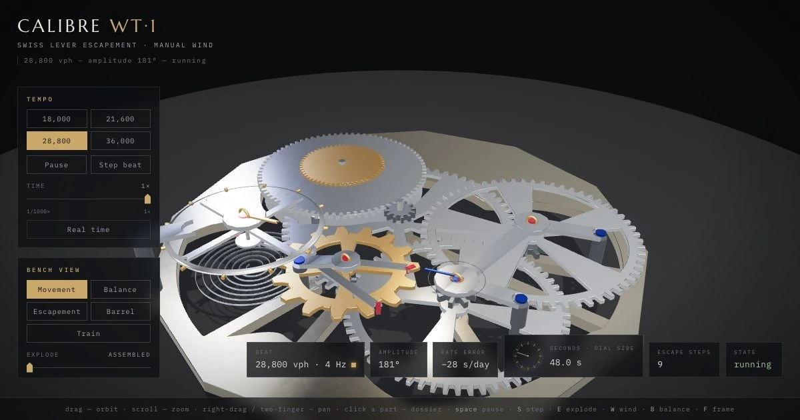

<!-- Generated by scripts/build-showcase.py from the model database. -->

```{=html}
<div class="showcase-detail"><nav class="showcase-breadcrumb" aria-label="Breadcrumb"><a href="/raw/showcase.html">Model Showcase</a><span aria-hidden="true">/</span><a href="/raw/showcase.html#family-glm">GLM family</a></nav><header class="showcase-detail-header"><p class="showcase-domain">Language models</p><h1>GLM-5.3</h1><p>GLM-5.3: a shared base with further post-training</p><nav class="showcase-detail-actions" aria-label="On this page"><a href="#model-card">Model card</a><a href="#results">Results & examples</a><a href="#source-slides">Source slides</a><a href="#methods">Methods & sources</a></nav></header><section class="showcase-source-map" id="source-slides" aria-labelledby="source-slides-title"><h2 id="source-slides-title">Source slides</h2><ul><li><span>Model card</span><a href="/raw/lectures/01_intro/lecture01_part2_final_v3_showcase.html#/sc-llm-glm-53" title="Slide ID: sc-llm-glm-53">Model Showcase: Model Cards &amp; Results · slide 24</a><code>sc-llm-glm-53</code></li><li><span>Results</span><a href="/raw/lectures/01_intro/lecture01_part2_final_v3_showcase.html#/sc-llm-glm-53-results" title="Slide ID: sc-llm-glm-53-results">Model Showcase: Model Cards &amp; Results · slide 25</a><code>sc-llm-glm-53-results</code></li></ul></section>
```

```{=html}
<section class="showcase-section" id="model-card"><div class="showcase-section-heading"><h2>Model card</h2></div>
```

```{=html}
<article class="showcase-slide-source" data-presentation="intro-showcase" data-slide="sc-llm-glm-53"><p class="showcase-slide-reference"><a href="/raw/lectures/01_intro/lecture01_part2_final_v3_showcase.html#/sc-llm-glm-53" title="Slide ID: sc-llm-glm-53">Model Showcase: Model Cards &amp; Results · slide 24</a></p><div class="showcase-source">
<div class="sc-body ds-body" data-company="zai"><div class="ds-card"><div class="ds-head"><div class="sc-company" aria-label="Z.ai / Zhipu" role="img"><span class="sc-company-caption">Zhipu</span></div><p class="ds-kicker">released 14.08.2026</p><p class="ds-kicker ds-r">Open weights</p><h3 class="ds-name">GLM-5.3</h3><p class="ds-lic">Open checkpoint</p></div>
<div class="ds-row"><div class="ds-feat"><h4>Architecture</h4><p class="ds-st"><i class="sc-pip k"></i>Known</p></div>
<div class="ds-spec ds-lead"><span class="ds-k">MoE + sparse attention</span><div class="ds-line"><b class="ds-v">~753B</b></div>
</div>
<div class="ds-spec "><span class="ds-k">Shared base</span><b class="ds-v">GLM-5.2</b></div>
<div class="ds-spec ds-part"><span class="ds-k">Active, secondary source</span><b class="ds-v">~40B</b></div>
</div>
<div class="ds-row"><div class="ds-feat"><h4>Data</h4><p class="ds-st"><i class="sc-pip p"></i>Partial</p></div>
<div class="ds-spec ds-lead"><span class="ds-k">Post-training, reported</span><div class="ds-line"><b class="ds-v">Security tasks</b></div>
</div>
<div class="ds-spec ds-part"><span class="ds-k">Environment data</span><b class="ds-v">Executable security</b></div>
<div class="ds-spec ds-gap"><span class="ds-k">Pretraining corpus</span><b class="ds-v">Not disclosed</b></div>
</div>
<div class="ds-row"><div class="ds-feat"><h4>Training</h4><p class="ds-st"><i class="sc-pip k"></i>Known</p></div>
<div class="ds-spec ds-lead"><span class="ds-k">Source of improvements</span><div class="ds-line"><b class="ds-v">Post-training</b></div>
</div>
<div class="ds-spec "><span class="ds-k">Published direction</span><b class="ds-v">Scaled RL</b></div>
<div class="ds-spec ds-part"><span class="ds-k">Framework, reported</span><b class="ds-v">slime + SAO</b></div>
</div>
<div class="ds-row"><div class="ds-feat"><h4>Inference</h4><p class="ds-st"><i class="sc-pip k"></i>Known</p></div>
<div class="ds-spec ds-lead"><span class="ds-k">Reasoning effort</span><div class="ds-line"><b class="ds-v">low / high / max</b></div>
</div>
<div class="ds-spec "><span class="ds-k">Thinking history</span><b class="ds-v">clear_thinking=<wbr>false</b></div>
<div class="ds-spec ds-part"><span class="ds-k">Provider context / output</span><b class="ds-v">1M / ~128K</b></div>
</div>
<div class="ds-row"><div class="ds-feat"><h4>Tools</h4><p class="ds-st"><i class="sc-pip p"></i>Partial</p></div>
<div class="ds-spec ds-lead"><span class="ds-k">Provider APIs</span><div class="ds-line"><b class="ds-v">Function calls</b></div>
</div>
<div class="ds-spec "><span class="ds-k">Agent eval harness</span><b class="ds-v">Claude Code</b></div>
<div class="ds-spec ds-gap"><span class="ds-k">Checkpoint tool parser</span><b class="ds-v">Not specified</b></div>
</div></div>
</div>
<figure class="sc-evidence sc-evidence-strip"><div class="showcase-diagram-scroll" tabindex="0" role="region" aria-label="Diagram; scroll horizontally to inspect details"></div><a class="showcase-figure-link" href="/raw/lectures/01_intro/assets/showcase_llm_evidence/glm-53.svg" target="_blank" rel="noopener">Open full-size figure</a></figure>
<div class="sc-study">
<table class="sc-study-table" data-numeric="2 3">
<caption>Building software from a specification</caption>
<thead><tr><th scope="col">Benchmark score (%)</th><th scope="col">GLM-5.2</th><th scope="col">GLM-5.3</th></tr></thead>
<tbody>
<tr><th scope="row">NL2Repo</th><td>48.9</td><td>58.0</td></tr>
<tr><th scope="row">ProgramBench · Almost Solved</th><td>9.5</td><td>19.0</td></tr>
<tr><th scope="row">SWE-Marathon v1.1</th><td>19.4</td><td>42.5</td></tr>
</tbody>
</table>
<p class="sc-study-source"><a href="https://huggingface.co/zai-org/GLM-5.3#benchmark">Z.ai · GLM-5.3 Model Card, Benchmark</a> · Selected software-engineering rows</p>
</div>
<div class="fv-takeaway">GLM-5.3 adds post-training to the GLM-5.2 base; Flash is a different model with different dimensions.</div>
<div class="fv-source">LLM_v1.0.xlsx · GLM-5.3 · audit 18.10.2026 · <a href="https://huggingface.co/zai-org/GLM-5.3">Model card</a> · <a href="https://runtimewire.com/article/zai-releases-glm-5-3-open-weights-coding-cyber-defense">Release reporting</a> · <a href="https://www.siliconflow.com/zh/blog/glm-5-3-api-guide">Provider API</a> · <a href="https://huggingface.co/zai-org/GLM-5.3">Figure source</a></div></div></article>
```

```{=html}
</section>
```

```{=html}
<section class="showcase-section" id="results"><div class="showcase-section-heading"><h2>Results & examples</h2></div>
```

```{=html}
<article class="showcase-slide-source" data-presentation="intro-showcase" data-slide="sc-llm-glm-53-results"><p class="showcase-source-subtitle">What controls did GLM-5.3 put on a watch movement?</p><p class="showcase-slide-reference"><a href="/raw/lectures/01_intro/lecture01_part2_final_v3_showcase.html#/sc-llm-glm-53-results" title="Slide ID: sc-llm-glm-53-results">Model Showcase: Model Cards &amp; Results · slide 25</a></p><div class="showcase-source">
<div class="sc-body sr-body" data-company="zai">
<div class="sr-sidebar" role="group" aria-label="Model and reported metrics"><div class="sr-brand"><div aria-label="Z.ai / Zhipu" class="sc-company" role="img"><span class="sc-company-caption">Zhipu</span></div></div><div class="sr-model"><p>RESULTS · LLM</p><h3>GLM-5.3</h3></div><div class="sr-metrics"><div class="sr-metric"><p class="sr-metric-label">DeepSWE v1.1</p><p class="sr-metric-value">66.9%</p><p class="sr-metric-note">mini-swe-agent; 400K; 6h <a class="" href="https://huggingface.co/zai-org/GLM-5.3" target="_blank" rel="noopener">↗</a></p></div><div class="sr-metric"><p class="sr-metric-label">Terminal-Bench 3.0</p><p class="sr-metric-value">28.3%</p><p class="sr-metric-note">avg@3; Claude Code; max; 10h <a class="" href="https://huggingface.co/zai-org/GLM-5.3" target="_blank" rel="noopener">↗</a></p></div><div class="sr-metric"><p class="sr-metric-label">Toolathlon Verified</p><p class="sr-metric-value">73.0%</p><p class="sr-metric-note">pass@1; average of 3 runs <a class="" href="https://huggingface.co/zai-org/GLM-5.3" target="_blank" rel="noopener">↗</a></p></div></div></div>
<div class="sr-example"><div class="sr-stage"></div><p class="sr-caption">Sulat asked for a mechanical watch movement. The generated interface lets the viewer step through a beat, wind the spring and inspect the gear train.<span class="sr-caveat">Sulat’s published screenshot from its GLM-5.3 one-shot series.</span></p></div></div>
<div class="fv-takeaway">A single generated interface exposes both a moving mechanism and controls for examining its parts.</div>
<div class="fv-source"><a href="https://glm-5-3.demos.sulat.com/">Sulat · model attribution</a> · <a href="https://3d-watch-movement.glm-5-3.demos.sulat.com/">Original watch simulation</a> · Benchmark sources beside each score</div></div></article>
```

```{=html}
</section>
```

```{=html}
<section class="showcase-section" id="methods"><div class="showcase-section-heading"><h2>Methods & sources</h2><p>Source notes, evaluation conditions and limitations from the presentation slides.</p></div>
```

<details class="showcase-notes">
<summary>Model card: Model Showcase: Model Cards &amp; Results · slide 24</summary>

**Table.** Z.ai’s model card reports these results for its two releases. ProgramBench is explicitly the Almost Solved metric. For GLM-5.3, NL2Repo ran at temperature 1 with a 64K output budget and 1M context. SWE-Marathon used Claude Code at maximum effort, a 128K output budget and a 1M window. Z.ai documents a fix to anti-cheat checks for one SWE-Marathon task. Each row retains its own grading protocol. [Z.ai · GLM-5.3 Model Card, Benchmark](https://huggingface.co/zai-org/GLM-5.3#benchmark).

**Figure.** Z.ai, “Benchmark” and “Footnotes”, GLM-5.3 versus the published GLM-5.2 column. For GLM-5.3, Terminal-Bench 3.0 uses Claude Code at max effort with three rollouts. DeepSWE uses mini-swe-agent at 400K context. Toolathlon Verified averages three independent runs. [Primary source](https://huggingface.co/zai-org/GLM-5.3).

This card covers GLM-5.3, not GLM-5.3-Flash. The latter’s 320B total and 18B active hybrid sparse/linear design must not be transferred here. GLM-5.3 shares the GLM-5.2 base, has roughly 753B parameters and uses the glm_moe_dsa class. The roughly 40B active figure and IndexShare details come from secondary reporting and retain Partial status. The GLM-5 paper is lineage context, not a new complete GLM-5.3 technical report.

The model card attributes improvements to post-training. Security tasks, executable environments, the slime framework and SAO are reported through secondary sources because the audit could not read text from the Z.ai blog. This supports a Partial data description and qualified framework details, not a fully reproduced recipe. Open weights were released roughly two weeks after launch following safety work. The snapshot does not establish permissive MIT or Apache licensing terms for this checkpoint.

Reasoning stays on and effort supports low, high and max, with max default. clear_thinking is false by default, and the model card asks chat deployments to set it explicitly to true. The 1M context, approximately 128K output and pricing are provider figures. Function calls and an Anthropic-compatible API describe provider integrations; the model card does not identify a tool parser. Agent benchmarks used Claude Code 2.1.207 with Tool Search disabled.

**Snapshot and provenance.** LLM_v1.0.xlsx, sheet “GLM-5.3”, audit dated 18.10.2026. Category statuses follow “Сводка”: Architecture: Known; Data: Partial; Training: Known; Inference: Known; Tools: Partial. Known means a model-specific fact is disclosed, not that the whole category is complete. These slides summarize the supplied audit and do not constitute a fresh independent verification. Prices, limits and availability refer to that snapshot.

**Source rows:** 1, 2, 6, 7, 8, 9, 10, 11, 15, 16, 20, 21, 22, 23, 24, 28, 29, 30, 31, 32, 33, 34, 38, 39, 40, 41.

**Sources:** [Model card](https://huggingface.co/zai-org/GLM-5.3), [Release reporting](https://runtimewire.com/article/zai-releases-glm-5-3-open-weights-coding-cyber-defense), [Provider API](https://www.siliconflow.com/zh/blog/glm-5-3-api-guide).

</details>

<details class="showcase-notes">
<summary>Results: Model Showcase: Model Cards &amp; Results · slide 25</summary>

The model attribution comes from Sulat’s own GLM-5.3 catalog, not an independent reproduction or a Z.ai demonstration. The catalog includes a matching thumbnail and a working artifact with a Swiss lever escapement, winding, selectable tempo, views and an exploded layout. The screenshot is Sulat’s published thumbnail; the separate benchmark figures are from Z.ai’s model card.

[Sulat · model attribution](https://glm-5-3.demos.sulat.com/). [Original watch simulation](https://3d-watch-movement.glm-5-3.demos.sulat.com/).

</details>

```{=html}
</section><nav class="showcase-bottom-nav" aria-label="More models"><a href="/raw/showcase.html">Back to all models</a><a href="/raw/lectures/01_intro/lecture01_part2_final_v3_showcase.html#/sc-llm-glm-53">View source slide</a></nav></div>
```
