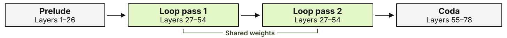
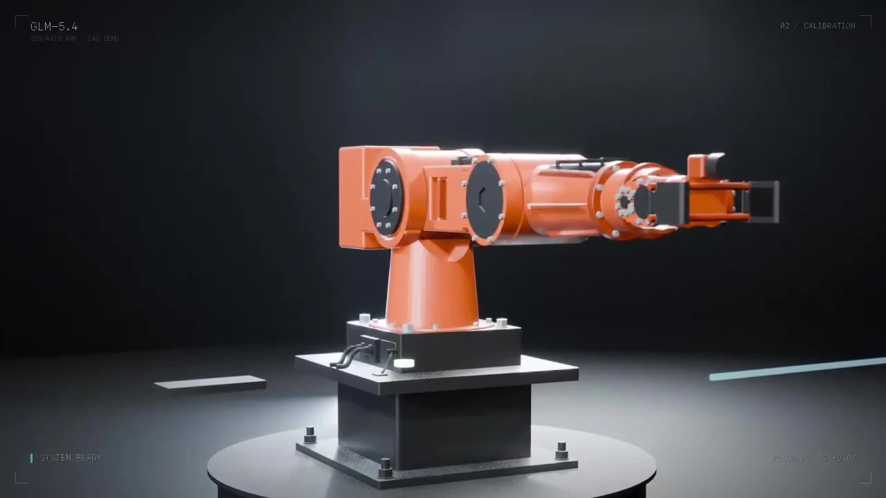

<!-- Generated by scripts/build-showcase.py from the model database. -->

```{=html}
<div class="showcase-detail"><nav class="showcase-breadcrumb" aria-label="Breadcrumb"><a href="/raw/showcase.html">Model Showcase</a><span aria-hidden="true">/</span><a href="/raw/showcase.html#family-glm">GLM family</a></nav><header class="showcase-detail-header"><p class="showcase-domain">Language models</p><h1>GLM-5.4</h1><p>Why does GLM-5.4 run its middle layers twice?</p><nav class="showcase-detail-actions" aria-label="On this page"><a href="#model-card">Model card</a><a href="#results">Results & examples</a><a href="#source-slides">Source slides</a><a href="#methods">Methods & sources</a></nav></header><section class="showcase-source-map" id="source-slides" aria-labelledby="source-slides-title"><h2 id="source-slides-title">Source slides</h2><ul><li><span>Model card</span><a href="/raw/lectures/01_intro/lecture01_part2_final_v3_showcase.html#/sc-llm-glm-54" title="Slide ID: sc-llm-glm-54">Model Showcase: Model Cards &amp; Results · slide 26</a><code>sc-llm-glm-54</code></li><li><span>Results</span><a href="/raw/lectures/01_intro/lecture01_part2_final_v3_showcase.html#/sc-llm-glm-54-results" title="Slide ID: sc-llm-glm-54-results">Model Showcase: Model Cards &amp; Results · slide 27</a><code>sc-llm-glm-54-results</code></li></ul></section>
```

```{=html}
<section class="showcase-section" id="model-card"><div class="showcase-section-heading"><h2>Model card</h2></div>
```

```{=html}
<article class="showcase-slide-source" data-presentation="intro-showcase" data-slide="sc-llm-glm-54"><p class="showcase-slide-reference"><a href="/raw/lectures/01_intro/lecture01_part2_final_v3_showcase.html#/sc-llm-glm-54" title="Slide ID: sc-llm-glm-54">Model Showcase: Model Cards &amp; Results · slide 26</a></p><div class="showcase-source">
<div class="sc-body ds-body" data-company="zai">
  <div class="ds-card">
    <div class="ds-head">
      <div class="sc-company" aria-label="Z.ai / Zhipu" role="img"><span class="sc-company-caption">Zhipu</span></div>
      <p class="ds-kicker">released 23.11.2026</p><p class="ds-kicker ds-r">Hosted at launch</p>
      <h3 class="ds-name">GLM-5.4</h3><p class="ds-lic">Weights planned</p>
    </div>
    <div class="ds-row">
      <div class="ds-feat"><h4>Architecture</h4><p class="ds-st"><i class="sc-pip k"></i>Known</p></div>
      <div class="ds-spec ds-lead"><span class="ds-k">GLM-5 base</span><b class="ds-v">750B scale</b></div>
      <div class="ds-spec"><span class="ds-k">State update</span><b class="ds-v">Per-token gates</b></div>
      <div class="ds-spec"><span class="ds-k">Sparse attention</span><b class="ds-v">Reused indices</b></div>
    </div>
    <div class="ds-row">
      <div class="ds-feat"><h4>Data</h4><p class="ds-st"><i class="sc-pip n"></i>Not disclosed</p></div>
      <div class="ds-spec ds-gap" style="grid-column: span 3"><span class="ds-k">Flagship training corpus</span><b class="ds-v">Mixture and token count undisclosed</b></div>
    </div>
    <div class="ds-row">
      <div class="ds-feat"><h4>Training</h4><p class="ds-st"><i class="sc-pip p"></i>Partial</p></div>
      <div class="ds-spec ds-lead"><span class="ds-k">Adapting the base</span><b class="ds-v">Continued training</b></div>
      <div class="ds-spec"><span class="ds-k">Loop tested at</span><b class="ds-v">1B–750B scale</b></div>
      <div class="ds-spec ds-gap"><span class="ds-k">Flagship compute</span><b class="ds-v">Not reported</b></div>
    </div>
    <div class="ds-row">
      <div class="ds-feat"><h4>Inference</h4><p class="ds-st"><i class="sc-pip k"></i>Known</p></div>
      <div class="ds-spec ds-lead"><span class="ds-k">Context window</span><b class="ds-v">1M tokens</b></div>
      <div class="ds-spec"><span class="ds-k">Maximum output</span><b class="ds-v">128K tokens</b></div>
      <div class="ds-spec"><span class="ds-k">Second-pass cache</span><b class="ds-v">Shared + local KV</b></div>
    </div>
    <div class="ds-row">
      <div class="ds-feat"><h4>Tools</h4><p class="ds-st"><i class="sc-pip k"></i>Known</p></div>
      <div class="ds-spec ds-lead"><span class="ds-k">Tool interface</span><b class="ds-v">Function calls</b></div>
      <div class="ds-spec"><span class="ds-k">Structured output</span><b class="ds-v">JSON</b></div>
      <div class="ds-spec"><span class="ds-k">Coding access</span><b class="ds-v">GLM Coding Plan</b></div>
    </div>
  </div>
</div>
<figure class="sc-evidence sc-evidence-strip"><div class="showcase-diagram-scroll" tabindex="0" role="region" aria-label="Diagram; scroll horizontally to inspect details"></div><a class="showcase-figure-link" href="/raw/lectures/01_intro/assets/showcase_results_20261021/llm/glm-54-loop.svg" target="_blank" rel="noopener">Open full-size figure</a></figure>
<div class="sc-study">
  <table class="sc-study-table" data-numeric="2 3 4">
    <caption>30B loop experiment at equal parameter count</caption>
    <thead><tr><th scope="col">Benchmark</th><th scope="col">Base score</th><th scope="col">Loop score</th><th scope="col">Mean output length Δ</th></tr></thead>
    <tbody>
      <tr><th scope="row">AIME25</th><td>19.17</td><td>30.42</td><td>−2.0%</td></tr>
      <tr><th scope="row">GPQA-Diamond</th><td>47.58</td><td>56.26</td><td>−11.7%</td></tr>
      <tr><th scope="row">AA-LCR</th><td>40.33</td><td>47.67</td><td>−9.7%</td></tr>
      <tr><th scope="row">MMLU-Pro</th><td>71.65</td><td>75.05</td><td>−14.9%</td></tr>
      <tr><th scope="row">IFBench</th><td>50.20</td><td>53.47</td><td>−13.0%</td></tr>
    </tbody>
  </table>
  <p class="sc-study-source"><a href="https://cdn.bigmodel.cn/markdown/feishu-66636cb34d-3.jpg">Z.ai · iso-parameter ablation table</a> · The looped model used ~10% more total training compute. Both used thinking mode after 200K long-context supervised fine-tuning.</p>
</div>
<div class="fv-takeaway">Reusing the middle block gives each token 106 layer applications across 78 numbered layers.</div>
<div class="fv-source">Z.ai · checked 25.11.2026 · <a href="https://z.ai/blog/glm-5.4">Technical release</a> · <a href="https://docs.z.ai/guides/llm/glm-5.4">Model guide</a> · <a href="https://cdn.bigmodel.cn/markdown/feishu-fbd39b457f-2.jpg">Original architecture diagram</a></div></div></article>
```

```{=html}
</section>
```

```{=html}
<section class="showcase-section" id="results"><div class="showcase-section-heading"><h2>Results & examples</h2></div>
```

```{=html}
<article class="showcase-slide-source" data-presentation="intro-showcase" data-slide="sc-llm-glm-54-results"><p class="showcase-source-subtitle">A six-axis robot arm modeled in FreeCAD</p><p class="showcase-slide-reference"><a href="/raw/lectures/01_intro/lecture01_part2_final_v3_showcase.html#/sc-llm-glm-54-results" title="Slide ID: sc-llm-glm-54-results">Model Showcase: Model Cards &amp; Results · slide 27</a></p><div class="showcase-source">
<div class="sc-body sr-body" data-company="zai">
  <div class="sr-sidebar" role="group" aria-label="Z.ai’s reported GLM-5.4 results against GLM-5.3">
    <div class="sr-brand"><div aria-label="Z.ai / Zhipu" class="sc-company" role="img"><span class="sc-company-caption">Zhipu</span></div></div>
    <div class="sr-model"><p>Z.AI COMPARISON</p><h3>GLM-5.4 vs 5.3</h3></div>
    <div class="sr-metrics">
      <div class="sr-metric"><p class="sr-metric-label">GLM-5.4 wins</p><p class="sr-metric-value">51.1%</p></div>
      <div class="sr-metric"><p class="sr-metric-label">Ties</p><p class="sr-metric-value">25.7%</p></div>
      <div class="sr-metric"><p class="sr-metric-label">GLM-5.3 wins</p><p class="sr-metric-value">23.1%</p><p class="sr-metric-note">The chart omits the task set and judging method. <a href="https://cdn.bigmodel.cn/markdown/feishu-77ddd119d9-1.jpg" aria-label="Original comparison chart">↗</a></p></div>
    </div>
  </div>
  <div class="sr-example">
    <div class="sr-stage">
      
      <video controls muted playsinline preload="none" src="/raw/lectures/01_intro/assets/showcase_results_20261021/llm/glm-54-freecad-excerpt.mp4" poster="/raw/lectures/01_intro/assets/showcase_results_20261021/llm/glm-54-freecad-poster.webp" aria-label="Eight-second silent excerpt from Z.ai’s GLM-5.4 FreeCAD demonstration. The linkage and gripper assemble and rotate."></video>
    </div>
    <p class="sr-caption">Z.ai credits GLM-5.4 with the FreeCAD model. Watch the links and gripper come together and rotate.<span class="sr-caveat">Vendor demonstration · 8-second silent excerpt</span></p>
  </div>
</div>
<div class="fv-takeaway">The animation shows joint motion. Load capacity and manufacturing tolerances need separate tests.</div>
<div class="fv-source">Z.ai · checked 24.11.2026 · <a href="https://docs.z.ai/guides/llm/glm-5.4">Model guide</a> · <a href="https://cdn.bigmodel.cn/static/platform/videos/glm-5.4/3.mp4">Original CAD video</a> · <a href="https://cdn.bigmodel.cn/markdown/feishu-77ddd119d9-1.jpg">Head-to-head chart</a></div></div></article>
```

```{=html}
</section>
```

```{=html}
<section class="showcase-section" id="methods"><div class="showcase-section-heading"><h2>Methods & sources</h2><p>Source notes, evaluation conditions and limitations from the presentation slides.</p></div>
```

<details class="showcase-notes">
<summary>Model card: Model Showcase: Model Cards &amp; Results · slide 26</summary>

Read the diagram from left to right. The 26 prelude layers run once. The same 28 middle layers transform the hidden state twice, then 24 coda layers process the refined state. Adding the applications gives 26 + 28 + 28 + 24 = 106. This count covers the numbered Transformer blocks. The diagram omits the input projections, gates and output head. Each pass has its own per-token gate, so the residual update can change in strength even though the block weights are shared.

On the second pass, attention reads selected key/value entries from the first pass and fresh entries within a sliding window. It also reuses the first pass’s sparse-attention indices. The extra KV storage therefore scales with the local window. Ask which cost weight sharing saves and which it retains. A second copy of the middle block’s weights is unnecessary, while each generated token still incurs the second pass’s compute.

The architecture schematic describes the 750B-scale GLM-5.4 flagship. The adjacent table transcribes all five benchmark rows in Z.ai’s separate 30B experiment. The authors kept the parameter count equal, used about 10% more total training compute for the looped variant, and evaluated both with thinking enabled after 200K long-context supervised fine-tuning. “Mean output length Δ” is the reported percentage change relative to the baseline, measured in output tokens. On GPQA-Diamond the loop raises the score from 47.58 to 56.26 while the average response uses 2,473 fewer tokens (−11.7%). Ask which comparison would isolate the effect of looping from the extra training compute. A baseline trained with the same compute budget would address that question.

The model guide lists video, images, text and files as inputs, with text output. Z.ai lists Coding Plan, ZCode and Chat as launch routes. The announcement describes future publication of weights after safety hardening, and the model guide says general Model API availability follows a security assessment. Access statements are dated 24 November 2026.

The course schematic redraws the layer ranges in Z.ai’s figure in “The Loop Architecture.” The native table comes from the unnumbered benchmark table in “Scaling Correctness & Controlled Iso-Parameter Ablations.” It shows the baseline and +Loop scores and the relative component of “Avg. Length Change.” [Original architecture figure](https://cdn.bigmodel.cn/markdown/feishu-fbd39b457f-2.jpg) · [Original 30B ablation table](https://cdn.bigmodel.cn/markdown/feishu-66636cb34d-3.jpg) · [Technical release](https://z.ai/blog/glm-5.4) · [Model guide](https://docs.z.ai/guides/llm/glm-5.4).

</details>

<details class="showcase-notes">
<summary>Results: Model Showcase: Model Cards &amp; Results · slide 27</summary>

Z.ai’s “Scaling Coding to Engineering” example attributes the six-axis digital assembly to GLM-5.4 using FreeCAD. The vendor shows a rendered sequence. The publication does not give a CAD project, a full prompt, a tool-call transcript, mechanical specifications or evidence of fabrication. Ask students which additional artifact would let them check dimensions or joint constraints. An editable, dimensioned CAD model would make those checks possible.

The local clip shows 00:01–00:09 of Z.ai’s original 21.5-second video, at normal speed, with its audio removed. The poster is a frame at 00:08.875 from the same source. Both assets play or display offline. The version is identified by the model guide’s caption and by the GLM-5.4 credit inside the video. [Model guide, “Generalized Coding”](https://docs.z.ai/guides/llm/glm-5.4) · [Original video](https://cdn.bigmodel.cn/static/platform/videos/glm-5.4/3.mp4).

The sidebar reads the first row of Z.ai’s separate GLM-5.4 win-rate chart. The three outcomes are 51.1% wins, 25.7% ties and 23.1% losses for GLM-5.4 against GLM-5.3. The labels total 99.9% after rounding. Z.ai does not identify the sample size, prompts or judge alongside the chart. The comparison does not measure this CAD task. [Original chart](https://cdn.bigmodel.cn/markdown/feishu-77ddd119d9-1.jpg).

</details>

```{=html}
</section><nav class="showcase-bottom-nav" aria-label="More models"><a href="/raw/showcase.html">Back to all models</a><a href="/raw/lectures/01_intro/lecture01_part2_final_v3_showcase.html#/sc-llm-glm-54">View source slide</a></nav></div>
```
