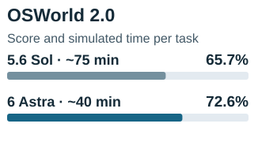
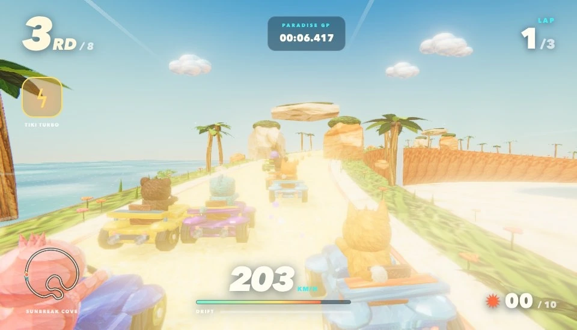

<!-- Generated by scripts/build-showcase.py from the model database. -->

```{=html}
<div class="showcase-detail"><nav class="showcase-breadcrumb" aria-label="Breadcrumb"><a href="/raw/showcase.html">Model Showcase</a><span aria-hidden="true">/</span><a href="/raw/showcase.html#family-gpt">GPT family</a></nav><header class="showcase-detail-header"><p class="showcase-domain">Language models</p><h1>GPT-6 Astra</h1><p>GPT-6 Astra: training methods without model dimensions</p><nav class="showcase-detail-actions" aria-label="On this page"><a href="#model-card">Model card</a><a href="#results">Results & examples</a><a href="#source-slides">Source slides</a><a href="#methods">Methods & sources</a></nav></header><section class="showcase-source-map" id="source-slides" aria-labelledby="source-slides-title"><h2 id="source-slides-title">Source slides</h2><ul><li><span>Model card</span><a href="/raw/lectures/01_intro/lecture01_part2_final_v3_showcase.html#/sc-llm-gpt6-astra" title="Slide ID: sc-llm-gpt6-astra">Model Showcase: Model Cards &amp; Results · slide 8</a><code>sc-llm-gpt6-astra</code></li><li><span>Results</span><a href="/raw/lectures/01_intro/lecture01_part2_final_v3_showcase.html#/sc-llm-gpt6-astra-results" title="Slide ID: sc-llm-gpt6-astra-results">Model Showcase: Model Cards &amp; Results · slide 9</a><code>sc-llm-gpt6-astra-results</code></li></ul></section>
```

```{=html}
<section class="showcase-section" id="model-card"><div class="showcase-section-heading"><h2>Model card</h2></div>
```

```{=html}
<article class="showcase-slide-source" data-presentation="intro-showcase" data-slide="sc-llm-gpt6-astra"><p class="showcase-slide-reference"><a href="/raw/lectures/01_intro/lecture01_part2_final_v3_showcase.html#/sc-llm-gpt6-astra" title="Slide ID: sc-llm-gpt6-astra">Model Showcase: Model Cards &amp; Results · slide 8</a></p><div class="showcase-source">
<div class="sc-body bn-body bn-w1" data-company="openai"><div class="bn-id" style="--bn-brand:#141414"><div class="bn-plate"><figure class="sc-evidence"><a class="showcase-figure-link" href="/raw/lectures/01_intro/assets/showcase_llm_evidence/gpt6-astra.svg" target="_blank" rel="noopener">Open full-size figure</a></figure></div>
<div class="bn-model"><p class="bn-kicker">LLM · OpenAI</p><h3>GPT-6 Astra</h3><p class="bn-ids"><code>gpt-6-astra</code></p><div class="bn-facts"><p><span>Released</span><b class="bn-date">03.09.2026</b></p><p><span>Access</span><b>API / Codex</b></p><p><span>Weights</span><b class="bn-shut">closed</b></p></div>
</div></div>
<div class="bn-pub"><div class="bn-tile bn-k bn-a"><div class="bn-head"><h4>Inference</h4><span class="sc-status"><i class="sc-pip k"></i>Known</span></div>
<div class="bn-stat"><p class="bn-num">$10 / $50</p><p class="bn-cap">per 1M input / output tokens</p></div>
<div class="bn-stat bn-rule"><p class="bn-num">5<small>levels</small></p><p class="bn-cap">reasoning effort: low through max</p></div>
<div class="bn-rule"><p class="bn-item"><i class="sc-pip p"></i>About 1.05M context, per secondary sources.</p><p class="bn-item"><i class="sc-pip k"></i>Fast mode: up to 2× speed at 2× price.</p></div>
</div>
<div class="bn-tile bn-k bn-b"><div class="bn-head"><h4>Data</h4><span class="sc-status"><i class="sc-pip k"></i>Known</span></div><p class="bn-item"><i class="sc-pip k"></i>Diverse datasets with OpenAI filtering, including personal-data reduction.</p><p class="bn-item"><i class="sc-pip k"></i>Synthetic, production and semi-synthetic safety examples.</p></div>
<div class="bn-tile bn-k bn-c"><div class="bn-head"><h4>Tools</h4><span class="sc-status"><i class="sc-pip k"></i>Known</span></div><p class="bn-item"><i class="sc-pip k"></i>Computer use and browsing.</p><p class="bn-item"><i class="sc-pip k"></i>Codex: cross-window notes and async clarifications.</p></div>
<div class="bn-tile bn-k bn-d"><div class="bn-head"><h4>Training</h4><span class="sc-status"><i class="sc-pip k"></i>Known</span></div><p class="bn-item"><i class="sc-pip k"></i>Pretraining, RL and alignment.</p><p class="bn-item"><i class="sc-pip k"></i>Adversarial safety training.</p><p class="bn-gap">No optimizer or model size.</p></div>
</div>
<div class="bn-strip"><div class="bn-strip-label"><span>Undisclosed</span><b>1<small>of 5</small></b></div>
<div class="bn-cell"><h4><i class="sc-pip n"></i>Architecture</h4><p>Parameter count, dense or MoE topology, and attention are undisclosed. Looped-model claims are rumors.</p></div>
</div></div>
<div class="sc-study">
<table class="sc-study-table" data-numeric="2 3">
<caption>Astra in simulated workplace tasks</caption>
<thead><tr><th scope="col">Unintended outcome</th><th scope="col">No policy</th><th scope="col">With policy</th></tr></thead>
<tbody>
<tr><th scope="row">Overall rate</th><td>3.4%</td><td>3.0%</td></tr>
<tr><th scope="row">Unauthorized transaction</th><td>6.8%</td><td>4.3%</td></tr>
<tr><th scope="row">Unauthorized messages</th><td>1.7%</td><td>1.4%</td></tr>
<tr><th scope="row">Service disruption</th><td>0.0%</td><td>0.3%</td></tr>
</tbody>
</table>
<p class="sc-study-source"><a href="https://deploymentsafety.openai.com/gpt-6-astra#tbl-35">OpenAI · System Card, Table 8</a> · Lower is better</p>
</div>
<div class="fv-takeaway">The disclosed methods support a training outline, without revealing the model’s topology.</div>
<div class="fv-source">LLM_v1.0.xlsx · GPT-6 Astra · audit 18.10.2026 · <a href="https://openai.com/index/gpt-6-astra/">Launch</a> · <a href="https://deploymentsafety.openai.com/gpt-6-astra">System card</a> · <a href="https://arxiv.org/pdf/2607.26115">GPT-Red paper</a> · <a href="https://openai.com/index/gpt-6-astra/">Figure source</a></div></div></article>
```

```{=html}
</section>
```

```{=html}
<section class="showcase-section" id="results"><div class="showcase-section-heading"><h2>Results & examples</h2></div>
```

```{=html}
<article class="showcase-slide-source" data-presentation="intro-showcase" data-slide="sc-llm-gpt6-astra-results"><p class="showcase-source-subtitle">What does Astra’s racing-game demo look like in play?</p><p class="showcase-slide-reference"><a href="/raw/lectures/01_intro/lecture01_part2_final_v3_showcase.html#/sc-llm-gpt6-astra-results" title="Slide ID: sc-llm-gpt6-astra-results">Model Showcase: Model Cards &amp; Results · slide 9</a></p><div class="showcase-source">
<div class="sc-body sr-body" data-company="openai">
<div class="sr-sidebar" role="group" aria-label="Model and reported metrics"><div class="sr-brand"><div aria-label="OpenAI" class="sc-company" role="img"></div></div><div class="sr-model"><p>RESULTS · LLM</p><h3>GPT-6 Astra</h3></div><div class="sr-metrics"><div class="sr-metric"><p class="sr-metric-label">DeepSWE v1.1</p><p class="sr-metric-value">74.1%</p><p class="sr-metric-note">Best reported effort; research setup <a class="" href="https://openai.com/index/gpt-6-astra/" target="_blank" rel="noopener">↗</a></p></div><div class="sr-metric"><p class="sr-metric-label">Terminal-Bench 4.0</p><p class="sr-metric-value">57.9%</p><p class="sr-metric-note">Best reported effort; research setup <a class="" href="https://openai.com/index/gpt-6-astra/" target="_blank" rel="noopener">↗</a></p></div><div class="sr-metric"><p class="sr-metric-label">GPQA Diamond</p><p class="sr-metric-value">96.0%</p><p class="sr-metric-note">Published research evaluation <a class="" href="https://openai.com/index/gpt-6-astra/" target="_blank" rel="noopener">↗</a></p></div></div></div>
<div class="sr-example"><div class="sr-stage"><video controls playsinline preload="none" src="/raw/lectures/01_intro/assets/showcase_llm_evidence/astra-race.mp4" poster="/raw/lectures/01_intro/assets/showcase_llm_evidence/astra-race.webp" aria-label="A playable race begins in the Sunbreak Cove course of Tidal Rush, with opponent karts and a live speedometer."></video></div><p class="sr-caption">After the start signal, the kart accelerates among seven opponents on Sunbreak Cove. The timer, speedometer and race position update during play.<span class="sr-caveat">Gameplay from Pietro Schirano’s demo, featured by OpenAI.</span></p></div></div>
<div class="fv-takeaway">The timer and position counter show how player input changes the state of the game.</div>
<div class="fv-source"><a href="https://openai.com/index/gpt-6-astra/">OpenAI · Computer use</a> · <a href="https://tidal-rush-paradise-gp.skirano.chatgpt.site/">Schirano’s original game</a> · Benchmark sources beside each score</div></div></article>
```

```{=html}
</section>
```

```{=html}
<section class="showcase-section" id="methods"><div class="showcase-section-heading"><h2>Methods & sources</h2><p>Source notes, evaluation conditions and limitations from the presentation slides.</p></div>
```

<details class="showcase-notes">
<summary>Model card: Model Showcase: Model Cards &amp; Results · slide 8</summary>

**Table.** The same GPT-6 Astra model was evaluated with and without its user-confirmation instruction in intentionally adversarial, simulated work environments. The communication row refers to unauthorized external communication. Lower means fewer unintended outcomes. The observed service-disruption rate increased slightly in this sample. These are evaluation-set rates. [OpenAI · System Card, Table 8](https://deploymentsafety.openai.com/gpt-6-astra#tbl-35).

**Figure.** OpenAI, “Computer use”, OSWorld 2.0. OpenAI pairs each partial score with approximate minutes per task from its latency simulations. The bars encode score from 0 to 100%, not elapsed time. [Primary source](https://openai.com/index/gpt-6-astra/).

The workbook distinguishes disclosed methods from speculation. OpenAI describes pretraining, RL, alignment, targeted professional training and adversarial safety training. It also describes dataset filtering and specific safety-data types. These statements justify Known summary categories, but they do not reveal dimensions, optimizer settings or a reproducible training corpus. Dense, looped or recurrent-depth descriptions and the alleged token counts are labeled rumors and are excluded from the factual card.

The roughly 1.05M context figure is Partial because it comes from model routers or secondary reporting. The April 2026 cutoff is also secondary and is not promoted to a headline. The detailed reasoning-RL claim in row 20 was not rechecked in the supplied audit. Computer use and browsing are model use cases, while cross-window memory notes and asynchronous clarification are Codex product features. Sites belongs to ChatGPT rather than to the model architecture. Prices and fast-mode multipliers describe the 18 October snapshot.

**Snapshot and provenance.** LLM_v1.0.xlsx, sheet “GPT-6 Astra”, audit dated 18.10.2026. Category statuses follow “Сводка”: Architecture: Not disclosed; Data: Known; Training: Known; Inference: Known; Tools: Known. Known means a model-specific fact is disclosed, not that the whole category is complete. These slides summarize the supplied audit and do not constitute a fresh independent verification. Prices, limits and availability refer to that snapshot.

**Source rows:** 1, 2, 6, 7, 11, 12, 13, 14, 15, 19, 20, 21, 22, 23, 30, 31, 32, 33, 41, 42, 43, 44, 46.

**Sources:** [Launch](https://openai.com/index/gpt-6-astra/), [System card](https://deploymentsafety.openai.com/gpt-6-astra), [GPT-Red paper](https://arxiv.org/pdf/2607.26115).

</details>

<details class="showcase-notes">
<summary>Results: Model Showcase: Model Cards &amp; Results · slide 9</summary>

OpenAI identifies Pietro Schirano’s Tidal Rush: Paradise GP in the GPT-6 Astra release. The recording shows the original game running with its published JavaScript and texture assets, including the transition from the countdown into the race. The release table supplies the separate research benchmark scores at left. The playback uses sampled browser frames and does not measure real-time performance.

[OpenAI · Computer use](https://openai.com/index/gpt-6-astra/). [Schirano’s original game](https://tidal-rush-paradise-gp.skirano.chatgpt.site/).

</details>

```{=html}
</section><nav class="showcase-bottom-nav" aria-label="More models"><a href="/raw/showcase.html">Back to all models</a><a href="/raw/lectures/01_intro/lecture01_part2_final_v3_showcase.html#/sc-llm-gpt6-astra">View source slide</a></nav></div>
```
