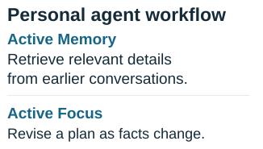
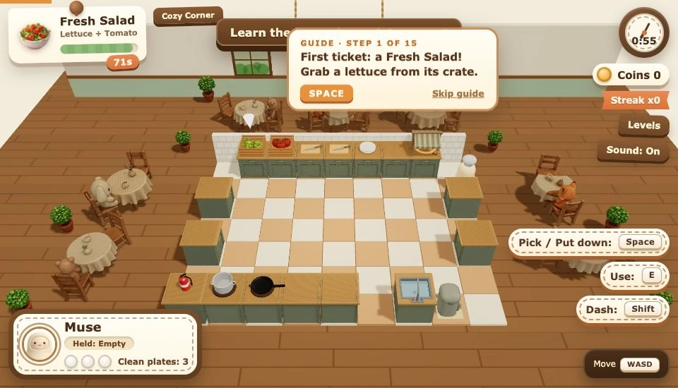

<!-- Generated by scripts/build-showcase.py from the model database. -->

```{=html}
<div class="showcase-detail"><nav class="showcase-breadcrumb" aria-label="Breadcrumb"><a href="/raw/showcase.html">Model Showcase</a><span aria-hidden="true">/</span><a href="/raw/showcase.html#family-muse">Muse family</a></nav><header class="showcase-detail-header"><p class="showcase-domain">Language models</p><h1>Muse Wonder</h1><p>Muse Wonder: agent behavior is the public interface</p><nav class="showcase-detail-actions" aria-label="On this page"><a href="#model-card">Model card</a><a href="#results">Results & examples</a><a href="#source-slides">Source slides</a><a href="#methods">Methods & sources</a></nav></header><section class="showcase-source-map" id="source-slides" aria-labelledby="source-slides-title"><h2 id="source-slides-title">Source slides</h2><ul><li><span>Model card</span><a href="/raw/lectures/01_intro/lecture01_part2_final_v3_showcase.html#/sc-llm-muse-wonder" title="Slide ID: sc-llm-muse-wonder">Model Showcase: Model Cards &amp; Results · slide 12</a><code>sc-llm-muse-wonder</code></li><li><span>Results</span><a href="/raw/lectures/01_intro/lecture01_part2_final_v3_showcase.html#/sc-llm-muse-wonder-results" title="Slide ID: sc-llm-muse-wonder-results">Model Showcase: Model Cards &amp; Results · slide 13</a><code>sc-llm-muse-wonder-results</code></li></ul></section>
```

```{=html}
<section class="showcase-section" id="model-card"><div class="showcase-section-heading"><h2>Model card</h2></div>
```

```{=html}
<article class="showcase-slide-source" data-presentation="intro-showcase" data-slide="sc-llm-muse-wonder"><p class="showcase-slide-reference"><a href="/raw/lectures/01_intro/lecture01_part2_final_v3_showcase.html#/sc-llm-muse-wonder" title="Slide ID: sc-llm-muse-wonder">Model Showcase: Model Cards &amp; Results · slide 12</a></p><div class="showcase-source">
<div class="sc-body bn-body bn-w1" data-company="meta"><div class="bn-id" style="--bn-brand:#0866ff"><div class="bn-plate"><figure class="sc-evidence"><a class="showcase-figure-link" href="/raw/lectures/01_intro/assets/showcase_llm_evidence/muse-wonder.svg" target="_blank" rel="noopener">Open full-size figure</a></figure></div>
<div class="bn-model"><p class="bn-kicker">LLM · Meta</p><h3>Muse Wonder</h3><p class="bn-ids"><code>muse-wonder-1.0</code></p><div class="bn-facts"><p><span>Released</span><b class="bn-date">12.10.2026</b></p><p><span>Access</span><b>API</b></p><p><span>Weights</span><b class="bn-shut">closed</b></p></div>
</div></div>
<div class="bn-pub"><div class="bn-tile bn-k bn-a"><div class="bn-head"><h4>Inference</h4><span class="sc-status"><i class="sc-pip k"></i>Known</span></div>
<div class="bn-stat"><p class="bn-num">1M<small>tokens</small></p><p class="bn-cap">context for Wonder and Wonder Full</p></div>
<div class="bn-stat bn-rule"><p class="bn-num">$4 / $20</p><p class="bn-cap">API input / output per 1M tokens</p></div>
<div class="bn-rule"><p class="bn-item"><i class="sc-pip k"></i>Text, image, video and audio input. Text output.</p><p class="bn-item"><i class="sc-pip k"></i>Active Memory carries context across conversations.</p></div>
</div>
<div class="bn-tile bn-k bn-b"><div class="bn-head"><h4>Tools</h4><span class="sc-status"><i class="sc-pip k"></i>Known</span></div><p class="bn-item"><i class="sc-pip k"></i>Subagents and parallel tool calls with error recovery.</p><p class="bn-item"><i class="sc-pip k"></i>Computer use across browser, desktop and mobile apps.</p><p class="bn-item"><i class="sc-pip k"></i>OpenAI SDK-compatible API and orchestration cookbooks.</p></div>
<div class="bn-tile bn-p bn-c"><div class="bn-head"><h4>Data</h4><span class="sc-status"><i class="sc-pip p"></i>Partial</span></div><p class="bn-item"><i class="sc-pip p"></i>Multilingual pretraining data.</p><p class="bn-gap">Sources and volume undisclosed.</p></div>
<div class="bn-tile bn-p bn-d"><div class="bn-head"><h4>Training</h4><span class="sc-status"><i class="sc-pip p"></i>Partial</span></div><p class="bn-item"><i class="sc-pip p"></i>Scaled pretraining and RL relative to Muse Spark.</p><p class="bn-item"><i class="sc-pip p"></i>Training on long coding tasks.</p></div>
</div>
<div class="bn-strip"><div class="bn-strip-label"><span>Undisclosed</span><b>1<small>of 5</small></b></div>
<div class="bn-cell"><h4><i class="sc-pip n"></i>Architecture</h4><p>Larger base models than Muse Spark is a vendor description. Parameter count and dense or MoE topology remain undisclosed.</p></div>
</div></div>
<div class="sc-study">
<table class="sc-study-table" data-numeric="2 3">
<caption>What changes in the Full serving tier?</caption>
<thead><tr><th scope="col">Benchmark score (%)</th><th scope="col">Wonder</th><th scope="col">Wonder Full</th></tr></thead>
<tbody>
<tr><th scope="row">OSWorld V2.1 · partial</th><td>72.6</td><td>78.4</td></tr>
<tr><th scope="row">OSWorld V2.1 · binary</th><td>34.3</td><td>39.4</td></tr>
<tr><th scope="row">AutomationBench-AA</th><td>39.1</td><td>45.4</td></tr>
<tr><th scope="row">MemoryBench</th><td>85.6</td><td>85.5</td></tr>
</tbody>
</table>
<p class="sc-study-source"><a href="https://research.meta.ai/static/muse-wonder-model-card#page=3">Meta · Model Card, §3, p. 3</a> · Both tiers at max effort</p>
</div>
<div class="fv-takeaway">Wonder’s API and agent workflow are described more fully than its model or training recipe.</div>
<div class="fv-source">LLM_v1.0.xlsx · Muse Wonder · audit 18.10.2026 · <a href="https://research.meta.ai/static/muse-wonder-model-card">Model card</a> · <a href="https://research.meta.ai/blog/muse-wonder">Meta blog</a> · <a href="https://dev.meta.ai/models/muse-wonder">Developer page</a> · <a href="https://research.meta.ai/blog/muse-wonder">Figure source</a></div></div></article>
```

```{=html}
</section>
```

```{=html}
<section class="showcase-section" id="results"><div class="showcase-section-heading"><h2>Results & examples</h2></div>
```

```{=html}
<article class="showcase-slide-source" data-presentation="intro-showcase" data-slide="sc-llm-muse-wonder-results"><p class="showcase-source-subtitle">What does the Muse Kitchen demo turn into a game?</p><p class="showcase-slide-reference"><a href="/raw/lectures/01_intro/lecture01_part2_final_v3_showcase.html#/sc-llm-muse-wonder-results" title="Slide ID: sc-llm-muse-wonder-results">Model Showcase: Model Cards &amp; Results · slide 13</a></p><div class="showcase-source">
<div class="sc-body sr-body" data-company="meta">
<div class="sr-sidebar" role="group" aria-label="Model and reported metrics"><div class="sr-brand"><div aria-label="Meta" class="sc-company" role="img"></div></div><div class="sr-model"><p>RESULTS · LLM</p><h3>Muse Wonder</h3></div><div class="sr-metrics"><div class="sr-metric"><p class="sr-metric-label">DeepSWE v1.1</p><p class="sr-metric-value">78.8%</p><p class="sr-metric-note">Wonder, max; Datacurve via Meta <a class="" href="https://dev.meta.ai/models/muse-wonder" target="_blank" rel="noopener">↗</a></p></div><div class="sr-metric"><p class="sr-metric-label">Terminal-Bench 4.0-AA</p><p class="sr-metric-value">52.0%</p><p class="sr-metric-note">Wonder, max; AA variant <a class="" href="https://dev.meta.ai/models/muse-wonder" target="_blank" rel="noopener">↗</a></p></div><div class="sr-metric"><p class="sr-metric-label">ProgramBench</p><p class="sr-metric-value">50.0%</p><p class="sr-metric-note">Wonder, max; ≥95% tests passed <a class="" href="https://dev.meta.ai/models/muse-wonder" target="_blank" rel="noopener">↗</a></p></div></div></div>
<div class="sr-example"><div class="sr-stage"><video controls playsinline preload="none" src="/raw/lectures/01_intro/assets/showcase_llm_evidence/muse-kitchen.mp4" poster="/raw/lectures/01_intro/assets/showcase_llm_evidence/muse-kitchen.webp" aria-label="A chef in the Cozy Corner level of the Muse Kitchen game published by Meta."></video></div><p class="sr-caption">The first ticket asks for a salad. The kitchen displays lettuce and tomato, a time limit and a guide to picking up the first ingredient.<span class="sr-caveat">Meta’s Muse Wonder family showcase. Meta does not identify the serving tier for this artifact.</span></p></div></div>
<div class="fv-takeaway">Meta shows how a generated kitchen handles recipes, workstations and timed orders.</div>
<div class="fv-source"><a href="https://research.meta.ai/blog/muse-wonder">Meta · Frontier coding</a> · <a href="https://research.meta.ai/artifacts/introducing-muse-wonder/kitchen-game/v6/index.html">Original kitchen game</a> · Benchmark sources beside each score</div></div></article>
```

```{=html}
</section>
```

```{=html}
<section class="showcase-section" id="methods"><div class="showcase-section-heading"><h2>Methods & sources</h2><p>Source notes, evaluation conditions and limitations from the presentation slides.</p></div>
```

<details class="showcase-notes">
<summary>Model card: Model Showcase: Model Cards &amp; Results · slide 12</summary>

**Table.** Values are selected from the table on p. 3, transcribed from the standard Wonder and Wonder Full columns. OSWorld partial gives graded progress, while binary counts fully successful tasks. Meta reports AutomationBench-AA strict pass@1 using Artificial Analysis, and MemoryBench is Meta’s internal context-recall evaluation. Section 3, pp. 4–6, describes the underlying metrics. [Meta · Model Card, §3, p. 3](https://research.meta.ai/static/muse-wonder-model-card#page=3).

**Figure.** Meta, “Active Memory” and “Active Focus”. The diagram interprets the published product behaviors. It does not propose an internal architecture. [Primary source](https://research.meta.ai/blog/muse-wonder).

Keep the variants separate. Muse Wonder is muse-wonder-1.0 through the API, while Muse Wonder Full is muse-wonder-full-1.0 and is available only through a Muse Code subscription in this snapshot. Both have a 1M inference context. The displayed price applies to the Wonder API, not a separate Full API. The claimed scale increase over Muse Spark does not identify the architecture.

Meta describes multilingual data, larger pretraining and RL runs, long coding tasks and safety post-training, but the workbook marks these categories Partial. It does not list corpus sources, volume or an optimization recipe. Active Memory, Active Focus and subagent orchestration describe system behavior and product integration rather than additional model layers. The model card recommends a human checkpoint for irreversible actions in agent workflows. The API’s support for several input modalities does not mean it generates audio or images.

**Snapshot and provenance.** LLM_v1.0.xlsx, sheet “Muse Wonder”, audit dated 18.10.2026. Category statuses follow “Сводка”: Architecture: Not disclosed; Data: Partial; Training: Partial; Inference: Known; Tools: Known. Known means a model-specific fact is disclosed, not that the whole category is complete. These slides summarize the supplied audit and do not constitute a fresh independent verification. Prices, limits and availability refer to that snapshot.

**Source rows:** 1, 2, 6, 7, 11, 12, 16, 17, 18, 19, 20, 24, 25, 26, 27, 28, 29, 30, 34, 35, 36, 37, 38.

**Sources:** [Model card](https://research.meta.ai/static/muse-wonder-model-card), [Meta blog](https://research.meta.ai/blog/muse-wonder), [Developer page](https://dev.meta.ai/models/muse-wonder).

</details>

<details class="showcase-notes">
<summary>Results: Model Showcase: Model Cards &amp; Results · slide 13</summary>

Meta’s article describes building a 3D cooking game from customizable image inputs. The published artifact contains three levels. The clip shows the first, Cozy Corner, from the original game. Meta reports the sidebar evaluation figures for the standard Muse Wonder at max effort. The family-level demo does not specify whether the standard or Full tier generated it. The playback uses sampled browser frames and does not measure real-time performance.

[Meta · Frontier coding](https://research.meta.ai/blog/muse-wonder). [Original kitchen game](https://research.meta.ai/artifacts/introducing-muse-wonder/kitchen-game/v6/index.html).

</details>

```{=html}
</section><nav class="showcase-bottom-nav" aria-label="More models"><a href="/raw/showcase.html">Back to all models</a><a href="/raw/lectures/01_intro/lecture01_part2_final_v3_showcase.html#/sc-llm-muse-wonder">View source slide</a></nav></div>
```
