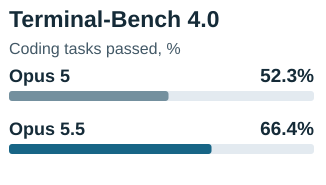
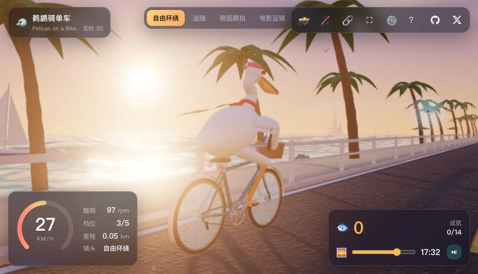

<!-- Generated by scripts/build-showcase.py from the model database. -->

```{=html}
<div class="showcase-detail"><nav class="showcase-breadcrumb" aria-label="Breadcrumb"><a href="/raw/showcase.html">Model Showcase</a><span aria-hidden="true">/</span><a href="/raw/showcase.html#family-opus">Opus family</a></nav><header class="showcase-detail-header"><p class="showcase-domain">Language models</p><h1>Claude Opus 5.5</h1><p>Claude Opus 5.5: documented use, undisclosed architecture</p><nav class="showcase-detail-actions" aria-label="On this page"><a href="#model-card">Model card</a><a href="#results">Results & examples</a><a href="#source-slides">Source slides</a><a href="#methods">Methods & sources</a></nav></header><section class="showcase-source-map" id="source-slides" aria-labelledby="source-slides-title"><h2 id="source-slides-title">Source slides</h2><ul><li><span>Model card</span><a href="/raw/lectures/01_intro/lecture01_part2_final_v3_showcase.html#/sc-llm-opus-55" title="Slide ID: sc-llm-opus-55">Model Showcase: Model Cards &amp; Results · slide 2</a><code>sc-llm-opus-55</code></li><li><span>Results</span><a href="/raw/lectures/01_intro/lecture01_part2_final_v3_showcase.html#/sc-llm-opus-55-results" title="Slide ID: sc-llm-opus-55-results">Model Showcase: Model Cards &amp; Results · slide 3</a><code>sc-llm-opus-55-results</code></li></ul></section>
```

```{=html}
<section class="showcase-section" id="model-card"><div class="showcase-section-heading"><h2>Model card</h2></div>
```

```{=html}
<article class="showcase-slide-source" data-presentation="intro-showcase" data-slide="sc-llm-opus-55"><p class="showcase-slide-reference"><a href="/raw/lectures/01_intro/lecture01_part2_final_v3_showcase.html#/sc-llm-opus-55" title="Slide ID: sc-llm-opus-55">Model Showcase: Model Cards &amp; Results · slide 2</a></p><div class="showcase-source">
<div class="sc-body bn-body bn-w1" data-company="anthropic"><div class="bn-id" style="--bn-brand:#d97757"><div class="bn-plate"><figure class="sc-evidence"><a class="showcase-figure-link" href="/raw/lectures/01_intro/assets/showcase_llm_evidence/opus-55.svg" target="_blank" rel="noopener">Open full-size figure</a></figure></div>
<div class="bn-model"><p class="bn-kicker">LLM · Anthropic</p><h3>Claude Opus 5.5</h3><p class="bn-ids"><code>claude-opus-5-5</code></p><div class="bn-facts"><p><span>Released</span><b class="bn-date">22.09.2026</b></p><p><span>Access</span><b>API</b></p><p><span>Weights</span><b class="bn-shut">closed</b></p></div>
</div></div>
<div class="bn-pub"><div class="bn-tile bn-k bn-a"><div class="bn-head"><h4>Inference</h4><span class="sc-status"><i class="sc-pip k"></i>Known</span></div>
<div class="bn-stat"><p class="bn-num">1M<small>tokens</small></p><p class="bn-cap">context window · <b>128K</b> max output</p></div>
<div class="bn-stat bn-rule"><p class="bn-num">$4 / $20</p><p class="bn-cap">per 1M input / output tokens</p></div>
<div class="bn-rule"><p class="bn-item"><i class="sc-pip k"></i>Adaptive thinking stays on. Default effort: medium.</p><p class="bn-item"><i class="sc-pip k"></i>Cache read: $0.20 per 1M tokens.</p></div>
</div>
<div class="bn-tile bn-k bn-b"><div class="bn-head"><h4>Data</h4><span class="sc-status"><i class="sc-pip k"></i>Known</span></div>
<div class="bn-split"><div class="bn-stat"><p class="bn-num">Jun 2026</p><p class="bn-cap">knowledge cutoff</p></div>
<div class="bn-col"><p class="bn-item"><i class="sc-pip k"></i>Web, public and private datasets, opted-in user data, synthetic data.</p><p class="bn-gap">No token counts or source shares.</p></div>
</div></div>
<div class="bn-tile bn-k bn-c"><div class="bn-head"><h4>Tools</h4><span class="sc-status"><i class="sc-pip k"></i>Known</span></div><p class="bn-item"><i class="sc-pip k"></i>Server and client tools. Tool sets can change mid-conversation.</p><p class="bn-item"><i class="sc-pip k"></i>Forced <code>tool_choice</code> returns 400.</p></div>
<div class="bn-tile bn-p bn-d"><div class="bn-head"><h4>Training</h4><span class="sc-status"><i class="sc-pip p"></i>Partial</span></div><p class="bn-item"><i class="sc-pip p"></i>Constitution-guided post-training.</p><p class="bn-item"><i class="sc-pip p"></i>RL graders: indirect evidence.</p><p class="bn-gap">No optimizer or token budget.</p></div>
</div>
<div class="bn-strip"><div class="bn-strip-label"><span>Undisclosed</span><b>1<small>of 5</small></b></div>
<div class="bn-cell"><h4><i class="sc-pip n"></i>Architecture</h4><p>Dense or MoE, parameter count, layers and attention are undisclosed.</p></div>
</div></div>
<div class="sc-study">
<table class="sc-study-table" data-numeric="2 3">
<caption>Issue resolution across SWE-bench variants</caption>
<thead><tr><th scope="col">SWE-bench split</th><th scope="col">Opus 5</th><th scope="col">Opus 5.5</th></tr></thead>
<tbody>
<tr><th scope="row">Pro</th><td>79.2%</td><td>89.9%</td></tr>
<tr><th scope="row">Multilingual</th><td>89.5%</td><td>93.9%</td></tr>
<tr><th scope="row">Multimodal</th><td>59.4%</td><td>61.4%</td></tr>
</tbody>
</table>
<p class="sc-study-source"><a href="https://www-cdn.anthropic.com/fc1b44717c85dc068bc6ba5024219938094694bd/Claude%20Opus%205.5%20System%20Card.pdf#page=174">Anthropic · System Card, Table 8.1.A</a> · Five trials per split</p>
</div>
<div class="fv-takeaway">The API is described in detail, while the system card leaves model topology unspecified.</div>
<div class="fv-source">LLM_v1.0.xlsx · Opus 5.5 · audit 18.10.2026 · <a href="https://www-cdn.anthropic.com/fc1b44717c85dc068bc6ba5024219938094694bd/Claude%20Opus%205.5%20System%20Card.pdf">System card</a> · <a href="https://platform.claude.com/docs/en/models/opus-5-5/whats-new-opus-5-5">API changes</a> · <a href="https://www.anthropic.com/claude-opus-5-5">Launch</a> · <a href="https://www.anthropic.com/claude-opus-5-5">Figure source</a></div></div></article>
```

```{=html}
</section>
```

```{=html}
<section class="showcase-section" id="results"><div class="showcase-section-heading"><h2>Results & examples</h2></div>
```

```{=html}
<article class="showcase-slide-source" data-presentation="intro-showcase" data-slide="sc-llm-opus-55-results"><p class="showcase-source-subtitle">What did Opus build from a one-line game prompt?</p><p class="showcase-slide-reference"><a href="/raw/lectures/01_intro/lecture01_part2_final_v3_showcase.html#/sc-llm-opus-55-results" title="Slide ID: sc-llm-opus-55-results">Model Showcase: Model Cards &amp; Results · slide 3</a></p><div class="showcase-source">
<div class="sc-body sr-body" data-company="anthropic">
<div class="sr-sidebar" role="group" aria-label="Model and reported metrics"><div class="sr-brand"><div aria-label="Anthropic" class="sc-company" role="img"></div></div><div class="sr-model"><p>RESULTS · LLM</p><h3>Claude Opus 5.5</h3></div><div class="sr-metrics"><div class="sr-metric"><p class="sr-metric-label">Terminal-Bench 4.0</p><p class="sr-metric-value">66.4%</p><p class="sr-metric-note">xhigh; production safeguards <a class="" href="https://www.anthropic.com/claude-opus-5-5" target="_blank" rel="noopener">↗</a></p></div><div class="sr-metric"><p class="sr-metric-label">FrontierCode v1.1 Main</p><p class="sr-metric-value">54.4%</p><p class="sr-metric-note">max; production safeguards <a class="" href="https://www.anthropic.com/claude-opus-5-5" target="_blank" rel="noopener">↗</a></p></div><div class="sr-metric"><p class="sr-metric-label">GDPval-AA v2.1</p><p class="sr-metric-value">1846 Elo</p><p class="sr-metric-note">max; AA result via Anthropic <a class="" href="https://www.anthropic.com/claude-opus-5-5" target="_blank" rel="noopener">↗</a></p></div></div></div>
<div class="sr-example"><div class="sr-stage"><video controls playsinline preload="none" src="/raw/lectures/01_intro/assets/showcase_llm_evidence/opus-pelican.mp4" poster="/raw/lectures/01_intro/assets/showcase_llm_evidence/opus-pelican.webp" aria-label="Gameplay from riba2534’s coast-road cycling game, with a pelican pedaling past palm trees."></video></div><p class="sr-caption">A rider follows the coast on a bicycle. The same scene combines an animated bird, moving wheels and a changing camera.<span class="sr-caveat">Gameplay recorded from riba2534’s published browser game.</span></p></div></div>
<div class="fv-takeaway">One sentence became an interactive 3D scene with controls, sound and a moving camera.</div>
<div class="fv-source"><a href="https://github.com/riba2534/claude-opus-5-5-demo/tree/54adc1fb64155f9dd7c1c90ecae7b8185ac540b8/pelican-bike">Creator’s source and attribution</a> · Benchmark sources beside each score</div></div></article>
```

```{=html}
</section>
```

```{=html}
<section class="showcase-section" id="methods"><div class="showcase-section-heading"><h2>Methods & sources</h2><p>Source notes, evaluation conditions and limitations from the presentation slides.</p></div>
```

<details class="showcase-notes">
<summary>Model card: Model Showcase: Model Cards &amp; Results · slide 2</summary>

**Table.** The table selects three SWE-bench rows in §8.1 (p. 174), with protocols in §8.2. The percentage is the share of repository issues resolved, averaged over five trials. The multilingual set spans nine languages. The multimodal set supplies images with issue descriptions. The Opus 5.5 measurements use adaptive thinking at maximum effort. The splits differ in task composition. [Anthropic · System Card, Table 8.1.A](https://www-cdn.anthropic.com/fc1b44717c85dc068bc6ba5024219938094694bd/Claude%20Opus%205.5%20System%20Card.pdf#page=174).

**Figure.** Anthropic, “Performance and cost-effectiveness”, Terminal-Bench 4.0 row and footnote 1. The release reports 66.4% for Opus 5.5 at xhigh effort with production safeguards. Bars use a 0–100% scale. [Primary source](https://www.anthropic.com/claude-opus-5-5).

The data category is Known because the system card identifies source classes and cleaning, not because it supplies a reproducible corpus. Public web data, public and private datasets, user data supplied through feedback or explicit training consent, and model-generated data are all listed. Counts and source shares remain absent. The June 2026 cutoff does not specify the composition of that corpus.

Keep the inference contract separate from architecture. The workbook records 1M context and 128K output, always-on adaptive thinking, and a medium default effort. Row 24 includes a migration-guide retelling and a Fable overview link, so the workbook is the provenance for this Opus limit. The 300K batch-output claim is directly supported only for Sonnet 5.5 and must not be transferred to Opus. The evidence for RL graders is indirect, drawn from reward-hacking discussion rather than a published RL recipe. Forced tool selection returns 400, while auto plus strict tools or structured outputs is the documented alternative.

**Snapshot and provenance.** LLM_v1.0.xlsx, sheet “Opus 5.5”, audit dated 18.10.2026. Category statuses follow “Сводка”: Architecture: Not disclosed; Data: Known; Training: Partial; Inference: Known; Tools: Known. Known means a model-specific fact is disclosed, not that the whole category is complete. These slides summarize the supplied audit and do not constitute a fresh independent verification. Prices, limits and availability refer to that snapshot.

**Source rows:** 1, 2, 6, 10, 11, 13, 14, 18, 19, 20, 24, 25, 26, 28, 30, 34, 38, 39, 40, 41.

**Sources:** [System card](https://www-cdn.anthropic.com/fc1b44717c85dc068bc6ba5024219938094694bd/Claude%20Opus%205.5%20System%20Card.pdf), [API changes](https://platform.claude.com/docs/en/models/opus-5-5/whats-new-opus-5-5), [Launch](https://www.anthropic.com/claude-opus-5-5).

</details>

<details class="showcase-notes">
<summary>Results: Model Showcase: Model Cards &amp; Results · slide 3</summary>

The creator reports one prompt, one Claude Code session, xhigh effort and no manual code edits. The creator’s README records a subagent review that found twelve issues and a post-deployment repair for a black screen. The clip shows the published, repaired game running in a browser. The source repository separates the bicycle, bird, ocean, scenery and input loop into different modules. Benchmark figures in the sidebar come from Anthropic and use the effort settings shown. The playback uses sampled browser frames and does not measure real-time performance.

[Creator’s source and attribution](https://github.com/riba2534/claude-opus-5-5-demo/tree/54adc1fb64155f9dd7c1c90ecae7b8185ac540b8/pelican-bike).

</details>

```{=html}
</section><nav class="showcase-bottom-nav" aria-label="More models"><a href="/raw/showcase.html">Back to all models</a><a href="/raw/lectures/01_intro/lecture01_part2_final_v3_showcase.html#/sc-llm-opus-55">View source slide</a></nav></div>
```
