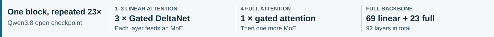
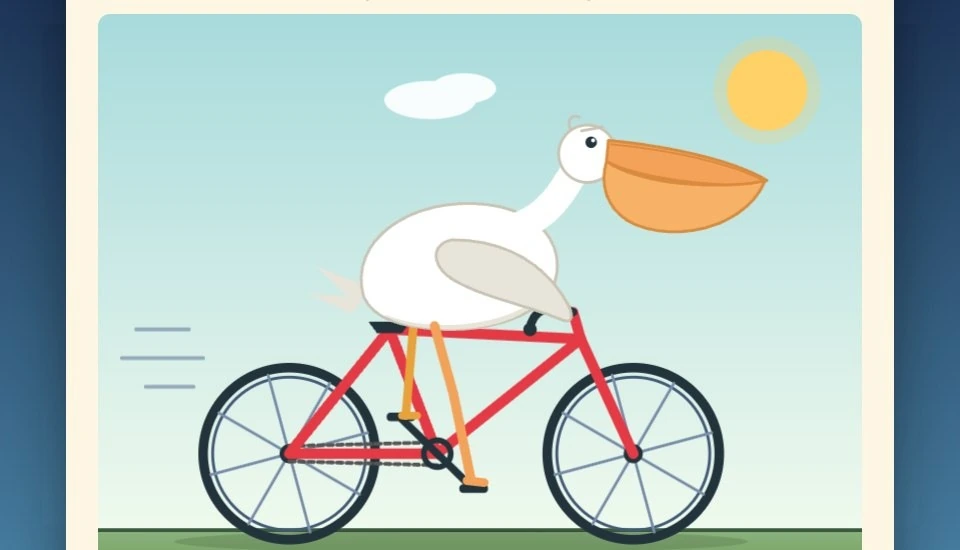

<!-- Generated by scripts/build-showcase.py from the model database. -->

```{=html}
<div class="showcase-detail"><nav class="showcase-breadcrumb" aria-label="Breadcrumb"><a href="/raw/showcase.html">Model Showcase</a><span aria-hidden="true">/</span><a href="/raw/showcase.html#family-qwen">Qwen family</a></nav><header class="showcase-detail-header"><p class="showcase-domain">Language models</p><h1>Qwen3.8-2.4T-A95B</h1><p>Qwen3.8: open checkpoint and hosted Max differ</p><nav class="showcase-detail-actions" aria-label="On this page"><a href="#model-card">Model card</a><a href="#results">Results & examples</a><a href="#source-slides">Source slides</a><a href="#methods">Methods & sources</a></nav></header><section class="showcase-source-map" id="source-slides" aria-labelledby="source-slides-title"><h2 id="source-slides-title">Source slides</h2><ul><li><span>Model card</span><a href="/raw/lectures/01_intro/lecture01_part2_final_v3_showcase.html#/sc-llm-qwen38" title="Slide ID: sc-llm-qwen38">Model Showcase: Model Cards &amp; Results · slide 18</a><code>sc-llm-qwen38</code></li><li><span>Results</span><a href="/raw/lectures/01_intro/lecture01_part2_final_v3_showcase.html#/sc-llm-qwen38-results" title="Slide ID: sc-llm-qwen38-results">Model Showcase: Model Cards &amp; Results · slide 19</a><code>sc-llm-qwen38-results</code></li></ul></section>
```

```{=html}
<section class="showcase-section" id="model-card"><div class="showcase-section-heading"><h2>Model card</h2></div>
```

```{=html}
<article class="showcase-slide-source" data-presentation="intro-showcase" data-slide="sc-llm-qwen38"><p class="showcase-slide-reference"><a href="/raw/lectures/01_intro/lecture01_part2_final_v3_showcase.html#/sc-llm-qwen38" title="Slide ID: sc-llm-qwen38">Model Showcase: Model Cards &amp; Results · slide 18</a></p><div class="showcase-source">
<div class="sc-body ds-body" data-company="alibaba"><div class="ds-card"><div class="ds-head"><div class="sc-company" aria-label="Alibaba / Qwen" role="img"><span class="sc-company-caption">Qwen</span></div><p class="ds-kicker">released 12.08.2026</p><p class="ds-kicker ds-r">Open weights</p><h3 class="ds-name">Qwen3.8-2.4T-A95B</h3><p class="ds-lic">Custom Qwen licence</p></div>
<div class="ds-row"><div class="ds-feat"><h4>Architecture</h4><p class="ds-st"><i class="sc-pip k"></i>Known</p></div>
<div class="ds-spec ds-lead"><span class="ds-k">Total / active</span><div class="ds-line"><b class="ds-v">2.4T / 95B</b></div>
</div>
<div class="ds-spec "><span class="ds-k">Backbone</span><b class="ds-v">92-layer hybrid MoE</b></div>
<div class="ds-spec "><span class="ds-k">Attention</span><b class="ds-v">DeltaNet + gated</b></div>
</div>
<div class="ds-row"><div class="ds-feat"><h4>Data</h4><p class="ds-st"><i class="sc-pip n"></i>Not disclosed</p></div>
<div class="ds-spec ds-gap ds-w2"><span class="ds-k">Pretraining corpus</span><b class="ds-v">Sources, volume and collection pipeline undisclosed</b></div>
<div class="ds-spec "><span class="ds-k">Published weights</span><b class="ds-v">BF16 checkpoint</b></div>
</div>
<div class="ds-row"><div class="ds-feat"><h4>Training</h4><p class="ds-st"><i class="sc-pip p"></i>Partial</p></div>
<div class="ds-spec ds-lead"><span class="ds-k">Published artifact</span><div class="ds-line"><b class="ds-v">Post-trained</b></div>
</div>
<div class="ds-spec ds-part"><span class="ds-k">Disclosed method</span><b class="ds-v">Multi-step MTP</b></div>
<div class="ds-spec ds-gap"><span class="ds-k">Not disclosed</span><b class="ds-v">SFT / RL recipe</b></div>
</div>
<div class="ds-row"><div class="ds-feat"><h4>Inference</h4><p class="ds-st"><i class="sc-pip k"></i>Known</p></div>
<div class="ds-spec ds-lead"><span class="ds-k">Native context</span><div class="ds-line"><b class="ds-v">262,144</b><span class="ds-n">tokens</span></div>
</div>
<div class="ds-spec "><span class="ds-k">Extended context</span><b class="ds-v">1,010,000</b></div>
<div class="ds-spec "><span class="ds-k">Open checkpoint</span><b class="ds-v">Text, thinking on</b></div>
</div>
<div class="ds-row"><div class="ds-feat"><h4>Tools</h4><p class="ds-st"><i class="sc-pip k"></i>Known</p></div>
<div class="ds-spec ds-lead"><span class="ds-k">Open checkpoint</span><div class="ds-line"><b class="ds-v">Bring your tools</b></div>
</div>
<div class="ds-spec "><span class="ds-k">Hosted Max</span><b class="ds-v">Built-in tools</b></div>
<div class="ds-spec "><span class="ds-k">Harnesses evaluated</span><b class="ds-v">Claude Code + more</b></div>
</div></div>
</div>
<figure class="sc-evidence sc-evidence-strip"><div class="showcase-diagram-scroll" tabindex="0" role="region" aria-label="Diagram; scroll horizontally to inspect details"></div><a class="showcase-figure-link" href="/raw/lectures/01_intro/assets/showcase_llm_evidence/qwen38.svg" target="_blank" rel="noopener">Open full-size figure</a></figure>
<div class="sc-study">
<table class="sc-study-table" data-numeric="2 3">
<caption>Open checkpoint at two weight precisions</caption>
<thead><tr><th scope="col">Benchmark scoring rule</th><th scope="col">FP8</th><th scope="col">NVFP4</th></tr></thead>
<tbody>
<tr><th scope="row">GSM8K · strict match</th><td>89.61%</td><td>90.37%</td></tr>
<tr><th scope="row">GSM8K · flexible match</th><td>90.52%</td><td>91.05%</td></tr>
<tr><th scope="row">AIME 2025 · average of 3</th><td>87.78%</td><td>92.22%</td></tr>
<tr><th scope="row">AIME 2025 · pass in 3</th><td>93.33%</td><td>96.67%</td></tr>
</tbody>
</table>
<p class="sc-study-source"><a href="https://github.com/vllm-project/vllm-project.github.io/blob/main/_posts/2026-08-12-qwen3.8.md#fp4-quantization-quality-at-lower-cost">vLLM / Inferact · FP4 quantization</a> · Increased reasoning budget</p>
</div>
<div class="fv-takeaway">Architecture is detailed, but Max’s vision, optional thinking and built-in tools are a hosted variant.</div>
<div class="fv-source">LLM_v1.0.xlsx · Qwen3.8 · audit 18.10.2026 · <a href="https://huggingface.co/Qwen/Qwen3.8-2.4T-A95B">Checkpoint card</a> · <a href="https://docs.sglang.io/cookbook/autoregressive/Qwen/Qwen3.8">SGLang recipe</a> · <a href="https://lightseek.org/tokenspeed/recipes/models">TokenSpeed recipes</a> · <a href="https://huggingface.co/Qwen/Qwen3.8-2.4T-A95B">Figure source</a></div></div></article>
```

```{=html}
</section>
```

```{=html}
<section class="showcase-section" id="results"><div class="showcase-section-heading"><h2>Results & examples</h2></div>
```

```{=html}
<article class="showcase-slide-source" data-presentation="intro-showcase" data-slide="sc-llm-qwen38-results"><p class="showcase-source-subtitle">What did the open Qwen checkpoint draw?</p><p class="showcase-slide-reference"><a href="/raw/lectures/01_intro/lecture01_part2_final_v3_showcase.html#/sc-llm-qwen38-results" title="Slide ID: sc-llm-qwen38-results">Model Showcase: Model Cards &amp; Results · slide 19</a></p><div class="showcase-source">
<div class="sc-body sr-body" data-company="alibaba">
<div class="sr-sidebar" role="group" aria-label="Model and reported metrics"><div class="sr-brand"><div aria-label="Alibaba / Qwen" class="sc-company" role="img"><span class="sc-company-caption">Qwen</span></div></div><div class="sr-model"><p>RESULTS · LLM</p><h3>Qwen3.8</h3></div><div class="sr-metrics"><div class="sr-metric"><p class="sr-metric-label">GSM8K · strict</p><p class="sr-metric-value">89.61%</p><p class="sr-metric-note">FP8 checkpoint <a href="https://github.com/vllm-project/vllm-project.github.io/blob/main/_posts/2026-08-12-qwen3.8.md">↗</a></p></div><div class="sr-metric"><p class="sr-metric-label">AIME25 · avg@3</p><p class="sr-metric-value">87.78%</p><p class="sr-metric-note">FP8 checkpoint <a href="https://github.com/vllm-project/vllm-project.github.io/blob/main/_posts/2026-08-12-qwen3.8.md">↗</a></p></div><div class="sr-metric"><p class="sr-metric-label">AIME25 · pass@3</p><p class="sr-metric-value">93.33%</p><p class="sr-metric-note">FP8 checkpoint <a href="https://github.com/vllm-project/vllm-project.github.io/blob/main/_posts/2026-08-12-qwen3.8.md">↗</a></p></div></div></div>
<div class="sr-example"><div class="sr-stage"></div><p class="sr-caption">The request was a pelican riding a bicycle, drawn as inline SVG. The published output uses vector paths for the bird and bicycle and CSS animation for the wheels.<span class="sr-caveat">Browser frame from the OneShotLM run · Qwen3.8-2.4T-A95B via pi-agent.</span></p></div></div>
<div class="fv-takeaway">This text-only checkpoint generated drawing instructions that the browser could render.</div>
<div class="fv-source"><a href="https://oneshotlm.com/r/pelican-on-bicycle-qwen-qwen3-8-2-4t-a95b/">OneShotLM · run and transcript</a> · <a href="https://github.com/vllm-project/vllm-project.github.io/blob/main/_posts/2026-08-12-qwen3.8.md">vLLM / Inferact · FP8 evaluations</a> · Benchmark sources beside each score</div></div></article>
```

```{=html}
</section>
```

```{=html}
<section class="showcase-section" id="methods"><div class="showcase-section-heading"><h2>Methods & sources</h2><p>Source notes, evaluation conditions and limitations from the presentation slides.</p></div>
```

<details class="showcase-notes">
<summary>Model card: Model Showcase: Model Cards &amp; Results · slide 18</summary>

**Table.** The vLLM team and Inferact published these measurements of Qwen3.8-2.4T-A95B and its NVFP4 quantization. The table expands the paired values in the “FP4 quantization: quality at lower cost” section into separate rows for their scoring rules. The authors say that a larger reasoning budget is required to reproduce their results. They provide no uncertainty intervals here. These measurements apply to the open weights, separately from the hosted Max service. [vLLM / Inferact · FP4 quantization](https://github.com/vllm-project/vllm-project.github.io/blob/main/_posts/2026-08-12-qwen3.8.md#fp4-quantization-quality-at-lower-cost).

**Figure.** Qwen, open model card, “Model Overview”, Hidden Layout. Each block has three Gated DeltaNet–MoE layers and one gated-attention–MoE layer. The two totals are 23 × 3 and 23 × 1. [Primary source](https://huggingface.co/Qwen/Qwen3.8-2.4T-A95B).

The scope is the open Qwen3.8-2.4T-A95B checkpoint, based on the Qwen3.5 text-MoE class. It has 92 layers and hidden dimension 8192. The repeated four-layer block uses three Gated DeltaNet layers and one Gated Attention layer, each followed by MoE. There are 512 experts, with 10 routed and one shared active. The checkpoint has 262,144 native context tokens and can extend to 1,010,000.

Do not transfer hosted Max capabilities to these weights. The open checkpoint is text-only, requires thinking and preserves thinking history by default. Hosted Qwen3.8-Max adds vision, optional non-thinking mode, default 1M context and built-in tools. API price and rate limits in row 37 apply to hosted Max, so they are not shown as checkpoint specifications. The open weights require externally supplied tool integrations. The exact qwen3_coder tool-parser claim in row 42 was not rechecked in the supplied audit; the card therefore emphasizes the supported harnesses and BYO tool distinction instead.

The post-trained checkpoint and multi-step MTP establish only Partial training disclosure. Token budgets, SFT, RL and reward-model details remain absent, and the Qwen3 recipe cannot be inherited by analogy. The custom qwen3.8-max licence contains thresholds for attribution and separate licensing, so open weights does not mean an unrestricted licence.

**Snapshot and provenance.** LLM_v1.0.xlsx, sheet “Qwen3.8”, audit dated 18.10.2026. Category statuses follow “Сводка”: Architecture: Known; Data: Not disclosed; Training: Partial; Inference: Known; Tools: Known. Known means a model-specific fact is disclosed, not that the whole category is complete. These slides summarize the supplied audit and do not constitute a fresh independent verification. Prices, limits and availability refer to that snapshot.

**Source rows:** 1, 2, 6, 7, 8, 9, 10, 11, 12, 13, 14, 15, 16, 17, 21, 25, 26, 27, 31, 32, 33, 34, 35, 36, 37, 38, 42, 43, 44.

**Sources:** [Checkpoint card](https://huggingface.co/Qwen/Qwen3.8-2.4T-A95B), [SGLang recipe](https://docs.sglang.io/cookbook/autoregressive/Qwen/Qwen3.8), [TokenSpeed recipes](https://lightseek.org/tokenspeed/recipes/models).

</details>

<details class="showcase-notes">
<summary>Results: Model Showcase: Model Cards &amp; Results · slide 19</summary>

OneShotLM records the model ID qwen/qwen3.8-2.4t-a95b, an August 13 run, its six-message transcript and a 9,650-byte self-contained output file. The frame shows that file rendered locally. The separate measurements in the sidebar are reported by vLLM and Inferact for the FP8 checkpoint; the AIME average and pass metrics are different aggregations across the same three samples. The Qwen model card table headed Qwen3.8-Max refers to the hosted variant and is not used here.

[OneShotLM · run and transcript](https://oneshotlm.com/r/pelican-on-bicycle-qwen-qwen3-8-2-4t-a95b/). [vLLM / Inferact · FP8 evaluations](https://github.com/vllm-project/vllm-project.github.io/blob/main/_posts/2026-08-12-qwen3.8.md).

</details>

```{=html}
</section><nav class="showcase-bottom-nav" aria-label="More models"><a href="/raw/showcase.html">Back to all models</a><a href="/raw/lectures/01_intro/lecture01_part2_final_v3_showcase.html#/sc-llm-qwen38">View source slide</a></nav></div>
```
