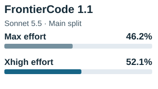
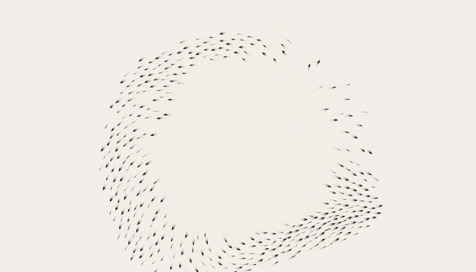

<!-- Generated by scripts/build-showcase.py from the model database. -->

```{=html}
<div class="showcase-detail"><nav class="showcase-breadcrumb" aria-label="Breadcrumb"><a href="/raw/showcase.html">Model Showcase</a><span aria-hidden="true">/</span><a href="/raw/showcase.html#family-sonnet">Sonnet family</a></nav><header class="showcase-detail-header"><p class="showcase-domain">Language models</p><h1>Claude Sonnet 5.5</h1><p>Claude Sonnet 5.5: explicit API constraints</p><nav class="showcase-detail-actions" aria-label="On this page"><a href="#model-card">Model card</a><a href="#results">Results & examples</a><a href="#source-slides">Source slides</a><a href="#methods">Methods & sources</a></nav></header><section class="showcase-source-map" id="source-slides" aria-labelledby="source-slides-title"><h2 id="source-slides-title">Source slides</h2><ul><li><span>Model card</span><a href="/raw/lectures/01_intro/lecture01_part2_final_v3_showcase.html#/sc-llm-sonnet-55" title="Slide ID: sc-llm-sonnet-55">Model Showcase: Model Cards &amp; Results · slide 4</a><code>sc-llm-sonnet-55</code></li><li><span>Results</span><a href="/raw/lectures/01_intro/lecture01_part2_final_v3_showcase.html#/sc-llm-sonnet-55-results" title="Slide ID: sc-llm-sonnet-55-results">Model Showcase: Model Cards &amp; Results · slide 5</a><code>sc-llm-sonnet-55-results</code></li></ul></section>
```

```{=html}
<section class="showcase-section" id="model-card"><div class="showcase-section-heading"><h2>Model card</h2></div>
```

```{=html}
<article class="showcase-slide-source" data-presentation="intro-showcase" data-slide="sc-llm-sonnet-55"><p class="showcase-slide-reference"><a href="/raw/lectures/01_intro/lecture01_part2_final_v3_showcase.html#/sc-llm-sonnet-55" title="Slide ID: sc-llm-sonnet-55">Model Showcase: Model Cards &amp; Results · slide 4</a></p><div class="showcase-source">
<div class="sc-body bn-body bn-w1" data-company="anthropic"><div class="bn-id" style="--bn-brand:#d97757"><div class="bn-plate"><figure class="sc-evidence"><a class="showcase-figure-link" href="/raw/lectures/01_intro/assets/showcase_llm_evidence/sonnet-55.svg" target="_blank" rel="noopener">Open full-size figure</a></figure></div>
<div class="bn-model"><p class="bn-kicker">LLM · Anthropic</p><h3>Claude Sonnet 5.5</h3><p class="bn-ids"><code>claude-sonnet-5-5</code></p><div class="bn-facts"><p><span>Released</span><b class="bn-date">28.09.2026</b></p><p><span>Access</span><b>API</b></p><p><span>Weights</span><b class="bn-shut">closed</b></p></div>
</div></div>
<div class="bn-pub"><div class="bn-tile bn-k bn-a"><div class="bn-head"><h4>Inference</h4><span class="sc-status"><i class="sc-pip k"></i>Known</span></div>
<div class="bn-stat"><p class="bn-num">1M<small>tokens</small></p><p class="bn-cap">context · <b>128K</b> standard output</p></div>
<div class="bn-stat bn-rule"><p class="bn-num">$2 / $10</p><p class="bn-cap">per 1M input / output tokens</p></div>
<div class="bn-rule"><p class="bn-item"><i class="sc-pip k"></i>Batch output: up to 300K with the beta header.</p><p class="bn-item"><i class="sc-pip k"></i>Adaptive thinking. Default effort: high.</p></div>
</div>
<div class="bn-tile bn-k bn-b"><div class="bn-head"><h4>Data</h4><span class="sc-status"><i class="sc-pip k"></i>Known</span></div>
<div class="bn-split"><div class="bn-stat"><p class="bn-num">Jun 2026</p><p class="bn-cap">data / knowledge cutoff</p></div>
<div class="bn-col"><p class="bn-item"><i class="sc-pip k"></i>Web, public and private datasets, synthetic data.</p><p class="bn-item"><i class="sc-pip k"></i>Deduplication and classification.</p></div>
</div></div>
<div class="bn-tile bn-k bn-c"><div class="bn-head"><h4>Tools</h4><span class="sc-status"><i class="sc-pip k"></i>Known</span></div><p class="bn-item"><i class="sc-pip k"></i>Inline tools and tool-set changes.</p><p class="bn-item"><i class="sc-pip k"></i>Forced <code>tool_choice</code> returns 400.</p></div>
<div class="bn-tile bn-p bn-d"><div class="bn-head"><h4>Training</h4><span class="sc-status"><i class="sc-pip p"></i>Partial</span></div><p class="bn-item"><i class="sc-pip p"></i>Constitution-guided post-training and fine-tuning.</p><p class="bn-gap">No reproducible recipe.</p></div>
</div>
<div class="bn-strip"><div class="bn-strip-label"><span>Undisclosed</span><b>1<small>of 5</small></b></div>
<div class="bn-cell"><h4><i class="sc-pip n"></i>Architecture</h4><p>System card and API docs do not disclose topology, size, layers or attention.</p></div>
</div></div>
<div class="sc-study">
<table class="sc-study-table" data-numeric="2 3">
<caption>Toolathlon-Verified across three attempts</caption>
<thead><tr><th scope="col">Grading rule</th><th scope="col">Sonnet 5</th><th scope="col">Sonnet 5.5</th></tr></thead>
<tbody>
<tr><th scope="row">One trial (pass@1)</th><td>74.7%</td><td>77.8%</td></tr>
<tr><th scope="row">Any of three pass</th><td>84.3%</td><td>85.2%</td></tr>
<tr><th scope="row">All three pass</th><td>65.7%</td><td>68.5%</td></tr>
<tr><th scope="row">Mean assistant turns</th><td>24.5</td><td>31.6</td></tr>
</tbody>
</table>
<p class="sc-study-source"><a href="https://www-cdn.anthropic.com/870c8f525702625d2c62fc6dd04c857e3250bec1/Claude%20Sonnet%205.5%20System%20Card.pdf#page=135">Anthropic · System Card, Table 8.14.5.A</a> · 108 tasks, max effort</p>
</div>
<div class="fv-takeaway">Limits and tool rules are public, while the training recipe remains partial.</div>
<div class="fv-source">LLM_v1.0.xlsx · Sonnet 5.5 · audit 18.10.2026 · <a href="https://www-cdn.anthropic.com/870c8f525702625d2c62fc6dd04c857e3250bec1/Claude%20Sonnet%205.5%20System%20Card.pdf">System card</a> · <a href="https://platform.claude.com/docs/en/models/sonnet-5-5/overview">Model overview</a> · <a href="https://platform.claude.com/docs/en/models/sonnet-5-5/whats-new-sonnet-5-5">API changes</a> · <a href="https://www.anthropic.com/claude-sonnet-5-5">Figure source</a></div></div></article>
```

```{=html}
</section>
```

```{=html}
<section class="showcase-section" id="results"><div class="showcase-section-heading"><h2>Results & examples</h2></div>
```

```{=html}
<article class="showcase-slide-source" data-presentation="intro-showcase" data-slide="sc-llm-sonnet-55-results"><p class="showcase-source-subtitle">Can a single HTML file make 400 birds flock?</p><p class="showcase-slide-reference"><a href="/raw/lectures/01_intro/lecture01_part2_final_v3_showcase.html#/sc-llm-sonnet-55-results" title="Slide ID: sc-llm-sonnet-55-results">Model Showcase: Model Cards &amp; Results · slide 5</a></p><div class="showcase-source">
<div class="sc-body sr-body" data-company="anthropic">
<div class="sr-sidebar" role="group" aria-label="Model and reported metrics"><div class="sr-brand"><div aria-label="Anthropic" class="sc-company" role="img"></div></div><div class="sr-model"><p>RESULTS · LLM</p><h3>Claude Sonnet 5.5</h3></div><div class="sr-metrics"><div class="sr-metric"><p class="sr-metric-label">Terminal-Bench 4.0</p><p class="sr-metric-value">70.6%</p><p class="sr-metric-note">max; vendor-reported <a class="" href="https://www.anthropic.com/claude-sonnet-5-5" target="_blank" rel="noopener">↗</a></p></div><div class="sr-metric"><p class="sr-metric-label">FrontierCode 1.1 Main</p><p class="sr-metric-value">52.1%</p><p class="sr-metric-note">xhigh; max scores 46.2% <a class="" href="https://www.anthropic.com/claude-sonnet-5-5" target="_blank" rel="noopener">↗</a></p></div><div class="sr-metric"><p class="sr-metric-label">GDPval-AA v2.1</p><p class="sr-metric-value">1844 Elo</p><p class="sr-metric-note">max; AA result via Anthropic <a class="" href="https://www.anthropic.com/claude-sonnet-5-5" target="_blank" rel="noopener">↗</a></p></div></div></div>
<div class="sr-example"><div class="sr-stage"><video controls playsinline preload="none" src="/raw/lectures/01_intro/assets/showcase_llm_evidence/sonnet-starlings.mp4" poster="/raw/lectures/01_intro/assets/showcase_llm_evidence/sonnet-starlings.webp" aria-label="Four hundred animated starlings turn and regroup in the Sonnet 5.5 program published by Anthropic."></video></div><p class="sr-caption">Anthropic asked for a flock of 400 starlings in one HTML file. Watch how the shape changes as nearby birds turn together.<span class="sr-caveat">Browser recording of the Sonnet 5.5 output in Anthropic’s comparison.</span></p></div></div>
<div class="fv-takeaway">A short visual prompt produced a working flock simulation with 400 moving birds.</div>
<div class="fv-source"><a href="https://www.anthropic.com/claude-sonnet-5-5">Anthropic · Creating murmurations</a> · Benchmark sources beside each score</div></div></article>
```

```{=html}
</section>
```

```{=html}
<section class="showcase-section" id="methods"><div class="showcase-section-heading"><h2>Methods & sources</h2><p>Source notes, evaluation conditions and limitations from the presentation slides.</p></div>
```

<details class="showcase-notes">
<summary>Model card: Model Showcase: Model Cards &amp; Results · slide 4</summary>

**Table.** Anthropic’s internal harness runs the verified Toolathlon tasks three times. Pass@1 averages the trials, pass@3 counts a task if any trial passes, and pass³ requires all three trials to pass. Mean turns are measured per trajectory. Sonnet 5.5 ran with production safety classifiers, and two stopped trials counted as failures. The source table is on p. 135. [Anthropic · System Card, Table 8.14.5.A](https://www-cdn.anthropic.com/870c8f525702625d2c62fc6dd04c857e3250bec1/Claude%20Sonnet%205.5%20System%20Card.pdf#page=135).

**Figure.** Anthropic, “Performance and cost”, FrontierCode 1.1 (Main), footnote 2. Anthropic reports both effort settings. The ordering is specific to this model and evaluation. Bars use a 0–100% scale. [Primary source](https://www.anthropic.com/claude-sonnet-5-5).

Sonnet shares the same five-category summary pattern as Opus, but the operational details differ. The workbook gives 1M context and 128K standard output. A batch request can reach 300K output with output-300k-2026-03-24. Standard pricing is $2 input and $10 output per million tokens, with a 50% batch discount and $0.10 cache reads. These are dated snapshot prices.

Adaptive thinking is the default and thinking:disabled returns 400. The lowest mode is between_tools, without preliminary thinking, at effort no higher than high. Non-default temperature, top_p or top_k also return 400. The model supports inline tools in beta and changing tools during a conversation. Computer use requires computer_toolset_20260801 in Claude API and Google Cloud, while the workbook records an exception for Bedrock. The training category stays Partial because constitution-guided objectives do not disclose the optimization recipe. The Opus reward-hacking review was not repeated for Sonnet.

**Snapshot and provenance.** LLM_v1.0.xlsx, sheet “Sonnet 5.5”, audit dated 18.10.2026. Category statuses follow “Сводка”: Architecture: Not disclosed; Data: Known; Training: Partial; Inference: Known; Tools: Known. Known means a model-specific fact is disclosed, not that the whole category is complete. These slides summarize the supplied audit and do not constitute a fresh independent verification. Prices, limits and availability refer to that snapshot.

**Source rows:** 1, 2, 6, 10, 11, 12, 16, 18, 22, 23, 24, 25, 26, 27, 28, 35, 36, 37, 39.

**Sources:** [System card](https://www-cdn.anthropic.com/870c8f525702625d2c62fc6dd04c857e3250bec1/Claude%20Sonnet%205.5%20System%20Card.pdf), [Model overview](https://platform.claude.com/docs/en/models/sonnet-5-5/overview), [API changes](https://platform.claude.com/docs/en/models/sonnet-5-5/whats-new-sonnet-5-5).

</details>

<details class="showcase-notes">
<summary>Results: Model Showcase: Model Cards &amp; Results · slide 5</summary>

The release compares Sonnet 5 and Sonnet 5.5. This clip runs the latter’s original self-contained HTML program (PROGRAMS.latest.text) from murmuration-latest.html. The code sets N = 400 and draws the flock with a Canvas 2D context. It is the output of the published run, not a recreated animation. Anthropic also reports completing Pokémon Red from screenshots in this release.

[Anthropic · Creating murmurations](https://www.anthropic.com/claude-sonnet-5-5).

</details>

```{=html}
</section><nav class="showcase-bottom-nav" aria-label="More models"><a href="/raw/showcase.html">Back to all models</a><a href="/raw/lectures/01_intro/lecture01_part2_final_v3_showcase.html#/sc-llm-sonnet-55">View source slide</a></nav></div>
```
