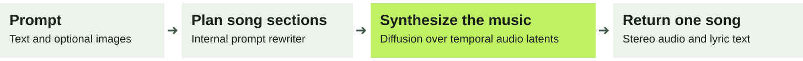

<!-- Generated by scripts/build-showcase.py from the model database. -->

```{=html}
<div class="showcase-detail"><nav class="showcase-breadcrumb" aria-label="Breadcrumb"><a href="/raw/showcase.html">Model Showcase</a><span aria-hidden="true">/</span><a href="/raw/showcase.html#family-lyria">Lyria family</a></nav><header class="showcase-detail-header"><p class="showcase-domain">Music</p><h1>Lyria 3.5</h1><p>Lyria 3.5: latent diffusion, single-turn songs</p><nav class="showcase-detail-actions" aria-label="On this page"><a href="#model-card">Model card</a><a href="#results">Results & examples</a><a href="#source-slides">Source slides</a><a href="#methods">Methods & sources</a></nav></header><section class="showcase-source-map" id="source-slides" aria-labelledby="source-slides-title"><h2 id="source-slides-title">Source slides</h2><ul><li><span>Model card</span><a href="/raw/lectures/01_intro/lecture01_part2_final_v3_showcase.html#/sc-music-lyria-35" title="Slide ID: sc-music-lyria-35">Model Showcase: Model Cards &amp; Results · slide 87</a><code>sc-music-lyria-35</code></li><li><span>Results</span><a href="/raw/lectures/01_intro/lecture01_part2_final_v3_showcase.html#/sc-music-lyria-35-results" title="Slide ID: sc-music-lyria-35-results">Model Showcase: Model Cards &amp; Results · slide 88</a><code>sc-music-lyria-35-results</code></li></ul></section>
```

```{=html}
<section class="showcase-section" id="model-card"><div class="showcase-section-heading"><h2>Model card</h2></div>
```

```{=html}
<article class="showcase-slide-source" data-presentation="intro-showcase" data-slide="sc-music-lyria-35"><p class="showcase-slide-reference"><a href="/raw/lectures/01_intro/lecture01_part2_final_v3_showcase.html#/sc-music-lyria-35" title="Slide ID: sc-music-lyria-35">Model Showcase: Model Cards &amp; Results · slide 87</a></p><div class="showcase-source">
<div class="sc-body ds-body" data-company="google-deepmind"><div class="ds-card"><div class="ds-head"><div class="sc-company" aria-label="Google DeepMind" role="img"></div><p class="ds-kicker">card 29.07.2026</p><p class="ds-kicker ds-r">Closed · Gemini API</p><h3 class="ds-name">Lyria 3.5</h3><p class="ds-lic">Weights not published</p></div>
<div class="ds-row"><div class="ds-feat"><h4>Architecture</h4><p class="ds-st"><i class="sc-pip p"></i>Partial</p></div><div class="ds-spec ds-lead"><span class="ds-k">Generator</span><b class="ds-v">Latent diffusion</b></div><div class="ds-spec ds-part"><span class="ds-k">Inputs: card vs API</span><b class="ds-v">Text / text + images</b></div><div class="ds-spec ds-gap"><span class="ds-k">Not disclosed</span><b class="ds-v">Size, codec, encoder</b></div></div>
<div class="ds-row"><div class="ds-feat"><h4>Data</h4><p class="ds-st"><i class="sc-pip p"></i>Partial</p></div><div class="ds-spec ds-lead ds-part"><span class="ds-k">Training material</span><b class="ds-v">Captioned audio</b></div><div class="ds-spec ds-part"><span class="ds-k">Processing</span><b class="ds-v">Dedup + filtering</b></div><div class="ds-spec ds-gap"><span class="ds-k">Not disclosed</span><b class="ds-v">Sources, size, licences</b></div></div>
<div class="ds-row"><div class="ds-feat"><h4>Training</h4><p class="ds-st"><i class="sc-pip p"></i>Partial</p></div><div class="ds-spec ds-part"><span class="ds-k">Stages named</span><b class="ds-v">Pretrain → SFT → RL</b></div><div class="ds-spec ds-part"><span class="ds-k">Platform</span><b class="ds-v">TPU · JAX · Pathways</b></div><div class="ds-spec ds-gap"><span class="ds-k">Not disclosed</span><b class="ds-v">Optimizer, compute</b></div></div>
<div class="ds-row"><div class="ds-feat"><h4>Inference</h4><p class="ds-st"><i class="sc-pip k"></i>Known</p></div><div class="ds-spec ds-lead"><span class="ds-k">Full-song duration</span><b class="ds-v">Up to 3 min</b></div><div class="ds-spec "><span class="ds-k">Output</span><b class="ds-v">44.1 kHz stereo</b></div><div class="ds-spec "><span class="ds-k">Editing constraint</span><b class="ds-v">Single-turn only</b></div></div>
<div class="ds-row"><div class="ds-feat"><h4>Tools</h4><p class="ds-st"><i class="sc-pip p"></i>Partial</p></div><div class="ds-spec ds-lead"><span class="ds-k">Access</span><b class="ds-v">Gemini API</b></div><div class="ds-spec "><span class="ds-k">Provenance</span><b class="ds-v">SynthID watermark</b></div><div class="ds-spec ds-gap"><span class="ds-k">Not published</span><b class="ds-v">Weights, fine-tuning</b></div></div>
</div></div>
<figure class="sc-evidence sc-evidence-strip"><div class="showcase-diagram-scroll" tabindex="0" role="region" aria-label="Diagram; scroll horizontally to inspect details"></div><a class="showcase-figure-link" href="/raw/lectures/01_intro/assets/showcase_results_20261021/music/lyria-35-request.svg" target="_blank" rel="noopener">Open full-size figure</a></figure>
<div class="sc-study">
<table class="sc-study-table">
<caption>Choosing a Gemini music endpoint</caption>
<thead><tr><th scope="col">API feature</th><th scope="col">Lyria 3 Clip</th><th scope="col">Lyria 3.5</th></tr></thead>
<tbody>
<tr><th scope="row">Use case</th><td>Loop or preview</td><td>Full song</td></tr>
<tr><th scope="row">Track length</th><td>Fixed 30 s</td><td>About 2 min¹</td></tr>
<tr><th scope="row">Model ID</th><td>lyria-3-clip-preview</td><td>lyria-3.5</td></tr>
<tr><th scope="row">Default output</th><td>MP3</td><td>MP3</td></tr>
</tbody></table>
<p class="sc-study-source"><a href="https://aistudio.google.com/docs/music-generation">Google · Lyria model comparison</a> · ¹ Length guided by prompt</p>
</div>
<div class="fv-takeaway">One prompt sets the song structure before Lyria synthesizes the audio.</div>
<div class="fv-source"><a href="https://deepmind.google/models/model-cards/lyria-3-5/">DeepMind · architecture</a> · <a href="https://deepmind.google/models/lyria/">Lyria · duration</a> · <a href="https://aistudio.google.com/docs/music-generation#intelligence">API · model intelligence</a></div></div></article>
```

```{=html}
</section>
```

```{=html}
<section class="showcase-section" id="results"><div class="showcase-section-heading"><h2>Results & examples</h2></div>
```

```{=html}
<article class="showcase-slide-source" data-presentation="intro-showcase" data-slide="sc-music-lyria-35-results"><p class="showcase-source-subtitle">Lyria 3.5: Feels Like Sympathy</p><p class="showcase-slide-reference"><a href="/raw/lectures/01_intro/lecture01_part2_final_v3_showcase.html#/sc-music-lyria-35-results" title="Slide ID: sc-music-lyria-35-results">Model Showcase: Model Cards &amp; Results · slide 88</a></p><div class="showcase-source">
<div class="sc-body sr-body" data-company="google-deepmind">
<div class="sr-sidebar" role="group" aria-label="Model and reported metrics"><div class="sr-brand"><div aria-label="Google DeepMind" class="sc-company" role="img"></div></div><div class="sr-model"><p>RESULTS · Music</p><h3>Lyria 3.5</h3></div><div class="sr-metrics"><div class="sr-metric"><p class="sr-metric-label">Song duration</p><p class="sr-metric-value">Up to 3 min</p><p class="sr-metric-note">Capability, not quality or the selected demo’s duration <a class="" href="https://deepmind.google/models/lyria/" target="_blank" rel="noopener">↗</a></p></div><div class="sr-metric"><p class="sr-metric-label">Audio format</p><p class="sr-metric-value">44.1 kHz stereo</p><p class="sr-metric-note">API capability; no numeric quality score published <a class="" href="https://ai.google.dev/gemini-api/docs/music-generation" target="_blank" rel="noopener">↗</a></p></div></div></div>
<div class="sr-example"><div class="sr-stage sr-audio sr-music">
<div><p class="sr-audio-label">Google DeepMind · Lyria 3.5 demo</p><h3>Feels Like Sympathy</h3></div>
<div><p class="sr-audio-label">Style brief</p><p class="sr-audio-prompt">A 95 BPM funk-pop track with electronic production, female vocals, electric guitar and funk bass.</p></div>
<div><p class="sr-audio-label">Excerpt · 0:12–0:30 in the recording</p><audio controls preload="none" aria-label="Feels Like Sympathy · Google DeepMind · Lyria 3.5 demo" src="/raw/lectures/01_intro/assets/showcase_results_20261021/music/lyria-35-feels-like-sympathy.mp3"></audio></div></div><p class="sr-caption">Listen for how the bass and guitar divide the beat. Do they produce the funk groove called for in the brief?</p></div></div>
<div class="fv-takeaway">The requested tempo and instrumentation give the class two concrete listening checks.</div>
<div class="fv-source">Audio · Google DeepMind · Lyria 3.5 demo · <a href="https://deepmind.google/models/lyria/#lyria-35">Published example</a> · <a href="https://storage.googleapis.com/gdm-deepmind-com-prod-public/media/rC8sZkug1fhkL2as/lyria-3-5__track__feels-like-sympathy__1-1.webm">Original recording</a></div></div></article>
```

```{=html}
</section>
```

```{=html}
<section class="showcase-section" id="methods"><div class="showcase-section-heading"><h2>Methods & sources</h2><p>Source notes, evaluation conditions and limitations from the presentation slides.</p></div>
```

<details class="showcase-notes">
<summary>Model card: Model Showcase: Model Cards &amp; Results · slide 87</summary>

The opening model-comparison table in Google’s Gemini API music guide gives separate model IDs, recommended uses, duration and default output format. For the full-song model Google describes the API duration as “a couple of minutes” and states that the prompt can influence the length. The separate Lyria product page advertises songs up to three minutes. Both modes return stereo audio at 44.1 kHz. [Google · Lyria model comparison](https://aistudio.google.com/docs/music-generation).

Google’s model card identifies latent diffusion over temporal audio representations. The developer guide’s “Model intelligence” section describes the internal prompt rewriter and planning before synthesis. The figure connects these documented steps at a functional level. The API returns audio and text for a song with lyrics.

Scope is Lyria 3.5 for full songs. The date in the identity band is publication of its model card, 29 July 2026. Product rollouts are separate: the workbook cites press reports for the 4 September Gemini app/API launch (rows 37, 40). Lyria 3 Clip and Lyria RealTime are separate scopes; do not infer that Lyria 3.5 has RealTime’s interactive streaming (rows 8, 42).

Architecture is Partial, not wholly unknown. The card explicitly says latent diffusion over temporal audio latents (row 6), but parameter count, audio autoencoder, latent rate and text encoder are not described (rows 9–10). There is a source conflict on inputs: the model card lists text; the API and product page permit text plus up to ten images (row 7). The October 1 API docs use lyria-3.5 and lyria-3-clip-preview, whereas a September 3 documentation mirror shows lyria-3.5-clip-preview and lyria-3.5-pro-preview. These identifiers must not be treated as interchangeable (row 8).

Training data is described as audio annotated with captions of varying detail. Deduplication, safety and quality filtering are named without thresholds, source lists, licences or corpus size (rows 14–17). Safety mitigations mention conditional pretraining, supervised fine-tuning and reinforcement learning from human and critic feedback. TPU, JAX and ML Pathways are named, but no hardware count, duration or optimization recipe is disclosed (rows 21–24). Reported quality improvements are unquantified developer evaluation claims.

The product page allows up to three-minute songs; the API describes a couple of minutes. Output is 44.1 kHz stereo, MP3 by default, with WAV for Lyria 3.5. Users can supply lyrics, section tags and timestamped prompts, and request instrumentals. Generation is single-turn: no iterative Lyria 3.5 editing, and repeated prompts can produce different songs (rows 28–31).

Use the Interactions API with model lyria-3.5; audio and text appear as output_audio and output_text (row 36). SynthID watermarking and safety checks are documented (rows 38–39). The $0.04 Clip / $0.08 Pro prices in row 32 came from a secondary documentation mirror; the official pricing section was not extracted, so the card does not present them as a verified Lyria 3.5 price. Weights and fine-tuning are not published; the separate open Magenta RealTime model is not this model (row 41).

Snapshot provenance: Music_v1.0.xlsx, sheet “Lyria 3.5”, audit 19.10.2026. The five category statuses reproduce the workbook’s summary judgment; they are not a majority vote over detail rows or a quality ranking. This card converts the supplied audit and does not certify the sources afresh. “Not disclosed” means not found in that audit’s accessible materials, not proof that the capability is absent.

**Source rows:** 6, 7, 8, 9, 10, 14, 15, 16, 17, 21, 22, 23, 24, 28, 29, 30, 31, 32, 36, 37, 38, 39, 40, 41, 42.

**Primary sources:** [Model card](https://deepmind.google/models/model-cards/lyria-3-5/), [Gemini API](https://ai.google.dev/gemini-api/docs/music-generation), [Lyria](https://deepmind.google/models/lyria/).

</details>

<details class="showcase-notes">
<summary>Results: Model Showcase: Model Cards &amp; Results · slide 88</summary>

The track and prompt appear in the Lyria 3.5 carousel. The audio was extracted from the publisher’s WebM, which runs 2 minutes 36 seconds. The reported 44.1 kHz stereo format is for the generation API. It is separate from the WebM audio encoding.

This slide plays 0:12–0:30 of the published recording. The local copy is an 18-second stereo MP3 with a brief fade at each cut. [Publisher](https://deepmind.google/models/lyria/#lyria-35) · [Original recording](https://storage.googleapis.com/gdm-deepmind-com-prod-public/media/rC8sZkug1fhkL2as/lyria-3-5__track__feels-like-sympathy__1-1.webm).

</details>

```{=html}
</section><nav class="showcase-bottom-nav" aria-label="More models"><a href="/raw/showcase.html">Back to all models</a><a href="/raw/lectures/01_intro/lecture01_part2_final_v3_showcase.html#/sc-music-lyria-35">View source slide</a></nav></div>
```
