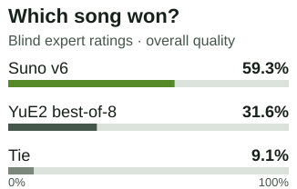

<!-- Generated by scripts/build-showcase.py from the model database. -->

```{=html}
<div class="showcase-detail"><nav class="showcase-breadcrumb" aria-label="Breadcrumb"><a href="/raw/showcase.html">Model Showcase</a><span aria-hidden="true">/</span><a href="/raw/showcase.html#family-suno">Suno family</a></nav><header class="showcase-detail-header"><p class="showcase-domain">Music</p><h1>Suno v6</h1><p>Suno v6: full songs, undisclosed generator</p><nav class="showcase-detail-actions" aria-label="On this page"><a href="#model-card">Model card</a><a href="#results">Results & examples</a><a href="#source-slides">Source slides</a><a href="#methods">Methods & sources</a></nav></header><section class="showcase-source-map" id="source-slides" aria-labelledby="source-slides-title"><h2 id="source-slides-title">Source slides</h2><ul><li><span>Model card</span><a href="/raw/lectures/01_intro/lecture01_part2_final_v3_showcase.html#/sc-music-suno-v6" title="Slide ID: sc-music-suno-v6">Model Showcase: Model Cards &amp; Results · slide 83</a><code>sc-music-suno-v6</code></li><li><span>Results</span><a href="/raw/lectures/01_intro/lecture01_part2_final_v3_showcase.html#/sc-music-suno-v6-results" title="Slide ID: sc-music-suno-v6-results">Model Showcase: Model Cards &amp; Results · slide 84</a><code>sc-music-suno-v6-results</code></li></ul></section>
```

```{=html}
<section class="showcase-section" id="model-card"><div class="showcase-section-heading"><h2>Model card</h2></div>
```

```{=html}
<article class="showcase-slide-source" data-presentation="intro-showcase" data-slide="sc-music-suno-v6"><p class="showcase-slide-reference"><a href="/raw/lectures/01_intro/lecture01_part2_final_v3_showcase.html#/sc-music-suno-v6" title="Slide ID: sc-music-suno-v6">Model Showcase: Model Cards &amp; Results · slide 83</a></p><div class="showcase-source">
<div class="sc-body bn-body bn-w2" data-company="suno"><div class="bn-id"><div class="bn-plate"><figure class="sc-evidence"><a class="showcase-figure-link" href="/raw/lectures/01_intro/assets/showcase_results_20261021/music/suno-v6-listeners.svg" target="_blank" rel="noopener">Open full-size figure</a></figure></div><div class="bn-model"><p class="bn-kicker">Music · Suno</p><h3>Suno v6</h3><p class="bn-ids"><code>v6 · v6-wild</code><code>v6-mini</code></p><div class="bn-facts"><p><span>Released</span><b class="bn-date">09.09.2026</b></p><p><span>Access</span><b>Service</b></p><p><span>Weights</span><b class="bn-shut">closed</b></p></div></div></div><div class="bn-pub"><div class="bn-tile bn-p bn-a"><div class="bn-head"><h4>Inference</h4><span class="sc-status"><i class="sc-pip p"></i>Partial</span></div><div class="bn-stat"><p class="bn-num">8<small>minutes</small></p><p class="bn-cap">per generation · all three variants</p></div><div class="bn-stat bn-rule"><p class="bn-num">$8 / $24</p><p class="bn-cap">Pro / Premier per month · annual billing</p></div><div class="bn-rule"><p class="bn-item"><i class="sc-pip k"></i>Uploads: Free 8 min; paid 30 min</p><p class="bn-item"><i class="sc-pip k"></i>Free: mini · paid: v6 / wild</p></div><p class="bn-gap">No seed, codec or sampler settings</p></div><div class="bn-tile bn-p bn-b"><div class="bn-head"><h4>Data</h4><span class="sc-status"><i class="sc-pip p"></i>Partial</span></div><p class="bn-item"><i class="sc-pip p"></i>Developed with WMG, BMG and Believe</p><p class="bn-item"><i class="sc-pip p"></i>Previous-model YouTube reports do not establish the v6 corpus</p><p class="bn-gap">No corpus size, source mix or filtering recipe</p></div><div class="bn-tile bn-p bn-c"><div class="bn-head"><h4>Tools</h4><span class="sc-status"><i class="sc-pip p"></i>Partial</span></div><p class="bn-item"><i class="sc-pip k"></i>Edit one section or lyric line; mashups and stems</p><p class="bn-item"><i class="sc-pip k"></i>Suno Studio on Premier</p><p class="bn-gap">No public API or local runtime found</p></div></div><div class="bn-strip"><div class="bn-strip-label"><span>Not disclosed</span><b>2<small>of 5</small></b></div><div class="bn-cell"><h4><i class="sc-pip n"></i>Architecture</h4><p>Generator, parameter count, codec and audio latents</p></div><div class="bn-cell"><h4><i class="sc-pip n"></i>Training</h4><p>Stages, losses, RL, distillation and compute</p></div></div></div>
<div class="sc-study">
<table class="sc-study-table" data-numeric="2 3 4">
<caption>Automatic scores on 192 music prompts</caption>
<thead><tr><th scope="col">Model</th><th scope="col">Candidates</th><th scope="col">SongBench avg ↑</th><th scope="col">Phoneme error ↓</th></tr></thead>
<tbody>
<tr><th scope="row">Suno v6</th><td>2</td><td>6.5562</td><td>7.58%</td></tr>
<tr><th scope="row">Suno v6 Wild</th><td>2</td><td>6.4195</td><td>7.45%</td></tr>
<tr><th scope="row">YuE2</th><td>8</td><td>6.9632</td><td>9.79%</td></tr>
</tbody></table>
<p class="sc-study-source"><a href="https://arxiv.org/html/2609.33757v1#S4.T1">Yuan et al. · Table 1</a> · WildSongBench</p>
</div>
<div class="fv-takeaway">Suno v6 won more expert votes even though YuE2 best-of-8 scored higher on automated SongBench.</div>
<div class="fv-source"><a href="https://suno.com/v6">Suno · v6 release</a> · <a href="https://help.suno.com/en/articles/13924929">Song length</a> · <a href="https://arxiv.org/html/2609.33757v1#S4.F7">YuE2 · Fig. 7</a></div></div></article>
```

```{=html}
</section>
```

```{=html}
<section class="showcase-section" id="results"><div class="showcase-section-heading"><h2>Results & examples</h2></div>
```

```{=html}
<article class="showcase-slide-source" data-presentation="intro-showcase" data-slide="sc-music-suno-v6-results"><p class="showcase-source-subtitle">Suno v6: Closer Tonight</p><p class="showcase-slide-reference"><a href="/raw/lectures/01_intro/lecture01_part2_final_v3_showcase.html#/sc-music-suno-v6-results" title="Slide ID: sc-music-suno-v6-results">Model Showcase: Model Cards &amp; Results · slide 84</a></p><div class="showcase-source">
<div class="sc-body sr-body" data-company="suno">
<div class="sr-sidebar" role="group" aria-label="Model and reported metrics"><div class="sr-brand"><div aria-label="Suno" class="sc-company" role="img"></div></div><div class="sr-model"><p>RESULTS · Music</p><h3>Suno v6</h3></div><div class="sr-metrics"><div class="sr-metric"><p class="sr-metric-label">SongBench average</p><p class="sr-metric-value">6.5562</p><p class="sr-metric-note">YuE-author evaluation · 192 prompts · 2-candidate selection <a class="" href="https://map-yue2.github.io/data/benchmark-results.csv?v=20260912-suno-v6" target="_blank" rel="noopener">↗</a></p></div><div class="sr-metric"><p class="sr-metric-label">Phoneme error rate</p><p class="sr-metric-value">7.58%</p><p class="sr-metric-note">Same competitor-authored evaluation; lower is better <a class="" href="https://map-yue2.github.io/data/benchmark-results.csv?v=20260912-suno-v6" target="_blank" rel="noopener">↗</a></p></div><div class="sr-metric"><p class="sr-metric-label">Generation length</p><p class="sr-metric-value">Up to 8 min</p><p class="sr-metric-note">v6-family capability; not quality or measured latency <a class="" href="https://help.suno.com/en/articles/13924929" target="_blank" rel="noopener">↗</a></p></div></div></div>
<div class="sr-example"><div class="sr-stage sr-audio sr-music">
<div><p class="sr-audio-label">yismeily · Suno v6</p><h3>Closer Tonight</h3></div>
<div><p class="sr-audio-label">Style brief</p><p class="sr-audio-prompt">Midtempo pop with a close male tenor, doubled acoustic guitar and a restrained drum groove.</p></div>
<div><p class="sr-audio-label">Excerpt · 0:20–0:38 in the recording</p><audio controls preload="none" aria-label="Closer Tonight · yismeily · Suno v6" src="/raw/lectures/01_intro/assets/showcase_results_20261021/music/suno-v6-closer-tonight.mp3"></audio></div></div><p class="sr-caption">Listen for the distance between the lead voice and its layered doubles. How much space does the rhythm section leave for them?</p></div></div>
<div class="fv-takeaway">The creator’s song illustrates vocal layering. The scores at left summarize a separate 192-prompt evaluation.</div>
<div class="fv-source">Audio · yismeily · Suno v6 · <a href="https://suno.com/song/271f2deb-6ae7-4730-9e66-2588b7a3ed51">Published example</a> · <a href="https://cdn1.suno.ai/271f2deb-6ae7-4730-9e66-2588b7a3ed51.mp4">Original recording</a></div></div></article>
```

```{=html}
</section>
```

```{=html}
<section class="showcase-section" id="methods"><div class="showcase-section-heading"><h2>Methods & sources</h2><p>Source notes, evaluation conditions and limitations from the presentation slides.</p></div>
```

<details class="showcase-notes">
<summary>Model card: Model Showcase: Model Cards &amp; Results · slide 83</summary>

Table 1 reports automated measurements from the YuE2 team. SongBench averages seven quality dimensions. Phoneme error rate compares an automatic transcription of the sung words with the target lyrics. Fractions in the paper are expressed as percentages here. Both Suno rows select the lower-error output of two candidates, with four speech-recognition transcriptions per candidate. YuE2 best-of-8 selects first for musicality, then prompt adherence, then phoneme error. This gives a different ordering from the overall expert preference in the chart. [Yuan et al. · Table 1](https://arxiv.org/html/2609.33757v1#S4.T1).

Yuan et al. report this overall-quality comparison in §4.1 and Figure 7. The YuE2 team collected blinded expert judgments. Shares exclude unable-to-judge answers and retain ties (tie share shown by subtraction of rounded values). YuE2 selected from eight generations, while Suno v6 used the lower-phoneme-error output from two candidates. On the separate automatic SongBench evaluation, YuE2 best-of-8 scored 6.96 and Suno v6 scored 6.56. The listening panel used benchmark prompts and did not rate the linked creator song.

Scope is the v6 family: v6, v6-wild and v6-mini, released in the vendor’s 9 September blog (rows 6–10). The flagship and wild variants are paid; mini is the Free option. “Faster and more efficient” is the vendor’s description, not a published parameter count.

The input set is text, audio, images and video; output is a song with vocals and lyrics (row 7). The workbook still scores Architecture as Not disclosed because the generator type, backbone, codec and latent representation are not described. The inference summary is Partial even though the product limits are Known: eight minutes per generation, audio uploads of eight minutes on Free and thirty on paid plans, and the listed annual-billing prices (rows 27–33). These are the audit-date terms, not current price certification.

The data wording is deliberately narrow. The official blog names Warner Music Group, BMG and Believe as industry partners; it does not enumerate the training corpus (row 14). The claim that v6 does not use earlier-model data comes via TechCrunch. The YouTube admission reported by Music Business Worldwide concerns previous models and must not be transferred to v6 (row 15). Sources, hours, filtering and licence details remain unreported in the audit (rows 16–17).

Tools include section-level edits, one-line lyric replacement, mashups, stems and Premier’s Studio (rows 37–40). The absence of a public official API in the audited sources is why this card says “no public API found,” not “API impossible” (rows 41–42). The workbook describes planned watermarking through press coverage only; it does not establish a shipped v6 watermark (row 44). Commercial-use terms and download limits are recorded in rows 31 and 43; those are scoped to plans and downloaded songs, not blanket ownership claims.

Snapshot provenance: Music_v1.0.xlsx, sheet “Suno v6”, audit 19.10.2026. The five category statuses reproduce the workbook’s summary judgment; they are not a majority vote over detail rows or a quality ranking. This card converts the supplied audit and does not certify the sources afresh. “Not disclosed” means not found in that audit’s accessible materials, not proof that the capability is absent.

**Source rows:** 6, 7, 8, 9, 10, 14, 15, 16, 17, 21, 22, 23, 27, 28, 29, 30, 31, 32, 33, 37, 38, 39, 40, 41, 42, 43, 44, 45, 46.

**Primary sources:** [v6 launch](https://suno.com/blog/introducing-v6), [Song length](https://help.suno.com/en/articles/13924929), [Plans](https://suno.com/pricing).

</details>

<details class="showcase-notes">
<summary>Results: Model Showcase: Model Cards &amp; Results · slide 84</summary>

Suno credits yismeily and identifies this song as V6. The playback excerpt comes from the official song video’s audio stream. The separate WildSongBench scores come from the YuE2 authors, who selected the lower-PER candidate from two using four ASR passes per candidate.

This slide plays 0:20–0:38 of the published recording. The local copy is an 18-second stereo MP3 with a brief fade at each cut. [Publisher](https://suno.com/song/271f2deb-6ae7-4730-9e66-2588b7a3ed51) · [Original recording](https://cdn1.suno.ai/271f2deb-6ae7-4730-9e66-2588b7a3ed51.mp4).

</details>

```{=html}
</section><nav class="showcase-bottom-nav" aria-label="More models"><a href="/raw/showcase.html">Back to all models</a><a href="/raw/lectures/01_intro/lecture01_part2_final_v3_showcase.html#/sc-music-suno-v6">View source slide</a></nav></div>
```
