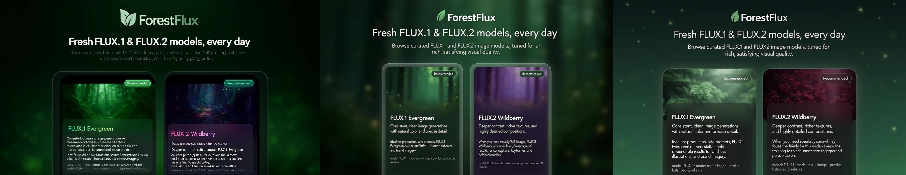
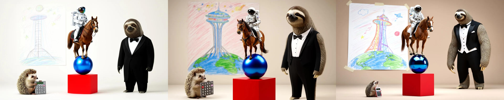

<!-- Generated by scripts/build-showcase.py from the model database. -->

```{=html}
<div class="showcase-detail"><nav class="showcase-breadcrumb" aria-label="Breadcrumb"><a href="/raw/showcase.html">Model Showcase</a><span aria-hidden="true">/</span><a href="/raw/showcase.html#family-flux">FLUX family</a></nav><header class="showcase-detail-header"><p class="showcase-domain">Image generation</p><h1>FLUX.2</h1><p>FLUX.2 uses a higher-fidelity image autoencoder</p><nav class="showcase-detail-actions" aria-label="On this page"><a href="#model-card">Model card</a><a href="#results">Results & examples</a><a href="#source-slides">Source slides</a><a href="#methods">Methods & sources</a></nav></header><section class="showcase-source-map" id="source-slides" aria-labelledby="source-slides-title"><h2 id="source-slides-title">Source slides</h2><ul><li><span>Model card</span><a href="/raw/lectures/01_intro/lecture01_part2_final_v3_showcase.html#/sc-t2i-flux-2" title="Slide ID: sc-t2i-flux-2">Model Showcase: Model Cards &amp; Results · slide 37</a><code>sc-t2i-flux-2</code></li><li><span>Results</span><a href="/raw/lectures/01_intro/lecture01_part2_final_v3_showcase.html#/sc-t2i-flux-2-results" title="Slide ID: sc-t2i-flux-2-results">Model Showcase: Model Cards &amp; Results · slide 38</a><code>sc-t2i-flux-2-results</code></li></ul></section>
```

```{=html}
<section class="showcase-section" id="model-card"><div class="showcase-section-heading"><h2>Model card</h2></div>
```

```{=html}
<article class="showcase-slide-source" data-presentation="intro-showcase" data-slide="sc-t2i-flux-2"><p class="showcase-slide-reference"><a href="/raw/lectures/01_intro/lecture01_part2_final_v3_showcase.html#/sc-t2i-flux-2" title="Slide ID: sc-t2i-flux-2">Model Showcase: Model Cards &amp; Results · slide 37</a></p><div class="showcase-source">
<div class="sc-body ds-body" data-company="black-forest-labs"><div class="ds-card"><div class="ds-head"><div class="sc-company" aria-label="Black Forest Labs" role="img"><span class="sc-company-name">Black Forest<small>Labs</small></span></div><p class="ds-kicker">released 25.11.2025</p><p class="ds-kicker ds-r">[dev] weights + API</p><h3 class="ds-name">FLUX.2</h3><p class="ds-lic">[dev]: Non-Commercial License</p></div>
<div class="ds-row"><div class="ds-feat"><h4>Architecture</h4><p class="ds-st"><i class="sc-pip p"></i>Partial</p></div><div class="ds-spec ds-lead"><span class="ds-k">Image transformer [dev]</span><b class="ds-v">32B</b></div><div class="ds-spec"><span class="ds-k">Text / vision encoder</span><b class="ds-v">Mistral-3 24B</b></div><div class="ds-spec ds-gap"><span class="ds-k">Hosted sizes</span><b class="ds-v">Not disclosed</b></div></div>
<div class="ds-row"><div class="ds-feat"><h4>Data</h4><p class="ds-st"><i class="sc-pip p"></i>Partial</p></div><div class="ds-spec ds-lead"><span class="ds-k">Pretraining filters [dev]</span><b class="ds-v">NSFW + CSAM</b></div><div class="ds-spec ds-gap"><span class="ds-k">Corpus / source mix</span><b class="ds-v">Not disclosed</b></div><div class="ds-spec ds-gap"><span class="ds-k">Synthetic share</span><b class="ds-v">Not disclosed</b></div></div>
<div class="ds-row"><div class="ds-feat"><h4>Training</h4><p class="ds-st"><i class="sc-pip p"></i>Partial</p></div><div class="ds-spec ds-lead"><span class="ds-k">Published for [dev]</span><b class="ds-v">Guidance distillation</b></div><div class="ds-spec"><span class="ds-k">Safety post-training</span><b class="ds-v">Targeted fine-tuning</b></div><div class="ds-spec ds-gap"><span class="ds-k">Recipe / compute</span><b class="ds-v">Not disclosed</b></div></div>
<div class="ds-row"><div class="ds-feat"><h4>Inference</h4><p class="ds-st"><i class="sc-pip k"></i>Known</p></div><div class="ds-spec ds-lead"><span class="ds-k">Output ceiling</span><b class="ds-v">4 MP</b></div><div class="ds-spec"><span class="ds-k">[dev] example</span><b class="ds-v">50 steps · guidance 4</b></div><div class="ds-spec"><span class="ds-k">Hosted references</span><b class="ds-v">8 API · 10 Playground</b></div></div>
<div class="ds-row"><div class="ds-feat"><h4>Tools</h4><p class="ds-st"><i class="sc-pip k"></i>Known</p></div><div class="ds-spec ds-lead"><span class="ds-k">Generation + editing</span><b class="ds-v">One task pipeline</b></div><div class="ds-spec"><span class="ds-k">Local [dev] runtime</span><b class="ds-v">Diffusers / ComfyUI</b></div><div class="ds-spec"><span class="ds-k">Grounding search</span><b class="ds-v">[max] only</b></div></div></div></div>
<figure class="sc-evidence sc-evidence-strip"><div class="showcase-diagram-scroll" tabindex="0" role="region" aria-label="Diagram; scroll horizontally to inspect details"></div><a class="showcase-figure-link" href="/raw/lectures/01_intro/assets/showcase_evidence_20261124/t2i/flux-2.svg" target="_blank" rel="noopener">Open full-size figure</a></figure>
<div class="sc-study">
<table class="sc-study-table" data-numeric="2 3 4">
  <caption>How closely does the decoder reconstruct?</caption>
  <thead><tr><th scope="col">Encoder</th><th scope="col">Channels/token</th><th scope="col">SSIM ↑</th><th scope="col">PSNR (dB) ↑</th></tr></thead>
  <tbody>
  <tr><th scope="row">SD</th><td>16</td><td>0.698</td><td>25.05</td></tr>
  <tr><th scope="row">FLUX.1</th><td>64</td><td>0.889</td><td>31.13</td></tr>
  <tr><th scope="row">FLUX.2</th><td>128</td><td>0.904</td><td>31.46</td></tr>
  <tr><th scope="row">RAE</th><td>768</td><td>0.496</td><td>18.83</td></tr>
  </tbody>
</table>
<p class="sc-study-source"><a href="https://bfl.ai/techblog/representation-comparison/index.html">BFL latent-space study · table 1</a> · ImageNet validation · 256 tokens</p>
</div>
<div class="fv-takeaway">Specifications for the open [dev] checkpoint do not transfer to hosted models.</div>
<div class="fv-source"><a href="https://bfl.ai/techblog/representation-comparison/index.html">FLUX.2 latent-space study · table 1</a> · T2I_v1.1.xlsx · FLUX.2 · audit 18–19.10.2026 · <a href="https://huggingface.co/black-forest-labs/FLUX.2-dev">[dev] card</a> · <a href="https://docs.bfl.ai/flux_2/flux2_overview">Family overview</a> · <a href="https://docs.bfl.ai/quick_start/pricing">API pricing</a></div></div></article>
```

```{=html}
</section>
```

```{=html}
<section class="showcase-section" id="results"><div class="showcase-section-heading"><h2>Results & examples</h2></div>
```

```{=html}
<article class="showcase-slide-source" data-presentation="intro-showcase" data-slide="sc-t2i-flux-2-results"><p class="showcase-source-subtitle">The same design at three step budgets</p><p class="showcase-slide-reference"><a href="/raw/lectures/01_intro/lecture01_part2_final_v3_showcase.html#/sc-t2i-flux-2-results" title="Slide ID: sc-t2i-flux-2-results">Model Showcase: Model Cards &amp; Results · slide 38</a></p><div class="showcase-source">
<div class="sc-body sr-body" data-company="black-forest-labs">
<div class="sr-sidebar" role="group" aria-label="Model and magnified image details"><div class="sr-brand"><div aria-label="Black Forest Labs" class="sc-company" role="img"><span class="sc-company-name">Black Forest<small>Labs</small></span></div></div><div class="sr-model"><p>RESULTS · Text-to-image</p><h3>FLUX.2</h3></div><div class="sr-metrics"><div class="sr-metric"><p class="sr-metric-label">Sampling steps, left to right</p><p class="sr-metric-value">6 / 20 / 50</p><p class="sr-metric-note">FLUX.2 [flex] · two published trials</p></div><div class="sr-metric"><p class="sr-metric-label" style="font-weight:600;margin-bottom:8px">6 steps · subtitle detail</p><svg xmlns="http://www.w3.org/2000/svg" role="img" aria-label="The beginning of the subtitle contains distorted letters at six steps." width="100%" height="72" viewbox="270 193 245 58" preserveaspectratio="xMinYMid meet" style="display:block;overflow:hidden"><title>The beginning of the subtitle contains distorted letters at six steps.</title><image href="/raw/lectures/01_intro/assets/showcase_results_20261021/t2i/sc-t2i-flux-2-flex-design-step-comparison.jpg" width="3626" height="704"></image></svg></div><div class="sr-metric"><p class="sr-metric-label" style="font-weight:600;margin-bottom:8px">50 steps · subtitle detail</p><svg xmlns="http://www.w3.org/2000/svg" role="img" aria-label="At fifty steps the same subtitle starts with the legible words Browse curated." width="100%" height="72" viewbox="2738 167 245 58" preserveaspectratio="xMinYMid meet" style="display:block;overflow:hidden"><title>At fifty steps the same subtitle starts with the legible words Browse curated.</title><image href="/raw/lectures/01_intro/assets/showcase_results_20261021/t2i/sc-t2i-flux-2-flex-design-step-comparison.jpg" width="3626" height="704"></image></svg></div></div></div>
<div class="sr-example"><div class="sr-stage sr-gallery sr-gallery-stacked"><figure><figcaption>Typography · 6, 20, 50 steps from left</figcaption></figure><figure><figcaption>Scene detail · 6, 20, 50 steps from left</figcaption></figure></div><p class="sr-caption">The enlarged subtitle resolves into “Browse curated” at 50 steps. In the lower series, compare the balance of rider, horse and sphere.</p></div></div>
<div class="fv-takeaway">Black Forest Labs varied the step count on FLUX.2 [flex].</div>
<div class="fv-source">Published example and reported metrics · checked 21.10.2026 · <a class="" href="https://bfl.ai/blog/flux-2" target="_blank" rel="noopener">Example source</a></div></div></article>
```

```{=html}
</section>
```

```{=html}
<section class="showcase-section" id="methods"><div class="showcase-section-heading"><h2>Methods & sources</h2><p>Source notes, evaluation conditions and limitations from the presentation slides.</p></div>
```

<details class="showcase-notes">
<summary>Model card: Model Showcase: Model Cards &amp; Results · slide 37</summary>

**Table evidence.** BFL evaluates pixel-aligned original/reconstruction pairs on ImageNet validation. Structural similarity (SSIM) and peak signal-to-noise ratio (PSNR) are point estimates rounded from table 1, which also reports uncertainty. Channel counts and equal 256-token representation length come from the paragraph immediately before the table. The RAE has more channels and lower reference-based fidelity, illustrating that representation width alone does not determine reconstruction quality. [BFL latent-space study · table 1](https://bfl.ai/techblog/representation-comparison/index.html).

**Figure evidence.** Black Forest Labs, Reconstruction Performance, table 1. The autoencoders reconstruct ImageNet validation images. Reconstruction FID compares original and reconstructed image distributions. Lower values indicate closer agreement. These are component scores, separate from prompt-to-image benchmark performance. [Primary source](https://bfl.ai/techblog/representation-comparison/index.html).

**Historical audit.** This is a faithful conversion of the supplied T2I_v1.1.xlsx audit snapshot, checked by its author on 18 October 2026 and refined on 19 October 2026. It is not a fresh verification of these linked sources. “Not disclosed” means absent from the materials covered by that audit, not that the capability cannot exist. Known/Partial/Not disclosed measure disclosure, not model quality or full reproducibility. Prices, endpoints and limits are preserved as dated audit claims.

Open weights here does not mean unrestricted open-source licensing. The category-level Architecture remains Partial because the sheet spans [dev] and undisclosed hosted variants. Inference and Tools retain the Known summary statuses even though individual limits vary by surface.

**Exact scope and category provenance:** sheet `FLUX.2`, identity row 2; `Сводка` row 7. Architecture / Data / Training / Inference / Tools = Partial / Partial / Partial / Known / Known.

**Row provenance and caveats (model-sheet row numbers):**

- Row 2: Scope includes open [dev] and hosted [pro], [flex], [max]; Klein is a separate sheet.
- Row 6: Hosted variants are distinct from the open checkpoint.
- Row 7: Latent flow matching / rectified flow transformer unifies text-to-image and editing.
- Row 8: 32B counts the [dev] image transformer only; hosted parameter counts are undisclosed.
- Row 9: Main FLUX.2 uses Mistral-3 24B VLM; Klein uses different encoders.
- Row 10: A new VAE/latent space is reported; VAE is Apache-2.0.
- Row 14: Full corpus list, pair counts, source proportions and synthetic share are absent.
- Row 15: [dev] card describes pretraining filtering of NSFW and known CSAM with IWF collaboration.
- Row 19: Guidance distillation is explicitly disclosed for [dev].
- Row 20: Targeted safety fine-tuning for T2I/I2I misuse is described for [dev].
- Row 21: Optimizer, steps, exact compute/FLOPs and data budget are absent.
- Row 25: Generation/editing up to four megapixels; 4 MP is not FLUX 3’s 4K/16 MP class.
- Row 26: Hosted [pro]/[flex]/[max] accepts eight API references or ten in Playground; [dev] recommended maximum is six.
- Row 27: [flex] exposes steps and guidance scale.
- Row 28: [dev] example uses 50 steps and guidance scale 4; 28 steps is a possible tradeoff, not the same default.
- Row 29: [dev] BF16 is published; a 4-bit deployment example uses a remote text encoder.
- Row 30: flux-2-pro is pinned; flux-2-pro-preview changes over time.
- Row 31: Pricing is per rounded-up MP (1 MP=1024×1024), at most 4 output MP. First/additional/reference MP USD: max .07/.03/.03; pro .03/.015/.015; flex .05/.05/.05. Klein prices refer to separate variants.
- Row 35: Text edits, object/background/text replacement, style transfer and multi-reference composition are documented.
- Row 36: Family grounding search belongs to [max].
- Row 37: Hex colours and structured JSON in prompts are supported.
- Row 38: Async calls return polling_url; result image URL lasts ten minutes.
- Row 39: [dev] has reference code, ComfyUI and Diffusers support.
- Row 40: [dev] uses FLUX Non-Commercial License; rights for using weights and outputs are distinct.
- Row 41: Hosted [pro] adds signed C2PA; [dev] reference code contains a pixel-watermarking example.

**Source URLs preserved from workbook HYPERLINK formulas:**

- [Source 1](https://docs.bfl.ai/flux_2/flux2_overview)
- [Source 2](https://bfl.ai/blog/flux-2)
- [Source 3](https://huggingface.co/black-forest-labs/FLUX.2-dev)
- [Source 4](https://huggingface.co/black-forest-labs/FLUX.2-klein-9B)
- [Source 5](https://docs.bfl.ai/quick_start/pricing)
- [Source 6](https://docs.bfl.ai/flux_2/flux2_image_editing)
- [Source 7](https://bfl.ai/pricing)
- [Source 8](https://docs.bfl.ai/flux_2/flux2_text_to_image)

</details>

<details class="showcase-notes">
<summary>Results: Model Showcase: Model Cards &amp; Results · slide 38</summary>

The insets magnify the beginning of the site subtitle in the first and third panels of BFL’s published design comparison. Each inset uses the same 245 × 58 pixel viewport of the original local JPEG. The source gallery identifies 6, 20 and 50 steps, and supplies no paired latency measurements.

Published results checked 21 October 2026. These are sourced examples and reported measurements; no models were run for this deck.


Official FLUX.2 [flex] examples show how inference steps affect text and image detail.


- **Shown step budgets: 6 / 20 / 50 **. Left-to-right settings in the official demonstration; no timings supplied. Attribution: example_configuration. [Source](https://bfl.ai/blog/flux-2).

- **Output / editing: Up to 4 MP **. Published family capability, not a measured accuracy score. Attribution: output_characteristic. [Source](https://bfl.ai/blog/flux-2).

- **Reference inputs: Up to 10 **. Published multi-reference limit; endpoint-specific details may differ. Attribution: output_characteristic. [Source](https://bfl.ai/blog/flux-2).


**Example provenance and limitations.**

The captions explicitly attribute both step-series images to FLUX.2 [flex], which is included in this model-family card.

These are [flex] outputs; do not attribute them to [dev], [pro] or [max].

No numeric quality metric was extracted from the launch prose; the demonstration is vendor curated.

[Published media/source](https://cdn.sanity.io/images/2gpum2i6/production/3e6970864309fcba9e66a189f9a4e2d1edb25922-3626x704.jpg): FLUX.2 [flex] design: 6, 20, 50 steps from left to right.. Rights: Public BFL showcase; page footer reserves rights. No separate demo-image licence identified. Attribute Black Forest Labs; model-weight licences are distinct.

[Published media/source](https://cdn.sanity.io/images/2gpum2i6/production/2952776af632e4c98278d36c19dd82fb7a88e16c-3840x768.jpg): FLUX.2 [flex] detail: 6, 20, 50 steps from left to right.. Rights: Public BFL showcase; page footer reserves rights. No separate demo-image licence identified. Attribute Black Forest Labs; model-weight licences are distinct.

</details>

```{=html}
</section><nav class="showcase-bottom-nav" aria-label="More models"><a href="/raw/showcase.html">Back to all models</a><a href="/raw/lectures/01_intro/lecture01_part2_final_v3_showcase.html#/sc-t2i-flux-2">View source slide</a></nav></div>
```
