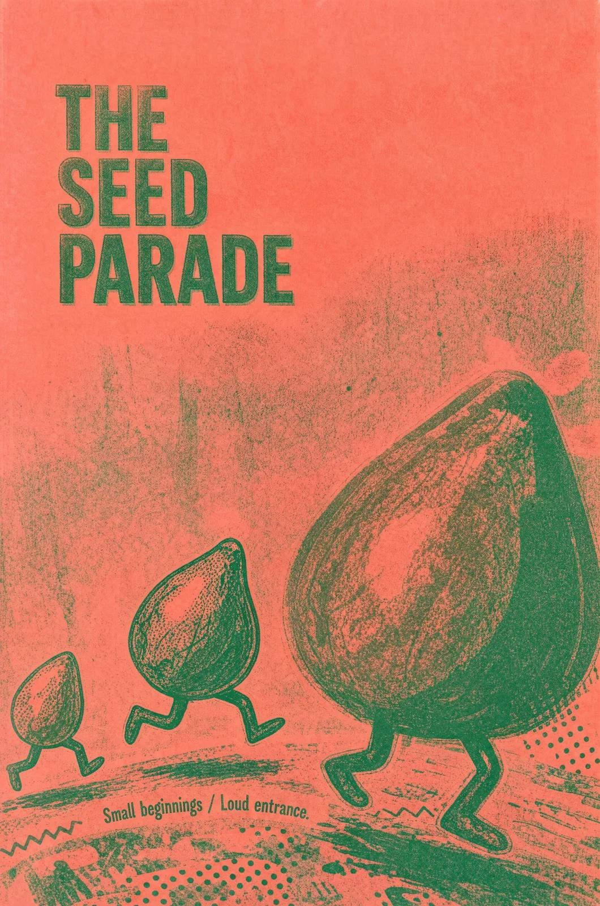

<!-- Generated by scripts/build-showcase.py from the model database. -->

```{=html}
<div class="showcase-detail"><nav class="showcase-breadcrumb" aria-label="Breadcrumb"><a href="/raw/showcase.html">Model Showcase</a><span aria-hidden="true">/</span><a href="/raw/showcase.html#family-flux">FLUX family</a></nav><header class="showcase-detail-header"><p class="showcase-domain">Image generation</p><h1>FLUX 3 Image</h1><p>FLUX 3 uses Self-Flow to learn from two noise levels</p><nav class="showcase-detail-actions" aria-label="On this page"><a href="#model-card">Model card</a><a href="#results">Results & examples</a><a href="#source-slides">Source slides</a><a href="#methods">Methods & sources</a></nav></header><section class="showcase-source-map" id="source-slides" aria-labelledby="source-slides-title"><h2 id="source-slides-title">Source slides</h2><ul><li><span>Model card</span><a href="/raw/lectures/01_intro/lecture01_part2_final_v3_showcase.html#/sc-t2i-flux-3-image" title="Slide ID: sc-t2i-flux-3-image">Model Showcase: Model Cards &amp; Results · slide 41</a><code>sc-t2i-flux-3-image</code></li><li><span>Results</span><a href="/raw/lectures/01_intro/lecture01_part2_final_v3_showcase.html#/sc-t2i-flux-3-image-results" title="Slide ID: sc-t2i-flux-3-image-results">Model Showcase: Model Cards &amp; Results · slide 42</a><code>sc-t2i-flux-3-image-results</code></li></ul></section>
```

```{=html}
<section class="showcase-section" id="model-card"><div class="showcase-section-heading"><h2>Model card</h2></div>
```

```{=html}
<article class="showcase-slide-source" data-presentation="intro-showcase" data-slide="sc-t2i-flux-3-image"><p class="showcase-slide-reference"><a href="/raw/lectures/01_intro/lecture01_part2_final_v3_showcase.html#/sc-t2i-flux-3-image" title="Slide ID: sc-t2i-flux-3-image">Model Showcase: Model Cards &amp; Results · slide 41</a></p><div class="showcase-source">
<div class="sc-body ds-body" data-company="black-forest-labs"><div class="ds-card"><div class="ds-head"><div class="sc-company" aria-label="Black Forest Labs" role="img"><span class="sc-company-name">Black Forest<small>Labs</small></span></div><p class="ds-kicker">GA date not stated</p><p class="ds-kicker ds-r">Hosted API</p><h3 class="ds-name">FLUX 3 Image</h3><p class="ds-lic">Public weights not found</p></div>
<div class="ds-row"><div class="ds-feat"><h4>Architecture</h4><p class="ds-st"><i class="sc-pip p"></i>Partial</p></div><div class="ds-spec ds-lead"><span class="ds-k">Family backbone</span><b class="ds-v">Multimodal flow</b></div><div class="ds-spec ds-gap"><span class="ds-k">Image transformer</span><b class="ds-v">Size not disclosed</b></div><div class="ds-spec ds-gap"><span class="ds-k">Encoder / VAE</span><b class="ds-v">Not disclosed</b></div></div>
<div class="ds-row"><div class="ds-feat"><h4>Data</h4><p class="ds-st"><i class="sc-pip p"></i>Partial</p></div><div class="ds-spec ds-lead"><span class="ds-k">Joint training modalities</span><b class="ds-v">Image · video · audio</b></div><div class="ds-spec ds-gap"><span class="ds-k">Corpus / source mix</span><b class="ds-v">Not disclosed</b></div><div class="ds-spec ds-gap"><span class="ds-k">Dataset licences</span><b class="ds-v">Not disclosed</b></div></div>
<div class="ds-row"><div class="ds-feat"><h4>Training</h4><p class="ds-st"><i class="sc-pip p"></i>Partial</p></div><div class="ds-spec ds-lead ds-part"><span class="ds-k">Family method</span><b class="ds-v">Self-Flow</b></div><div class="ds-spec ds-part"><span class="ds-k">Layout understanding</span><b class="ds-v">Vendor claim</b></div><div class="ds-spec ds-gap"><span class="ds-k">Recipe / FLOPs</span><b class="ds-v">Not disclosed</b></div></div>
<div class="ds-row"><div class="ds-feat"><h4>Inference</h4><p class="ds-st"><i class="sc-pip p"></i>Partial</p></div><div class="ds-spec ds-lead"><span class="ds-k">Output resolution</span><b class="ds-v">Up to 4K class</b></div><div class="ds-spec"><span class="ds-k">Input references</span><b class="ds-v">Up to 10</b></div><div class="ds-spec"><span class="ds-k">Per image at 1K</span><b class="ds-v">US$0.048</b></div></div>
<div class="ds-row"><div class="ds-feat"><h4>Tools</h4><p class="ds-st"><i class="sc-pip p"></i>Partial</p></div><div class="ds-spec ds-lead"><span class="ds-k">Layout controls</span><b class="ds-v">Bounding boxes</b></div><div class="ds-spec"><span class="ds-k">Web / image search</span><b class="ds-v">On by default</b></div><div class="ds-spec ds-part"><span class="ds-k">Outside-box pixels</span><b class="ds-v">May change</b></div></div></div></div>
<figure class="sc-evidence sc-evidence-strip"><div class="showcase-diagram-scroll" tabindex="0" role="region" aria-label="Diagram; scroll horizontally to inspect details"></div><a class="showcase-figure-link" href="/raw/lectures/01_intro/assets/showcase_evidence_20261124/t2i/flux-3-image.svg" target="_blank" rel="noopener">Open full-size figure</a></figure>
<div class="sc-study">
<table class="sc-study-table" data-numeric="2">
  <caption>How long does a one-reference edit take?</caption>
  <thead><tr><th scope="col">Model and setting</th><th scope="col">Mean latency (s)</th></tr></thead>
  <tbody>
  <tr><th scope="row">Krea 3 Fast</th><td>8.0</td></tr>
  <tr><th scope="row">Nano Banana 2.1</th><td>19.3</td></tr>
  <tr><th scope="row">FLUX 3 Image</th><td>41.1</td></tr>
  <tr><th scope="row">GPT Image 2.5 Flare · max</th><td>45.7</td></tr>
  </tbody>
</table>
<p class="sc-study-source"><a href="https://www.krea.ai/blog/krea-3-technical-report">Krea 3 technical report · figure 3</a> · 2K output · fal API</p>
</div>
<div class="fv-takeaway">Rich editing controls coexist with undisclosed model size and production recipe.</div>
<div class="fv-source"><a href="https://proceedings.mlr.press/v306/chefer26a.html">Self-Flow · fig. 3</a> · T2I_v1.1.xlsx · FLUX 3 Image · audit 18–19.10.2026 · <a href="https://docs.bfl.ai/flux_3/flux3_image_overview">Image overview</a> · <a href="https://bfl.ai/blog/flux-3">FLUX 3 post</a> · <a href="https://bfl.ai/models/flux-3-image">Box controls</a></div></div></article>
```

```{=html}
</section>
```

```{=html}
<section class="showcase-section" id="results"><div class="showcase-section-heading"><h2>Results & examples</h2></div>
```

```{=html}
<article class="showcase-slide-source" data-presentation="intro-showcase" data-slide="sc-t2i-flux-3-image-results"><p class="showcase-source-subtitle">Typography across two visual styles</p><p class="showcase-slide-reference"><a href="/raw/lectures/01_intro/lecture01_part2_final_v3_showcase.html#/sc-t2i-flux-3-image-results" title="Slide ID: sc-t2i-flux-3-image-results">Model Showcase: Model Cards &amp; Results · slide 42</a></p><div class="showcase-source">
<div class="sc-body sr-body" data-company="black-forest-labs">
<div class="sr-sidebar" role="group" aria-label="Model and reported metrics"><div class="sr-brand"><div aria-label="Black Forest Labs" class="sc-company" role="img"><span class="sc-company-name">Black Forest<small>Labs</small></span></div></div><div class="sr-model"><p>RESULTS · Text-to-image</p><h3>FLUX 3 Image</h3></div><div class="sr-metrics"><div class="sr-metric"><p class="sr-metric-label">Native sample size</p><p class="sr-metric-value">16.8 MP</p><p class="sr-metric-note">5456 × 3072 Soba-shop sample; separate from selected tiles. <a class="" href="https://bfl.ai/models/flux-3-image" target="_blank" rel="noopener">↗</a></p></div><div class="sr-metric"><p class="sr-metric-label">Reference images</p><p class="sr-metric-value">Up to 10</p><p class="sr-metric-note">Product-page capability; no quality benchmark given. <a class="" href="https://bfl.ai/models/flux-3-image" target="_blank" rel="noopener">↗</a></p></div></div></div>
<div class="sr-example"><div class="sr-stage sr-gallery"><figure><figcaption>Vintage sprinter postage stamp</figcaption></figure><figure><figcaption>The Seed Parade poster</figcaption></figure></div><p class="sr-caption">Read the stamp at the center of its green surround, then compare the tall type and restricted palette of the seed poster.</p></div></div>
<div class="fv-takeaway">Both designs come from the full FLUX 3 Image gallery.</div>
<div class="fv-source">Published example and reported metrics · checked 21.10.2026 · <a class="" href="https://bfl.ai/models/flux-3-image" target="_blank" rel="noopener">Example source</a></div></div></article>
```

```{=html}
</section>
```

```{=html}
<section class="showcase-section" id="methods"><div class="showcase-section-heading"><h2>Methods & sources</h2><p>Source notes, evaluation conditions and limitations from the presentation slides.</p></div>
```

<details class="showcase-notes">
<summary>Model card: Model Showcase: Model Cards &amp; Results · slide 41</summary>

**Table evidence.** Millon et al. measured mean elapsed seconds from request to completed output on an image-to-image workload with one reference and 2K output. The selected rows include the full FLUX 3 Image endpoint. This is Krea’s comparison and includes service latency. The paper does not supply a corresponding FLUX 3 GPU-only time or production model size. [Krea 3 technical report · figure 3](https://www.krea.ai/blog/krea-3-technical-report).

**Figure evidence.** Chefer et al., ICML 2026, figure 3, section 3.4 and equations 6–7. Dark blocks indicate the noisier tokens, pale blocks the cleaner ones. An exponential moving average of student weights supplies the teacher. BFL links Self-Flow to the FLUX 3 family in its July launch. This schematic describes the published method, whose experimental checkpoints differ from the commercial image endpoint. [Primary source](https://proceedings.mlr.press/v306/chefer26a.html).

**Historical audit.** This is a faithful conversion of the supplied T2I_v1.1.xlsx audit snapshot, checked by its author on 18 October 2026 and refined on 19 October 2026. It is not a fresh verification of these linked sources. “Not disclosed” means absent from the materials covered by that audit, not that the capability cannot exist. Known/Partial/Not disclosed measure disclosure, not model quality or full reproducibility. Prices, endpoints and limits are preserved as dated audit claims.

The datasheet is used because every category has some disclosure; it does not imply open weights. All five summary statuses remain Partial. Do not transfer Klein’s 5.6B count, local sampling controls or weights licence to full Image. The header deliberately gives no exact GA date.

**Exact scope and category provenance:** sheet `FLUX 3 Image`, identity row 2; `Сводка` row 9. Architecture / Data / Training / Inference / Tools = Partial / Partial / Partial / Partial / Partial.

**Row provenance and caveats (model-sheet row numbers):**

- Row 2: Only hosted flux-3-image; video, action and Image Klein are separate products.
- Row 6: Image generation is a distinct API endpoint.
- Row 7: Unified multimodal flow matching is a FLUX 3 family claim.
- Row 8: Full Image parameter count, layers, exact encoder/VAE and attention configuration are absent.
- Row 12: BFL describes joint image/video/audio learning with language for instructions and relationships.
- Row 13: Full corpus list, volumes, dataset licences and modality proportions are absent.
- Row 17: Self-Flow aligns generation and understanding; exact production recipe is absent.
- Row 18: Native layout/composition training is a vendor claim without quantitative recipe.
- Row 19: Increased compute/data is claimed; exact FLOPs, optimizer, schedule and cost are absent.
- Row 23: BFL primary materials do not state exact general availability date. OpenRouter reports 1 October 2026 and flux-3-image-20261001, but the workbook does not accept this secondary date as primary evidence.
- Row 24: Resolution classes 768sq/1k/1.5k/2k/4k correspond to approximately .6/1/2/4/16 MP, not fixed dimensions.
- Row 25: Native 2K/4K is a vendor claim; dimensions depend on aspect ratio.
- Row 26: Up to ten input images as URLs or base64.
- Row 27: Inputs must be at least 256×256 and at most 16 MP.
- Row 28: Full Image API uses aspect_ratio, resolution and images; it does not take seed, width or input_image.
- Row 29: version=latest; dated pinned versions are added as published.
- Row 30: BFL calculator snapshot on 19 October: USD per output .041 (768²), .048 (1K), .07 (1.5K), .10 (2K), .607 (4K).
- Row 34: Instruction edits, multiple targeted changes and reference composition are supported.
- Row 35: Boxes are [top,left,bottom,right] on a 0–1000 grid, with caption and JSON element table.
- Row 36: Source and target regions support moving, replacing and removing objects.
- Row 37: Pixels outside boxes are usually preserved, but shadows, reflections and nearby lighting can change.
- Row 38: grounding=true enables both web and image search by default; false disables both.
- Row 39: Prompt upsampling preserves custom element IDs and box coordinates.
- Row 40: Async API returns id/polling_url with Pending/Reasoning/Generating/Ready states; result URL lasts one hour.
- Row 41: API and Playground exist; a full Image checkpoint was not found. Klein weights are a separate product.

**Source URLs preserved from workbook HYPERLINK formulas:**

- [Source 1](https://docs.bfl.ai/flux_3/flux3_image_overview)
- [Source 2](https://bfl.ai/models/flux-3-image)
- [Source 3](https://bfl.ai/blog/flux-3)
- [Source 4](https://openrouter.ai/black-forest-labs/flux-3-image-20261001)
- [Source 5](https://docs.bfl.ai/api-reference/utility/generate-an-image-with-flux-3)
- [Source 6](https://docs.bfl.ai/quick_start/pricing)
- [Source 7](https://docs.bfl.ai/flux_3/flux3_image_generate)
- [Source 8](https://bfl.ai/pricing)
- [Source 9](https://docs.bfl.ai/flux_3/flux3_image_bounding_boxes)
- [Source 10](https://docs.bfl.ai/flux_3/flux3_image_layout)
- [Source 11](https://huggingface.co/black-forest-labs/flux-3-image-klein)

</details>

<details class="showcase-notes">
<summary>Results: Model Showcase: Model Cards &amp; Results · slide 42</summary>

Published results checked 21 October 2026. These are sourced examples and reported measurements; no models were run for this deck.


Official examples contrast a vintage sports stamp with a colourful seed-parade poster.


- **Native-resolution showcase: 5456 × 3072 / 16.8 MP **. Separate Soba shop example on the same page; not the resolution of these selected web assets. Attribution: output_characteristic. [Source](https://bfl.ai/models/flux-3-image).

- **Reference inputs: Up to 10 **. Product-page multi-reference capability. Attribution: output_characteristic. [Source](https://bfl.ai/models/flux-3-image).


**Example provenance and limitations.**

Both assets appear in the full FLUX 3 Image product showcase, separate from the Klein launch page.

Hosted model version is named, but the displayed gallery does not identify a dated API snapshot.

No image-quality score or timed test is published in the checked product-page prose.

The July multimodal FLUX 3 blog reports video preference results; those are not image-model metrics.

[Published media/source](https://cdn.sanity.io/images/2gpum2i6/production/96f1f4a6928343cb30d483f57ff25ccaf52ac956-1600x1600.webp): FLUX 3 Image: vintage sprinter stamp.. Rights: Public BFL showcase; page footer reserves rights. No separate demo-image licence identified. Attribute Black Forest Labs; model-weight licences are distinct.

[Published media/source](https://cdn.sanity.io/images/2gpum2i6/production/3e32b49291adc2702caf3be25aba17a1662fc907-1060x1600.webp): FLUX 3 Image: The Seed Parade poster.. Rights: Public BFL showcase; page footer reserves rights. No separate demo-image licence identified. Attribute Black Forest Labs; model-weight licences are distinct.

</details>

```{=html}
</section><nav class="showcase-bottom-nav" aria-label="More models"><a href="/raw/showcase.html">Back to all models</a><a href="/raw/lectures/01_intro/lecture01_part2_final_v3_showcase.html#/sc-t2i-flux-3-image">View source slide</a></nav></div>
```
