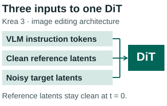
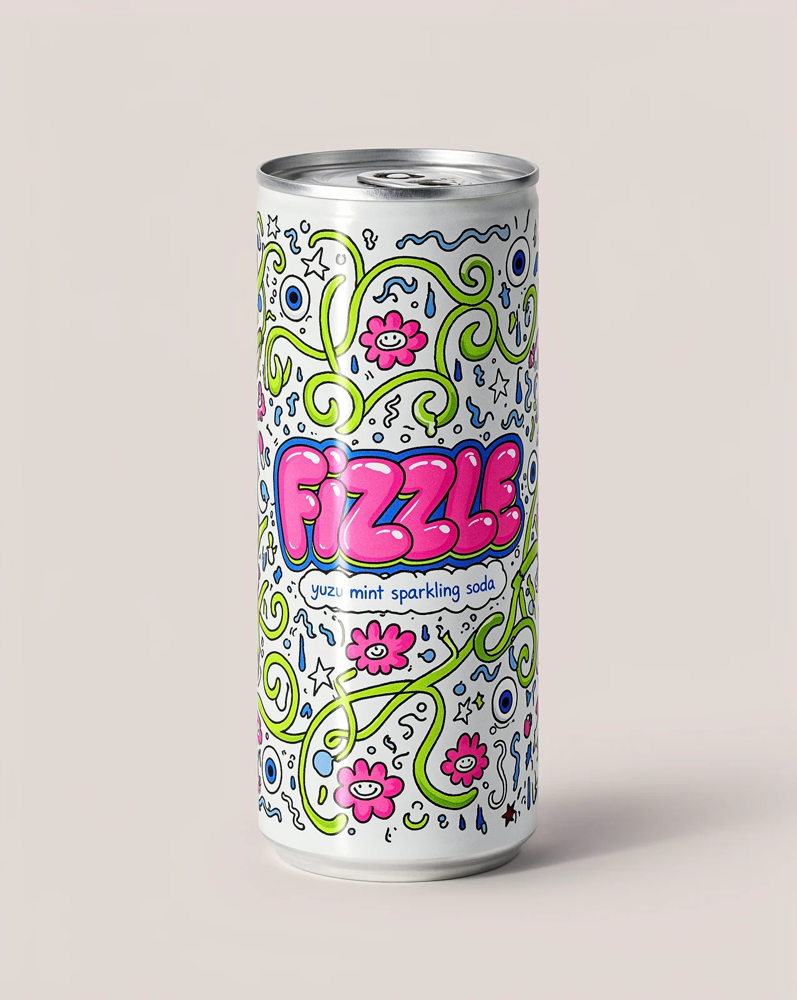
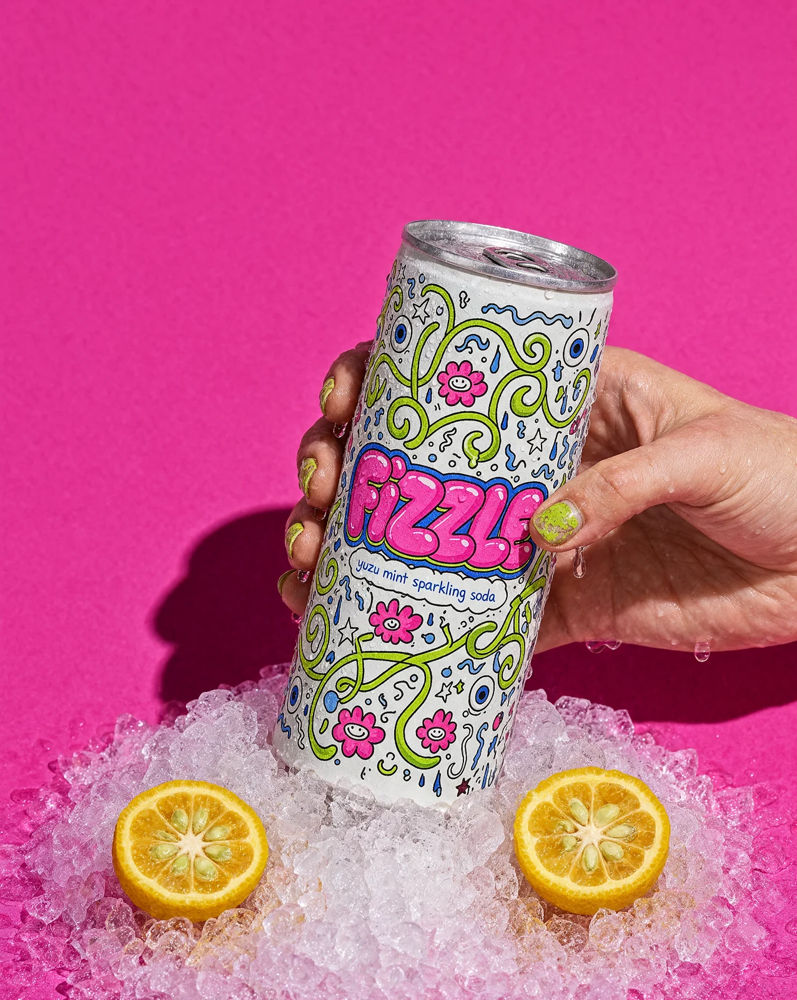

<!-- Generated by scripts/build-showcase.py from the model database. -->

```{=html}
<div class="showcase-detail"><nav class="showcase-breadcrumb" aria-label="Breadcrumb"><a href="/raw/showcase.html">Model Showcase</a><span aria-hidden="true">/</span><a href="/raw/showcase.html#family-krea">Krea family</a></nav><header class="showcase-detail-header"><p class="showcase-domain">Image generation</p><h1>Krea 3</h1><p>Krea 3 combines instructions and references in one transformer</p><nav class="showcase-detail-actions" aria-label="On this page"><a href="#model-card">Model card</a><a href="#results">Results & examples</a><a href="#source-slides">Source slides</a><a href="#methods">Methods & sources</a></nav></header><section class="showcase-source-map" id="source-slides" aria-labelledby="source-slides-title"><h2 id="source-slides-title">Source slides</h2><ul><li><span>Model card</span><a href="/raw/lectures/01_intro/lecture01_part2_final_v3_showcase.html#/sc-t2i-krea-3" title="Slide ID: sc-t2i-krea-3">Model Showcase: Model Cards &amp; Results · slide 45</a><code>sc-t2i-krea-3</code></li><li><span>Results</span><a href="/raw/lectures/01_intro/lecture01_part2_final_v3_showcase.html#/sc-t2i-krea-3-results" title="Slide ID: sc-t2i-krea-3-results">Model Showcase: Model Cards &amp; Results · slide 46</a><code>sc-t2i-krea-3-results</code></li></ul></section>
```

```{=html}
<section class="showcase-section" id="model-card"><div class="showcase-section-heading"><h2>Model card</h2></div>
```

```{=html}
<article class="showcase-slide-source" data-presentation="intro-showcase" data-slide="sc-t2i-krea-3"><p class="showcase-slide-reference"><a href="/raw/lectures/01_intro/lecture01_part2_final_v3_showcase.html#/sc-t2i-krea-3" title="Slide ID: sc-t2i-krea-3">Model Showcase: Model Cards &amp; Results · slide 45</a></p><div class="showcase-source">
<div class="sc-body bn-body bn-w2" data-company="krea"><div class="bn-id"><div class="bn-plate"><figure class="sc-evidence"><a class="showcase-figure-link" href="/raw/lectures/01_intro/assets/showcase_evidence_20261124/t2i/krea-3.svg" target="_blank" rel="noopener">Open full-size figure</a></figure></div><div class="bn-model"><p class="bn-kicker">Text-to-image</p><h3>Krea 3</h3><p class="bn-ids"><code>Krea 3</code><code>Berry: provider variant</code></p><div class="bn-facts"><p><span>Released</span><b class="bn-date">15.10.2026</b></p><p><span>Access</span><b>API · krea.ai</b></p><p><span>Weights</span><b class="bn-shut">not found</b></p></div></div></div><div class="bn-pub">
<div class="bn-tile bn-p bn-a"><div class="bn-head"><h4>Inference</h4><span class="sc-status"><i class="sc-pip p"></i>Partial</span></div><div class="bn-stat"><p class="bn-num">1K / 2K</p><p class="bn-cap">1K default · 10 aspect ratios</p></div><div class="bn-stat bn-rule"><p class="bn-num">$0.03</p><p class="bn-cap">per image at 1K, without references</p></div><p class="bn-item"><i class="sc-pip p"></i>Krea 3 Fast averaged 8.0 s on one-reference 2K edits via fal</p><p class="bn-item"><i class="sc-pip p"></i>The technical report supports up to 8 references</p><p class="bn-gap">Same seed need not repeat the result</p></div>
<div class="bn-tile bn-p bn-b"><div class="bn-head"><h4>Tools</h4><span class="sc-status"><i class="sc-pip p"></i>Partial</span></div><div class="bn-items2"><p class="bn-item"><i class="sc-pip p"></i>Direct API: beta-workspace early access</p><p class="bn-item"><i class="sc-pip k"></i>Node SDK and async job polling</p><p class="bn-item"><i class="sc-pip p"></i>Regional edits: experimental at provider</p><p class="bn-item"><i class="sc-pip k"></i>LoRA / style_urls return 422</p></div></div>
<div class="bn-tile bn-p bn-c"><div class="bn-head"><h4>Training</h4><span class="sc-status"><i class="sc-pip p"></i>Partial</span></div><div class="bn-stat"><p class="bn-num">2K</p><p class="bn-cap">Training resolution stated in launch post</p></div><p class="bn-gap">Krea 2 pretraining → edit pairs → RL and preference optimization</p></div></div>
<div class="bn-strip"><div class="bn-strip-label"><span>Nov. report</span><b>2<small>updates</small></b></div><div class="bn-cell"><h4><i class="sc-pip p"></i>Architecture · Partial</h4><p>Single-stream diffusion transformer with image-conditioned instructions</p></div><div class="bn-cell"><h4><i class="sc-pip p"></i>Data · Partial</h4><p>Mining, two VLM filters and deduplication retain 0.17% of candidate pairs</p></div></div></div>
<div class="sc-study">
<table class="sc-study-table" data-numeric="2">
  <caption>Which mined image pairs survive?</caption>
  <thead><tr><th scope="col">Selection stage</th><th scope="col">Share kept at stage</th></tr></thead>
  <tbody>
  <tr><th scope="row">DINOv3 similarity</th><td>45%</td></tr>
  <tr><th scope="row">Qwen3.5-9B filter</th><td>4.7%</td></tr>
  <tr><th scope="row">Qwen3.6-27B audit</th><td>45%</td></tr>
  <tr><th scope="row">Target deduplication</th><td>18%</td></tr>
  </tbody>
</table>
<p class="sc-study-source"><a href="https://www.krea.ai/blog/krea-3-technical-report">Krea 3 report · figure 12</a> · 0.17% of initial candidates remain</p>
</div>
<div class="fv-takeaway">A clean copy of each reference lets the transformer preserve detail while it denoises the target.</div>
<div class="fv-source"><a href="https://www.krea.ai/blog/krea-3-technical-report">Krea 3 report · figs. 5 &amp; 12</a> · T2I_v1.1.xlsx · Krea 3 · audit 18–19.10.2026 · <a href="https://www.krea.ai/blog/introducing-krea-3">Launch post</a> · <a href="https://www.krea.ai/docs/developers/krea-3/overview">Direct API</a> · <a href="https://replicate.com/krea/krea-3/readme">Provider card</a></div></div></article>
```

```{=html}
</section>
```

```{=html}
<section class="showcase-section" id="results"><div class="showcase-section-heading"><h2>Results & examples</h2></div>
```

```{=html}
<article class="showcase-slide-source" data-presentation="intro-showcase" data-slide="sc-t2i-krea-3-results"><p class="showcase-source-subtitle">From packshot to campaign scene</p><p class="showcase-slide-reference"><a href="/raw/lectures/01_intro/lecture01_part2_final_v3_showcase.html#/sc-t2i-krea-3-results" title="Slide ID: sc-t2i-krea-3-results">Model Showcase: Model Cards &amp; Results · slide 46</a></p><div class="showcase-source">
<div class="sc-body sr-body" data-company="krea">
<div class="sr-sidebar" role="group" aria-label="Model and reported metrics"><div class="sr-brand"><div aria-label="Krea AI" class="sc-company" role="img"></div></div><div class="sr-model"><p>RESULTS · Text-to-image</p><h3>Krea 3</h3></div><div class="sr-metrics"><div class="sr-metric"><p class="sr-metric-label">Edit turnaround</p><p class="sr-metric-value">Under 8 s</p><p class="sr-metric-note">Vendor: most edits, native 2K, end-to-end. <a class="" href="https://www.krea.ai/blog/introducing-krea-3" target="_blank" rel="noopener">↗</a></p></div><div class="sr-metric"><p class="sr-metric-label">Native output</p><p class="sr-metric-value">2K</p><p class="sr-metric-note">Published editing resolution; not a quality score. <a class="" href="https://www.krea.ai/blog/introducing-krea-3" target="_blank" rel="noopener">↗</a></p></div><div class="sr-metric"><p class="sr-metric-label">Reference images</p><p class="sr-metric-value">Up to 6</p><p class="sr-metric-note">Published maximum per edit. <a class="" href="https://www.krea.ai/blog/introducing-krea-3" target="_blank" rel="noopener">↗</a></p></div></div></div>
<div class="sr-example"><div class="sr-stage sr-gallery"><figure><figcaption>Input · soda packshot</figcaption></figure><figure><figcaption>Edit · iced campaign scene</figcaption></figure></div><p class="sr-caption">The edit places the can in a hand over crushed ice and cut yuzu. Compare the label lettering and doodles across the pair.</p></div></div>
<div class="fv-takeaway">Krea uses the same product in a new setting. The source identifies the model at family level.</div>
<div class="fv-source">Published example and reported metrics · checked 21.10.2026 · <a class="" href="https://www.krea.ai/blog/introducing-krea-3" target="_blank" rel="noopener">Example source</a></div></div></article>
```

```{=html}
</section>
```

```{=html}
<section class="showcase-section" id="methods"><div class="showcase-section-heading"><h2>Methods & sources</h2><p>Source notes, evaluation conditions and limitations from the presentation slides.</p></div>
```

<details class="showcase-notes">
<summary>Model card: Model Showcase: Model Cards &amp; Results · slide 45</summary>

**Table evidence.** The study starts this mining path with SigLIP 2 candidate pairs and reports approximately 45%, 4.7%, 45% and 18% kept at each successive stage. Each row uses its own incoming pool as denominator. The cumulative retention is 0.17%, reported by the authors. The figures apply to the mined-pair stream, one source of training data. [Krea 3 report · figure 12](https://www.krea.ai/blog/krea-3-technical-report).

**Figure evidence.** Millon et al., Krea 3 Technical Report, November 3, 2026. Figure 5 explains the three paths. The VLM receives instructions and downsampled references. The DiT receives instruction tokens from that VLM and both clean reference and noisy target latents. Figure 12 describes filtering of a separate pool of mined candidate pairs. The reported survival rate is specific to that mining pipeline. [Primary source](https://www.krea.ai/blog/krea-3-technical-report).

**Historical audit (October).** The November 3 report expanded both Architecture and Data to Partial. Earlier disclosure labels below describe October only. This is a faithful conversion of the supplied T2I_v1.1.xlsx audit snapshot, checked by its author on 18 October 2026 and refined on 19 October 2026. It is not a fresh verification of these linked sources. “Not disclosed” means absent from the materials covered by that audit, not that the capability cannot exist. Known/Partial/Not disclosed measure disclosure, not model quality or full reproducibility. Prices, endpoints and limits are preserved as dated audit claims.

The workbook reports that the Krea User Guide could not be opened and does not use it as factual evidence; it relies on launch, direct API and provider card. Do not treat provider Berry/Jam names as separate published weight releases. No missing feature is asserted impossible: the audit describes what its selected sources disclose.

**Exact scope and category provenance:** sheet `Krea 3`, identity row 2; `Сводка` row 11. Architecture / Data / Training / Inference / Tools = Not disclosed / Not disclosed / Partial / Partial / Partial.

**Row provenance and caveats (model-sheet row numbers):**

- Row 2: Krea 3 includes direct API and provider variants; API launch date 15 October 2026.
- Row 6: Supports instruction editing and T2I without references.
- Row 7: Backbone and parameter count are absent from the launch.
- Row 8: Encoders, VAE and latents are absent.
- Row 9: Replicate Berry targets quality; faster Jam is only announced.
- Row 13: Dataset names and size are absent.
- Row 14: Cleaning/filtering are absent.
- Row 15: Data licensing is absent.
- Row 16: Synthetic data and mixture are absent.
- Row 17: Data for future drawn/text instructions is still being created; it does not disclose current Krea 3 corpus.
- Row 21: Launch explicitly states training at 2K resolution.
- Row 22: Loss and optimizer are absent.
- Row 23: RL/preference training is absent.
- Row 24: Distillation is not described.
- Row 25: Hardware and compute are absent.
- Row 29: 1K/2K output; API default 1K.
- Row 30: Most 2K edits under eight seconds end-to-end is Krea’s claim, not an independently validated SLA.
- Row 31: Launch accepts up to six references while direct API says eight; surface/document dependence is unresolved.
- Row 32: References are limited to 4 MP; with five or more, each long side is at most 1536 px.
- Row 33: Ten aspect ratios; width/height up to 4096 are rounded to a supported 1K/2K canvas.
- Row 34: fast expands prompts; high spends more time planning complex edits.
- Row 35: Seed repetition does not guarantee identical output because prompts are expanded.
- Row 36: Negative prompt limit is 1024 characters.
- Row 37: Base USD output price without references: .03 for 1K, .06 for 2K.
- Row 38: Direct API add-ons: each 1K reference +.02, 2K reference +.07; high reasoning +.02 per generation.
- Row 39: Steps, sampler and CFG are absent from reviewed API parameters.
- Row 43: Direct endpoint POST /generate/image/krea/krea-3 is early access for beta workspaces.
- Row 44: Node `@krea-ai/sdk`, GET /jobs/{id} polling, result.urls output.
- Row 45: Krea promises unchanged-pixel preservation; Replicate calls regional edit experimental, slower and lower quality.
- Row 46: LoRA and style_urls currently return 422; future support is only promised.
- Row 47: Enterprise zero-data-retention uses X-Api-Zero-Data-Retention: 1 and base64 data URI references only.
- Row 48: Krea 3 was not found among fifteen models on official HF; an open weights licence is unconfirmed.
- Row 49: krea.ai and named providers offer access.
- Row 50: Krea 3 was not found among 23 reviewed official GitHub repos; local inference code not established.

**Source URLs preserved from workbook HYPERLINK formulas:**

- [Source 1](https://replicate.com/krea/krea-3/readme)
- [Source 2](https://www.krea.ai/blog/introducing-krea-3)
- [Source 3](https://www.krea.ai/docs/developers/krea-3/overview)
- [Source 4](https://www.krea.ai/docs/developers/job-lifecycle)
- [Source 5](https://huggingface.co/krea/models)
- [Source 6](https://github.com/orgs/krea-ai/repositories?type=all)

</details>

<details class="showcase-notes">
<summary>Results: Model Showcase: Model Cards &amp; Results · slide 46</summary>

Published results checked 21 October 2026. These are sourced examples and reported measurements; no models were run for this deck.


A verified product before/after demonstrates recontextualising a can while retaining its design.


- **Edit turnaround: Under 8 seconds **. Most edits, end-to-end at native 2K. Comparison table uses Krea edit jobs, Sep 24–Oct 1, 2026, queue included; no sample count. Attribution: vendor_latency_claim. [Source](https://www.krea.ai/blog/introducing-krea-3).

- **Native output: 2K **. Published native editing resolution; not an image-quality score. Attribution: output_characteristic. [Source](https://www.krea.ai/blog/introducing-krea-3).

- **Reference inputs: Up to 6 **. Maximum references per edit in the launch description. Attribution: output_characteristic. [Source](https://www.krea.ai/blog/introducing-krea-3).


**Example provenance and limitations.**

The Krea 3 launch presents a source/product edit pair in the Your product stays your product section; page explicitly attributes its edited images to Krea 3.

This is image editing, not an unconditioned text-to-image sample.

Vendor latency claim is not a locally reproduced benchmark.

[Published media/source](https://s.krea.ai/blog-posts/krea-3/soda-before.webp): Input: product packshot.. Rights: Public vendor showcase. No explicit image-reuse licence identified on the checked page; retain source attribution. Model/weights licences do not establish a licence for these page assets.

[Published media/source](https://s.krea.ai/blog-posts/krea-3/soda-after.webp): Krea 3: product in an iced campaign scene.. Rights: Public vendor showcase. No explicit image-reuse licence identified on the checked page; retain source attribution. Model/weights licences do not establish a licence for these page assets.

</details>

```{=html}
</section><nav class="showcase-bottom-nav" aria-label="More models"><a href="/raw/showcase.html">Back to all models</a><a href="/raw/lectures/01_intro/lecture01_part2_final_v3_showcase.html#/sc-t2i-krea-3">View source slide</a></nav></div>
```
