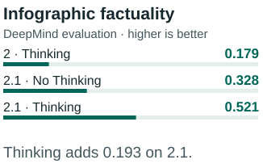
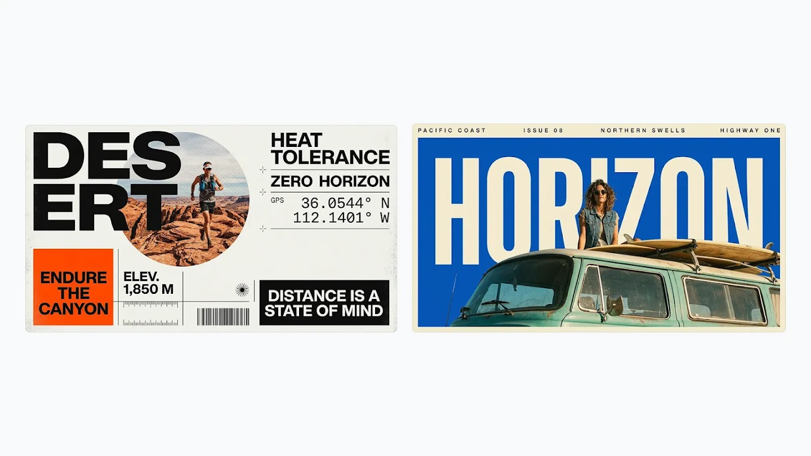

<!-- Generated by scripts/build-showcase.py from the model database. -->

```{=html}
<div class="showcase-detail"><nav class="showcase-breadcrumb" aria-label="Breadcrumb"><a href="/raw/showcase.html">Model Showcase</a><span aria-hidden="true">/</span><a href="/raw/showcase.html#family-gemini">Gemini family</a></nav><header class="showcase-detail-header"><p class="showcase-domain">Image generation</p><h1>Nano Banana 2.1</h1><p>Thinking improves infographic factuality in Nano Banana 2.1</p><nav class="showcase-detail-actions" aria-label="On this page"><a href="#model-card">Model card</a><a href="#results">Results & examples</a><a href="#source-slides">Source slides</a><a href="#methods">Methods & sources</a></nav></header><section class="showcase-source-map" id="source-slides" aria-labelledby="source-slides-title"><h2 id="source-slides-title">Source slides</h2><ul><li><span>Model card</span><a href="/raw/lectures/01_intro/lecture01_part2_final_v3_showcase.html#/sc-t2i-nano-banana-21" title="Slide ID: sc-t2i-nano-banana-21">Model Showcase: Model Cards &amp; Results · slide 35</a><code>sc-t2i-nano-banana-21</code></li><li><span>Results</span><a href="/raw/lectures/01_intro/lecture01_part2_final_v3_showcase.html#/sc-t2i-nano-banana-21-results" title="Slide ID: sc-t2i-nano-banana-21-results">Model Showcase: Model Cards &amp; Results · slide 36</a><code>sc-t2i-nano-banana-21-results</code></li></ul></section>
```

```{=html}
<section class="showcase-section" id="model-card"><div class="showcase-section-heading"><h2>Model card</h2></div>
```

```{=html}
<article class="showcase-slide-source" data-presentation="intro-showcase" data-slide="sc-t2i-nano-banana-21"><p class="showcase-slide-reference"><a href="/raw/lectures/01_intro/lecture01_part2_final_v3_showcase.html#/sc-t2i-nano-banana-21" title="Slide ID: sc-t2i-nano-banana-21">Model Showcase: Model Cards &amp; Results · slide 35</a></p><div class="showcase-source">
<div class="sc-body bn-body bn-w2" data-company="google-deepmind"><div class="bn-id"><div class="bn-plate"><figure class="sc-evidence"><a class="showcase-figure-link" href="/raw/lectures/01_intro/assets/showcase_evidence_20261124/t2i/nano-banana-21.svg" target="_blank" rel="noopener">Open full-size figure</a></figure></div><div class="bn-model"><p class="bn-kicker">Text-to-image</p><h3>Nano Banana 2.1</h3><p class="bn-ids"><code>gemini-nano-banana-2.1</code></p><div class="bn-facts"><p><span>Card date</span><b class="bn-date">06.10.2026*</b></p><p><span>Access</span><b>Gemini API</b></p><p><span>Weights</span><b class="bn-shut">not found</b></p></div></div></div><div class="bn-pub">
<div class="bn-tile bn-p bn-a"><div class="bn-head"><h4>Inference</h4><span class="sc-status"><i class="sc-pip p"></i>Partial</span></div><div class="bn-stat"><p class="bn-num">1K–4K</p><p class="bn-cap">14 aspect ratios; 1K default</p></div><div class="bn-stat bn-rule"><p class="bn-num">$0.0336</p><p class="bn-cap">per 1K output image · Standard USD</p></div><p class="bn-item"><i class="sc-pip k"></i>14 refs: up to 4 characters + 10 objects</p><p class="bn-item"><i class="sc-pip p"></i>API limits differ from the model card</p><p class="bn-gap">No reproducible latency, steps or CFG</p></div>
<div class="bn-tile bn-p bn-b"><div class="bn-head"><h4>Tools</h4><span class="sc-status"><i class="sc-pip p"></i>Partial</span></div><div class="bn-items2"><p class="bn-item"><i class="sc-pip k"></i>Interactions API; multi-turn edits</p><p class="bn-item"><i class="sc-pip k"></i>Web / Image Search grounding</p><p class="bn-item"><i class="sc-pip k"></i>Batch API; SynthID</p><p class="bn-item"><i class="sc-pip p"></i>Cloud access; weights not found</p></div></div>
<div class="bn-tile bn-p bn-c"><div class="bn-head"><h4>Architecture</h4><span class="sc-status"><i class="sc-pip p"></i>Partial</span></div><div class="bn-items2"><p class="bn-item"><i class="sc-pip k"></i>Based on Gemini 3.6 Flash</p><p class="bn-item"><i class="sc-pip p"></i>MoE appears only in linked Gemini 3 Pro context</p></div><p class="bn-gap">Exact image component and size absent</p></div></div>
<div class="bn-strip"><div class="bn-strip-label"><span>Not disclosed</span><b>2<small>of 5</small></b></div><div class="bn-cell"><h4><i class="sc-pip n"></i>Data</h4><p>No corpus disclosure for exact 2.1</p></div><div class="bn-cell"><h4><i class="sc-pip n"></i>Training</h4><p>No image recipe or compute for 2.1</p></div></div></div>
<div class="sc-study">
<table class="sc-study-table" data-numeric="2 3">
  <caption>How Thinking changes editing preference</caption>
  <thead><tr><th scope="col">Editing task</th><th scope="col">No Thinking</th><th scope="col">Thinking</th></tr></thead>
  <tbody>
  <tr><th scope="row">General editing</th><td>980 ± 15</td><td>1026 ± 12</td></tr>
  <tr><th scope="row">Single character</th><td>1021 ± 14</td><td>1028 ± 14</td></tr>
  <tr><th scope="row">Multiple characters</th><td>1068 ± 14</td><td>1106 ± 14</td></tr>
  <tr><th scope="row">Product identity</th><td>981 ± 18</td><td>1024 ± 18</td></tr>
  </tbody>
</table>
<p class="sc-study-source"><a href="https://deepmind.google/models/model-cards/nano-banana-2-1/">DeepMind · Editing results</a> · Preference rating ↑ · Oct. 2026</p>
</div>
<div class="fv-takeaway">A linked family card provides context, not the exact image model’s recipe.</div>
<div class="fv-source"><a href="https://deepmind.google/models/model-cards/nano-banana-2-1/">DeepMind · evaluation results</a> · T2I_v1.1.xlsx · Nano Banana 2.1 · audit 18–19.10.2026 · <a href="https://ai.google.dev/gemini-api/docs/models/gemini-nano-banana-2.1">API card</a> · <a href="https://deepmind.google/models/model-cards/nano-banana-2-1/">Model card</a> · <a href="https://ai.google.dev/gemini-api/docs/pricing">Pricing</a></div></div></article>
```

```{=html}
</section>
```

```{=html}
<section class="showcase-section" id="results"><div class="showcase-section-heading"><h2>Results & examples</h2></div>
```

```{=html}
<article class="showcase-slide-source" data-presentation="intro-showcase" data-slide="sc-t2i-nano-banana-21-results"><p class="showcase-source-subtitle">Design briefs become finished posters</p><p class="showcase-slide-reference"><a href="/raw/lectures/01_intro/lecture01_part2_final_v3_showcase.html#/sc-t2i-nano-banana-21-results" title="Slide ID: sc-t2i-nano-banana-21-results">Model Showcase: Model Cards &amp; Results · slide 36</a></p><div class="showcase-source">
<div class="sc-body sr-body" data-company="google-deepmind">
<div class="sr-sidebar" role="group" aria-label="Model and reported metrics"><div class="sr-brand"><div aria-label="Google DeepMind" class="sc-company" role="img"></div></div><div class="sr-model"><p>RESULTS · Text-to-image</p><h3>Nano Banana 2.1</h3></div><div class="sr-metrics"><div class="sr-metric"><p class="sr-metric-label">T2I preference</p><p class="sr-metric-value">1050 ± 14 Elo</p><p class="sr-metric-note">Thinking; Google SxS human evaluation, Oct 2026. <a class="" href="https://deepmind.google/models/model-cards/nano-banana-2-1/" target="_blank" rel="noopener">↗</a></p></div><div class="sr-metric"><p class="sr-metric-label">Infographic design</p><p class="sr-metric-value">1048 ± 17 Elo</p><p class="sr-metric-note">Thinking; vendor evaluation, comparison-pool specific. <a class="" href="https://deepmind.google/models/model-cards/nano-banana-2-1/" target="_blank" rel="noopener">↗</a></p></div><div class="sr-metric"><p class="sr-metric-label">General editing</p><p class="sr-metric-value">1026 ± 12 Elo</p><p class="sr-metric-note">Thinking; Google human evaluation, Oct 2026. <a class="" href="https://deepmind.google/models/model-cards/nano-banana-2-1/" target="_blank" rel="noopener">↗</a></p></div></div></div>
<div class="sr-example"><div class="sr-stage"></div><p class="sr-caption">Compare the split word DESERT with the title HORIZON. In each poster, the lettering shares the composition with the photograph.</p></div></div>
<div class="fv-takeaway">The posters illustrate layout. DeepMind evaluated the Thinking configuration separately for the scores at left.</div>
<div class="fv-source">Published example and reported metrics · checked 21.10.2026 · <a class="" href="https://deepmind.google/models/gemini-image/flash/" target="_blank" rel="noopener">Example source</a></div></div></article>
```

```{=html}
</section>
```

```{=html}
<section class="showcase-section" id="methods"><div class="showcase-section-heading"><h2>Methods & sources</h2><p>Source notes, evaluation conditions and limitations from the presentation slides.</p></div>
```

<details class="showcase-notes">
<summary>Model card: Model Showcase: Model Cards &amp; Results · slide 35</summary>

**Table evidence.** The four selected rows are General Editing, Single-Character Consistency, Multi-Character Consistency, and Product Consistency. Both columns are for Nano Banana 2.1. Plus/minus intervals are reproduced as reported. The editing preference scores are on a different scale from infographic factuality in the figure. Numerical differences in point estimates do not establish statistical significance. [DeepMind · Editing results](https://deepmind.google/models/model-cards/nano-banana-2-1/).

**Figure evidence.** The text-to-image results table reports infographic factuality separately from the design-preference rating. Here all bars are the factuality score. Relative to 2.1 without Thinking, 2.1 with Thinking gains 0.193 on this measure. The poster gallery illustrates graphic design and was not scored for the lecture. [Primary source](https://deepmind.google/models/model-cards/nano-banana-2-1/).

**Historical audit.** This is a faithful conversion of the supplied T2I_v1.1.xlsx audit snapshot, checked by its author on 18 October 2026 and refined on 19 October 2026. It is not a fresh verification of these linked sources. “Not disclosed” means absent from the materials covered by that audit, not that the capability cannot exist. Known/Partial/Not disclosed measure disclosure, not model quality or full reproducibility. Prices, endpoints and limits are preserved as dated audit claims.

The visible asterisk marks the 6 October documentation date. Although some rows contain family-level evidence, the supplied summary explicitly rates exact-version Data and Training as not disclosed. Preserve that expert judgment rather than counting partial rows.

**Exact scope and category provenance:** sheet `Nano Banana 2.1`, identity row 2; `Сводка` row 6. Architecture / Data / Training / Inference / Tools = Partial / Not disclosed / Not disclosed / Partial / Partial.

**Row provenance and caveats (model-sheet row numbers):**

- Row 2: The date is the model-card/API-document date, not an independently established launch date.
- Row 6: Stable API ID gemini-nano-banana-2.1.
- Row 7: Native multimodal image generation/editing also returns text.
- Row 8: The “based on” chain is 2.1 → Gemini 3.6 Flash → 3.5 Flash → 3 Flash → 3 Pro.
- Row 9: Sparse MoE Transformer is described at Gemini 3 Pro; the exact 2.1 image component is not independently specified.
- Row 10: Parameter and expert counts are absent.
- Row 11: Encoders, VAE and latents are absent.
- Row 15: Gemini 3 Pro lists web text, code, images, audio and video; this is not an exact 2.1 corpus disclosure.
- Row 16: Open, crawled, licensed, user, internal and synthetic source categories belong to Gemini 3 Pro context.
- Row 17: 2.1 corpus size and proportions are absent.
- Row 18: Related cards discuss deduplication, robots.txt, quality and safety filters; exact 2.1 procedures and thresholds are absent.
- Row 19: 2.1 training pairs, captions and masks are absent.
- Row 20: Gemini 3 Pro mentions commercial licences, but the exact 2.1 dataset/licence list is absent.
- Row 21: Gemini 3.6 Flash cutoff dates do not establish an image-data cutoff for 2.1.
- Row 25: SFT and RL are described for Gemini 3 Pro, without exact 2.1 post-training confirmation.
- Row 26: Image loss and distillation recipe are absent.
- Row 27: TPU, JAX and ML Pathways come from related Gemini cards, not a confirmed 2.1 configuration.
- Row 28: 2.1 FLOPs, duration and cost are absent.
- Row 32: 1K/2K/4K outputs, default 1K.
- Row 33: Fourteen aspect ratios include extreme 1:8 and 8:1.
- Row 34: Up to 14 references: four characters and ten objects.
- Row 35: Thinking levels minimal/medium/high; default medium. Thinking is not a diffusion-step count.
- Row 36: API limits are 131072 input and 32768 output tokens.
- Row 37: Model card instead gives up to 1M context and 64K text output; the workbook prioritizes API limits for integration.
- Row 38: Flash-speed is not a reproducible latency or SLA.
- Row 39: Diffusion steps, sampler and CFG are undisclosed.
- Row 40: Standard USD output prices: 1K 0.0336, 2K 0.0504, 4K 0.113. Input $1.50/1M and text/thinking $7.50/1M are separate.
- Row 41: Guide says 2520 tokens for 4K; Pricing says 3780. The workbook uses the published 4K price rather than calculating from disputed token counts.
- Row 42: The card notes small-text, identity, spatial and masked/doodle-edit errors.
- Row 46: Interactions API has official Python, JavaScript, Java, Go and REST examples.
- Row 48: Multi-turn uses previous_interaction_id; local edits use semantic masking.
- Row 49: Search grounding excludes web photos of real people for image-grounding.
- Row 50: Batch API supported.
- Row 51: No weight download offered; cloud use is governed by Gemini API Terms.
- Row 52: Generated images contain SynthID.

**Source URLs preserved from workbook HYPERLINK formulas:**

- [Source 1](https://ai.google.dev/gemini-api/docs/models/gemini-nano-banana-2.1)
- [Source 2](https://deepmind.google/models/model-cards/nano-banana-2-1/)
- [Source 3](https://deepmind.google/models/model-cards/gemini-3-6-flash/)
- [Source 4](https://storage.googleapis.com/deepmind-media/Model-Cards/Gemini-3-Pro-Model-Card.pdf)
- [Source 5](https://storage.googleapis.com/deepmind-media/Model-Cards/Gemini-3-Flash-Model-Card.pdf)
- [Source 6](https://ai.google.dev/gemini-api/docs/image-generation)
- [Source 7](https://ai.google.dev/gemini-api/docs/pricing)
- [Source 8](https://ai.google.dev/gemini-api/terms)

</details>

<details class="showcase-notes">
<summary>Results: Model Showcase: Model Cards &amp; Results · slide 36</summary>

Published results checked 21 October 2026. These are sourced examples and reported measurements; no models were run for this deck.


A paired outdoor-sports and coastal-travel poster showcase demonstrates composition and typography.


- **T2I overall preference: 1050 ± 14 Elo **. October 2026; side-by-side human evaluation. Elo is specific to this comparison pool. Attribution: vendor_internal_evaluation. [Source](https://deepmind.google/models/model-cards/nano-banana-2-1/).

- **Infographic design: 1048 ± 17 Elo **. Same model-card human evaluation; not a universal cross-vendor score. Attribution: vendor_internal_evaluation. [Source](https://deepmind.google/models/model-cards/nano-banana-2-1/).

- **General editing: 1026 ± 12 Elo **. October 2026 model-card editing evaluation. Attribution: vendor_internal_evaluation. [Source](https://deepmind.google/models/model-cards/nano-banana-2-1/).


**Example provenance and limitations.**

Selected image is slide 1 under the dedicated Introducing Nano Banana 2.1 section, not the older Nano Banana 2 hero or performance section.

Showcase does not disclose Thinking setting for these specific images. Metrics refer to the Thinking configuration.

The generic product page still contains Gemini 3.1 Flash Image / Nano Banana 2 charts; those are excluded.

[Published media/source](https://lh3.googleusercontent.com/qYB1K6_eqd8ofMr69hQFbUgdUbVn7me2LIjpxGrdznoZyVH1QLUhOD8W-mOAVpLp9I8PwNwk7YF-0wByFpySk1AomfAIrTIXzehj4cpbr3F1jaQvOg=w1440-h810-n-nu): Nano Banana 2.1: DESERT and HORIZON poster examples.. Rights: Public vendor showcase. No explicit image-reuse licence identified on the checked page; retain source attribution. Model/weights licences do not establish a licence for these page assets.

</details>

```{=html}
</section><nav class="showcase-bottom-nav" aria-label="More models"><a href="/raw/showcase.html">Back to all models</a><a href="/raw/lectures/01_intro/lecture01_part2_final_v3_showcase.html#/sc-t2i-nano-banana-21">View source slide</a></nav></div>
```
