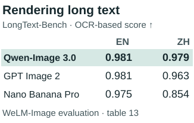
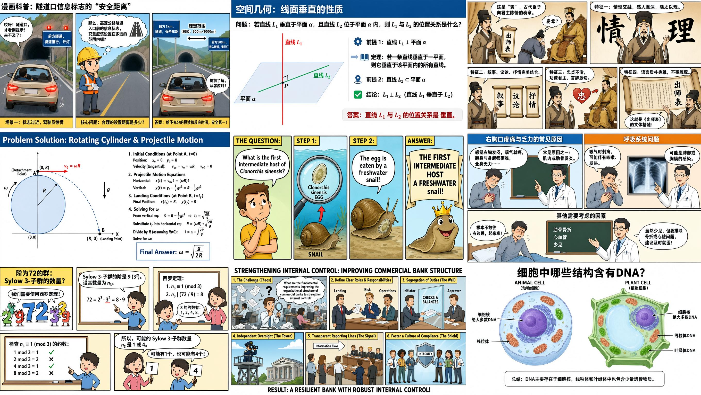
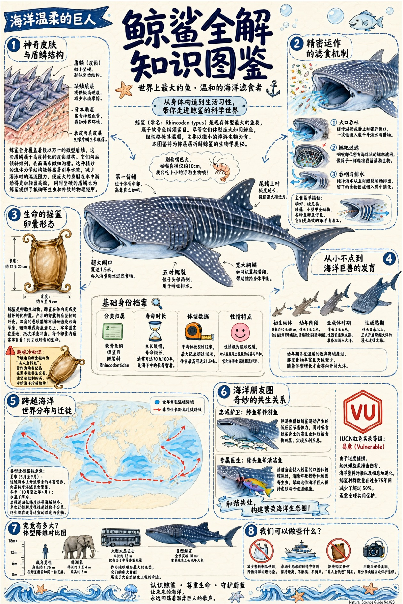

<!-- Generated by scripts/build-showcase.py from the model database. -->

```{=html}
<div class="showcase-detail"><nav class="showcase-breadcrumb" aria-label="Breadcrumb"><a href="/raw/showcase.html">Model Showcase</a><span aria-hidden="true">/</span><a href="/raw/showcase.html#family-qwen">Qwen family</a></nav><header class="showcase-detail-header"><p class="showcase-domain">Image generation</p><h1>Qwen-Image 3.0</h1><p>Qwen-Image 3.0 renders long text in English and Chinese</p><nav class="showcase-detail-actions" aria-label="On this page"><a href="#model-card">Model card</a><a href="#results">Results & examples</a><a href="#source-slides">Source slides</a><a href="#methods">Methods & sources</a></nav></header><section class="showcase-source-map" id="source-slides" aria-labelledby="source-slides-title"><h2 id="source-slides-title">Source slides</h2><ul><li><span>Model card</span><a href="/raw/lectures/01_intro/lecture01_part2_final_v3_showcase.html#/sc-t2i-qwenimage-3" title="Slide ID: sc-t2i-qwenimage-3">Model Showcase: Model Cards &amp; Results · slide 47</a><code>sc-t2i-qwenimage-3</code></li><li><span>Results</span><a href="/raw/lectures/01_intro/lecture01_part2_final_v3_showcase.html#/sc-t2i-qwenimage-3-results" title="Slide ID: sc-t2i-qwenimage-3-results">Model Showcase: Model Cards &amp; Results · slide 48</a><code>sc-t2i-qwenimage-3-results</code></li></ul></section>
```

```{=html}
<section class="showcase-section" id="model-card"><div class="showcase-section-heading"><h2>Model card</h2></div>
```

```{=html}
<article class="showcase-slide-source" data-presentation="intro-showcase" data-slide="sc-t2i-qwenimage-3"><p class="showcase-slide-reference"><a href="/raw/lectures/01_intro/lecture01_part2_final_v3_showcase.html#/sc-t2i-qwenimage-3" title="Slide ID: sc-t2i-qwenimage-3">Model Showcase: Model Cards &amp; Results · slide 47</a></p><div class="showcase-source">
<div class="sc-body bn-body bn-w3" data-company="alibaba"><div class="bn-id"><div class="bn-plate"><figure class="sc-evidence"><a class="showcase-figure-link" href="/raw/lectures/01_intro/assets/showcase_evidence_20261124/t2i/qwenimage-3.svg" target="_blank" rel="noopener">Open full-size figure</a></figure></div><div class="bn-model"><p class="bn-kicker">Text-to-image</p><h3>Qwen-Image 3.0</h3><p class="bn-ids"><code>qwen-image-3.0-pro</code><code>qwen-image-3.0</code></p><div class="bn-facts"><p><span>Released</span><b class="bn-date">20.07.2026*</b></p><p><span>Access</span><b>Model Studio API</b></p><p><span>Weights</span><b class="bn-shut">not found</b></p></div></div></div><div class="bn-pub">
<div class="bn-tile bn-p bn-a"><div class="bn-head"><h4>Inference</h4><span class="sc-status"><i class="sc-pip p"></i>Partial</span></div><div class="bn-stat"><p class="bn-num">2048²<small>px</small></p><p class="bn-cap">maximum output area · ratio 1:8–8:1</p></div><div class="bn-stat bn-rule"><p class="bn-num">$0.03</p><p class="bn-cap">Standard output image · Singapore USD</p></div><p class="bn-item"><i class="sc-pip k"></i>Up to 3 references and 6 outputs per call</p><p class="bn-item"><i class="sc-pip k"></i>Seed, negative prompt and prompt enhancement</p><p class="bn-gap">No steps, CFG or comparable latency</p></div>
<div class="bn-tile bn-p bn-b"><div class="bn-head"><h4>Tools</h4><span class="sc-status"><i class="sc-pip p"></i>Partial</span></div><div class="bn-stat"><p class="bn-num">T2I + I2I</p><p class="bn-cap">One ID per Standard / Pro variant</p></div><p class="bn-item"><i class="sc-pip k"></i>OpenAI Images-compatible sync; DashScope sync / async</p><p class="bn-item"><i class="sc-pip k"></i>Fine-tuning explicitly unsupported for 3.0</p><p class="bn-item"><i class="sc-pip k"></i>Compatible API: no mask, multipart or /images/edits</p><p class="bn-gap">No 3.0 checkpoint or weights licence found</p></div></div>
<div class="bn-strip"><div class="bn-strip-label"><span>Not disclosed</span><b>3<small>of 5</small></b></div><div class="bn-cell"><h4><i class="sc-pip n"></i>Architecture</h4><p>Backbone, parameters, encoders, VAE</p></div><div class="bn-cell"><h4><i class="sc-pip n"></i>Data</h4><p>Corpora, captions, filtering, licences</p></div><div class="bn-cell"><h4><i class="sc-pip n"></i>Training</h4><p>Loss, RL, distillation and compute</p></div></div></div>
<div class="sc-study">
<table class="sc-study-table" data-numeric="2 3 4">
  <caption>Single-image edit scores across benchmarks</caption>
  <thead><tr><th scope="col">Benchmark</th><th scope="col">Qwen 3.0</th><th scope="col">GPT Image 2</th><th scope="col">Nano Banana Pro</th></tr></thead>
  <tbody>
  <tr><th scope="row">GEdit</th><td>8.521</td><td>8.580</td><td>8.264</td></tr>
  <tr><th scope="row">ImgEdit</th><td>4.597</td><td>4.665</td><td>4.455</td></tr>
  <tr><th scope="row">UnicBench</th><td>8.903</td><td>9.079</td><td>8.660</td></tr>
  <tr><th scope="row">WeGenEditBench</th><td>3.961</td><td>4.104</td><td>3.999</td></tr>
  </tbody>
</table>
<p class="sc-study-source"><a href="https://arxiv.org/html/2611.07392v1#S6.T14">WeLM-Image · table 14</a> · Higher is better within each row</p>
</div>
<div class="fv-takeaway">An earlier Qwen-Image architecture or licence cannot be assigned to version 3.0.</div>
<div class="fv-source"><a href="https://arxiv.org/html/2611.07392v1#S6.T13">WeLM-Image · table 13</a> · T2I_v1.1.xlsx · QwenImage 3 · audit 18–19.10.2026 · <a href="https://www.alibabacloud.com/help/en/model-studio/qwen-image-3-0-pro">Pro card</a> · <a href="https://www.alibabacloud.com/help/en/model-studio/qwen-image-3-0">Standard card</a> · <a href="https://www.alibabacloud.com/help/en/model-studio/qwen-image-generation-and-editing-api-reference">API reference</a></div></div></article>
```

```{=html}
</section>
```

```{=html}
<section class="showcase-section" id="results"><div class="showcase-section-heading"><h2>Results & examples</h2></div>
```

```{=html}
<article class="showcase-slide-source" data-presentation="intro-showcase" data-slide="sc-t2i-qwenimage-3-results"><p class="showcase-source-subtitle">Dense information in a single image</p><p class="showcase-slide-reference"><a href="/raw/lectures/01_intro/lecture01_part2_final_v3_showcase.html#/sc-t2i-qwenimage-3-results" title="Slide ID: sc-t2i-qwenimage-3-results">Model Showcase: Model Cards &amp; Results · slide 48</a></p><div class="showcase-source">
<div class="sc-body sr-body" data-company="alibaba">
<div class="sr-sidebar" role="group" aria-label="Model and magnified image details"><div class="sr-brand"><div aria-label="Alibaba / Qwen" class="sc-company" role="img"><span class="sc-company-caption">Qwen</span></div></div><div class="sr-model"><p>RESULTS · Text-to-image</p><h3>Qwen-Image 3.0</h3></div><div class="sr-metrics"><div class="sr-metric"><p class="sr-metric-label" style="font-weight:600;margin-bottom:8px">Poster detail · filter feeding</p><svg xmlns="http://www.w3.org/2000/svg" role="img" aria-label="Small illustrated organisms and blue water flow toward the open mouth of the whale shark." width="100%" height="140" viewbox="901 172 341 180" preserveaspectratio="xMinYMid meet" style="display:block;overflow:hidden"><title>Small illustrated organisms and blue water flow toward the open mouth of the whale shark.</title><image href="/raw/lectures/01_intro/assets/showcase_results_20261021/t2i/sc-t2i-qwenimage-3-whale-shark-infographic.jpg" width="1260" height="1888"></image></svg></div><div class="sr-metric"><p class="sr-metric-label" style="font-weight:600;margin-bottom:8px">Poster detail · migration routes</p><svg xmlns="http://www.w3.org/2000/svg" role="img" aria-label="Red dashed arrows show migration routes over blue oceans on a world map." width="100%" height="140" viewbox="27 1297 598 281" preserveaspectratio="xMinYMid meet" style="display:block;overflow:hidden"><title>Red dashed arrows show migration routes over blue oceans on a world map.</title><image href="/raw/lectures/01_intro/assets/showcase_results_20261021/t2i/sc-t2i-qwenimage-3-whale-shark-infographic.jpg" width="1260" height="1888"></image></svg></div></div></div>
<div class="sr-example"><div class="sr-stage sr-gallery"><figure><figcaption>Grid of educational layouts</figcaption></figure><figure><figcaption>Whale-shark infographic</figcaption></figure></div><p class="sr-caption">The poster uses blue flow lines to illustrate feeding and red dashed arrows to show migration. Both details are enlarged at left.</p></div></div>
<div class="fv-takeaway">Qwen attributes both images to version 3.0. The launch gallery leaves the Standard or Pro tier unspecified.</div>
<div class="fv-source">Published example and reported metrics · checked 21.10.2026 · <a class="" href="https://qwen.ai/blog?id=qwen-image-3.0" target="_blank" rel="noopener">Example source</a></div></div></article>
```

```{=html}
</section>
```

```{=html}
<section class="showcase-section" id="methods"><div class="showcase-section-heading"><h2>Methods & sources</h2><p>Source notes, evaluation conditions and limitations from the presentation slides.</p></div>
```

<details class="showcase-notes">
<summary>Model card: Model Showcase: Model Cards &amp; Results · slide 47</summary>

**Table evidence.** The WeLM-Image authors score single-reference editing on four benchmarks. These are original units with different scales and each row can be compared across models. The authors label Qwen-Image-3.0 without specifying its Standard or Pro tier. The two other model names are GPT-Image-2 and Nano-Banana-Pro. [WeLM-Image · table 14](https://arxiv.org/html/2611.07392v1#S6.T14).

**Figure evidence.** WeLM-Image table 13 splits LongText-Bench by language. The metric compares recognized text to what the prompt requests. The authors identify Qwen-Image-3.0 without a Standard/Pro suffix, so the score stays at that level. Read the generated infographic separately for content accuracy. [Primary source](https://arxiv.org/html/2611.07392v1#S6.T13).

**Historical audit.** This is a faithful conversion of the supplied T2I_v1.1.xlsx audit snapshot, checked by its author on 18 October 2026 and refined on 19 October 2026. It is not a fresh verification of these linked sources. “Not disclosed” means absent from the materials covered by that audit, not that the capability cannot exist. Known/Partial/Not disclosed measure disclosure, not model quality or full reproducibility. Prices, endpoints and limits are preserved as dated audit claims.

The workbook’s Qwen 3.0 blog was available only via an official search excerpt, not fully extracted; API facts were checked against Model Studio in that audit. This slide introduces no fresh verification. The date asterisk distinguishes Pro from the later Standard API date.

**Exact scope and category provenance:** sheet `QwenImage 3`, identity row 2; `Сводка` row 12. Architecture / Data / Training / Inference / Tools = Not disclosed / Not disclosed / Not disclosed / Partial / Partial.

**Row provenance and caveats (model-sheet row numbers):**

- Row 2: Scope is qwen-image-3.0-pro plus qwen-image-3.0. Date on slide is Pro API; Standard released 4 August 2026 per summary.
- Row 6: 3.0 topology is undisclosed; original Qwen-Image MMDiT is not inherited by assumption.
- Row 7: Standard/Pro parameters are absent.
- Row 8: Text/vision encoders and conditioning are absent.
- Row 9: VAE compression, latent channels, patching and tokenizer are absent.
- Row 13: Corpora, pair counts and source proportions are absent.
- Row 14: Captioning, cleaning, deduplication and selection pipeline are absent.
- Row 15: Synthetic share, edit triplets and mixing ratios are absent.
- Row 16: Training-corpus licences and rights process are absent.
- Row 20: Loss, curriculum and base/post-training stages are absent.
- Row 21: Teachers, distillation, RLHF/DPO and reward models are absent.
- Row 22: GPU-hours, hardware, batch, optimizer and schedule are absent.
- Row 26: Both exact IDs support T2I and I2I.
- Row 27: Output area is 512²–2048² pixels with aspect ratio 1:8–8:1; 2048² is an area bound, not a maximum side length.
- Row 28: One to three references; up to 10 MB; sides 1–8000 px and input ratio at most 10:1.
- Row 29: Input URL/base64 accepts JPG/PNG/BMP/TIFF/WEBP/GIF; output PNG URL lasts 24 hours.
- Row 30: Up to six outputs per call for either version.
- Row 31: Recommended prompt length at most 4500 tokens; Chinese and English input documented.
- Row 32: 10 px text, twelve languages and 20+ fonts are developer claims not independently evaluated.
- Row 33: negative_prompt and seed 0–2147483647 are available.
- Row 34: prompt_extend direct supports T2I/I2I; agent only T2I. enable_thinking requires prompt_extend.
- Row 35: Sampler, steps and CFG are absent and not API controls.
- Row 36: Standard is described as faster, without comparable fixed-condition latency.
- Row 37: Singapore USD per image: Pro 1K .04 / 2K .075, Standard 1K/2K .03; input .003, at the audit date.
- Row 38: Output area at most 2250000 px is charged 1K, otherwise 2K; input tier depends on output area.
- Row 39: Singapore Pro 5 RPM / Standard 20 RPM are service limits, not latency.
- Row 43: OpenAI Images-compatible synchronous API and DashScope sync/async with Python SDK examples.
- Row 44: The same variant ID handles generation/editing and fusion of up to three references.
- Row 45: In OpenAI-compatible mode, mask, multipart and /images/edits are explicitly unsupported.
- Row 46: Fine-tuning unsupported for 3.0. Cloud SFT-LoRA instructions name Qwen 2.0, not 3.0.
- Row 47: No 3.0 checkpoint found in reviewed official Qwen-Image collection/repository.
- Row 48: No 3.0 weights licence found; original Qwen-Image Apache-2.0 cannot be transferred.

**Source URLs preserved from workbook HYPERLINK formulas:**

- [Source 1](https://www.alibabacloud.com/help/en/model-studio/qwen-image-3-0-pro)
- [Source 2](https://github.com/QwenLM/Qwen-Image)
- [Source 3](https://www.alibabacloud.com/help/en/model-studio/qwen-image-3-0)
- [Source 4](https://www.alibabacloud.com/help/en/model-studio/image-model)
- [Source 5](https://www.alibabacloud.com/help/en/model-studio/qwen-image-generation-and-editing-api-reference)
- [Source 6](https://www.alibabacloud.com/help/en/model-studio/newly-released-models)
- [Source 7](https://www.alibabacloud.com/help/en/model-studio/model-pricing)
- [Source 8](https://www.alibabacloud.com/help/en/model-studio/wan-image-generation-finetune-guide)
- [Source 9](https://huggingface.co/collections/Qwen/qwen-image)

</details>

<details class="showcase-notes">
<summary>Results: Model Showcase: Model Cards &amp; Results · slide 48</summary>

The two insets magnify original regions of the whale-shark poster. The upper crop shows the illustrated filter-feeding mechanism. The lower crop shows the poster’s migration map. Read them as design examples. The biological claims on this model-generated poster were not independently verified.

Published results checked 21 October 2026. These are sourced examples and reported measurements; no models were run for this deck.


Official output examples combine multi-panel educational design and a whale-shark infographic.


- **Example composition: 3 × 3 panels **. Nine panels in one published gallery image. Attribution: output_characteristic. [Source](https://qwen.ai/blog?id=qwen-image-3.0).

- **Published grid asset: 2720 × 1536 px **. Natural dimensions read from the official gallery image; not a model maximum. Attribution: asset_characteristic. [Source](https://qwen.ai/blog?id=qwen-image-3.0).

- **Published whale asset: 1260 × 1888 px **. Natural dimensions read from the official gallery image; not a quality benchmark. Attribution: asset_characteristic. [Source](https://qwen.ai/blog?id=qwen-image-3.0).


**Example provenance and limitations.**

The Qwen-Image-3.0 launch labels the third-generation model and includes these assets under its capability examples; Standard versus Pro is not specified.

No verified numerical quality/preference/latency result captured from the checked release.

Gallery is exact 3.0 family evidence, not evidence for a particular Standard/Pro endpoint.

Infographic text and factual correctness have not been independently audited.

[Published media/source](https://qianwen-res.oss-accelerate.aliyuncs.com/Qwen-Image/image3/update2.png): Qwen-Image-3.0: nine-panel educational infographic.. Rights: Public vendor showcase. No explicit image-reuse licence identified on the checked page; retain source attribution. Model/weights licences do not establish a licence for these page assets.

[Published media/source](https://qianwen-res.oss-accelerate.aliyuncs.com/Qwen-Image/image3/whale.jpg): Qwen-Image-3.0: whale-shark infographic.. Rights: Public vendor showcase. No explicit image-reuse licence identified on the checked page; retain source attribution. Model/weights licences do not establish a licence for these page assets.

</details>

```{=html}
</section><nav class="showcase-bottom-nav" aria-label="More models"><a href="/raw/showcase.html">Back to all models</a><a href="/raw/lectures/01_intro/lecture01_part2_final_v3_showcase.html#/sc-t2i-qwenimage-3">View source slide</a></nav></div>
```
