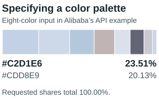
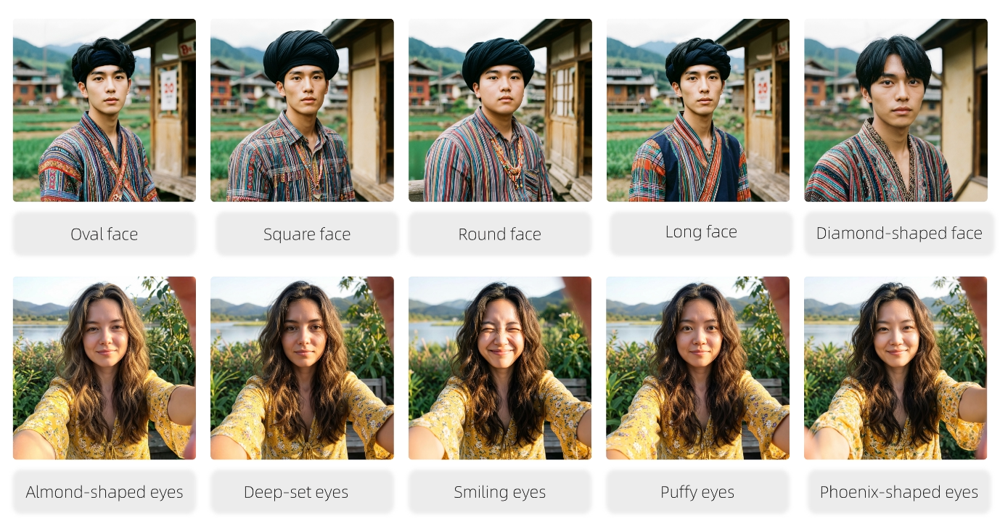
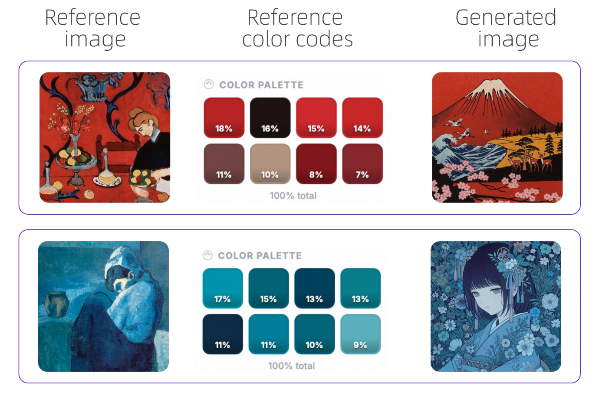

<!-- Generated by scripts/build-showcase.py from the model database. -->

```{=html}
<div class="showcase-detail"><nav class="showcase-breadcrumb" aria-label="Breadcrumb"><a href="/raw/showcase.html">Model Showcase</a><span aria-hidden="true">/</span><a href="/raw/showcase.html#family-wan">Wan family</a></nav><header class="showcase-detail-header"><p class="showcase-domain">Image generation</p><h1>Wan2.7 Image</h1><p>Wan2.7 Image accepts a palette with target color proportions</p><nav class="showcase-detail-actions" aria-label="On this page"><a href="#model-card">Model card</a><a href="#results">Results & examples</a><a href="#source-slides">Source slides</a><a href="#methods">Methods & sources</a></nav></header><section class="showcase-source-map" id="source-slides" aria-labelledby="source-slides-title"><h2 id="source-slides-title">Source slides</h2><ul><li><span>Model card</span><a href="/raw/lectures/01_intro/lecture01_part2_final_v3_showcase.html#/sc-t2i-wan-27-image" title="Slide ID: sc-t2i-wan-27-image">Model Showcase: Model Cards &amp; Results · slide 49</a><code>sc-t2i-wan-27-image</code></li><li><span>Results</span><a href="/raw/lectures/01_intro/lecture01_part2_final_v3_showcase.html#/sc-t2i-wan-27-image-results" title="Slide ID: sc-t2i-wan-27-image-results">Model Showcase: Model Cards &amp; Results · slide 50</a><code>sc-t2i-wan-27-image-results</code></li></ul></section>
```

```{=html}
<section class="showcase-section" id="model-card"><div class="showcase-section-heading"><h2>Model card</h2></div>
```

```{=html}
<article class="showcase-slide-source" data-presentation="intro-showcase" data-slide="sc-t2i-wan-27-image"><p class="showcase-slide-reference"><a href="/raw/lectures/01_intro/lecture01_part2_final_v3_showcase.html#/sc-t2i-wan-27-image" title="Slide ID: sc-t2i-wan-27-image">Model Showcase: Model Cards &amp; Results · slide 49</a></p><div class="showcase-source">
<div class="sc-body bn-body bn-w1" data-company="alibaba"><div class="bn-id"><div class="bn-plate"><figure class="sc-evidence"><a class="showcase-figure-link" href="/raw/lectures/01_intro/assets/showcase_evidence_20261124/t2i/wan-27-image.svg" target="_blank" rel="noopener">Open full-size figure</a></figure></div><div class="bn-model"><p class="bn-kicker">Text-to-image</p><h3>Wan2.7 Image</h3><p class="bn-ids"><code>wan2.7-image-pro</code><code>wan2.7-image</code></p><div class="bn-facts"><p><span>Released</span><b class="bn-date">01.04.2026</b></p><p><span>Access</span><b>API · cloud LoRA</b></p><p><span>Weights</span><b class="bn-shut">not found</b></p></div></div></div><div class="bn-pub">
<div class="bn-tile bn-p bn-a"><div class="bn-head"><h4>Inference</h4><span class="sc-status"><i class="sc-pip p"></i>Partial</span></div><div class="bn-stat"><p class="bn-num">4096²<small>px</small></p><p class="bn-cap">Pro T2I ceiling; edits / Standard ≤2048²</p></div><div class="bn-stat bn-rule"><p class="bn-num">$0.03</p><p class="bn-cap">Standard output image · Singapore USD</p></div><p class="bn-item"><i class="sc-pip k"></i>Up to 9 inputs; sequential output up to 12</p><p class="bn-item"><i class="sc-pip p"></i>Seed gives similar, not identical, results</p><p class="bn-gap">No steps, CFG or reproducible latency</p></div>
<div class="bn-tile bn-p bn-b"><div class="bn-head"><h4>Tools</h4><span class="sc-status"><i class="sc-pip p"></i>Partial</span></div><div class="bn-items2"><p class="bn-item"><i class="sc-pip k"></i>Cloud SFT-LoRA and deployed model ID</p><p class="bn-item"><i class="sc-pip k"></i>Up to 2 bounding boxes per input</p><p class="bn-item"><i class="sc-pip k"></i>3–10 colours in a HEX palette</p><p class="bn-item"><i class="sc-pip p"></i>No published bitmap-mask / outpaint control</p></div></div>
<div class="bn-tile bn-p bn-c"><div class="bn-head"><h4>Data</h4><span class="sc-status"><i class="sc-pip p"></i>Partial</span></div><p class="bn-item"><i class="sc-pip p"></i>“Large, diverse” base data; no named corpus</p><p class="bn-item"><i class="sc-pip k"></i>User SFT: ZIP + JSONL</p><p class="bn-gap">Adaptation ≠ base data</p></div>
<div class="bn-tile bn-p bn-d"><div class="bn-head"><h4>Training</h4><span class="sc-status"><i class="sc-pip p"></i>Partial</span></div><p class="bn-item"><i class="sc-pip p"></i>Long-context learning claim; no base recipe</p><p class="bn-item"><i class="sc-pip k"></i>Cloud efficient_sft / LoRA</p><p class="bn-gap">Base compute absent</p></div></div>
<div class="bn-strip"><div class="bn-strip-label"><span>Not disclosed</span><b>1<small>of 5</small></b></div><div class="bn-cell"><h4><i class="sc-pip n"></i>Architecture</h4><p>Image/Pro topology, parameter count, encoders and latent design</p></div></div></div>
<div class="sc-study">
<table class="sc-study-table" data-numeric="2 3">
  <caption>Does the judge change the ranking?</caption>
  <thead><tr><th scope="col">KnowVis judge</th><th scope="col">Wan 2.7 Pro</th><th scope="col">FLUX.2 Pro</th></tr></thead>
  <tbody>
  <tr><th scope="row">Gemini 3.1 Pro · initial</th><td>6th</td><td>7th</td></tr>
  <tr><th scope="row">Gemini 3.1 Pro · rerun</th><td>8th</td><td>6th</td></tr>
  <tr><th scope="row">Gemini 3.5 Flash</th><td>8th</td><td>6th</td></tr>
  <tr><th scope="row">GPT-5.5</th><td>8th</td><td>7th</td></tr>
  </tbody>
</table>
<p class="sc-study-source"><a href="https://arxiv.org/html/2611.18101v1#A9.T24">KnowVis · table 24</a> · Rank among 10 models · 240 cases</p>
</div>
<div class="fv-takeaway">A documented adaptation workflow does not reveal the base model or its weights.</div>
<div class="fv-source"><a href="https://help.aliyun.com/en/model-studio/wan-image-generation-and-editing-api-reference">Wan API · color_palette</a> · T2I_v1.1.xlsx · Wan2.7 · audit 18–19.10.2026 · <a href="https://www.alibabacloud.com/help/en/model-studio/wan2-7-image-pro">Pro card</a> · <a href="https://www.alibabacloud.com/help/en/model-studio/image-model">Image API</a> · <a href="https://www.alibabacloud.com/help/en/model-studio/wan-image-generation-finetune-guide">Cloud LoRA</a></div></div></article>
```

```{=html}
</section>
```

```{=html}
<section class="showcase-section" id="results"><div class="showcase-section-heading"><h2>Results & examples</h2></div>
```

```{=html}
<article class="showcase-slide-source" data-presentation="intro-showcase" data-slide="sc-t2i-wan-27-image-results"><p class="showcase-source-subtitle">Character variety and palette control</p><p class="showcase-slide-reference"><a href="/raw/lectures/01_intro/lecture01_part2_final_v3_showcase.html#/sc-t2i-wan-27-image-results" title="Slide ID: sc-t2i-wan-27-image-results">Model Showcase: Model Cards &amp; Results · slide 50</a></p><div class="showcase-source">
<div class="sc-body sr-body" data-company="alibaba">
<div class="sr-sidebar" role="group" aria-label="Model and reported metrics"><div class="sr-brand"><div aria-label="Alibaba / Wan" class="sc-company" role="img"><span class="sc-company-caption">Wan</span></div></div><div class="sr-model"><p>RESULTS · Text-to-image</p><h3>Wan2.7 Image</h3></div><div class="sr-metrics"><div class="sr-metric"><p class="sr-metric-label">Text input at launch</p><p class="sr-metric-value">3,000 tokens</p><p class="sr-metric-note">Launch claim. The API reference separately limits prompts to 5,000 characters. <a class="" href="https://www.alibabacloud.com/en/press-room/alibaba-unveils-wan2-7-redefining-personalized-and" target="_blank" rel="noopener">↗</a></p></div><div class="sr-metric"><p class="sr-metric-label">Rendering languages</p><p class="sr-metric-value">12</p><p class="sr-metric-note">Vendor supported-language count. <a class="" href="https://www.alibabacloud.com/en/press-room/alibaba-unveils-wan2-7-redefining-personalized-and" target="_blank" rel="noopener">↗</a></p></div><div class="sr-metric"><p class="sr-metric-label">References / batch</p><p class="sr-metric-value">9 / up to 12</p><p class="sr-metric-note">Published input-reference and output-batch maxima. <a class="" href="https://www.alibabacloud.com/en/press-room/alibaba-unveils-wan2-7-redefining-personalized-and" target="_blank" rel="noopener">↗</a></p></div></div></div>
<div class="sr-example"><div class="sr-stage sr-gallery"><figure><figcaption>Character attributes across a series</figcaption></figure><figure><figcaption>Reference → color codes → output</figcaption></figure></div><p class="sr-caption">The first grid changes facial attributes. The second places source art, palette swatches and a generated composition side by side.</p></div></div>
<div class="fv-takeaway">Alibaba labels these examples Wan2.7-Image. The 4K option belongs to the Pro text-to-image endpoint.</div>
<div class="fv-source">Published example and reported metrics · checked 21.10.2026 · <a class="" href="https://www.alibabacloud.com/en/press-room/alibaba-unveils-wan2-7-redefining-personalized-and" target="_blank" rel="noopener">Example source</a></div></div></article>
```

```{=html}
</section>
```

```{=html}
<section class="showcase-section" id="methods"><div class="showcase-section-heading"><h2>Methods & sources</h2><p>Source notes, evaluation conditions and limitations from the presentation slides.</p></div>
```

<details class="showcase-notes">
<summary>Model card: Model Showcase: Model Cards &amp; Results · slide 49</summary>

**Table evidence.** Yu et al. evaluate world-knowledge grounding on the 240-case unseen Skill-Tree validation split. Table 24 compares ranks under different judges, including a same-setting rerun of Gemini 3.1 Pro Preview. Table 29 identifies the tested Wan model as Wan 2.7 Pro with Chinese prompts and 2048×2048 generation. FLUX.2 Pro uses English prompts and 2000×2000 outputs. This Pro result and the standard Wan2.7-Image gallery are explicitly distinguished. [Experimental settings](https://arxiv.org/html/2611.18101v1#A11.T29). [KnowVis · table 24](https://arxiv.org/html/2611.18101v1#A9.T24).

**Figure evidence.** Alibaba Cloud Model Studio, Wan 2.7 image generation and editing reference, color_palette field. Bands recreate the eight colors and their numeric input ratios, in the order published. The API accepts 3–10 colors whose shares total 100.00% with two decimal places when sequential mode is off. The proportions are inputs, not a claim about measured pixels in the gallery images. [Primary source](https://help.aliyun.com/en/model-studio/wan-image-generation-and-editing-api-reference).

**Historical audit.** This is a faithful conversion of the supplied T2I_v1.1.xlsx audit snapshot, checked by its author on 18 October 2026 and refined on 19 October 2026. It is not a fresh verification of these linked sources. “Not disclosed” means absent from the materials covered by that audit, not that the capability cannot exist. Known/Partial/Not disclosed measure disclosure, not model quality or full reproducibility. Prices, endpoints and limits are preserved as dated audit claims.

Cloud adaptation is a real supported tool, but it does not make weights downloadable or base Training Known. Preserve the summary’s Partial Data and Training judgments. Keep output limits task-specific: the large Pro T2I limit does not apply to reference edits or sequential series.

**Exact scope and category provenance:** sheet `Wan2.7`, identity row 2; `Сводка` row 13. Architecture / Data / Training / Inference / Tools = Not disclosed / Partial / Partial / Partial / Partial.

**Row provenance and caveats (model-sheet row numbers):**

- Row 2: Scope is wan2.7-image-pro and wan2.7-image only; Wan2.7 video has different IDs.
- Row 6: Image topology/layers are absent.
- Row 7: Total/active parameter counts are absent.
- Row 8: Text/vision encoders, conditioning and common backbone are absent.
- Row 9: VAE compression, latent channels, patching and tokenizer are absent.
- Row 13: Large and diverse base data is claimed, without corpus names, counts or proportions.
- Row 14: Base-data filtering, deduplication, captioning, synthetic/edit-triplet shares and licences are absent.
- Row 15: User adaptation data is a ZIP of images with data.jsonl; I2I uses reference/target pairs. It is not the original training corpus.
- Row 19: Base loss, optimizer, batch and curriculum are absent.
- Row 20: Announcement names long-context learning but provides no mechanism or full recipe.
- Row 21: Base distillation, RL/reward model and preference data are absent.
- Row 22: Base GPU-hours, hardware and compute budget are absent.
- Row 23: Both image variants support Singapore cloud efficient_sft/LoRA for T2I, I2I and multi-I2I.
- Row 24: Suggested adaptation settings: 800 steps, evaluation every 200, lr 3e-5, rank 32, AdamW decay .02, clip .5. These are not base-training settings.
- Row 28: Both IDs support T2I/I2I and series; video is separately scoped.
- Row 29: Pro T2I output area up to 4096²; Pro I2I/series and Standard up to 2048².
- Row 30: Minimum output area 768², ratio 1:8–8:1; 4K preset only for Pro T2I.
- Row 31: Zero to nine inputs, up to 20 MB, JPEG/PNG/BMP/WEBP, sides 240–8000; no alpha.
- Row 32: Ordinary n=1–4; sequential n≤12 is a maximum and the model chooses the actual count.
- Row 33: API prompt at most 5000 characters, truncating excess; announcement’s 3000 tokens is a different unit.
- Row 34: thinking_mode defaults true only for T2I without references or sequential generation and adds time.
- Row 35: Seed 0–2147483647 gives similar, not guaranteed identical outputs.
- Row 36: Steps, CFG, sampler and negative_prompt are not described in the reviewed API.
- Row 37: Standard is called faster without reproducible hardware-specific latency.
- Row 38: Singapore USD per successful output: Pro .075, Standard .03, at the audit date.
- Row 39: PNG output; result/task URLs last 24 hours.
- Row 43: DashScope sync/async HTTP with Python and Java examples.
- Row 44: Official skill describes instruction edits, style transfer, fusion and subject preservation.
- Row 45: bbox_list accepts at most two rectangles per input as absolute-pixel [x1,y1,x2,y2].
- Row 46: color_palette has 3–10 HEX entries with ratios totaling 100%; not with sequential generation.
- Row 47: Official skill covers text/image-to-series up to twelve images and CLI examples.
- Row 48: Cloud LoRA deployment returns deployed_model for later inference.
- Row 49: No official Wan-AI 2.7-Image checkpoint found; reviewed access is Model Studio API.
- Row 50: Weights licence not found; Apache-2.0 for the skills repository is not a weights licence.
- Row 51: Boxes are documented, but no bitmap-mask or dedicated outpainting API parameter was found.

**Source URLs preserved from workbook HYPERLINK formulas:**

- [Source 1](https://www.alibabacloud.com/help/en/model-studio/wan2-7-image-pro)
- [Source 2](https://www.alibabacloud.com/help/en/model-studio/wan2-7-image)
- [Source 3](https://www.alibabacloud.com/en/press-room/alibaba-unveils-wan2-7-redefining-personalized-and)
- [Source 4](https://www.alibabacloud.com/help/en/model-studio/wan-image-generation-finetune-guide)
- [Source 5](https://www.alibabacloud.com/help/en/model-studio/image-model)
- [Source 6](https://www.alibabacloud.com/help/en/model-studio/newly-released-models)
- [Source 7](https://www.alibabacloud.com/help/en/model-studio/wan-image-generation-and-editing-api-reference)
- [Source 8](https://www.alibabacloud.com/help/en/model-studio/model-pricing)
- [Source 9](https://github.com/Wan-Video/Wan-skills/blob/main/skills/wan2.7-image-skill/references/image-generation-editing.md)
- [Source 10](https://github.com/Wan-Video/Wan-skills)
- [Source 11](https://huggingface.co/Wan-AI/models)

</details>

<details class="showcase-notes">
<summary>Results: Model Showcase: Model Cards &amp; Results · slide 50</summary>

Published results checked 21 October 2026. These are sourced examples and reported measurements; no models were run for this deck.


Alibaba’s release illustrates personalised characters and prompt-directed colour palettes.


- **Text input: Up to 3,000 tokens **. Press-release capability claim; not text-accuracy measurement. Attribution: output_characteristic. [Source](https://www.alibabacloud.com/en/press-room/alibaba-unveils-wan2-7-redefining-personalized-and).

- **Text rendering languages: 12 **. Supported-language count in release; no per-language accuracy values transcribed. Attribution: output_characteristic. [Source](https://www.alibabacloud.com/en/press-room/alibaba-unveils-wan2-7-redefining-personalized-and).

- **References / output batch: 9 / up to 12 **. Published maxima for reference inputs and generated images per request. Attribution: output_characteristic. [Source](https://www.alibabacloud.com/en/press-room/alibaba-unveils-wan2-7-redefining-personalized-and).


**Example provenance and limitations.**

April 1 release captions these examples Wan2.7-Image. Pro is announced separately; these assets are not labelled Pro.

Release includes a vendor blind-preference chart, but its numerical values and evaluation protocol were not verified here; do not invent a score.

Pro-specific 4K output does not establish that these standard Image examples came from Pro.

[Published media/source](https://img.alicdn.com/imgextra/i1/O1CN01SeSfox1YxIpxzLwNK_!!6000000003125-2-tps-1378-729.png): Wan2.7-Image: character-personalisation examples.. Rights: Public vendor showcase. No explicit image-reuse licence identified on the checked page; retain source attribution. Model/weights licences do not establish a licence for these page assets.

[Published media/source](https://img.alicdn.com/imgextra/i2/O1CN01aNXCjR1rlpcIET8Vy_!!6000000005672-2-tps-1380-920.png): Wan2.7-Image: colour-palette examples.. Rights: Public vendor showcase. No explicit image-reuse licence identified on the checked page; retain source attribution. Model/weights licences do not establish a licence for these page assets.

</details>

```{=html}
</section><nav class="showcase-bottom-nav" aria-label="More models"><a href="/raw/showcase.html">Back to all models</a><a href="/raw/lectures/01_intro/lecture01_part2_final_v3_showcase.html#/sc-t2i-wan-27-image">View source slide</a></nav></div>
```
