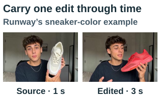

<!-- Generated by scripts/build-showcase.py from the model database. -->

```{=html}
<div class="showcase-detail"><nav class="showcase-breadcrumb" aria-label="Breadcrumb"><a href="/raw/showcase.html">Model Showcase</a><span aria-hidden="true">/</span><a href="/raw/showcase.html#family-aleph">Aleph family</a></nav><header class="showcase-detail-header"><p class="showcase-domain">Video generation</p><h1>Aleph 2.0</h1><p>How does Aleph 2.0 carry a color edit through a shot?</p><nav class="showcase-detail-actions" aria-label="On this page"><a href="#model-card">Model card</a><a href="#results">Results & examples</a><a href="#source-slides">Source slides</a><a href="#methods">Methods & sources</a></nav></header><section class="showcase-source-map" id="source-slides" aria-labelledby="source-slides-title"><h2 id="source-slides-title">Source slides</h2><ul><li><span>Model card</span><a href="/raw/lectures/01_intro/lecture01_part2_final_v3_showcase.html#/sc-t2v-aleph-2" title="Slide ID: sc-t2v-aleph-2">Model Showcase: Model Cards &amp; Results · slide 67</a><code>sc-t2v-aleph-2</code></li><li><span>Results</span><a href="/raw/lectures/01_intro/lecture01_part2_final_v3_showcase.html#/sc-t2v-aleph-2-results" title="Slide ID: sc-t2v-aleph-2-results">Model Showcase: Model Cards &amp; Results · slide 68</a><code>sc-t2v-aleph-2-results</code></li></ul></section>
```

```{=html}
<section class="showcase-section" id="model-card"><div class="showcase-section-heading"><h2>Model card</h2></div>
```

```{=html}
<article class="showcase-slide-source" data-presentation="intro-showcase" data-slide="sc-t2v-aleph-2"><p class="showcase-slide-reference"><a href="/raw/lectures/01_intro/lecture01_part2_final_v3_showcase.html#/sc-t2v-aleph-2" title="Slide ID: sc-t2v-aleph-2">Model Showcase: Model Cards &amp; Results · slide 67</a></p><div class="showcase-source">
<div class="sc-body bn-body bn-w3" data-company="runway"><div class="bn-id"><div class="bn-plate"><figure class="sc-evidence"><a class="showcase-figure-link" href="/raw/lectures/01_intro/assets/showcase_video_evidence/aleph-2.svg" target="_blank" rel="noopener">Open full-size figure</a></figure></div><div class="bn-model"><p class="bn-kicker">Video editing · not T2V</p><h3>Aleph 2.0</h3><p class="bn-ids"><code>runwayml/aleph-2</code></p><div class="bn-facts"><p><span>Released</span><b class="bn-date">21.05.2026</b></p><p><span>Access</span><b>Studio / API</b></p><p><span>Weights</span><b class="bn-shut">not found</b></p></div></div></div><div class="bn-pub"><div class="bn-tile bn-p bn-a"><div class="bn-head"><h4>Inference</h4><span class="sc-status"><i class="sc-pip p"></i>Partial</span></div><div class="bn-stat"><p class="bn-num">30<small>s</small></p><p class="bn-cap">Existing video clips · up to 1080p</p></div><div class="bn-rule"><p class="bn-item"><i class="sc-pip p"></i>Replicate: input 2–30 s, under 16 MB</p><p class="bn-item"><i class="sc-pip p"></i>Partner APIs differ in output controls and price</p></div><p class="bn-gap">Audio capability not described by Runway</p></div><div class="bn-tile bn-k bn-b"><div class="bn-head"><h4>Tools</h4><span class="sc-status"><i class="sc-pip k"></i>Known</span></div><div class="bn-stat"><p class="bn-num">1–5<small>anchors</small></p><p class="bn-cap">Keyframe images on Replicate</p></div><div class="bn-chips"><span>Local edits</span><span>Relight</span><span>Restyle</span><span>Multi-shot</span></div><div class="bn-rule"><p class="bn-item"><i class="sc-pip k"></i>Edit Studio: preview a frame edit before video rendering</p></div><p class="bn-gap">T2V / I2V from scratch not claimed</p></div></div><div class="bn-strip"><div class="bn-strip-label"><span>Not disclosed</span><b>3<small>of 5</small></b></div><div class="bn-cell"><h4><i class="sc-pip n"></i>Architecture</h4><p>Backbone · parameters · encoders · VAE</p></div><div class="bn-cell"><h4><i class="sc-pip n"></i>Data</h4><p>Training sources · sizes · licences</p></div><div class="bn-cell"><h4><i class="sc-pip n"></i>Training</h4><p>Objective · compute · optimizer · conditioning recipe</p></div></div></div>
<div class="sc-study">
<table class="sc-study-table" data-numeric="2 3">
<caption>How well does an edited first frame carry over?</caption>
<thead><tr><th scope="col">VLM judgment</th><th scope="col">Aleph 2.0</th><th scope="col">MoviEdit</th></tr></thead>
<tbody>
<tr><th scope="row">Subject preservation</th><td>0.985</td><td>1.000</td></tr>
<tr><th scope="row">Cross-shot consistency</th><td>0.906</td><td>0.981</td></tr>
<tr><th scope="row">Edited-frame fidelity</th><td>0.819</td><td>0.828</td></tr>
<tr><th scope="row">Overall edit success</th><td>0.806</td><td>0.803</td></tr>
</tbody>
</table>
<p class="sc-study-source"><a href="https://arxiv.org/html/2611.02737v1#S3.T2">MoviEdit-Bench · Table 2</a> · 64 first-frame edits · higher is better</p>
</div>
<div class="fv-takeaway">An image guides edits to a supplied clip; it is not evidence of image-to-video generation.</div>
<div class="fv-source"><a href="https://runway.com/product/aleph-2">Figure · source and edited frames</a> · <a href="https://runway.com/news/introducing-aleph-2-and-edit-studio">Runway launch</a> · <a href="https://replicate.com/runwayml/aleph-2">Provider API</a> · <a href="https://runware.ai/docs/models/runway-aleph-2-0">Runware docs</a> · T2V_v1.0.xlsx · Aleph 2.0 · audit 19.10.2026</div></div></article>
```

```{=html}
</section>
```

```{=html}
<section class="showcase-section" id="results"><div class="showcase-section-heading"><h2>Results & examples</h2></div>
```

```{=html}
<article class="showcase-slide-source" data-presentation="intro-showcase" data-slide="sc-t2v-aleph-2-results"><p class="showcase-source-subtitle">Aleph 2.0 changes a white sneaker to red</p><p class="showcase-slide-reference"><a href="/raw/lectures/01_intro/lecture01_part2_final_v3_showcase.html#/sc-t2v-aleph-2-results" title="Slide ID: sc-t2v-aleph-2-results">Model Showcase: Model Cards &amp; Results · slide 68</a></p><div class="showcase-source">
<div class="sc-body sr-body" data-company="runway">
<div class="sr-sidebar" role="group" aria-label="Model and reported metrics"><div class="sr-brand"><div aria-label="Runway" class="sc-company" role="img"></div></div><div class="sr-model"><p>RESULTS · Text-to-video</p><h3>Aleph 2.0</h3></div><div class="sr-metrics"><div class="sr-metric"><p class="sr-metric-label">Editing preference Elo</p><p class="sr-metric-value">1014 Elo</p><p class="sr-metric-note">95% CI 1006–1022; n=20,816; AA 2026-10-21 <a class="" href="https://artificialanalysis.ai/video/leaderboard/video-editing" target="_blank" rel="noopener">↗</a></p></div><div class="sr-metric"><p class="sr-metric-label">Maximum editable duration</p><p class="sr-metric-value">30 s</p><p class="sr-metric-note">Vendor capability limit; not a quality benchmark <a class="" href="https://runway.com/news/introducing-aleph-2-and-edit-studio" target="_blank" rel="noopener">↗</a></p></div><div class="sr-metric"><p class="sr-metric-label">Supported edit resolution</p><p class="sr-metric-value">1080p</p><p class="sr-metric-note">Vendor capability limit; not a quality benchmark <a class="" href="https://runway.com/news/introducing-aleph-2-and-edit-studio" target="_blank" rel="noopener">↗</a></p></div></div></div>
<div class="sr-example"><div class="sr-stage"><video controls playsinline preload="none" src="/raw/lectures/01_intro/assets/showcase_video_evidence/aleph-2.mp4" poster="/raw/lectures/01_intro/assets/showcase_video_evidence/aleph-2-poster.webp" aria-label="Aleph 2.0 changes a white sneaker to red" aria-describedby="aleph-2-caption"></video></div><p class="sr-caption" id="aleph-2-caption">The wipe reveals the edited shoe. Follow its outline and the presenter’s fingers as the shoe turns.</p></div></div>
<div class="fv-takeaway">Check whether the fingers, camera motion and room survive the color change.</div>
<div class="fv-source"><a href="https://runway.com/product/aleph-2">Runway · Same video, new product</a> · Artificial Analysis snapshot 21 Oct 2026 · metric sources above</div></div></article>
```

```{=html}
</section>
```

```{=html}
<section class="showcase-section" id="methods"><div class="showcase-section-heading"><h2>Methods & sources</h2><p>Source notes, evaluation conditions and limitations from the presentation slides.</p></div>
```

<details class="showcase-notes">
<summary>Model card: Model Showcase: Model Cards &amp; Results · slide 67</summary>

Both methods receive the source video, instruction and an edited first frame. The values reproduce the vision-language-model judgment columns for the first-frame subset of MoviEdit-Bench. Overall edit success measures the share of sampled frames passing all applicable edit requirements. The other first-frame metrics use their own criteria and should not be averaged to reproduce overall success. This independent study was published in November 2026, after the specification workbook. [MoviEdit-Bench · Table 2](https://arxiv.org/html/2611.02737v1#S3.T2).

The frame pair is taken from Runway’s before/after wipe under Same video, new product. The frames show different moments at 1 and 3 seconds. The release report describes using an edited frame to guide changes throughout the source clip, including across relevant shots.

The specification table follows the 19 October 2026 workbook. Aleph 2.0 belongs in the video workbook because it edits existing video. It is not presented as a model for generating new video from text or a single image. The active Text-to-video category is the deck's umbrella video category.

Runway announced Aleph 2.0 and Edit Studio on 21 May. The first-party capability is editing clips up to 30 seconds in 1080p, including local object changes, relighting, scene changes and multi-shot propagation. The description “edit one frame to update an entire video” is a product feature; it does not disclose how frame conditioning was trained. The workbook finds no backbone, parameter, corpus or training-recipe disclosure.

The provider's Replicate page specifies 2–30-second inputs under 16 MB and up to five positioned keyframe images. Other output formats, seeds, pricing and latency details depend on partner APIs and were not confirmed in official Runway API documentation. These differences explain the partial inference status. Runway does not describe Aleph 2.0 audio handling in the audited material; a secondary assertion that it does not process audio is not promoted to a confirmed universal property.

Edit Studio can preview an edited image before rendering the video. Reference images function as editing anchors for a supplied clip; neither this nor the platform preview establishes text-to-video or image-to-video generation from scratch. Public weights were not found. Partner early-access conditions and attribution requirements should be read in the cited provider page before use.

**Sheet-row provenance:** scope and architecture 6–9; data/provenance 13–14; training 18–19; release/inference/access 23–30; tool scope 34–38; weights 41. **Status provenance:** `Сводка`, row 11, columns B–F.

**Workbook sources:** [Runway launch](https://runway.com/news/introducing-aleph-2-and-edit-studio), [Provider API](https://replicate.com/runwayml/aleph-2), [Runware docs](https://runware.ai/docs/models/runway-aleph-2-0).

</details>

<details class="showcase-notes">
<summary>Results: Model Showcase: Model Cards &amp; Results · slide 68</summary>

Runway’s Aleph 2 product page pairs its sneaker-color instruction with replacement-wipe.mp4. The local copy remuxes the complete five-second 720p presentation stream from Runway’s Mux player. The moving wipe is part of the vendor comparison. The 1080p figure on the slide is the published editing ceiling.

- **Editing preference Elo: 1014 Elo**. Instruction-based video editing; audio kept. Independent preference benchmark. [Source](https://artificialanalysis.ai/video/leaderboard/video-editing).

- **Maximum editable duration: 30 seconds**. Maximum supported clip length. Attribution: Vendor-published capability limit, not a benchmark.. [Source](https://runway.com/news/introducing-aleph-2-and-edit-studio).

- **Supported edit resolution: 1080 vertical pixels**. Published release capability. Attribution: Vendor-published capability limit, not a quality score.. [Source](https://runway.com/news/introducing-aleph-2-and-edit-studio).

[Published example](https://runway.com/product/aleph-2) · [Original media](https://stream.mux.com/UiL4i02FjzFOn8ejIyaQOZUEnjjNkd9PzwAcodcB33SA.m3u8)

</details>

```{=html}
</section><nav class="showcase-bottom-nav" aria-label="More models"><a href="/raw/showcase.html">Back to all models</a><a href="/raw/lectures/01_intro/lecture01_part2_final_v3_showcase.html#/sc-t2v-aleph-2">View source slide</a></nav></div>
```
