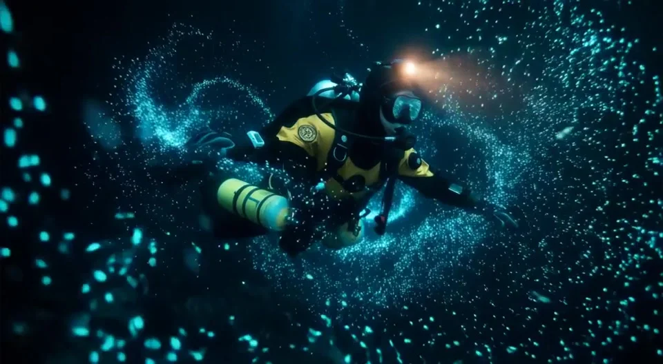

<!-- Generated by scripts/build-showcase.py from the model database. -->

```{=html}
<div class="showcase-detail"><nav class="showcase-breadcrumb" aria-label="Breadcrumb"><a href="/raw/showcase.html">Model Showcase</a><span aria-hidden="true">/</span><a href="/raw/showcase.html#family-flux">FLUX family</a></nav><header class="showcase-detail-header"><p class="showcase-domain">Video generation</p><h1>FLUX 3 Video</h1><p>How do keyframes guide a FLUX 3 shot?</p><nav class="showcase-detail-actions" aria-label="On this page"><a href="#model-card">Model card</a><a href="#results">Results & examples</a><a href="#source-slides">Source slides</a><a href="#methods">Methods & sources</a></nav></header><section class="showcase-source-map" id="source-slides" aria-labelledby="source-slides-title"><h2 id="source-slides-title">Source slides</h2><ul><li><span>Model card</span><a href="/raw/lectures/01_intro/lecture01_part2_final_v3_showcase.html#/sc-t2v-flux-3-video" title="Slide ID: sc-t2v-flux-3-video">Model Showcase: Model Cards &amp; Results · slide 59</a><code>sc-t2v-flux-3-video</code></li><li><span>Results</span><a href="/raw/lectures/01_intro/lecture01_part2_final_v3_showcase.html#/sc-t2v-flux-3-video-results" title="Slide ID: sc-t2v-flux-3-video-results">Model Showcase: Model Cards &amp; Results · slide 60</a><code>sc-t2v-flux-3-video-results</code></li></ul></section>
```

```{=html}
<section class="showcase-section" id="model-card"><div class="showcase-section-heading"><h2>Model card</h2></div>
```

```{=html}
<article class="showcase-slide-source" data-presentation="intro-showcase" data-slide="sc-t2v-flux-3-video"><p class="showcase-slide-reference"><a href="/raw/lectures/01_intro/lecture01_part2_final_v3_showcase.html#/sc-t2v-flux-3-video" title="Slide ID: sc-t2v-flux-3-video">Model Showcase: Model Cards &amp; Results · slide 59</a></p><div class="showcase-source">
<div class="sc-body ds-body" data-company="black-forest-labs"><div class="ds-card"><div class="ds-head"><div class="sc-company" aria-label="Black Forest Labs" role="img"><span class="sc-company-name">Black Forest<small>Labs</small></span></div><p class="ds-kicker">video 04.08.2026</p><p class="ds-kicker ds-r">API preview</p><h3 class="ds-name">FLUX 3 Video</h3><p class="ds-lic">No public weights found</p></div><div class="ds-row"><div class="ds-feat"><h4>Architecture</h4><p class="ds-st"><i class="sc-pip p"></i>Partial</p></div><div class="ds-spec ds-part ds-w2"><span class="ds-k">Family description</span><b class="ds-v">Multimodal flow matching</b></div><div class="ds-spec ds-gap"><span class="ds-k">Not disclosed</span><b class="ds-v">Size, encoders, VAE</b></div></div><div class="ds-row"><div class="ds-feat"><h4>Data</h4><p class="ds-st"><i class="sc-pip p"></i>Partial</p></div><div class="ds-spec ds-part ds-w2"><span class="ds-k">Modalities</span><b class="ds-v">Image + video + audio</b></div><div class="ds-spec ds-gap"><span class="ds-k">Not disclosed</span><b class="ds-v">Corpora, licences</b></div></div><div class="ds-row"><div class="ds-feat"><h4>Training</h4><p class="ds-st"><i class="sc-pip p"></i>Partial</p></div><div class="ds-spec ds-lead ds-part"><span class="ds-k">Named approach</span><b class="ds-v">Self-Flow</b></div><div class="ds-spec ds-gap ds-w2"><span class="ds-k">Not disclosed</span><b class="ds-v">Production recipe, compute, optimizer</b></div></div><div class="ds-row"><div class="ds-feat"><h4>Inference</h4><p class="ds-st"><i class="sc-pip k"></i>Known</p></div><div class="ds-spec ds-lead"><span class="ds-k">T2V / I2V output</span><b class="ds-v">5–20 s · 24 fps</b></div><div class="ds-spec "><span class="ds-k">Larger outputs</span><b class="ds-v">Upsampled FHD–4K</b></div><div class="ds-spec "><span class="ds-k">Audio</span><b class="ds-v">Joint generation</b></div></div><div class="ds-row"><div class="ds-feat"><h4>Tools</h4><p class="ds-st"><i class="sc-pip k"></i>Known</p></div><div class="ds-spec ds-lead"><span class="ds-k">Workflow</span><b class="ds-v">Draft → enhance</b></div><div class="ds-spec "><span class="ds-k">Keyframe control</span><b class="ds-v">Up to 10 images</b></div><div class="ds-spec "><span class="ds-k">Separate endpoint</span><b class="ds-v">Video Edit [fast]</b></div></div></div></div>
<figure class="sc-evidence sc-evidence-strip"><div class="showcase-diagram-scroll" tabindex="0" role="region" aria-label="Diagram; scroll horizontally to inspect details"></div><a class="showcase-figure-link" href="/raw/lectures/01_intro/assets/showcase_video_evidence/flux-3-video.svg" target="_blank" rel="noopener">Open full-size figure</a></figure>
<div class="sc-study">
<table class="sc-study-table" data-numeric="2">
<caption>Which clips did BFL’s raters prefer?</caption>
<thead><tr><th scope="col">Opponent</th><th scope="col">FLUX 3 preferred</th></tr></thead>
<tbody>
<tr><th scope="row">Seedance 2.0</th><td>52%</td></tr>
<tr><th scope="row">HappyHorse 1.1</th><td>57%</td></tr>
<tr><th scope="row">Kling v3 Pro</th><td>60%</td></tr>
<tr><th scope="row">Runway Gen-4.5</th><td>77%</td></tr>
<tr><th scope="row">Luma Ray 3.2</th><td>93%</td></tr>
</tbody>
</table>
<p class="sc-study-source"><a href="https://bfl.ai/blog/flux-3">BFL · Early Evaluations, Video</a> · 10 s, 720p, with audio</p>
</div>
<div class="fv-takeaway">Video generation, continuation and editing have distinct controls and availability.</div>
<div class="fv-source"><a href="https://docs.bfl.ai/flux_3/flux3_video#keyframes">Figure · keyframes, example 1</a> · <a href="https://docs.bfl.ai/flux_3/flux3_video">Video docs</a> · <a href="https://bfl.ai/blog/flux-3">FLUX 3 launch</a> · <a href="https://docs.bfl.ml/release-notes">Release notes</a> · T2V_v1.0.xlsx · FLUX 3 Video · audit 19.10.2026</div></div></article>
```

```{=html}
</section>
```

```{=html}
<section class="showcase-section" id="results"><div class="showcase-section-heading"><h2>Results & examples</h2></div>
```

```{=html}
<article class="showcase-slide-source" data-presentation="intro-showcase" data-slide="sc-t2v-flux-3-video-results"><p class="showcase-source-subtitle">FLUX 3 animates four underwater keyframes</p><p class="showcase-slide-reference"><a href="/raw/lectures/01_intro/lecture01_part2_final_v3_showcase.html#/sc-t2v-flux-3-video-results" title="Slide ID: sc-t2v-flux-3-video-results">Model Showcase: Model Cards &amp; Results · slide 60</a></p><div class="showcase-source">
<div class="sc-body sr-body" data-company="black-forest-labs">
<div class="sr-sidebar" role="group" aria-label="Model and reported metrics"><div class="sr-brand"><div aria-label="Black Forest Labs" class="sc-company" role="img"><span class="sc-company-name">Black Forest<small>Labs</small></span></div></div><div class="sr-model"><p>RESULTS · Text-to-video</p><h3>FLUX 3 Video</h3></div><div class="sr-metrics"><div class="sr-metric"><p class="sr-metric-label">T2V preference Elo</p><p class="sr-metric-value">1145 Elo</p><p class="sr-metric-note">95% CI 1129–1161; n=4,864; AA 2026-10-21 <a class="" href="https://artificialanalysis.ai/video/leaderboard/text-to-video" target="_blank" rel="noopener">↗</a></p></div><div class="sr-metric"><p class="sr-metric-label">I2V preference Elo</p><p class="sr-metric-value">1086 Elo</p><p class="sr-metric-note">95% CI 1070–1102; n=4,170; AA 2026-10-21 <a class="" href="https://artificialanalysis.ai/video/leaderboard/image-to-video" target="_blank" rel="noopener">↗</a></p></div><div class="sr-metric"><p class="sr-metric-label">Preference over Kling v3 Pro</p><p class="sr-metric-value">60%</p><p class="sr-metric-note">Vendor early eval: 10 s, 720p, audio; sample count undisclosed <a class="" href="https://bfl.ai/blog/flux-3" target="_blank" rel="noopener">↗</a></p></div></div></div>
<div class="sr-example"><div class="sr-stage"><video controls playsinline preload="none" src="/raw/lectures/01_intro/assets/showcase_video_evidence/flux-3-video.mp4" poster="/raw/lectures/01_intro/assets/showcase_video_evidence/flux-3-video-poster.webp" aria-label="FLUX 3 animates four underwater keyframes" aria-describedby="flux-3-video-caption"></video></div><p class="sr-caption" id="flux-3-video-caption">Four supplied views anchor the diver at 0, 3, 7 and 10 seconds. Watch the camera travel between those views.</p></div></div>
<div class="fv-takeaway">Timed keyframes specify compositions. The model supplies the motion between them.</div>
<div class="fv-source"><a href="https://docs.bfl.ai/flux_3/flux3_video#keyframes">Black Forest Labs · keyframes, example 1</a> · Artificial Analysis snapshot 21 Oct 2026 · metric sources above</div></div></article>
```

```{=html}
</section>
```

```{=html}
<section class="showcase-section" id="methods"><div class="showcase-section-heading"><h2>Methods & sources</h2><p>Source notes, evaluation conditions and limitations from the presentation slides.</p></div>
```

<details class="showcase-notes">
<summary>Model card: Model Showcase: Model Cards &amp; Results · slide 59</summary>

Selected rows reconstructed from BFL’s 23 July preliminary text-to-video comparison. Each row compares early FLUX 3 with a different opponent. BFL does not give the prompt count, uncertainty intervals or treatment of ties in this report. These figures describe generated video from text, while the adjacent four-image example uses keyframe conditioning. [BFL · Early Evaluations, Video](https://bfl.ai/blog/flux-3).

The four supplied images in BFL’s FLUX 3 Video documentation, Keyframes, Example 1, are reproduced in their original order. The labels give the actual keyframe times. The spacings are schematic. The results slide plays the output paired with these images.

The specification table follows the 19 October 2026 workbook. Its scope is hosted FLUX 3 Video in preview plus the separately named Video Edit tool. Image and Action products are not evidence about the video model's dimensions or weight availability.

The source describes a shared multimodal flow-matching backbone based on Self-Flow and joint image/video/audio training. It does not disclose the production video's parameter count, encoders, VAE, corpus composition, licences, full training recipe or compute. The architecture, data and training summary statuses therefore remain partial.

The displayed 5–20-second range applies to text-to-video and image-to-video. Video continuation is limited to 5–15 seconds; it should not be presented as arbitrary video-reference editing. Outputs use 24 fps with optional jointly generated audio. FHD, QHD and UHD are upsampled from the HD generation, not separately established native generation resolutions. The documented UHD 16:9 canvas is 3840×2176, not exactly 3840×2160. Draft mode produces an HD preview and a cache for enhancing the selected result.

Image-to-video accepts up to 10 timestamped keyframes. FLUX Video Edit [fast] is a separate endpoint; its detailed limits in the workbook rely on aggregators, and a dated BFL release entry was not found. Omni Reference was still marked coming soon. Public video weights were not found; private weight access and plans for FLUX 3 Dev are not a public checkpoint release.

**Sheet-row provenance:** scope/architecture 6–9; data 13–14; training 18–19; dates and inference 23–29; tools 36–42; access/weights 43. **Status provenance:** `Сводка`, row 7, columns B–F.

**Workbook sources:** [Video docs](https://docs.bfl.ai/flux_3/flux3_video), [FLUX 3 launch](https://bfl.ai/blog/flux-3), [Release notes](https://docs.bfl.ml/release-notes).

</details>

<details class="showcase-notes">
<summary>Results: Model Showcase: Model Cards &amp; Results · slide 60</summary>

The FLUX 3 Video documentation pairs these four keyframes with the video source labelled Keyframes interpolation: example 1. The slide plays the full published example. BFL does not specify a pinned model version or seed for this clip. The October 2026 Artificial Analysis entries are for FLUX 3 and the 60% figure is a separate preliminary vendor T2V comparison.

- **T2V preference Elo: 1145 Elo**. Text prompt; audio enabled. Independent preference benchmark. [Source](https://artificialanalysis.ai/video/leaderboard/text-to-video).

- **I2V preference Elo: 1086 Elo**. Source image; audio enabled. Independent preference benchmark. [Source](https://artificialanalysis.ai/video/leaderboard/image-to-video).

- **Preference over Kling v3 Pro: 60 percent**. 10-second 720p T2V clips with audio. Preliminary vendor evaluation. [Source](https://bfl.ai/blog/flux-3).

[Published example](https://docs.bfl.ai/flux_3/flux3_video#keyframes) · [Original media](https://cdn.sanity.io/files/2gpum2i6/production/afc86a790f1a835db3cff62e58dd658c3d47fc59.mp4)

</details>

```{=html}
</section><nav class="showcase-bottom-nav" aria-label="More models"><a href="/raw/showcase.html">Back to all models</a><a href="/raw/lectures/01_intro/lecture01_part2_final_v3_showcase.html#/sc-t2v-flux-3-video">View source slide</a></nav></div>
```
