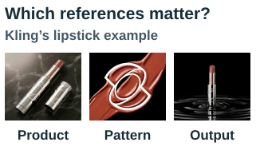

<!-- Generated by scripts/build-showcase.py from the model database. -->

```{=html}
<div class="showcase-detail"><nav class="showcase-breadcrumb" aria-label="Breadcrumb"><a href="/raw/showcase.html">Model Showcase</a><span aria-hidden="true">/</span><a href="/raw/showcase.html#family-kling">Kling family</a></nav><header class="showcase-detail-header"><p class="showcase-domain">Video generation</p><h1>Kling 3.0 Omni</h1><p>How does Kling 3.0 Omni combine visual references?</p><nav class="showcase-detail-actions" aria-label="On this page"><a href="#model-card">Model card</a><a href="#results">Results & examples</a><a href="#source-slides">Source slides</a><a href="#methods">Methods & sources</a></nav></header><section class="showcase-source-map" id="source-slides" aria-labelledby="source-slides-title"><h2 id="source-slides-title">Source slides</h2><ul><li><span>Model card</span><a href="/raw/lectures/01_intro/lecture01_part2_final_v3_showcase.html#/sc-t2v-kling-3-omni" title="Slide ID: sc-t2v-kling-3-omni">Model Showcase: Model Cards &amp; Results · slide 61</a><code>sc-t2v-kling-3-omni</code></li><li><span>Results</span><a href="/raw/lectures/01_intro/lecture01_part2_final_v3_showcase.html#/sc-t2v-kling-3-omni-results" title="Slide ID: sc-t2v-kling-3-omni-results">Model Showcase: Model Cards &amp; Results · slide 62</a><code>sc-t2v-kling-3-omni-results</code></li></ul></section>
```

```{=html}
<section class="showcase-section" id="model-card"><div class="showcase-section-heading"><h2>Model card</h2></div>
```

```{=html}
<article class="showcase-slide-source" data-presentation="intro-showcase" data-slide="sc-t2v-kling-3-omni"><p class="showcase-slide-reference"><a href="/raw/lectures/01_intro/lecture01_part2_final_v3_showcase.html#/sc-t2v-kling-3-omni" title="Slide ID: sc-t2v-kling-3-omni">Model Showcase: Model Cards &amp; Results · slide 61</a></p><div class="showcase-source">
<div class="sc-body bn-body bn-w1" data-company="kling"><div class="bn-id"><div class="bn-plate"><figure class="sc-evidence"><a class="showcase-figure-link" href="/raw/lectures/01_intro/assets/showcase_video_evidence/kling-3-omni.svg" target="_blank" rel="noopener">Open full-size figure</a></figure></div><div class="bn-model"><p class="bn-kicker">Text-to-video · Kuaishou</p><h3>Kling 3.0 Omni</h3><p class="bn-ids"><code>kling-v3-omni</code></p><div class="bn-facts"><p><span>Released</span><b class="bn-date">05.02.2026</b></p><p><span>Access</span><b>Web / API</b></p><p><span>Weights</span><b class="bn-shut">not found</b></p></div></div></div><div class="bn-pub"><div class="bn-tile bn-k bn-a"><div class="bn-head"><h4>Inference</h4><span class="sc-status"><i class="sc-pip k"></i>Known</span></div><div class="bn-stat"><p class="bn-num">3–15<small>s</small></p><p class="bn-cap">Generation · 720p, 1080p or 4K</p></div><div class="bn-rule"><p class="bn-item"><i class="sc-pip k"></i>Native audio; five named speech languages</p><p class="bn-item"><i class="sc-pip k"></i>Video-reference input disables native audio</p></div><p class="bn-gap bn-gap-p">4K added to API in April 2026</p></div><div class="bn-tile bn-k bn-b"><div class="bn-head"><h4>Tools</h4><span class="sc-status"><i class="sc-pip k"></i>Known</span></div><div class="bn-chips"><span>Text → video</span><span>Start / end frame</span><span>Elements</span><span>Video editing</span><span>Multi-shot</span></div><p class="bn-item"><i class="sc-pip k"></i>Elements bind look and voice</p><p class="bn-gap">Edits can keep source audio</p></div><div class="bn-tile bn-p bn-c"><div class="bn-head"><h4>Architecture</h4><span class="sc-status"><i class="sc-pip p"></i>Partial</span></div><p class="bn-item"><i class="sc-pip p"></i>Unified multimodal framework</p><p class="bn-gap">Size and internals absent</p></div><div class="bn-tile bn-p bn-d"><div class="bn-head"><h4>Training</h4><span class="sc-status"><i class="sc-pip p"></i>Partial</span></div><p class="bn-item"><i class="sc-pip p"></i>Unified training claim</p><p class="bn-gap">Recipe and compute absent</p></div></div><div class="bn-strip"><div class="bn-strip-label"><span>Not disclosed</span><b>1<small>of 5</small></b></div><div class="bn-cell"><h4><i class="sc-pip n"></i>Data</h4><p>Corpus · sizes · licences · filtering. Platform user/video counts do not establish training-set composition.</p></div></div></div>
<div class="sc-study">
<table class="sc-study-table" data-numeric="2 3">
<caption>Which visual references survive generation?</caption>
<thead><tr><th scope="col">Reference type</th><th scope="col">Prompts</th><th scope="col">Fidelity / 100</th></tr></thead>
<tbody>
<tr><th scope="row">Scene layout</th><td>232</td><td>86.9</td></tr>
<tr><th scope="row">Character appearance</th><td>213</td><td>85.8</td></tr>
<tr><th scope="row">Prop identity</th><td>209</td><td>47.9</td></tr>
</tbody>
</table>
<p class="sc-study-source"><a href="https://arxiv.org/html/2607.24241v2#A5.T9">FilmBench · Table 9</a> · Reference-to-video · higher is better</p>
</div>
<div class="fv-takeaway">The documented controls are specific; the unified-training claim is only a high-level description.</div>
<div class="fv-source"><a href="https://kling.ai/quickstart/klingai-video-3-omni-model-user-guide">Figure · Omni reference guide</a> · <a href="https://kling.ai/quickstart/klingai-video-3-omni-model-user-guide">Omni guide</a> · <a href="https://replicate.com/kwaivgi/kling-v3-omni-video">Provider API</a> · <a href="https://kling.ai/document-api/updates/api">API updates · Apr/Jun 2026</a> · T2V_v1.0.xlsx · Kling 3.0 Omni · audit 19.10.2026</div></div></article>
```

```{=html}
</section>
```

```{=html}
<section class="showcase-section" id="results"><div class="showcase-section-heading"><h2>Results & examples</h2></div>
```

```{=html}
<article class="showcase-slide-source" data-presentation="intro-showcase" data-slide="sc-t2v-kling-3-omni-results"><p class="showcase-source-subtitle">Kling 3.0 Omni turns a ribbon of color into lipstick</p><p class="showcase-slide-reference"><a href="/raw/lectures/01_intro/lecture01_part2_final_v3_showcase.html#/sc-t2v-kling-3-omni-results" title="Slide ID: sc-t2v-kling-3-omni-results">Model Showcase: Model Cards &amp; Results · slide 62</a></p><div class="showcase-source">
<div class="sc-body sr-body" data-company="kling">
<div class="sr-sidebar" role="group" aria-label="Model and reported metrics"><div class="sr-brand"><div aria-label="Kling AI / Kuaishou" class="sc-company" role="img"><span class="sc-company-caption">Kuaishou</span></div></div><div class="sr-model"><p>RESULTS · Text-to-video</p><h3>Kling 3.0 Omni</h3></div><div class="sr-metrics"><div class="sr-metric"><p class="sr-metric-label">T2V preference Elo</p><p class="sr-metric-value">1020 Elo</p><p class="sr-metric-note">95% CI 1003–1037; n=3,378; AA 2026-10-21 <a class="" href="https://artificialanalysis.ai/video/leaderboard/text-to-video" target="_blank" rel="noopener">↗</a></p></div><div class="sr-metric"><p class="sr-metric-label">I2V preference Elo</p><p class="sr-metric-value">1004 Elo</p><p class="sr-metric-note">95% CI 987–1021; n=3,077; AA 2026-10-21 <a class="" href="https://artificialanalysis.ai/video/leaderboard/image-to-video" target="_blank" rel="noopener">↗</a></p></div></div></div>
<div class="sr-example"><div class="sr-stage"><video controls playsinline preload="none" src="/raw/lectures/01_intro/assets/showcase_video_evidence/kling-3-omni.mp4" poster="/raw/lectures/01_intro/assets/showcase_video_evidence/kling-3-omni-poster.webp" aria-label="Kling 3.0 Omni turns a ribbon of color into lipstick" aria-describedby="kling-3-omni-caption"></video></div><p class="sr-caption" id="kling-3-omni-caption">The color flows across black, forms a pattern and gathers into a lipstick. Compare the final product with the reference on the model card.</p></div></div>
<div class="fv-takeaway">The product reference controls what appears. The prompt describes how it should emerge.</div>
<div class="fv-source"><a href="https://kling.ai/quickstart/klingai-video-3-omni-model-user-guide">Kling AI · Omni guide, lipstick example</a> · Artificial Analysis snapshot 21 Oct 2026 · metric sources above</div></div></article>
```

```{=html}
</section>
```

```{=html}
<section class="showcase-section" id="methods"><div class="showcase-section-heading"><h2>Methods & sources</h2><p>Source notes, evaluation conditions and limitations from the presentation slides.</p></div>
```

<details class="showcase-notes">
<summary>Model card: Model Showcase: Model Cards &amp; Results · slide 61</summary>

Wang et al. report automatic visual-following scores for the exact Kling 3.0 Omni model on the FilmBench reference-to-video subset. Each prompt contributes only to the reference type supplied for that prompt. The table transposes its three reference-type columns and displays the corresponding disjoint sample sizes. The lipstick example illustrates one prop case. [FilmBench · Table 9](https://arxiv.org/html/2607.24241v2#A5.T9).

Kling’s Omni guide, section 1, All-in-One Reference 3.0, shows four reference views of a lipstick and a separate pattern reference. The diagram selects the first product view and the pattern, next to a frame sampled at six seconds from that row’s output.

The specification table follows the 19 October 2026 workbook. The release date is the 5 February announcement of the Kling 3.0 family and early access, not a separately established general-availability date for every Omni feature. Video 3.0 without Omni and the Image 3.0 products are outside scope.

The vendor describes a unified multimodal training framework, but the workbook finds no parameter count, encoder/VAE design, objective or training recipe. The platform's creator and video totals are product statistics, not disclosed training data. The five advertised speech languages are also capabilities rather than a description of the speech corpus.

The February launch guide covers 3–15 seconds and 720p/1080p. The official API change log documents 4K generation on 23 April for kling-v3-omni modes without reference video. On 17 June, Kling added support for reference videos of 3–15 seconds with 4K generation. Native audio supports multiple speakers, but it is not supported with reference-video input; preserving original audio is a different control. The October workbook used a provider API for some parameters. The dated Kling API updates confirm the added 4K modes.

Elements are reference-conditioned characters or objects, not disclosed architecture modules. Editing and feature-reference modes use existing video; per-shot controls and first/last frames are separate documented interfaces. Do not treat the generation duration as an editing limit without checking the relevant endpoint.

**Sheet-row provenance:** scope/architecture 6–9; data 13–14; training 18–19; release and inference 23–27 and 30; tools/access 35–39 and 41. **Status provenance:** `Сводка`, row 8, columns B–F.

**Workbook sources:** [Omni guide](https://kling.ai/quickstart/klingai-video-3-omni-model-user-guide), [Provider API](https://replicate.com/kwaivgi/kling-v3-omni-video), [Family launch](https://finance.yahoo.com/news/kling-ai-launches-3-0-080000425.html).

</details>

<details class="showcase-notes">
<summary>Results: Model Showcase: Model Cards &amp; Results · slide 62</summary>

Kling’s guide pairs the selected product and pattern references with this video output. The complete eight-second clip comes from the first example in All-in-One Reference 3.0. The Artificial Analysis scores belong to the 1080p Pro entry and are separate from this curated guide example.

- **T2V preference Elo: 1020 Elo**. Text prompt; audio enabled. Independent preference benchmark. [Source](https://artificialanalysis.ai/video/leaderboard/text-to-video).

- **I2V preference Elo: 1004 Elo**. Source image; audio enabled. Independent preference benchmark. [Source](https://artificialanalysis.ai/video/leaderboard/image-to-video).

[Published example](https://kling.ai/quickstart/klingai-video-3-omni-model-user-guide) · [Original media](https://static-70.klingai-cdn-aws.com/kling-blog/presigned_url/1b7f8cfb-19a0-420f-afdb-44ca2b9e1a15_kling_20260204_作品_纯黑背景_黑暗中划出_3872_0.mp4)

</details>

```{=html}
</section><nav class="showcase-bottom-nav" aria-label="More models"><a href="/raw/showcase.html">Back to all models</a><a href="/raw/lectures/01_intro/lecture01_part2_final_v3_showcase.html#/sc-t2v-kling-3-omni">View source slide</a></nav></div>
```
