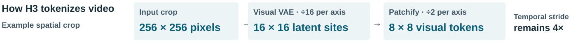

<!-- Generated by scripts/build-showcase.py from the model database. -->

```{=html}
<div class="showcase-detail"><nav class="showcase-breadcrumb" aria-label="Breadcrumb"><a href="/raw/showcase.html">Model Showcase</a><span aria-hidden="true">/</span><a href="/raw/showcase.html#family-minimax-h3">MiniMax H3 family</a></nav><header class="showcase-detail-header"><p class="showcase-domain">Video generation</p><h1>MiniMax H3</h1><p>How does MiniMax H3 compress video before attention?</p><nav class="showcase-detail-actions" aria-label="On this page"><a href="#model-card">Model card</a><a href="#results">Results & examples</a><a href="#source-slides">Source slides</a><a href="#methods">Methods & sources</a></nav></header><section class="showcase-source-map" id="source-slides" aria-labelledby="source-slides-title"><h2 id="source-slides-title">Source slides</h2><ul><li><span>Model card</span><a href="/raw/lectures/01_intro/lecture01_part2_final_v3_showcase.html#/sc-t2v-minimax-h3" title="Slide ID: sc-t2v-minimax-h3">Model Showcase: Model Cards &amp; Results · slide 57</a><code>sc-t2v-minimax-h3</code></li><li><span>Results</span><a href="/raw/lectures/01_intro/lecture01_part2_final_v3_showcase.html#/sc-t2v-minimax-h3-results" title="Slide ID: sc-t2v-minimax-h3-results">Model Showcase: Model Cards &amp; Results · slide 58</a><code>sc-t2v-minimax-h3-results</code></li></ul></section>
```

```{=html}
<section class="showcase-section" id="model-card"><div class="showcase-section-heading"><h2>Model card</h2></div>
```

```{=html}
<article class="showcase-slide-source" data-presentation="intro-showcase" data-slide="sc-t2v-minimax-h3"><p class="showcase-slide-reference"><a href="/raw/lectures/01_intro/lecture01_part2_final_v3_showcase.html#/sc-t2v-minimax-h3" title="Slide ID: sc-t2v-minimax-h3">Model Showcase: Model Cards &amp; Results · slide 57</a></p><div class="showcase-source">
<div class="sc-body ds-body" data-company="minimax"><div class="ds-card"><div class="ds-head"><div class="sc-company" aria-label="MiniMax" role="img"></div><p class="ds-kicker">released 31.07.2026</p><p class="ds-kicker ds-r">Open weights</p><h3 class="ds-name">MiniMax H3</h3><p class="ds-lic">H3 Community License</p></div><div class="ds-row"><div class="ds-feat"><h4>Architecture</h4><p class="ds-st"><i class="sc-pip k"></i>Known</p></div><div class="ds-spec ds-lead"><span class="ds-k">Omni-Transformer</span><b class="ds-v">33B dense</b></div><div class="ds-spec "><span class="ds-k">Text encoder</span><b class="ds-v">Qwen3-VL-32B</b></div><div class="ds-spec "><span class="ds-k">Spatial compression</span><b class="ds-v">32×</b></div></div><div class="ds-row"><div class="ds-feat"><h4>Data</h4><p class="ds-st"><i class="sc-pip p"></i>Partial</p></div><div class="ds-spec ds-lead ds-part"><span class="ds-k">Composition</span><b class="ds-v">Real, natural data</b></div><div class="ds-spec ds-gap ds-w2"><span class="ds-k">Not disclosed</span><b class="ds-v">Sizes, sources, licences, mixing ratios</b></div></div><div class="ds-row"><div class="ds-feat"><h4>Training</h4><p class="ds-st"><i class="sc-pip p"></i>Partial</p></div><div class="ds-spec ds-part ds-w2"><span class="ds-k">Joint training</span><b class="ds-v">Image + video + audio</b></div><div class="ds-spec "><span class="ds-k">Checkpoints</span><b class="ds-v">CFG-distilled</b></div></div><div class="ds-row"><div class="ds-feat"><h4>Inference</h4><p class="ds-st"><i class="sc-pip k"></i>Known</p></div><div class="ds-spec ds-lead"><span class="ds-k">Open weights</span><b class="ds-v">768p · 4–15 s</b></div><div class="ds-spec "><span class="ds-k">Native audio</span><b class="ds-v">32 kHz stereo</b></div><div class="ds-spec "><span class="ds-k">2K regeneration</span><b class="ds-v">API only</b></div></div><div class="ds-row"><div class="ds-feat"><h4>Tools</h4><p class="ds-st"><i class="sc-pip k"></i>Known</p></div><div class="ds-spec ds-lead"><span class="ds-k">Open checkpoints</span><b class="ds-v">FL2VA + Ref2VA</b></div><div class="ds-spec ds-w2"><span class="ds-k">Local runtimes</span><b class="ds-v">SGLang · vLLM · diffusers · ComfyUI</b></div></div></div></div>
<figure class="sc-evidence sc-evidence-strip"><div class="showcase-diagram-scroll" tabindex="0" role="region" aria-label="Diagram; scroll horizontally to inspect details"></div><a class="showcase-figure-link" href="/raw/lectures/01_intro/assets/showcase_video_evidence/minimax-h3.svg" target="_blank" rel="noopener">Open full-size figure</a></figure>
<div class="sc-study">
<table class="sc-study-table" data-numeric="2 3">
<caption>Physical reasoning from incomplete prompts</caption>
<thead><tr><th scope="col">Reasoning task</th><th scope="col">Cases</th><th scope="col">Success rate</th></tr></thead>
<tbody>
<tr><th scope="row">Multi-view spatial</th><td>200</td><td>43.50%</td></tr>
<tr><th scope="row">Video decision</th><td>100</td><td>56.00%</td></tr>
<tr><th scope="row">Audio disambiguation</th><td>146</td><td>27.40%</td></tr>
<tr><th scope="row">Audiovisual integration</th><td>71</td><td>47.89%</td></tr>
<tr><th scope="row">All tasks</th><td>517</td><td>41.97%</td></tr>
</tbody>
</table>
<p class="sc-study-source"><a href="https://arxiv.org/html/2609.18323v1#S4.T2">Zhao et al. · Table 2</a> · Human judgments on generated clips</p>
</div>
<div class="fv-takeaway">The architecture and checkpoints are concrete; corpus and compute details remain missing.</div>
<div class="fv-source"><a href="https://www.minimax.io/news/minimax-h3-open-source">Figure · H3-VisualVAE</a> · <a href="https://www.minimax.io/blog/minimax-h3">H3 blog</a> · <a href="https://huggingface.co/MiniMaxAI/MiniMax-H3">Model card</a> · <a href="https://huggingface.co/MiniMaxAI/MiniMax-H3/blob/main/LICENSE">Licence</a> · T2V_v1.0.xlsx · MiniMax H3 · audit 19.10.2026</div></div></article>
```

```{=html}
</section>
```

```{=html}
<section class="showcase-section" id="results"><div class="showcase-section-heading"><h2>Results & examples</h2></div>
```

```{=html}
<article class="showcase-slide-source" data-presentation="intro-showcase" data-slide="sc-t2v-minimax-h3-results"><p class="showcase-source-subtitle">MiniMax H3 cuts from the fleet to its captain</p><p class="showcase-slide-reference"><a href="/raw/lectures/01_intro/lecture01_part2_final_v3_showcase.html#/sc-t2v-minimax-h3-results" title="Slide ID: sc-t2v-minimax-h3-results">Model Showcase: Model Cards &amp; Results · slide 58</a></p><div class="showcase-source">
<div class="sc-body sr-body" data-company="minimax">
<div class="sr-sidebar" role="group" aria-label="Model and reported metrics"><div class="sr-brand"><div aria-label="MiniMax" class="sc-company" role="img"></div></div><div class="sr-model"><p>RESULTS · Text-to-video</p><h3>MiniMax H3</h3></div><div class="sr-metrics"><div class="sr-metric"><p class="sr-metric-label">T2V preference Elo</p><p class="sr-metric-value">1158 Elo</p><p class="sr-metric-note">95% CI 1142–1174; n=5,781; AA 2026-10-21 <a class="" href="https://artificialanalysis.ai/video/leaderboard/text-to-video" target="_blank" rel="noopener">↗</a></p></div><div class="sr-metric"><p class="sr-metric-label">I2V preference Elo</p><p class="sr-metric-value">1140 Elo</p><p class="sr-metric-note">95% CI 1124–1156; n=4,209; AA 2026-10-21 <a class="" href="https://artificialanalysis.ai/video/leaderboard/image-to-video" target="_blank" rel="noopener">↗</a></p></div><div class="sr-metric"><p class="sr-metric-label">Editing preference Elo</p><p class="sr-metric-value">1125 Elo</p><p class="sr-metric-note">95% CI 1114–1136; n=7,457; AA 2026-10-21 <a class="" href="https://artificialanalysis.ai/video/leaderboard/video-editing" target="_blank" rel="noopener">↗</a></p></div></div></div>
<div class="sr-example"><div class="sr-stage"><video controls playsinline preload="none" src="/raw/lectures/01_intro/assets/showcase_video_evidence/minimax-h3.mp4" poster="/raw/lectures/01_intro/assets/showcase_video_evidence/minimax-h3-poster.webp" aria-label="MiniMax H3 cuts from the fleet to its captain" aria-describedby="minimax-h3-caption"></video></div><p class="sr-caption" id="minimax-h3-caption">Watch the cut from the bridge to the captain. The published prompt cues it at 4.5 s and asks for a flash and an impact sound.</p></div></div>
<div class="fv-takeaway">The request gives a specific cut time, sound cue and seed for checking the generated sequence.</div>
<div class="fv-source"><a href="https://huggingface.co/MiniMaxAI/MiniMax-H3">MiniMax · H3 reproducible 768p cases</a> · Artificial Analysis snapshot 21 Oct 2026 · metric sources above</div></div></article>
```

```{=html}
</section>
```

```{=html}
<section class="showcase-section" id="methods"><div class="showcase-section-heading"><h2>Methods & sources</h2><p>Source notes, evaluation conditions and limitations from the presentation slides.</p></div>
```

<details class="showcase-notes">
<summary>Model card: Model Showcase: Model Cards &amp; Results · slide 57</summary>

The experiment distributes essential event information across input modalities. Human raters judge whether the output meets each task’s semantic requirement. Sample sizes differ by scenario. The pooled success rate weights each instance equally. The study does not isolate a causal effect of the input modality. [Zhao et al. · Table 2](https://arxiv.org/html/2609.18323v1#S4.T2).

MiniMax’s H3 release describes its visual encoder in the H3-VAE / H3-VisualVAE section. The encoder divides both spatial axes by 16 and the temporal axis by 4. A 1 × 2 × 2 patch groups four visual latent sites into one Transformer token. The diagram works through an illustrative 256 × 256 crop. It shows the spatial grid at one latent time position.

The specification table follows the 19 October 2026 workbook. The 31 July date belongs to the launch blog; the workbook dates the licence to 2 August and the open-weight announcement to 3 August.

The 33B dense single-stream H3-Omni-Transformer is separate from the full Qwen3-VL-32B encoder. The displayed 32× spatial compression includes a 16× visual autoencoder and 2× patchifying; it is not the VAE compression alone. The release supports full attention, while the sparse-attention implementation was not included in the initial open release.

The vendor calls the data real and natural and describes joint image/video/audio training. Corpus sizes, source licences, mixing ratios, compute, optimizer and schedule are not supplied. The open BF16 checkpoints are CFG-distilled. This is partial disclosure of training, not a reproducible training recipe.

Open FL2VA and Ref2VA weights produce native 768p at 24 fps, 4–15 seconds, with 32 kHz stereo audio. H3-Context-IR and 2K regeneration remain hosted components, so the open weights are not equivalent to the complete API. FL2VA supports text or first/last-frame input; Ref2VA accepts at most 12 total reference files under modality limits. Editing is expressed through reference conditioning rather than a separately specified editing mode. The listed local runtimes do not establish a minimum VRAM requirement.

The workbook records a Community License with territory and commercial restrictions, including exclusions for the EU, UK, Republic of Korea and US unless separately approved. “Open weights” here means available checkpoints, not an unrestricted open-source licence.

**Sheet-row provenance:** architecture 6–12; data 16–17; training 21–24; release/inference 29–33 and 36; tools and licence 41–47. **Status provenance:** `Сводка`, row 6, columns B–F.

**Workbook sources:** [H3 blog](https://www.minimax.io/blog/minimax-h3), [Model card](https://huggingface.co/MiniMaxAI/MiniMax-H3), [Licence](https://huggingface.co/MiniMaxAI/MiniMax-H3/blob/main/LICENSE).

</details>

<details class="showcase-notes">
<summary>Results: Model Showcase: Model Cards &amp; Results · slide 58</summary>

The sample is t2va.mp4 in MiniMax’s reproducible 768p cases. The request script specifies seed 0, a 768-pixel short edge, a target of 10 seconds and no input assets. It gives the cut time in the input text. The local file preserves the published audiovisual streams.

- **T2V preference Elo: 1158 Elo**. Text prompt; audio enabled. Independent preference benchmark. [Source](https://artificialanalysis.ai/video/leaderboard/text-to-video).

- **I2V preference Elo: 1140 Elo**. Source image; audio enabled. Independent preference benchmark. [Source](https://artificialanalysis.ai/video/leaderboard/image-to-video).

- **Editing preference Elo: 1125 Elo**. Instruction-based video editing; audio kept. Independent preference benchmark. [Source](https://artificialanalysis.ai/video/leaderboard/video-editing).

[Published example](https://huggingface.co/MiniMaxAI/MiniMax-H3) · [Original media](https://huggingface.co/MiniMaxAI/MiniMax-H3/resolve/main/assets/t2va.mp4) · [Full prompt and seed](https://huggingface.co/MiniMaxAI/MiniMax-H3/blob/main/scripts/readme/reproducible-768p-t2va-request.sh)

</details>

```{=html}
</section><nav class="showcase-bottom-nav" aria-label="More models"><a href="/raw/showcase.html">Back to all models</a><a href="/raw/lectures/01_intro/lecture01_part2_final_v3_showcase.html#/sc-t2v-minimax-h3">View source slide</a></nav></div>
```
