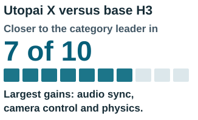

<!-- Generated by scripts/build-showcase.py from the model database. -->

```{=html}
<div class="showcase-detail"><nav class="showcase-breadcrumb" aria-label="Breadcrumb"><a href="/raw/showcase.html">Model Showcase</a><span aria-hidden="true">/</span><a href="/raw/showcase.html#family-utopai">Utopai family</a></nav><header class="showcase-detail-header"><p class="showcase-domain">Video generation</p><h1>Utopai X</h1><p>Which capabilities improved after Utopai X post-training?</p><nav class="showcase-detail-actions" aria-label="On this page"><a href="#model-card">Model card</a><a href="#results">Results & examples</a><a href="#source-slides">Source slides</a><a href="#methods">Methods & sources</a></nav></header><section class="showcase-source-map" id="source-slides" aria-labelledby="source-slides-title"><h2 id="source-slides-title">Source slides</h2><ul><li><span>Model card</span><a href="/raw/lectures/01_intro/lecture01_part2_final_v3_showcase.html#/sc-t2v-utopai-x" title="Slide ID: sc-t2v-utopai-x">Model Showcase: Model Cards &amp; Results · slide 55</a><code>sc-t2v-utopai-x</code></li><li><span>Results</span><a href="/raw/lectures/01_intro/lecture01_part2_final_v3_showcase.html#/sc-t2v-utopai-x-results" title="Slide ID: sc-t2v-utopai-x-results">Model Showcase: Model Cards &amp; Results · slide 56</a><code>sc-t2v-utopai-x-results</code></li></ul></section>
```

```{=html}
<section class="showcase-section" id="model-card"><div class="showcase-section-heading"><h2>Model card</h2></div>
```

```{=html}
<article class="showcase-slide-source" data-presentation="intro-showcase" data-slide="sc-t2v-utopai-x"><p class="showcase-slide-reference"><a href="/raw/lectures/01_intro/lecture01_part2_final_v3_showcase.html#/sc-t2v-utopai-x" title="Slide ID: sc-t2v-utopai-x">Model Showcase: Model Cards &amp; Results · slide 55</a></p><div class="showcase-source">
<div class="sc-body bn-body bn-w1" data-company="utopai"><div class="bn-id"><div class="bn-plate"><figure class="sc-evidence"><a class="showcase-figure-link" href="/raw/lectures/01_intro/assets/showcase_video_evidence/utopai-x.svg" target="_blank" rel="noopener">Open full-size figure</a></figure></div><div class="bn-model"><p class="bn-kicker">Text-to-video · Utopai Studios</p><h3>Utopai X</h3><p class="bn-ids"><code>H3 post-training</code></p><div class="bn-facts"><p><span>Released</span><b class="bn-date">30.09.2026</b></p><p><span>Access</span><b>PAI platform</b></p><p><span>Weights</span><b class="bn-shut">not found</b></p></div></div></div><div class="bn-pub"><div class="bn-tile bn-p bn-a"><div class="bn-head"><h4>Inference</h4><span class="sc-status"><i class="sc-pip p"></i>Partial</span></div><div class="bn-stat"><p class="bn-num">T2V</p><p class="bn-cap">Text-prompt video generation inside PAI</p></div><div class="bn-rule"><p class="bn-item"><i class="sc-pip p"></i>Evaluated with audio; detailed audio controls not published</p></div><p class="bn-gap">Resolution, duration and model API not disclosed</p></div><div class="bn-tile bn-p bn-b"><div class="bn-head"><h4>Tools</h4><span class="sc-status"><i class="sc-pip p"></i>Partial</span></div><div class="bn-chips"><span>Text → video</span><span>PAI workflow</span></div><p class="bn-item"><i class="sc-pip p"></i>PAI: compare takes, keep versions, export footage</p><p class="bn-gap">I2V and model-level video editing not documented</p></div><div class="bn-tile bn-p bn-c"><div class="bn-head"><h4>Architecture</h4><span class="sc-status"><i class="sc-pip p"></i>Partial</span></div><p class="bn-item"><i class="sc-pip k"></i>Based on MiniMax H3</p><p class="bn-gap">Changes and size undisclosed</p></div><div class="bn-tile bn-p bn-d"><div class="bn-head"><h4>Training</h4><span class="sc-status"><i class="sc-pip p"></i>Partial</span></div><p class="bn-item"><i class="sc-pip p"></i>Post-trained on H3</p><p class="bn-gap">Method and compute absent</p></div></div><div class="bn-strip"><div class="bn-strip-label"><span>Not disclosed</span><b>1<small>of 5</small></b></div><div class="bn-cell"><h4><i class="sc-pip n"></i>Data</h4><p>Post-training corpus · sizes · licences · filtering; studio production signals are not confirmed as Utopai X training data.</p></div></div></div>
<div class="sc-study">
<table class="sc-study-table" data-numeric="2">
<caption>Which filmmaking tasks led the launch rankings?</caption>
<thead><tr><th scope="col">Capability</th><th scope="col">Rank</th><th scope="col">Example test</th></tr></thead>
<tbody>
<tr><th scope="row">Physics</th><td>1</td><td>Boat enters water</td></tr>
<tr><th scope="row">Audio timing</th><td>1</td><td>Robot powers up</td></tr>
<tr><th scope="row">Lighting and materials</th><td>2</td><td>Lamp brightens</td></tr>
<tr><th scope="row">Camera control</th><td>2</td><td>Whip-pan reveal</td></tr>
</tbody>
</table>
<p class="sc-study-source"><a href="https://www.utopaistudios.com/en/blog/utopai-x-ai-video-model-filmmaking">Utopai · launch comparison table</a> · Artificial Analysis · 29 Sep 2026</p>
</div>
<div class="fv-takeaway">An identified base model does not establish the derivative’s architecture or limits.</div>
<div class="fv-source"><a href="https://www.utopaistudios.com/en/blog/utopai-x-ai-video-model-filmmaking">Figure · category comparison</a> · <a href="https://www.utopaistudios.com/en/blog/introducing-the-all-new-pai-and-utopai-x">PAI launch</a> · <a href="https://www.utopaistudios.com/en/blog/utopai-x-ai-video-model-filmmaking">Utopai X page</a> · T2V_v1.0.xlsx · Utopai X · audit 19.10.2026</div></div></article>
```

```{=html}
</section>
```

```{=html}
<section class="showcase-section" id="results"><div class="showcase-section-heading"><h2>Results & examples</h2></div>
```

```{=html}
<article class="showcase-slide-source" data-presentation="intro-showcase" data-slide="sc-t2v-utopai-x-results"><p class="showcase-source-subtitle">Utopai X puts a moving hand in contact with a sphere</p><p class="showcase-slide-reference"><a href="/raw/lectures/01_intro/lecture01_part2_final_v3_showcase.html#/sc-t2v-utopai-x-results" title="Slide ID: sc-t2v-utopai-x-results">Model Showcase: Model Cards &amp; Results · slide 56</a></p><div class="showcase-source">
<div class="sc-body sr-body" data-company="utopai">
<div class="sr-sidebar" role="group" aria-label="Model and reported metrics"><div class="sr-brand"><div aria-label="Utopai" class="sc-company" role="img"><span class="sc-company-name">Utopai</span></div></div><div class="sr-model"><p>RESULTS · Text-to-video</p><h3>Utopai X</h3></div><div class="sr-metrics"><div class="sr-metric"><p class="sr-metric-label">T2V preference Elo</p><p class="sr-metric-value">1166 Elo</p><p class="sr-metric-note">95% CI 1149–1183; n=5,103; AA 2026-10-21 <a class="" href="https://artificialanalysis.ai/video/leaderboard/text-to-video" target="_blank" rel="noopener">↗</a></p></div><div class="sr-metric"><p class="sr-metric-label">Physics category rank</p><p class="sr-metric-value">#1 (Sep 2026)</p><p class="sr-metric-note">AA launch analysis, Sep 2026; vendor republication <a class="" href="https://www.utopaistudios.com/en/blog/utopai-x-ai-video-model-filmmaking" target="_blank" rel="noopener">↗</a></p></div><div class="sr-metric"><p class="sr-metric-label">Audio synchronization rank</p><p class="sr-metric-value">#1 (Sep 2026)</p><p class="sr-metric-note">AA launch analysis, Sep 2026; separate from lip sync <a class="" href="https://www.utopaistudios.com/en/blog/utopai-x-ai-video-model-filmmaking" target="_blank" rel="noopener">↗</a></p></div></div></div>
<div class="sr-example"><div class="sr-stage"><video controls playsinline preload="none" src="/raw/lectures/01_intro/assets/showcase_video_evidence/utopai-x.mp4" poster="/raw/lectures/01_intro/assets/showcase_video_evidence/utopai-x-poster.webp" aria-label="Utopai X puts a moving hand in contact with a sphere" aria-describedby="utopai-x-caption"></video></div><p class="sr-caption" id="utopai-x-caption">A hand handles the blue sphere between a cube and a pyramid. Follow the boundary where the fingers meet the sphere.</p></div></div>
<div class="fv-takeaway">The September category ranks and the October overall score come from different snapshots.</div>
<div class="fv-source"><a href="https://www.utopaistudios.com/en/blog/introducing-the-all-new-pai-and-utopai-x">Utopai Studios · Utopai X launch reel</a> · Artificial Analysis snapshot 21 Oct 2026 · metric sources above</div></div></article>
```

```{=html}
</section>
```

```{=html}
<section class="showcase-section" id="methods"><div class="showcase-section-heading"><h2>Methods & sources</h2><p>Source notes, evaluation conditions and limitations from the presentation slides.</p></div>
```

<details class="showcase-notes">
<summary>Model card: Model Showcase: Model Cards &amp; Results · slide 55</summary>

The table reorganizes the Utopai X row of the report’s comparison with Wan 3.0, Seedance 2.5 and MiniMax H3. The probes summarize separate examples in the same report. The Artificial Analysis launch rankings reflect blind preferences in each capability across prompts. A probe illustrates a category rather than determining its rank. Wan 3.0 ranked first in lighting/materials and camera control in this snapshot. [Utopai · launch comparison table](https://www.utopaistudios.com/en/blog/utopai-x-ai-video-model-filmmaking).

Artificial Analysis measured distance from the best Elo score separately within ten capability categories. The diagram counts categories in which the Utopai X gap was smaller than the H3 gap. It does not imply seven category wins. The data are from 29 September 2026 and were published in the Utopai capability report on 2 October.

The specification table follows the 19 October 2026 workbook. Utopai X is the video-generation model inside the PAI production platform, released with the PAI announcement on 30 September. The model page is dated 2 October.

The identified relationship is post-training on MiniMax H3. H3's 33B backbone, encoder, open-weight status, 768p output and 15-second limit are not assigned to Utopai X. The workbook finds no Utopai disclosure of architectural changes, dimensions or generation limits. It also distinguishes studio feedback becoming training/evaluation signals in general from confirmed use of that feedback to train this particular model.

Text-prompt video generation is stated. Evaluation in a text-to-video-with-audio leaderboard is evidence of an audio output, but not a specification of dialogue controls or lip sync. The PAI platform handles shot planning, take comparison, versioning and export to editing applications. These workflow tools do not establish image-to-video or model-level video editing. The workbook did not find a public model API, a first-party price or public Utopai X weights; the base H3's licence does not carry over automatically.

**Sheet-row provenance:** scope and lineage 6–8; data 12–13; training 17–19; release/access/limits 23–25 and 28; model tasks versus platform workflow 32–36. **Status provenance:** `Сводка`, row 5, columns B–F.

**Workbook sources:** [PAI launch](https://www.utopaistudios.com/en/blog/introducing-the-all-new-pai-and-utopai-x), [Utopai X page](https://www.utopaistudios.com/en/blog/utopai-x-ai-video-model-filmmaking).

</details>

<details class="showcase-notes">
<summary>Results: Model Showcase: Model Cards &amp; Results · slide 56</summary>

The model-specific Utopai X launch reel is embedded separately from the PAI platform reel. The local example is an excerpt from 00:41.5 to 00:50.0 and retains its soundtrack. The vendor publishes a curated montage without a reproducible request for this shot.

- **T2V preference Elo: 1166 Elo**. Text prompt; audio enabled. Independent preference benchmark. [Source](https://artificialanalysis.ai/video/leaderboard/text-to-video).

- **Physics category rank: 1 rank**. September 30 launch analysis; source chart uses September 29 data. Utopai republishes Artificial Analysis results. [Source](https://www.utopaistudios.com/en/blog/utopai-x-ai-video-model-filmmaking).

- **Audio synchronization rank: 1 rank**. September 30 launch analysis; synchronization evaluated separately from lip sync. Utopai republishes Artificial Analysis results. [Source](https://www.utopaistudios.com/en/blog/utopai-x-ai-video-model-filmmaking).

[Published example](https://www.utopaistudios.com/en/blog/introducing-the-all-new-pai-and-utopai-x) · [Original media](https://www.youtube.com/watch?v=uXo8QT6mCjY)

</details>

```{=html}
</section><nav class="showcase-bottom-nav" aria-label="More models"><a href="/raw/showcase.html">Back to all models</a><a href="/raw/lectures/01_intro/lecture01_part2_final_v3_showcase.html#/sc-t2v-utopai-x">View source slide</a></nav></div>
```
