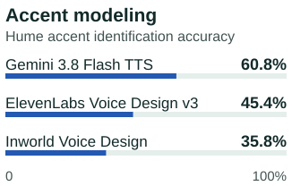
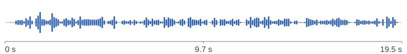

<!-- Generated by scripts/build-showcase.py from the model database. -->

```{=html}
<div class="showcase-detail"><nav class="showcase-breadcrumb" aria-label="Breadcrumb"><a href="/raw/showcase.html">Model Showcase</a><span aria-hidden="true">/</span><a href="/raw/showcase.html#family-gemini">Gemini family</a></nav><header class="showcase-detail-header"><p class="showcase-domain">Speech</p><h1>Gemini 3.8 Flash TTS</h1><p>Gemini 3.8 Flash TTS: voices beyond presets</p><nav class="showcase-detail-actions" aria-label="On this page"><a href="#model-card">Model card</a><a href="#results">Results & examples</a><a href="#source-slides">Source slides</a><a href="#methods">Methods & sources</a></nav></header><section class="showcase-source-map" id="source-slides" aria-labelledby="source-slides-title"><h2 id="source-slides-title">Source slides</h2><ul><li><span>Model card</span><a href="/raw/lectures/01_intro/lecture01_part2_final_v3_showcase.html#/sc-tts-gemini-38-flash" title="Slide ID: sc-tts-gemini-38-flash">Model Showcase: Model Cards &amp; Results · slide 77</a><code>sc-tts-gemini-38-flash</code></li><li><span>Results</span><a href="/raw/lectures/01_intro/lecture01_part2_final_v3_showcase.html#/sc-tts-gemini-38-flash-results" title="Slide ID: sc-tts-gemini-38-flash-results">Model Showcase: Model Cards &amp; Results · slide 78</a><code>sc-tts-gemini-38-flash-results</code></li></ul></section>
```

```{=html}
<section class="showcase-section" id="model-card"><div class="showcase-section-heading"><h2>Model card</h2></div>
```

```{=html}
<article class="showcase-slide-source" data-presentation="intro-showcase" data-slide="sc-tts-gemini-38-flash"><p class="showcase-slide-reference"><a href="/raw/lectures/01_intro/lecture01_part2_final_v3_showcase.html#/sc-tts-gemini-38-flash" title="Slide ID: sc-tts-gemini-38-flash">Model Showcase: Model Cards &amp; Results · slide 77</a></p><div class="showcase-source">
<div class="sc-body bn-body bn-w1" data-company="google">
  <div class="bn-id">
    <div class="bn-plate"><figure class="sc-evidence"><a class="showcase-figure-link" href="/raw/lectures/01_intro/assets/showcase_results_20261021/tts/gemini-38-accent.svg" target="_blank" rel="noopener">Open full-size figure</a></figure></div>
    <div class="bn-model">
      <p class="bn-kicker">TTS · Google DeepMind</p>
      <h3>Gemini 3.8 Flash TTS</h3>
      <p class="bn-ids"><code>gemini-3.8-flash-tts</code></p>
      <div class="bn-facts">
        <p><span>API GA</span><b class="bn-date">22.09.2026</b></p>
        <p><span>Access</span><b>API · AI Studio</b></p>
        <p><span>Weights</span><b class="bn-shut">closed</b></p>
      </div>
    </div>
  </div>
  <div class="bn-pub">
    <div class="bn-tile bn-k bn-a">
      <div class="bn-head"><h4>Voice &amp; Control</h4><span class="sc-status"><i class="sc-pip k"></i>Known</span></div>
      <div class="bn-stat"><p class="bn-num">130<small>languages</small></p><p class="bn-cap">listed in docs · 30 prebuilt voices</p></div>
      <div class="bn-rule">
        <p class="bn-item"><i class="sc-pip k"></i>Natural-language style + inline audio tags</p>
        <p class="bn-item"><i class="sc-pip k"></i>Up to 2 speakers, prebuilt voices only</p>
        <p class="bn-item"><i class="sc-pip k"></i>Voice design; replication with recorded consent</p>
      </div>
      <p class="bn-gap">SSML and word timestamps undisclosed</p>
    </div>
    <div class="bn-tile bn-p bn-b">
      <div class="bn-head"><h4>Inference</h4><span class="sc-status"><i class="sc-pip p"></i>Partial</span></div>
      <div class="bn-stat"><p class="bn-num">8,192 / 16,384</p><p class="bn-cap">Gemini API input / output token limits</p></div>
      <p class="bn-item"><i class="sc-pip k"></i>Streaming PCM · 24 kHz mono · text in, audio out</p>
    </div>
    <div class="bn-tile bn-p bn-c">
      <div class="bn-head"><h4>Architecture</h4><span class="sc-status"><i class="sc-pip p"></i>Partial</span></div>
      <p class="bn-item"><i class="sc-pip k"></i>Gemini 3 Pro base: family card</p>
      <p class="bn-item"><i class="sc-pip n"></i>TTS topology and codec undisclosed</p>
    </div>
    <div class="bn-tile bn-p bn-d">
      <div class="bn-head"><h4>Training</h4><span class="sc-status"><i class="sc-pip p"></i>Partial</span></div>
      <p class="bn-item"><i class="sc-pip k"></i>SynthID on generated audio</p>
      <p class="bn-item"><i class="sc-pip n"></i>TTS training recipe undisclosed</p>
    </div>
  </div>
  <div class="bn-strip">
    <div class="bn-strip-label"><span>Withheld</span><b>1<small>of 5</small></b></div>
    <div class="bn-cell"><h4><i class="sc-pip n"></i>Data</h4><p>No TTS corpus sources, size, language mix or provenance for the prebuilt voices.</p></div>
  </div>
</div>
<div class="sc-study">
  <table class="sc-study-table" data-numeric="2 3">
    <caption>Voice Arena ratings by language</caption>
    <thead><tr><th scope="col">Locale</th><th scope="col">3.8 Flash TTS</th><th scope="col">3.8 Flash-Lite TTS</th></tr></thead>
    <tbody>
      <tr><th scope="row">English</th><td>1061</td><td>1087</td></tr>
      <tr><th scope="row">Japanese</th><td>1232</td><td>1152</td></tr>
      <tr><th scope="row">Brazilian Portuguese</th><td>1104</td><td>1134</td></tr>
      <tr><th scope="row">Hindi</th><td>1106</td><td>1076</td></tr>
    </tbody>
  </table>
  <p class="sc-study-source"><a href="https://storage.googleapis.com/deepmind-media/gemini/gemini_3-8_tts_model_evaluation.pdf#page=4">DeepMind evaluation report · Voice Arena Evals</a> · Elo points ↑ from blind pairs, September 2026.</p>
</div>
<div class="fv-takeaway">Voice creation and direction are documented; TTS internals are mostly deferred to a family card.</div>
<div class="fv-source"><a href="https://storage.googleapis.com/deepmind-media/gemini/gemini_3-8_tts_model_evaluation.pdf">TTS model evaluation, p. 3</a> · <a href="https://www.hume.ai/blog/introducing-the-hume-voice-controllability-leaderboard">Hume accent protocol</a> · <a href="https://ai.google.dev/gemini-api/docs/models/gemini-3.8-flash-tts">Flash TTS model</a></div></div></article>
```

```{=html}
</section>
```

```{=html}
<section class="showcase-section" id="results"><div class="showcase-section-heading"><h2>Results & examples</h2></div>
```

```{=html}
<article class="showcase-slide-source" data-presentation="intro-showcase" data-slide="sc-tts-gemini-38-flash-results"><p class="showcase-source-subtitle">Design a Melbourne radio voice</p><p class="showcase-slide-reference"><a href="/raw/lectures/01_intro/lecture01_part2_final_v3_showcase.html#/sc-tts-gemini-38-flash-results" title="Slide ID: sc-tts-gemini-38-flash-results">Model Showcase: Model Cards &amp; Results · slide 78</a></p><div class="showcase-source">
<div class="sc-body sr-body" data-company="google">
<div class="sr-sidebar" role="group" aria-label="Model and reported metrics"><div class="sr-brand"><div aria-label="Google" class="sc-company" role="img"></div></div><div class="sr-model"><p>RESULTS · Text-to-speech</p><h3>Gemini 3.8 Flash TTS</h3></div><div class="sr-metrics"><div class="sr-metric"><p class="sr-metric-label">English voice design</p><p class="sr-metric-value">71.4</p><p class="sr-metric-note">Hume composite score reported in the model evaluation. <a class="" href="https://storage.googleapis.com/deepmind-media/gemini/gemini_3-8_tts_model_evaluation.pdf" target="_blank" rel="noopener">↗</a></p></div><div class="sr-metric"><p class="sr-metric-label">Accent identification</p><p class="sr-metric-value">60.8%</p><p class="sr-metric-note">Pooled accuracy across six Hume accent tasks. <a class="" href="https://storage.googleapis.com/deepmind-media/gemini/gemini_3-8_tts_model_evaluation.pdf" target="_blank" rel="noopener">↗</a></p></div></div></div>
<div class="sr-example">
  <div class="sr-stage sr-audio">
    <div><p class="sr-audio-label">Google · Gemini 3.8 Flash TTS</p><h3>A Melbourne DJ takes the mic</h3></div>
<p class="sr-audio-prompt"><strong>Opening line.</strong> “Alright, Melbourne. So good to have you with us tonight.”</p>
    <div></div>
    <audio controls preload="none" src="/raw/lectures/01_intro/assets/showcase_results_20261021/tts/gemini-38-melbourne.m4a" aria-label="Play Google · Gemini 3.8 Flash TTS speech example">Audio playback requires an HTML5 browser.</audio>
  </div>
  <p class="sr-caption">Google identifies the DJ as a voice designed from a description. Listen for changes of pace and emphasis.</p>
</div>
</div>
<div class="fv-takeaway">The voice brief specifies the persona and accent. The performance also varies emphasis within each line.</div>
<div class="fv-source"><a href="https://blog.google/innovation-and-ai/models-and-research/gemini-models/gemini-3-8-text-to-speech/" target="_blank" rel="noopener">DJ voice-design demonstration</a> · <a href="https://storage.googleapis.com/deepmind-media/gemini/gemini_3-8_tts_model_evaluation.pdf" target="_blank" rel="noopener">Evaluation report</a> · <a href="https://www.hume.ai/blog/introducing-the-hume-voice-controllability-leaderboard" target="_blank" rel="noopener">Hume protocol</a></div></div></article>
```

```{=html}
</section>
```

```{=html}
<section class="showcase-section" id="methods"><div class="showcase-section-heading"><h2>Methods & sources</h2><p>Source notes, evaluation conditions and limitations from the presentation slides.</p></div>
```

<details class="showcase-notes">
<summary>Model card: Model Showcase: Model Cards &amp; Results · slide 77</summary>

Source: Gemini 3.8 Audio Model Evaluation, PDF page 4 (printed page 3), Voice Arena Evals. These four of the seven published locale rows illustrate how the ordering of Flash and Flash-Lite varies with the listening panel. Elo ratings are derived from public blind comparisons. Compare models within a locale. Google reports production checkpoints, default sampling settings and one generation per prompt. These ratings measure listener preference and are independent of the Hume accent-identification result in the figure.

The chart redraws the Accents row of the Voice Design table on page 3 of Google DeepMind’s Gemini 3.8 Audio model evaluation. Hume reports pooled identification accuracy over six accent tasks. Chance varies from 17% to 33% by task. Google tested production checkpoints at default settings with one generation per prompt. Hume discloses a non-exclusive licensing agreement with Google.

**October workbook context.**

This card converts the supplied TTS_v1.0.xlsx audit dated 18 October 2026; it is not a new verification of the linked documentation. “Сводка”, row 7 supplies the category statuses: partial architecture, undisclosed data, partial training, partial inference, known voice and control. Row numbers below refer to the “Gemini 3.8 Flash TTS” sheet.

The exact model is gemini-3.8-flash-tts, with no preview suffix, GA in Gemini API from 22 September (row 6). Flash-Lite TTS and the Gemini Live models are separate models (rows 12–13). Flash TTS takes text and produces audio; it does not support Live API, tool calling or the broad multimodal input capabilities of the Live models (row 10). The Agent Platform channel was separately in preview from 28 September, and these 3.8 models were not available through Cloud Text-to-Speech API in the audit (rows 36–38). The closed-weights label follows the summary's inference from published access channels and no weights release (row 14).

The common Gemini 3.8 Audio card says the four audio models are based on Gemini 3 Pro. It does not say that this TTS model is based on Gemini 3.8 Flash. The card redirects architecture and training-data sections to the Gemini 3 Pro card without disclosing a TTS-specific topology, parameter count or corpus (rows 7–8 and 18). The 25 audio tokens per second are a billing relation, not a disclosed codec architecture (row 9). Prebuilt voice provenance is also absent (row 20). Training recipe and hardware are undisclosed; safety evaluations and SynthID provide safety information rather than a reproducible training procedure (rows 26–29).

The input limit is 8,192 tokens and the API serving output limit is 16,384. A broader model-card claim says 64K output, so the card uses the actual serving limit rather than the larger family-card number (row 11). Output defaults to mono 24 kHz 16-bit WAV for a unary response and headerless PCM for streaming (rows 39–40). No numerical vendor latency is published (row 41). The audit's promotional standard price is $0.50 / $9.00 per million text-input / audio-output tokens through 31 December 2026; it is not presented here as a permanent price (row 42).

The documentation lists 130 output languages and 30 prebuilt voices (rows 54 and 56). The extended library size is inconsistent across the blog, changelog and guide, so the card does not repeat a single headline total (row 55). Style goes in speech metadata; the text itself is a literal transcript, with inline tags for vocal events (rows 57–58 and 66). Two-speaker generation requires prebuilt voices; custom-voice turns or larger casts must be generated separately and assembled (row 59). Voice design and replication are API capabilities documented for 3.8, not evidence of generic audio-input support in the TTS generation model (rows 60–61).

Replication needs a 10–30 second reference and a separate recording of consent from the same adult speaker, with speaker verification (rows 30 and 61). AI Studio replication also has regional exclusions (row 31); it is not universally available. Neither SSML nor word / phoneme timestamps are documented for this model (row 65). The January 2025 cutoff in the shared card is not a description of the TTS corpus (row 19).

Sources: [Flash TTS model documentation](https://ai.google.dev/gemini-api/docs/models/gemini-3.8-flash-tts), [speech generation](https://ai.google.dev/gemini-api/docs/speech-generation), [Gemini 3.8 Audio model card](https://deepmind.google/models/model-cards/gemini-3-8-audio/). Scope and source-access caveats: workbook README rows 21–22.

</details>

<details class="showcase-notes">
<summary>Results: Model Showcase: Model Cards &amp; Results · slide 78</summary>

The adjacent carousel caption assigns this exact Melbourne DJ clip to Gemini 3.8 Flash TTS. The local M4A retains the AAC audio track from Google’s waveform video. The DJ welcomes the Melbourne audience and builds anticipation for a new dance track. The clip illustrates voice design. Google reports Hume’s English overall and accent values in its model evaluation; Hume’s methodology defines the accent figure as pooled identification accuracy. [Hume discloses a non-exclusive licensing agreement with Google](https://www.hume.ai/blog/newly-released-google-s-gemini-3-8-flash-tts-tops-hume-s-real-world-voiceeq-leaderboard).

The waveform shows peak absolute amplitude within equally spaced intervals of the playable course copy. Its time scale is in seconds.

[Original demonstration](https://blog.google/innovation-and-ai/models-and-research/gemini-models/gemini-3-8-text-to-speech/) · [Vendor media file](https://storage.googleapis.com/gweb-uniblog-publish-prod/original_videos/AudioWaveform-Blue_HighEnergyDJ.mp4)

</details>

```{=html}
</section><nav class="showcase-bottom-nav" aria-label="More models"><a href="/raw/showcase.html">Back to all models</a><a href="/raw/lectures/01_intro/lecture01_part2_final_v3_showcase.html#/sc-tts-gemini-38-flash">View source slide</a></nav></div>
```
