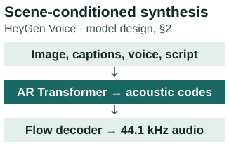
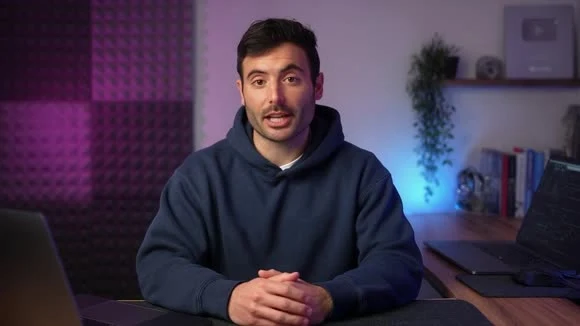
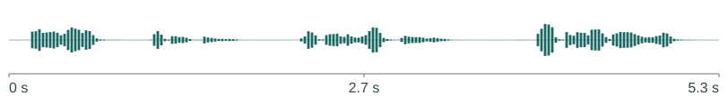

<!-- Generated by scripts/build-showcase.py from the model database. -->

```{=html}
<div class="showcase-detail"><nav class="showcase-breadcrumb" aria-label="Breadcrumb"><a href="/raw/showcase.html">Model Showcase</a><span aria-hidden="true">/</span><a href="/raw/showcase.html#family-heygen-voice">HeyGen Voice family</a></nav><header class="showcase-detail-header"><p class="showcase-domain">Speech</p><h1>HeyGen Voice</h1><p>How does HeyGen Voice put a speaker in a new scene?</p><nav class="showcase-detail-actions" aria-label="On this page"><a href="#model-card">Model card</a><a href="#results">Results & examples</a><a href="#source-slides">Source slides</a><a href="#methods">Methods & sources</a></nav></header><section class="showcase-source-map" id="source-slides" aria-labelledby="source-slides-title"><h2 id="source-slides-title">Source slides</h2><ul><li><span>Model card</span><a href="/raw/lectures/01_intro/lecture01_part2_final_v3_showcase.html#/sc-tts-heygen-voice" title="Slide ID: sc-tts-heygen-voice">Model Showcase: Model Cards &amp; Results · slide 79</a><code>sc-tts-heygen-voice</code></li><li><span>Results</span><a href="/raw/lectures/01_intro/lecture01_part2_final_v3_showcase.html#/sc-tts-heygen-voice-results" title="Slide ID: sc-tts-heygen-voice-results">Model Showcase: Model Cards &amp; Results · slide 80</a><code>sc-tts-heygen-voice-results</code></li></ul></section>
```

```{=html}
<section class="showcase-section" id="model-card"><div class="showcase-section-heading"><h2>Model card</h2></div>
```

```{=html}
<article class="showcase-slide-source" data-presentation="intro-showcase" data-slide="sc-tts-heygen-voice"><p class="showcase-slide-reference"><a href="/raw/lectures/01_intro/lecture01_part2_final_v3_showcase.html#/sc-tts-heygen-voice" title="Slide ID: sc-tts-heygen-voice">Model Showcase: Model Cards &amp; Results · slide 79</a></p><div class="showcase-source">
<div class="sc-body bn-body bn-w1" data-company="heygen">
  <div class="bn-id">
    <div class="bn-plate"><figure class="sc-evidence"><a class="showcase-figure-link" href="/raw/lectures/01_intro/assets/showcase_results_20261021/tts/heygen-voice-synthesis.svg" target="_blank" rel="noopener">Open full-size figure</a></figure></div>
    <div class="bn-model">
      <p class="bn-kicker">Text-to-speech · HeyGen</p>
      <h3>HeyGen Voice</h3>
      <p class="bn-ids"><code>heygen-voice-1</code><code>heygen-voice-1-turbo</code></p>
      <div class="bn-facts">
        <p><span>Released</span><b class="bn-date">09.10.2026</b></p>
        <p><span>Access</span><b>API · platform</b></p>
        <p><span>Weights</span><b class="bn-shut">closed</b></p>
      </div>
    </div>
  </div>
  <div class="bn-pub">
    <div class="bn-tile bn-k bn-a">
      <div class="bn-head"><h4>Voice &amp; Control</h4><span class="sc-status"><i class="sc-pip k"></i>Known</span></div>
      <div class="bn-stat"><p class="bn-num">2<small>clone policies</small></p><p class="bn-cap">Scene adaptation or reference continuation</p></div>
      <div class="bn-rule">
        <p class="bn-item"><i class="sc-pip k"></i>Reference audio supplies timbre and accent</p>
        <p class="bn-item"><i class="sc-pip k"></i>Image and captions describe scene and delivery</p>
        <p class="bn-item"><i class="sc-pip k"></i>Expressiveness boost scales the optional adapter</p>
      </div>
      <p class="bn-gap">API controls vary by voice type</p>
    </div>
    <div class="bn-tile bn-k bn-b">
      <div class="bn-head"><h4>Inference</h4><span class="sc-status"><i class="sc-pip k"></i>Known</span></div>
      <div class="bn-stat"><p class="bn-num">≈0.1<small>RTF</small></p><p class="bn-cap">Reported synthesis time ÷ audio duration · one concurrent request</p></div>
      <p class="bn-item"><i class="sc-pip k"></i>API default output is 44.1 kHz mono WAV</p>
    </div>
    <div class="bn-tile bn-k bn-c">
      <div class="bn-head"><h4>Architecture</h4><span class="sc-status"><i class="sc-pip k"></i>Known</span></div>
      <p class="bn-item"><i class="sc-pip k"></i>Autoregressive acoustic Transformer</p>
      <p class="bn-item"><i class="sc-pip k"></i>Flow matching in continuous audio latents</p>
    </div>
    <div class="bn-tile bn-k bn-d">
      <div class="bn-head"><h4>Training</h4><span class="sc-status"><i class="sc-pip k"></i>Known</span></div>
      <p class="bn-item"><i class="sc-pip k"></i>Simulated and real cross-scene pairs</p>
      <p class="bn-item"><i class="sc-pip k"></i>GRPO for fidelity, DPO for expression</p>
    </div>
  </div>
  <div class="bn-strip">
    <div class="bn-strip-label"><span>Data disclosure</span><b>Partial</b></div>
    <div class="bn-cell"><h4><i class="sc-pip p"></i>Talking-video corpus</h4><p>HeyGen mines the same speaker across scenes. The report describes curation and leaves the corpus hours and source list unspecified.</p></div>
  </div>
</div>
<div class="sc-study">
  <table class="sc-study-table" data-numeric="2 3">
    <caption>Two clone policies on 331 matched scenes</caption>
    <thead><tr><th scope="col">Mean cosine ↑</th><th scope="col">Voice-clone</th><th scope="col">Full-clone</th></tr></thead>
    <tbody>
      <tr><th scope="row">Speaker to target</th><td>0.590</td><td>0.581</td></tr>
      <tr><th scope="row">Speaker to reference</th><td>0.739</td><td>0.757</td></tr>
      <tr><th scope="row">Audio to target audio</th><td>0.637</td><td>0.608</td></tr>
      <tr><th scope="row">Audio to scene image</th><td>0.282</td><td>0.278</td></tr>
    </tbody>
  </table>
  <p class="sc-study-source"><a href="https://dynamic.heygen.ai/www/research/introducing-heygen-voice/heygen-voice-scene-aware-voice-cloning-for-talking-videos.pdf#page=13">HeyGen technical report · §5.1, Table 5</a> · Same speaker recorded in two different scenes.</p>
</div>
<div class="fv-takeaway">The voice reference identifies the speaker. The image and captions guide how that voice sounds in the scene.</div>
<div class="fv-source"><a href="https://dynamic.heygen.ai/www/research/introducing-heygen-voice/heygen-voice-scene-aware-voice-cloning-for-talking-videos.pdf">HeyGen Voice report, §§2–4</a> · <a href="https://developers.heygen.com/docs/voices/heygen-voice-speech">Voice API</a> · <a href="https://www.heygen.com/models/heygen-voice-1">Listening studies</a></div></div></article>
```

```{=html}
</section>
```

```{=html}
<section class="showcase-section" id="results"><div class="showcase-section-heading"><h2>Results & examples</h2></div>
```

```{=html}
<article class="showcase-slide-source" data-presentation="intro-showcase" data-slide="sc-tts-heygen-voice-results"><p class="showcase-source-subtitle">A cloned voice in a treated studio</p><p class="showcase-slide-reference"><a href="/raw/lectures/01_intro/lecture01_part2_final_v3_showcase.html#/sc-tts-heygen-voice-results" title="Slide ID: sc-tts-heygen-voice-results">Model Showcase: Model Cards &amp; Results · slide 80</a></p><div class="showcase-source">
<div class="sc-body sr-body" data-company="heygen">
<div class="sr-sidebar" role="group" aria-label="Model and reported metrics"><div class="sr-brand"><div aria-label="HeyGen" class="sc-company" role="img"><span class="sc-company-name">HeyGen</span></div></div><div class="sr-model"><p>RESULTS · Text-to-speech</p><h3>HeyGen Voice</h3></div><div class="sr-metrics"><div class="sr-metric"><p class="sr-metric-label">Own-voice selection</p><p class="sr-metric-value">41.7%</p><p class="sr-metric-note">6,153 three-way votes from users choosing their own voice. <a class="" href="https://dynamic.heygen.ai/www/research/introducing-heygen-voice/heygen-voice-scene-aware-voice-cloning-for-talking-videos.pdf" target="_blank" rel="noopener">↗</a></p></div><div class="sr-metric"><p class="sr-metric-label">Narrator choice vs. Eleven v4</p><p class="sr-metric-value">61.5%</p><p class="sr-metric-note">Decided narrator-choice votes across 245 scripts in 5 languages. <a class="" href="https://dynamic.heygen.ai/www/research/introducing-heygen-voice/heygen-voice-scene-aware-voice-cloning-for-talking-videos.pdf" target="_blank" rel="noopener">↗</a></p></div></div></div>
<div class="sr-example">
  <div class="sr-stage sr-audio">
    <div style="display:grid;grid-template-columns:1fr 0.95fr;gap:26px;align-items:center">
  <div><p class="sr-audio-label">HeyGen · HeyGen Voice</p><h3>Adam in the recording studio</h3><p class="sr-audio-prompt" style="margin-top:18px"><strong>Spoken line.</strong> “Same voice, different scene. Listen to how it changes. Still sounds like me, right?”</p></div>
  
</div>
    <div></div>
    <audio controls preload="none" src="/raw/lectures/01_intro/assets/showcase_results_20261021/tts/heygen-voice-studio.m4a" aria-label="Play HeyGen · HeyGen Voice speech example">Audio playback requires an HTML5 browser.</audio>
  </div>
  <p class="sr-caption">The published studio example places Adam’s cloned voice in a treated room. Listen for the close, dry sound of the voice.</p>
</div>
</div>
<div class="fv-takeaway">The reference voice identifies Adam. The scene determines the acoustics around him.</div>
<div class="fv-source"><a href="https://www.heygen.com/models/heygen-voice-1" target="_blank" rel="noopener">Studio demonstration</a> · <a href="https://dynamic.heygen.ai/www/research/introducing-heygen-voice/heygen-voice-scene-aware-voice-cloning-for-talking-videos.pdf" target="_blank" rel="noopener">Research report, §5</a></div></div></article>
```

```{=html}
</section>
```

```{=html}
<section class="showcase-section" id="methods"><div class="showcase-section-heading"><h2>Methods & sources</h2><p>Source notes, evaluation conditions and limitations from the presentation slides.</p></div>
```

<details class="showcase-notes">
<summary>Model card: Model Showcase: Model Cards &amp; Results · slide 79</summary>

The table transposes two rows from Table 5. Each of the 331 cases pairs an English reference recording with another recording of the same speaker in a different scene. Speaker comparisons use ECAPA-TDNN cosine similarity after vocal isolation. Audio–audio and audio–image comparisons use ImageBind cosine similarity. Both HeyGen policies additionally receive the target frame, speaker and background captions, and an SNR control. Captions and SNR are derived from real target audio in this experiment. Voice-clone better matches the target scene, while full-clone better preserves the original reference voice.

The diagram condenses §§2.1–2.4 of HeyGen Research’s *Scene-Aware Voice Cloning for Talking Videos*. The image, speaker and background captions, reference voice and continuity features are pooled or encoded into a conditioning prefix. The causal Transformer predicts discrete acoustic codes. Its hidden states condition a diffusion Transformer that uses flow matching in a continuous latent space. A waveform decoder produces audio at 44.1 kHz. In later segments an audio anchor and local acoustic context help maintain the speaker and room tone.

Figure 3 in the report gives the training order: supervised multilingual speech, simulated cross-scene adaptation, real cross-scene fine-tuning, group-relative policy optimization for intelligibility and speaker similarity, and direct preference optimization of a low-rank adapter for expressiveness. Section 3.1 describes talking-video curation and cross-video pairing. The reported real-time factor is approximately 0.1 at concurrency one, or roughly one second of synthesis per ten seconds of output. This is a throughput measure over generated audio. It does not specify time to first audio.

The public API accepts a script of 1–10,000 characters and one voice ID. Instant and professional voices support speed, pitch and best-effort seed. Instant voices additionally expose expressiveness control, while professional voices accept explicit breaks. The scene-aware research system includes controls beyond the public TTS endpoint. HeyGen labels the listening example at product level. The published example has no finer checkpoint attribution.

[Technical report, §§2–4](https://dynamic.heygen.ai/www/research/introducing-heygen-voice/heygen-voice-scene-aware-voice-cloning-for-talking-videos.pdf) · [HeyGen speech API](https://developers.heygen.com/docs/voices/heygen-voice-speech)

</details>

<details class="showcase-notes">
<summary>Results: Model Showcase: Model Cards &amp; Results · slide 80</summary>

The Studio result is one of the generated scenes in HeyGen’s demonstration with Adam. The vendor labels it HeyGen Voice and leaves the specific serving checkpoint unspecified. The M4A retains the original AAC track. The image is a frame from the same video. The two preference figures answer different questions and have different denominators.

The waveform shows peak absolute amplitude within equally spaced intervals of the playable course copy. Its time scale is in seconds.

[Original demonstration](https://www.heygen.com/models/heygen-voice-1) · [Vendor media file](https://dynamic.heygen.ai/www/heygen-voice/flagship-studio-v2.mp4)

</details>

```{=html}
</section><nav class="showcase-bottom-nav" aria-label="More models"><a href="/raw/showcase.html">Back to all models</a><a href="/raw/lectures/01_intro/lecture01_part2_final_v3_showcase.html#/sc-tts-heygen-voice">View source slide</a></nav></div>
```
