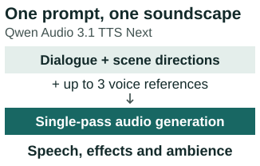
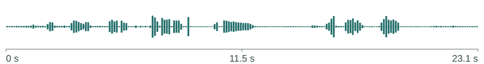

<!-- Generated by scripts/build-showcase.py from the model database. -->

```{=html}
<div class="showcase-detail"><nav class="showcase-breadcrumb" aria-label="Breadcrumb"><a href="/raw/showcase.html">Model Showcase</a><span aria-hidden="true">/</span><a href="/raw/showcase.html#family-qwen">Qwen family</a></nav><header class="showcase-detail-header"><p class="showcase-domain">Speech</p><h1>Qwen Audio 3.1</h1><p>Qwen Audio 3.1: Flash streams, Next builds scenes</p><nav class="showcase-detail-actions" aria-label="On this page"><a href="#model-card">Model card</a><a href="#results">Results & examples</a><a href="#source-slides">Source slides</a><a href="#methods">Methods & sources</a></nav></header><section class="showcase-source-map" id="source-slides" aria-labelledby="source-slides-title"><h2 id="source-slides-title">Source slides</h2><ul><li><span>Model card</span><a href="/raw/lectures/01_intro/lecture01_part2_final_v3_showcase.html#/sc-tts-qwen-audio-31" title="Slide ID: sc-tts-qwen-audio-31">Model Showcase: Model Cards &amp; Results · slide 75</a><code>sc-tts-qwen-audio-31</code></li><li><span>Results</span><a href="/raw/lectures/01_intro/lecture01_part2_final_v3_showcase.html#/sc-tts-qwen-audio-31-results" title="Slide ID: sc-tts-qwen-audio-31-results">Model Showcase: Model Cards &amp; Results · slide 76</a><code>sc-tts-qwen-audio-31-results</code></li></ul></section>
```

```{=html}
<section class="showcase-section" id="model-card"><div class="showcase-section-heading"><h2>Model card</h2></div>
```

```{=html}
<article class="showcase-slide-source" data-presentation="intro-showcase" data-slide="sc-tts-qwen-audio-31"><p class="showcase-slide-reference"><a href="/raw/lectures/01_intro/lecture01_part2_final_v3_showcase.html#/sc-tts-qwen-audio-31" title="Slide ID: sc-tts-qwen-audio-31">Model Showcase: Model Cards &amp; Results · slide 75</a></p><div class="showcase-source">
<div class="sc-body bn-body bn-w1" data-company="alibaba">
  <div class="bn-id">
    <div class="bn-plate"><figure class="sc-evidence"><a class="showcase-figure-link" href="/raw/lectures/01_intro/assets/showcase_results_20261021/tts/qwen-31-next-scene.svg" target="_blank" rel="noopener">Open full-size figure</a></figure></div>
    <div class="bn-model">
      <p class="bn-kicker">Text-to-speech · Alibaba</p>
      <h3>Qwen Audio 3.1</h3>
      <p class="bn-ids"><code>TTS Flash / TTS Next</code></p>
      <div class="bn-facts">
        <p><span>Announced</span><b class="bn-date">22.09.2026</b></p>
        <p><span>Access</span><b>Cloud API</b></p>
        <p><span>Weights</span><b class="bn-shut">closed</b></p>
      </div>
    </div>
  </div>
  <div class="bn-pub">
    <div class="bn-tile bn-k bn-a">
      <div class="bn-head"><h4>Voice &amp; Control</h4><span class="sc-status"><i class="sc-pip k"></i>Known</span></div>
      <div class="bn-stat"><p class="bn-num">68<small>voices</small></p><p class="bn-cap">Flash presets · language and region vary</p></div>
      <div class="bn-rule">
        <p class="bn-item"><i class="sc-pip k"></i>Flash: cloning, voice design and SSML</p>
        <p class="bn-item"><i class="sc-pip k"></i>Next: Chinese / English; up to 3 speakers</p>
        <p class="bn-item"><i class="sc-pip k"></i>Next: speech + effects + ambience</p>
      </div>
      <p class="bn-gap bn-gap-p"><i class="sc-pip p"></i>Two documented endpoints on this card</p>
    </div>
    <div class="bn-tile bn-p bn-b">
      <div class="bn-head"><h4>Inference</h4><span class="sc-status"><i class="sc-pip p"></i>Partial</span></div>
      <div class="bn-stat"><p class="bn-num">120<small>s</small></p><p class="bn-cap">Next output limit · podcasts up to 240 s</p></div>
      <p class="bn-item"><i class="sc-pip k"></i>Flash streams; Next returns a file · no latency figures</p>
    </div>
    <div class="bn-tile bn-p bn-c">
      <div class="bn-head"><h4>Architecture</h4><span class="sc-status"><i class="sc-pip p"></i>Partial</span></div>
      <p class="bn-item"><i class="sc-pip k"></i>Next: unified AudioGen generation</p>
      <p class="bn-item"><i class="sc-pip p"></i>Flash topology and codec are unreported</p>
    </div>
    <div class="bn-tile bn-p bn-d">
      <div class="bn-head"><h4>Training</h4><span class="sc-status"><i class="sc-pip p"></i>Partial</span></div>
      <p class="bn-item"><i class="sc-pip k"></i>Next: optional AIGC tag + content checks</p>
      <p class="bn-item"><i class="sc-pip p"></i>Flash recipe not established for 3.1</p>
    </div>
  </div>
  <div class="bn-strip">
    <div class="bn-strip-label"><span>Withheld</span><b>1<small>of 5</small></b></div>
    <div class="bn-cell"><h4><i class="sc-pip n"></i>Data</h4><p>No training hours, sources, synthetic shares or corpus language mix for either TTS model.</p></div>
  </div>
</div>
<div class="sc-study">
  <table class="sc-study-table">
    <caption>Qwen Audio 3.1 in the Singapore API</caption>
    <thead><tr><th scope="col">Service property</th><th scope="col">TTS Flash</th><th scope="col">TTS Next</th></tr></thead>
    <tbody>
      <tr><th scope="row">Generation input</th><td>Text</td><td>Text + optional audio</td></tr>
      <tr><th scope="row">Output delivery</th><td>Stream or file</td><td>Completed file</td></tr>
      <tr><th scope="row">1M input tokens</th><td>US$0.23</td><td>US$0.93</td></tr>
      <tr><th scope="row">1M output tokens</th><td>US$1.87</td><td>US$1.87</td></tr>
    </tbody>
  </table>
  <p class="sc-study-source"><a href="https://www.alibabacloud.com/help/en/model-studio/qwen-audio-3-1-tts-flash">Alibaba Cloud · Flash API spec</a> · <a href="https://www.alibabacloud.com/help/en/model-studio/qwen-audio-3-1-tts-next">Next API spec</a> · Singapore list prices, November 2026.</p>
</div>
<div class="fv-takeaway">Flash and Next serve different audio tasks; shared branding does not establish shared internals.</div>
<div class="fv-source"><a href="https://help.aliyun.com/en/model-studio/qwen-audio-3-1-tts-flash">Flash documentation</a> · <a href="https://www.alibabacloud.com/help/en/model-studio/qwen-audio-3-1-tts-next">Next model specification</a> · <a href="https://www.alibabacloud.com/help/en/model-studio/audio-generation">English prompt guide</a></div></div></article>
```

```{=html}
</section>
```

```{=html}
<section class="showcase-section" id="results"><div class="showcase-section-heading"><h2>Results & examples</h2></div>
```

```{=html}
<article class="showcase-slide-source" data-presentation="intro-showcase" data-slide="sc-tts-qwen-audio-31-results"><p class="showcase-source-subtitle">Two voices on a rainy platform</p><p class="showcase-slide-reference"><a href="/raw/lectures/01_intro/lecture01_part2_final_v3_showcase.html#/sc-tts-qwen-audio-31-results" title="Slide ID: sc-tts-qwen-audio-31-results">Model Showcase: Model Cards &amp; Results · slide 76</a></p><div class="showcase-source">
<div class="sc-body sr-body" data-company="alibaba">
<div class="sr-sidebar" role="group" aria-label="Model and reported metrics"><div class="sr-brand"><div aria-label="Alibaba / Qwen" class="sc-company" role="img"><span class="sc-company-caption">Qwen</span></div></div><div class="sr-model"><p>RESULTS · Text-to-speech</p><h3>Qwen Audio 3.1</h3></div><div class="sr-metrics"><div class="sr-metric"><p class="sr-metric-label">Next output limit</p><p class="sr-metric-value">120 / 240 s</p><p class="sr-metric-note">Maximum output per request for scenes / podcasts. <a class="" href="https://www.alibabacloud.com/help/en/model-studio/qwen-audio-3-1-tts-next" target="_blank" rel="noopener">↗</a></p></div><div class="sr-metric"><p class="sr-metric-label">Next input limit</p><p class="sr-metric-value">3,000 chars</p><p class="sr-metric-note">Maximum text length in the prompt guide. <a class="" href="https://www.alibabacloud.com/help/en/model-studio/audio-generation" target="_blank" rel="noopener">↗</a></p></div><div class="sr-metric"><p class="sr-metric-label">Next service quota</p><p class="sr-metric-value">180 req/min</p><p class="sr-metric-note">Published quota in Beijing and Singapore. <a class="" href="https://www.alibabacloud.com/help/en/model-studio/qwen-audio-3-1-tts-next" target="_blank" rel="noopener">↗</a></p></div></div></div>
<div class="sr-example">
  <div class="sr-stage sr-audio">
    <div><p class="sr-audio-label">Alibaba Cloud · Qwen Audio 3.1 TTS Next</p><h3>A farewell at the station</h3></div>
<p class="sr-audio-prompt"><strong>Opening exchange.</strong> Owen: “You didn’t have to come.”   Ruth: “You left your scarf.”</p>
    <div></div>
    <audio controls preload="none" src="/raw/lectures/01_intro/assets/showcase_results_20261021/tts/qwen-31-railway.mp3" aria-label="Play Alibaba Cloud · Qwen Audio 3.1 TTS Next speech example">Audio playback requires an HTML5 browser.</audio>
  </div>
  <p class="sr-caption">Two siblings part at a railway station. Listen for the rain continuing through the changes of speaker.</p>
</div>
</div>
<div class="fv-takeaway">One scene description sets the two voices, the weather and the train sounds.</div>
<div class="fv-source"><a href="https://www.alibabacloud.com/help/en/model-studio/audio-generation" target="_blank" rel="noopener">Film dialogue example</a> · <a href="https://www.alibabacloud.com/help/en/model-studio/qwen-audio-3-1-tts-next" target="_blank" rel="noopener">Next API limits</a></div></div></article>
```

```{=html}
</section>
```

```{=html}
<section class="showcase-section" id="methods"><div class="showcase-section-heading"><h2>Methods & sources</h2><p>Source notes, evaluation conditions and limitations from the presentation slides.</p></div>
```

<details class="showcase-notes">
<summary>Model card: Model Showcase: Model Cards &amp; Results · slide 75</summary>

This table combines the Model capabilities, API access or Invocation, and Singapore pricing sections of the exact qwen-audio-3.1-tts-flash and qwen-audio-3.1-tts-next pages. Flash supports WebSocket streaming and a non-real-time HTTP endpoint. Next returns a completed audio file and can accept reference recordings in the generation request. The selected USD list prices exclude promotions and apply per million tokens on the relevant side of the request. The service properties are distinct from speech quality measurements.

The diagram follows the Next model specification and the English prompt guide. Reference recordings are optional. Each reference has a 30-second, 10 MB limit. Next returns one completed audio file over HTTPS. The model specification describes unified audio generation and leaves the internal architecture unspecified.

**October workbook context.**

This card faithfully converts the supplied TTS_v1.0.xlsx audit of 18 October 2026. It does not independently re-certify the external sources. Category statuses are from “Сводка”, row 6: partial architecture, undisclosed data, partial training, partial inference, known voice and control. Following row numbers refer to the “Qwen Audio 3.1” sheet.

This is one workbook model card covering two documented TTS endpoints: qwen-audio-3.1-tts-flash and qwen-audio-3.1-tts-next (rows 35–36). The family was announced on 22 September; some press reports use 23 September (row 55). ASR and Realtime are different models. TTS-Plus appears on Artificial Analysis and a price aggregator, but was not found in official model lists or pricing notices (row 37). Do not apply its leaderboard score to Flash or Next (row 52). Closed weights is the audit's summary conclusion from API-only access and no public release, not an explicit model licence statement (row 38).

Flash is the streaming speech endpoint, with AOQ and WebSocket access. Next uses synchronous HTTPS and returns a finished file (rows 15 and 40). Next accepts up to 3,000 prompt characters and generates at most 120 seconds, or 240 seconds for podcasts (rows 14 and 53). Flash's maximum input/output fields are blank. Neither TTS endpoint has a published numerical latency; the approximately 160 ms figure elsewhere in the family is ASR latency, not TTS (row 47). Next documents WAV, MP3 and PCM, with 48 kHz stereo by default. Do not copy Flash sample rates or formats from examples that name 3.0 (rows 48–49).

The architecture distinction is deliberate. Next's model page documents unified AudioGen generation of speech, sound effects and ambience from text and reference audio (row 8). A language-model-plus-diffusion account for Next is secondary (row 9). The Flash language-model / flow-matching topology and 12.5 Hz tokenizer are also secondary, and match an older 3.0 technical report, so the audit flags possible version confusion (rows 7 and 12). The same applies to a reported five-stage training pipeline with final RL (row 26). Parameters and base LLM are undisclosed (rows 11 and 13); training corpus details are absent for both models (rows 19–22).

Flash has 68 preset voices with differing languages and regions. Cloning and voice design are documented only in Beijing; all 68 presets support timestamps, SSML and instruction control (rows 59 and 62–65, 71–72). Next supports Chinese and English, up to three reference clips / speakers, natural-language direction, and speech with sound effects and ambience (rows 61, 64 and 67–70). Its API does not expose the timestamp controls suggested by the model page (row 71). Next's AIGC marking is optional and defaults to false; content inspection failures are documented. These safeguards do not disclose the training recipe (rows 29–30).

Sources: [TTS Flash](https://help.aliyun.com/en/model-studio/qwen-audio-3-1-tts-flash), [TTS Next](https://help.aliyun.com/en/model-studio/qwen-audio-3-1-tts-next), [audio generation API](https://help.aliyun.com/en/model-studio/audio-generation-api). The audit could not open the research blog on OSS; see README rows 21–22 for that limitation and the explicit prohibition on inheriting 3.0 facts.

</details>

<details class="showcase-notes">
<summary>Results: Model Showcase: Model Cards &amp; Results · slide 76</summary>

The English prompt guide attaches this WAV to the Film dialogue row, and its supported-model table lists qwen-audio-3.1-tts-next. A brother and sister trade short lines at a rainy station. They discuss his scarf and when he will call. The prompt specifies a whistle and departing footsteps. The course copy retains the complete 23-second stereo clip as a 160 kb/s MP3. The limits shown describe the service, independent of the clip.

The waveform shows peak absolute amplitude within equally spaced intervals of the playable course copy. Its time scale is in seconds.

[Original demonstration](https://www.alibabacloud.com/help/en/model-studio/audio-generation) · [Vendor media file](https://g-adoc.alcasset.com/media/maas_docs/sfm-cn/en/audios/6a4b3c2d1e0f92c0.wav)

</details>

```{=html}
</section><nav class="showcase-bottom-nav" aria-label="More models"><a href="/raw/showcase.html">Back to all models</a><a href="/raw/lectures/01_intro/lecture01_part2_final_v3_showcase.html#/sc-tts-qwen-audio-31">View source slide</a></nav></div>
```
