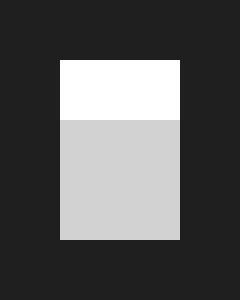
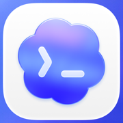
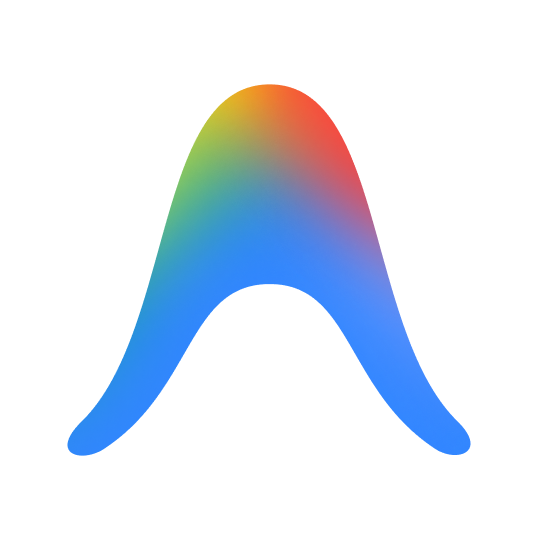

<!-- Generated by scripts/build-tools-showcase.py from the tools database. -->

```{=html}
<div class="showcase-catalog tools-showcase-catalog" data-noun="tool" data-group-noun="group"><header class="showcase-hero"><div><p class="showcase-domain">AI coding tools</p><h1>Tools Showcase</h1><p class="showcase-intro">Explore how the tools work. Inspect their uses and evidence.</p><p>Tool cards, published examples and technical figures from the lecture.</p></div><div class="showcase-hero-actions"><a class="course-button" href="/raw/lectures/01_intro/lecture01_tools_showcase.html">Open the lecture</a></div></header><p class="showcase-snapshot">13 tools · 3 groups · Every detail page links to its source slides and notes.</p><div class="showcase-controls"><label class="showcase-search-label" for="showcase-search">Find a tool<input id="showcase-search" type="search" placeholder="Tool, surface or capability" autocomplete="off"></label><div class="showcase-filters" role="group" aria-label="Tool group"><button type="button" data-filter="all" aria-pressed="true">All tools <span>13</span></button><button type="button" data-filter="ide" aria-pressed="false">Editor &amp; IDE <span>5</span></button><button type="button" data-filter="terminal" aria-pressed="false">Terminal <span>4</span></button><button type="button" data-filter="workspace" aria-pressed="false">Local &amp; remote workspaces <span>4</span></button></div></div><div class="showcase-catalog-meta"><p id="showcase-count" role="status" aria-live="polite">13 tools</p></div><div id="showcase-empty" hidden><h2>No matching tools</h2><p>Try another name or clear the filter.</p><button type="button" id="showcase-reset">Clear filters</button></div><div class="showcase-families"><section class="showcase-family" id="family-ide" data-family="ide" aria-labelledby="family-ide-title"><header class="showcase-family-heading"><h2 id="family-ide-title">Editor &amp; IDE</h2><span class="showcase-family-count">5 tools</span></header><div class="showcase-grid"><article class="showcase-model tools-showcase-tool" data-family="ide" data-category="ide" data-search="Cursor Editor &amp; IDE AI editor and agent platform Editing interfaces and cloud delegation"><a class="showcase-preview" href="/raw/tools-showcase/cursor.html" aria-label="Cursor tool card"><span class="showcase-brand"></span></a><div class="showcase-card-body"><div class="showcase-card-meta"><span>Editor &amp; IDE</span><span>AI editor and agent platform</span></div><h3 class="model-name"><a href="/raw/tools-showcase/cursor.html">Cursor</a></h3><p class="showcase-description">Editing interfaces and cloud delegation</p></div><nav class="showcase-card-actions" aria-label="Cursor materials"><a href="/raw/tools-showcase/cursor.html">Tool card</a><a href="/raw/tools-showcase/cursor.html#use-cases">Use cases & results</a></nav></article>
<article class="showcase-model tools-showcase-tool" data-family="ide" data-category="ide" data-search="GitHub Copilot Editor &amp; IDE IDE, GitHub, app, and terminal Capabilities and review points"><a class="showcase-preview" href="/raw/tools-showcase/copilot.html" aria-label="GitHub Copilot tool card"><span class="showcase-brand"></span></a><div class="showcase-card-body"><div class="showcase-card-meta"><span>Editor &amp; IDE</span><span>IDE, GitHub, app, and terminal</span></div><h3 class="model-name"><a href="/raw/tools-showcase/copilot.html">GitHub Copilot</a></h3><p class="showcase-description">Capabilities and review points</p></div><nav class="showcase-card-actions" aria-label="GitHub Copilot materials"><a href="/raw/tools-showcase/copilot.html">Tool card</a><a href="/raw/tools-showcase/copilot.html#use-cases">Use cases & results</a></nav></article>
<article class="showcase-model tools-showcase-tool" data-family="ide" data-category="ide" data-search="Junie Editor &amp; IDE JetBrains IDE agent and CLI From IDE context to a reviewed patch"><a class="showcase-preview" href="/raw/tools-showcase/junie.html" aria-label="Junie tool card"><span class="showcase-brand"></span></a><div class="showcase-card-body"><div class="showcase-card-meta"><span>Editor &amp; IDE</span><span>JetBrains IDE agent and CLI</span></div><h3 class="model-name"><a href="/raw/tools-showcase/junie.html">Junie</a></h3><p class="showcase-description">From IDE context to a reviewed patch</p></div><nav class="showcase-card-actions" aria-label="Junie materials"><a href="/raw/tools-showcase/junie.html">Tool card</a><a href="/raw/tools-showcase/junie.html#use-cases">Use cases & results</a></nav></article>
<article class="showcase-model tools-showcase-tool" data-family="ide" data-category="ide" data-search="Cline Editor &amp; IDE Open-source coding agent Plan to Act with checkpoints enabled"><a class="showcase-preview" href="/raw/tools-showcase/cline.html" aria-label="Cline tool card"><span class="showcase-brand"></span></a><div class="showcase-card-body"><div class="showcase-card-meta"><span>Editor &amp; IDE</span><span>Open-source coding agent</span></div><h3 class="model-name"><a href="/raw/tools-showcase/cline.html">Cline</a></h3><p class="showcase-description">Plan to Act with checkpoints enabled</p></div><nav class="showcase-card-actions" aria-label="Cline materials"><a href="/raw/tools-showcase/cline.html">Tool card</a><a href="/raw/tools-showcase/cline.html#use-cases">Use cases & results</a></nav></article>
<article class="showcase-model tools-showcase-tool" data-family="ide" data-category="ide" data-search="Kiro Editor &amp; IDE IDE · CLI Requirements-First Feature Spec"><a class="showcase-preview" href="/raw/tools-showcase/kiro.html" aria-label="Kiro tool card"><span class="showcase-brand"></span></a><div class="showcase-card-body"><div class="showcase-card-meta"><span>Editor &amp; IDE</span><span>IDE · CLI</span></div><h3 class="model-name"><a href="/raw/tools-showcase/kiro.html">Kiro</a></h3><p class="showcase-description">Requirements-First Feature Spec</p></div><nav class="showcase-card-actions" aria-label="Kiro materials"><a href="/raw/tools-showcase/kiro.html">Tool card</a><a href="/raw/tools-showcase/kiro.html#use-cases">Use cases & results</a></nav></article></div></section>
<section class="showcase-family" id="family-terminal" data-family="terminal" aria-labelledby="family-terminal-title"><header class="showcase-family-heading"><h2 id="family-terminal-title">Terminal</h2><span class="showcase-family-count">4 tools</span></header><div class="showcase-grid"><article class="showcase-model tools-showcase-tool" data-family="terminal" data-category="terminal" data-search="Aider Terminal Terminal pair programming Terminal pair programming"><a class="showcase-preview" href="/raw/tools-showcase/aider.html" aria-label="Aider tool card"><span class="showcase-brand"></span></a><div class="showcase-card-body"><div class="showcase-card-meta"><span>Terminal</span><span>Terminal pair programming</span></div><h3 class="model-name"><a href="/raw/tools-showcase/aider.html">Aider</a></h3><p class="showcase-description">Terminal pair programming</p></div><nav class="showcase-card-actions" aria-label="Aider materials"><a href="/raw/tools-showcase/aider.html">Tool card</a><a href="/raw/tools-showcase/aider.html#use-cases">Use cases & results</a></nav></article>
<article class="showcase-model tools-showcase-tool" data-family="terminal" data-category="terminal" data-search="Claude Code Terminal Anthropic · Terminal agent ↶ Verification results feed back into context for the next pass."><a class="showcase-preview" href="/raw/tools-showcase/claude-code.html" aria-label="Claude Code tool card"><span class="showcase-brand"></span></a><div class="showcase-card-body"><div class="showcase-card-meta"><span>Terminal</span><span>Anthropic · Terminal agent</span></div><h3 class="model-name"><a href="/raw/tools-showcase/claude-code.html">Claude Code</a></h3><p class="showcase-description">↶ Verification results feed back into context for the next pass.</p></div><nav class="showcase-card-actions" aria-label="Claude Code materials"><a href="/raw/tools-showcase/claude-code.html">Tool card</a><a href="/raw/tools-showcase/claude-code.html#use-cases">Use cases & results</a></nav></article>
<article class="showcase-model tools-showcase-tool" data-family="terminal" data-category="terminal" data-search="Gemini CLI Terminal Google · Open-source terminal agent Google · Open-source terminal agent"><a class="showcase-preview" href="/raw/tools-showcase/gemini-cli.html" aria-label="Gemini CLI tool card"><span class="showcase-brand"></span></a><div class="showcase-card-body"><div class="showcase-card-meta"><span>Terminal</span><span>Google · Open-source terminal agent</span></div><h3 class="model-name"><a href="/raw/tools-showcase/gemini-cli.html">Gemini CLI</a></h3><p class="showcase-description">Google · Open-source terminal agent</p></div><nav class="showcase-card-actions" aria-label="Gemini CLI materials"><a href="/raw/tools-showcase/gemini-cli.html">Tool card</a><a href="/raw/tools-showcase/gemini-cli.html#use-cases">Use cases & results</a></nav></article>
<article class="showcase-model tools-showcase-tool" data-family="terminal" data-category="terminal" data-search="OpenCode Terminal V2 · Terminal interface V2 · Terminal interface"><a class="showcase-preview" href="/raw/tools-showcase/opencode.html" aria-label="OpenCode tool card"><span class="showcase-brand"></span></a><div class="showcase-card-body"><div class="showcase-card-meta"><span>Terminal</span><span>V2 · Terminal interface</span></div><h3 class="model-name"><a href="/raw/tools-showcase/opencode.html">OpenCode</a></h3><p class="showcase-description">V2 · Terminal interface</p></div><nav class="showcase-card-actions" aria-label="OpenCode materials"><a href="/raw/tools-showcase/opencode.html">Tool card</a><a href="/raw/tools-showcase/opencode.html#use-cases">Use cases & results</a></nav></article></div></section>
<section class="showcase-family" id="family-workspace" data-family="workspace" aria-labelledby="family-workspace-title"><header class="showcase-family-heading"><h2 id="family-workspace-title">Local &amp; remote workspaces</h2><span class="showcase-family-count">4 tools</span></header><div class="showcase-grid"><article class="showcase-model tools-showcase-tool" data-family="workspace" data-category="workspace" data-search="Codex Local &amp; remote workspaces CLI · ChatGPT desktop app Desktop execution modes"><a class="showcase-preview" href="/raw/tools-showcase/codex.html" aria-label="Codex tool card"><span class="showcase-brand"></span></a><div class="showcase-card-body"><div class="showcase-card-meta"><span>Local &amp; remote workspaces</span><span>CLI · ChatGPT desktop app</span></div><h3 class="model-name"><a href="/raw/tools-showcase/codex.html">Codex</a></h3><p class="showcase-description">Desktop execution modes</p></div><nav class="showcase-card-actions" aria-label="Codex materials"><a href="/raw/tools-showcase/codex.html">Tool card</a><a href="/raw/tools-showcase/codex.html#use-cases">Use cases & results</a></nav></article>
<article class="showcase-model tools-showcase-tool" data-family="workspace" data-category="workspace" data-search="Antigravity Local &amp; remote workspaces Google · Desktop agent app Google · Desktop agent app"><a class="showcase-preview" href="/raw/tools-showcase/antigravity.html" aria-label="Antigravity tool card"><span class="showcase-brand"></span></a><div class="showcase-card-body"><div class="showcase-card-meta"><span>Local &amp; remote workspaces</span><span>Google · Desktop agent app</span></div><h3 class="model-name"><a href="/raw/tools-showcase/antigravity.html">Antigravity</a></h3><p class="showcase-description">Google · Desktop agent app</p></div><nav class="showcase-card-actions" aria-label="Antigravity materials"><a href="/raw/tools-showcase/antigravity.html">Tool card</a><a href="/raw/tools-showcase/antigravity.html#use-cases">Use cases & results</a></nav></article>
<article class="showcase-model tools-showcase-tool" data-family="workspace" data-category="workspace" data-search="Windsurf Local &amp; remote workspaces Cognition · IDE and agent command center Cognition · IDE and agent command center"><a class="showcase-preview" href="/raw/tools-showcase/windsurf.html" aria-label="Windsurf tool card"><span class="showcase-brand"></span></a><div class="showcase-card-body"><div class="showcase-card-meta"><span>Local &amp; remote workspaces</span><span>Cognition · IDE and agent command center</span></div><h3 class="model-name"><a href="/raw/tools-showcase/windsurf.html">Windsurf</a></h3><p class="showcase-description">Cognition · IDE and agent command center</p></div><nav class="showcase-card-actions" aria-label="Windsurf materials"><a href="/raw/tools-showcase/windsurf.html">Tool card</a><a href="/raw/tools-showcase/windsurf.html#use-cases">Use cases & results</a></nav></article>
<article class="showcase-model tools-showcase-tool" data-family="workspace" data-category="workspace" data-search="OpenHands Local &amp; remote workspaces Agent Canvas · Software Agent SDK Agent Canvas · Software Agent SDK"><a class="showcase-preview" href="/raw/tools-showcase/openhands.html" aria-label="OpenHands tool card"><span class="showcase-brand"></span></a><div class="showcase-card-body"><div class="showcase-card-meta"><span>Local &amp; remote workspaces</span><span>Agent Canvas · Software Agent SDK</span></div><h3 class="model-name"><a href="/raw/tools-showcase/openhands.html">OpenHands</a></h3><p class="showcase-description">Agent Canvas · Software Agent SDK</p></div><nav class="showcase-card-actions" aria-label="OpenHands materials"><a href="/raw/tools-showcase/openhands.html">Tool card</a><a href="/raw/tools-showcase/openhands.html#use-cases">Use cases & results</a></nav></article></div></section></div>
```

```{=html}
<section class="showcase-presentations" id="presentations"><h2>Source presentations</h2><ul><li><a href="/raw/lectures/01_intro/lecture01_tools_showcase.html">Tools Showcase</a><span>M1</span></li></ul></section><p class="showcase-provenance">Examples and reported results retain the lecture’s source links, conditions and limitations on each tool page.</p></div><script src="/assets/showcase.js" defer></script>
```
