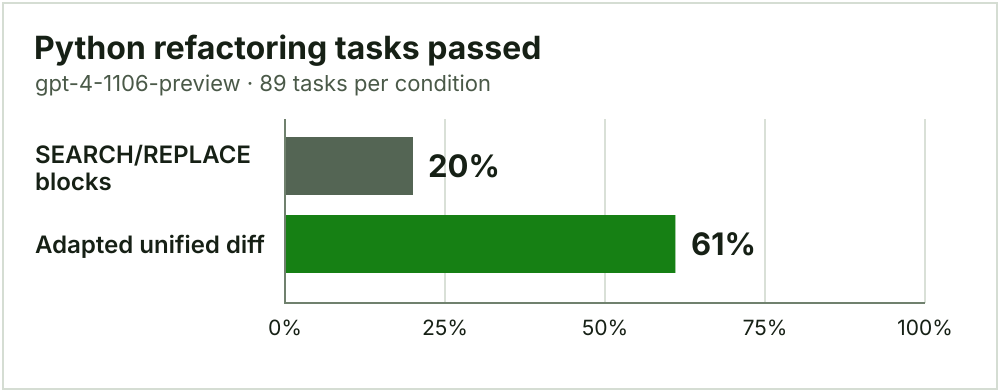

<!-- Generated by scripts/build-tools-showcase.py from the tools database. -->

```{=html}
<div class="showcase-detail tools-showcase-detail"><nav class="showcase-breadcrumb" aria-label="Breadcrumb"><a href="/raw/tools-showcase.html">Tools Showcase</a><span aria-hidden="true">/</span><a href="/raw/tools-showcase.html#family-terminal">Terminal</a></nav><header class="showcase-detail-header"><p class="showcase-domain">Terminal · Terminal pair programming</p><h1>Aider</h1><p>Terminal pair programming</p><nav class="showcase-detail-actions" aria-label="On this page"><a href="#tool-card">Tool card</a><a href="#use-cases">Use cases & results</a><a href="#technical-figures">Technical figures</a><a href="#source-slides">Source slides</a><a href="#methods">Methods & sources</a></nav></header><section class="showcase-source-map" id="source-slides" aria-labelledby="source-slides-title"><h2 id="source-slides-title">Source slides</h2><ul><li><span>Tool card</span><a href="/raw/lectures/01_intro/lecture01_tools_showcase.html#/ts-aider" title="Slide ID: ts-aider">Tools Showcase · slide 12</a><code>ts-aider</code></li><li><span>Use cases & results</span><a href="/raw/lectures/01_intro/lecture01_tools_showcase.html#/ts-aider-uses" title="Slide ID: ts-aider-uses">Tools Showcase · slide 13</a><code>ts-aider-uses</code></li><li><span>Technical figures</span><a href="/raw/lectures/01_intro/lecture01_tools_showcase.html#/ts-evidence-terminal-aider" title="Slide ID: ts-evidence-terminal-aider">Tools Showcase · slide 30</a><code>ts-evidence-terminal-aider</code></li></ul></section>
```

```{=html}
<section class="showcase-section" id="tool-card"><div class="showcase-section-heading"><h2>Tool card</h2></div>
```

```{=html}
<article class="showcase-slide-source" data-presentation="intro-tools" data-slide="ts-aider"><p class="showcase-slide-reference"><a href="/raw/lectures/01_intro/lecture01_tools_showcase.html#/ts-aider" title="Slide ID: ts-aider">Tools Showcase · slide 12</a></p><div class="showcase-source tools-showcase-source ts-aider"><div class="ts-card">
  <div class="ts-product-line">
    
    <span class="ts-surface">Terminal pair programming</span>
  </div>
  <figure class="ts-chart">
    <h3>Files in, commits out</h3>
    <div class="ts-diagram ts-flow">
      <div class="ts-node"><strong>Repository context</strong><span>Full files via <code>/add</code> or <code>/read-only</code>, plus a ranked map of symbols and signatures</span></div>
      <span class="ts-edge" aria-hidden="true">→</span>
      <div class="ts-node ts-node-accent"><strong>Aider edits</strong><span>Applies model-proposed changes to editable files</span></div>
      <span class="ts-edge" aria-hidden="true">→</span>
      <div class="ts-node"><strong>Git history</strong><span>Automatic commits record Aider’s edits by default</span></div>
    </div>
    <div class="ts-secondary">
      <h3>What each chat mode produces</h3>
      <table class="ts-mini-table" aria-label="Aider chat modes and file edits">
        <thead><tr><th scope="col">Mode</th><th scope="col">Model output</th><th scope="col">Edits files</th></tr></thead>
        <tbody>
          <tr><th scope="row"><code>/ask</code></th><td>Discussion and suggestions</td><td>No</td></tr>
          <tr><th scope="row"><code>/code</code></th><td>Main model generates edit instructions</td><td>Yes</td></tr>
          <tr><th scope="row"><code>/architect</code></th><td>Proposal passed to editor for edit instructions</td><td>Yes</td></tr>
        </tbody>
      </table>
    </div>
  </figure>
  <div class="ts-facts" role="group" aria-label="Aider capabilities">
    <h3>Controls</h3>
    <dl>
      <dt>Model providers</dt><dd>Hosted APIs or compatible local models</dd>
      <dt>Inspect edits</dt><dd><code>/diff</code> shows changes since your last message</dd>
      <dt>Reverse edits</dt><dd><code>/undo</code> targets the latest commit if Aider made it</dd>
      <dt>Run checks</dt><dd><code>/test</code> can feed failing command output back into the chat</dd>
    </dl>
  </div>
  <div class="ts-sources"><a class="ts-evidence-link" href="/raw/tools-showcase/aider.html#technical-figures">Technical figure</a><a href="https://aider.chat/docs/repomap.html">Repository map</a><a href="https://aider.chat/docs/llms.html">Models</a><a href="https://aider.chat/docs/git.html">Git integration</a><a href="https://aider.chat/docs/usage/commands.html">Commands</a><a href="https://aider.chat/docs/usage/modes.html">Chat modes</a></div>
</div></div></article>
```

```{=html}
</section>
```

```{=html}
<section class="showcase-section" id="use-cases"><div class="showcase-section-heading"><h2>Use cases & results</h2></div>
```

```{=html}
<article class="showcase-slide-source" data-presentation="intro-tools" data-slide="ts-aider-uses"><p class="showcase-source-subtitle">How has Aider written tests and updated docs?</p><p class="showcase-slide-reference"><a href="/raw/lectures/01_intro/lecture01_tools_showcase.html#/ts-aider-uses" title="Slide ID: ts-aider-uses">Tools Showcase · slide 13</a></p><div class="showcase-source tools-showcase-source ts-aider"><div class="ts-card ts-use-layout">
  <article class="ts-use-case">
    <h3>Test Aider’s file-add command</h3>
    <p class="ts-use-provenance">Recorded Aider transcript</p>
    <ol class="ts-use-flow">
      <li class="ts-use-step"><h4>Task</h4><p>Write a black-box test for <code>cmd_add()</code> in <code>tests/test_commands.py</code>.</p></li>
      <li class="ts-use-step"><h4>How Aider was used</h4><p>Aider used a repository map, wrote the test, then read the first <code>pytest</code> failure and corrected its argument type.</p></li>
      <li class="ts-use-step"><h4>Recorded result</h4><p>The test passed on the second run with a string argument.</p></li>
    </ol>
    <figure class="ts-use-artifact">
      <pre><code>AttributeError: 'list' object has no attribute 'split'
1 failed in 0.34s
…
1 passed in 0.38s</code></pre>
      <figcaption><a href="https://aider.chat/examples/add-test.html">Aider transcript excerpts from both pytest runs</a></figcaption>
    </figure>
    <p class="ts-use-source"><a href="https://aider.chat/examples/add-test.html">Aider · Create a black-box test case</a></p>
  </article>
  <article class="ts-use-case">
    <h3>Sync the README with new CLI flags</h3>
    <p class="ts-use-provenance">Recorded Aider transcript</p>
    <ol class="ts-use-flow">
      <li class="ts-use-step"><h4>Task</h4><p>Update usage docs after the arguments in <code>main()</code> changed.</p></li>
      <li class="ts-use-step"><h4>How Aider was used</h4><p>The author put <code>aider/main.py</code> and <code>README.md</code> in the chat so Aider could compare implementation and docs.</p></li>
      <li class="ts-use-step"><h4>Recorded result</h4><p>Aider applied and committed the README edit.</p></li>
    </ol>
    <figure class="ts-use-artifact">
      <pre><code>Applied edit to README.md
Commit 024f45e aider: Updated command line arguments in main() …</code></pre>
      <figcaption><a href="https://aider.chat/examples/update-docs.html">Aider transcript excerpt showing the commit</a></figcaption>
    </figure>
    <p class="ts-use-source"><a href="https://aider.chat/examples/update-docs.html">Aider · Automatically update docs</a></p>
  </article>
</div></div></article>
```

```{=html}
</section>
```

```{=html}
<section class="showcase-section" id="technical-figures"><div class="showcase-section-heading"><h2>Technical figures</h2></div>
```

```{=html}
<article class="showcase-slide-source" data-presentation="intro-tools" data-slide="ts-evidence-terminal-aider"><p class="showcase-source-subtitle">How did edit formats affect Aider’s refactoring score?</p><p class="showcase-slide-reference"><a href="/raw/lectures/01_intro/lecture01_tools_showcase.html#/ts-evidence-terminal-aider" title="Slide ID: ts-evidence-terminal-aider">Tools Showcase · slide 30</a></p><div class="showcase-source tools-showcase-source ts-aider"><div class="ts-card ts-evidence-layout">
  <figure class="ts-evidence-figure">
    
    <figcaption>Chart redrawn from <a href="https://aider.chat/2023/12/21/unified-diffs.html">Paul Gauthier, “Unified diffs make GPT-4 Turbo 3X less lazy”</a> · December 21, 2023.</figcaption>
  <a class="showcase-figure-link" href="/raw/lectures/01_intro/assets/tools_showcase/evidence-terminal-aider-refactor.svg" target="_blank" rel="noopener">Open full-size figure</a></figure>
  <div class="ts-evidence-facts" role="group" aria-labelledby="ts-aider-evidence-method">
    <h3 id="ts-aider-evidence-method">What Aider measured</h3>
    <dl>
      <dt>Pass rate</dt><dd>20% with blocks and 61% with adapted diffs</dd>
      <dt>Suite</dt><dd>89 Python refactors drawn from nine open-source repositories</dd>
      <dt>Pass check</dt><dd>Valid Python and the expected abstract syntax tree structure after extracting a method</dd>
      <dt>Harness change</dt><dd>New diff syntax, hunk prompting, and flexible patch application</dd>
      <dt>Placeholder comments</dt><dd>Observed on 12 tasks with blocks and 4 with adapted diffs</dd>
    </dl>
  </div>
  <div class="ts-sources"><a href="/raw/tools-showcase/aider.html#tool-card">Back to Aider</a><a href="https://aider.chat/2023/12/21/unified-diffs.html#refactoring-benchmark">Benchmark protocol</a><a href="/raw/lectures/01_intro/assets/tools_showcase/evidence-terminal-aider-refactor.svg">Open full-size chart</a></div>
</div></div></article>
```

```{=html}
</section>
```

```{=html}
<section class="showcase-section" id="methods"><div class="showcase-section-heading"><h2>Methods & sources</h2><p>Original slide notes, source links and reported conditions for the material above.</p></div>
```

<details class="showcase-notes">
<summary>Tool card: Tools Showcase · slide 12</summary>

Aider отправляет запрос пользователя вместе с содержимым выбранных файлов и компактной картой репозитория. Карта отбирает важные определения и сигнатуры в пределах бюджета контекста. Она помогает найти модуль для последующего чтения полного текста. Для справочных материалов есть отдельный режим добавления файлов только для чтения.

В режиме Architect два обращения к модели разделяют предложение решения и подготовку конкретных правок. В обеих ролях можно использовать одну и ту же модель или назначить редактору другую через <code>--editor-model</code>.

При стандартных настройках Aider коммитит свои правки. Перед изменением уже модифицированного файла он может отдельно закоммитить существующие правки. Команда /undo предназначена для последнего коммита, сделанного Aider. От модели и провайдера зависит, куда отправляется контекст. [Логотип Aider](https://aider.chat/assets/logo.svg).

</details>

<details class="showcase-notes">
<summary>Use cases &amp; results: Tools Showcase · slide 13</summary>

Обе панели описывают опубликованные сеансы Aider. В первом автор ограничил контекст структурной картой репозитория. Тест вызывал <code>cmd_add()</code> и проверял появление двух файлов во временном каталоге. Первый запуск выявил ошибку теста: реализация принимала строку имён, а тест передавал список. После правки в записи видно прохождение одного теста. Это наблюдение из конкретного сеанса с исторической версией Aider.

Во втором сеансе автор заранее добавил файл реализации и README. Транскрипт показывает правку списка параметров и идентификатор коммита. При разборе удобно сверить, какие утверждения можно подтвердить по diff, а какие потребовали бы сравнения с фактическим выводом команды справки.

</details>

<details class="showcase-notes">
<summary>Technical figures: Tools Showcase · slide 30</summary>

Первичный отчёт Пола Готье от 21 декабря 2023 года сравнивает два способа передачи и применения правок на одном снимке модели <code>gpt-4-1106-preview</code>. На графике приведены опубликованные 20% и 61% с общей шкалой от 0 до 100%. Знаменатель для каждой доли — 89 задач. Абсолютные числа прошедших задач не восстанавливаются из округлённых процентов.

В задачах метод переносили из класса на уровень модуля. Тесты смотрели, разбирается ли Python, существует ли функция на верхнем уровне и близки ли размеры нужных участков AST к исходным. Это проверка структуры, поэтому из неё нельзя вывести эквивалентность поведения. Отдельный индикатор отчёта — задачи с комментариями-заглушками, 12 против 4, в том же порядке. Вместе с форматированием менялись указания о размере фрагментов и правила их применения, поэтому измерялся эффект конфигурации целиком.

</details>

```{=html}
</section><nav class="showcase-bottom-nav" aria-label="More tools"><a href="/raw/tools-showcase.html">Back to all tools</a><a href="/raw/lectures/01_intro/lecture01_tools_showcase.html#/ts-aider">View source slide</a></nav></div>
```
