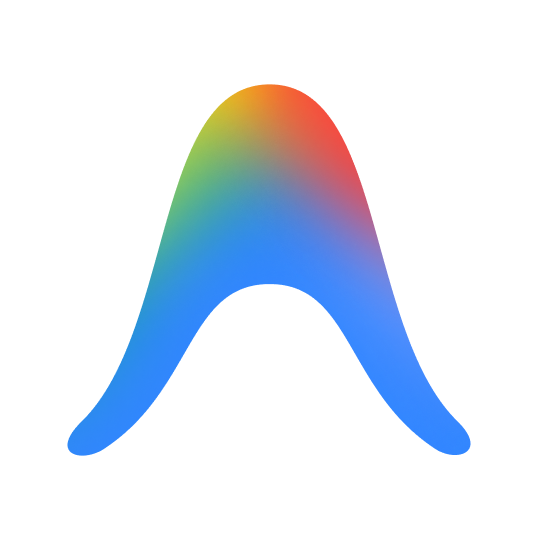
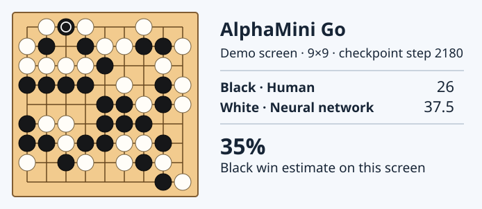

<!-- Generated by scripts/build-tools-showcase.py from the tools database. -->

```{=html}
<div class="showcase-detail tools-showcase-detail"><nav class="showcase-breadcrumb" aria-label="Breadcrumb"><a href="/raw/tools-showcase.html">Tools Showcase</a><span aria-hidden="true">/</span><a href="/raw/tools-showcase.html#family-workspace">Local &amp; remote workspaces</a></nav><header class="showcase-detail-header"><p class="showcase-domain">Local &amp; remote workspaces · Google · Desktop agent app</p><h1>Antigravity</h1><p>Google · Desktop agent app</p><nav class="showcase-detail-actions" aria-label="On this page"><a href="#tool-card">Tool card</a><a href="#use-cases">Use cases & results</a><a href="#source-slides">Source slides</a><a href="#methods">Methods & sources</a></nav></header><section class="showcase-source-map" id="source-slides" aria-labelledby="source-slides-title"><h2 id="source-slides-title">Source slides</h2><ul><li><span>Tool card</span><a href="/raw/lectures/01_intro/lecture01_tools_showcase.html#/ts-antigravity" title="Slide ID: ts-antigravity">Tools Showcase · slide 22</a><code>ts-antigravity</code></li><li><span>Use cases & results</span><a href="/raw/lectures/01_intro/lecture01_tools_showcase.html#/ts-antigravity-uses" title="Slide ID: ts-antigravity-uses">Tools Showcase · slide 23</a><code>ts-antigravity-uses</code></li></ul></section>
```

```{=html}
<section class="showcase-section" id="tool-card"><div class="showcase-section-heading"><h2>Tool card</h2></div>
```

```{=html}
<article class="showcase-slide-source" data-presentation="intro-tools" data-slide="ts-antigravity"><p class="showcase-slide-reference"><a href="/raw/lectures/01_intro/lecture01_tools_showcase.html#/ts-antigravity" title="Slide ID: ts-antigravity">Tools Showcase · slide 22</a></p><div class="showcase-source tools-showcase-source ts-antigravity"><div class="ts-card">
  <div class="ts-product-line"><strong class="ts-name">Antigravity</strong><span class="ts-surface">Google · Desktop agent app</span></div>
  <div class="ts-chart" role="group" aria-labelledby="ts-antigravity-chart">
    <h3 id="ts-antigravity-chart">From project to evidence</h3>
    <div class="ts-diagram ts-flow">
      <div class="ts-node"><strong>Project</strong><span>Workspace and agent conversations</span></div>
      <span class="ts-edge" aria-hidden="true">→</span>
      <div class="ts-node"><strong>Plan</strong><span><code>/plan</code> · Inline feedback and approval</span></div>
      <span class="ts-edge" aria-hidden="true">→</span>
      <div class="ts-node"><strong>Implement</strong><span>Edit files, run commands and use the browser when available</span></div>
      <span class="ts-edge" aria-hidden="true">→</span>
      <div class="ts-node ts-node-accent"><strong>Review</strong><span>Git diff, walkthrough and optional browser evidence</span></div>
    </div>
    <div class="ts-secondary">
      <h3 id="ts-antigravity-worktrees">Git worktree choices in Coding layout</h3>
      <table class="ts-mini-table" aria-labelledby="ts-antigravity-worktrees">
        <thead><tr><th scope="col">Session mode</th><th scope="col">Agent edits in</th><th scope="col">Parallel sessions</th></tr></thead>
        <tbody>
          <tr><th scope="row">Local mode</th><td>Active Git checkout</td><td>Share the same files</td></tr>
          <tr><th scope="row">New worktree</th><td>New Git worktree per session</td><td>Keep Git edits separate</td></tr>
        </tbody>
      </table>
    </div>
  </div>
  <div class="ts-facts" role="group" aria-labelledby="ts-antigravity-facts">
    <h3 id="ts-antigravity-facts">Platform features</h3>
    <dl>
      <dt>Parallel work</dt><dd>Multiple agent conversations per project</dd>
      <dt>Subagents</dt><dd>Background runs with separate conversation context</dd>
      <dt>Diff review</dt><dd>Compare one turn, comment, stage or commit</dd>
      <dt>Approvals</dt><dd>Configurable artifact review policy</dd>
      <dt>Browser tools</dt><dd>Inspect pages and console errors, capture screenshots</dd>
      <dt>Other surfaces</dt><dd>IDE, CLI, extensions and SDK</dd>
    </dl>
  </div>
  <div class="ts-sources"><a href="https://antigravity.google/product">Product surfaces</a> · <a href="https://antigravity.google/docs/plan/">Planning</a> · <a href="https://antigravity.google/docs/artifacts/">Artifacts</a> · <a href="https://antigravity.google/docs/browser">Browser use</a> · <a href="https://antigravity.google/docs/projects">Git worktrees</a></div>
</div></div></article>
```

```{=html}
</section>
```

```{=html}
<section class="showcase-section" id="use-cases"><div class="showcase-section-heading"><h2>Use cases & results</h2></div>
```

```{=html}
<article class="showcase-slide-source" data-presentation="intro-tools" data-slide="ts-antigravity-uses"><p class="showcase-source-subtitle">Antigravity 2.0 · An operating system and a Go player</p><p class="showcase-slide-reference"><a href="/raw/lectures/01_intro/lecture01_tools_showcase.html#/ts-antigravity-uses" title="Slide ID: ts-antigravity-uses">Tools Showcase · slide 23</a></p><div class="showcase-source tools-showcase-source ts-antigravity"><div class="ts-card ts-use-layout">
  <article class="ts-use-case">
    <h3>A small OS for FreeDoom</h3>
    <p class="ts-use-provenance">Antigravity 2.0 · Google experiment</p>
    <ol class="ts-use-flow">
      <li class="ts-use-step"><h4>Task</h4><p>Build an operating system that can run FreeDoom.</p></li>
      <li class="ts-use-step"><h4>How the tool was used</h4><p>Parallel agents implemented the kernel, filesystem and input and display drivers.</p></li>
      <li class="ts-use-step"><h4>Public evidence</h4><p>Google reports that FreeDoom ran on the prototype OS.</p></li>
    </ol>
    <figure class="ts-use-artifact">
      <table aria-label="Google’s reported resource use for the operating-system run">
        <tbody>
          <tr><th scope="row">Subagents</th><td>93</td></tr>
          <tr><th scope="row">Model calls</th><td>15,314</td></tr>
          <tr><th scope="row">Input tokens</th><td>Over 339 million</td></tr>
        </tbody>
      </table>
      <figcaption>Reported run totals · <a href="https://youtu.be/JZ5DlYJ5t2M">Google’s agent-team recording</a></figcaption>
    </figure>
    <p class="ts-use-source"><a href="https://antigravity.google/blog/google-antigravity-built-an-os#the-operating-system">Google · Operating-system experiment</a></p>
  </article>
  <article class="ts-use-case">
    <h3>An AlphaZero-style Go player</h3>
    <p class="ts-use-provenance">Antigravity 2.0 · Google experiment</p>
    <ol class="ts-use-flow">
      <li class="ts-use-step"><h4>Task</h4><p>Recreate a lightweight AlphaZero system for 9×9 Go.</p></li>
      <li class="ts-use-step"><h4>How the tool was used</h4><p>Agents built the training pipeline in JAX and Flax, then connected the model to the app.</p></li>
      <li class="ts-use-step"><h4>Public evidence</h4><p>Google shows a playable Go app backed by the trained model.</p></li>
    </ol>
    <figure class="ts-use-artifact">
      <a class="ts-use-artifact-open" href="https://img.youtube.com/vi/RoltpP9kjeY/maxresdefault.jpg"></a>
      <figcaption>Position and values redrawn from Google’s demo poster · <a href="https://youtu.be/RoltpP9kjeY">Watch the resulting Go app</a></figcaption>
    </figure>
    <p class="ts-use-source"><a href="https://antigravity.google/blog/google-antigravity-built-an-os#-and-more">Google · AlphaZero experiment</a></p>
  </article>
</div></div></article>
```

```{=html}
</section>
```

```{=html}
<section class="showcase-section" id="methods"><div class="showcase-section-heading"><h2>Methods & sources</h2><p>Original slide notes, source links and reported conditions for the material above.</p></div>
```

<details class="showcase-notes">
<summary>Tool card: Tools Showcase · slide 22</summary>

На схеме показана работа с командой `/plan` в отдельном приложении Antigravity. Проект объединяет рабочие папки и переписки с агентами. Команда формирует план реализации. По умолчанию агент ждёт подтверждения перед правками, если пользователь прямо не попросил продолжить сразу. План можно прокомментировать до начала правок. Политика просмотра артефактов определяет, когда агент запрашивает подтверждение в других сценариях. [Планирование](https://antigravity.google/docs/plan/), [политика просмотра артефактов](https://antigravity.google/docs/artifact-review).

Diff показывает изменения исходников, а walkthrough собирает сведения о выполненной работе. Браузер может дополнить отчёт снимком страницы или записью действий. Возможности управления браузером зависят от версии приложения, аккаунта и среды. [Артефакты](https://antigravity.google/docs/artifacts/), [использование браузера](https://antigravity.google/docs/browser).

Таблица показывает, где окажутся правки Git при параллельных сессиях в интерфейсе Coding. Отдельные рабочие деревья разделяют правки репозиториев. Папки без Git используются на прежнем месте. У фоновых субагентов отдельный контекст переписки. В Review можно открыть изменения за один ход, оставить комментарий к строке, проиндексировать файлы и сделать коммит. [Проекты](https://antigravity.google/docs/projects), [субагенты](https://antigravity.google/docs/subagents), [просмотр изменений](https://antigravity.google/docs/review-changes).

Знак из [пресс-материалов Google Antigravity](https://antigravity.google/press) перенесён из архива курса в исходном виде.

</details>

<details class="showcase-notes">
<summary>Use cases &amp; results: Tools Showcase · slide 23</summary>

Оба эксперимента описала команда Google Antigravity. Для задачи с FreeDoom команда использовала Antigravity 2.0 и Gemini 3.5 Flash. Google сообщает об успешном запуске игры на экспериментальной ОС и перечисляет отсутствующие возможности, включая многопоточность общего назначения и аппаратное ускорение. В первой попытке агенты нашли историю предыдущих запусков. Отчёт отдельно описывает повторный запуск после очистки истории.

В опыте с го агенты реализовали упрощённую систему по мотивам AlphaZero, обучили ResNet на партиях с самим собой и сделали приложение для игры с моделью. Схема воссоздаёт положение камней и показатели на опубликованном кадре AlphaMini Go. 35% — оценка шансов чёрных в показанной позиции. [Кадр демонстрации](https://img.youtube.com/vi/RoltpP9kjeY/maxresdefault.jpg), [отчёт команды Antigravity, 19 мая 2026 года](https://antigravity.google/blog/google-antigravity-built-an-os).

</details>

```{=html}
</section><nav class="showcase-bottom-nav" aria-label="More tools"><a href="/raw/tools-showcase.html">Back to all tools</a><a href="/raw/lectures/01_intro/lecture01_tools_showcase.html#/ts-antigravity">View source slide</a></nav></div>
```
