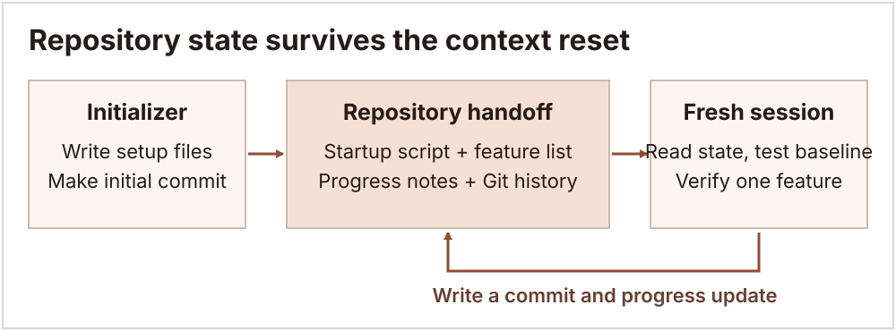

<!-- Generated by scripts/build-tools-showcase.py from the tools database. -->

```{=html}
<div class="showcase-detail tools-showcase-detail"><nav class="showcase-breadcrumb" aria-label="Breadcrumb"><a href="/raw/tools-showcase.html">Tools Showcase</a><span aria-hidden="true">/</span><a href="/raw/tools-showcase.html#family-terminal">Terminal</a></nav><header class="showcase-detail-header"><p class="showcase-domain">Terminal · Anthropic · Terminal agent</p><h1>Claude Code</h1><p>↶ Verification results feed back into context for the next pass.</p><nav class="showcase-detail-actions" aria-label="On this page"><a href="#tool-card">Tool card</a><a href="#use-cases">Use cases & results</a><a href="#technical-figures">Technical figures</a><a href="#source-slides">Source slides</a><a href="#methods">Methods & sources</a></nav></header><section class="showcase-source-map" id="source-slides" aria-labelledby="source-slides-title"><h2 id="source-slides-title">Source slides</h2><ul><li><span>Tool card</span><a href="/raw/lectures/01_intro/lecture01_tools_showcase.html#/ts-claude-code" title="Slide ID: ts-claude-code">Tools Showcase · slide 14</a><code>ts-claude-code</code></li><li><span>Use cases & results</span><a href="/raw/lectures/01_intro/lecture01_tools_showcase.html#/ts-claude-code-uses" title="Slide ID: ts-claude-code-uses">Tools Showcase · slide 15</a><code>ts-claude-code-uses</code></li><li><span>Technical figures</span><a href="/raw/lectures/01_intro/lecture01_tools_showcase.html#/ts-evidence-terminal-claude-code" title="Slide ID: ts-evidence-terminal-claude-code">Tools Showcase · slide 31</a><code>ts-evidence-terminal-claude-code</code></li></ul></section>
```

```{=html}
<section class="showcase-section" id="tool-card"><div class="showcase-section-heading"><h2>Tool card</h2></div>
```

```{=html}
<article class="showcase-slide-source" data-presentation="intro-tools" data-slide="ts-claude-code"><p class="showcase-slide-reference"><a href="/raw/lectures/01_intro/lecture01_tools_showcase.html#/ts-claude-code" title="Slide ID: ts-claude-code">Tools Showcase · slide 14</a></p><div class="showcase-source tools-showcase-source ts-claude-code"><div class="ts-card">
  <div class="ts-product-line">
    
    <strong class="ts-name">Claude Code</strong><span class="ts-surface">Anthropic · Terminal agent</span>
  </div>
  <figure class="ts-chart">
    <h3>Agent loop</h3>
    <div class="ts-diagram ts-flow">
      <div class="ts-node"><strong>Gather context</strong><span>Search files, read code and inspect Git state</span></div>
      <span class="ts-edge" aria-hidden="true">→</span>
      <div class="ts-node ts-node-accent"><strong>Act</strong><span>Edit files or run commands under tool permissions</span></div>
      <span class="ts-edge" aria-hidden="true">→</span>
      <div class="ts-node"><strong>Verify</strong><span>Use diffs, builds and tests to check results</span></div>
    </div>
    <div class="ts-secondary">
      <h3>When extensions load or run</h3>
      <table class="ts-mini-table" aria-label="Claude Code extension timing by default">
        <thead><tr><th scope="col">Extension</th><th scope="col">At session start</th><th scope="col">On demand or event</th></tr></thead>
        <tbody>
          <tr><th scope="row">Skills</th><td>Descriptions</td><td>Full content loads when used</td></tr>
          <tr><th scope="row">MCP servers</th><td>Tool names and server instructions</td><td>Tool schemas load as needed</td></tr>
          <tr><th scope="row">Hooks</th><td><code>SessionStart</code> hooks can run</td><td>Configured actions run on matching events</td></tr>
        </tbody>
      </table>
    </div>
    <figcaption><span aria-hidden="true">↶</span> Verification results feed back into context for the next pass.</figcaption>
  </figure>
  <div class="ts-facts" role="group" aria-label="Claude Code capabilities">
    <h3>Session configuration</h3>
    <dl>
      <dt>Plan Mode</dt><dd>Explore and propose a plan before approving implementation</dd>
      <dt>Permissions</dt><dd>Allow, ask or deny actions according to the active rules</dd>
      <dt>Instructions</dt><dd><code>CLAUDE.md</code> supplies repository conventions</dd>
      <dt>Subagents</dt><dd>Delegate tasks in separate context windows</dd>
      <dt>Git worktrees</dt><dd><code>--worktree</code> gives sessions separate checkouts</dd>
    </dl>
  </div>
  <div class="ts-sources"><a class="ts-evidence-link" href="/raw/tools-showcase/claude-code.html#technical-figures">Technical figure</a><a href="https://code.claude.com/docs/en/how-claude-code-works">Agent loop</a><a href="https://code.claude.com/docs/en/common-workflows#plan-before-editing">Plan Mode</a><a href="https://code.claude.com/docs/en/permissions">Permissions</a><a href="https://code.claude.com/docs/en/features-overview">Extensions</a><a href="https://code.claude.com/docs/en/worktrees">Worktrees</a></div>
</div></div></article>
```

```{=html}
</section>
```

```{=html}
<section class="showcase-section" id="use-cases"><div class="showcase-section-heading"><h2>Use cases & results</h2></div>
```

```{=html}
<article class="showcase-slide-source" data-presentation="intro-tools" data-slide="ts-claude-code-uses"><p class="showcase-source-subtitle">How have Anthropic teams used Claude Code?</p><p class="showcase-slide-reference"><a href="/raw/lectures/01_intro/lecture01_tools_showcase.html#/ts-claude-code-uses" title="Slide ID: ts-claude-code-uses">Tools Showcase · slide 15</a></p><div class="showcase-source tools-showcase-source ts-claude-code"><div class="ts-card ts-use-layout">
  <article class="ts-use-case">
    <h3>Write test logic in Rust</h3>
    <p class="ts-use-provenance">Anthropic Inference team interview</p>
    <ol class="ts-use-flow">
      <li class="ts-use-step"><h4>Task</h4><p>Test behavior in a component written in a language unfamiliar to the engineer.</p></li>
      <li class="ts-use-step"><h4>How Claude Code was used</h4><p>Engineers described the behavior to check and asked Claude Code to express it in the codebase’s language.</p></li>
      <li class="ts-use-step"><h4>Reported artifact</h4><p>The team describes generated test logic in Rust.</p></li>
    </ol>
    <figure class="ts-use-artifact">
      <blockquote>“Claude writes the logic in the required language (like Rust)”</blockquote>
      <figcaption><a href="https://assets.claude.com/58284b19e702b49db9302d5b6f135ad8871e7658.pdf#page=9">Anthropic Inference interview report, p. 9</a></figcaption>
    </figure>
    <p class="ts-use-source"><a href="https://assets.claude.com/58284b19e702b49db9302d5b6f135ad8871e7658.pdf#page=9">Anthropic · How teams use Claude Code, p. 9</a></p>
  </article>
  <article class="ts-use-case">
    <h3>Build reusable model-analysis dashboards</h3>
    <p class="ts-use-provenance">Anthropic Data Science and ML Engineering interviews</p>
    <ol class="ts-use-flow">
      <li class="ts-use-step"><h4>Task</h4><p>Visualize reinforcement-learning model performance and training data.</p></li>
      <li class="ts-use-step"><h4>How Claude Code was used</h4><p>Data scientists asked Claude Code to build React tooling from scratch in a sandbox.</p></li>
      <li class="ts-use-step"><h4>Reported artifact</h4><p>The report describes reusable React dashboards and a TypeScript app of about 5,000 lines.</p></li>
    </ol>
    <figure class="ts-use-artifact">
      <blockquote>“permanent React dashboards that can be reused across future model evaluations”</blockquote>
      <figcaption><a href="https://assets.claude.com/58284b19e702b49db9302d5b6f135ad8871e7658.pdf#page=11">Anthropic Data Science and ML Engineering interview report, p. 11</a></figcaption>
    </figure>
    <p class="ts-use-source"><a href="https://assets.claude.com/58284b19e702b49db9302d5b6f135ad8871e7658.pdf#page=11">Anthropic · How teams use Claude Code, p. 11</a></p>
  </article>
</div></div></article>
```

```{=html}
</section>
```

```{=html}
<section class="showcase-section" id="technical-figures"><div class="showcase-section-heading"><h2>Technical figures</h2></div>
```

```{=html}
<article class="showcase-slide-source" data-presentation="intro-tools" data-slide="ts-evidence-terminal-claude-code"><p class="showcase-source-subtitle">How did Anthropic carry coding state across context resets?</p><p class="showcase-slide-reference"><a href="/raw/lectures/01_intro/lecture01_tools_showcase.html#/ts-evidence-terminal-claude-code" title="Slide ID: ts-evidence-terminal-claude-code">Tools Showcase · slide 31</a></p><div class="showcase-source tools-showcase-source ts-claude-code"><div class="ts-card ts-evidence-layout">
  <figure class="ts-evidence-figure">
    
    <figcaption>Diagram adapted from <a href="https://www.anthropic.com/research/effective-harnesses-for-long-running-agents">Justin Young, “Effective harnesses for long-running agents,” failure modes and solutions table</a> · November 26, 2025.</figcaption>
  <a class="showcase-figure-link" href="/raw/lectures/01_intro/assets/tools_showcase/evidence-terminal-claude-handoff.svg" target="_blank" rel="noopener">Open full-size figure</a></figure>
  <div class="ts-evidence-facts" role="group" aria-labelledby="ts-claude-evidence-method">
    <h3 id="ts-claude-evidence-method">Claude Agent SDK experiment</h3>
    <dl>
      <dt>Durable artifacts</dt><dd><code>init.sh</code>, <code>feature_list.json</code>, <code>claude-progress.txt</code> and commits</dd>
      <dt>Startup check</dt><dd>Run a basic end-to-end test before editing</dd>
      <dt>Progress check</dt><dd>Update a feature’s status after verification</dd>
      <dt>Two prompts</dt><dd>Initializer and coding sessions share the system prompt and tools</dd>
    </dl>
  </div>
  <div class="ts-sources"><a href="/raw/tools-showcase/claude-code.html#tool-card">Back to Claude Code</a><a href="https://www.anthropic.com/research/effective-harnesses-for-long-running-agents#getting-up-to-speed">Session startup sequence</a><a href="/raw/lectures/01_intro/assets/tools_showcase/evidence-terminal-claude-handoff.svg">Open full-size diagram</a><a href="https://assets.claude.com/45cde22d0d024defb3e6276ade31d5bc1bf9834c.png">Anthropic’s /compact vs. /clear figure</a></div>
</div></div></article>
```

```{=html}
</section>
```

```{=html}
<section class="showcase-section" id="methods"><div class="showcase-section-heading"><h2>Methods & sources</h2><p>Original slide notes, source links and reported conditions for the material above.</p></div>
```

<details class="showcase-notes">
<summary>Tool card: Tools Showcase · slide 14</summary>

Anthropic описывает три фазы, границы которых могут пересекаться: сбор контекста, действие и проверка. Результат инструмента возвращается модели и влияет на её следующий шаг. Запрос на объяснение кода может потребовать только чтения. Для задачи с правками цикл может повторяться несколько раз. Пользователь может прервать работу и уточнить направление.

Plan Mode включают по необходимости. В нём Claude Code читает файлы и предлагает план проекта перед переходом к реализации. <code>CLAUDE.md</code> задаёт соглашения для модели, а права на действия задаются правилами инструментов. [Фирменный знак Claude](https://platform.claude.com/docs/en/manage-claude/oauth-apps/linked-billing/link-button#logo-file).

Таблица показывает стандартное поведение. Для навыков, которые запускает только пользователь, содержимое и описание подгружаются при вызове. Схемы инструментов MCP могут загружаться заранее при отключённом поиске инструментов.

</details>

<details class="showcase-notes">
<summary>Use cases &amp; results: Tools Showcase · slide 15</summary>

Это внутренние истории, опубликованные Anthropic по итогам интервью с сотрудниками. В первом случае исходным материалом служило описание ожидаемого поведения, которое затем выражалось в тесте на языке репозитория. Отчёт приводит Rust как пример и не публикует конкретный исходник или журнал запуска тестов.

Во втором случае команда использовала Claude Code для визуализации данных обучения и оценки моделей. В статье Anthropic уточняется, что команда запускала такие попытки в песочнице. Упомянутый размер TypeScript-приложения характеризует один разработанный артефакт. [Дополнительное описание подхода](https://claude.com/resources/articles/how-anthropic-teams-use-claude-code).

</details>

<details class="showcase-notes">
<summary>Technical figures: Tools Showcase · slide 31</summary>

Схема адаптирует таблицу «Agent failure modes and solutions» и раздел «Getting up to speed» из отчёта Джастина Янга, опубликованного инженерной командой Anthropic 26 ноября 2025 года. Это исторический эксперимент с Claude Agent SDK для длительной разработки веб-приложений. Начальная сессия готовит структуру проекта. В последующих сессиях новый контекст восстанавливается из файлов и Git, а результаты проверки и коммит передаются следующей сессии.

В статье различие между двумя ролями задаётся первым пользовательским сообщением. Системная инструкция, набор инструментов и общая архитектура запуска совпадают. Последующие сессии выбирают одну незавершённую функцию. Перед правками они проверяют исходное состояние, а после реализации меняют флаг прохождения при подтверждённом результате. Авторы описывают наблюдения в прототипе. На схеме показана организация передачи состояния, а численной оценки выигрыша в отчёте для этой схемы нет.

Для сопоставления с обычной работой в Claude Code откройте оригинальную схему из статьи Тарика Шихипара от 15 апреля 2026 года. Она показывает, как <code>/compact</code> продолжает сессию с резюме модели, а <code>/clear</code> начинает новую сессию, которой можно передать явно составленный бриф. Эту тему также разбирает открытый урок Anthropic. [Статья и схема](https://claude.com/resources/articles/using-claude-code-session-management-and-1m-context#compacting-vs-launching-a-fresh-session) · [Context Management in Claude Code](https://www.youtube.com/watch?v=eW3oTyfeWZ0).

</details>

```{=html}
</section><nav class="showcase-bottom-nav" aria-label="More tools"><a href="/raw/tools-showcase.html">Back to all tools</a><a href="/raw/lectures/01_intro/lecture01_tools_showcase.html#/ts-claude-code">View source slide</a></nav></div>
```
