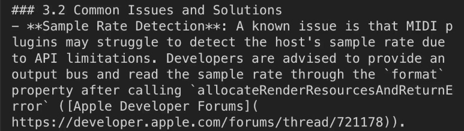
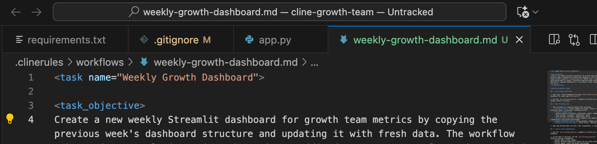

<!-- Generated by scripts/build-tools-showcase.py from the tools database. -->

```{=html}
<div class="showcase-detail tools-showcase-detail"><nav class="showcase-breadcrumb" aria-label="Breadcrumb"><a href="/raw/tools-showcase.html">Tools Showcase</a><span aria-hidden="true">/</span><a href="/raw/tools-showcase.html#family-ide">Editor &amp; IDE</a></nav><header class="showcase-detail-header"><p class="showcase-domain">Editor &amp; IDE · Open-source coding agent</p><h1>Cline</h1><p>Plan to Act with checkpoints enabled</p><nav class="showcase-detail-actions" aria-label="On this page"><a href="#tool-card">Tool card</a><a href="#use-cases">Use cases & results</a><a href="#source-slides">Source slides</a><a href="#methods">Methods & sources</a></nav></header><section class="showcase-source-map" id="source-slides" aria-labelledby="source-slides-title"><h2 id="source-slides-title">Source slides</h2><ul><li><span>Tool card</span><a href="/raw/lectures/01_intro/lecture01_tools_showcase.html#/ts-cline" title="Slide ID: ts-cline">Tools Showcase · slide 8</a><code>ts-cline</code></li><li><span>Use cases & results</span><a href="/raw/lectures/01_intro/lecture01_tools_showcase.html#/ts-cline-uses" title="Slide ID: ts-cline-uses">Tools Showcase · slide 9</a><code>ts-cline-uses</code></li></ul></section>
```

```{=html}
<section class="showcase-section" id="tool-card"><div class="showcase-section-heading"><h2>Tool card</h2></div>
```

```{=html}
<article class="showcase-slide-source" data-presentation="intro-tools" data-slide="ts-cline"><p class="showcase-slide-reference"><a href="/raw/lectures/01_intro/lecture01_tools_showcase.html#/ts-cline" title="Slide ID: ts-cline">Tools Showcase · slide 8</a></p><div class="showcase-source tools-showcase-source ts-cline"><div class="ts-card">
  <div class="ts-product-line">
    
    <strong class="ts-name">Cline</strong>
    <span class="ts-surface">Open-source coding agent</span>
  </div>
  <figure class="ts-chart">
    <figcaption>Plan to Act with checkpoints enabled</figcaption>
    <div class="ts-diagram ts-flow">
      <div class="ts-node"><strong>Provider</strong><span>Cline provider, own API key, or supported local model.</span></div>
      <span class="ts-edge" aria-hidden="true">→</span>
      <div class="ts-node"><strong>Plan</strong><span>Read and search the codebase. Agree on what to change.</span></div>
      <span class="ts-edge" aria-hidden="true">→</span>
      <div class="ts-node ts-node-accent"><strong>Act</strong><span>Carry context forward. Edit files and run permitted commands.</span></div>
      <span class="ts-edge" aria-hidden="true">→</span>
      <div class="ts-node"><strong>Review or restore</strong><span>Compare the checkpoint diff and choose what to restore.</span></div>
    </div>
    <div class="ts-secondary">
      <h3 id="ts-cline-restore-scope">Checkpoint restore scope</h3>
      <table class="ts-mini-table" aria-labelledby="ts-cline-restore-scope">
        <thead><tr><th scope="col">Restore option</th><th scope="col">Project files</th><th scope="col">Task history</th></tr></thead>
        <tbody>
          <tr><th scope="row">Restore Files</th><td><strong>Revert</strong></td><td>Keep</td></tr>
          <tr><th scope="row">Restore Task Only</th><td>Keep</td><td><strong>Revert</strong></td></tr>
          <tr><th scope="row">Restore Files &amp; Task</th><td><strong>Revert</strong></td><td><strong>Revert</strong></td></tr>
        </tbody>
      </table>
    </div>
  </figure>
  <div class="ts-facts" role="group" aria-label="Cline capabilities">
    <h3>Controls and extensions</h3>
    <dl>
      <dt>Auto Approve</dt><dd>Separate permissions for reads, edits, and terminal commands.</dd>
      <dt>Model per mode</dt><dd>Settings can switch models automatically on Plan ↔ Act.</dd>
      <dt>Checkpoint store</dt><dd>Optional project snapshots in a separate Git repository.</dd>
      <dt>Project rules</dt><dd>Version rules in <code>.clinerules/</code> or <code>.cline/rules/</code>.</dd>
      <dt>MCP servers</dt><dd>Connect external tools and data sources.</dd>
    </dl>
  </div>
  <div class="ts-sources"><a href="https://docs.cline.bot/core-workflows/plan-and-act">Plan and Act</a><a href="https://docs.cline.bot/core-workflows/task-management">Providers</a><a href="https://docs.cline.bot/features/auto-approve">Approvals</a><a href="https://docs.cline.bot/core-workflows/checkpoints">Checkpoints</a></div>
</div></div></article>
```

```{=html}
</section>
```

```{=html}
<section class="showcase-section" id="use-cases"><div class="showcase-section-heading"><h2>Use cases & results</h2></div>
```

```{=html}
<article class="showcase-slide-source" data-presentation="intro-tools" data-slide="ts-cline-uses"><p class="showcase-source-subtitle">What did Cline produce in two project write-ups?</p><p class="showcase-slide-reference"><a href="/raw/lectures/01_intro/lecture01_tools_showcase.html#/ts-cline-uses" title="Slide ID: ts-cline-uses">Tools Showcase · slide 9</a></p><div class="showcase-source tools-showcase-source ts-cline"><div class="ts-card ts-use-layout">
  <article class="ts-use-case">
    <h3>Research for a Logic Pro extension</h3>
    <ol class="ts-use-flow">
      <li class="ts-use-step"><h4>Task</h4><p>Find the Apple frameworks and audio plug-in APIs needed for an extension idea.</p></li>
      <li class="ts-use-step"><h4>How Cline was used</h4><p>Cline gathered and analyzed Apple documentation via Firecrawl Deep Research MCP.</p></li>
      <li class="ts-use-step"><h4>Reported artifact</h4><p>Research notes saved in the project repository.</p></li>
    </ol>
    <figure class="ts-use-artifact">
      <a class="ts-use-artifact-open" href="https://storage.ghost.io/c/d6/fe/d6feb101-a8e6-444b-bae8-3ca714794abb/content/media/2025/03/firecrawl-deep-research-logicpro-1.mp4#t=23"></a>
      <figcaption>Research output · <a href="https://storage.ghost.io/c/d6/fe/d6feb101-a8e6-444b-bae8-3ca714794abb/content/media/2025/03/firecrawl-deep-research-logicpro-1.mp4#t=23">Author’s recording at 0:23</a></figcaption>
    </figure>
    <p class="ts-use-source"><a href="https://cline.bot/blog/build-anything-you-dont-know-how-to-build-my-experience-with-cline">Cline Blog · Nick Baumann’s project report</a></p>
  </article>
  <article class="ts-use-case">
    <h3>Weekly growth dashboard</h3>
    <ol class="ts-use-flow">
      <li class="ts-use-step"><h4>Task</h4><p>Turn CSV exports into week-over-week metrics and charts for a Streamlit dashboard.</p></li>
      <li class="ts-use-step"><h4>How Cline was used</h4><p>Cline built the dashboard with the author and turned their session into a Markdown workflow.</p></li>
      <li class="ts-use-step"><h4>Reported artifact</h4><p>Streamlit dashboard and reusable Markdown workflow.</p></li>
    </ol>
    <figure class="ts-use-artifact">
      <a class="ts-use-artifact-open" href="https://storage.ghost.io/c/d6/fe/d6feb101-a8e6-444b-bae8-3ca714794abb/content/images/2025/09/image-23.png"></a>
      <figcaption>Generated workflow · <code>weekly-growth-dashboard.md</code></figcaption>
    </figure>
    <p class="ts-use-source"><a href="https://cline.bot/blog/how-i-stopped-repeating-myself-to-cline">Cline Blog · Internal workflow report</a></p>
  </article>
</div></div></article>
```

```{=html}
</section>
```

```{=html}
<section class="showcase-section" id="methods"><div class="showcase-section-heading"><h2>Methods & sources</h2><p>Original slide notes, source links and reported conditions for the material above.</p></div>
```

<details class="showcase-notes">
<summary>Tool card: Tools Showcase · slide 8</summary>

Схема относится к расширению Cline. В Plan агент читает файлы, ищет по коду и обсуждает подход. Для правок и запуска команд используется Act, куда переносится история обсуждения. Настройка разных моделей для Plan и Act автоматически выбирает модель при переключении. Конкретный вызов инструмента проходит через правила подтверждений.

Checkpoints хранят снимки в отдельном Git-репозитории. Восстановление ограничено состоянием проекта и задачи. Внешний эффект команды, например запрос к сервису, остаётся отдельным действием. Cline предлагает расширения редактора, CLI, настольное приложение и облачный сервис. [Правила](https://github.com/cline/cline/blob/main/docs/customization/cline-rules.mdx) · [MCP](https://github.com/cline/cline/blob/main/docs/mcp/mcp-overview.mdx) · [Продукты Cline](https://cline.bot/) · [Бренд Cline](https://cline.bot/brand).

</details>

<details class="showcase-notes">
<summary>Use cases &amp; results: Tools Showcase · slide 9</summary>

Ник Бауманн описывает подготовку собственного расширения для Logic Pro. Через Firecrawl Deep Research MCP Cline собрал сведения об инструментах Apple, оформил их как документацию в репозитории и использовал её как контекст для дальнейшей работы. Результат этого этапа — исследовательские заметки для проекта в разработке. [Cline Blog, Build Anything You Don't Know How to Build](https://cline.bot/blog/build-anything-you-dont-know-how-to-build-my-experience-with-cline).

В другой публикации Бауманн показывает рабочий процесс подготовки еженедельного дашборда в Streamlit. Он передал Cline выгрузки и CSV, помог выбрать расчёты и диаграммы, затем попросил записать последовательность действий в Markdown. На снимке виден сгенерированный файл `weekly-growth-dashboard.md` в `.clinerules/workflows`. При следующем запуске сценарий запрашивает входные данные и пересобирает дашборд. [Cline Blog, How I stopped repeating myself to Cline](https://cline.bot/blog/how-i-stopped-repeating-myself-to-cline).

</details>

```{=html}
</section><nav class="showcase-bottom-nav" aria-label="More tools"><a href="/raw/tools-showcase.html">Back to all tools</a><a href="/raw/lectures/01_intro/lecture01_tools_showcase.html#/ts-cline">View source slide</a></nav></div>
```
