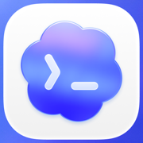
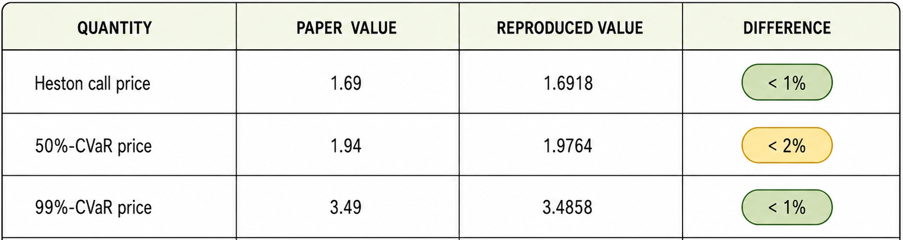
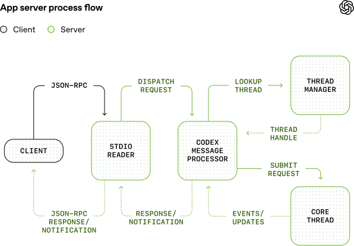

<!-- Generated by scripts/build-tools-showcase.py from the tools database. -->

```{=html}
<div class="showcase-detail tools-showcase-detail"><nav class="showcase-breadcrumb" aria-label="Breadcrumb"><a href="/raw/tools-showcase.html">Tools Showcase</a><span aria-hidden="true">/</span><a href="/raw/tools-showcase.html#family-workspace">Local &amp; remote workspaces</a></nav><header class="showcase-detail-header"><p class="showcase-domain">Local &amp; remote workspaces · CLI · ChatGPT desktop app</p><h1>Codex</h1><p>Desktop execution modes</p><nav class="showcase-detail-actions" aria-label="On this page"><a href="#tool-card">Tool card</a><a href="#use-cases">Use cases & results</a><a href="#technical-figures">Technical figures</a><a href="#source-slides">Source slides</a><a href="#methods">Methods & sources</a></nav></header><section class="showcase-source-map" id="source-slides" aria-labelledby="source-slides-title"><h2 id="source-slides-title">Source slides</h2><ul><li><span>Tool card</span><a href="/raw/lectures/01_intro/lecture01_tools_showcase.html#/ts-codex" title="Slide ID: ts-codex">Tools Showcase · slide 20</a><code>ts-codex</code></li><li><span>Use cases & results</span><a href="/raw/lectures/01_intro/lecture01_tools_showcase.html#/ts-codex-uses" title="Slide ID: ts-codex-uses">Tools Showcase · slide 21</a><code>ts-codex-uses</code></li><li><span>Technical figures</span><a href="/raw/lectures/01_intro/lecture01_tools_showcase.html#/ts-evidence-remote-codex" title="Slide ID: ts-evidence-remote-codex">Tools Showcase · slide 33</a><code>ts-evidence-remote-codex</code></li></ul></section>
```

```{=html}
<section class="showcase-section" id="tool-card"><div class="showcase-section-heading"><h2>Tool card</h2></div>
```

```{=html}
<article class="showcase-slide-source" data-presentation="intro-tools" data-slide="ts-codex"><p class="showcase-slide-reference"><a href="/raw/lectures/01_intro/lecture01_tools_showcase.html#/ts-codex" title="Slide ID: ts-codex">Tools Showcase · slide 20</a></p><div class="showcase-source tools-showcase-source ts-codex"><div class="ts-card">
  <div class="ts-product-line"><strong class="ts-name">Codex</strong><span class="ts-surface">CLI · ChatGPT desktop app</span></div>
  <figure class="ts-chart" aria-labelledby="ts-codex-map">
    <figcaption id="ts-codex-map">Desktop execution modes</figcaption>
    <div class="ts-diagram ts-branches">
      <div class="ts-node ts-hub"><strong>Codex chat</strong></div>
      <div class="ts-branch-list">
        <div class="ts-node"><strong>Local</strong><span>Existing project directory</span></div>
        <div class="ts-node ts-node-accent"><strong>Worktree</strong><span>Separate local Git checkout</span></div>
        <div class="ts-node"><strong>Cloud</strong><span>Remote execution in its own workspace</span></div>
      </div>
    </div>
    <div class="ts-secondary">
      <h3 id="ts-codex-handoff">Handoff between checkouts</h3>
      <div class="ts-mini-map" role="group" aria-labelledby="ts-codex-handoff">
        <div class="ts-mini-node"><strong>Local checkout</strong></div>
        <span class="ts-mini-edge ts-mini-edge-bidirectional">⇄<span>Chat + code both ways</span></span>
        <div class="ts-mini-node"><strong>Managed worktree</strong><span>Detached HEAD by default</span></div>
      </div>
    </div>
  </figure>
  <div class="ts-facts" role="group" aria-labelledby="ts-codex-controls">
    <h3 id="ts-codex-controls">Execution and review</h3>
    <dl>
      <dt>CLI</dt><dd><code>codex</code> interactive · <code>codex exec</code> scripted</dd>
      <dt>Sandbox</dt><dd>Controls file and network access</dd>
      <dt>Approval policy</dt><dd>Sets when actions need approval</dd>
      <dt>Desktop review</dt><dd>Diff view and inline comments</dd>
    </dl>
  </div>
  <div class="ts-sources"><a class="ts-evidence-link" href="/raw/tools-showcase/codex.html#technical-figures">Technical figure</a><a href="https://learn.chatgpt.com/docs/codex/cli">Codex CLI</a><a href="https://learn.chatgpt.com/docs/environments/modes">Modes</a><a href="https://learn.chatgpt.com/docs/environments/git-worktrees">Worktrees</a><a href="https://learn.chatgpt.com/docs/agent-approvals-security#sandbox-and-approvals">Sandbox and approvals</a></div>
</div></div></article>
```

```{=html}
</section>
```

```{=html}
<section class="showcase-section" id="use-cases"><div class="showcase-section-heading"><h2>Use cases & results</h2></div>
```

```{=html}
<article class="showcase-slide-source" data-presentation="intro-tools" data-slide="ts-codex-uses"><p class="showcase-source-subtitle">What did Codex produce in two published projects?</p><p class="showcase-slide-reference"><a href="/raw/lectures/01_intro/lecture01_tools_showcase.html#/ts-codex-uses" title="Slide ID: ts-codex-uses">Tools Showcase · slide 21</a></p><div class="showcase-source tools-showcase-source ts-codex"><div class="ts-card ts-use-layout">
  <article class="ts-use-case">
    <h3>Port Bazel Diff from Kotlin to Rust</h3>
    <ol class="ts-use-flow">
      <li class="ts-use-step"><h4>Task</h4><p>Port the Kotlin Bazel Diff CI tool to Rust while preserving upstream behavior.</p></li>
      <li class="ts-use-step"><h4>How Codex was used</h4><p>An internal Codex fork wrote parity tests against upstream and kept an execution plan.</p></li>
      <li class="ts-use-step"><h4>Public artifact</h4><p>Rust CLI and a parity harness comparing its behavior with the upstream JAR.</p></li>
    </ol>
    <figure class="ts-use-artifact">
      <pre><code>assert_eq!(upstream.hashes, rust.hashes);
assert_eq!(upstream.dep_edges, rust.dep_edges);
Ok(())</code></pre>
      <figcaption><a href="https://github.com/friel-openai/bazel-differous/blob/37ee0da98a56141f545172bf1481e898215bdd74/crates/integration-tests/tests/generate_hashes_parity.rs#L61-L63">Hash and dependency-edge assertions · repository excerpt</a></figcaption>
    </figure>
    <p class="ts-use-source"><a href="https://forum.openai.com/en/public/clubs/developers-and-startups-y6l6m/videos/event-replay-vibe-engineering-with-openais-codex-2025-12-03">OpenAI Forum · Recorded demo</a> · <a href="https://github.com/friel-openai/bazel-differous#testing-and-verification">Public repository and tests</a></p>
  </article>
  <article class="ts-use-case">
    <h3>Reproduce results from <em>Deep Hedging</em></h3>
    <ol class="ts-use-flow">
      <li class="ts-use-step"><h4>Task</h4><p>Reproduce numerical claims using the paper and available local resources.</p></li>
      <li class="ts-use-step"><h4>How Codex was used</h4><p>With a Goal, Codex mapped claims to evidence, rebuilt pricing mechanics and trained replacement hedging policies.</p></li>
      <li class="ts-use-step"><h4>Reported result</h4><p>Rebuilt hedge-surface plots and produced approximate numerical matches. Original training state was unavailable.</p></li>
    </ol>
    <figure class="ts-use-artifact">
      <a class="ts-use-artifact-open" href="https://developers.openai.com/cookbook/assets/notebook-attachments/examples/codex/using_goals_in_codex/591e8054-d28c-4853-bb15-c66cb1146351.png"></a>
      <figcaption>Ledger rows from <a href="https://developers.openai.com/cookbook/examples/codex/using_goals_in_codex#using-goals-for-complex-research-reproducing-a-quant-paper">OpenAI Cookbook · Figure 6</a> · Heston call 1.69 → 1.6918</figcaption>
    </figure>
    <p class="ts-use-source"><a href="https://developers.openai.com/cookbook/examples/codex/using_goals_in_codex#using-goals-for-complex-research-reproducing-a-quant-paper">OpenAI Cookbook · Research Goal · 9 May 2026</a></p>
  </article>
</div></div></article>
```

```{=html}
</section>
```

```{=html}
<section class="showcase-section" id="technical-figures"><div class="showcase-section-heading"><h2>Technical figures</h2></div>
```

```{=html}
<article class="showcase-slide-source" data-presentation="intro-tools" data-slide="ts-evidence-remote-codex"><p class="showcase-source-subtitle">How does the Codex App Server reach a core thread?</p><p class="showcase-slide-reference"><a href="/raw/lectures/01_intro/lecture01_tools_showcase.html#/ts-evidence-remote-codex" title="Slide ID: ts-evidence-remote-codex">Tools Showcase · slide 33</a></p><div class="showcase-source tools-showcase-source ts-codex"><div class="ts-card ts-evidence-layout">
  <figure class="ts-evidence-figure">
    <a href="/raw/lectures/01_intro/assets/tools_showcase/evidence-codex-app-server.svg" target="_blank" rel="noopener" title="Open full-size figure"></a>
    <figcaption>Original figure · <a href="https://openai.com/index/unlocking-the-codex-harness/#inside-the-codex-harness">Unlocking the Codex harness: how we built the App Server</a> · Celia Chen, OpenAI Engineering · 4 Feb 2026</figcaption>
  <a class="showcase-figure-link" href="/raw/lectures/01_intro/assets/tools_showcase/evidence-codex-app-server.svg" target="_blank" rel="noopener">Open full-size figure</a></figure>
  <div class="ts-evidence-facts" role="group" aria-labelledby="ts-evidence-codex-facts">
    <h3 id="ts-evidence-codex-facts">Protocol and runtime</h3>
    <dl>
      <dt>Transport</dt><dd>Bidirectional JSON-RPC over stdio (JSONL)</dd>
      <dt>Thread manager</dt><dd>Starts a Codex core session per thread</dd>
      <dt>Event stream</dt><dd>One request can produce multiple UI updates</dd>
      <dt>Approval</dt><dd>The server can pause a turn and ask the client for input</dd>
    </dl>
  </div>
  <div class="ts-sources"><a href="/raw/tools-showcase/codex.html#tool-card">Back to Codex ↑</a><a href="https://openai.com/index/unlocking-the-codex-harness/">Engineering report</a><a href="https://images.ctfassets.net/kftzwdyauwt9/eErxEn4okb3oc65EvHHBM/b20e2d68b33dd7eb2fab590683bf5d09/OAI_Unlocking_the_Codex_harness_App_server_process_flow_desktop-light.svg">Original figure</a></div>
</div></div></article>
```

```{=html}
</section>
```

```{=html}
<section class="showcase-section" id="methods"><div class="showcase-section-heading"><h2>Methods & sources</h2><p>Original slide notes, source links and reported conditions for the material above.</p></div>
```

<details class="showcase-notes">
<summary>Tool card: Tools Showcase · slide 20</summary>

Схема показывает режимы исполнения Codex в приложении ChatGPT. Local работает в текущем каталоге проекта. Worktree создаёт отдельную рабочую копию Git на машине, где открыт проект. Codex начинает с вершины выбранной ветки и по умолчанию использует detached HEAD. Рабочие копии используют общие метаданные Git. Handoff переносит чат и правки между Local и Worktree. В Cloud задача исполняется на управляемой удалённой машине и использует файлы и инструменты своего окружения. CLI можно запускать интерактивно командой `codex` или вызывать из скрипта через `codex exec`. [Режимы исполнения](https://learn.chatgpt.com/docs/environments/modes). [Worktrees](https://learn.chatgpt.com/docs/environments/git-worktrees). [CLI](https://learn.chatgpt.com/docs/codex/cli).

Песочница ограничивает технический доступ к файлам и сети, а политика одобрений определяет, когда агенту нужно запросить разрешение на действие. Отдельная рабочая копия даёт изоляцию правок Git. Для проверки правок в приложении откройте diff и оставьте комментарий на нужных строках. [Песочница и одобрения](https://learn.chatgpt.com/docs/agent-approvals-security#sandbox-and-approvals). [Проверка кода](https://learn.chatgpt.com/docs/code-review).

Иконка вырезана из опубликованной иллюстрации OpenAI. [Анонс приложения Codex](https://openai.com/index/introducing-the-codex-app/). [Исходная иллюстрация](https://images.ctfassets.net/kftzwdyauwt9/7E1L5KrvfinYdmBBNDPhf5/710a8a46258bafe8fe2d26f31ff242c0/Codex_Landing_Page_SEO.png).

</details>

<details class="showcase-notes">
<summary>Use cases &amp; results: Tools Showcase · slide 21</summary>

На OpenAI Forum Аарон Фрил показал запуск переноса Bazel Diff с Kotlin на Rust. Он задал оригинальный репозиторий как эталон поведения в 00:04:28, а в 00:05:33 уточнил, что использовал внутренний форк Codex. Публичный репозиторий содержит реализацию Rust, тестовые фикстуры и стенд, который сравнивает stdout, stderr и коды завершения Rust CLI и эталонного JAR на WORKSPACE и MODULE.bazel. Целью была совместимость. Документированные проверки относятся к конкретным фикстурам. [Запись OpenAI Forum](https://forum.openai.com/en/public/clubs/developers-and-startups-y6l6m/videos/event-replay-vibe-engineering-with-openais-codex-2025-12-03). [Публичный репозиторий](https://github.com/friel-openai/bazel-differous#testing-and-verification).

В OpenAI Cookbook Codex использовал Goal для проверки результатов статьи Buehler, Gonon, Teichmann и Wood. Он разделил утверждения по доступным свидетельствам, воспроизвёл эталонную цену Хестона и построил новые графики хеджирования. Фрагмент рисунка 6 показывает три пары чисел из статьи и повторного эксперимента. Для нейросетевых результатов с недоступными исходными траекториями и контрольными точками отчёт указывает приблизительное воспроизведение. Этот статус сохраняется в итоговом аудите. [OpenAI Cookbook, Using Goals in Codex](https://developers.openai.com/cookbook/examples/codex/using_goals_in_codex#using-goals-for-complex-research-reproducing-a-quant-paper).

</details>

<details class="showcase-notes">
<summary>Technical figures: Tools Showcase · slide 33</summary>

Это оригинальная схема процесса App Server из инженерной статьи Селии Чэнь от 4 февраля 2026 года. Проследите сплошные стрелки от клиентского запроса JSON-RPC через stdio reader к обработчику. Обработчик находит сеанс через менеджер потоков и направляет запрос в Codex core. Пунктирные стрелки показывают обратный путь событий и ответов. Обработчик преобразует внутренние события в стабильные уведомления, из которых клиент строит интерфейс.

JSON-RPC здесь двусторонний. Когда действию нужно подтверждение, сервер запрашивает его у клиента и приостанавливает ход до ответа. Схема фиксирует архитектуру App Server на дату публикации. В этой же статье переход терминального клиента на App Server описан как запланированный. [Инженерный отчёт OpenAI](https://openai.com/index/unlocking-the-codex-harness/). [Оригинал рисунка](https://images.ctfassets.net/kftzwdyauwt9/eErxEn4okb3oc65EvHHBM/b20e2d68b33dd7eb2fab590683bf5d09/OAI_Unlocking_the_Codex_harness_App_server_process_flow_desktop-light.svg).

</details>

```{=html}
</section><nav class="showcase-bottom-nav" aria-label="More tools"><a href="/raw/tools-showcase.html">Back to all tools</a><a href="/raw/lectures/01_intro/lecture01_tools_showcase.html#/ts-codex">View source slide</a></nav></div>
```
