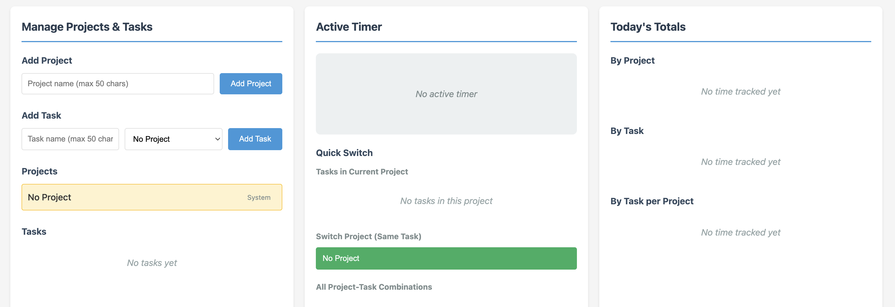
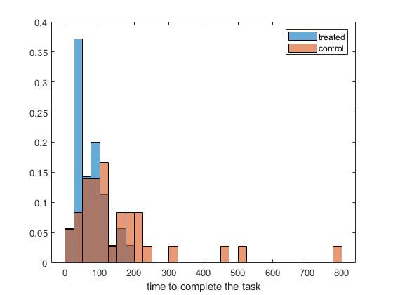

<!-- Generated by scripts/build-tools-showcase.py from the tools database. -->

```{=html}
<div class="showcase-detail tools-showcase-detail"><nav class="showcase-breadcrumb" aria-label="Breadcrumb"><a href="/raw/tools-showcase.html">Tools Showcase</a><span aria-hidden="true">/</span><a href="/raw/tools-showcase.html#family-ide">Editor &amp; IDE</a></nav><header class="showcase-detail-header"><p class="showcase-domain">Editor &amp; IDE · IDE, GitHub, app, and terminal</p><h1>GitHub Copilot</h1><p>Capabilities and review points</p><nav class="showcase-detail-actions" aria-label="On this page"><a href="#tool-card">Tool card</a><a href="#use-cases">Use cases & results</a><a href="#technical-figures">Technical figures</a><a href="#source-slides">Source slides</a><a href="#methods">Methods & sources</a></nav></header><section class="showcase-source-map" id="source-slides" aria-labelledby="source-slides-title"><h2 id="source-slides-title">Source slides</h2><ul><li><span>Tool card</span><a href="/raw/lectures/01_intro/lecture01_tools_showcase.html#/ts-copilot" title="Slide ID: ts-copilot">Tools Showcase · slide 4</a><code>ts-copilot</code></li><li><span>Use cases & results</span><a href="/raw/lectures/01_intro/lecture01_tools_showcase.html#/ts-copilot-uses" title="Slide ID: ts-copilot-uses">Tools Showcase · slide 5</a><code>ts-copilot-uses</code></li><li><span>Technical figures</span><a href="/raw/lectures/01_intro/lecture01_tools_showcase.html#/ts-evidence-ide-copilot" title="Slide ID: ts-evidence-ide-copilot">Tools Showcase · slide 28</a><code>ts-evidence-ide-copilot</code></li></ul></section>
```

```{=html}
<section class="showcase-section" id="tool-card"><div class="showcase-section-heading"><h2>Tool card</h2></div>
```

```{=html}
<article class="showcase-slide-source" data-presentation="intro-tools" data-slide="ts-copilot"><p class="showcase-slide-reference"><a href="/raw/lectures/01_intro/lecture01_tools_showcase.html#/ts-copilot" title="Slide ID: ts-copilot">Tools Showcase · slide 4</a></p><div class="showcase-source tools-showcase-source ts-copilot"><div class="ts-card">
  <div class="ts-product-line">
    
    <span class="ts-surface">IDE, GitHub, app, and terminal</span>
  </div>
  <figure class="ts-chart">
    <figcaption id="ts-copilot-matrix-title">Capabilities and review points</figcaption>
    <table class="ts-matrix" aria-labelledby="ts-copilot-matrix-title">
      <thead><tr><th scope="col">Surface</th><th scope="col">Capability</th><th scope="col">Review point</th></tr></thead>
      <tbody>
        <tr><th scope="row">IDE suggestions</th><td>Inline completions · next edit suggestions</td><td>Accept or dismiss in place</td></tr>
        <tr><th scope="row">IDE Chat and Agent</th><td>Ask · Plan · Edit · Agent</td><td>References · plan · diff</td></tr>
        <tr><th scope="row">GitHub code review</th><td>Review changed lines in a PR</td><td>Comments · suggested patches</td></tr>
        <tr><th scope="row">Cloud agent</th><td>Delegate an issue or prompt</td><td>Session log · draft PR</td></tr>
        <tr><th scope="row">Copilot app</th><td>Parallel sessions across repositories</td><td>Session progress · PR status</td></tr>
        <tr><th scope="row">Copilot CLI</th><td>Interactive and scripted terminal tasks</td><td>Tool calls · diff · <code>/review</code></td></tr>
      </tbody>
    </table>
    <div class="ts-secondary">
      <h3>Separate approvals on a Copilot pull request</h3>
      <div class="ts-mini-map ts-mini-split">
        <div class="ts-mini-node ts-mini-hub"><strong>Copilot PR</strong><span>Agent changes</span></div>
        <div class="ts-mini-branches">
          <div class="ts-mini-node"><strong>Workflow run</strong><span>Manual approval by default.</span></div>
          <div class="ts-mini-node"><strong>Human review</strong><span>Eligible reviewers, when rules require approval.</span></div>
        </div>
      </div>
    </div>
  </figure>
  <div class="ts-facts" role="group" aria-label="GitHub Copilot capabilities">
    <h3>Shared controls</h3>
    <dl>
      <dt>Repository instructions</dt><dd><code>.github/<wbr>copilot-instructions.md</code></dd>
      <dt>Extension points</dt><dd>Agent skills and MCP servers where supported.</dd>
      <dt>Availability</dt><dd>IDE, plan, and organization policy.</dd>
      <dt>Session handoff</dt><dd>Delegate from supported IDEs. <code>/remote on</code> enables web or mobile steering.</dd>
    </dl>
  </div>
  <div class="ts-sources"><a class="ts-evidence-link" href="/raw/tools-showcase/copilot.html#technical-figures">Technical figure</a><a href="https://docs.github.com/en/copilot/get-started/where-to-use-github-copilot">Surface guide</a><a href="https://docs.github.com/en/copilot/concepts/copilot-surfaces/copilot-in-ides">IDE features</a><a href="https://docs.github.com/en/copilot/how-tos/copilot-on-github/use-copilot-agents">Cloud agent and code review</a><a href="https://docs.github.com/en/enterprise-cloud%40latest/copilot/how-tos/copilot-on-github/use-copilot-agents/review-copilot-output">PR approvals</a></div>
</div></div></article>
```

```{=html}
</section>
```

```{=html}
<section class="showcase-section" id="use-cases"><div class="showcase-section-heading"><h2>Use cases & results</h2></div>
```

```{=html}
<article class="showcase-slide-source" data-presentation="intro-tools" data-slide="ts-copilot-uses"><p class="showcase-source-subtitle">What did Copilot produce in two published demos?</p><p class="showcase-slide-reference"><a href="/raw/lectures/01_intro/lecture01_tools_showcase.html#/ts-copilot-uses" title="Slide ID: ts-copilot-uses">Tools Showcase · slide 5</a></p><div class="showcase-source tools-showcase-source ts-copilot"><div class="ts-card ts-use-layout">
  <article class="ts-use-case">
    <h3>Input validation for a GitHub Action</h3>
    <ol class="ts-use-flow">
      <li class="ts-use-step"><h4>Task</h4><p>Handle malformed inputs in <code>validate-file-exists</code> and fix README examples.</p></li>
      <li class="ts-use-step"><h4>How Copilot was used</h4><p>The workshop host assigned a scoped issue to the cloud coding agent, then reviewed its PR.</p></li>
      <li class="ts-use-step"><h4>Public artifact</h4><p>Merged PR #55 with validation and edge-case tests.</p></li>
    </ol>
    <figure class="ts-use-artifact">
      <table>
        <tbody>
          <tr><th scope="row">Input</th><td><code>',,,'</code></td></tr>
          <tr><th scope="row">Jest assertion</th><td><code>rejects.toThrow</code></td></tr>
          <tr><th scope="row">Expected error</th><td>No valid files found in input. Please provide a comma-separated list of file names.</td></tr>
        </tbody>
      </table>
      <figcaption>Exact test values · <a href="https://github.com/chrisreddington/validate-file-exists/blob/48f7a366d8dc1eee0bf40c5e68e10e9f27148722/__tests__/fileValidator.test.ts">PR #55’s test file</a></figcaption>
    </figure>
    <p class="ts-use-source"><a href="https://github.blog/ai-and-ml/github-copilot/from-chaos-to-clarity-using-github-copilot-agents-to-improve-developer-workflows/">GitHub Blog · Workshop report</a> · <a href="https://github.com/chrisreddington/validate-file-exists/pull/55">Merged PR #55</a></p>
  </article>
  <article class="ts-use-case">
    <h3>Personal time-tracking web app</h3>
    <ol class="ts-use-flow">
      <li class="ts-use-step"><h4>Task</h4><p>Build a prototype for logging time spent on activities.</p></li>
      <li class="ts-use-step"><h4>How Copilot was used</h4><p>Review the proposal in Plan mode, then start implementation in Agent mode.</p></li>
      <li class="ts-use-step"><h4>Demo artifact</h4><p>Time tracker running in the browser.</p></li>
    </ol>
    <figure class="ts-use-artifact">
      <a class="ts-use-artifact-open" href="https://docs.github.com/assets/cb-276006/images/help/copilot/time-tracker-example1.png"></a>
      <figcaption>Demo screenshot detail · <a href="https://docs.github.com/en/copilot/tutorials/vibe-coding#testing-your-application">Testing the time tracker</a></figcaption>
    </figure>
    <p class="ts-use-source"><a href="https://docs.github.com/en/copilot/tutorials/vibe-coding">GitHub Docs · Guided IDE tutorial</a></p>
  </article>
</div></div></article>
```

```{=html}
</section>
```

```{=html}
<section class="showcase-section" id="technical-figures"><div class="showcase-section-heading"><h2>Technical figures</h2></div>
```

```{=html}
<article class="showcase-slide-source" data-presentation="intro-tools" data-slide="ts-evidence-ide-copilot"><p class="showcase-source-subtitle">How long did developers take in the Copilot trial?</p><p class="showcase-slide-reference"><a href="/raw/lectures/01_intro/lecture01_tools_showcase.html#/ts-evidence-ide-copilot" title="Slide ID: ts-evidence-ide-copilot">Tools Showcase · slide 28</a></p><div class="showcase-source tools-showcase-source ts-copilot"><div class="ts-card ts-evidence-layout">
  <figure class="ts-evidence-figure">
    
    <figcaption>Elapsed minutes among task completers. <a href="https://arxiv.org/html/2302.06590v1#Sx3.F6">Original Figure 6 · Peng et al. (2023)</a></figcaption>
  <a class="showcase-figure-link" href="/raw/lectures/01_intro/assets/tools_showcase/evidence-ide-copilot-fig6.jpg" target="_blank" rel="noopener">Open full-size figure</a></figure>
  <div class="ts-evidence-facts" role="group" aria-labelledby="ts-copilot-study-facts">
    <h3 id="ts-copilot-study-facts">One timed coding task</h3>
    <dl>
      <dt>Trial setup</dt><dd>95 Upwork developers randomized in 2022. One JavaScript HTTP server task.</dd>
      <dt>Completion</dt><dd>First commit that passed all 12 tests. 35 completers in each arm, from 45 assigned Copilot and 50 controls.</dd>
      <dt>Means among completers</dt><dd><strong>71.17 min</strong> assigned Copilot · <strong>160.89 min</strong> control.</dd>
      <dt>Difference in mean time</dt><dd><strong>55.8% shorter</strong> in this task (95% CI 21–89%).</dd>
      <dt>Measure both outcomes</dt><dd>Track completion rates alongside times for completed tasks.</dd>
    </dl>
  </div>
  <div class="ts-sources"><a href="/raw/tools-showcase/copilot.html#tool-card">Back to GitHub Copilot</a><a href="https://arxiv.org/abs/2302.06590">Study preprint · February 2023</a><a href="https://arxiv.org/html/2302.06590v1#Sx2">Study design</a></div>
</div></div></article>
```

```{=html}
</section>
```

```{=html}
<section class="showcase-section" id="methods"><div class="showcase-section-heading"><h2>Methods & sources</h2><p>Original slide notes, source links and reported conditions for the material above.</p></div>
```

<details class="showcase-notes">
<summary>Tool card: Tools Showcase · slide 4</summary>

Таблица сопоставляет точку входа, работу Copilot и объект проверки. Режимы Ask, Plan, Edit и Agent зависят от IDE. В Ask кода не меняют, в Plan согласуют подход, в Edit принимают предложенные правки, а Agent может редактировать файлы и запускать команды. В терминале /review запускает проверку изменений, а /remote on включает удалённое управление сеансом, если оно разрешено политикой. В поддерживаемых IDE можно передать задачу облачному агенту и следить за её ходом. [Режимы IDE](https://docs.github.com/en/copilot/how-tos/copilot-in-your-ide/chat-with-copilot/chat-in-ide) · [Cloud Agent в IDE](https://docs.github.com/en/copilot/how-tos/copilot-in-your-ide/use-copilot-agents/use-cloud-agent-in-your-ide) · [Команды CLI](https://docs.github.com/en/copilot/reference/copilot-cli-reference/cli-command-reference) · [Правила репозитория](https://docs.github.com/en/copilot/how-tos/copilot-in-your-ide/customize-copilot/configure-custom-instructions/add-repository-instructions-in-your-ide).

Для PR облачного агента отдельно проверяют diff, статус CI и одобрения. Если GitHub Actions ждёт разрешения на запуск, сначала просматривают изменения. Если по правилам репозитория необходимо одобрение PR, одобрение автора поручения Copilot не засчитывается. [Проверка результата Copilot](https://docs.github.com/en/enterprise-cloud%40latest/copilot/how-tos/copilot-on-github/use-copilot-agents/review-copilot-output) · [Бренд Copilot](https://brand.github.com/brand-identity/copilot).

</details>

<details class="showcase-notes">
<summary>Use cases &amp; results: Tools Showcase · slide 5</summary>

Крис Реддингтон показал в серии Rubber Duck Thursdays рефакторинг своего GitHub Action. Сначала он сформулировал issue с критериями, затем назначил его Copilot. Агент добавил проверки пустых и некорректных строк, обновил документацию и написал четыре теста. Ведущий одобрил запуск CI и передал ошибку Markdown lint обратно в PR, после чего агент внёс ещё одну правку. [Отчёт GitHub о воркшопе](https://github.blog/ai-and-ml/github-copilot/from-chaos-to-clarity-using-github-copilot-agents-to-improve-developer-workflows/) · [Публичный PR #55](https://github.com/chrisreddington/validate-file-exists/pull/55).

Руководство GitHub предлагает собрать персональный тайм-трекер из чата в VS Code или JetBrains IDE. Участник сначала уточняет план, затем разрешает действия Agent mode и открывает локально работающую страницу. На слайде указан артефакт демонстрации из руководства. Конкретная реализация при повторном запуске зависит от ответов агента. [GitHub Docs, Vibe coding with GitHub Copilot](https://docs.github.com/en/copilot/tutorials/vibe-coding).

</details>

<details class="showcase-notes">
<summary>Technical figures: Tools Showcase · slide 28</summary>

На рисунке 6 показано распределение времени у 70 завершивших задание. Цвета означают назначенные группы. В 2022 году на Upwork набрали 95 профессиональных разработчиков и случайно распределили 45 в группу с доступом к Copilot, 50 в контроль. Контроль мог использовать обычные ресурсы, включая Stack Overflow. Группа с доступом получила короткое обучающее видео. Пять назначенных в эту группу начали задачу без настройки инструмента, поэтому на слайде указано назначение группы.

Время отсчитывали от создания личной копии репозитория в GitHub Classroom до первого коммита, прошедшего все 12 тестов. 35 участников в каждой группе завершили задание и опрос. Средние 71,17 и 160,89 минуты рассчитаны среди завершивших. Сокращение времени выражено относительно 160,89 минуты. Четыре наблюдения свыше 300 минут относятся к контролю, и авторы сообщают о сохранении результата после их исключения. Разница в доле завершивших оценена в 7 процентных пунктов с 95%-м интервалом от −11 до 25. Область вывода ограничена одним стандартизованным заданием и участниками, его завершившими. [Sida Peng, Eirini Kalliamvakou, Peter Cihon и Mert Demirer, «The Impact of AI on Developer Productivity: Evidence from GitHub Copilot», 13 февраля 2023, Results и Figure 6](https://arxiv.org/html/2302.06590v1#Sx3) · [Оригинальный файл рисунка](https://arxiv.org/html/2302.06590v1/Figures/timetocomplete.jpg).

</details>

```{=html}
</section><nav class="showcase-bottom-nav" aria-label="More tools"><a href="/raw/tools-showcase.html">Back to all tools</a><a href="/raw/lectures/01_intro/lecture01_tools_showcase.html#/ts-copilot">View source slide</a></nav></div>
```
