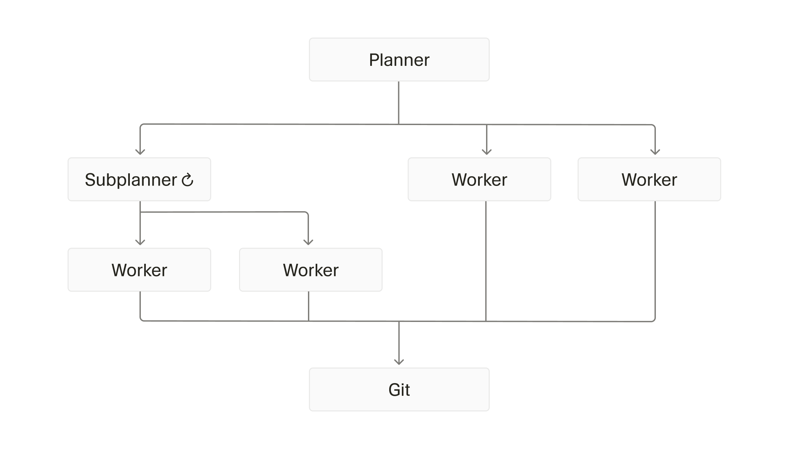

<!-- Generated by scripts/build-tools-showcase.py from the tools database. -->

```{=html}
<div class="showcase-detail tools-showcase-detail"><nav class="showcase-breadcrumb" aria-label="Breadcrumb"><a href="/raw/tools-showcase.html">Tools Showcase</a><span aria-hidden="true">/</span><a href="/raw/tools-showcase.html#family-ide">Editor &amp; IDE</a></nav><header class="showcase-detail-header"><p class="showcase-domain">Editor &amp; IDE · AI editor and agent platform</p><h1>Cursor</h1><p>Editing interfaces and cloud delegation</p><nav class="showcase-detail-actions" aria-label="On this page"><a href="#tool-card">Tool card</a><a href="#use-cases">Use cases & results</a><a href="#technical-figures">Technical figures</a><a href="#source-slides">Source slides</a><a href="#methods">Methods & sources</a></nav></header><section class="showcase-source-map" id="source-slides" aria-labelledby="source-slides-title"><h2 id="source-slides-title">Source slides</h2><ul><li><span>Tool card</span><a href="/raw/lectures/01_intro/lecture01_tools_showcase.html#/ts-cursor" title="Slide ID: ts-cursor">Tools Showcase · slide 2</a><code>ts-cursor</code></li><li><span>Use cases & results</span><a href="/raw/lectures/01_intro/lecture01_tools_showcase.html#/ts-cursor-uses" title="Slide ID: ts-cursor-uses">Tools Showcase · slide 3</a><code>ts-cursor-uses</code></li><li><span>Technical figures</span><a href="/raw/lectures/01_intro/lecture01_tools_showcase.html#/ts-evidence-ide-cursor" title="Slide ID: ts-evidence-ide-cursor">Tools Showcase · slide 29</a><code>ts-evidence-ide-cursor</code></li></ul></section>
```

```{=html}
<section class="showcase-section" id="tool-card"><div class="showcase-section-heading"><h2>Tool card</h2></div>
```

```{=html}
<article class="showcase-slide-source" data-presentation="intro-tools" data-slide="ts-cursor"><p class="showcase-slide-reference"><a href="/raw/lectures/01_intro/lecture01_tools_showcase.html#/ts-cursor" title="Slide ID: ts-cursor">Tools Showcase · slide 2</a></p><div class="showcase-source tools-showcase-source ts-cursor"><div class="ts-card">
  <div class="ts-product-line">
    
    <strong class="ts-name">Cursor</strong>
    <span class="ts-surface">AI editor and agent platform</span>
  </div>
  <figure class="ts-chart">
    <figcaption>Editing interfaces and cloud delegation</figcaption>
    <div class="ts-diagram ts-branches">
      <div class="ts-node ts-hub"><strong>Cursor</strong></div>
      <div class="ts-branch-list">
        <div class="ts-node"><strong>Editor</strong><span>Tab suggests multi-line and cross-file edits. Agent edits code and runs checks.</span></div>
        <div class="ts-node"><strong>Agents Window</strong><span>Parallel sessions in local workspaces, worktrees, remote SSH, or cloud.</span></div>
        <div class="ts-node"><strong>CLI</strong><span>Interactive Agent or <code>agent -p</code> for scripts and CI.</span></div>
        <div class="ts-node ts-node-accent"><strong>Cloud Agents</strong><span>Delegate background work and follow the session on web or mobile.</span></div>
      </div>
    </div>
    <div class="ts-secondary">
      <h3 id="ts-cursor-runtime-location">Where a Cloud Agent runs</h3>
      <table class="ts-mini-table" aria-labelledby="ts-cursor-runtime-location">
        <thead><tr><th scope="col">Component</th><th scope="col">Cursor-hosted</th><th scope="col">Self-Hosted Machines</th></tr></thead>
        <tbody>
          <tr><th scope="row">Agent loop and inference</th><td colspan="2">Cursor cloud in both configurations</td></tr>
          <tr><th scope="row">Tool execution</th><td>Isolated Cursor VM</td><td>Your worker</td></tr>
        </tbody>
      </table>
    </div>
  </figure>
  <div class="ts-facts" role="group" aria-label="Cursor capabilities">
    <h3>Agent controls</h3>
    <dl>
      <dt>Ask · Plan · Agent · Debug</dt><dd>Explore code, agree on a plan, edit and run checks, or gather runtime evidence.</dd>
      <dt>Project context</dt><dd>File references, Instant Grep, and rules in <code>.cursor/rules/</code>.</dd>
      <dt>Design Mode</dt><dd>Send element context and a screenshot from the running UI.</dd>
      <dt>Review and rollback</dt><dd>Agent Review checks local diffs. Restore Checkpoint rolls back Agent edits.</dd>
    </dl>
  </div>
  <div class="ts-sources"><a class="ts-evidence-link" href="/raw/tools-showcase/cursor.html#technical-figures">Technical figure</a><a href="https://cursor.com/help/ai-features/tab">Tab</a><a href="https://cursor.com/help/ai-features/agent">Agent modes</a><a href="https://cursor.com/docs/agent/agents-window">Agents Window</a><a href="https://cursor.com/docs/cli/using">CLI and cloud handoff</a><a href="https://cursor.com/docs/cloud-agent/self-hosted/choose-runtime">Cloud runtime</a></div>
</div></div></article>
```

```{=html}
</section>
```

```{=html}
<section class="showcase-section" id="use-cases"><div class="showcase-section-heading"><h2>Use cases & results</h2></div>
```

```{=html}
<article class="showcase-slide-source" data-presentation="intro-tools" data-slide="ts-cursor-uses"><p class="showcase-source-subtitle">What did teams use Cursor to change?</p><p class="showcase-slide-reference"><a href="/raw/lectures/01_intro/lecture01_tools_showcase.html#/ts-cursor-uses" title="Slide ID: ts-cursor-uses">Tools Showcase · slide 3</a></p><div class="showcase-source tools-showcase-source ts-cursor"><div class="ts-card ts-use-layout">
  <article class="ts-use-case">
    <h3>Box’s React migration</h3>
    <ol class="ts-use-flow">
      <li class="ts-use-step"><h4>Task</h4><p>Resume a stalled React migration to unify cross-platform feature development.</p></li>
      <li class="ts-use-step"><h4>How Cursor was used</h4><p>Box gave Cursor rules for how the new components should be structured.</p></li>
      <li class="ts-use-step"><h4>Reported artifact</h4><p>React migration proof of concept.</p></li>
    </ol>
    <figure class="ts-use-artifact">
      <blockquote>Box built a proof of concept against the production codebase in three days</blockquote>
      <figcaption>Result excerpt · <a href="https://cursor.com/blog/box">Cursor’s Box customer report</a></figcaption>
    </figure>
    <p class="ts-use-source"><a href="https://cursor.com/blog/box">Cursor · Box customer report</a></p>
  </article>
  <article class="ts-use-case">
    <h3>Product docs from recurring support questions</h3>
    <ol class="ts-use-flow">
      <li class="ts-use-step"><h4>Task</h4><p>Update product documentation when several customers ask the same question.</p></li>
      <li class="ts-use-step"><h4>How Cursor was used</h4><p>Support mentions <code>@Cursor</code> in Slack and describes the documentation change.</p></li>
      <li class="ts-use-step"><h4>Reported artifact</h4><p>Documentation pull request.</p></li>
    </ol>
    <figure class="ts-use-artifact">
      <blockquote>We just mention @Cursor in Slack with what needs updating, and a cloud agent will open a PR against our docs repo.</blockquote>
      <figcaption>Workflow excerpt · <a href="https://cursor.com/blog/cursor-support#documentation-updates">Cursor Support report</a></figcaption>
    </figure>
    <p class="ts-use-source"><a href="https://cursor.com/blog/cursor-support#documentation-updates">Cursor Support · Internal workflow report</a></p>
  </article>
</div></div></article>
```

```{=html}
</section>
```

```{=html}
<section class="showcase-section" id="technical-figures"><div class="showcase-section-heading"><h2>Technical figures</h2></div>
```

```{=html}
<article class="showcase-slide-source" data-presentation="intro-tools" data-slide="ts-evidence-ide-cursor"><p class="showcase-source-subtitle">How did Cursor coordinate agents in a browser experiment?</p><p class="showcase-slide-reference"><a href="/raw/lectures/01_intro/lecture01_tools_showcase.html#/ts-evidence-ide-cursor" title="Slide ID: ts-evidence-ide-cursor">Tools Showcase · slide 29</a></p><div class="showcase-source tools-showcase-source ts-cursor"><div class="ts-card ts-evidence-layout">
  <figure class="ts-evidence-figure">
    
    <figcaption><a href="https://cursor.com/blog/self-driving-codebases#the-final-system-design">Wilson Lin, Towards self-driving codebases · Original final-design diagram · 5 Feb 2026</a></figcaption>
  <a class="showcase-figure-link" href="/raw/lectures/01_intro/assets/tools_showcase/evidence-ide-cursor-planner.png" target="_blank" rel="noopener">Open full-size figure</a></figure>
  <div class="ts-evidence-facts" role="group" aria-labelledby="ts-cursor-study-facts">
    <h3 id="ts-cursor-study-facts">The browser prototype</h3>
    <dl>
      <dt>Experiment</dt><dd>Cursor reports a week-long autonomous run on a research browser.</dd>
      <dt>Planning</dt><dd>The root planner owns the goal. Subplanners take responsibility for narrower parts.</dd>
      <dt>Execution</dt><dd>Workers use separate repo copies and send completion notes to their requesting planner.</dd>
      <dt>Throughput</dt><dd>Peak of about <strong>1,000 commits per hour</strong> in this run. The harness tolerated intermediate errors.</dd>
      <dt>Release check</dt><dd>Use a separately validated snapshot to assess release readiness.</dd>
    </dl>
  </div>
  <div class="ts-sources"><a href="/raw/tools-showcase/cursor.html#tool-card">Back to Cursor</a><a href="https://cursor.com/blog/self-driving-codebases#throughput-and-tradeoffs">Throughput and correctness</a><a href="https://cursor.com/blog/scaling-agents">Earlier research report · January 2026</a></div>
</div></div></article>
```

```{=html}
</section>
```

```{=html}
<section class="showcase-section" id="methods"><div class="showcase-section-heading"><h2>Methods & sources</h2><p>Original slide notes, source links and reported conditions for the material above.</p></div>
```

<details class="showcase-notes">
<summary>Tool card: Tools Showcase · slide 2</summary>

Схема показывает поверхности одного продукта. В редакторе Tab предлагает правки по мере набора кода, может менять несколько строк и указывать на следующее место редактирования. Agent решает задачи с поиском по репозиторию, изменением нескольких файлов и запуском команд. Ask подходит для изучения кода, Plan для согласования подхода. При переходе между режимами в новой сессии полезно явно приложить нужный файл или символ.

Agents Window объединяет сеансы и настройки среды. В worktree изолируются изменения на диске. CLI поддерживает интерактивную работу, режим печати для сценариев и передачу задачи Cloud Agent. При Self-Hosted Machines на машине пользователя выполняются вызовы инструментов. Цикл агента и инференс остаются в облаке Cursor. В Design Mode вместе с заметкой передаются данные о выбранном элементе и снимок экрана. Agent Review проверяет локальный diff. [Worktrees](https://cursor.com/docs/configuration/worktrees) · [Правила](https://cursor.com/docs/rules) · [Design Mode](https://cursor.com/docs/agent/design-mode) · [Agent Review](https://cursor.com/docs/agent/agent-review) · [Self-Hosted Machines](https://cursor.com/docs/cloud-agent/self-hosted) · [Бренд Cursor](https://cursor.com/brand).

</details>

<details class="showcase-notes">
<summary>Use cases &amp; results: Tools Showcase · slide 3</summary>

В публикации Cursor представители Box описывают миграцию на React. Команда зафиксировала правила построения новых компонентов, а затем сделала проверяемый прототип на существующей производственной кодовой базе. На слайде указан конкретный артефакт раннего этапа. [Cursor, отчёт о работе Box](https://cursor.com/blog/box).

Во втором случае Коди Фишер и Зак Хадсон описывают внутреннюю работу техподдержки Cursor. Повторяющиеся обращения указывают, где документация нуждается в правке. Сотрудник описывает изменение в Slack, и облачный агент открывает PR в репозитории документации. Публичный источник описывает процесс команды. [Cursor Support, Documentation updates](https://cursor.com/blog/cursor-support#documentation-updates).

</details>

<details class="showcase-notes">
<summary>Technical figures: Tools Showcase · slide 29</summary>

Оригинальная схема относится к исследовательскому harness из статьи Wilson Lin от 5 февраля 2026 года. Команда выбрала прототип браузера как задачу с множеством связанных подсистем. Корневой планировщик владеет общим результатом. При необходимости он рекурсивно выделяет подзадачи с ответственными планировщиками. Рабочие агенты берут отдельные задания и работают в своих копиях репозитория. После сдачи задачи они передают запустившему планировщику результаты, отклонения и наблюдения. Стрелки в Git показывают движение изменений к репозиторию. Канал отчётов к планировщику описан в тексте отчёта.

Около 1 000 коммитов в час — пик в описанном недельном исследовательском прогоне. В отчёте отмечено, что требование полной корректности перед каждым коммитом создавало задержки, и предложено отдельно проверять снимки кода перед выпуском. Прототип служил внутренней исследовательской задачей. [Wilson Lin, «Towards self-driving codebases», 5 февраля 2026](https://cursor.com/blog/self-driving-codebases) · [Оригинальный файл схемы](https://ptht05hbb1ssoooe.public.blob.vercel-storage.com/assets/blog/autonomy-diagram-4-3.png).

</details>

```{=html}
</section><nav class="showcase-bottom-nav" aria-label="More tools"><a href="/raw/tools-showcase.html">Back to all tools</a><a href="/raw/lectures/01_intro/lecture01_tools_showcase.html#/ts-cursor">View source slide</a></nav></div>
```
