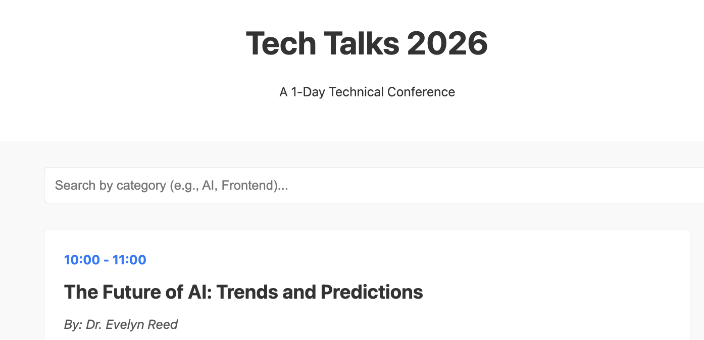

<!-- Generated by scripts/build-tools-showcase.py from the tools database. -->

```{=html}
<div class="showcase-detail tools-showcase-detail"><nav class="showcase-breadcrumb" aria-label="Breadcrumb"><a href="/raw/tools-showcase.html">Tools Showcase</a><span aria-hidden="true">/</span><a href="/raw/tools-showcase.html#family-terminal">Terminal</a></nav><header class="showcase-detail-header"><p class="showcase-domain">Terminal · Google · Open-source terminal agent</p><h1>Gemini CLI</h1><p>Google · Open-source terminal agent</p><nav class="showcase-detail-actions" aria-label="On this page"><a href="#tool-card">Tool card</a><a href="#use-cases">Use cases & results</a><a href="#source-slides">Source slides</a><a href="#methods">Methods & sources</a></nav></header><section class="showcase-source-map" id="source-slides" aria-labelledby="source-slides-title"><h2 id="source-slides-title">Source slides</h2><ul><li><span>Tool card</span><a href="/raw/lectures/01_intro/lecture01_tools_showcase.html#/ts-gemini-cli" title="Slide ID: ts-gemini-cli">Tools Showcase · slide 16</a><code>ts-gemini-cli</code></li><li><span>Use cases & results</span><a href="/raw/lectures/01_intro/lecture01_tools_showcase.html#/ts-gemini-cli-uses" title="Slide ID: ts-gemini-cli-uses">Tools Showcase · slide 17</a><code>ts-gemini-cli-uses</code></li></ul></section>
```

```{=html}
<section class="showcase-section" id="tool-card"><div class="showcase-section-heading"><h2>Tool card</h2></div>
```

```{=html}
<article class="showcase-slide-source" data-presentation="intro-tools" data-slide="ts-gemini-cli"><p class="showcase-slide-reference"><a href="/raw/lectures/01_intro/lecture01_tools_showcase.html#/ts-gemini-cli" title="Slide ID: ts-gemini-cli">Tools Showcase · slide 16</a></p><div class="showcase-source tools-showcase-source ts-gemini-cli"><div class="ts-card">
  <div class="ts-product-line">
    
    <strong class="ts-name">Gemini CLI</strong><span class="ts-surface">Google · Open-source terminal agent</span>
  </div>
  <figure class="ts-chart">
    <h3>Instruction loading order</h3>
    <ol class="ts-diagram ts-stack">
      <li class="ts-node"><strong>Global defaults</strong><code>~/.gemini/GEMINI.md</code></li>
      <li class="ts-node"><strong>Workspace instructions</strong><span><code>GEMINI.md</code> in workspace directories and their parents</span></li>
      <li class="ts-node ts-node-accent"><strong>Component instructions</strong><span>Discovered when a tool accesses a path, up to a trusted root</span></li>
    </ol>
    <div class="ts-secondary">
      <h3>How Markdown imports reach the model</h3>
      <div class="ts-mini-map">
        <div class="ts-mini-node"><strong>Context file</strong><span><code>GEMINI.md</code> by default</span></div>
        <span class="ts-mini-edge" aria-hidden="true">→</span>
        <div class="ts-mini-node"><strong>Expand <code>@path</code></strong><span>Include the referenced Markdown</span></div>
        <span class="ts-mini-edge" aria-hidden="true">→</span>
        <div class="ts-mini-node"><strong>Combined instructions</strong><span>Attach to each prompt</span></div>
      </div>
    </div>
  </figure>
  <div class="ts-facts" role="group" aria-label="Gemini CLI capabilities">
    <h3>Session tools and access</h3>
    <dl>
      <dt>Inspect or rescan</dt><dd><code>/memory show</code> or <code>/memory reload</code></dd>
      <dt>Context filenames</dt><dd><code>context.fileName</code> accepts a name or list</dd>
      <dt>Interact with the project</dt><dd>Search, edit and run shell commands under tool policies</dd>
      <dt>Authentication</dt><dd>Gemini API key and Vertex AI are documented routes</dd>
      <dt>Consumer access</dt><dd>Code Assist consumer sign-in ended June 18, 2026</dd>
    </dl>
  </div>
  <div class="ts-sources"><a href="https://geminicli.com/docs/cli/gemini-md/">Instruction hierarchy</a><a href="https://geminicli.com/docs/get-started/">CLI overview</a><a href="https://geminicli.com/docs/get-started/authentication/">Authentication</a><a href="https://developers.google.com/gemini-code-assist/docs/deprecations/code-assist-individuals">Consumer access change</a></div>
</div></div></article>
```

```{=html}
</section>
```

```{=html}
<section class="showcase-section" id="use-cases"><div class="showcase-section-heading"><h2>Use cases & results</h2></div>
```

```{=html}
<article class="showcase-slide-source" data-presentation="intro-tools" data-slide="ts-gemini-cli-uses"><p class="showcase-source-subtitle">What did Google’s Gemini CLI workshop produce?</p><p class="showcase-slide-reference"><a href="/raw/lectures/01_intro/lecture01_tools_showcase.html#/ts-gemini-cli-uses" title="Slide ID: ts-gemini-cli-uses">Tools Showcase · slide 17</a></p><div class="showcase-source tools-showcase-source ts-gemini-cli"><div class="ts-card ts-use-layout">
  <article class="ts-use-case">
    <h3>Save a news brief to a local file</h3>
    <p class="ts-use-provenance">Google Codelab with sample terminal output</p>
    <ol class="ts-use-flow">
      <li class="ts-use-step"><h4>Task</h4><p>Gather finance headlines and save them as <code>finance-news-today.txt</code>.</p></li>
      <li class="ts-use-step"><h4>How Gemini CLI was used</h4><p>The CLI called Google Search, requested approval to write the file, and reopened it via an <code>@file</code> reference.</p></li>
      <li class="ts-use-step"><h4>Recorded result</h4><p>The lab prints a save confirmation and a read-back excerpt from the generated text file.</p></li>
    </ol>
    <figure class="ts-use-artifact">
      <pre><code>✦ I have saved the latest finance news to finance-news-today.txt.</code></pre>
      <figcaption><a href="https://codelabs.developers.google.com/gemini-cli-hands-on#6">Google Codelab terminal output excerpt</a></figcaption>
    </figure>
    <p class="ts-use-source"><a href="https://codelabs.developers.google.com/gemini-cli-hands-on#6">Google Codelabs · Built-in tools, step 7</a></p>
  </article>
  <article class="ts-use-case">
    <h3>Build a searchable conference agenda</h3>
    <p class="ts-use-provenance">Google Codelab with a sample screenshot</p>
    <ol class="ts-use-flow">
      <li class="ts-use-step"><h4>Task</h4><p>Build a one-day schedule with six talks and a category filter.</p></li>
      <li class="ts-use-step"><h4>How Gemini CLI was used</h4><p>The workshop author reviewed a plan for an Express server, a JSON data file, and a browser frontend.</p></li>
      <li class="ts-use-step"><h4>Recorded result</h4><p>The codelab shows the generated schedule page and explains how to try the filter locally.</p></li>
    </ol>
    <figure class="ts-use-artifact">
      <a class="ts-use-artifact-open" href="https://codelabs.developers.google.com/static/gemini-cli-hands-on/img/12664933302b3867.png"></a>
      <figcaption><a href="https://codelabs.developers.google.com/gemini-cli-hands-on#9">Cropped screenshot of the workshop author’s run</a></figcaption>
    </figure>
    <p class="ts-use-source"><a href="https://codelabs.developers.google.com/gemini-cli-hands-on#9">Google Codelabs · Use cases, step 10</a></p>
  </article>
</div></div></article>
```

```{=html}
</section>
```

```{=html}
<section class="showcase-section" id="methods"><div class="showcase-section-heading"><h2>Methods & sources</h2><p>Original slide notes, source links and reported conditions for the material above.</p></div>
```

<details class="showcase-notes">
<summary>Tool card: Tools Showcase · slide 16</summary>

Gemini CLI объединяет содержимое найденных файлов. Порядок на схеме описывает загрузку, без гарантии приоритета одной конфликтующей инструкции над другой. При первом обращении к компоненту могут добавиться указания из его каталога и предков до доверенного корня. /memory show выводит всё объединённое содержимое, загруженное к моменту вызова. Правила для инструментов задаются отдельно.

С 18 июня 2026 года прекращён доступ к Gemini CLI через Gemini Code Assist for individuals, Google AI Pro и Google AI Ultra. Google направляет пользователей этих подписок в семейство Antigravity. Для Code Assist Standard и Enterprise действует отдельный график вывода из эксплуатации. [Объявление команды Gemini CLI](https://github.com/google-gemini/gemini-cli/discussions/28017) · [Фирменный знак Gemini CLI](https://geminicli.com/brand-kit/).

</details>

<details class="showcase-notes">
<summary>Use cases &amp; results: Tools Showcase · slide 17</summary>

Лабораторная Google публикует конкретный вывод инструментов и снимок созданной страницы. В первом упражнении пользователь отдельным сообщением попросил повторно прочитать файл через @-ссылку. Это проверяет наличие файла и его содержимое. Новостные утверждения требуют собственной проверки источников, а результат повторного запуска будет зависеть от даты.

Во втором упражнении пользователь задаёт параметры однодневной программы и сначала просит план. Затем на опубликованном снимке можно увидеть интерфейс приложения. Фильтр предлагается проверить в локальном браузере, отдельного протокола тестирования в источнике нет. При повторении ориентируйтесь на действующие способы аутентификации на предыдущем слайде.

</details>

```{=html}
</section><nav class="showcase-bottom-nav" aria-label="More tools"><a href="/raw/tools-showcase.html">Back to all tools</a><a href="/raw/lectures/01_intro/lecture01_tools_showcase.html#/ts-gemini-cli">View source slide</a></nav></div>
```
