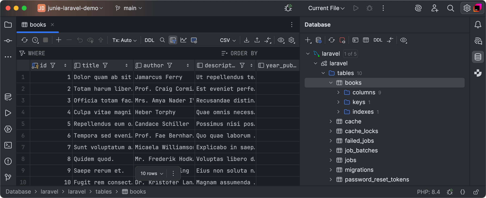
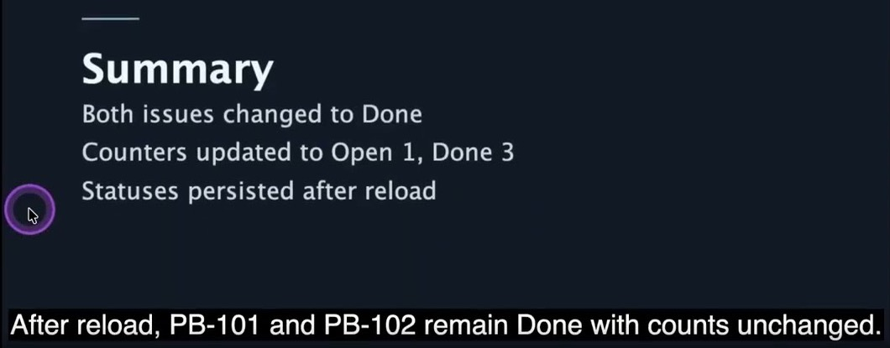

<!-- Generated by scripts/build-tools-showcase.py from the tools database. -->

```{=html}
<div class="showcase-detail tools-showcase-detail"><nav class="showcase-breadcrumb" aria-label="Breadcrumb"><a href="/raw/tools-showcase.html">Tools Showcase</a><span aria-hidden="true">/</span><a href="/raw/tools-showcase.html#family-ide">Editor &amp; IDE</a></nav><header class="showcase-detail-header"><p class="showcase-domain">Editor &amp; IDE · JetBrains IDE agent and CLI</p><h1>Junie</h1><p>From IDE context to a reviewed patch</p><nav class="showcase-detail-actions" aria-label="On this page"><a href="#tool-card">Tool card</a><a href="#use-cases">Use cases & results</a><a href="#source-slides">Source slides</a><a href="#methods">Methods & sources</a></nav></header><section class="showcase-source-map" id="source-slides" aria-labelledby="source-slides-title"><h2 id="source-slides-title">Source slides</h2><ul><li><span>Tool card</span><a href="/raw/lectures/01_intro/lecture01_tools_showcase.html#/ts-junie" title="Slide ID: ts-junie">Tools Showcase · slide 6</a><code>ts-junie</code></li><li><span>Use cases & results</span><a href="/raw/lectures/01_intro/lecture01_tools_showcase.html#/ts-junie-uses" title="Slide ID: ts-junie-uses">Tools Showcase · slide 7</a><code>ts-junie-uses</code></li></ul></section>
```

```{=html}
<section class="showcase-section" id="tool-card"><div class="showcase-section-heading"><h2>Tool card</h2></div>
```

```{=html}
<article class="showcase-slide-source" data-presentation="intro-tools" data-slide="ts-junie"><p class="showcase-slide-reference"><a href="/raw/lectures/01_intro/lecture01_tools_showcase.html#/ts-junie" title="Slide ID: ts-junie">Tools Showcase · slide 6</a></p><div class="showcase-source tools-showcase-source ts-junie"><div class="ts-card">
  <div class="ts-product-line">
    
    <strong class="ts-name">Junie</strong>
    <span class="ts-surface">JetBrains IDE agent and CLI</span>
  </div>
  <figure class="ts-chart">
    <figcaption>From IDE context to a reviewed patch</figcaption>
    <ol class="ts-diagram ts-stack">
      <li class="ts-node"><strong>Project context</strong><span>IDE context and guidelines from <code>AGENTS.md</code> or <code>.junie/AGENTS.md</code>.</span></li>
      <li class="ts-node"><strong>Plan and edit</strong><span>Ask mode explores read-only. Code mode plans, edits, and runs commands.</span></li>
      <li class="ts-node ts-node-accent"><strong>Run IDE checks</strong><span>Inspections and native build/test tools where supported, including JVM and C#.</span></li>
      <li class="ts-node"><strong>Review changes</strong><span>Diff and test output. Keep changes, request a follow-up, or roll back.</span></li>
    </ol>
    <div class="ts-secondary">
      <h3>CLI–IDE bridge</h3>
      <div class="ts-mini-map">
        <div class="ts-mini-node"><strong>Junie CLI</strong><span><code>/ide</code> checks status</span></div>
        <span class="ts-mini-edge" aria-hidden="true">→</span>
        <div class="ts-mini-node"><strong>JetBrains IDE plugin</strong><span>Same project open in the IDE</span></div>
        <span class="ts-mini-edge" aria-hidden="true">→</span>
        <div class="ts-mini-node"><strong>IDE-backed features</strong><span>Symbols in <code>@</code>, native tests, live debugger</span></div>
      </div>
    </div>
  </figure>
  <div class="ts-facts" role="group" aria-label="Junie capabilities">
    <h3>Integration and permissions</h3>
    <dl>
      <dt>Entry points</dt><dd>Air, AI Chat, separate IDE plugin, and CLI.</dd>
      <dt>Action Allowlist</dt><dd><code>Terminal</code>, <code>RunTest</code>, <code>Build</code>, and <code>MCP</code> rules for sensitive actions.</dd>
      <dt>Project scope</dt><dd><code>.aiignore</code> marks file contents that require approval to access.</dd>
      <dt>Debugging</dt><dd><code>/debug</code> manages breakpoints and inspects live state with a supported setup.</dd>
    </dl>
  </div>
  <div class="ts-sources"><a href="https://junie.jetbrains.com/">Junie and Air</a><a href="https://junie.jetbrains.com/docs/junie-ide-plugin.html">IDE plugin</a><a href="https://junie.jetbrains.com/docs/junie-cli-jetbrains-ide-integration.html">CLI–IDE connection</a><a href="https://junie.jetbrains.com/docs/action-allowlist.html">Action Allowlist</a></div>
</div></div></article>
```

```{=html}
</section>
```

```{=html}
<section class="showcase-section" id="use-cases"><div class="showcase-section-heading"><h2>Use cases & results</h2></div>
```

```{=html}
<article class="showcase-slide-source" data-presentation="intro-tools" data-slide="ts-junie-uses"><p class="showcase-source-subtitle">What did Junie implement and verify?</p><p class="showcase-slide-reference"><a href="/raw/lectures/01_intro/lecture01_tools_showcase.html#/ts-junie-uses" title="Slide ID: ts-junie-uses">Tools Showcase · slide 7</a></p><div class="showcase-source tools-showcase-source ts-junie"><div class="ts-card ts-use-layout">
  <article class="ts-use-case">
    <h3>Book management in Laravel</h3>
    <ol class="ts-use-flow">
      <li class="ts-use-step"><h4>Task</h4><p>Add forms for creating, viewing, editing and deleting books in a fresh Laravel project.</p></li>
      <li class="ts-use-step"><h4>How Junie was used</h4><p>In PhpStorm, Junie planned the change, wrote screens and tests, and ran a database seeder.</p></li>
      <li class="ts-use-step"><h4>Demo artifact</h4><p>Book-management screens and ten seeded records.</p></li>
    </ol>
    <figure class="ts-use-artifact">
      <a class="ts-use-artifact-open" href="https://blog.jetbrains.com/wp-content/uploads/2025/06/rows-added-to-database.png"></a>
      <figcaption>Original PhpStorm screenshot · Seeded <code>books</code> table</figcaption>
    </figure>
    <p class="ts-use-source"><a href="https://blog.jetbrains.com/wp-content/uploads/2025/06/rows-added-to-database.png">JetBrains · Seeded database screenshot</a></p>
  </article>
  <article class="ts-use-case">
    <h3>Bulk status change in an issue tracker</h3>
    <ol class="ts-use-flow">
      <li class="ts-use-step"><h4>Task</h4><p>Mark PB-101 and PB-102 as Done. Verify the counters and persistence after reload.</p></li>
      <li class="ts-use-step"><h4>How Junie was used</h4><p><code>/demo</code> launches the app, drives the browser and records the check.</p></li>
      <li class="ts-use-step"><h4>Demo artifact</h4><p>Browser recording and HTML report.</p></li>
    </ol>
    <figure class="ts-use-artifact">
      <a class="ts-use-artifact-open" href="https://www.youtube.com/watch?v=LFNif37uiTA"></a>
      <figcaption>Recorded result · <a href="https://www.youtube.com/watch?v=LFNif37uiTA">Junie’s HTML report walkthrough</a></figcaption>
    </figure>
    <p class="ts-use-source"><a href="https://www.youtube.com/watch?v=kIbd6bQgNPs">Junie · Recorded browser check</a></p>
  </article>
</div></div></article>
```

```{=html}
</section>
```

```{=html}
<section class="showcase-section" id="methods"><div class="showcase-section-heading"><h2>Methods & sources</h2><p>Original slide notes, source links and reported conditions for the material above.</p></div>
```

<details class="showcase-notes">
<summary>Tool card: Tools Showcase · slide 6</summary>

На сайте JetBrains Junie представлен как агент в Air внутри IDE. Отдельно документированы вход через AI Chat, собственное окно плагина и CLI. Схема описывает работу с IDE-контекстом. Доступность проверок зависит от IDE, языка и интеграции. Например, в документации Action Allowlist отдельно приведены запуск тестов и сборка JVM-проектов в IntelliJ IDEA, а также C# в Rider. Они используют средства IDE. В терминале также можно запустить команды проекта.

В CLI команда /ide показывает подключение к IDE. /debug работает с живым сеансом отладчика в поддерживаемой IDE при настроенных инструментах. Файл .aiignore ограничивает доступ к содержимому, а разрешённые команды и настройки подтверждения могут менять границы доступа. [Контекст Junie в AI Chat](https://www.jetbrains.com/help/ai-assistant/junie-agent.html) · [Команды CLI](https://junie.jetbrains.com/docs/slash-commands.html) · [Настройки проекта](https://junie.jetbrains.com/docs/junie-plugin-project-settings.html).

</details>

<details class="showcase-notes">
<summary>Use cases &amp; results: Tools Showcase · slide 7</summary>

Ханна Якуш начала с чистого проекта Laravel и попросила Junie сделать формы управления книгами, добавить десять записей через seeder и выполнить тесты. Команды терминала она подтверждала в IDE. Статья «Discover Junie for PhpStorm» в блоге JetBrains за июнь 2025 года показывает изменения, экраны и результат запуска seeder. [Снимок экрана приложения](https://blog.jetbrains.com/wp-content/uploads/2025/06/image-30.png) · [Снимок заполненной базы](https://blog.jetbrains.com/wp-content/uploads/2025/06/rows-added-to-database.png).

Аляксей Картыннік описывает этот сценарий в статье «Your diff has a demo now with Junie /demo» в блоге JetBrains от 18 сентября 2026 года. На кадре из разбора HTML-отчёта виден итог записи: PB-101 и PB-102 остались в статусе Done после перезагрузки, Open = 1, Done = 3. [Запись проверки](https://www.youtube.com/watch?v=kIbd6bQgNPs) · [Разбор HTML-отчёта](https://www.youtube.com/watch?v=LFNif37uiTA) · [Документация /demo](https://junie.jetbrains.com/docs/junie-cli-demo.html).

</details>

```{=html}
</section><nav class="showcase-bottom-nav" aria-label="More tools"><a href="/raw/tools-showcase.html">Back to all tools</a><a href="/raw/lectures/01_intro/lecture01_tools_showcase.html#/ts-junie">View source slide</a></nav></div>
```
