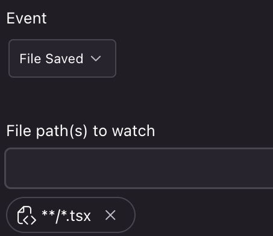
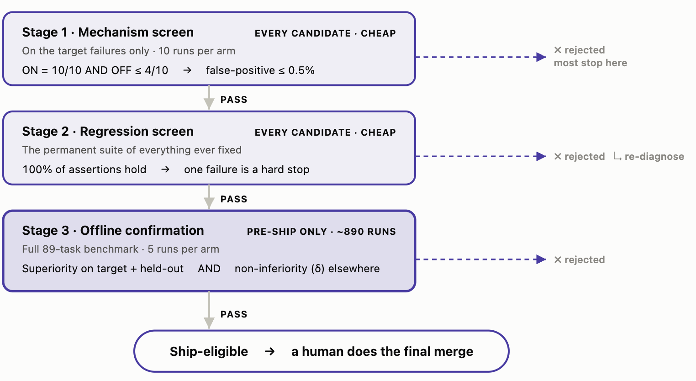

<!-- Generated by scripts/build-tools-showcase.py from the tools database. -->

```{=html}
<div class="showcase-detail tools-showcase-detail"><nav class="showcase-breadcrumb" aria-label="Breadcrumb"><a href="/raw/tools-showcase.html">Tools Showcase</a><span aria-hidden="true">/</span><a href="/raw/tools-showcase.html#family-ide">Editor &amp; IDE</a></nav><header class="showcase-detail-header"><p class="showcase-domain">Editor &amp; IDE · IDE · CLI</p><h1>Kiro</h1><p>Requirements-First Feature Spec</p><nav class="showcase-detail-actions" aria-label="On this page"><a href="#tool-card">Tool card</a><a href="#use-cases">Use cases & results</a><a href="#technical-figures">Technical figures</a><a href="#source-slides">Source slides</a><a href="#methods">Methods & sources</a></nav></header><section class="showcase-source-map" id="source-slides" aria-labelledby="source-slides-title"><h2 id="source-slides-title">Source slides</h2><ul><li><span>Tool card</span><a href="/raw/lectures/01_intro/lecture01_tools_showcase.html#/ts-kiro" title="Slide ID: ts-kiro">Tools Showcase · slide 10</a><code>ts-kiro</code></li><li><span>Use cases & results</span><a href="/raw/lectures/01_intro/lecture01_tools_showcase.html#/ts-kiro-uses" title="Slide ID: ts-kiro-uses">Tools Showcase · slide 11</a><code>ts-kiro-uses</code></li><li><span>Technical figures</span><a href="/raw/lectures/01_intro/lecture01_tools_showcase.html#/ts-evidence-ide-kiro" title="Slide ID: ts-evidence-ide-kiro">Tools Showcase · slide 32</a><code>ts-evidence-ide-kiro</code></li></ul></section>
```

```{=html}
<section class="showcase-section" id="tool-card"><div class="showcase-section-heading"><h2>Tool card</h2></div>
```

```{=html}
<article class="showcase-slide-source" data-presentation="intro-tools" data-slide="ts-kiro"><p class="showcase-slide-reference"><a href="/raw/lectures/01_intro/lecture01_tools_showcase.html#/ts-kiro" title="Slide ID: ts-kiro">Tools Showcase · slide 10</a></p><div class="showcase-source tools-showcase-source ts-kiro"><div class="ts-card">
  <div class="ts-product-line"><strong class="ts-name">Kiro</strong><span class="ts-surface">IDE · CLI</span></div>
  <figure class="ts-chart" aria-labelledby="ts-kiro-map">
    <figcaption id="ts-kiro-map">Requirements-First Feature Spec</figcaption>
    <div class="ts-diagram ts-flow">
      <div class="ts-node"><strong><code>requirements.md</code></strong><span>User stories</span><span>EARS acceptance criteria</span><span>Edge cases</span></div>
      <span class="ts-edge" aria-hidden="true">→</span>
      <div class="ts-node"><strong><code>design.md</code></strong><span>Components and interfaces</span><span>Error handling</span><span>Testing strategy</span></div>
      <span class="ts-edge" aria-hidden="true">→</span>
      <div class="ts-node ts-node-accent"><strong><code>tasks.md</code></strong><span>Runnable tasks</span><span>Task dependencies</span><span>Required and optional work</span></div>
    </div>
    <div class="ts-feature-band"><strong>Run all tasks</strong><ul><li>Dependencies set wave order</li><li>Tasks within a wave run in parallel</li></ul></div>
    <div class="ts-secondary">
      <h3 id="ts-kiro-spec-order">Artifact order by Spec option</h3>
      <table class="ts-mini-table" aria-labelledby="ts-kiro-spec-order">
        <colgroup><col style="width:29%"><col style="width:29%"><col style="width:42%"></colgroup>
        <thead><tr><th scope="col">Spec</th><th scope="col">First</th><th scope="col">Then</th></tr></thead>
        <tbody>
          <tr><th scope="row">Design-First</th><td>Design</td><td>Requirements → Tasks</td></tr>
          <tr><th scope="row">Bugfix Spec</th><td><code>bugfix.md</code></td><td>Design → Tasks</td></tr>
          <tr><th scope="row">Quick Spec</th><td colspan="2">One pass · Requirements → Design → Tasks</td></tr>
        </tbody>
      </table>
    </div>
  </figure>
  <div class="ts-facts" role="group" aria-labelledby="ts-kiro-controls">
    <h3 id="ts-kiro-controls">Project controls</h3>
    <dl>
      <dt>Review gates</dt><dd>Confirm requirements and design</dd>
      <dt>Steering</dt><dd>Project guidance in <code>.kiro/steering/</code></dd>
      <dt>Hooks</dt><dd>Session event → agent prompt or shell command</dd>
      <dt>CLI</dt><dd>Specs with V3 · headless runs</dd>
    </dl>
  </div>
  <div class="ts-sources"><a class="ts-evidence-link" href="/raw/tools-showcase/kiro.html#technical-figures">Technical figure</a><a href="https://kiro.dev/docs/specs/">Specs</a><a href="https://kiro.dev/docs/steering/">Steering</a><a href="https://kiro.dev/docs/hooks/">Hooks</a><a href="https://kiro.dev/docs/cli/">CLI</a></div>
</div></div></article>
```

```{=html}
</section>
```

```{=html}
<section class="showcase-section" id="use-cases"><div class="showcase-section-heading"><h2>Use cases & results</h2></div>
```

```{=html}
<article class="showcase-slide-source" data-presentation="intro-tools" data-slide="ts-kiro-uses"><p class="showcase-source-subtitle">What has Kiro been used to build or update?</p><p class="showcase-slide-reference"><a href="/raw/lectures/01_intro/lecture01_tools_showcase.html#/ts-kiro-uses" title="Slide ID: ts-kiro-uses">Tools Showcase · slide 11</a></p><div class="showcase-source tools-showcase-source ts-kiro"><div class="ts-card ts-use-layout">
  <article class="ts-use-case">
    <h3>Port an ABAP package to S/4HANA</h3>
    <ol class="ts-use-flow">
      <li class="ts-use-step"><h4>Task</h4><p>Convert the ABAP in one SAP ECC package for S/4HANA.</p></li>
      <li class="ts-use-step"><h4>How Kiro was used</h4><p>A Kiro-based agent drafted specs and tests, converted the code, then ran the tests.</p></li>
      <li class="ts-use-step"><h4>Reported result</h4><p>A converted package with all generated unit tests passing.</p></li>
    </ol>
    <figure class="ts-use-artifact">
      <table aria-label="Reported AWS ABAP conversion benchmark">
        <thead><tr><th scope="col">Package</th><th scope="col">Elapsed</th><th scope="col">Kiro credits</th></tr></thead>
        <tbody><tr><td><strong>88 objects</strong><br>5,854 ABAP lines</td><td><strong>4.5 h</strong></td><td><strong>377</strong></td></tr></tbody>
      </table>
      <figcaption>Metrics from <a href="https://aws.amazon.com/blogs/awsforsap/accelerate-your-sap-modernization-with-kiro-benchmarks-and-use-cases/">AWS for SAP · ABAP upgrade benchmark</a></figcaption>
    </figure>
    <p class="ts-use-source"><a href="https://aws.amazon.com/blogs/awsforsap/accelerate-your-sap-modernization-with-kiro-benchmarks-and-use-cases/">AWS for SAP · Internal benchmark · 29 Sep 2026</a></p>
  </article>
  <article class="ts-use-case">
    <h3>Check comments on TSX file saves</h3>
    <ol class="ts-use-flow">
      <li class="ts-use-step"><h4>Task</h4><p>Save the workshop’s <code>Post.tsx</code> component to trigger a comment check.</p></li>
      <li class="ts-use-step"><h4>How Kiro was used</h4><p>A file-save hook matches <code>**/*.tsx</code> and asks Kiro to inspect comment coverage.</p></li>
      <li class="ts-use-step"><h4>Expected artifact</h4><p>A reviewable diff of proposed JSDoc additions when comments are insufficient.</p></li>
    </ol>
    <figure class="ts-use-artifact">
      <a class="ts-use-artifact-open" href="https://static.us-east-1.prod.workshops.aws/public/b840bdc1-1408-483e-a854-be9332c42659/static/images/kiro-agent-hook-created.png"></a>
      <figcaption>Configuration screenshot detail · <a href="https://catalog.workshops.aws/kiro-immersion/en-US/50-agent-hooks">AWS Agent Hooks exercise</a></figcaption>
    </figure>
    <p class="ts-use-source"><a href="https://catalog.workshops.aws/kiro-immersion/en-US/50-agent-hooks">AWS Workshop Studio · Agent Hooks exercise</a></p>
  </article>
</div></div></article>
```

```{=html}
</section>
```

```{=html}
<section class="showcase-section" id="technical-figures"><div class="showcase-section-heading"><h2>Technical figures</h2></div>
```

```{=html}
<article class="showcase-slide-source" data-presentation="intro-tools" data-slide="ts-evidence-ide-kiro"><p class="showcase-source-subtitle">How does Kiro’s team screen harness changes?</p><p class="showcase-slide-reference"><a href="/raw/lectures/01_intro/lecture01_tools_showcase.html#/ts-evidence-ide-kiro" title="Slide ID: ts-evidence-ide-kiro">Tools Showcase · slide 32</a></p><div class="showcase-source tools-showcase-source ts-kiro"><div class="ts-card ts-evidence-layout">
  <figure class="ts-evidence-figure">
    <a href="/raw/lectures/01_intro/assets/tools_showcase/evidence-kiro-three-stage-gate.png" download title="Download full-size figure"></a>
    <figcaption>Original figure · <a href="https://kiro.dev/blog/how-kiro-fixes-itself/#decide-on-the-delta-through-checks-the-model-cannot-reach">How Kiro fixes itself, and how we keep the fixes honest</a> · Myeongsoo Kim et al., Kiro · 20 Oct 2026</figcaption>
  <a class="showcase-figure-link" href="/raw/lectures/01_intro/assets/tools_showcase/evidence-kiro-three-stage-gate.png" target="_blank" rel="noopener">Open full-size figure</a></figure>
  <div class="ts-evidence-facts" role="group" aria-labelledby="ts-evidence-kiro-facts">
    <h3 id="ts-evidence-kiro-facts">Internal evaluation</h3>
    <dl>
      <dt>Control</dt><dd>Same Kiro with the candidate change off and on</dd>
      <dt>Full confirmation</dt><dd>89 tasks · 5 runs per task per arm · ≈890 runs</dd>
      <dt>First week</dt><dd>7 of 8 opened PRs merged</dd>
      <dt>Release decision</dt><dd>Checks followed by human review</dd>
    </dl>
  </div>
  <div class="ts-sources"><a href="/raw/tools-showcase/kiro.html#tool-card">Back to Kiro ↑</a><a href="https://kiro.dev/blog/how-kiro-fixes-itself/">Engineering report</a><a href="https://kiro.dev/images/blogs/how-kiro-fixes-itself/three-stage-gate.png?h=a263c631">Original figure</a></div>
</div></div></article>
```

```{=html}
</section>
```

```{=html}
<section class="showcase-section" id="methods"><div class="showcase-section-heading"><h2>Methods & sources</h2><p>Original slide notes, source links and reported conditions for the material above.</p></div>
```

<details class="showcase-notes">
<summary>Tool card: Tools Showcase · slide 10</summary>

На схеме показан вариант Requirements-First. В `requirements.md` фиксируются критерии приёмки в формате EARS. В `design.md` описываются архитектура и стратегия проверки. В `tasks.md` требования связываются с задачами, которые можно запустить по отдельности или все сразу. При общем запуске Kiro группирует задачи по зависимостям. Волны идут последовательно, внутри волны задачи выполняются параллельно. [Feature Specs](https://kiro.dev/docs/specs/feature-specs/). [Параллельный запуск задач](https://kiro.dev/docs/specs/#running-tasks-in-parallel).

В Design-First работа начинается с технического решения. Quick Spec формирует три файла без промежуточных согласований. Bugfix Spec начинает с `bugfix.md`, где описаны наблюдаемая ошибка, ожидаемое поведение и поведение, которое нужно сохранить. [Варианты спецификаций](https://kiro.dev/docs/specs/#types-of-specs).

Steering хранит проектные соглашения в Markdown. Hooks запускают команду или добавляют агенту промпт по заданному событию. Набор событий зависит от интерфейса. В CLI 3.x по умолчанию используется V3, который поддерживает Specs. В CLI также есть режим запуска без интерактивного сеанса. [Steering](https://kiro.dev/docs/steering/). [Hooks](https://kiro.dev/docs/hooks/). [CLI](https://kiro.dev/docs/cli/).

Иконка предоставлена на сайте продукта. [Оригинал иконки Kiro](https://kiro.dev/icon.svg).

</details>

<details class="showcase-notes">
<summary>Use cases &amp; results: Tools Showcase · slide 11</summary>

В первом сценарии AWS сообщает о внутреннем запуске агента на базе Kiro для миграции одного SAP ECC-пакета. До преобразования агент подготовил функциональную спецификацию, технический дизайн и классы модульных тестов. После преобразования он запустил сгенерированные тесты. 4,5 часа и прохождение тестов относятся к пакету из 88 объектов и 5 854 строк в описанной среде. [AWS for SAP, первый сценарий](https://aws.amazon.com/blogs/awsforsap/accelerate-your-sap-modernization-with-kiro-benchmarks-and-use-cases/).

Во втором сценарии участник настраивает TSX Comment Inspector, меняет и сохраняет `frontend/src/components/Post.tsx`, затем проверяет предложенный diff. Фрагмент оригинального скриншота показывает выбранное событие и шаблон имён файлов. Добавление JSDoc при нехватке комментариев указано как ожидаемое поведение упражнения. Дифф просматривает участник. [AWS Workshop Studio, Agent Hooks](https://catalog.workshops.aws/kiro-immersion/en-US/50-agent-hooks).

</details>

<details class="showcase-notes">
<summary>Technical figures: Tools Showcase · slide 32</summary>

Это оригинальная схема команды Kiro от 20 октября 2026 года. Она описывает внутренний процесс проверки изменений в агентном рантайме Kiro. Кандидата сравнивают с повторным контрольным прогоном того же агента при выключенном изменении. На стартовом отборе проверяют целевые сбои. Кандидат должен пройти 10 из 10 запусков, контроль — не более 4 из 10. Затем постоянный набор регрессионных проверок должен пройти целиком. Финальная проверка охватывает 89 задач, по пять запусков с изменением и без него на задачу. Авторы проверяют улучшение на целевых и отложенных задачах и допускают только заранее ограниченное ухудшение на остальных.

В первую неделю система открыла восемь PR. Семь приняли, ещё один закрыли по другой причине. Это число относится к конкретной неделе. После автоматических проверок решение о слиянии принимает человек. [Инженерный отчёт Kiro](https://kiro.dev/blog/how-kiro-fixes-itself/). [Оригинал рисунка](https://kiro.dev/images/blogs/how-kiro-fixes-itself/three-stage-gate.png?h=a263c631).

</details>

```{=html}
</section><nav class="showcase-bottom-nav" aria-label="More tools"><a href="/raw/tools-showcase.html">Back to all tools</a><a href="/raw/lectures/01_intro/lecture01_tools_showcase.html#/ts-kiro">View source slide</a></nav></div>
```
