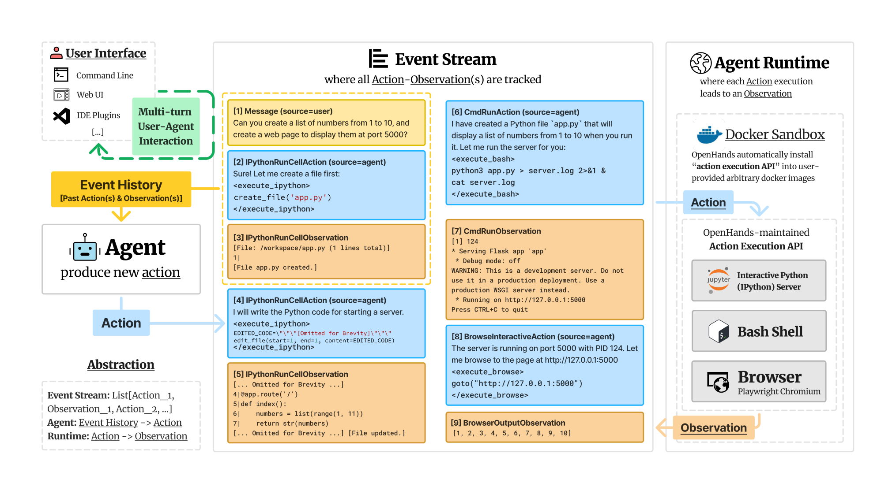

<!-- Generated by scripts/build-tools-showcase.py from the tools database. -->

```{=html}
<div class="showcase-detail tools-showcase-detail"><nav class="showcase-breadcrumb" aria-label="Breadcrumb"><a href="/raw/tools-showcase.html">Tools Showcase</a><span aria-hidden="true">/</span><a href="/raw/tools-showcase.html#family-workspace">Local &amp; remote workspaces</a></nav><header class="showcase-detail-header"><p class="showcase-domain">Local &amp; remote workspaces · Agent Canvas · Software Agent SDK</p><h1>OpenHands</h1><p>Agent Canvas · Software Agent SDK</p><nav class="showcase-detail-actions" aria-label="On this page"><a href="#tool-card">Tool card</a><a href="#use-cases">Use cases & results</a><a href="#technical-figures">Technical figures</a><a href="#source-slides">Source slides</a><a href="#methods">Methods & sources</a></nav></header><section class="showcase-source-map" id="source-slides" aria-labelledby="source-slides-title"><h2 id="source-slides-title">Source slides</h2><ul><li><span>Tool card</span><a href="/raw/lectures/01_intro/lecture01_tools_showcase.html#/ts-openhands" title="Slide ID: ts-openhands">Tools Showcase · slide 26</a><code>ts-openhands</code></li><li><span>Use cases & results</span><a href="/raw/lectures/01_intro/lecture01_tools_showcase.html#/ts-openhands-uses" title="Slide ID: ts-openhands-uses">Tools Showcase · slide 27</a><code>ts-openhands-uses</code></li><li><span>Technical figures</span><a href="/raw/lectures/01_intro/lecture01_tools_showcase.html#/ts-evidence-remote-openhands" title="Slide ID: ts-evidence-remote-openhands">Tools Showcase · slide 34</a><code>ts-evidence-remote-openhands</code></li></ul></section>
```

```{=html}
<section class="showcase-section" id="tool-card"><div class="showcase-section-heading"><h2>Tool card</h2></div>
```

```{=html}
<article class="showcase-slide-source" data-presentation="intro-tools" data-slide="ts-openhands"><p class="showcase-slide-reference"><a href="/raw/lectures/01_intro/lecture01_tools_showcase.html#/ts-openhands" title="Slide ID: ts-openhands">Tools Showcase · slide 26</a></p><div class="showcase-source tools-showcase-source ts-openhands"><div class="ts-card">
  <div class="ts-product-line"><strong class="ts-name">OpenHands</strong><span class="ts-surface">Agent Canvas · Software Agent SDK</span></div>
  <div class="ts-chart" role="group" aria-labelledby="ts-openhands-chart">
    <h3 id="ts-openhands-chart">Where the agent runs</h3>
    <div class="ts-diagram ts-branches">
      <div class="ts-node ts-hub ts-node-accent"><strong>Agent Canvas</strong><span>Browser client for conversations, files and terminals</span></div>
      <div class="ts-branch-list">
        <div class="ts-node"><strong>Local process</strong><span>Agent server on your machine</span></div>
        <div class="ts-node"><strong>Docker</strong><span>Self-hosted backend with mounted directories</span></div>
        <div class="ts-node"><strong>OpenHands Cloud</strong><span>Managed cloud sandbox</span></div>
      </div>
    </div>
    <div class="ts-secondary">
      <h3 id="ts-openhands-connections">Tool calls and model requests</h3>
      <div class="ts-mini-map ts-mini-split" role="group" aria-labelledby="ts-openhands-connections">
        <div class="ts-mini-node ts-mini-hub"><strong>Agent Server</strong><span>Runs the built-in OpenHands agent</span></div>
        <div class="ts-mini-branches">
          <div class="ts-mini-node"><strong>Tool calls</strong><span>Workspace files and shell under runtime permissions</span></div>
          <div class="ts-mini-node"><strong>Model requests</strong><span>Local endpoint or hosted provider API</span></div>
        </div>
      </div>
    </div>
  </div>
  <div class="ts-facts" role="group" aria-labelledby="ts-openhands-facts">
    <h3 id="ts-openhands-facts">Configurable components</h3>
    <dl>
      <dt>Workspace</dt><dd>Project folder, repository or container mount</dd>
      <dt>Conversation state</dt><dd>Agent Server stores history and profiles</dd>
      <dt>Agent profiles</dt><dd>Choose tools and MCP servers</dd>
      <dt>Per-session Docker</dt><dd>One container per conversation, when enabled</dd>
      <dt>Software Agent SDK</dt><dd>Python and REST APIs</dd>
    </dl>
  </div>
  <div class="ts-sources"><a class="ts-evidence-link" href="/raw/tools-showcase/openhands.html#technical-figures">Technical figure</a><a href="https://docs.openhands.dev/openhands/usage/agent-canvas/architecture">Agent Canvas architecture</a> · <a href="https://docs.openhands.dev/openhands/usage/agent-canvas/backend-setup/docker-execution">Docker execution</a> · <a href="https://docs.openhands.dev/openhands/usage/agent-canvas/agent-profiles">Agent Profiles</a> · <a href="https://docs.openhands.dev/sdk">Software Agent SDK</a></div>
</div></div></article>
```

```{=html}
</section>
```

```{=html}
<section class="showcase-section" id="use-cases"><div class="showcase-section-heading"><h2>Use cases & results</h2></div>
```

```{=html}
<article class="showcase-slide-source" data-presentation="intro-tools" data-slide="ts-openhands-uses"><p class="showcase-source-subtitle">OpenHands · Internal tooling and PR review</p><p class="showcase-slide-reference"><a href="/raw/lectures/01_intro/lecture01_tools_showcase.html#/ts-openhands-uses" title="Slide ID: ts-openhands-uses">Tools Showcase · slide 27</a></p><div class="showcase-source tools-showcase-source ts-openhands"><div class="ts-card ts-use-layout">
  <article class="ts-use-case">
    <h3>US Mobile’s migration tool</h3>
    <p class="ts-use-provenance">Customer case reported by OpenHands</p>
    <ol class="ts-use-flow">
      <li class="ts-use-step"><h4>Task</h4><p>Add self-service infrastructure migration to an internal developer platform.</p></li>
      <li class="ts-use-step"><h4>How the tool was used</h4><p>OpenHands implemented front-end and back-end changes from the engineer’s feature spec.</p></li>
      <li class="ts-use-step"><h4>Public evidence</h4><p>The engineer reports a pushed branch and follow-up fixes for edge cases.</p></li>
    </ol>
    <figure class="ts-use-artifact">
      <blockquote cite="https://hub.openhands.dev/blog/case-study-how-us-mobile-supercharges-software-engineering-with-openhands">“It took an 8 pointer story down to a 2 pointer.”</blockquote>
      <figcaption>Engineer’s story-point estimate · <a href="https://hub.openhands.dev/blog/case-study-how-us-mobile-supercharges-software-engineering-with-openhands#results">Published US Mobile interview</a></figcaption>
    </figure>
    <p class="ts-use-source"><a href="https://hub.openhands.dev/blog/case-study-how-us-mobile-supercharges-software-engineering-with-openhands">OpenHands · US Mobile case study</a></p>
  </article>
  <article class="ts-use-case">
    <h3>Automate reviews on the SDK repository</h3>
    <p class="ts-use-provenance">OpenHands team · Reported production use</p>
    <ol class="ts-use-flow">
      <li class="ts-use-step"><h4>Task</h4><p>Give contributors early feedback on changes to <code>software-agent-sdk</code>.</p></li>
      <li class="ts-use-step"><h4>How the tool was used</h4><p>An OpenHands review plugin applied repository-specific checks to pull-request diffs.</p></li>
      <li class="ts-use-step"><h4>Public evidence</h4><p>The team reports 1,000+ reviews across 900+ pull requests in six months.</p></li>
    </ol>
    <figure class="ts-use-artifact">
      <blockquote cite="https://github.com/OpenHands/software-agent-sdk/pull/3802#pullrequestreview-4533022438">“The <code>claude-4.6-opus</code> regression caught by the earlier QA review has been fixed in this commit (<code>97451661</code>)”</blockquote>
      <figcaption>Excerpt from the OpenHands bot’s <a href="https://github.com/OpenHands/software-agent-sdk/pull/3802#pullrequestreview-4533022438">published review of SDK PR #3802</a></figcaption>
    </figure>
    <p class="ts-use-source"><a href="https://www.openhands.dev/blog/20260506-the-verification-stack">OpenHands · The Verification Stack</a></p>
  </article>
</div></div></article>
```

```{=html}
</section>
```

```{=html}
<section class="showcase-section" id="technical-figures"><div class="showcase-section-heading"><h2>Technical figures</h2></div>
```

```{=html}
<article class="showcase-slide-source" data-presentation="intro-tools" data-slide="ts-evidence-remote-openhands"><p class="showcase-source-subtitle">OpenHands · The action–observation loop</p><p class="showcase-slide-reference"><a href="/raw/lectures/01_intro/lecture01_tools_showcase.html#/ts-evidence-remote-openhands" title="Slide ID: ts-evidence-remote-openhands">Tools Showcase · slide 34</a></p><div class="showcase-source tools-showcase-source ts-openhands"><div class="ts-card ts-evidence-layout">
  <figure class="ts-evidence-figure">
    
    <figcaption><a href="https://arxiv.org/html/2407.16741v3#S2.F2">Wang et al. · Figure 2 · arXiv v3, April 2025</a> · <a href="https://creativecommons.org/licenses/by/4.0/">CC BY 4.0</a></figcaption>
  <a class="showcase-figure-link" href="/raw/lectures/01_intro/assets/tools_showcase/evidence-openhands-2025-fig2.png" target="_blank" rel="noopener">Open full-size figure</a></figure>
  <div class="ts-evidence-facts" role="group" aria-labelledby="ts-openhands-event-loop">
    <h3 id="ts-openhands-event-loop">Read the loop</h3>
    <dl>
      <dt>Agent</dt><dd>Reads the history and proposes the next action.</dd>
      <dt>Event stream</dt><dd>Records user messages, actions and observations in order.</dd>
      <dt>Runtime</dt><dd>Executes actions and returns observations to the stream.</dd>
      <dt>Agent Canvas today</dt><dd>The browser client connects to the selected backend. Agent Server runs the conversation and tools.</dd>
    </dl>
  </div>
  <div class="ts-sources"><a href="/raw/tools-showcase/openhands.html#tool-card">Back to OpenHands</a> · <a href="/raw/lectures/01_intro/assets/tools_showcase/evidence-openhands-2025-fig2.png" download>Download full-size figure</a> · <a href="https://proceedings.iclr.cc/paper_files/paper/2025/hash/a4b6ad6b48850c0c331d1259fc66a69c-Abstract-Conference.html">ICLR 2025 proceedings</a> · <a href="https://docs.openhands.dev/openhands/usage/agent-canvas/architecture">Current Agent Canvas architecture</a></div>
</div></div></article>
```

```{=html}
</section>
```

```{=html}
<section class="showcase-section" id="methods"><div class="showcase-section-heading"><h2>Methods & sources</h2><p>Original slide notes, source links and reported conditions for the material above.</p></div>
```

<details class="showcase-notes">
<summary>Tool card: Tools Showcase · slide 26</summary>

Браузерный клиент Agent Canvas подключается к серверу, который запускает агента и его инструменты. Три ветви показывают типичные виды размещения сервера. Документация также описывает собственную виртуальную машину и другие варианты. Прежний CLI остался в документации для существующих пользователей, а для новых локальных установок предлагается Agent Canvas. [OpenHands CLI](https://docs.openhands.dev/openhands/usage/cli/installation).

Рабочая область указывает папку проекта. Доступ инструментов к файлам зависит от разрешений среды исполнения и от смонтированных папок при работе в Docker. Место исполнения инструментов и место обработки запросов модели выбираются отдельно. При подключении модели через API запросы обрабатывает её провайдер. Разработчики могут собирать собственных агентов на OpenHands Software Agent SDK. [Устройство Agent Canvas](https://docs.openhands.dev/openhands/usage/agent-canvas/overview), [OpenHands SDK](https://docs.openhands.dev/sdk).

При запуске всего приложения в Docker сервер и инструменты работают в общем контейнере. В другом режиме внешний Agent Server остаётся на хосте и создаёт отдельный контейнер для каждой переписки. Профиль встроенного агента может выбирать инструменты и серверы MCP и ссылаться на отдельный профиль модели. У внешнего агента ACP свой способ выбора модели и аутентификации. [Бэкенд Docker](https://docs.openhands.dev/openhands/usage/agent-canvas/backend-setup/docker), [изоляция сессий](https://docs.openhands.dev/openhands/usage/agent-canvas/backend-setup/docker-execution), [профили агента](https://docs.openhands.dev/openhands/usage/agent-canvas/agent-profiles).

Знак перенесён из архива курса без изменений. [Исходный favicon документации OpenHands](https://docs.openhands.dev/mintlify-assets/_mintlify/favicons/allhandsai/NJyVpY-OoVetrcKF/_generated/favicon/android-chrome-192x192.png).

</details>

<details class="showcase-notes">
<summary>Use cases &amp; results: Tools Showcase · slide 27</summary>

В начале работы над инструментом миграции инженер US Mobile передал агенту уже подготовленную спецификацию. Согласно опубликованному кейсу, OpenHands подготовил изменения для клиентской и серверной частей внутренней платформы в фоне. После отправки ветки инженер проверил результат и внёс правки для пограничных случаев. Публикация описывает внутренний проект по словам инженера. [Кейс US Mobile, сентябрь 2025 года](https://hub.openhands.dev/blog/case-study-how-us-mobile-supercharges-software-engineering-with-openhands).

Во втором кейсе команда OpenHands использовала плагин для проверки изменений своего открытого SDK. Агент читает diff и учитывает инструкции репозитория. В показанном отзыве на PR №3802 бот сообщает о проверке исправления регрессии разрешения идентификатора модели и указывает коммит. Числа отражают количество опубликованных проверок и охваченных pull request за шесть месяцев. Качество рекомендаций авторы оценивают отдельной методикой. [Отзыв на PR №3802](https://github.com/OpenHands/software-agent-sdk/pull/3802#pullrequestreview-4533022438), [отчёт команды OpenHands](https://www.openhands.dev/blog/20260506-the-verification-stack).

</details>

<details class="showcase-notes">
<summary>Technical figures: Tools Showcase · slide 34</summary>

На рисунке из исторической статьи OpenHands показана работа со средой через поток событий. Агент получает историю, содержащую сообщения пользователя, действия и наблюдения, и формирует следующее действие. Среда исполнения принимает действие и возвращает результат в поток. Цветные блоки в центре показывают последовательность событий в опубликованном примере. Синий обозначает действия агента, оранжевый — ответы среды. [Wang и соавторы, рисунок 2 и раздел 2](https://arxiv.org/html/2407.16741v3#S2.F2).

В описанной реализации Docker-контейнер предоставляет IPython, Bash и браузер. На стороне современного Agent Canvas взаимодействие начинается в браузерном клиенте. Выбранный бэкенд определяет, где Agent Server ведёт сессию и запускает инструменты. Исторический рисунок объясняет обмен действиями и наблюдениями, а текущая документация описывает сервисы и варианты их размещения. [Архитектура Agent Canvas](https://docs.openhands.dev/openhands/usage/agent-canvas/architecture).

Первый препринт вышел в июле 2024 года. Здесь использован оригинальный файл рисунка 2 из третьей редакции от 18 апреля 2025 года. Изображение перенесено без изменений с атрибуцией по CC BY 4.0. [Версия статьи и лицензия](https://arxiv.org/abs/2407.16741v3).

</details>

```{=html}
</section><nav class="showcase-bottom-nav" aria-label="More tools"><a href="/raw/tools-showcase.html">Back to all tools</a><a href="/raw/lectures/01_intro/lecture01_tools_showcase.html#/ts-openhands">View source slide</a></nav></div>
```
