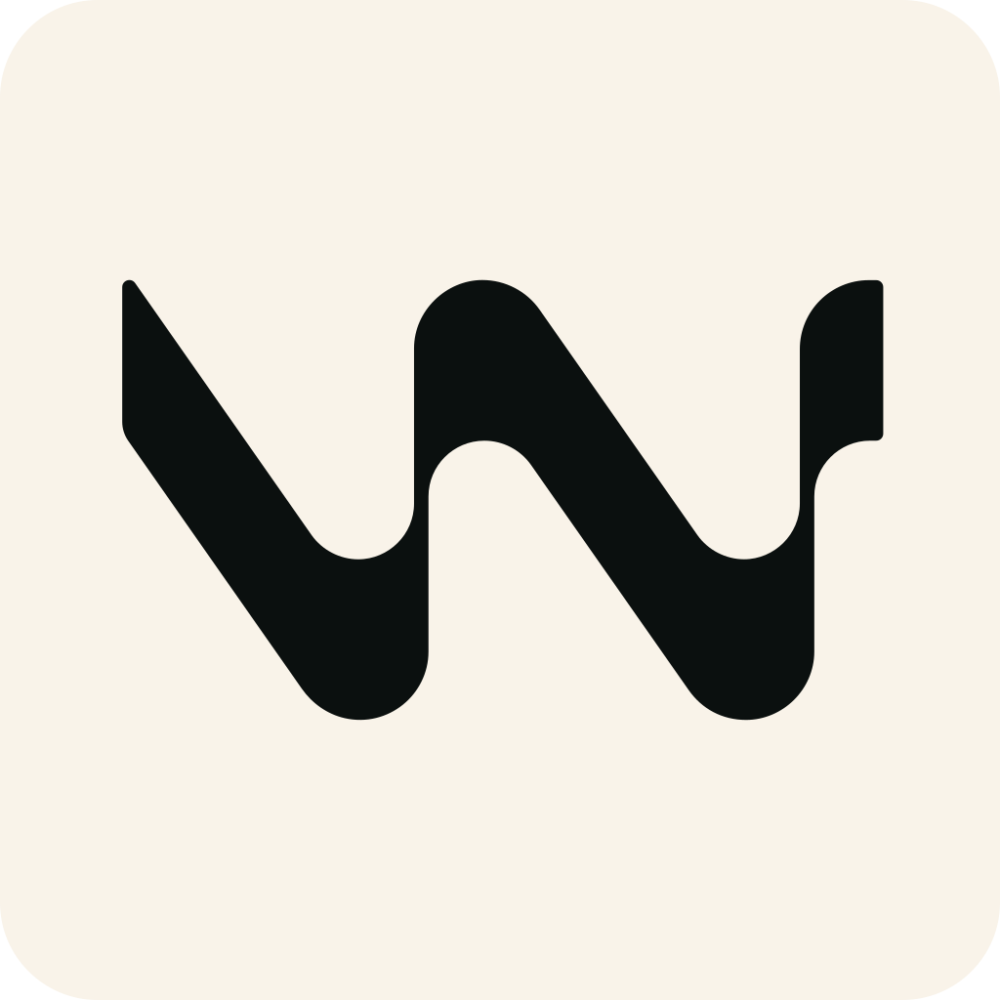

<!-- Generated by scripts/build-tools-showcase.py from the tools database. -->

```{=html}
<div class="showcase-detail tools-showcase-detail"><nav class="showcase-breadcrumb" aria-label="Breadcrumb"><a href="/raw/tools-showcase.html">Tools Showcase</a><span aria-hidden="true">/</span><a href="/raw/tools-showcase.html#family-workspace">Local &amp; remote workspaces</a></nav><header class="showcase-detail-header"><p class="showcase-domain">Local &amp; remote workspaces · Cognition · IDE and agent command center</p><h1>Windsurf</h1><p>Cognition · IDE and agent command center</p><nav class="showcase-detail-actions" aria-label="On this page"><a href="#tool-card">Tool card</a><a href="#use-cases">Use cases & results</a><a href="#source-slides">Source slides</a><a href="#methods">Methods & sources</a></nav></header><section class="showcase-source-map" id="source-slides" aria-labelledby="source-slides-title"><h2 id="source-slides-title">Source slides</h2><ul><li><span>Tool card</span><a href="/raw/lectures/01_intro/lecture01_tools_showcase.html#/ts-windsurf" title="Slide ID: ts-windsurf">Tools Showcase · slide 24</a><code>ts-windsurf</code></li><li><span>Use cases & results</span><a href="/raw/lectures/01_intro/lecture01_tools_showcase.html#/ts-windsurf-uses" title="Slide ID: ts-windsurf-uses">Tools Showcase · slide 25</a><code>ts-windsurf-uses</code></li></ul></section>
```

```{=html}
<section class="showcase-section" id="tool-card"><div class="showcase-section-heading"><h2>Tool card</h2></div>
```

```{=html}
<article class="showcase-slide-source" data-presentation="intro-tools" data-slide="ts-windsurf"><p class="showcase-slide-reference"><a href="/raw/lectures/01_intro/lecture01_tools_showcase.html#/ts-windsurf" title="Slide ID: ts-windsurf">Tools Showcase · slide 24</a></p><div class="showcase-source tools-showcase-source ts-windsurf"><div class="ts-card">
  <div class="ts-product-line"><strong class="ts-name">Windsurf</strong><span class="ts-surface">Cognition · IDE and agent command center</span></div>
  <div class="ts-chart">
    <h3 id="ts-windsurf-chart">Selected Devin Local modes</h3>
    <table class="ts-matrix" aria-labelledby="ts-windsurf-chart">
      <thead><tr><th scope="col">Mode</th><th scope="col">Edits repo files</th><th scope="col">Behavior</th></tr></thead>
      <tbody>
        <tr><th scope="row">Ask</th><td>No</td><td>Explore code and answer questions</td></tr>
        <tr><th scope="row">Plan</th><td>No</td><td>Propose a plan for approval</td></tr>
        <tr><th scope="row">Code</th><td>Yes</td><td>Workspace edits pre-approved by default</td></tr>
        <tr><th scope="row">Smart</th><td>Yes</td><td>Can also approve actions it judges safe</td></tr>
      </tbody>
    </table>
    <div class="ts-secondary">
      <h3 id="ts-windsurf-sessions">Sessions in Devin Desktop</h3>
      <div class="ts-mini-map ts-mini-split" role="group" aria-labelledby="ts-windsurf-sessions">
        <div class="ts-mini-node ts-mini-hub"><strong>Agent Command Center</strong><span>Launch and track sessions</span></div>
        <div class="ts-mini-branches">
          <div class="ts-mini-node"><strong>Devin Local</strong><span>Your machine</span></div>
          <div class="ts-mini-node"><strong>Devin Cloud</strong><span>Managed environment</span></div>
          <div class="ts-mini-node"><strong>ACP agent</strong><span>Third-party integration · preview</span></div>
        </div>
      </div>
    </div>
  </div>
  <div class="ts-facts" role="group" aria-labelledby="ts-windsurf-facts">
    <h3 id="ts-windsurf-facts">Desktop features</h3>
    <dl>
      <dt>Session views</dt><dd>Spaces and a Kanban board</dd>
      <dt>Code review</dt><dd>Quick Review for local changes</dd>
      <dt>Local execution</dt><dd>Separate Git worktrees · optional OS sandboxing</dd>
      <dt>Reusable plans</dt><dd><code>@</code>-mention a saved Markdown plan</dd>
      <dt>Permission rules</dt><dd>Allow, ask or deny tool actions</dd>
      <dt>Agent configuration</dt><dd>Rules, skills, hooks, plugins and MCP</dd>
    </dl>
  </div>
  <div class="ts-sources"><a href="https://devin.ai/desktop">Devin Desktop FAQ</a> · <a href="https://docs.devin.ai/desktop/devin-local/overview">Devin Local</a> · <a href="https://docs.devin.ai/desktop/devin-local/modes">Mode reference</a> · <a href="https://docs.devin.ai/desktop/quick-review">Quick Review</a></div>
</div></div></article>
```

```{=html}
</section>
```

```{=html}
<section class="showcase-section" id="use-cases"><div class="showcase-section-heading"><h2>Use cases & results</h2></div>
```

```{=html}
<article class="showcase-slide-source" data-presentation="intro-tools" data-slide="ts-windsurf-uses"><p class="showcase-source-subtitle">Windsurf and Devin Desktop · Build failures and game edits</p><p class="showcase-slide-reference"><a href="/raw/lectures/01_intro/lecture01_tools_showcase.html#/ts-windsurf-uses" title="Slide ID: ts-windsurf-uses">Tools Showcase · slide 25</a></p><div class="showcase-source tools-showcase-source ts-windsurf"><div class="ts-card ts-use-layout">
  <article class="ts-use-case">
    <h3>Fix a failing CircleCI build</h3>
    <p class="ts-use-provenance">Devin Desktop · CircleCI walkthrough</p>
    <ol class="ts-use-flow">
      <li class="ts-use-step"><h4>Task</h4><p>Diagnose six failing phone-validator tests in <code>dataforge-demo</code>.</p></li>
      <li class="ts-use-step"><h4>How the tool was used</h4><p>Devin Local read CircleCI results via MCP and corrected an inverted check in <code>phone.js</code>.</p></li>
      <li class="ts-use-step"><h4>Public evidence</h4><p>CircleCI shows the failed run and the green pipeline after the fix.</p></li>
    </ol>
    <figure class="ts-use-artifact">
      <table aria-label="CircleCI pipeline results transcribed from the published screenshots">
        <thead><tr><th scope="col">Pipeline</th><th scope="col">Result</th><th scope="col">Run detail</th></tr></thead>
        <tbody>
          <tr><th scope="row">3</th><td>Failed</td><td>6 tests failed</td></tr>
          <tr><th scope="row">4</th><td>Success</td><td>Build, lint, test, coverage</td></tr>
        </tbody>
      </table>
      <figcaption>Values transcribed from <a href="https://images.ctfassets.net/il1yandlcjgk/5MfSirgHaSSg5QN2I9rW7y/e04935e9cc05bbfa03f6473f1ecf6ad6/circleci-pipeline-green-after-devin-desktop-fix.png">CircleCI’s pipeline screenshot</a></figcaption>
    </figure>
    <p class="ts-use-source"><a href="https://circleci.com/blog/getting-started-with-devin-desktop-and-circleci/#figuring-out-why-builds-fail">CircleCI · Diagnosis and repair walkthrough</a></p>
  </article>
  <article class="ts-use-case">
    <h3>Change food values in a browser game</h3>
    <p class="ts-use-provenance">Windsurf Cascade · Historical publisher demo</p>
    <ol class="ts-use-flow">
      <li class="ts-use-step"><h4>Task</h4><p>Vary food-cell values and make each cell’s size reflect its value.</p></li>
      <li class="ts-use-step"><h4>How the tool was used</h4><p>Cascade searched the existing game code and proposed coordinated edits across files.</p></li>
      <li class="ts-use-step"><h4>Public evidence</h4><p>The archived demo links its source code and a video walkthrough of the changes.</p></li>
    </ol>
    <figure class="ts-use-artifact">
      <pre><code>Analyzed renderer.js:(1-100)
Analyzed config.js:(1-100)
Analyzed gameState.js:(1-100)
Searched codebase          73 results</code></pre>
      <figcaption>Cascade activity transcribed from the <a href="https://img.youtube.com/vi/dsB3hHz-Nfw/maxresdefault.jpg">official demo poster</a> · <a href="https://youtu.be/dsB3hHz-Nfw">Watch the edit</a></figcaption>
    </figure>
    <p class="ts-use-source"><a href="https://github.com/Exafunction/windsurf-demo#tasks-to-understand-cascade">Windsurf · Demo repository and recording</a></p>
  </article>
</div></div></article>
```

```{=html}
</section>
```

```{=html}
<section class="showcase-section" id="methods"><div class="showcase-section-heading"><h2>Methods & sources</h2><p>Original slide notes, source links and reported conditions for the material above.</p></div>
```

<details class="showcase-notes">
<summary>Tool card: Tools Showcase · slide 24</summary>

Devin Desktop — текущее название редактора Windsurf. Командный центр объединяет сессии Devin Local, облачного Devin и сторонних агентов, подключённых по Agent Client Protocol. Поддержка сторонних ACP-агентов описана как предварительная версия. Cascade относится к прежней версии продукта. В текущем Devin Desktop новые сессии Cascade недоступны. [Devin Desktop](https://docs.devin.ai/desktop/introducing-devin-desktop), [Cascade](https://docs.devin.ai/desktop/cascade).

В таблице четыре режима из документации Devin Local. Ask читает код и отвечает. Plan исследует репозиторий без правок и сохраняет проект плана вне рабочего репозитория. Code по умолчанию автоматически разрешает правки внутри рабочей области, а отдельные команды могут потребовать подтверждения. Smart добавляет автоматические разрешения на действия, которые дополнительная модель считает безопасными. Доступность Smart зависит от этапа внедрения. Организационные правила имеют приоритет. При включённой изоляции документация описывает отдельный режим Autonomous. [Режимы Devin Local](https://docs.devin.ai/desktop/devin-local/modes).

Ранее сохранённый план можно подключить через меню упоминаний в новой сессии. Правила разрешений настраиваются для проекта, пользователя или организации и применяются к конкретным инструментам и действиям. [Разрешения Devin Local](https://docs.devin.ai/desktop/devin-local/permissions), [настройки агента](https://docs.devin.ai/desktop/devin-local/overview).

Прежний знак используется рядом с прежним названием. [Исходный favicon Windsurf](https://windsurf.com/favicon.svg).

</details>

<details class="showcase-notes">
<summary>Use cases &amp; results: Tools Showcase · slide 25</summary>

В примере CircleCI автор намеренно оставил неверную проверку длины телефонного номера. На снимке Devin Local перечисляет шесть упавших тестов и указывает на `phone.js`. Следующий снимок показывает успешный прогон после исправления. В описанном процессе пользователь подтверждает коммит и отправку изменений. [Руководство CircleCI](https://circleci.com/blog/getting-started-with-devin-desktop-and-circleci/#figuring-out-why-builds-fail), [учебный репозиторий dataforge-demo](https://github.com/CIRCLECI-GWP/dataforge-demo).

Вторая демонстрация записана для прежнего Windsurf и агента Cascade. В задаче про размеры и значения еды важна согласованность изменений в нескольких файлах игры. По ссылке доступны исходники и запись демонстрации. Актуальный Devin Desktop использует Devin Local для новых локальных сессий. [Архивная демонстрация Windsurf](https://github.com/Exafunction/windsurf-demo#tasks-to-understand-cascade), [статус Cascade](https://docs.devin.ai/desktop/cascade).

</details>

```{=html}
</section><nav class="showcase-bottom-nav" aria-label="More tools"><a href="/raw/tools-showcase.html">Back to all tools</a><a href="/raw/lectures/01_intro/lecture01_tools_showcase.html#/ts-windsurf">View source slide</a></nav></div>
```
